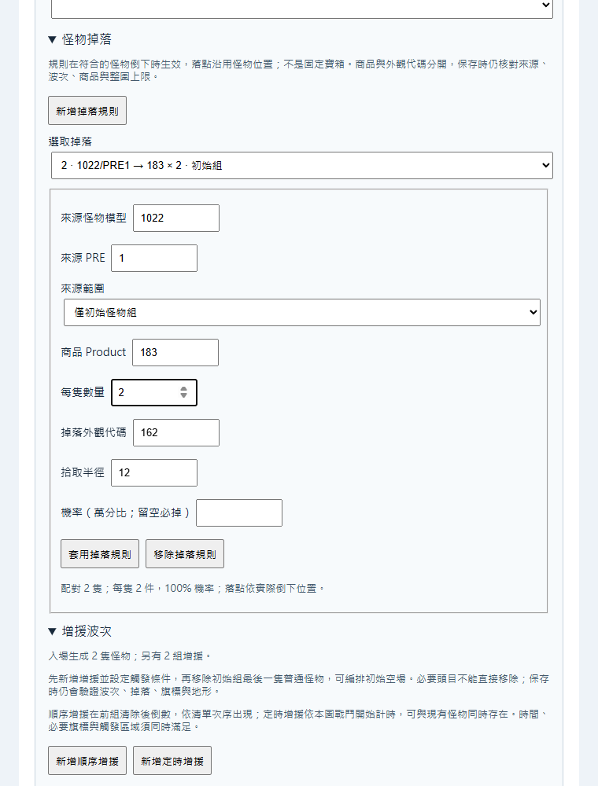

# 掉落表單瀏覽器驗收

2026-11-24。SERVER_DESIGN_CHOICE／NOT_NATIVE_MEF。接續 UI-DROP-01，使用獨立管理端、
種子資料庫副本與 REA 自有暫存 headless Chromium；明確指定 loopback URL，未操作使用者瀏覽器或遊戲。
這次執行真實 DOM 填寫、下拉選擇、套用及原生表單保存，不以函式 fixture 或 HTTP 代寫冒充瀏覽器。
先前 Computer Use 無法確認網址而停止的紀錄保留；本次另建受控瀏覽器驗收。

|保存版|實際操作與讀回|
|---|---|
|r1|原整合 Case693 控制版|
|r2|入口1004/PRE1改為僅初始組、每隻2件、機率10000，套用保存後讀回|
|r3|第二圖新增1022/PRE1初始組183×2、外觀162、半徑12；保留原增援規則|
|r4|移除新增規則，原增援規則保持，保存為新版本；語意還原r2|
|r5|入口機率留白，保存後欄位省略；無掉落節點隱藏編輯欄位|

最新為r5時再讀歷史r3，兩筆規則與初始組數量2仍在，沒有另存或刪除歷史。
六個瀏覽器情境共60個記錄步驟（含各自scenario_start），全部completed，無page-error／console事件；
每次結束均確認自有瀏覽器程序已終止。1440×1000與760×1000截圖已目視核對欄位與按鈕，沒有重疊或橫向裁切。
瀏覽器回報 Chromium 157.0.8103.80；此證據不包含瀏覽器執行檔SHA或原生平台相容性結論。

五版各兩次下載相同ZIP，逐檔核對manifest／scenario／AI raw SHA與預期語意。
瀏覽器原生textarea提交會改變換行，r2起AI raw SHA為
`1868d3fd9d145169f6dc407dcf650a106c09a9432ad03181ea7ca0952ac57d81`；
與r1原AI JSON語意相同，不能稱原始bytes不變。r4屬性順序與r2可能不同，語意還原不等於raw SHA相同。
實際瀏覽器r3 scenario SHA為`28b1f7a149b11c60f5778259702a8c5bf91c5ffd3256d1f30958d8e2c603a239`。
各版精確SHA、瀏覽器Evidence ID及截圖雜湊見[收據](../testing/drop-browser-20261124.receipt.json)。
收據SHA256：`30b182ea90f9bf84bcc1324888876a762ccdee655818aa2f6a407ceb97298a74`。
原始DOM可能含防偽token，只留本機outputs；公開庫僅保存經選取的收據與無token截圖。

r1／r2／r3／r5各兩分支TCP全部通過，一次88EXP與原隊回村；r4只驗保存與語意還原。
實際瀏覽器r3另由新建實際時計Host正常登入、廣場建隊進村、選關、移動戰鬥、Space拾取、
付款、結算回村。五筆掉落共8件183，機關付1，SQL保存7；88EXP保存39088，一次完成，原村原隊伍。
保留管理端Network為`e439607d…`（內嵌提交bbd086de），本次Host為`bc6e06d0…`（內嵌提交80c25039）；
兩者raw SHA分別記錄，不宣稱同一二進位檔。瀏覽器匯出同版配套由本次Host直接載入驗證。
Host／檢查器／管理端三Release零警告錯誤，802 HappyPath零失敗略過。
隔離Admin與Host都已停止。冷測試DB唯讀開啟要求日誌恢復；核對Host PID不存在後，
只複製DB與日誌至另一讀回目錄恢復，原DB／日誌雜湊保持。不是故障注入或備份還原套件。

這批驗收涵蓋正常值與必掉規則；機率分布、錯誤／邊界與其他延後套件未執行。
工程帳號為教學／Q15／Lv15準備前置，不算自然新帳號或指定v2人工通過；原生MEF與Client外觀仍獨立待驗。
原始資源、種子DB與現用服務保持；只使用隔離服務及配套工作副本。
