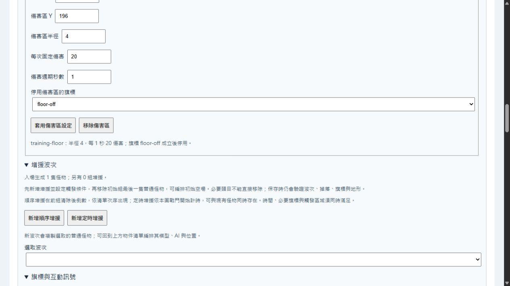

# 傷害區圖形編排與戰鬥中停用

2026-11-23。SERVER_DESIGN_CHOICE／**NOT_NATIVE_MEF**。沿用[地形傷害區](AREA-HAZARDS.md)
既有傷害、時計與清場政策；本批新增作者表單、唯讀診斷和正常玩家操作驗證。
不新增 Client 陷阱模型、傷害跳字、opcode 或本地自主 AI。

## 作者接口

工作台可新增、選取、編輯及移除傷害區：唯一識別、中心、半徑、固定傷害、週期和停用旗標。
中心仍須落在原BND可走格；傷害為1～500整數、週期0.25～3600秒、半徑為正有限值，
每圖最多16區。旗標選單引用同一定義已宣告的訊號，無旗標可明確保留為無條件傷害區。
原有訊號改名的相依引用更新繼續適用。圖形物件清單與橙圈可選取對應區域，顯示固定傷害／週期／停用摘要；
沒有傷害區的節點隱藏欄位。保存仍執行完整來源、旗標、AI與BND檢查，沒有省略 Server 權威。

## 本批可玩的設定

以原 Case693 整合版本（SHA256 `424b8d5afc3aa822e286e384c7924334ac3800b3b748c6fe521e048b5ce59026`）
為基準，其他地圖、怪物、掉落付款、分支、75%頭目階段和88EXP結算保持。
在入口Map3430／node10新增：

| 設定 | 值 |
|---|---|
| 傷害區 | training-floor，中心664,196，r4，每1秒固定20傷害 |
| 停用旗標 | floor-off |
| 訊號來源 | CheckpointInteracted，key13，區域664,196／r12 |
| 前置 | 不要求清場、不收道具、沒有其他必要旗標 |
| 標記 | key14／r6，沿既有互動標記adapter |

這是原出生點，BND SHA256 `2d6052c29a1045d44c14834a9f8313ae2731861d1014b890dd4d9f8091d6f5d4`。
玩家正常建隊進村選關，在出生點留一下會掉HP；怪物仍在遠處存活時按機關，傷害區停用，
再按原路戰鬥、拾取、付款、分支、頭目、結果並回原村原隊伍。
不能用「清場後不扣血」代替「機關在戰鬥中停傷」的證據。

## 保存與正常驗證

瀏覽器r1是已知空場fixture；先以JSON一次載回原整合內容並保存r2。
後續全用圖形表單新增機關與傷害區保存r3、移除傷害區保存r4、從歷史r3恢復並保存r5。
r4仍保留不收費的floor-off機關訊號，這與原r2不同；正常路線也實際操作它，不忽略額外操作。
r3與r5內容raw SHA相同：`c7389defa7ec0c370c94f1407cf43ec6283a24da0c177c11887fff4e802ae74c`。
五版各兩次ZIP下載相同，內容差異及AI語意完整核對。瀏覽器表單CRLF會改raw bytes，配套均綁各版實際SHA，
沒有把原LF雜湊硬套到表單檔。

原r2、移除r4、恢復r5各兩條正常TCP分支，共六路各一次88EXP保存及原村同隊返回。
r5的兩路均保留四階段觀察：進區前HP500／ticks0；作用後HP460／ticks2；按key13後停用；
再留在區內1.5秒仍HP460／ticks2。四階段怪物1004仍存活、groupCleared=false。
實際`0048 key13/category1/state0`確認機關狀態改變；`0034/+16`實際資源回包HP460與Server權威一致。
HP淨變化與傷害次數分開記錄，沒有把其他回復／計時機制換成自訂總傷害公式。

同一r5配套的獨立真實時計Host也觀察到相同四階段HP／ticks／旗標，並完整六圖通關。
SQLite總增量88EXP、一次20EXP完成、角色39000→39088、拾取183與機關11付款守恆，回Map182原隊伍。
TCP使用測試時計；Host使用實際時計與正常socket輸入，無直接Handle／Poll／設旗標／傳送座標捷徑。
精確資源回包核對屬TCP證據，不代填Host Client動畫或指定v2人測。

診斷新增每區設定、停用狀態與damageTicks唯讀欄位；未更動傷害執行器。
Host／Inspect／Admin三Release零警告／錯誤；最終796 HappyPath零失敗／略過，JS／三Python語法通過。
收據SHA256 `ff6e69dbd06516fdee2236c1b564d24d7a3a5db77656d544c0fdbab99b4dd449`。

完整收據：[hazard-editor-20261123.receipt.json](../testing/hazard-editor-20261123.receipt.json)。

## 中斷與工具修正的證據界線

原隔離Admin與第一個測試程序後來均確認不在執行，且該次TRX缺失；五版草稿仍完整。
確認PID與port已空後，只以相同DLL／原隔離DB恢復Admin下載配套，再停止恢復程序；
沒有重建草稿或因觀察逾時而重開仍活著的程序。HappyPath以後來真正產生的收據為準。
這是環境中斷，不是本輪執行故障注入測試。

r4首條檢查器在出口回走出生點操作額外機關時，原4096格怪物尋路上限不足，保留失敗檔。
只在Inspector玩家規劃的原搜尋失敗時，透過既有cellLimit參數重試完整已知格網；仍發正常移動輸入，
不變更遊戲怪物4096格政策。r4兩路各實際啟用一次fallback並完成key13操作，補驗88EXP回村。
r2／r5及Host保留先前成功收據；同版Network SHA相同，舊／新Inspector SHA分開固定，沒有重標為同一工具。

自有Admin／Host已停止、種子DB不變，使用者現用服務／資料／Client保持。
前置是準備教學／Q15／Lv15；自然新帳號、指定v2、陷阱素材／跳字、其他adapter與全部MEF目標仍另列。
原延後的錯誤／邊界／重送／重登／故障／併發／安全／壓測未因此改列通過。
