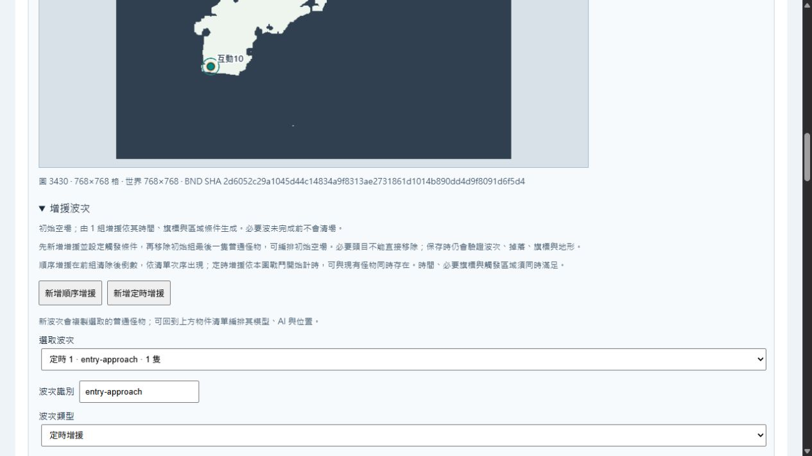

# 用圖形工作台編排初始空場

2026-11-23。SERVER_DESIGN_CHOICE／**NOT_NATIVE_MEF**。接續
[初始空場正常接近生怪](INITIAL-EMPTY-REGION-APPROACH.md)，補掉「引擎可用、圖形工具卻禁止」的接口缺口。
只調整作者工具，不新增遊戲規則、schema、封包或 Client 修改。

## 作者操作

1. 選取入口的普通怪物，先新增增援波。波次仍需至少一隻怪物。
2. 用現有訊號表單建立 RegionEntered，填入位置、半徑與旗標；在波次表單設定時間及所需旗標。
3. 回到物件清單選原來的初始怪，按「移除選取怪物」。已有增援時，可移除初始組最後一隻普通怪。
4. 初始組摘要改顯示「初始空場、由幾組增援依條件生成」。保存並通過正式規則／AI／地形檢查後下載配套。

必要頭目的原移除限制保持。增援波內不能用移除怪物按鈕刪成空波；不需要整波時使用移除波次。
初始空場時也不能移除僅剩的一波。這些圖面限制不取代 Server 的波次、旗標、掉落及頭目身分驗證，
也不自動改掉落身分／必要頭目或解決循環觸發條件。原版及歷史草稿均保留。

## 瀏覽器與內容證據

使用隔離普通 Case693 工作台。r1是上一批的已知空場範例；為測試純圖形轉換，先經 JSON
載入原整合內容並保存r2，之後建立訊號、增援及清空初始組完全使用表單／按鈕，保存r3。
不能將這次基準準備也宣稱成純圖形操作。

| 瀏覽器實際階段 | 初始怪 | 增援 | 結果 |
|---|---:|---:|---|
| r2原整合入口 | 1 | 0 | 88EXP，正式驗證通過 |
| 圖形表單準備波次／旗標 | 1 | 1 | 複製普通1004並配置進區條件 |
| 移除原初始1004、保存r3 | 0 | 1 | 顯示初始空場，88EXP，正式驗證通過 |
| r3後讀回歷史r2 | 1 | 0 | 最新仍r3，歷史內容未變 |

r3僅把原入口1004移至 `entry-approach` timed wave，delay0、requiredFlags=`entry-approached`；
RegionEntered中心416,392／r16。其餘圖、機關、分支、頭目及獎勵保持。
與上一批手工候選不同，這個圖形版本保留原掉落的未指定waveId匹配，且訊號順序為原付款訊號後追加進區訊號，
wave明示activationRegion=null。原1004已只存在該波，所以正常掉落183仍一次；不把兩檔稱為逐byte相同。

瀏覽器r2／r3的原始scenario SHA分別 `37746b786ae944bf71572200155efa9f9b882d1b92e5db17847f9542b093b523`／
`44fe479de77449e32ec291f48e6155dc05876c4cf1deb0a7586d40460fc45a4b`。
AI raw SHA均 `1868d3fd9d145169f6dc407dcf650a106c09a9432ad03181ea7ca0952ac57d81`，
與原AI語意相同；表單CRLF改變raw bytes，所有配套核對使用各版原始雜湊。
三版各兩次HTTP ZIP下載一致，原r1保存後未改，r2／r3內容差異依上述欄位完整核對。

r2／r3各兩條正常TCP分支，四路均一次88EXP保存並回原村原隊伍。r3保存配套的獨立真實時計
Host完成入口0→1生怪、六圖、拾取183／機關11付款、頭目與結果，角色39000→39088，
完成20EXP一次、整場88EXP入庫與背包守恆；同Map182原隊伍返回。精確頭目階段快照來自TCP，
Host證據是另程序正常線路及SQLite，不代填指定v2畫面。

Host／Inspect／Admin三個Release零警告／錯誤，796 HappyPath零失敗／略過，JS及三Python語法通過。
自有Admin／Host已停止、種子DB不變，使用者現用服務／資料／Client保持。前置是準備教學／Q15／Lv15，
不是自然新帳號；其他adapter、指定v2、原生自主AI與原延後測試仍各自追蹤。

最終工程收據：[empty-group-editor-20261123.receipt.json](../testing/empty-group-editor-20261123.receipt.json)。
收據SHA256 `0e7e87765fa32c947720eef5121120300b4ca7c4ca39f4f1169e312e6ef9e2bf`。
圖形操作不等於指定 Client 畫面或自主生成通過。
