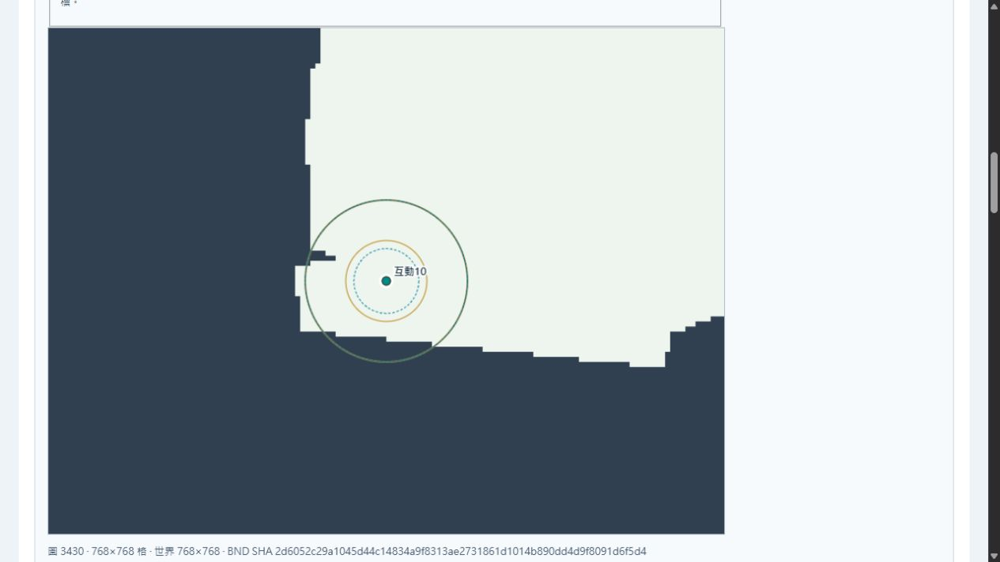
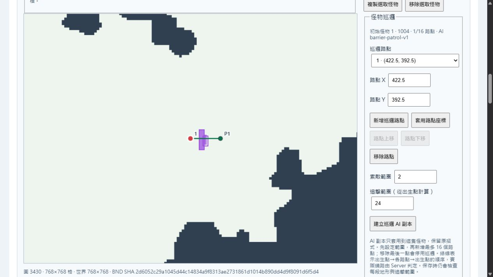

# 關卡互動範圍與屏障預覽

2026-11-23。SERVER_DESIGN_CHOICE／NOT_NATIVE_MEF。完成既定
[D06作者圖面需求](../../kr-extra-roy/MEF-level-functional-closure-20261118/DEVELOPMENT-PLAN.md)：
分開顯示Server設定半徑、Client理論選取範圍及旗標屏障overlay。
本批不改關卡執行器、碰撞、Client、schema或封包。

## 操作與判讀

- 「圖面縮放」提供全圖、2／4／8倍；放大時以選取物件為中心，保持世界X／Y相同比例。
- 「顯示設定範圍與Client選取範圍」可切換圈線。實線為設定半徑，虛線為Client理論邊界。
  出口category0為距離嚴格小於0.8倍傳送半徑；手動機關category1為嚴格小於原半徑。
  Server的原區域判斷則包含邊界。實際Client輸入仍需原模式、點啟用與輸入／距離條件。
- 選取出口或手動機關會列出兩種數值，例如出口半徑8：Server≤8／Client<6.4；手動機關
  半徑16：Server≤16／Client<16。屏障顯示標記另標示不負責關卡進度，不能冒充出口。
- 有屏障的節點會列「旗標已成立」預覽勾選；勾選使相應屏障視為開啟。全部設為未成立
  可重設。紫色格是仍關閉屏障新增的阻擋；綠色虛框表示已開啟，靜態BND牆面始終保留。
- 縮放、圈線與預覽旗標只存在編輯器記憶體，不寫入JSON或遊戲instance。切換節點／載入
  JSON／重新開頁會重算；保存版本不會將「預覽已開門」帶入副本。

## 幾何契約與來源

category0／1與Server判斷的差異沿用既有
[SP02／SP04](../../kr-extra-roy/MEF-level-functional-closure-20261118/space-mechanisms/spatial-contracts.json)，
沒有新增原生主張。圓圈是二維作者示意，不是實際Client按鍵確認或三維碰撞。

底圖仍是原[地形API](SCENARIO-MAP-EDITOR.md)；overlay不更改它。對每個關閉屏障，以Server
相同float格中心及半開矩形條件求覆蓋：minX／minY包含、maxX／maxY不包含。若同格有多個
關閉屏障，任一仍關閉即阻擋；只有所有覆蓋者開啟才解除新增阻擋。已被底圖阻擋的格另計，
不當成屏障可移除的牆面。預覽圖層按當前node／旗標變更重建，僅縮放或選取時沿用。

格中心遵循 `(column+0.5f)*worldWidth/columns`、`(row+0.5f)*worldHeight/rows`；瀏覽器
以float32舍入對應既有Server運算。圖面及原點圖座標逆轉換共用縮放與位移；不縮減底圖格數。
腳本仍由既有精確CSP／SRI方式發布，沒有新增eval或放寬安全設定。

## 作者範例與驗證

[空間預覽範例](phindos-stage462-case693-spatial-preview.scenario.json)從既有巡邏屏障整合版
另存，只增加一個重疊半格邊界屏障、一個覆蓋既有牆面的屏障及31秒開第二屏障旗標。
原件保留；這是明示Server自有資料，不假稱官方關卡新增門模型。範例SHA256
`2984221ccd1820be2f1868254d2c35d980a75c64ad3b53a8ac8a182a1a3c74dd`。

[完整收據](spatial-editor-validation.json) SHA256
`63b5076dc53421de424c3fff2ebb21eb001733b1fce0c7c8afbf75ba096aefc7`。

| 預覽成立旗標 | 關閉屏障 | 新增阻擋格 | 覆蓋既有牆格 |
|---|---|---|---|
| 無 | 3 | 20 | 4 |
| patrol-gate-open | 1 | 8 | 0 |
| geometry-second-open | 2 | 16 | 4 |
| 兩者 | 0 | 0 | 0 |

- 獨立Inspector以實際固定SHA的mushroom01.bnd及既有 `WithBarriers/CanStand` 掃描768×768
  格，並輸出合併bitset SHA、變動格與統計。Browser四狀態統計與這個Server參考完全相同；
  半格邊界與重疊格沒有重複計數。底圖阻擋格始終519666。
- Browser實際檢查兩種圈線數值、8倍放大、旗標組合、無屏障節點隱藏及切回重設。預覽時
  JSON原字串不變；在全部開啟狀態保存r2後，重新載入仍為全關閉、全圖，內容語意保持。
  Canvas像素讀取API不支援，沒有把它算通過；圖層外觀以截圖獨立確認，不宣稱逐像素比對。
- 兩版精確ZIP／關卡／AI配對、初版保持；BrowserPOST的CRLF只作證據比對正規化，實際
  匯出及Host仍綁原始bytes與各自SHA。兩版關卡JSON完全同義、AI換行以外相同。
- 實際保存前／後各兩條正常TCP分支，共四路，各一次88EXP、原村同隊返回；新增兩個
  門旗標已在首圖正常時計成立。保存後r2另有獨立真實時計Host，正常建隊入口至六圖、波次、
  機關、分支、頭目階段、一次88EXP保存與同隊回村；SQLite唯讀核對。
- Host／Inspect／Admin三Release零警告／錯誤，793HappyPath全通過、零失敗／跳過，JS及
  四份Python工具語法通過。本批隔離Admin／Host停止，來源DB、現用服務、使用者資料與
  原始Client資源保持。

`GAME_RUNTIME_OBSERVATION`：本批為Admin瀏覽器、原BND資料檢查及OFFLINE_SYNTHETIC／
LOOPBACK_TCP證據；不是指定v2按鍵／碰撞／門動畫驗收。只核所選幾何，未窮舉所有地圖、
非方形比例或三維場景。D06其他區域退訂、原生門素材／碰撞、自然新帳號及暫緩測試仍另列，
不能把作者預覽當成目前遊戲旗標或整體MEF完成。
