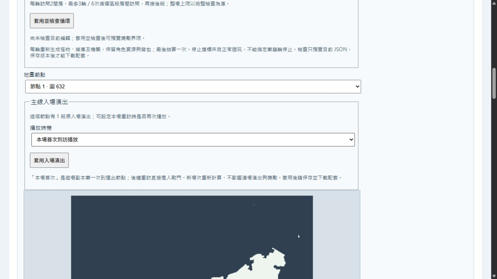

# 主線入場演出圖形工作台

2026-11-23。SERVER_DESIGN_CHOICE／NOT_NATIVE_MEF。接續[逐節點入場演出政策](STORY-ENTRY-SCENE-POLICY.md)，
補上先前 JSON-only 的作者入口；本批沒有變更政策執行器、場景鍵、玩法或獎勵。

## 使用方式

在「副本關卡編輯」選一般主線或主線循環設定，再選地圖節點。「主線入場演出」提供：

| 選項 | 保存內容與行為 |
|---|---|
| 沿用原設定（每次播放） | 移除這個節點的 entryScenePolicy，恢復缺省行為 |
| 每次到訪播放 | 寫入 EveryVisit，明確要求每次走原入場演出 |
| 本場首次到訪播放 | 寫入 FirstVisit；同場此節點首次播放，後續重訪直接戰鬥 |

選擇後按「套用入場演出」，修改寫入下方 JSON；填修改備註並「保存並驗證」，才建立新版本。
下載「此版本完整配套 ZIP」會固定該版本的關卡、AI、經驗政策與manifest。保存不會立即替換
遊戲服務。查看歷史版本可讀回當時選項，不能把目前選單的未保存值當成已發布設定。

畫面會說明此節點有幾段原入場演出；沒有演出時明示設定目前不影響流程。它只調整原序列
派送政策，不提供新增scene鍵、任意腳本或演出資源修改。首次範圍與原規格相同，是本場逐節點
NodeVisit，不是帳號永久已看過；清場／前後敘事與任務權威保持。

## 來源與版本界線

工作台從已固定的敘事內容產生 `(scenario, node, map, scenes)` metadata，隨頁面HTML編碼後
交給圖面。一般主線只列可編輯任務，循環工作台只列其綁定任務；只有目前定義、node及map
均相符才顯示控制。普通狩獵場不取得此來源，因此不顯示。Server仍以原catalog／Story
來源驗證為準，UI不是新的權威通路。

編輯節點是敘事陣列的 index+1，不能誤用原 SourceNode。例如Q119節點1／Map632的入場scene2，
節點4／Map635的入場scene3，均有正流程來源映射核對；一般與循環工作台的投影一致。
新增metadata不更改既有profile SHA、schema或已存內容；來源SHA原已涵蓋敘事與節點配置。

## 實際驗證

[完整收據](story-entry-editor-validation.json) SHA256
`a7025bf85215bd21575eb4b27a8cd3d1d0efa1a7efb8d56c2224590df2dcc1ee`。

| 保存版 | 實際瀏覽器操作 | 三輪場景2派送／合成回報 | 經驗保存 |
|---|---|---|---|
| r1 | 原擊倒事件範本，未設政策 | 3／3 | 5984 |
| r2 | 選首次播放、套用、保存 | 1／1 | 5984 |
| r3 | 改每次播放、套用、保存 | 3／3 | 5984 |
| r4 | 恢復沿用原設定、套用、保存 | 3／3 | 5984 |

- 實際瀏覽器完成r2～4；r4後再讀歷史r2，仍顯示FirstVisit與「目前查看版本2／最新4」。
  切到無演出的節點2會正確提示；一般主線Q119有控制、Case693隱藏。截圖為本批隔離Admin，
  非遊戲Client。早期兩筆觀察尚在換頁，只採後來明確完成載入的觀察，不將其算成歷史讀回通過。
- 四版各兩次HTTP下載ZIP完全相同，核實各版關卡／AI／經驗政策／manifest的原始bytes SHA，
  舊r1的ZIP保持。r2／r3只改node1政策；r4恢復原JSON語意，其他節點、怪物、AI與獎勵不變。
- 瀏覽器POST使關卡及AI的LF轉CRLF，raw SHA因而改變。比對僅正規化CRLF→LF後，AI bytes完全相同；
  r2正規化關卡對應前批FirstVisit候選、r4對應原候選。實際匯出、manifest與Host仍使用各版原始
  bytes及各自SHA，沒有把正規化檔案偷換成部署檔。首次收據檢查誤把AI固定為r1 SHA，已修正
  讀取器並重驗保留檔，沒有為此重跑遊戲或修改執行器。
- 四個實際匯出版本的正常TCP三輪路線全部通過；依原intro／逐訪entry／clear／return陣列
  逐項核對全部Q119派送及輸入回報，並非只看總次數。各8次房間訪問、5984EXP、一次Q119、
  Q120游標及同隊回村保持。
- 歷史r2與最新r4各有同版獨立真實時計Host，正常登入／廣場建隊／進村／NPC／編隊／戰鬥／
  三輪／結算／原村同隊返回。SQLite唯讀核對一次5880EXP／40mastery任務列及累計增加5984。
  r2僅派送／回報一次scene2，r4為三次；Town1Map182保持。
- 三Release Host／Inspect／Admin零警告／錯誤，793 HappyPath全通過、零失敗／跳過；既有
  工作台正流程補來源映射檢查，沒有以新增測試數宣稱進度。JS語法及四份Python工具語法通過。
  本批隔離Admin／Host均停止，來源DB SHA、現用服務、使用者資料與Client原件保持。

`GAME_RUNTIME_OBSERVATION`：以上是Admin瀏覽器及OFFLINE_SYNTHETIC／LOOPBACK_TCP證據；
沒有新指定v2畫面或實際播放確認，也沒有逐任務遊玩其餘Q119～Q144。自然新帳號、其他演出
功能及既有暫緩的邊界／重送／重連／故障／併發／安全／壓測仍待辦。整體MEF目標保持進行。
