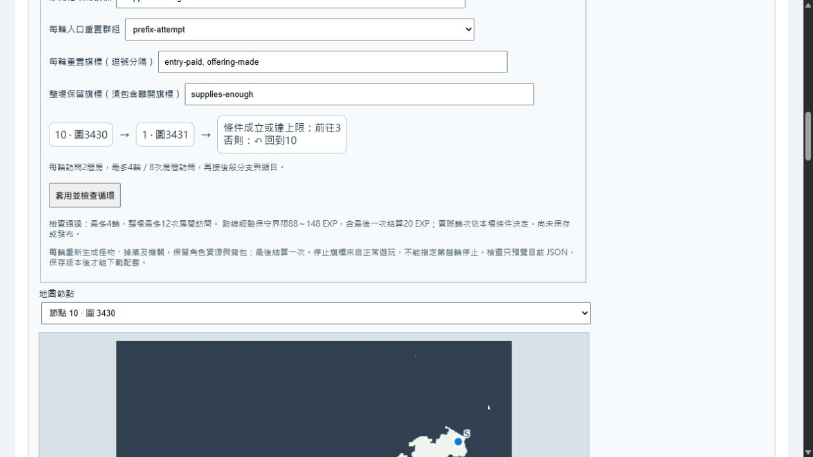

# 動態循環管理與版本配套

2026-11-22。SERVER_DESIGN_CHOICE / NOT_NATIVE_MEF。接續[結構化循環](STRUCTURED-LOOPS.md)，基準分析庫 `1f4bfc793`、Server `c55ddf6`。本輪完成管理端範本、循環表單、未保存預覽、同版關卡／AI保存與實際下載配套通關；沒有修改Client或替換現行服務。

## 啟用與編輯

原15個狩獵場範本保持，新增獨立 `case-693-loop`，標題尾加「動態循環」。Server管理啟動器 `tools/start-local-cash-admin.ps1` 新增 `-IncludeStructuredLoops`；需要既有 `-Database` 與可用的 `-ScenarioBoundsDirectory`。這只啟用管理頁，不會換遊戲Host。

對應管理端環境設定如下，四個來源欄位需一起提供，另需原BND目錄。載入時核對來源SHA、AI、Case693入口、地形及完整循環規則，不能只靠UI上的選項放行。

|設定鍵|用途|
|---|---|
|TARTAROS_ADMIN_STRUCTURED_LOOP_SCENARIO_PATH／SHA256|循環範本的絕對路徑／固定雜湊|
|TARTAROS_ADMIN_STRUCTURED_LOOP_BEHAVIOR_PATH／SHA256|該範本AI絕對路徑／固定雜湊|
|TARTAROS_ADMIN_SCENARIO_BOUNDS_DIRECTORY|既有已核對的原BND目錄|

初始範本仍為scenario61a0532e、AId4768b72；完整SHA見原規格。選取此類型後，表單可開關循環、調整名稱、1～16輪上限、停止旗標、入口重置群組、重置／整場保留旗標。圖示保留本adapter支援的10→1，再回10或離開到3；不是任意地圖／巢狀loop編輯器。停止旗標須出自兩房的既有訊號並保留，所有body producer須明列重置或保留。其他來源／幾何及旗標相依仍由Server驗證。

「套用並檢查循環」先把規則寫入目前JSON，再向正式預覽API取得驗證結果、保守經驗上下界、單次結算及整場最多訪問數。它不新增草稿、不發布；若等待期間JSON或AI變更，不顯示舊回覆為目前有效。訊號改名同步untilFlag／retainFlags與下拉選項。保存仍走原有版本transaction，編輯中的內容可保存；匯出必須通過完整檢查。

## 預覽資料及配套

POST `/admin/scenarios/preview` 使用既有表單驗證token、profile、json、behaviors，僅開放已載入的循環工作台profile。回傳既有preview欄位，另可包含structuredLoops及maximumNodeVisits；普通範本省略這兩欄。每個loop預覽含id、entryNode、latchNode、exitKey、exitNode、maximumIterations、untilFlag、resetScope、resetFlags、retainFlags，以及rooms的node／chart／map。

有啟用loop的 `.scenario-bundle.json` 保持 `LOCAL_SCENARIO_AUTHORING_BUNDLE_V1_NOT_NATIVE_MEF` 及原本三檔ZIP，追加同一份structuredLoops預覽及experienceBounds：minimum、maximum、completion、maximumNodeVisits、interpretation=`CONSERVATIVE_PER_VISIT_BOUNDS_COMPLETION_ONCE`。來源不展開為alias；實際執行仍在同node依權威條件決定。

清單settings保留 `TARTAROS_LOCAL_STRUCTURED_LOOPS_MODE=LOCAL_STRUCTURED_LOOPS_V1_NOT_NATIVE_MEF`、Case693關卡路徑／SHA及配對AI路徑／SHA。解壓到新工作目錄後，將清單中的 `<解壓目錄>` 替換為實際絕對路徑，沿用正常登入／村莊等其餘Host設定。下載不自動複製到遊戲目錄、不啟動／重啟Host；正式換版前仍須做完整Host配套預檢。既有 `-IncludeStructuredLoops` 啟動範例選的是固定範本，不會自動搜尋下載目錄或改用最新草稿。

匯出永遠指定draft及version；頁面顯示「目前查看版本／最新版本」，預覽、連結及ZIP都綁正在看的版本。相同版本重複下載位元組一致。未含loop的既有配套不追加上述欄位；固定entry／prefix重訪工作台仍獨立，不混用動態mode。

## 正流程證據

[機器收據](structured-loop-workbench-validation.json)及本機 `outputs/structured-loop-workbench-20261122` 保留HTTP、瀏覽器、下載與TCP證據：

- 未保存的兩輪預覽為88～108EXP、最多8次訪問，草稿及版本筆數不變。
- r1三輪為88～128EXP／最多10訪；保存r2四輪後為88～148EXP／最多12訪，r1頁面與ZIP仍為原三輪。配套各兩次下載一致，原r1關卡及AI與範本bytes相同。
- 實際下載r1及r2各走正常入口的提前成立／上限兩路，四路保存108／128／108／148EXP回原村同隊；逐訪機關及19／24／19／29枚投射物清理通過。
- 瀏覽器實際編輯2／4輪並取得108／148上界、將supplies-ready改為supplies-enough且同步保留引用，保存新草稿後通過完整檢查。從該瀏覽器保存版本實際下載的新配對再走TCP，以改名旗標在第二輪成立，保存108EXP回原隊。
- 瀏覽器從原r2開歷史r1，欄位仍為3輪且顯示最新2版。截圖使用預設視窗，沒有另列窄視窗／手機驗收。
- 舊單房2／3次ZIP與歷史golden相同；既有prefix工作台兩路實際下載配套各保存128EXP。
- 三個Release零警告／錯誤，696/696 HappyPath通過；兩個隔離Admin均停止，原資料庫來源不改、現行服務未替換。

本輪為準備角色4／Lv15、教學／Q15進度的loopback TCP及Admin HTTP／瀏覽器驗證。指定v2遊戲操作、自然新帳號升級、另啟部署Host遊戲通關、新匯出版本完整Host啟動預檢與非正流程仍分開待驗。巢狀／跨body流程、其他adapter與原生MEF研究尚未完成，整體MEF目標保持進行。
