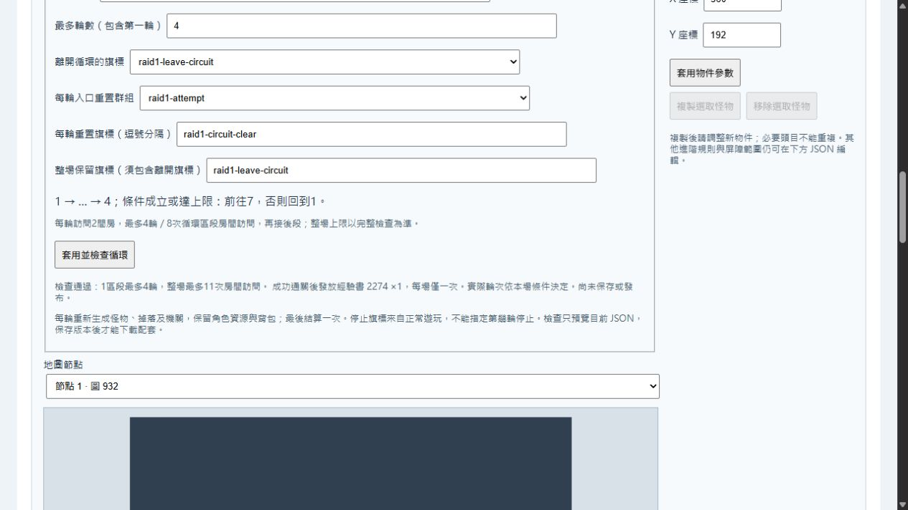

# RAID 循環配套完整正流程驗證

2026-11-22；SERVER_CONFORMANCE / OFFLINE_SYNTHETIC / NOT_NATIVE_MEF。
依據 [RAID 循環契約](../scenario-content/RAID-STRUCTURED-LOOPS.md)。
準備帳號角色4、Lv17／250000EXP、教學／Q15、普通裝備2725／11262及20張HP232。
這不是自然新帳號從零升級，也不是指定 v2 Client 驗收。

## 驗證分層

1. 三個來源候選各三輪：原 BND、正常 loopback TCP，各測正常停止互動與不互動達上限。
   5／9 次訪問、當前 run／source／visit 的 loop 決策及每輪 reset 由只讀診斷取得。
2. 隔離 Admin HTTP：來源推導兩房 body，未保存預覽改成四輪，最大11訪問且不寫草稿。
   保存 r1、下載三檔 ZIP；另存停用循環 r2。歷史 r1 重複下載 bytes 相同，r2 reader 得出5訪問。
   歷史測試使用另一批 UUID，r1 scenario SHA 與通關實際配套相同，manifest SHA 不混用。
3. 三個實際下載四輪 r1 配套，各兩條正常 TCP：驗 exact reader 後，走正常登入／primary、
   廣場建隊／RAID選擇／開始、原 BND 走位與普攻、可選 checkpoint、頭目、結算、回廣場。
   這批是同程序 gateway 排程與 test clock；不得叫作真實時間獨立部署。
4. 相同三份 r1 配套各兩條獨立完整 Release Host：真實時間，driver/Server PID 不同，
   遊戲輸入全走 socket，不建立內部 world、不直接 Handle／Poll 或寫 debug 旗標／輪次。
   driver 依固定地形規劃走位，按正常互動產生停止條件，從實際 chart／載圖確認路線。
   loopDecisions 是輸入與回覆的推導結果；內部決策與 reset 的精確快照仍引用第3層。
5. 三個原 RAID 不啟用循環的五圖 TCP 控制，保留各一本書、CP3000及回廣場。
   共用真實時間 walker 的既有一般狩獵場控制另列最終收據，保持一般 EXP 與同隊回村。

獨立 Host 每場 readonly SQLite 核對只交付一本2274／2275／2276與一筆 reward、CP3000、
Lv17／250000EXP、穿戴實例、錢包／故事／其他背包保持；HP卷軸僅按正常冷卻消耗。
19-byte成功回覆只一次，書在返回廣場0024之前發布，正常清理 RAID 隊伍。
實際 world trace 僅涵蓋 map／chart／角色資源，並非所有 S2C；成功及背包發布由 socket 逐次核對。
部署 Host/Network DLL、scenario／AI、manifest 與原始 trace 各自保存 SHA，不能以建置通過取代路線驗證。

所有資料庫是獨立副本，來源 SHA 前後保持。每場 finally 核對 PID 與完整部署 DLL 才停止自己的 Host。
沒有換現用商城服務、管理端或玩家資料，沒有執行／附加／操作 Client。

## 重現入口

私有 Server 工具：

- `tools/check-raid-loop-workbench.py`：三 profile、預覽／r1／停用r2／歷史不可變。
- `tools/check-raid-loop-routes.py`：同版配套各 stop／cap；加 `--deployed` 才是獨立 Host／真實時間。
- `tools/audit-raid-loop-receipts.py`：獨立覆核終態SQLite、map／chart trace、TCP visits／reset及TRX。
- `tools/check-normal-raid-routes.py --tcp`：三個舊 RAID 基準控制。

完整參數與啟動方式見私有 `docs/LOCAL-RAID-STRUCTURED-LOOPS.md`。
本機工作輸出：`outputs/raid-loop-20261122-tcp-final`（來源3輪）、
`raid-loop-workbench-20261122-v3`（實際通關配套）、
`raid-loop-workbench-20261122-history-v3`（另存停用及歷史）、
`raid-loop-paired-tcp-20261122-v2`（下載版TCP）、
`raid-loop-deployed-matrix-20261122`（下載版獨立Host）、
`raid-loop-legacy-tcp-control-20261122`（原五圖控制）。
失敗試作輸出沒有列為成功收據：錯誤BND目錄、舊Inspector、不正確草稿revision／空loop陣列等，
都只修正工具或輸入後使用新目錄重驗，沒有放寬來源／schema／Host遊戲規則。
原整合副本控制首輪另漏選 `--offering`，未操作必需消耗183的checkpoint11而停在首門，
自己的Host已清理；此未列通過。以新副本及正確正常互動選項重驗，保留失敗輸出。

## 管理畫面

隔離 Admin 的實際瀏覽器，把來源最多3輪改為4輪並只讀檢查，顯示整場最多11次訪問、
經驗書2274×1且每場一次，尚未保存／發布。畫面不是 Client 或遊戲測試。

## GAME_RUNTIME_OBSERVATION 與待驗

本輪沒有新的指定 v2 畫面結果，既有 NV-01／RAID-03～07 人工待驗不改為通過。
新增 RAID-L01：正常廣場建隊選相應 RAID，先滿足原最低等級。載入核准的新配套後，
第一種操作在第二房清怪後使用停止機關再走出口，應接回後段、五圖通關；
另一種不操作停止機關，應以原 chart/map 回跳、重生怪物並重做每輪條件，達四輪後接回後段。
兩場各一本書、CP依既有成功規則、正常清隊回廣場，核對 checkpoint 可見／可操作與回跳畫面。
本輪未替換現用服務，不請使用者立即執行這份待驗。

原生 MEF 傳入／載入、Client 自主生怪及完整 AI、自然新帳號完整主線、巢狀與其他 adapter 維持 OPEN。
重送／重登、敗退、故障、併發、安全及壓測依原排程待測，沒有執行或宣稱通過。

## 四輪下載配套最終 RAID 結果

| RAID | 正常停止 | 四輪上限 | 每場通關書 | CP | 保存等級／EXP | HP卷軸 |
|---|---|---|---|---|---|---|
| 1 | 5訪問 | 11訪問 | 2274×1 | 3000保持 | Lv17／250000保持 | 0 |
| 2 | 5訪問 | 11訪問 | 2275×1 | 3000保持 | Lv17／250000保持 | 0 |
| 3 | 5訪問 | 11訪問 | 2276×1 | 3000保持 | Lv17／250000保持 | 0 |

六條獨立Host共48次戰鬥房間訪問；相同六份保存版本TCP路線亦通過。
來源三輪的六條TCP為5／9訪問，不能混成保存四輪的5／11。
三份停用r2均經exact reader核對5訪問，並完成普通五圖TCP、一本書及回廣場。
管理端歷史另存r2後r1 ZIP bytes不變，scenario SHA與實際通關版相同。

Host、Inspector、Admin三個最終Release建置零警告／錯誤。
最終TRX核對732/732 HappyPath、零失敗／略過，SHA256
`5238384f976a5615e754072e5460dcccbdf4c73919c389d2316a6e80a829aa64`。
測試runner本身成功；保留的外層命令曾把logger檔名的分號誤作PowerShell分隔符，
runner結束後才出現額外命令不存在錯誤，因此使用runner實際產生的TRX，不把外層exit1偽列exit0。

當版共用walker的原整合Case693獨立Host控制亦通過：正常登入／廣場建隊／進村／選關，
六訪`10,1,3,5,4,2`，完成原波次、消耗機關、分支與頭目，88EXP保存為39088，回原村同隊。
10筆經驗credit中只有1筆completion；一筆綁入口visit的checkpoint11消耗183×1，最後背包183×2守恆。
精確75%頭目階段與timer內部快照仍引用既有同程序收據，本次真實時間控制證明正常輸入與實際生怪／通關，
不冒充新Client畫面或新內部時計觀測。

既有Case695共用walker控制亦完成10訪問、104EXP保存及原村同隊返回；
正常拾取後已提交背包數量2／4對應繼續／UntilFlag離開，保留原背包停止條件。
所有本輪隔離Host／Admin已停止，15082／18414／18415／18416／63094無監聽。

[最終機器收據](raid-loop-complete-routes-validation.json)獨立核對六場原版BND載圖／chart、
保存版來源／AI／manifest／部署DLL、終態SQLite、同版TCP訪次及重置、停用與歷史、兩個回村控制及TRX。
收據SHA256 `8af8d4411b416b72b1cf90316dcc5c0f9f23fb63045d8688624eba282d4c0788`。
Source／三輪TCP與歷史r1/r2輸出另有明確根目錄，不把不同配套UUID混成同一manifest。
