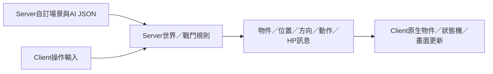

# 怪物決策、位置與傷害的權限界線

來源原始KR BIN SHA9741d1975327b9309d82b52f631165bc410757694d7c183a5eed970a53ebef91；Server現行v38來源01aed878b4d0f9db5b2ff7f798e48adcde97088a。這是限定架構補證，不是原生MEF完成、全類別AI審計或官方權限證明。

## 原生能力與不能推論的事

[metadata](metadata.json)限定核對CMonster RTTI F7DFAC／COL C6AC84／vtable C0C9DC。+2C指向4D1E10：property1接收signedWORD保存+3B0並更新血條比率；property5/6保存D0／CC。+60指向4CAD40，為intD0×約0.01×floatCC的速度getter，不是AI決策器。共用4CA890以既有移動旗標與方向作本地位置更新，但沒有因此證實誰決定追哪個目標。

CMonster建立的4D1710與外部0007→4AE4D0、本機4A0F70→lb.CreateObjectEx等不是新發現；先前T13來源已有完整限定報告，本輪沿用並核對身份。lb/Q是不同接口，掛接controller參數不是AI開關。舊SubAI549C60指定路徑的model<=9限制仍成立，但不能升為整個Client無怪物AI。

[歷史線索收斂](historical-lead-boundaries.json)將舊待追查的4B2620狀態1回復迴圈與4BB150三個固定actorID的狀態20／隨機展示motion迴圈分開。這些指定迴圈不構成自主尋敵／選招證據；未展開helper與其他間接路徑仍保留未知。不把存在原生狀態機、速度或HP setter當作存在完整戰鬥裁決。

## 現行Server與MEF

目前Server讀取明示NOT_NATIVE_MEF的Scenario／MonsterBehavior JSON，決定生成、追擊、攻擊節奏、命中、HP與死亡。LocalTutorialPose保存玩家位置及Server碰撞結果；LocalTutorialCombat.PollEnemies保存怪物位置並在移動時發位置／方向／狀態。Client接收物件及狀態，持續執行本地動畫／位移更新。

此圖只描述現行重建架構；官方Server／房主／Client分工尚未證實。原生MEF reader、樣本、傳輸opcode與Client事件執行鏈仍未閉合，不能改副檔名或傳任意blob。將AI參數搬進檔案不會自動把執行權搬到Client。

若未來取得真實MEF：先查格式與哪端消費，再決定NativeMefReader→有來源的IR→ServerRuntime；若要Client執行，另需其接收／載入／事件呼叫鏈，不能以ServerReader代替。傷害顯示setter不證明公式在Client。

## 定向接續

RR-0013／T13只追一種普通怪（可先1036）的實際控制器／動作生產者，區分外部接收、腳本本地建立、控制清單、目標選擇與出站。沿既有資料與新線索，不重做已完成RTTI、全庫MEF掃描或泛用AI框架。沒有證據時允許UNKNOWN，不強求Client一定存在AI。

重現verify_authority_boundary.py --workspace-root E:/Tartaros/workspace：核對10個既有精確視窗、6個bulk身份及4個rooted函式界線。沒有啟動／附加／修改Client或執行原始腳本；原件與完整資源留本機。治理檢查不是原生語意或實機驗收。
