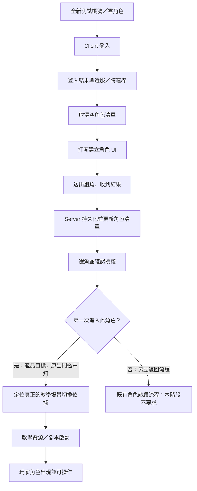

# S00 Iteration 16 — 全新帳號 → 建立角色 → 新手教學：端到端開發與研究總規劃

> **完整範圍的非規範性 S00 工作草案，未推 Git、未執行 Client／Server 相容性測試。**  
> 日期：2026-10-30 Asia/Taipei。已核對 `ttr_anal_multi main@dd69ec9de353a695d25c6db8e362ff471ea0c137`、`ttr_server_roy main@2901f05eeb229ee2c3c0e9a46b6248aa555c3309`。對象只限 KR Client `Tartaros.bin` SHA256 `9741d1975327b9309d82b52f631165bc410757694d7c183a5eed970a53ebef91`，不適用未獨立查證的 TC。此文件綜合 Iteration 14/15 已保存原稿和 GitHub T02/T03/T04/T05/T06/T07/T16/T01 研究；**沒有重新獨立反組譯 BIN／Event.stp**。

## 0. 本次直接決定完整目標，而非等待每一小段結案

**玩家實際成功標準（最終 E2E）**：使用 Server 提供的一個**全新、原本沒有角色**的測試帳號，透過**未修改的指定 KR Client** 完成登入及選服；進入空角色／創角操作，於 Client 建立一名角色；經 Server 持久化後在角色清單中看到該角色；選擇自己角色且得到原版 Client 可識別的成功處理；**第一次進入新手教學的可見、可操作畫面**，能識別教學資源／腳本和自己的角色初始化。**不要求本階段完成整個新手教學、任務、戰鬥或回主城。**

本目標是使用者提出的 Server 產品方向，未正式登錄為已批准 REQ，不能反過來聲稱原版遊戲的首次登入流程必然如此。帳號**如何建立**先採維護者／測試管理端預先建立的政策（非 Client 註冊畫面）；若日後要用原版 Client 註冊帳號，是**另一獨立 Client 契約**，不能靠現有登入 Client 代替。不得將「直接在 DB 預放角色」算成完成**Client 創角**的驗收。

**成功分三層**：
- **D／Server 自主開發**：`ttr_server_roy` 模擬 Client 的新帳號、登入、角色建立、選角、首次教學狀態（Server 私有設計），可以先完成，即使協定未知；證明的是產品內部一致性。
- **S／有界來源契約**：S00 發布真正方向別 C2S/S2C、bytes/offset、scene/connection 前提、成功與失敗對應，受現有 REQ/RR/GAP/SPEC 監督；不能將 synthetic 轉成原版 wire MUST。
- **R／原版 Client 相容**：只有經使用者**另外明確授權**，在隔離環境實際運行對應 SHA 的 KR Client、擷取去敏的 wire/scene/UI/resource 和畫面證據，才能宣布 E2E 達成。目前 R=**未授權／未執行**，沒有任何原版登入成功或教學進入結果。

### 最終使用者路徑（產品期望、不是已證原版封包時序）

**硬性反證**：`Event.stp` SceneList 的 `(1001,1) → tutorial_start` 是**資源鍵**，目前**不是**已知網路 opcode／payload，也沒有證實首登必用該鍵。`0x565720` 同時供 ScenarioReview UI 與 EndCutScene 重入；E68 有界查到 S2C app `0x42` 的 handler `0x4B2190` 操作 `FAB2A0`，**沒有建立** C2S 角色選擇 `0x42` → S2C 成功回覆 → `SceneItem+0x248` → 教學啟動的正向鏈。`0xEA61` 同樣不可改叫教學任務號。T07 既有 `0x005F type6` 原版 `CDuelField` 與本機 tutorial fixture 衝突，不可用本機「曾可玩」代替原版教學相容性驗收。

## 1. E00–E12：完整 Client／Server 交界與責任矩陣

下表中的順序是**要驗收的使用者路徑**，**不是**證實的官方封包順序；每個階段含成功／失敗，且保留獨立 Client 原生證據的缺漏。

| Gate | 使用者可觀察結果 | 現有證據或可自主完成項 | 核心阻塞 | 原主責 |
|---|---|---|---|---|
| **E00** | 建立全新測試帳號 | 測試管理介面可建立零角色帳號；不預設原版 Client 有註冊 UI | Server 自訂帳號身分與驗證策略需批准 | S00、Server-C02 |
| **E01** | Client 送出登入請求 | 區分 E8/112B、000F/214B 的本地 producer 與 mode/slot | 實際 runtime 模式、首個 wire frame、codepage／opaque bytes | T02、T03 |
| **E02** | 登入結果／可選伺服器 | 區分 S2C app 0x13 與 0x7A 的 Client handler/gates | 真實 request/reply 配對、Server 結果與完整失敗分支 | T03、T02 |
| **E03** | 選服／跨連線 Session | key/slot 與 Connect、local F4241、Session 狀態分開 | 真正跨連線順序、token/lease/續接證據 | T02、T03 |
| **E04** | 取得零角色清單 | command2 65-byte prefix+53×N；N=0 仍需先通過 header/資源狀態 | 完整 65-byte prefix 語義、零角色 UI 後果 | T03、T04 |
| **E05** | 顯示建立角色 UI | 找 N=0/新增按鈕的 scene/dialog/resource/event → create UI 正向入口 | 未證原版 Client 零角色即自動開創角畫面 | T03、T06 |
| **E06** | 建立角色 C2S／S2C | 定位 create producer/response consumer、offset/編碼/結果碼/重送 | 目前沒有可支援的創角 wire opcode；選角 C2S 0x42 不可混用 | T03、T04、T02 |
| **E07** | 角色持久化／更新清單 | Server 交易建立單一角色後從來源權威重取清單、26+ID 相關 init 和 UI event 依原生補證 | Create 回覆與下一次 roster/初始化完整順序及 UI ready | T04、T03 |
| **E08** | 角色選擇請求 | 已知 0x4A3B80 本地建構 42 00 XX YY（4B，受 gate） | XX/YY 業務語義、Server 拒絕/允許與真實 wire pairing | T03、T02 |
| **E09** | 選角批准與世界狀態 | 找實際 success/error S2C → Client state/scene writer → 角色載入和初始資料 | S2C 0x42/0x43 不是已證 ACK；0x69/7 CSquare 路徑不能直接推為批准 | T03、T02、T04、T07 |
| **E10** | 首次進入教學的政策與判定 | 產品目標是首次建立角色後進教學；確定是否由 Server 保存 per-character tutorial state | 原版 account-first/character-first 規則、可跳過條件、觸發來源全未知 | S00、T03、T04、T16 |
| **E11** | 教學場景鍵／腳本啟動 | 已知 Event.stp SceneList (1001,1)→tutorial_start 與 0x565720 條件式 loader；校對 E68 的 Review/EndCutScene 分支 | 沒有 wire→scene key、selection→tutorial、腳本實際執行的正向連結 | T03、T06、T07、T16 |
| **E12** | 首個可見教學畫面／玩家初始化 | 核對玩家角色、場景資源與腳本/初始目標載入；將「進入」定義成可見可互動的首個教學畫面 | 需要獨立授權 KR Client 隔離動態測試；不能以 synthetic 或曾改過的 tutorial fixture 當官方可玩證據 | T04、T05、T06、T07、T16、S00 |

## 2. 六個真正制約端到端成功的「正向證據」缺口

**CP-1 真實連線與登入交易**：T02/T03 在相同 KR SHA、同一個有界 Client transport/scene 執行前提中，證明 mode 選擇與 C2S 認證 payload、slot/key、S2C 可對應的成功/失敗 handler、選服到 roster 的切線偏序。C2S E8/112B、000F/214B 與 S2C `0x13`/`0x7A` 是**各自存在的局部函式**，不能僅因相鄰而組成原 Server 交易。來源 `RR-0001/0003/0004/0005/0007`，`GAP-NET-0001/0002`、`GAP-AUTH-0001`。

**CP-2 零角色／創角 UI 正向入口**：T03 先找到無角色時 Client 的合法 UI/scene 分支、建立角色 dialog／按鈕 callback，T06 確認同版資源身分和建立／卸載條件。`N=0` 是有效清單幾何候選，但 `0x4B7F00` 有早期 header／資源前提，**不能**推出「零角色必自動跳創角」。

**CP-3 真正的角色建立 wire**：T03/T04 找原生建立角色 C2S builder、Server 回覆 consumer、欄位寬度、名字／職業／外觀、結果與失敗；T02 補 slot/frame；T04 查角色唯一 ID、初始值來源和持久化最小必備資料。此子題**尚無可採用的創角 opcode**。`0x4A3B80` 的 `42 00 XX YY` 屬於**選中已存在角色**，不可把它當 create request，也不可人工猜 request+1 S2C。

**CP-4 建角後更新清單及 UI**：T03/T04/T06 查 create result→角色資料重取／命令2、初始化 `26+ID`（以及局部 24/1F/25/15/DA/D2）之各方向與必要回覆，並區分 `record+0x5C=1`、`0x665150` list-hit、`F42EF/F4246/F4247/F4278` 本地事件和「使用者實際能操作」。Iteration 14/15 只證其局部 producer/consumer，未證 roster 收到必然觸發 UI 刷新。

**CP-5 角色選擇批准與世界進場**：T03 依 `RR-0002=BLOCKED` 保留既有完整來源及負向排除，真正要的是 **C2S42 → 同版原版 S2C success/error → Client 可達 state writer** 的正向或清楚條件證據。E68 `S2C42` 是 ScenarioReview 20-WORD 容器的局部讀寫，不是已證選角 ACK；`S2C43`、`S2C69/7` 和 `C2S43` 也不可「因數值相近」當固定配對。T07/T04 只接其主責的場景與初始狀態。

**CP-6 首教學觸發與玩家實際載入**：T03/T07/T16 找**從已選角成功的具體 Client 狀態**到教學 scene/script loader 的正向 writer/handler；T06 確認 `Event.stp` 同版資源和 `.seq` 所需條件；T04 確認角色基礎資料、初始位置與伺服器權威；T05 補進場後玩家顯示與移動前提。`(1001,1)→tutorial_start` 僅能當**候選資源定位錨點**，不等於 Server 一定發這兩整數或這個新手規則。若找不到正向證據，可在 Server mock 路徑先實作「首教學」產品狀態，但**原版 Client 相容 Gate 繼續 BLOCKED**。

### 研究優先級：不用等整個 Client 全部分析完成

**P0／最短進教學路徑**：CP-3 真正創角 request/reply；CP-5 選角成功回覆／world state；CP-6 首教學觸發——這三者目前是**缺正向證據的最重要阻塞**。同時 T02/T03 補 CP-1（首包/切線）以便 Server 能接上真正 Client，T03/T06 補 CP-2/4 以避免零角色與 UI 卡住。

**P1／能避免進教學前後死鎖的資料**：T04 初始角色資料；T03 清單後請求／回覆；T06 同版資源；T07 世界就緒。未知值不借用 LocalHero／固定 900/900／自製 scene/tut fixture。

**P2／進入後的遊玩**：教程完整任務、怪物、戰鬥、獎勵、教學完成後轉主城——**不在這一版「首次進入」驗收終點**，由 T08/T09/T14/T16 等延後規劃。

## 3. 把任務明確交給原主責（只列「研究包」，不假裝已正式派工）

| Task | 本階段唯一必需的可交付原生範圍 | 判定完成 |
|---|---|---|
| **T02** | E01–E03 的 wire framing、mode、Conn slot、actual first C2S/S2C、reconnect；E06/E08 只供通道證據 | 同版、同方向、位元組與 socket 前提 + 反例；先用 RR-0001/0004/0005/0006/0007 |
| **T03** | E02–E09：zero roster → create UI；create C2S/S2C；create後 roster/初始化；select42 配對；世界 state writer | 正向 caller/writer/consumer 綁定與按 branch 的 UNKNOWN；既有 RR-0002/0003/0008，不因 blocked 偽結案 |
| **T04** | E06/E07/E09/E12：角色欄位／初始值、唯一 ID 與 World state 權威資料需求 | 原始 Client 消費欄位與 Server 自訂 DB policy 分列；不沿用 fixture 初值 |
| **T06** | E05/E07/E11/E12：建立角色與選角 Dialog/control 和 SceneList 資源、`.seq` 版本 | 指向同版正確資源與初始化/場景 gate；不將畫面名稱當 wire |
| **T07** | E09–E12：從角色批准後 Client world-entry state 到場景創建、script/resource/ready | 具正向 handler/caller 和同版失敗分支；排除本機 type6 代用 |
| **T16** | E10/E11/E12：`tutorial_start` 進入條件、Lua/任務首次執行、開始／完成／重試標記 | 區分 XML/Lua 靜態存在、loader 呼叫、真正 runtime 任務啟動 |
| **T05** | E12：進場玩家 entity、座標與控制可用；不先展開移動系統 | 首可操作畫面的必要初始化證據，不能用固定出生坐標替代 |
| **T01** | 對 CP-3／5／6 可阻塞 Server 開發的精確 BIN、RTTI/virtual、原生資源 key 做定向 R2 複驗 | 原件 SHA、原稿 Git blob、scope、正／反證；不升整篇 FULL-PASS |
| **S00** | 沿既有 3 種 discovery 審核 REQ；整理 request/reply SPEC、GAP、RR 與實作者交接 | 正式唯一台帳一致、UNKNOWN 保留；不自動 ACCEPT RR／STABLE SPEC |

**派工規則**：此表只是 S00 協調規劃，沒有建立正式 RR，也不會喚醒任何 agent。開始執行研究時先確認 `research/requests/index.json` 是否涵蓋；對「創角」與「首教學」若仍無對應的獨立原生子題且有清楚正向驗收，**提議**按現有正式收件、認領、回報程序設不重複研究請求；不得由本計畫私自改 Task owner、把 RR-0002 BLOCKED 變成 ACCEPTED。

## 4. 實作庫 `ttr_server_roy` 的並行路線（與原版相容完全分離）

| Server 內部里程碑 | 先做什麼 | 本階段的驗收 | 能否同時開始 |
|---|---|---|---|
| **C00**（既有） | .NET10 模組骨架、CI、loopback diagnostics | repo main CI 通過；不是 Client TCP | 已完成，不重做 |
| **C01** | 非同步 TCP、frame codec seam、buffer/timeout、socket life、synthetic TestClient | 假 Client 連線/分包/重連，未知原版 framing fail-closed | **可** |
| **C02** | Test-account provisioning、密碼策略、Session、帳號權限、資料庫 | 零角色帳號能被 Mock Client 認證；憑證保密；ADR 審核 | **可** |
| **C03** | Character CRUD、建立角色交易／idempotency、所有權驗證、角色清單與初始狀態 | Mock Client 完成從 0 角到 1 角、斷線後角色不消失；wire 尚分離 | **可** |
| **C04-Lobby** | 依 S00 逐步落下真實 Client 可解之登入、切線、空清單、創角、刷新、選角 | 僅在每段有 bounded wire/scene 契約與經授權實測後才宣稱相容 | 受 CP-1～5 阻塞 |
| **C05-Tutorial-entry** | 首登與角色教學狀態、正確 Client scene/world spawn、script 入口及可見就緒 | 經授權的原版 KR Client 達到教學第一畫面並可操作 | 受 CP-5／6 阻塞 |

**Server-only 設計提案**：用 `Account(id, credentials)`, `Character(id, account_id, ... )`, `Session(id, account_id, bound_connections)`, `CharacterProgress(character_id, tutorial_state, ... )` 表示內部資料；`tutorial_state` 先考慮 `NOT_STARTED/IN_PROGRESS/COMPLETED` 及冪等更新、重連一致性，但**是否首次帳號／首次角色播放教學，及何時設 COMPLETED，仍待產品 ADR 決議與 Client 原生行為查證**。不得將此 schema 說成原官方 Server 的 DB/首登政策。

**不要使用的捷徑**：
- 帳號建立時偷偷自動補一個角色，然後宣稱完成 Client 創角。
- 對 unknown create/selection request 依「+1 封包」返回合成 success。
- 對未知的 65-byte roster prefix、場景座標、教學 key 強填固定值，稱為官方資料。
- 向 Client 發 `F42EF/F4246/F4247/F4278` 當 network opcode。
- 啟動修改過的 Client 或用本機 tutorial fixture 所見畫面當原版相容證據。

## 5. 十六個 E2E 驗收情境（目前皆為規劃，尚未執行）

| Case | Gate | 測試目的 | 當前性質 |
|---|---|---|---|
| E2E-T01 | E00 | 新帳號無角色，驗證身分、持久化和非重複帳號 | SERVER_INTERNAL_PLANNED |
| E2E-T02 | E01 | E8／000F 各有精確 Client local builder vector，未知 mode 明拒絕 | OFFLINE_SYNTHETIC_PLANNED |
| E2E-T03 | E02 | 登入成功、密碼錯誤、scene 不匹配三分支 | CONTRACT_MISSING |
| E2E-T04 | E03 | 選服跨 conn、斷線、session lease、錯 socket 重放 | CONTRACT_MISSING |
| E2E-T05 | E04 | N=0 清單的正向完整 header / 前置資源 | CONTRACT_MISSING |
| E2E-T06 | E05 | 零角色與既有角色 UI 分支均有正向 native entry | NATIVE_DISCOVERY_REQUIRED |
| E2E-T07 | E06 | 建立角色成功／重名／非法名稱／斷線重試 | NATIVE_DISCOVERY_REQUIRED |
| E2E-T08 | E07 | 創角只持久化一次、重新取得角色清單、重連可見 | SERVER_INTERNAL_PLANNED |
| E2E-T09 | E07 | 角色名單內容不等於 UI-ready；驗 local init/event subscription | CONTRACT_MISSING |
| E2E-T10 | E08 | 選角本地 42 00 XX YY 與 Server 授權、擁有權錯誤 | CONTRACT_MISSING |
| E2E-T11 | E09 | 選角成功／拒絕 S2C 正向 pairing 和 scene writer | NATIVE_DISCOVERY_REQUIRED |
| E2E-T12 | E10 | 全新角色第一次進教學 vs 已進教學重登的 Server policy | SERVER_POLICY_PENDING_APPROVAL |
| E2E-T13 | E11 | 實際選角結果導致 tutorial_start key 選取，而非 Review/EndCutScene 假陽性 | NATIVE_DISCOVERY_REQUIRED |
| E2E-T14 | E12 | 合法 KR Client 到教學第一個可見且可操作畫面 | ORIGINAL_CLIENT_RUNTIME_AUTH_REQUIRED |
| E2E-T15 | E12 | 重連／中途斷線／故意錯誤 spawn 不可繞過權威校驗 | ORIGINAL_CLIENT_RUNTIME_AUTH_REQUIRED |
| E2E-T16 | E12 | 已完成教學角色再次登入，不重播（若產品政策批准） | ORIGINAL_CLIENT_RUNTIME_AUTH_REQUIRED |

**測試等級**：`SERVER_INTERNAL`/`OFFLINE_SYNTHETIC` 只證 Server 自己的一致性；`SOURCE_BACKED`／`SERVER_CONFORMANCE` 須有足夠的精確 SPEC/provenance；`ORIGINAL_CLIENT_COMPATIBILITY` 必須另外授權並提供可重現 trace。這 16 個是 **E2E-Txx 規劃代號**，不是正式 `TEST-*` ID、未列入唯一 `conformance/test-index.json`。

## 6. 各階段開始／完成的證據工件

每個要從「未知」改成「Server 可做」的 Client-bound gate，至少交：
1. **原生 Client 身份**：版本 KR、原始 SHA；同一條 Client build 的 BIN／資源版號及有界 Git blob/source lines。
2. **方向**：C2S 或 S2C；frame marker 和 app command 明確分離；Connection slot、scene、pipeline、mode 和上游 gate。
3. **位元組佈局**：有效長度/array/field offset/型別/endian/encoding、成功與錯誤、字串上限和 unknown opaque bytes，不取人造 fixture 值。
4. **正向時序**：請求 producer → 實際通路 → Client 可以消費的回覆 handler → 下個可達 state；UI 事件/資源鏈另列，不能僅靠相同 opcode 猜。
5. **證據階層**：`SOURCE_BACKED_PARTIAL`、T01 bounded review、正式 S00 SPEC/REQ/ADR 批准、Server synthetic/unit 和授權 Client runtime **逐一獨立標示**。
6. **反例**：短包、拒絕、重複建立、無角色、有角色、已進教學、斷線重連、錯誤 scene、不同 Client SHA。

若原生資料僅能支持一段 `SOURCE_BACKED_PARTIAL`，可先交出該段的 parser/serializer **受限介面**，**不可**宣稱整個 E2E 或把所有 Gate 自動升級為 CONTRACT_TESTABLE。維持 `RR-0002=BLOCKED`、`RR-0008=IN_REVIEW`、既有 GAP OPEN，直到正式獨立核准。

## 7. 正式需求治理如何表示本次新目標

- **現有 REQ**：`REQ-0001` 登入、`REQ-0002` 選服、`REQ-0003` 清單、`REQ-0004` UI、`REQ-0005` frame，均維持 **CANDIDATE**。本次不隨便把 E05/E06 或 E10/E11 新建為數字 ID。
- **待審不同產品需求**：`全新帳號測試建立`、`原版 Client 創角及持久化`、`首次角色進入新手教學` 屬不同的交付和驗收。使用者在本次明確描述了終點，日後由 S00 根據 `PLAYER_ADMIN_REQUEST` 登記去敏、原文與批准狀態；創角／教學若找到 Client 方向別依據，再補 `CODE_ANALYSIS` 到相應 REQ。**不新增來源類別**。
- **後端策略**：角色名字唯一性、帳號角色上限、帳號 Session 綁定、權限、斷線續接、教學狀態 DB 更新需 Server ADR／維護者批准；客戶端現有 guard 不是官方 Server policy。
- **規範更新**：缺協定 → 關聯既有 RR/GAP（需新建時正式去重）、已證 bytes → 精確 SPEC/測試 → T01 限定複驗 → S00 決策；實作 Bug → FB，不開第四 discovery origin。
- **對 Server repo**：只有正式發布的 SPEC/ADR/contract vector 才調整 pin/實作，這份未上 Git 的規劃不觸發程式改動。

## 8. 可直接交接給下一個 S00 對話的工作指令

> 請接續 `ttr_anal_multi` S00，先核對最新 GitHub main 的唯一 REQ/RR/GAP/SPEC/CLM/TEST 與 `governance/S00-NEXT-CHAT.md`，再讀 Iteration 14/15 的本地完整原稿及 **Iteration 16 的 E00–E12 全新帳號到首教學計畫**。不要再只優化 roster UI；從整條**零角色→創角→選角批准→教學場景**依 **P0 CP-3/CP-5/CP-6** 優先審核正向 Client 協定／scene writer，T02/T03 同步補 CP-1；完整記錄失敗/未知與每個 Task 的精確研究要求。創角 opcode、S2C42 ACK、1001/1 wire 或首次教學規則不能猜。Server C01～C03 可另行並行開發，但本倉庫僅做設計；不經另外明確授權不執行 Client、不做實機抓包。**除非使用者要求，上 Git／Push 不授權。**

## 9. 來源與保留界線

- S00：[roadmap](https://github.com/we88ec3-prog/ttr_anal_multi/blob/dd69ec9de353a695d25c6db8e362ff471ea0c137/governance/s00-roadmap.json)、[REQ](https://github.com/we88ec3-prog/ttr_anal_multi/blob/dd69ec9de353a695d25c6db8e362ff471ea0c137/design/requirements/index.json)、[RR](https://github.com/we88ec3-prog/ttr_anal_multi/blob/dd69ec9de353a695d25c6db8e362ff471ea0c137/research/requests/index.json)、[SPEC-SCENE](https://github.com/we88ec3-prog/ttr_anal_multi/blob/dd69ec9de353a695d25c6db8e362ff471ea0c137/spec/world/SPEC-SCENE-0001.md)。
- [T03/UI 來源](https://github.com/we88ec3-prog/ttr_anal_multi/blob/dd69ec9de353a695d25c6db8e362ff471ea0c137/kr/tasks/T03/README.md)、`CLM-CHAR-0001..0006`、`CLM-NET-0030`、[Iter. 13](https://github.com/we88ec3-prog/ttr_anal_multi/blob/dd69ec9de353a695d25c6db8e362ff471ea0c137/governance/S00-20261030-ITERATION-13.md)；Iteration 14/15 為**目前本地未提交文件**。
- [T01/E68 RR-0008 bounded review](https://github.com/we88ec3-prog/ttr_anal_multi/blob/dd69ec9de353a695d25c6db8e362ff471ea0c137/research/handoffs/t01-20261030-rr0008-e68-bounded-r2/README.md)、`CLM-SCENE-0001..0006`、E06/E08/E13/E14/E15/E16/E68原稿；只可局部引用，**非完整 Server 教學封包或首登規則**。
- [Server C00 規劃](https://github.com/we88ec3-prog/ttr_server_roy/blob/2901f05eeb229ee2c3c0e9a46b6248aa555c3309/docs/DEVELOPMENT-PLAN.md) 及 `contracts/spec-revision.json` 指向前述 S00 main，沒有在本輪修改。

**明確仍未知**：官方帳號創建路徑、建角 C2S/S2C、零角色 UI 是否強制創角、真實登入回覆配對/Socket 接續、完整 roster prefix、選角成功/失敗回覆、首次教學旗標與必入規則、scene/actor/script 首次啟動 wire-to-local state。這些不是本草案憑空解決的研究成果。