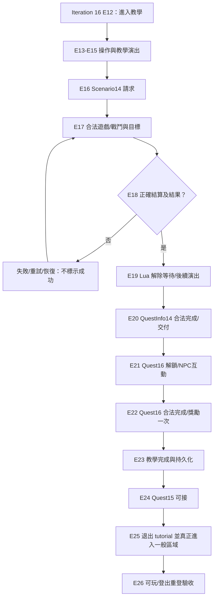

# S00 Iteration 17 — 全新帳號完成新手教學：Scenario 14、Quest 14／16、退出教學與正常遊戲交接

> **規劃草案／未上 Git／未新增正式 RR、REQ、GAP、SPEC 或 TEST。** 日期：2026-10-30（Asia/Taipei）。此文件延伸 Iteration 16 的 E00–E12，新增 E13–E26。S00 研究庫 main=`dd69ec9de353a695d25c6db8e362ff471ea0c137`；獨立 Server repo main=`2901f05eeb229ee2c3c0e9a46b6248aa555c3309`；KR Tartaros.bin SHA256=`9741d1975327b9309d82b52f631165bc410757694d7c183a5eed970a53ebef91`。未執行 Client，沒有原版 Server trace；本輪只檢視 GitHub 上既有 T16/T01/T07/T14/T15 等原稿，**沒有重新對原始 BIN 或資源做第一手 byte 驗證**。

## 0. 終點：真正完成新手教學，不只看到畫面或收一個 success flag

**本版本產品要求（待正式 S00 REQ/ADR 審核）**：依 Iteration 16，原版、未修改、指定 SHA 的 KR Client 使用零角色新帳號親自建立角色並進入教學；完成操作／演出、Scenario 14、QuestInfo 任務 14 及 16；Server 保存**角色層級**教學完成與任務／獎勵狀態（資料範圍需 ADR 決定），使 Quest15 達到可接條件，離開教學場景，進入一個可正常操作的非教學場景；登出再登入進度一致、不重領、不被強制重播。**Quest15 本身的完成不是這一輪硬性目標**；進入真正可玩世界與村莊 cutscene 的關係仍待證。

把終點拆成三個可獨立驗收的檢查點：

1. **TUTORIAL-LOCAL-END**：Lua / Client 可完成教學所有必經 checkpoint 和 Scenario14 後續；這不等於任務授權或持久化。
2. **TUTORIAL-SERVER-COMPLETE**：Quest14/Quest16 的 Server 角色權威進度／合法交付與可能獎勵已更新，Quest15 有根據的 availability，進度可跨重登。這是本次核心產品完成條件，**目前不是原版已觀察事件**。
3. **TUTORIAL-EXIT-READY**：實際退出 tutorial instance，進入可操作的非教學 scene／field，角色載入與 GUI ready 正常且不因重登入重播。只有經另行授權的原版 Client 實測才能說最終 E2E 通過。

**不要把以下四個不同 namespace 混成單一 ID 或完成旗標**：`SceneList (1001,1)→tutorial_start` 是 scene 資源索引；`PlayAndWaitForScene(1000,8)` 是演出鍵；`Tutorial.RequestStartScenario(14)` 的 14 是 Scenario selector；`QuestInfo.xml id=14` 是正式任務 ID。`QuestInfo id=16` 和 `id=15` 是後續任務，`(15,3) pindos_talkevent` 是 Event scene key；即使數字相同，也不能靠相等推導 wire。

## 1. 已有靜態證據：哪些可以指導設計，哪些不能當原版 Server 結論

| 有界來源 | 可引用的具體事實 | 嚴格保留的限制 |
|---|---|---|
| **T16-108 + T16-111** | `TutorialMain.lua` Part1/Part2 控制/鏡頭/NPC/checkpoint；Part2 在 Scene `(1000,8)` 後調用 `Tutorial.RequestStartScenario(14)`，等待 `IsScenarioEnded(14)`；本地 `0x4AA4D0` 建 C2S app payload `40 00 0E 00`，受 slot0／sender gate；Scene::CTutorial 專屬表B command `0x004C`→`0x4C4F20` 更新 scenario map，Lua getter 讀同一 map | 只有 Client 本地有條件 request/handler/reader；**未證原 Server 從收到 C2S40 必回 S2C4C**，nor true encounter success policy；且 init 可能清 map。`0x004C` 不會直接把 `QuestInfo14` 改為完成。 |
| **QuestInfo.xml + T16-108** | Quest16 有 `Demand id=14`；Quest15 有 `Demand id=16`；Quest14/16 的 giver／finisher 為 10027（研究原稿所記）；Quest15 指向 town5、field19、NPC10338；Quest16 獎勵 XML 含 `Reward type=2 value=50` | 以上是資源與 Client 限定消費；**不是**原版 Server 何時核准任務或發什麼封包。reward type2 不能沒證據就命名金幣/經驗值。 |
| **T16-118..124／T16-133** | Quest16 NPC/TalkBox、Quest15 條件、town5 selector、候選重算、`0x74(16)`／`0x38`／`0x40(15)` 的部分 Client writer/consumer 已有更深入靜態研究；Quest15 Scene3 `pindos_talkevent` 本地可 `LoadMap("town001D.map")` | 不證明原版 Server 的 packet 配對、Quest15 已接取、村莊 world-ready 或 tutorial terminal flag。某些 T16 原稿的 T01 R2 範圍/勘誤必依最新審查，不把整篇升 FULL-PASS。 |
| **T07／T08／T14／T15 任務邊界** | T07 scene reset/ready，T08 entity spawn，T14 stage 勝敗、結算、獎勵，T15 跨登入保存，主責已在原 Task README 明確記載 | 歷史本機「0.75秒結束」、「預完成 scenario14/16」、`005F type6` 替換 CTutorial、預設 900/900 等是 AI／本機 fixture，不是原版相容規格。 |
| **E08／RR-0008/T01** | SceneList `(1001,1)→tutorial_start`、Lua source 和 loader 的特定局部控制流；`0x565720` 還會由 EndCutScene 路徑調用 | 沒有 Client 首登選角成功→教學入口完整 wire；此 RR 與本次「教程結束」不同，不能據此標示已完成教學。 |

## 2. E13–E26 完整追加流程（E00–E12 保留不重編號）

**這是依賴/驗收順序，不是聲稱官方 Server 的封包順序。** 各階段仍須分開記錄 `LOCAL`, `SOURCE_BACKED_PARTIAL`, `SERVER_POLICY`, `ORIGINAL_CLIENT_RUNTIME`。

| Gate | 內容 | 必要 Server/研究輸出 | 目前最重要的未知 | 研究主責 |
|---|---|---|---|---|
| **E13** | 教學角色控制與基本操作 | 開始按鍵／滑鼠／視角／領隊與 checkpoint；哪些純本地，哪些要求 Server 證據？ | 本地 UI/進度 callback 不是 Server 封包；教學角色權威與復原未知 | T16／T06／T09 |
| **E14** | 教學角色、NPC 與場景就緒 | 按實際 Client 消費查所需角色、NPC、spawn、資源依賴與 ready；在可操作畫面中可定位互動點 | NPC actor ID 與 scene/resource key 不等於 wire；原版場景實際 ready/出生座標未知 | T04／T05／T06／T07／T08 |
| **E15** | 教學演出與腳本協程推進 | 標示每個需要 yield/checkpoint/對話／camera 釋放的條件、失敗和 timeout | 1000/8 是 SceneList 鍵，不是 Quest14 或 S2C opcode；是否 Server 同步未知 | T16／T06／T07 |
| **E16** | 發起 Scenario 14 | Client 在相符 tutorial/conn gate 可以送出請求；Server 何時接受及回覆要有明確契約 | 本地 4B payload 不證成功送達／原版 Server 批准；frame/slot/scene gate要分離 | T16／T02／T07 |
| **E17** | Scenario 14 戰鬥與目標 | 進入合法關卡、角色／敵人實體存在、目標和勝敗條件可供 Server 驗證；失敗和重入需有策略 | 不存在已核定的 Scenario14 完整 spawn/wave/掉落/勝利規則；禁止使用 0.75 秒結束等合成邏輯 | T07／T08／T09／T10／T14 |
| **E18** | Scenario 14 結算並通知 Client | 結果只在合法 Server 結算後生效；CTutorial 活躍時有可追的 S2C handler 與 Lua reader | 0x4C key14 是 Client handler 可消費形狀，不是已捕獲原 Server result；init 可能清 map；不等於 Quest14 完成 | T14／T16／T02／T07 |
| **E19** | 教學 Lua 解除等待並走完後續步驟 | 已經合法收到 Scenario14 結束訊息時 Lua 不再永遠 yield；後續交互和對話全部有明確終點 | 各個 callback、尾端關閉、reentry 和實際完成條件未整體閉合 | T16／T06／T07 |
| **E20** | QuestInfo 任務 14 完成／交付 | 找到 Quest14 狀態 record 正式 writer、NPC 交付／完成 C2S/S2C、拒絕與重複提交；持久化策略獨立 | Scenario14 ended!=QuestInfo14 completed；不可僅靠本地 script map 將任務14設完成 | T16／T14／T15 |
| **E21** | Quest 16 解鎖、接取與 NPC 操作 | 核對 Quest14 完成之後 Quest16 候選/對話/接取；狀態向量、town/scene 和 C2S/S2C 都獨立定位 | NPC 實際交互順序及原版 Server 狀態配對仍未知，不能從 Demand14 靜態欄位構造結果 | T16／T06／T02 |
| **E22** | Quest 16 完成／獎勵／交付 | 具正向 Client 回覆或 record 可證 Quest16 accepted/completed/turned-in；Server 交易一次性提交及獎勵 | Reward type=2 的經濟業務意義未證；不能自行當 EXP/金幣；Client completed UI vs Server authorized 狀態分開 | T16／T14／T15／T04 |
| **E23** | 教學完成旗標與持久化 | 定義產品上「完成」必須和合法 Quest16/場景退出一致；角色層級存檔與重新登入能證明；不可重複領獎 | 沒有已證原版 tutorial_complete packet/flag，也未證 account vs character scope；暫為 Server-only ADR 提案 | T15／T16／T04／S00 |
| **E24** | Quest 15 可接與第一主線交接 | Quest16 完成後，在正確 town selector/候選向量/必要 Client notification 下 Quest15 變可接 | Quest15 available != accepted/completed；0x74(16)/0x38 town selector/0x40(15) 靜態存在，不代表實際 Server 時序 | T16／T06／T02 |
| **E25** | 教學場景退出／切到非教學區域 | 核對真實 scene leave、切線、field/world install、角色重生成與 ready；不能只看到 cutscene 地圖就宣布進村 | Quest15 Scene3 不是 Server 強制地圖指令；T07 0x005F type6 有本機修補反例 | T07／T05／T06／T16 |
| **E26** | 正常遊戲狀態及重登驗收 | 正常非教學場景可顯示／操作；logout/login 不重播已完成教學、不重複獎勵、Quest15 狀態仍一致 | 原版可玩實測需另行明確授權；本方案沒有完成任何原版 Client runtime 驗收 | T15／T05／T04／S00 |



## 3. 四個最優先補證的跨系統斷點（避免重複 T16 已證部分）

### CP17-A：Scenario14 的「Client flag」與合法關卡結果

`TutorialMain.lua Part2 → local 0x40 4-byte builder` 以及 `CTutorial tableB 0x4C → scenario map → Lua IsScenarioEnded()` 已有有界 T16-111 證據，因此**不要重新研究這個已定位的局部 caller/reader**。需要新結果的是 T07/T08/T14 找「Scenario14 真正進場、actor/spawn/目標、勝敗/退出、合法結算結果」與 T02/T16 的方向別傳輸/handler時序。未得到同版本可信結果前，Server 只可 mock 完成，不得向原版 Client 發一個猜測性的正式勝利封包。`0x4C` 可以另做源限定負面/正面合成測試，但不是原版捕獲。

### CP17-B：Quest14 與 Scenario14 **不是同一進度**

T16-111 已指出 Scenario14 map=1 **不會直接改 QuestInfo14**。應針對 Quest14 狀態容器、NPC10027 交付、S2C 任務更新及 Quest16 Demand14 使得 Client 可接之具體 writer 做正向/負向分析；T14 負責關卡獎勵/完成政策，T15 負責 Server 狀態持久化契約，T16 負責任務 UI/record。當 Quest14 未被 Server 合法確認時，**不得**僅因 Lua 腳本繼續就解鎖 Quest16。

### CP17-C：Quest16 合法交付 → Quest15 可接（教學結尾的核心）

T16-118～124 和最新 T16-133 已把一些 NPC/`0x74`、town selector/`0x38`、`0x40` UI 路徑縮小；今後只追 Quest16 accept/turn-in/status/reward 與 Quest15 availability 的**最後正向交易配對**、必要 state update，以及 `Demand16` 如何令 Client 正確顯示下一個任務。Quest15 可接不是 Quest15 已接取、已完成，也不是 tutorial 被標完成。Server 私有交易需冪等：防重領獎、重放、跨角色權限混淆。

### CP17-D：正式教學結束與第一個正常場景

這是本輪新增最重要的空白：`Tutorial_EntryPoint/TutorialMain.lua` 的**終端回傳／旗標**、Client Scene::CTutorial 拆卸與切到正常 world、首次重登/恢復何時不再觸發 Tutorial。既有 `Quest15 (15,3) pindos_talkevent` 只是過場/本地資源，不能拿 `LoadMap("town001D.map")` 推斷 server field spawn。T07 必須補真正 world/scene install/ready，T05 補玩家位置和可操作狀態，T15 補角色層級存檔/斷線；T16 補 script terminal、quest stage/next entry gate。**Quest15 可接卻停留教學畫面不算最終完成。**

## 4. T16 最新研究的特殊陷阱與 R2 使用限制

- 對原版 KR，`TutorialMain.lua` 是 Lua5.1 compiled chunk；舊 T16-41 的「全文存取限制」是當時研究進度，T16-108/111 後已進一步對 Part1/Part2 做 bytecode 調查。不能只看舊缺口宣稱整段 Lua 不存在；也不能因此宣稱完整終端 callback 已證。
- `0x004C` 的「場景專屬 S2C handler 可以讀 4B payload」與「原版 Server 實際採此封包/次序」是兩個獨立主張；`CTutorial` 初始化若清 scenario map，時間先後直接影響 Lua 是否永久等待。
- `Quest16 <Demand id=14>`、`Quest15 <Demand id=16>` 確立資源中的先決條件，但需要正向 Client 消費和 Server 角色進度才能在實際 UI 運作。
- 先前 T16-117 的 mode2 與 QuestID 來源有 T01 精確勘誤；任何拿其舊稿做規範來源時必須先交叉核對新修訂及 T01 結案記錄。
- 事件場景 `(1001,1)` 的 `tutorial_start` **不等於** TutorialMain.lua `Tutorial_EntryPoint`，後者也不等於 Quest15 `Scene3`；同一片資源附近的 `Script`／`Scenario`／`QuestInfo` 值不自動共享 wire namespace。

## 5. 各 Task 工作包及禁止重複主題

| Task | 交付研究目標 | 不應重複／不得推斷 |
|---|---|---|
| **T16（劇情/任務）** | TutorialMain 的 checkpoint/terminal；Quest14 completed→Quest16 available／turned-in→Quest15 available；NPC10027/10338 的受控 C2S/S2C/UI | 不重跑 T16-111 已有 0x40/0x4C 局部路徑；不把 XML Demand 改成官方 Server ACK |
| **T14（目標/結算）** | Scenario14 合法開始、結果來源、成功／失敗/掉落與獎勵條件、返回 TUTO | 不使用本機清怪0.75秒、假完成/預置flag |
| **T07（scene）** | CTutorial instance/re-entry、Scenario14 scene ready、退出並安裝正常場景、world-ready、EndCutScene 差異 | 不把 `005F type6` 本機修補當成原版 tutorial state |
| **T08／T09／T10** | Scenario14 必要 actor/NPC/敵人生成與攻擊/角色控制的最小欄位（T08 spawn、T09 動作、T10 damage/combat） | 不要求先做完所有戰鬥/裝備/關卡，聚焦通關必要子集 |
| **T04** | 教學中 player/party 角色身分與 stat/位置來源，及任務狀態整合資料形狀 | 900/900、固定初始血量或測試 LocalHero 非正式來源 |
| **T06** | 同版本 UI/control/dialog 及教學 Lua/scene 索引資源存在條件 | 不把 scene文字名稱直接當 Server opcode |
| **T15** | character-scoped quest/tut/場景保存、重連幂等、未完成/已完成復原 | SQLite fixture != 官方後端 schema；profile cleanup!=save |
| **T05** | 離開 tutorial 後第一個可操作的非教學 field/player spawn 與必要移動驗收 | 不同於真正 T07 世界場景安裝；不可用固定估計座標 |
| **T02** | 相關 C2S/S2C frame／connection／scene relay、錯誤/retry、尤其 0x40/0x4C 和 quest record | 不取代 T16 業務 handler/Quest state；不把 channel2 當 slot0 |
| **T01/S00** | 精確來源與 T16/T14/T07 新本地 x86、Lua/QuestXml、blob/risk R0–R2 審核，轉成 SPEC/REQ/RR/GAP | 不把 partial source 或 synthetic CI 一次升 FULL-PASS/APPROVED |

## 6. 正式研究請求候選，**未建立** RR-0009 起新編號

本輪只規劃五個 *candidate research topic*，不是 `RR-*` 正式登錄或主動派工：

1. **CR-01／T16：教學 Lua terminal 與存檔邊界**；從 Part2、其後 local coroutine 到正式退出／可復原狀態，不重做 Scenario14 0x40/0x4C 基礎。
2. **CR-02／T14：Scenario14 真實勝敗/獎勵及回 TUTO 契約**；T16 只支援本地 map reader，T07/T08 支援場景/生成。
3. **CR-03／T16：Quest14/16 真實任務狀態與 Client 必要的完成/解鎖封包**；先對照 T16-118～133，僅填正向 writer/consumer 尚缺段。
4. **CR-04／T07：教學退出→一般 world install**；現有 `RR-0008` 主要覆蓋 **選角進入** 和部分 scene writer，不能直接拿來表示退出已證；正式建 RR 前應去重。
5. **CR-05／T15：教學完成與 quest state 的重登／斷線資料需求**；需分原生 Client 可見與 Server 自選政策。

**正式處理規則**：先搜尋 `research/requests/index.json`、Txx inbox、T01 已整合原稿與重複 RR，確認有具體 CODE_ANALYSIS 來源及非重複的驗收條件後，再依 S00 唯一 REQ/RR 台帳開案並走派工、認領、回報。使用者這次要求的「完成新手教學」屬 `PLAYER_ADMIN_REQUEST` 新交付終點，可待核准在統一 REQ 索引中登錄，而非推定已核准。**本次沒有新增正式 RR、沒有更新任何索引**。

## 7. 建議的 Server 內部資料與狀態（自訂，不是原版資料庫／官方規則）

推薦保留獨立的 `account_id`、`character_id`、`session_id`，不要用 Client conn slot 當 session 身分；教學及任務 state **按 character 及版本** 管理。這是需經獨立 ADR 核准的 proposed 模型：

```text
character_progress(character_id, tutorial_phase, tutorial_checkpoint, scene_instance, revision)
quest_progress(character_id, quest_id, state, accepted_at, completed_at, turned_in_at, revision)
scenario_result(character_id, scenario_id, instance_id, outcome, committed_at)
reward_grant(character_id, source_type, source_id, grant_version, applied_at, unique_key)
```

`tutorial_phase` 候選值：`NOT_STARTED → LOCAL_ACTIVE → SCENARIO14_PENDING → SCENARIO14_RESOLVED → QUEST14_COMPLETE → QUEST16_ACTIVE → QUEST16_COMPLETE → EXIT_PENDING → EXITED`。這是 **Server 產品內部狀態機提案**，不是已逆向的 Client 枚舉值。不要在收到任何 `S2C0x4C` 或 Lua checkpoint 時直接標 `EXITED`。以 `(character_id, source_type, source_id, grant_version)` 的交易唯一鍵保障只發一次合法獎勵；發獎、任務交付、教學完成的 transaction boundary 需明確；失敗可重試但不得跨角色／跨帳號重放。

可先在獨立 Server 專案 `C05-Tutorial` 寫 MockClient workflow / Quest/Scenario interface / persistence tests；**嚴禁**在未知的原版 C2S/S2C 上生成真實 reply bytes 或以合成 success 假稱相容。C00–C03 不受這些 wire 阻塞可先完成；C04 與 C05 逐 Gate 等 S00 發布來源可用契約。

## 8. 新增 25 個教學完成驗收案例（全部是未執行的測試計畫）

| 案例 | Gate | 必須驗證的情境 | 目前需求層級 |
|---|---|---|---|
| TUT-T17 | E13 | 按鍵與滑鼠/視角 checkpoint 按 Lua 事件順序完成 | LOCAL_TEST_PLANNED |
| TUT-T18 | E13 | checkpoint 重複通知與未初始化狀態不會錯誤推進 | LOCAL_TEST_PLANNED |
| TUT-T19 | E14 | 合法角色／NPC／場景資源缺失時採安全錯誤與追溯 | SOURCE_CONTRACT_MISSING |
| TUT-T20 | E15 | 不同 scene key 1000/8 與 Quest14 分離；Lua yield/返回可追 | SOURCE_CONTRACT_MISSING |
| TUT-T21 | E16 | C2S local 40 00 0E 00 在 sender gate 下組出；不自動當 wire success | SYNTHETIC_PLANNED |
| TUT-T22 | E16 | 錯誤 Connection/scene/frame 或重送時 Server 拒絕錯授權 | SOURCE_CONTRACT_MISSING |
| TUT-T23 | E17 | Scenario14 有效角色與敵人出生、目標、傷害、失敗／勝利 | NATIVE_DISCOVERY_REQUIRED |
| TUT-T24 | E17 | 失敗後重試與中斷後復原不憑倒數計時假勝利 | SERVER_INTERNAL_PLANNED |
| TUT-T25 | E18 | CTutorial 0x004C key14 更新與 Lua reader 同一 map | SOURCE_BACKED_SYNTHETIC_PLANNED |
| TUT-T26 | E18 | 非 CTutorial scene 或初始化清 map 前的錯時序不被誤判完成 | SOURCE_BACKED_SYNTHETIC_PLANNED |
| TUT-T27 | E19 | Scene1000/10/12/13/14 與其 Lua 協程／對話可達完成節點 | NATIVE_DISCOVERY_REQUIRED |
| TUT-T28 | E20 | Scenario14 結束後但 QuestInfo14 未交付時 Quest16 仍不被誤授權 | SERVER_INTERNAL_PLANNED |
| TUT-T29 | E20 | Quest14 成功/失敗/重複交付的 Client record 和 Server 狀態一致 | SOURCE_CONTRACT_MISSING |
| TUT-T30 | E21 | Quest14 Demand 成立/未成立兩分支能控制 Quest16 可接性 | SOURCE_BACKED_SYNTHETIC_PLANNED |
| TUT-T31 | E21 | NPC10027 不適當場景／控制器不能合法接取 Quest16 | SOURCE_CONTRACT_MISSING |
| TUT-T32 | E22 | Quest16 確認完成後持久化及獎勵至多一次 | SERVER_INTERNAL_PLANNED |
| TUT-T33 | E22 | Quest16 任務 record/通知真實 Client 可以接收及刷新 | SOURCE_CONTRACT_MISSING |
| TUT-T34 | E23 | 登出或斷線在各階段重連，完成旗標與進度保留 | SERVER_INTERNAL_PLANNED |
| TUT-T35 | E23 | 新角色/已完成角色具有不同且可重現的教學策略 | SERVER_POLICY_PENDING_APPROVAL |
| TUT-T36 | E24 | Quest15 Demand16 和 town5/owner/candidate/0x74 更新條件一致 | SOURCE_BACKED_SYNTHETIC_PLANNED |
| TUT-T37 | E24 | Quest15 可接但未完成、重複收 0x74/0x38 不產生獎勵 | SERVER_INTERNAL_PLANNED |
| TUT-T38 | E25 | 場景 Script scene15/3 不等同可玩世界；實際 scene ready/spawn 完成 | SOURCE_CONTRACT_MISSING |
| TUT-T39 | E25 | 切場途中斷線清理及重連不造成異常多角色／重複道具 | SERVER_INTERNAL_PLANNED |
| TUT-T40 | E26 | 原版 KR Client 完成教學／正常場景／登出重登可見且可操作 | ORIGINAL_CLIENT_RUNTIME_AUTH_REQUIRED |
| TUT-T41 | E26 | 未完成與已完成角色的原版 UI/任務狀態確實不同 | ORIGINAL_CLIENT_RUNTIME_AUTH_REQUIRED |

上述 `TUT-T17..T41` 不屬正式 `conformance/test-index.json` 的 `TEST-*`，沒有一個已執行；只有將來得到來源、審核、授權後才能各自變成正式測試。不應把 planning checksum/JSON validation 當成 Client pass。

## 9. 可驗收的 release gate 與拒絕條件

| 交付層級 | 可以宣稱什麼 | 明確不可宣稱什麼 |
|---|---|---|
| **D1：Server-only 合成 E00–E26** | MockClient 可從新帳號跑完各內部交易、Quest14/16→Quest15 狀態、退出與重登、只領一次獎勵 | 原版 Client 相容、原版 Server packet、劇情原生必要結果 |
| **D2：bounded-source contract** | 每個可證方向的 frame / payload / handler / state／scene/resource 可重現、有版本與證據、精確 unknown | 未覆蓋的 packet/body/order/權威推測全部變 MUST |
| **D3：授權原版 Client E2E** | 指定 SHA 的 KR Client、隔離 Server，實際由零角色到完整教學退出、Quest15可接、非教學可操作、重登不重複；有 sanitized trace、畫面/存檔證據 | 一次成功直接推定 TC 或所有角色/版本通用 |

**最低退出判斷**：三項必須同時通過才可標為最終版本教學完成：① Quest14/16 合法 completion/turn-in 和所有必要 Client UI 更新；② 教學 terminal/exit 的 Client 可觀察正向鏈及 Quest15 available；③ 實際 Client 已離開 tutorial、有真正 field/actor ready 且重新登入不回到教學、不重複發獎。若 Server-only 方案和原版 Client 事實衝突，暫列 `BLOCKED`，不硬改 Client 或冒稱官方結果。

## 10. 下一輪 S00 的具體開工次序

1. **先查 T16-108/111/118..133 最新核對範圍與 T01 審核**；建立 Scenario14—Quest14—Quest16—Quest15 的方向別狀態／handler 缺口表，避免重新分析已證段。
2. **集中處理 CR-02、CR-03、CR-01 和 CR-04**；先關鍵正向證據，保持無法排他的失敗分支。由正式 RR 去重與既有 Txx inbox 分配，不憑這份 Markdown 自動派工。
3. 根據已存在的 `REQ-0001..0005`、`RR-0001..0008`、7 SPEC/7 GAP 確認本輪新交付是否真的需要獨立 REQ/RR/GAP；如需新增，先取得使用者 Git 提交授權再正式建案。
4. 對 Server 專案交付 mock/接口/ADR 建議，不要求它先完成 Client 反組譯；下一個 server C01–C05 agent 應明確區分 mock 完成與原版相容。
5. 真實 Client 執行／抓包／原版 Server 連線需要**另外明確授權**；這份計畫沒有執行、提議的 Agent 也不因收件箱存在而自動啟動。

## 11. 來源清單與下一對話交接

- `T16-108`：`kr-temp-roy/20261029-232224-chatgpt-web-roy-T16-108-KR-tutorial-quest14-quest16-quest15-to-Phindous-end-to-end.md`（main 可見之既有研究原稿／證據範圍）
- `T16-111`：`kr-temp-roy/20261030-003535-chatgpt-web-roy-T16-111-KR-Quest14-tutorial-scenario14-C2S-S2C-client-loop-and-S00-boundaries.md`（main 可見之既有研究原稿／證據範圍）
- `T16-124`：`kr-temp-roy/20261030-103908-chatgpt-web-roy-T16-124-KR-Quest16-study5-Q15-Demand16-town5-NPC10338-C2S-S2C-scene-bridge.md`（main 可見之既有研究原稿／證據範圍）
- `T16-133`：`kr-temp-roy/20261030-171913-chatgpt-web-roy-T16-133-KR-Quest15-four-Lua-qbase-bytecode-talk-prolog-phases-return-native.md`（main 可見之既有研究原稿／證據範圍）
- `T16-41`：`kr-temp-roy/20261028-085929-chatgpt-web-roy-T16-41-KR-Lua-tutorial-static-source-audit.md`（main 可見之既有研究原稿／證據範圍）
- `T16-43`：`kr-temp-roy/20261028-085929-chatgpt-web-roy-T16-43-KR-tutorial-to-mainline-evidence-edges.md`（main 可見之既有研究原稿／證據範圍）
- `E08`：`kr-extra-roy/20261029-chatgpt-web-roy-E08-tutorial-start-Lua-and-scene-index.md`（main 可見之既有研究原稿／證據範圍）
- `T01-RR8`：`research/handoffs/t01-20261030-rr0008-e68-bounded-r2/README.md`（main 可見之既有研究原稿／證據範圍）

另閱讀 `governance/S00-NEXT-CHAT.md`、`governance/s00-roadmap.json`、`research/requests/index.json`、`design/requirements/index.json`、`spec/world/SPEC-SCENE-0001.md`；只讀新手教程源資料的 S00 位置，不從過去 partial 結論跳升。

**下輪可直接貼給新的 S00 對話：**「請核對最新 GitHub main，再接續 Iteration 16 (E00–E12) 與 Iteration 17 (E13–E26)，以全新帳號完成 KR 新手教學、Quest14/16合法結束、Quest15可接、正常場景與重登為最終目標。優先消除 CP17-A~D 的正向 Client 所需契約。嚴格區分 Scenario14 / QuestInfo14 / Script scene key / tutorial terminal。先以已保存 T16-108/111/118..133 和 T01 有界審核去重，沒有授權不跑 Client、不修改 Git，也不自動開 RR。」

**狀態：設計已延伸至 E26，未建立新正式 RR，未新增任何已通過的 conformance tests，未對 Github 進行 Push。**