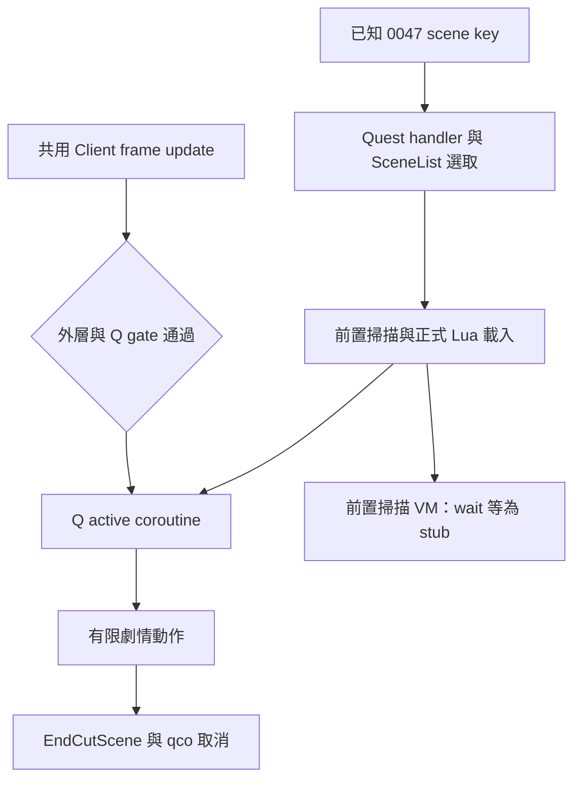

# MEF 開發前置續查：普通場景入口、協程壽命、死亡事件與本地物件身分

> extra/roy1／KR 原件／開始時間 2026-11-14 19:29:49 Asia/Taipei。使用者指示：「請繼續分析後上git」。
>
> **總目標仍為階段性未完成。** 本輪已閉合若干入口、持續更新、事件 producer／consumer 與回傳契約；尚未證明普通副本可以載入新 `.mef` 並接手完整戰鬥編排。以下每個正向或負向主張均限定到實際原件路徑，不提升 T01 FULL-PASS、RR ACCEPTED 或實機可玩狀態。

## 1. 先回答目前能開發到哪裡

**普通場景可執行已選中、載好並啟用的有限 Q sequence，已取得比前稿更完整的靜態依據。** `0047` 前端走獨立 Quest handler；共用 frame update 又會更新 Q manager，兩者都沒有「必須為 CScenarioField」的限制。這可以支持 Server 端的既有劇情選擇、開始／收尾整合與驗收契約。

然而，「已有 Lua parser」「副檔名可自訂」「能傳一個檔案」「能在普通場景播放既有 sequence」仍不足以直接得到「新 `.mef` 接手普通副本」。新內容仍須有可達的 selector／resource 路徑，不能靠 MapList 的 TRIGGER 字串自動推出執行；長時間戰鬥腳本也必須取得有效事件、可靠 actor 身分及正確取消機制。

本輪的實質更新如下。

| 問題 | 本輪新增的原件結論 | 對開發的直接影響 |
|---|---|---|
| 普通場景能否接到劇情入口？ | `0047 → 494440 → Quest v+4 → 4FDA30 → 503040 → 561760`，前端不走 generic current-scene gate；非零 quest 不受後述 quest=0 的型別分支限制 | 不再把有限 Q 劇情誤限於 CScenarioField；仍需有效遊戲狀態、合法 scene key 與資源 |
| 進普通場景後誰繼續跑協程？ | 共用 `490FE0 → 491ED7 → 561520` 更新 Q manager；受外層 `+BFCC`、Q `+28/+2C` 等 gate | 入口與 executor 可以接成一條正向功能鏈；不是只找到可呼叫 API |
| 長期啟用 Q 是否影響操作？ | Q 寫 current controller `+58=1`；三種已知 controller 的共用 consumer 會清既有控制 row 的移動位元與動作量 | 不能把長期 Q 活動視為不干擾一般操作的背景 runner；也不能外推成所有技能／網路通道都被封鎖 |
| 是否已有另一種常駐 runner？ | Tutorial 的 `tco` 有自己的 tick、alive 與取消路徑；Tutorial scene／Expedition Synopsis／特定 UI 才有已證 caller | 有原生持續腳本機制，但不能把 Tutorial context 泛化為普通副本 |
| 怪物死亡會否通知 Lua？ | 已把既有 EntityId 狀態訊息接到 CMonster 的 CDeadState；進入／更新支線主要為死亡動畫、視效、淡出及診斷 | 不能把顯示死亡直接當成 instance 的 GroupCleared |
| 移除時的三槽迴圈是否事件廣播？ | `4DFBC0` 呼 controller `v+1C`；已知三類 target 都是 `545290` 取槽值，caller 丟棄回傳 | 修正「通知三槽」的過度解讀；這個迴圈不能補上 Lua death observer |
| Client 有沒有 Lua 可讀的原生事件？ | 教學模式的互動 producer 會寫 controller flag，`Tutorial.GetControlStatus` 真的把數值推回 Lua | 存在正向機制，但 producer 有 mode=4 限制，普通控制器同 offset 不是同種欄位 |
| 本地建立物件能否直接拿回 ID？ | `lb.CreateObject`／`CreateObjectEx` 的 wrapper 宣告 1 個 Lua 結果，卻未 push 新 ID；後續 actor API 使用世界 ID 樹 | 不能把回傳 1 當 ID／成功碼；本地 spawn 替代 Server spawn 前仍缺可靠身分橋接 |

完整分題原稿：[entry.md](MEF-entry-lifecycle-events-20261114/entry.md)、[lifecycle.md](MEF-entry-lifecycle-events-20261114/lifecycle.md)、[events.md](MEF-entry-lifecycle-events-20261114/events.md)、[identity.md](MEF-entry-lifecycle-events-20261114/identity.md)、[controller-input.md](MEF-entry-lifecycle-events-20261114/controller-input.md)。本主稿整理跨題判斷，細部 bytes、分支及來源以分題稿和證據包為準。

## 2. 原件、工作基準與本輪範圍

### 2.1 可追溯來源

| 來源 | 大小 | SHA-256 |
|---|---:|---|
| `Tartaros.bin` | 12,472,320 bytes | `9741d1975327b9309d82b52f631165bc410757694d7c183a5eed970a53ebef91` |
| `Event.stp` | 11,241,597 bytes | `2e68e0202565530e574e0810ad7f758a2fc8d6826a0de0975ccaff12c2d4718b` |
| `Table.stp` | 5,248,784 bytes | `09e2cc48be98ad491afe394f966feb5812983fbf35da9037a8fa477d9848a442` |

本輪開始時工作分支為 `extra/roy1`，遠端及本地 parent 均為 `2d9896d62c1cfb14aa4f824f7adcb835156fb4eb`。最新 main 查核基準為 `552e05a024505a3773095f951c285216051ce2a1`；已取回該 commit 並以明確 SHA 讀取。這個單分支 checkout 的舊 `origin/main` 名稱不代表最新 main，沒有拿它代替本次基準。

已閱讀 `02-PROJECT-SHARED-INSTRUCTIONS.md`；沿用同一對話既有派工／退回檢查，並比較前次 main `ba5f96dfa94d734cbded291fb8887f50426bfa77` 至本次基準的相關治理、派工、RR、Task 與 Client 政策。相關入口沒有新差異；T08／T16 inbox 沒有本輪待認領 S00 請求。只修改 `kr-extra-roy`，不新建分支、不合併 main、不變更 RR／owner／共用索引。

反編譯檔僅導航；關鍵呼叫、虛擬槽位、constructor、欄位讀寫、marshaller、原資源列與指令均回到原件核對。PE VA→raw 按 section 映射；零初始化虛擬尾區不假裝有檔案 bytes。來源 commit、Git blob、原件 hash 及角色見 [source-manifest.json](MEF-entry-lifecycle-events-20261114/source-manifest.json)。

### 2.2 沿用的已證內容

前兩份稿件繼續有效：

- [可傳遞時機與資源可見性](20261114-183651-chatgpt-web-roy1-MEF-delivery-windows.md)：launcher 預啟動更新可條件性傳任意檔名；遊戲 TCP 尚無已證任意 blob→Lua 入口；交付、封裝索引、路徑、cache 與解析生命週期必須分開。
- [parser／executor／記憶體與路徑](20261114-190624-chatgpt-web-roy1-MEF-parser-executor-storage.md)：Lua 5.1.3 與精確 chunk header、兩種 Lua state、prepass 立即執行、正式 coroutine、MapList TRIGGER 只存檔名、來源 buffer 與 VM 物件分別存活。
- 最新 main 的 `S00-20261113-MONSTER-LOCAL-CONTROLLER-BOUNDARY.md`：本機 actor 掛接、三種 controller 分工、已證 SubAI 對一般怪物 model 的限制。它不代表所有 Client AI 路徑都不存在。
- 最新 main 的 `MEF-FUNCTIONAL-COMPLETION.md`：Server 已有多種關卡事件、波次、增援、巡邏與旗標成果；本稿不把它們重列成完全未實作。Server 內容定義進度與 Client 接手原 Server 操作的進度分別判定。

本輪沒有重做 `.mef`／STP 全名清查、FB74C0 literal 全掃、既有網路 opcode 表 census 或舊 16／15 direct-call 清單。新的定向查找只針對本輪尚缺的具體 caller、狀態、controller 槽位及本地 ID 計數器，搜尋範圍與排除界線有另行保存。

## 3. 普通場景的正向入口：`0047` 不是只對 CScenarioField 生效

### 3.1 前端到 Quest manager

`493170` 的 connection handler 表從 owner `+208` 起、stride `0x10`。`4936D4` 選 `494440`，`4936D9` 存 owner `+678`，索引 `(0x678-0x208)/0x10 = 0x47`。

`494440` 必要時初始化 Quest singleton；`494496..4944AF` 直接取 `FAB2A0` 的 vtable `+4` 呼叫。constructor `4FFE60` 在 `4FFE95` 安裝 `C0DB08`，其 `+4` 為 `4FDA30`。Quest 子表由 `5020B0` 註冊，`50210B` 寫 `FAB4DC=503040`；表起點 `FAB2A4`、stride 8，同樣得到 index `0x47`。

這條前端沒有經過 generic `4B7EC0` 的 current-scene-null gate。**它證明派送不被那個 gate 擋住，沒有證明空 scene 時可以安全播放。** 後面的 Q、世界、資源與 renderer 仍有 context 前置。

`503040` 接到 `561760`。在 `561830..561834`，非零 quest 直接跳到後續 `5618DC` 路徑；與當前 scene 型別 `4/9/0x19` 有關的比較屬於 quest=0 的 skip-record 分支。其中 `0x19` 是十進位 **25**，不是 STAGE 十進位 19。不能反過來把這組數字寫成所有 `0047` 播放的允許場景白名單。

兩個網路 key 按 **signed 16-bit** 解碼，不能由 XML 容許某個更大整數推定 `0047` 也能原樣表示。busy 時亦不是純粹無作用地忽略：`5617C6` 先清 manager `+89` 再走忙碌分支；review 入口 `565720` 則先把 `+89` 設為 1。第二段沒有排隊或載入，卻可能改變當前播放的 normal／review 結束分支。因此 Server 必須避免盲目重送和一次預送多段。

### 3.2 有入口還要有能選中的內容

原生選擇仍是 SceneList 的雙鍵與 `funcName`，再形成既有 `Event/Sequences/<name>.seq` 路徑。它不接收任意完整路徑或 `.mef` bytes。新的檔案即使已由 launcher 放到磁碟，也必須能被已存在的 selector 指向，並符合資源 resolver 的可見性。

本輪補到 SceneList 建構／讀取位置：`560170` 的 `560344` 呼 `5607D0`。在已核 `0047` 路徑中沒有每次重讀 SceneList；不能把「送一次 0047」當成「讓 Client 重新索引新檔案」的命令。動態別名或其他 reload 路徑不在這個單一 caller 結論內，沒有全域否定。

另一個看似替代的 `565720` 入口，上游閉合到本機 ScenarioReview UI 的選取／播放路徑，仍使用同類 scene key 與固定 `.seq` 命名；它不構成普通副本的任意檔名執行器。

### 3.3 開機固定 Lua 並不隨 Map191 自動重選

bootstrap 成功分支 `4A2EC0 → 4A3046 → 48AB70` 建立 Client，載入固定 Boot／Logic／Coroutine 名稱；接著 `4A305A → 6DEB40`，以 owner `+8` 的虛擬槽 `+28` 進到 `48C6E0`，載入固定 UI／Table Lua，再於 `48D775 → 560600` 綁共用 wrapper 並載核心腳本。

這個上游解釋固定 Lua context 何時建立，並未提供「每次選 Field19、收到 0012 或讀 Map191 的 TRIGGER 就執行新 Lua」的 consumer。本輪沒有把已存在的開機檔案清單改稱新的普通戰鬥啟動介面。

### 3.4 不同 ID 域必須分開

| ID 域 | 本案選定值／內容 | 可以推出什麼 |
|---|---|---|
| Quest／scene 雙鍵 | `15/1..4`、`119/1..5` | 選 SceneList row，不直接選 MapList TRIGGER |
| 邏輯 STAGE／Quest.field | `19` | Case103 的 STAGE，並非其他帶有 19 的 enum |
| Case ID | `103` | `_CaseList.xml` 的 `ID`，其 STAGE=19 |
| 實體 Map selector | `191`、`192` | `_MapList.xml` 對應 `S_pathofpindus01/02.mef` 名稱與 map/bound 資源 |
| 當前 scene 類型值 | `561760` 比較的 `4/9/0x19`，最後一項為十進位 25 | 這個函式特定分支的場景 enum；不能用 STAGE19 直接代入 |
| controller mode | `[FBA7AC]` 的 Single=2、Formation=3、Tutorial=4 | 與 `F9392C` 的場景 subtype 是不同欄位；Mission scene type4 不代表 Tutorial controller mode4 |
| 世界 actor ID | actor `+4`／GameInfo ID tree | 與 Quest、Case、Map、Q actor slot 均不同 |

場景類別也要按原始 factory 分開：`005F/type2 → CScenarioField`，`005F/type4 → CMissionField`。本案 Field19／Case103 的主線候選是前者，不能因口語說「普通副本」便改填 type4。`005F` 先把 subtype 寫到 `F9392C = F8D9E0+5F4C`，再進 factory；成功安裝時可與模式欄位對上，異常狀態則不能保證值與物件永遠一致。

定向讀取原資源也給出明確反例：`15/1` 與 `15/2` 的 `.seq` 呼 `LoadMap("Square03D.fld")`；`15/3` 呼 `LoadMap("town001D.map")`，副檔名照原字串；`15/4` 呼 `LoadMap("")`。四者都有函式宣告及 `Register(function)`。因此「能發 Quest15 的 scene」不等於「已在 Map191 執行它的 `.mef`」。選定列及原行號見 [selected-entry-resources.json](MEF-entry-lifecycle-events-20261114/selected-entry-resources.json)。

## 4. 從入口接到每 frame executor，並追到結束與取消

### 4.1 Q 的 frame caller 是共用外層

需要修正一種容易出現的推論：不是因為 `CMissionField` 自己的 update 內呼叫 Lua，所以普通副本才能播放。原件外層 `490FE0` 分別做兩件事：

1. `491CD8 → 489CB0` 取得 current scene owner，`491CDD` 讀 module `+5EAC`，非空則 `491CEC` 呼 module `v+18`。`CMissionField` 的該槽為 `423060`。
2. 稍後 `491E75` 檢外層 owner `+BFCC==0`，經 `491ED0 → 422F40` 取得 `&FB73C0`，`491ED7 → 561520` 更新 Q manager。

第二路沒有 CScenarioField 類型 gate，也不以第一路 module update 回傳值決定是否呼叫 Q。`561520` 自己再要求 `+28!=0`、`+2C==0` 等條件，`5615D8` 才進 `f_doCoTask`。啟用時還會在 `5615BF..5615C4` 直接向 `[FBA7A4]+58` 寫 1，沒有空指標 gate，因此**有效的 current controller** 是必要 context 前置。符合前置時，可形成「原生 scene 入口 + 共用 frame 更新」的普通場景有限劇情能力。

這項結論仍以狀態、資源與 context 有效為前置；它不等於把 Q 的 active／pause 狀態繞過，也沒有把外層未知欄位只憑位置命名為某種業務狀態。

**本輪追加追到了 `+58` 的控制輸出 consumer。** Single／Formation／Tutorial 的已知 `v+2C` 方法都會進共用 `5452C0`。在產生控制 row 的相關分支，`+58!=0` 會把 row 的 16-bit control word 歸零並恢復原 actor 方向；若前次仍帶移動位元而 mapper 沒產生新輸出，還可生成零控制 word 的停止 row。此路徑組既有 `C2S 000A`，仍可能送出包含零控制 word 的封包，到達正常消費尾端時在 `545B83` 清除 `+58`；disabled 早退可跳過此 reset，不能稱為每次呼叫必清。

mapper 的 `0x8000` 與移動／方向／速度／位置測試相連，低 15 bits 來自這條通道的按鍵／動作彙整。因此已證的是**這條控制輸出的移動位元與動作量會被歸零**，不是整個世界停止更新、所有封包被擋住或全部技能都不能施放。Q writer 又發生在 `+2C` 的停泵判斷之前，單憑暫停 coroutine pump 不能推定同時解除這個旗標效果。具體原件與 gate 見 [controller-input.md](MEF-entry-lifecycle-events-20261114/controller-input.md)。

前置掃描和正式執行使用不同 state，是前稿已證內容。本圖不是宣告兩路時間並行；它提醒實作者同一份內容可能先被 prepass 立即走過，再進正式 coroutine。無條件等待「全部怪物死亡」的迴圈仍可能卡住 prepass，不能只因正式 VM 支援 yield 就忽略此問題。

### 4.2 `tco` 是另一套 runner，不能直接當通用替代品

`4A8B90` 以名稱呼 `t_doCoTask`，將數值結果是否非零寫到 Tutorial owner `+34`。它與 Q 的 `f_doCoTask`／`qco` 是分離的 runner；原始 TutorialBase 建立獨立 `MoCo.new`，具有註冊、tick、alive 與移除介面。

| 已證 caller／owner | 更新條件 | 清理界線 |
|---|---|---|
| Tutorial scene，RTTI `CTutorial@Scene` | `4C4DF0` 在 base update 後 tick，不看 Q `+28` | `4C4D60` leave 明確呼全 coroutine 取消 |
| Expedition scene，RTTI `CExpedition@Scene` | `4C1930` 受 owner `+BD78` gate；`4C1E10` 在進 Synopsis 時置位 | 依其專用狀態管理，不能泛化到普通副本 |
| 特定 Tutorial／Synopsis UI | `47C980` 受 UI owner `+26C` gate | 屬該 UI 壽命，不是任意 current scene 的常駐回呼 |

`Coroutine.lua`／MoCo 完整原始 bytes 在本輪可用原件中仍未取得。既有 S00 原稿記錄曾解析它的 13 個 prototype；這是可復用的來源線索，不是本輪已重讀原件或已證完整 wait 時間單位／錯誤恢復語義。TutorialBase／TutorialMain 的特定 prototype 另由現有 Event.stp 原件核對。

正向能力已不只停在 tick：TutorialMain 會建立子 coroutine、保存 handle，以 alive／`IsCutSceneRunning`／控制旗標配合 yield 等待，再按 skip 或控制狀態移除子任務。Tutorial 進場明確載入 `Event/TutorialMain.lua` 並呼 `Tutorial_EntryPoint`，離場明確全取消 tco。qco 與 tco 共用正式 VM，但各有一次 `MoCo.new()`；`Q.EndCutScene` 清 qco，沒有在已核兩個結束分支呼 `t_removeAllCoroutines`，所以 Tutorial 父任務可跨越子 Q 劇情延續。

`t_doCoTask` 也有數值回傳契約：`4A8B90` 只接受 number 或可轉數值 string，經 `FISTP` 轉整數後寫 `T+34` 的 0／1；Lua boolean `true` 不會被當成非零。TutorialBase 將 `Q.EndCutScene` 當參數傳入 `tco:doCoTask`，但缺少 MoCo 函式體時，不能把它斷言為「只有正常結束才呼」或「只有錯誤才呼」。

### 4.3 離開場景不等於必然清掉所有 coroutine

本輪以 vtable 槽位區分真正 leave hook 與一般 handler：

- `CMissionField` 的 `v+14 = 4BBF10`，已核主體清自己的容器，沒有直接呼 qco／tco 全取消。
- `CScenarioField` 的 `v+14 = 8DC2F0`，此槽是空 hook。
- `4BCA90` 是既有 `S2C 0031` handler，不是上述 leave hook；其 `5624B0(0)` 路徑可到 EndCutScene／qco 收尾。
- Tutorial 的 `v+14 → 4C4D60` 才有明確的 tco 全取消。

因此不能把「切了地圖」當作已證的所有 Lua 工作停止保證，也不能把 `0031` 的特定收尾行為任意擴張成所有離場的共同契約。內容編排與 Server 整合都要記錄正常結束、跳過、失敗、離場和重入的實際路徑；qco 活動旗標清除、VM 存活與來源 buffer 釋放是不同層次。

## 5. 死亡、移除、教學互動：哪些資料真正到達 Lua

### 5.1 既有 EntityId 狀態訊息已接到 CDeadState

本輪沿既有狀態訊息入口，補到具體虛擬 target：`4ADDC6` 註冊 `0x000C → 4B0130`；handler 用 row 的 EntityId 查 GameInfo actor，`4B01AE` 呼 actor `+F0` 的 FSM `v+8`。CMonster 次 vtable `C0CA64` 的該槽為 `4CA060`。其 constructor `4D1710` 建 state ID 3 並安裝 `C077CC`；RTTI 經 COL／TypeDescriptor 證實 `CDeadState@ActorStates`。

狀態方法為 enter `4CB590`、update `4CB710`、leave `4CB7D0`。CMonster 的實際 update 也已接到 current state `v+8`，所以這不是只有孤立的 vtable 名稱。這讓「Server 指定世界 actor 狀態 → native 死亡顯示」不再停在不明 virtual call。但動畫 7、DEAD 視效、淡出或診斷資料，不自動具有「本 instance 某群組所有活體已清除」的語義。既有協定 framing 與狀態來源沿用原契約；本輪不另發明新死亡事件 opcode、ACK 或 group 欄位。

兩個行為會直接影響 Server 整合：缺 actor 的 row 會被跳過，沒有等待晚到 actor 的佇列；FSM 沒有「新 state 等於目前 state 即忽略」分支，重複 state3 會再次 exit／enter，重設死亡計時與效果。因此權威死亡、死亡呈現、actor 移除和群組完成要分開對帳，不能把每次 enter 或每筆移除都累計為一次新死亡。

enter 的可選 `49D8E0` 分支已追到底：它受 `FAB104 & 4` gate 控制，以 actor 的 model/composite 欄位格式化診斷文字，再送訊息佇列及 UI 刷新；不是保留 world EntityId／instance／group 的 Lua callback。這是該指定候選的排除，沒有宣告全部 UI event 系統都不能連 Lua。

### 5.2 三槽迴圈的更正

`4DFBC0` 世界移除路徑確實迴圈三次，但取的是當前 controller `v+1C`。對本輪已解析的 Single、Formation、Tutorial controller，這個槽都指向 `545290`：只回傳 `[this+0xC+index*0xC]`。caller 沒有保存或測試結果，也沒有在該 getter 中寫旗標或 dispatch。

所以本稿撤回「這個三槽迴圈可視為移除／死亡廣播」的表述。移除路徑後面還有 actor 自身方法、析構及索引 erase；這些需按其實際作用判讀，不能用「有呼控制器」四個字直接接成 Lua event。

### 5.3 有正向事件橋接，但屬 Tutorial context

原件提供一個可對照的完整機制：互動分類 4 且 `[FBA7AC]==4` 時，`5443E3` 寫入當前 controller `+0xB4+4*key = 1`。`Tutorial.GetControlStatus` 的註冊與包裝層接 `4A9FB0`，讀同一旗標；`4ACFFE` 寫 Lua number type，`4AD005` 寫入數值，`4AD007` 推進 stack top。這確實是 native producer → native reader → Lua 可讀值。

原始 `TutorialMain.lua` 還有真實 action consumer：`Tutorial_Part1` 輪詢點 1／2 的 `GetControlStatus`，條件成立後關閉對應 `TUTORIAL_POINT`，再播放 `1000/3`／`1000/4`。相關 Lua 指令字、常數與位置已回 Event.stp 對照，不是由 API 名稱推測。這套已證教學編排可在合法 context 下由 Client 接手等待與後續動作，普通副本尚缺的則是可適用於其 owner 的事件來源。

但 constructor 也給了不能泛化的反證：Tutorial controller 在 `548B90` 初始化 32 個旗標，並在 `548C65` 設 mode 4；Single controller 在 `5485A1`／`5485C6` 的 `+B4/+B8` 是 heap 物件指標，CMission 的此 controller 配置大小為 `0xC0`。同一 offset 在不同具體類別不是同一欄位。全域有 Tutorial namespace，不能保證普通副本中的 API 有正確 owner 佈局。

普通互動出口的已核 category=0 路徑走既有 `001C` 請求，不是以上教學旗標 writer。本輪也沒有從 CDeadState／世界移除補出「將指定怪物群死亡寫成這 32 個教學旗標」的鏈。

## 6. 本地建立 actor：有作用，但沒有可用的 ID 回傳契約

`lb.CreateObjectEx` 走 `4A1830 → 4A2010 → 4A25F0 → [FE178C]=4A0F70`。native 以 `[F7DE04]` 低 WORD 寫 actor `+4`，加入世界索引，再將 DWORD counter 加一；檔案初值是 1001。這些既有建立能力仍成立。

本輪補完回傳端：marshaller 在 `4A2806` 呼 native 後，直接回收暫存並 `xor eax,eax; ret`。外層 `4A2052` 設 EAX=1，但沒有 push Lua 結果。Lua VM 將這個 1 當結果個數，不是把數字 1 當作 ID。`lb.CreateObject` 的四參數捷徑同樣沒有 ID 回傳。

相對地，`SetActorAvatar`、`AttachActorItem`、`DetachActorItem` 確實將第一參數交 `82EF00` 查 `FAB138` 的世界 ID 樹，以 node `+10` 取得 actor。它們沒有把 model ID、Q slot 或建立順序轉成世界 EntityId。故兩端 API 之間仍缺可靠身分取得／對帳橋接。

參數型別亦不能猜：`CreateObjectEx` 的 attach 位置只接受 number 或可轉數值的 string，其他型別走 0 fallback。Lua `true` 不能直接代替已證的數字 `1`。若開發內容產生器，須驗固定參數數量、數值範圍與 owner context；native 的轉型失敗歸零不是完整的內容錯誤處理。

針對單一 counter 的 `.text` 絕對位址定向查找只見 `4A104F` 讀和 `4A11BB` 加一；這不含計算 alias。不能由它推定每張地圖重新從 1001 開始、多人建立次數一致，或 Server 可以安全猜出本機 ID。詳見 [identity.md](MEF-entry-lifecycle-events-20261114/identity.md) 與 [lb-bindings.json](MEF-entry-lifecycle-events-20261114/lb-bindings.json)。

## 7. 對 `.mef` 內容實作的具體約束

此處說的是「在既有 Client 機制之上設計可達內容」的需求，沒有宣告官方 `.mef` 格式已復原。若另設 Server 自有內容 schema，仍依既有治理標 `NOT_NATIVE_MEF`，且不能把 Server schema 已能執行等同 Client 接手。

| 內容／工具必須處理的面向 | 已可依據的證據 | 尚不能假設的部分 |
|---|---|---|
| 內容識別與選取 | SceneList 雙鍵、funcName、固定 sequence 路徑；MapList TRIGGER 為另一資料域 | 新檔案傳到 Client 後會自動掛進 selector；TRIGGER 字串會自動執行 |
| Parser 相容 | 前稿精確 Lua 5.1 header、文字 loader、不同 BOM 處理、Lua state 與資源 loader | 官方 `.mef` 就是 Lua；改副檔名就繞過 selector |
| 前置掃描可終止 | aux VM 的 72 個 stub 與 6 個有效 callback、Register 立即執行 | 戰鬥等待在 prepass 會 yield；所有 API 都存在於 aux state |
| 正式執行與壽命 | Q 的共用 frame tick、active/pause gate；Tutorial 另有 tco | 任意普通場景存在無限期 battle coroutine；換圖必然取消 |
| Typed API 與回傳值 | 參數 marshaller、不同 owner 佈局、真正 pushnumber 與只回結果個數的差異 | Lua `true` 能代替數值 1；任何 `return 1` 都是成功／ID |
| 事件來源 | 教學互動旗標的完整讀寫鏈；世界死亡狀態與移除的有界作用 | 普通死亡已聚合成指定 instance/group 的 Lua 事件 |
| 物件身分 | 世界 EntityId、Q slot、model ID 各有用途；local counter 寫 actor ID | 本機 spawn 自動與 Server EntityId 對齊；同 counter 值就代表同 actor |
| 結束與回報 | 已證 EndCutScene／qco 清理與特定 0031 路徑 | DoFile 返回值、畫面播完或 getter 返回值是業務完成 ACK |

因此現在可以進一步做有界的內容驗證器／編排規格與既有 sequence Server adapter；新 Client 內容的完整掛接、普通清組後自動開門、全怪物本地生成及通用自主 AI 尚不能宣告可直接落地。本輪沒有改寫或執行 Client、Lua、STP，也沒有新建一個偽裝成原生 `.mef` 的格式。

## 8. Server 開發需求與 Client 缺口分開移交

以下為供 S00 依既有 `REQ-0017`／`REQ-0018`／`REQ-0019` 等範圍去重的候選補充，並非新的平行台帳或核准規格。現有 Server 波次、旗標、結算等實作繼續按原成果管理。

| 玩家情境／目標 | 已證 Client 介面要求 | Server 開發或整合需求 | Client 待逆向部分 |
|---|---|---|---|
| 普通副本播放選定既有劇情 | `0047` scene key 可到 Q；共用 tick 可執行有限 sequence | 依正確 ID 域選內容，檢查其 LoadMap／RestoreMap 與當前 instance 是否相容；安排開始、正常結束、跳過與續戰 | 任意新內容的可達 selector／resource 安裝路徑 |
| 劇情結束後回到同一場戰鬥 | Q active／pause、EndCutScene、特定 0031 清理；離場 hook 不一律取消 | 建立重複開始／完成去重、取消與重入策略，對應既有合法訊息與 instance 世代；不能拿無效 return value 當 ACK | 非正常離場下其他 caller／異步清理的完整界線；不得假填新 wire 欄位 |
| Server 宣告特定怪物死亡 | 既有 EntityId 狀態訊息可到 CDeadState；世界索引有確定 key | 沿既有死亡／移除契約整合 actor 存在性、狀態順序與業務提交；本輪不要求重寫已完成死亡功能 | 普通死亡／移除到 Lua 的 typed observer，以及群組歸屬／計數 consumer |
| 停發 Server 開門，改由 Client 清組後開門 | 既有本地 setter 與教學事件介面只提供部分能力 | 設計明確停發對照測試，維持 instance 結果與持久化正確；提供可追溯事件來源與 group membership | 普通 instance 的可達清組事件及正確 owner；不能借教學 flags 假裝完成 |
| 停發 Server spawn，改由 Client 本地建立 | `lb.CreateObjectEx` 可建立本機世界 actor，但不回傳可靠 ID | 在已有 Client 介面證據之後設計身分對應、重複建立／重連去重及結果對帳；無介面時不得猜 ID 或自訂 opcode | 本地 actor handle／ID 取得及跨端橋接；普通怪物自主決策所需 context |

Server 內部如何保存 instance、編排波次或決定權威結果，屬 Server 開發需求；未知的 Client selector、Lua callback、actor 身分回傳仍屬 Client 逆向。兩者不能互相代替，也不要求取得原生 `.mef` 才能推進已有相容介面的 Server 工作。

## 9. 下一步與可驗證完成條件

### 9.1 可以開始的有界工作

**既有有限劇情的 Server 整合規格可以開始。** 選一個已知 scene key，固定前置場景／資源／角色狀態，記錄原生開始、共用 tick、EndCutScene、既有完成訊息和續戰的實際關聯。驗收不只看畫面出現，還要確認退出後輸入／戰鬥／地圖恢復正確，且重複／中斷不留下舊 coroutine。

這個階段證明的是 Client 執行已存在的有限內容，不是新 `.mef` 已部署成功。若要求新內容，必須另有一條原生可達的選取與資源可見性證據，不能用改名、覆寫既有資源或直接呼 debug function 取代這個要求。

### 9.2 尚未閉合的靜態問題

| 問題 | 本輪已排除／已完成的範圍 | 接續所需的精確證據 |
|---|---|---|
| 新腳本入口 | 0047 是既有雙鍵 selector；review UI 同域；固定 startup Lua 不是每次 Map191 自動載入；TRIGGER 儲存不等於執行 | 另一個實際可達 caller、可被現有 selector 指向的新路徑，或未取得之原始腳本內明確的載入 consumer |
| 普通戰鬥常駐排程與取消 | Q 只有 active 下 tick，且已補到 `+58` 抑制既有控制 row；tco 的三條 caller 有明確 context；已核 leave 槽不一律取消 | 可維持正常操作的普通場景啟用／tick／取消契約；不能用長期 Q active 假定不干擾控制；MoCo 原始 bytes 可補時間／錯誤語義 |
| 普通死亡／清組到 Lua | CDeadState 與世界移除補到具體方法；三槽 getter 排除；教學 flags 有正向但型別不適用 | 有 group／instance 語義的 producer、有效 owner 欄位、Lua reader／callback consumer，或可由已證 API 有界聚合的替代方案 |
| 本機 actor 身分橋接 | CreateObject 系列無新 ID push；外觀／附掛 API 要世界 ID；counter 不可當全域身分契約 | 新 actor ID／handle 的可達回傳或事件、與 Server 查找域的明確對應和壽命 |
| 普通自主 AI | 沿用最新 controller／SubAI 有界結論；能掛 controller 不等於有適用一般怪物的決策器 | 普通模型的 target 選擇、移動／攻擊決策及效果回報鏈；不得只證明一次性動作 API |

以上保留為未完成問題，不以「需要實機」概括仍缺的靜態 consumer，也不將缺少官方 Server 演算法當成 Client 逆向阻塞。

### 9.3 Client 接手的驗收必須指明停掉哪項 Server 操作

| 驗收目標 | 必須明確停止的 Server 操作 | Client 必須仍然完成 |
|---|---|---|
| Client 清組開門 | 該 instance 的對應開門／更新操作 | 正確群組死亡後開正確出口；換圖、取消、重入不誤開 |
| Client 本機 spawn | 指定測試群組的 Server spawn | 正確模型／位置／身分／生命週期；傷害、移除、結果可對帳 |
| Client 自主行為 | 選定範圍的 Server 逐步移動／選招命令 | 自主選擇、抵達／取消及有效動作；不是重播 Server 預排的每一步 |

本輪只完成分析和證據保存，沒有執行這些驗收。Server JSON 能取代逐關硬編碼，也不能代替上述「停掉指定 Server 操作」的成功條件。

## 10. 驗證與交付

已以本包 `verify_evidence.py` 對原 BIN、Event.stp、Table.stp 及 repository 固定來源完成唯讀重驗，結果為 **PASS（證據一致性）**。完整機器可讀結果見 [verification-result.json](MEF-entry-lifecycle-events-20261114/verification-result.json)。

| 核對項目 | 本輪結果 |
|---|---|
| 原件記錄 | 264 筆 code／data／string records，共 28,839 bytes，包含刻意保留的重疊視窗 |
| 原生關係 | 6 組 RTTI／vtable、7 個零初始化全域、34 個明確 direct call 與 14 個 lb binding |
| 有界候選 | 12 個入口目標、3 個事件目標、3 個 tco direct caller，以及單一 ID counter 的 2 個 literal operands |
| 選定資源 | 7 個 STP members；13 列 XML 與 16 行 sequence 原始內容 |
| Lua 資料 | 3 個原始 chunk、93 個 prototype、1,536 個指令字；其中本輪引用 19 個 prototype／779 個指令字，另核對 4 段事件 consumer 選取 |
| 固定 repository 來源 | 177 個 commit／path／Git blob／SHA-256 身分；三份先前完整 Lua 解碼另與原件重比 |

主稿與五個分題稿的相對連結已核對，補證和重驗器一併保存。數量用於重現本輪讀集，不作功能完成率或整體相容性分數。

證據包入口：[README.md](MEF-entry-lifecycle-events-20261114/README.md)。原件保持唯讀；驗證程式只解析 PE／STPD／Lua chunk 資料及核對 Git source identity，沒有啟動、附加或修改 Client，沒有執行 Lua。bytes 與來源核對通過只證明本包可重現，不代表全遊戲負面證明、官方 MEF 格式、T01 FULL-PASS 或實機驗收。
