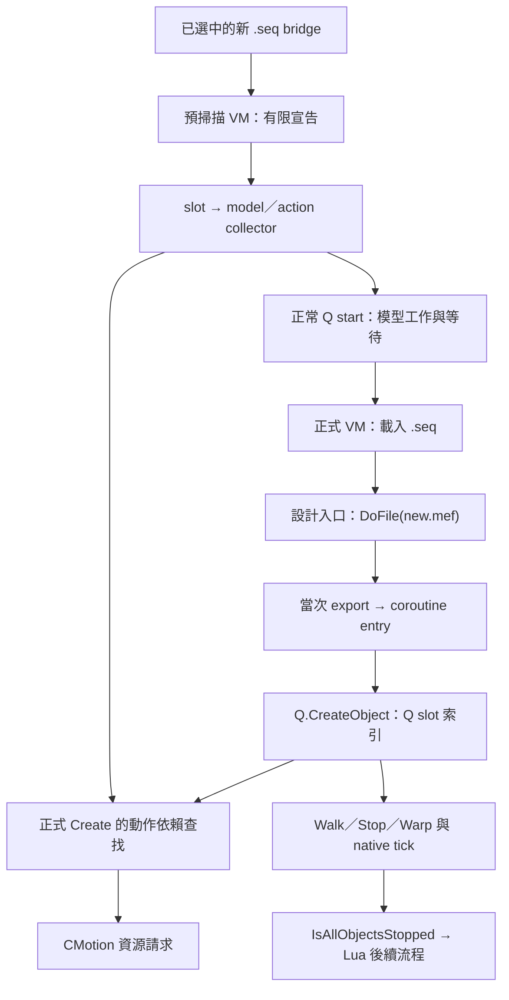

# `.mef` 第八輪：雙 VM 依賴、Q 物件生命週期與可用的停止 observer

作業開始：2026-11-16 02:41:01（Asia/Taipei）。分支：`extra/roy1`。工作父提交：`88b22bcd750ea219bfc56580139396d0ee677644`。本輪核對的 main：`03b3ea5eae2cb92f9fc373d432edeaf635d6c5fc`。

已完整讀取 `02-PROJECT-SHARED-INSTRUCTIONS.md` 與現行 AGENTS；與前輪 main 相比，指定治理／研究／共享及相關任務範圍沒有新增變動。沿用既有 branch，新增本報與自己的證據包，不變更共享狀態、RR、owner 或治理文件。完整來源身分與讀取界線在 [source-manifest.json](MEF-content-contracts-20261116/source-manifest.json)。

## 1. 本輪的直接答案

**現在可以把「新增 `.mef` 模組需要哪些依賴、如何建立並操作 Q 演出物件、如何等待走位停止、如何整組清理」寫成具體開發契約。普通戰鬥的持續 Lua 排程、可戰鬥世界物件身分及死亡／清組事件橋，仍未全部接齊。**

這輪不是再搜尋 `.mef` 字串或重述 parser 已存在，而是補完四組會直接改變實作方式的 producer／consumer：

| 問題 | 本輪新增結果 | 對開發的影響 |
|---|---|---|
| 新 `.seq` 只呼 `DoFile(new.mef)` 是否就夠？ | 預掃描另有 slot→model→action collector；正式 Create 會消費這筆資料，最後接到具體 CMotion 資源請求 | 新 bridge 須同步提供有限的依賴宣告；只在正式 VM 載入模組，不會自動補出預掃描集合 |
| Create 沒回新 ID，後續如何操作物件？ | Q 允許內容預先指定完整 DWORD slot，Create 存入 Q tree，Move／Show 用同一 slot 查找 | 已有 Q-local 參照方式；不能把它直接當 world EntityId |
| 如何等待這些物件完成移動？ | `Q.IsAllObjectsStopped()` 真正回 numeric 0／1；原版 `WaitForObjectsStop()` 已用它輪詢 | 有可用的有限走位演出流程；空表、Stop、Warp 也能讓判斷成立，不能拿它當死亡或清組 |
| 上輪普通 page／field 的動態 update 能否當背景 runner？ | 已接到 checkpoint、訊息維護、狀態列、背包與隊伍 UI | 這批具體 target 尚未提供新 Lua 的合法登記／背景 pump 契約 |

四份完整分析與原件證據分別是 [雙 VM／資源契約](MEF-content-contracts-20261116/bridge/report.md)、[Q 物件身分與清理](MEF-content-contracts-20261116/actors/report.md)、[停止與 Tutorial observer](MEF-content-contracts-20261116/observers/report.md)、[普通場景更新](MEF-content-contracts-20261116/ordinary-runner/report.md)。

### 必須顯性更正的前輪用語

[前輪 runner §7](MEF-world-integration-20261115/runner/report.md) 將 `4ADB10` 遍歷對象概稱為「native actor list」。本輪以 manager／element constructor、vtable、RTTI 與 vector producer 證明：**這是 `CCheckPointMgr @FB79F0` 的 checkpoint pointer vector `FB79F4..FB79F8`；正常元素是 `CCheckPoint`。** 它不是一般世界角色清單，也不是 Q 的 `CEventActor` tree。後續排程與敵人觀察分析應使用這個較精確的分類。[更正與原件鏈](MEF-content-contracts-20261116/ordinary-runner/report.md)

## 2. 完整使用流程：哪些已證，哪些仍是新內容設計

此前已證的發布、入口、parser、儲存與排程基礎在 [完整流程前稿](20261115-060700-chatgpt-web-roy1-MEF-complete-flow.md)、[runtime 契約](20261115-065342-chatgpt-web-roy1-MEF-runtime-contracts.md) 及 [world integration](20261115-121913-chatgpt-web-roy1-MEF-world-integration.md)。本輪沒有把那些成果重算成新發現。

| 階段 | 可採用的流程 | 必須保留的條件 |
|---|---|---|
| 1. 發布檔案 | 已證 launcher 啟動前的版本／HTTP／gzip／普通檔案交付鏈 | Server 須實作相容發布與啟動放行；這不會使遊戲 TCP 自動具有任意 `.mef` blob 接收能力 |
| 2. 讓內容可被選中 | 既有 `0047` 使用 signed 16-bit 的 quest／scene 雙鍵，查已載入 SceneList，形成 `Event/Sequences/<funcName>.seq` | 新資料須在索引／快取要求的時間可見；單有磁碟檔案或 MapList `.mef` 字串仍不成立 |
| 3. 預掃描 | 獨立 VM 立即執行 Register body，以全域 callback 收集模型、動作及 music | 必須有限返回；依賴順序、位寬、first-model 與參數個數按本輪契約 |
| 4. 模型工作 | 正常 Q start 把 collector 存到 `M+70`、發布模型工作並等待，再正式載 `.seq` | event／Wait 返回不構成模型完整性或 gameplay 成功 ACK |
| 5. 新模組入口 | 可以設計新的相容 `.seq` 明確呼 `DoFile(new.mef)`，有限頂層建立當次 export，再由合法 coroutine 進 entry | **這是條件式新 caller 設計，尚不是原版 `.mef` 已有 caller 的證明**；本輪未改原 SceneList、SEQ 或任何遊戲原件 |
| 6. 執行與觀察 | 有限 Q 內容可使用既有 slot 建物件、走位、停止 observer、後續對話／演出與明確 End | 仍受 qco、controller、輸入與資源生命週期條件限制 |
| 7. 清理與重入 | 實際 Q 全組清理、Lua 工作終止、正常 End／取消、等待解除各自處理 | `ShowObject` 不刪除、`DeleteObject` 空實作、Lua return 不代表所有 native 效果已清理 |
| 8. Server 對帳 | 由選定操作的內容 instance、版本、完成／失敗／取消規則完成協調 | 不能把既有 `003F`、`00EB` 或資源 event 自行擴成帶 generation 的新模組 ACK |

入口與索引條件沿用 [entry 報告](MEF-entry-lifecycle-events-20261114/entry.md)；資源可見性沿用 [resource gates](MEF-complete-flow-20261115/resource-gates/report.md)。`0047` 傳的是選取鍵，這條 handler 沒有任意檔名／檔案 bytes 欄位。Server 可以安排內容交付與後續選取時機，但「已傳到 Client」和「已由合法 caller 執行」仍須分別成立。

### 本輪閉合的雙階段關係



圖中 `DoFile(new.mef)` 節點是新內容整合設計；其餘選定 collector／Q／motion／observer 邊由本輪或已引用原件支持。模型工作與 CMotion 請求是不同階段，圖並不表示等待一個 event 就已確認動作播放或整段新內容執行完畢。[bridge](MEF-content-contracts-20261116/bridge/report.md)、[observers](MEF-content-contracts-20261116/observers/report.md)

## 3. 新內容最容易寫錯的資源契約

預掃描 `55C810` 的 map key 是 **slot 低 16 bits**，record model 是 **WORD**，action set 也用 **WORD**。同 key 第二次 Create 只加入 action，**不會更換第一次記錄的 model**。Ani／Walk／Warp 若先於 Create，查無 slot 就略過，並不保留待補依賴。

新 record 的整數 action 恰為 0 才改為 1；既有 record 再收到 0 不會同樣正規化。65536 先通過非零檢查、再截為 WORD 0，也是不同結果。這些分支與八個 `SYN / NOT_NATIVE_MEF` 算術反例已保存在 [bridge/contracts.json](MEF-content-contracts-20261116/bridge/contracts.json) 與 [synthetic-contracts.json](MEF-content-contracts-20261116/bridge/synthetic-contracts.json)。SYN 數字不代表有實際可用的同 ID 模型。

| 預掃描全域名稱 | 必須固定的參數個數 | 收集條件 |
|---|---:|---|
| `CreateObject` | 9 | 第 1 slot、第 2 model、第 6 action |
| `AniObject` | 3 | 第 1 slot、第 2 action，且 slot 已存在 |
| `WalkObject` | 7 | 第 5 numeric gate 非零，第 6 action；負 action 改為 4 |
| `WarpObject` | 7 | 第 6 numeric gate 非零，第 7 action；負 action 改為 1 |

這些 C callback 讀的是 stack 尾端 `-N..-1`；多傳值會把窗口移動。正式 global wrapper 與 direct `Q.*` 又可能使用不同參數表，例如正式 global Walk 有七參數、native Q Walk 有六參數。新內容產生器必須選定層級並校驗個數與 numeric 型別。[完整 ABI](MEF-content-contracts-20261116/bridge/report.md)、[原版 Walk wrapper](MEF-content-contracts-20261116/observers/report.md)

預掃描結果的用途也已接到實際 consumer：正式 `Q.CreateObject` 找 model resource，先要求 action 1／4，再以 slot low WORD 讀 `M+70` 的 action set，查 model `+D4` 的動作表。XML producer、constructor、RTTI 與 vtable 將所選動作具體定型為 `IS3D::CMotion`，最後 `v+24=7DAB20` 登記資源請求。這不是依名稱猜測「預載會載動畫」。[原件完整鏈](MEF-content-contracts-20261116/bridge/report.md)

正式 Create 對缺模型資源還有 `541610` 的按需工作，所以本報不把「預掃描漏一筆」說成一定完全不能建立；但它也不保證能補齊所有動作、貼圖或錯誤情況。內容驗證應在發布前檢查有限依賴集，避免依賴未證的自動補救。

## 4. Q 物件現在有可用參照，但不是完整世界生怪契約

### 4.1 三個 ID domain 應分開

| 用途 | 原件契約 | 不能取代的東西 |
|---|---|---|
| 正式 Q slot key | 完整 DWORD；Create 寫入，Move／Show 以同 key 查找 `M+18` | 不等於 world tree 的 EntityId |
| 預掃描 slot key | `slot & 0xFFFF` | 不等於正式 Q 的完整 key |
| actor `+04` | `((slot & 0xFF) << 8) \| typeByte` | 不因 low byte 類似網路型別就取得世界權威身分 |

例如 slot `1 / 257 / 65537` 可有三個不同 Q keys，卻得到相同 actor WORD；1 與 65537 又共用 prepass key。內容可採唯一 `0..255` slot 作保守政策，但這不是原生最大容量，也不是合法 world ID 的認證。[actors §4](MEF-content-contracts-20261116/actors/report.md)

所有已核 model 分支最後都配置 `0x438` 並建構 **CEventActor**。正式 Create 已證 publish 到 Q 私有索引；沒有在這個完整直接 body 看到 world registrar `4DFF30` 呼叫。未知下游或其他入口仍保留有界研究空間，現階段不能依賴未證的隱含 world 註冊。

這解決了「Create 不回新 ID，如何操控自己建立的演出物件」：內容自己保存 slot，後續使用同一 key。它沒有解決「如何建立可對帳、可戰鬥的世界怪物」。Create closure 的 C 結果數也不能當 spawn 成功／新 EntityId。[producer→consumer](MEF-content-contracts-20261116/actors/report.md)

### 4.2 三種清理行為不能混用

| 操作 | 本輪核實的效果 | 新內容規則 |
|---|---|---|
| `Q.DeleteObject(slot)` | 正常 binding target `476430` 原件只有 `C2 04 00`，直接 `ret 4` | 不能依它回收單一 slot |
| `Q.ShowObject(slot,0)` | 寫 actor `+42C`，render 讀這個 gate | 只是隱藏；不停止 native update、不刪索引 |
| 同 slot 再 `Q.CreateObject` | unique insertion 保留舊 actor，釋放新 tree node；選定返回路徑未清新配置 actor | 禁止當 replace／upsert，也不能盲目重送當可靠重試 |
| `Q.DeleteAllObject()` | 遍歷 Q tree，呼 cleanup、deleting destructor、heap free，再清 tree | 可以作已索引 Q 物件的整組清理；仍須另外結束／取消 Lua 工作 |

完整 registrar、marshaller、target、vtable、duplicate branch 與 destructor 鏈見 [actors §6–7](MEF-content-contracts-20261116/actors/report.md)。本輪沒有以靜態指標推導實機洩漏大小，也沒有假定 DeleteAll 能找到未成功插入 Q tree 的重複配置物件。

## 5. 已可用的移動完成 observer，以及它的限制

本輪最明確的正向腳本能力是：

> `Q.WalkObject` 用 slot 找 CEventActor → 設 `E2 & 0x8000` pending bit → native movement tick 更新位置並在條件成立時清 bit → `Q.IsAllObjectsStopped` 回 numeric 結果 → 原版 qbase `WaitForObjectsStop` 決定後續流程。

Getter 巡覽 Q 索引，任一 actor 的該位元仍為 1 就回 **0**；全部清除或 Q 表為空就回 **1**。原版 P24 先 yield，再在結果 `== 0` 時繼續 yield。P26 的 Walk wrapper 只 yield 一次，並不自動等到全部停止。[writer、tick、getter 與原版 Lua consumer](MEF-content-contracts-20261116/observers/report.md)

| 情況 | 為何必須單獨處理 |
|---|---|
| 空 Q tree | getter 回 1，但世界敵人可能仍存在 |
| 多個用途的 Q actor 共存 | getter 沒有 slot／group filter，會看整棵 Q tree |
| Stop／Warp | 可以清 bit；結果不等於自然抵達，更不等於死亡 |
| `actor+D4 != 0` | movement tick 直接返回，不幫忙清 pending |
| 零速度倍率 | 在已核距離條件下可能一直保持 pending；原版 speedstep 5 會得到 0 |
| qco 未 active 或被 gate 擋住 | native Q actor loop 在 qco 分支外，仍可能更新；Lua 等待仍需自己的 resume 條件 |

這給有限演出一條可開始實作的排序方式。若要用於可玩內容，仍須規劃失敗、Stop／取消、resume 與全組所有權，不能將「所有 Q 物件停止」改名為「這波敵人清空」。

另外核了兩個 Tutorial getter：`IsLeaderDialogOpened` 讀 Tutorial owner 的 UI 分支旗標，有原生 writer，但旗標不保證等於視窗實際可見；`GetTutorialState` 實際讀 current controller `+134`，已核 Tutorial ctor 清零，尚未閉合 post-init 有效 writer，也沒有普通 controller type guard。它們都不能填補普通戰鬥 death／group observer。[Tutorial 適用界線](MEF-content-contracts-20261116/observers/report.md)

## 6. 普通場景 runner：這輪縮小了什麼

上一輪留下的動態目標現在已接到正常 initializer、實際 owner、vtable／RTTI 與具體 consumer：

| 原先未定型的邊 | 本輪具體對象 |
|---|---|
| `4ADB10` 清單元素 `v+20` | CCheckPointMgr 內的 CCheckPoint，更新原生位置與 effect |
| ordinary field `v+24` | `4C4890 → 4D7A20`，訊息 owner `FB11E8` 與 `F4366` UI refresh |
| page `+164 → v+198` | Mission／Scenario 的 BottomMenu native UI |
| page `+168` 的 selected panel `v+1A8` | Inventory native 物品 UI；另一個 QuestInventory target 為空 `ret` |
| Mission page `+22C → v+16C` | PartyAlliance UI，最多顯示三個非自身 roster 項目 |

BottomMenu 確有 current-leader 三組數值比例 reader，已接到 native bar/control 更新；它不接受任意 EntityId，也沒有由此鏈把數值推回 Lua。巢狀 UI、terrain、collision、effect 與 runtime 指標改寫仍明列範圍，沒有宣稱全程式不存在另一個 runner。[ordinary-runner 全文](MEF-content-contracts-20261116/ordinary-runner/report.md)

**native update 持續發生，不等於新 Lua 可以在該入口登記工作。** Q actor loop 不被 qco 的 active／pause 分支包住，也不會解除前輪已證的 current controller `+58` gate。`Q.EnableInput` 或 `00EB` 清另一層 input mask，不能單獨保證 active Q 與一般戰鬥操作並存。[input 契約](MEF-runtime-contracts-20261115/input-lifecycle/report.md)

本輪沒有新找到 T caller，故不重做 Tutorial／Expedition／review 三條已閉合路徑。若功能只需要有限演出，可使用其已證生命週期；若目標是普通戰鬥的長駐邏輯，仍須有合法登記、持續 pump、操作保留、取消與重入的完整契約。

## 7. 現在能開始開發的部分

可以開始做**相容新內容產生器與有限演出整合**，並以以下單位交付：

1. **內容 manifest／離線檢查。** 固定 instance／版本、Q slots、model／action 依賴；拒絕 slot alias、同 slot 多 model、重複 Create、錯誤參數個數與不適用 numeric 型別。依實際 catalog 核資源存在，不使用 SYN 值當可玩預設。
2. **新 `.seq` bridge 與 `.mef` 模組設計。** 同一份內容規劃產生有限預掃描宣告與正式執行部分；新模組有限頂層建立當次 export。先檢查 `DoFile` 數值 0／1，再由既有 coroutine 呼 entry；stage 判定須有明確受控前提。
3. **Q-local 演出編排。** 一次 Create、保存 slot、Move／Walk／Show、明確 numeric 停止等待與 Stop／取消；以 DeleteAll 作已證整組回收，另處理 Lua 終止與重入。
4. **Server 相容發布與狀態協調。** 版本／manifest、資源可見性、SceneList 選取、busy／重送、正常收尾與取消都使用已證協定與適用條件。

上述開發不需要等待官方 `.mef` 原檔，但成果必須標明是相容新內容設計；若另訂 IR／測試記錄格式，須標 `NOT_NATIVE_MEF`。本輪只交分析與唯讀 verifier，未生成可部署遊戲內容或改動 Client。

## 8. Server 開發需求與還需要分析的機制

| 分類 | 具體下一步 | 完成判準 |
|---|---|---|
| **Server 開發需求：發布與選取** | 做相容版本、manifest／檔案交付；確保新內容在正確索引生命週期可見；提供可達的新內容鍵／路徑 | resource resolver 實際開到指定版本，已有 caller 真正選中內容 |
| **Server 開發需求：內容規範** | 實作 slot／依賴／ABI 檢查、同次執行去重、finite prepass 與正式 module export 契約 | 不依賴空 DeleteObject、隱含 upsert、truthy 0／1 或缺依賴補救 |
| **Server 開發需求：操作與結果對帳** | 定義要交給 MEF 的操作，對應 instance／generation、成功／失敗／取消與跨場次清理 | 同一操作的結果可辨識；既有短封包不被自行賦予未存在的欄位 |
| **Client 待分析：普通 runner** | 沿具體 callback／登記 producer，找到一般戰鬥中可持續跑 Lua 且符合 controller 操作條件的入口 | start、owner、tick、pause／cancel、reentry 全鏈成立；不以 UI tick 代替 |
| **Client 待分析：世界身分與建立結果** | 在已核 Q-local 與 `lb` 世界建立能力之間，接可用的 typed identity／具體類別／索引／結果 consumer | 新內容建立的是目標可戰鬥物件，後續更新、移除與 Server 對帳使用同一身分 |
| **Client 待分析：普通完成 observer** | 追真正的 world death／group／result writer 到已註冊 getter 或 callback | 新 Lua 讀到帶正確對象／群組語意的結果，不以移動停止或 UI flag 代替 |
| **次要限定研究：Tutorial state** | 找 current controller `+134` 的 post-init 實際 writer、適用型別及 reset | 確定數字語意與生命周期；不是只有 offset 命中 |
| **整合驗收** | 在授權的測試環境驗證新 caller、依賴、生命週期、失敗與取消，並停用要被替代的 Server 操作 | Client 的 MEF 流程仍完成所選功能；Server 繼續代跑不能算替代成功 |

官方 Server 的內部演算法未還原，不是本輪 Client 分析的阻塞；發布、業務狀態與對帳規則列為 Server 待開發。反之，尚未證明的 Client runner／world observer 也不會因列成需求就自動成為可呼叫 API。

## 9. 驗證、證據與交付界線

本輪維持 BIN-first：函式與資料表皆由原件 VA／raw bytes、反組譯、receiver、RTTI／vtable 與選定控制流裁決；Event.stp 只以資料解析原版 qbase 的四個 selected prototypes，未執行 Lua、未提交新解出的完整遊戲 member。子題互審已核 Q getter 的 0／1、native actor loop 的 gate 範圍、正式 prepass consumer 與 shared-pair 發布條件。

| 分題 | 原件範圍數 | Code windows | 指令記錄 | 額外核對 |
|---|---:|---:|---:|---|
| bridge | 50 | 32 | 3,573 | 45 anchors、29 direct links、6 imports、8 SYN cases、55 source pins |
| actors | 52 | 41 | 2,345 | 5 bindings、2 vtables、slot／model 向量、60 source pins |
| observers | 122 | 71 | 3,299 | Q 4／Tutorial 31 bindings、原版 Lua 4 prototypes／69 words、42 source pins |
| ordinary-runner | 130 | 64 | 4,614 | 22 vtable／RTTI、42 direct edges、2 thunks、89 source pins |

合計 354 個記錄、208 個 code windows、13,831 條指令記錄；各分題有交疊，**不能將加總當成不重複的全程式覆蓋率**。每個分題皆已通過原件／固定來源唯讀 verifier；總控再核 artifact hashes、跨文件連結與固定 Git tree identities，結果保存於 [verification-result.json](MEF-content-contracts-20261116/verification-result.json)。

```sh
python -B kr-extra-roy/MEF-content-contracts-20261116/verify_evidence.py \
  --originals /path/to/project_sources \
  --repo /path/to/ttr_anal_multi
```

檔案索引與各分題重跑方式見 [README.md](MEF-content-contracts-20261116/README.md)。這裡的 PASS 是有界靜態證據一致性，**不代表已執行 Client／Lua／Server，不代表端到端 gameplay 驗收，也不改變 T01 FULL-PASS 或任何共享研究狀態。**
