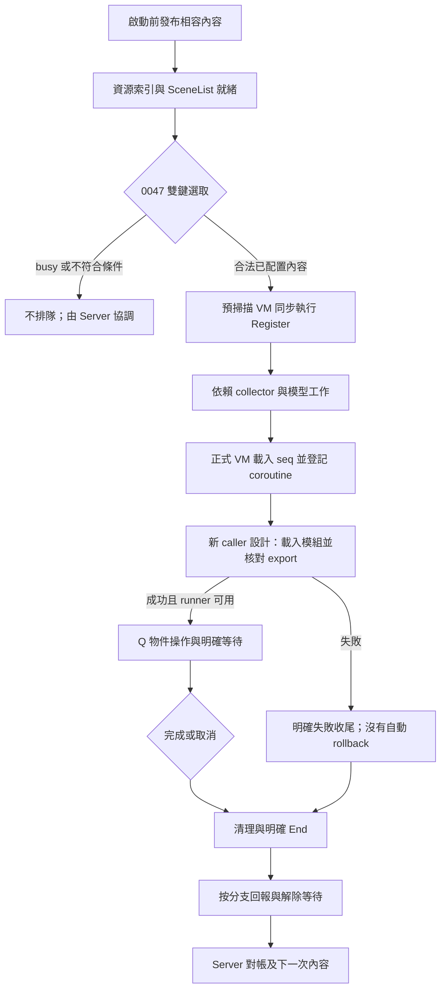

# `.mef` 端到端流程：新入口設計、排程與世界物件介面

整理基準時間：2026-11-16 04:01:28（Asia/Taipei）。工作分支：**`extra/roy1`**。本輪依使用者要求先同步 main，接續既有八輪研究，保存完整證據後提交。

## 1. 目前進度與本輪回答

**有限 Q 演出所需的交付、選取、雙 VM 載入、Lua parser／executor、coroutine 排程、物件操作、等待、結束與解除等待，現在可以放在同一條有來源的實作流程中。** 新 `.mef` 若採這個 Client 可讀的 Lua 內容，仍需一個明確新 caller；本輪將 `.seq` bridge 的兩階段設計推到可審閱契約，沒有把新設計說成已找到官方 MEF 首次入口。

**普通戰鬥全面移交給 `.mef` 尚未完成。** 必要缺口仍是普通戰鬥可用的背景 runner、可靠的世界物件身分，以及死亡／清組結果抵達 Lua 的對象語意。它們是具體 Client 介面缺口。內容發布、Server 狀態協調、相容回覆及任務／資產保存則列為 Server 開發需求，不等待原版 Server 內部演算法。

| 本輪交付層次 | 狀態與適用範圍 |
|---|---|
| 最新進度核對 | 已讀共同指示、最新 main 治理／RR／相關 Task 退回、共用有界驗證與自己的八輪成果；保留未推送第八輪提交 |
| 既有有限 Q 流程 | 已有可追溯的原生靜態鏈；本輪以總流程、狀態表及 Server 交接統一串起 |
| 新 `.seq → Lua 模組` 入口 | 條件式新內容設計；本輪補 closure／Register 時序契約。不是官方 MEF 語法或既有 MapList caller |
| 新的世界物件／Tutorial 觀察鏈 | 以具體 namespace、固定身分及 UI 情境限定，完整證據見本輪分題；不能升成普通敵人 observer |
| 普通戰鬥 MEF 替代 | 尚未閉合必要 Client 介面；保留精確已查範圍與下一步，不用 Server 繼續代做冒充替代完成 |
| 實際執行與審查 | 本輪未執行 Client、Lua、Server，未改遊戲資源；離線核對不等於可玩驗收、T01 FULL-PASS 或 RR ACCEPTED |

本輪分題為 [新 caller 與雙階段契約](MEF-end-to-end-20261116/entry/report.md)、[公開 runner 能力與限制](MEF-end-to-end-20261116/runner/report.md)、[世界物件／Tutorial observer](MEF-end-to-end-20261116/world/report.md)。[Server 開發交接](MEF-end-to-end-20261116/server-handoff.md) 可直接交給 S00，依既有需求流程整合。

## 2. Git、原件與治理基準

### 2.1 這次實際同步的內容

| 項目 | SHA／結果 |
|---|---|
| 開工時遠端 `main` | `03b3ea5eae2cb92f9fc373d432edeaf635d6c5fc` |
| 開工時遠端 `extra/roy1` | `88b22bcd750ea219bfc56580139396d0ee677644` |
| 保留的本機第八輪提交 | `c0c2ce5aa025b86a85a402071d4c0c18fcdbc2d5`，內容契約與四組完整證據 |
| 合併基點 | `0a2503db089a4867cff5ef8bf6d7689333f12fd1` |
| 本輪 main 合併提交 | `b0bf6bb5986f9c849fcfac4e16db42f0a1cf960c`；兩個既有歷史合併成功，無衝突 |
| 新研究的工作父提交 | 上述 `b0bf6bb5…`；沒有建立新分支，沒有 force push |

公開發布時，本機 Git 缺少寫入憑證，改用已授權的 GitHub 連線。第八輪與合併結果以完全相同 tree 分別發布為 `dda39a65ca483f2b4539c6feb74e05dfcdbf7ac8`、`15819c892c0a9a23924704daa5883615a09626bf`；上表保留實際本機研究歷史，機讀來源 pin 使用這兩個公開提交。R9 因更新 pins／發布說明而有新 tree，不把原本機 `28c88573…` 當作已公開提交。[完整發布對照](MEF-end-to-end-20261116/publication-note.md)

舊 checkout 的 fetch refspec 只更新 `extra/roy1`，舊 `origin/main` 並非最新。這次先以 `ls-remote` 取得遠端真實 SHA，再補足 shallow 歷史、更新本地 remote-tracking ref、找到共同祖先，最後正式 merge。更新本地 tracking ref 不等於對遠端 main 強制推送。完整保存的來源與合併資料在 [source-manifest.json](MEF-end-to-end-20261116/source-manifest.json)。

### 2.2 原始證據

| 原件 | SHA-256 | 角色 |
|---|---|---|
| KR Tartaros.bin | `9741d1975327b9309d82b52f631165bc410757694d7c183a5eed970a53ebef91` | 本輪新增 native code/data 裁決；PE32 i386，image base `0x400000` |
| Tartaros.exe | `03771b8e1c1e66248f54585fadf9a5e926eb77228721325bb9be5febc53b3b5f` | 沿用已證 launcher 交付鏈，與 BIN 的同值 VA 分開 |
| Event.stp | `2e68e0202565530e574e0810ad7f758a2fc8d6826a0de0975ccaff12c2d4718b` | 解析選定原版 Lua／SEQ bytecode 為資料，不執行 |
| Table.stp | `09e2cc48be98ad491afe394f966feb5812983fbf35da9037a8fa477d9848a442` | 沿用 map／scene／資源對應與原件身分 |
| Coroutine 原 bytes | `c3feac03a40d24a54adf7615781cab175aa4876a2bdad8763987e413d0c2a808` | 既有 Git carrier 的 13 prototypes／187 words，唯讀解析與重驗 |

全部 VA 以相應原件為準；BSS 虛擬尾段不杜撰 raw offset；不同類別的相同 offset 不合併。現成 bulk `.c` 僅供導航；新增關鍵主張均回到原件指令、資料、producer／consumer 或 Lua operands。未重做全量反編譯、STP 檔名掃描或舊 MEF 字串搜尋。

### 2.3 治理盤點與舊查核路徑更正

最新 AGENTS 的 2026-11-07 MEF 重啟指示已覆蓋舊暫緩；使用者本輪指定 `extra/roy1` 優先於一般 main 作業規則。本輪以正確的 `kr/tasks/Txx/README.md`、`task.json`、收件箱與唯一 RR 台帳核對，未修改 owner／RR／共享審查結果。

第八輪 `source-manifest.json` 的 `upstream_delta.scope` 誤用了 `kr-tasks/Txx`。本輪重新以 **`kr/tasks/Txx`** 查核；這是治理讀集路徑更正，不撤銷其原件 bytes／局部契約。T03、T10、T08 的歷史退回與普通怪 `RR-0013` 各保留原責任範圍；本輪按使用者明確指定處理 MEF，不把它當跨 Task 公開認領。[治理來源 pins](MEF-end-to-end-20261116/governance-source-pins.json)

main 的 MEF 功能表只明列整合到 11/14 三份 roy1 稿；後續 scheduler、world integration、第八輪 content contracts 已在工作分支存在。因此本輪進度不能只抄 main 舊表，也不能把尚未經 T01 全面審核的分支稿提升成共用 FULL-PASS。

### 2.4 八輪既有進度與本輪接續位置

| 既有輪次 | 已保存的主要成果 | 本輪採用方式 |
|---|---|---|
| R1 交付窗口 | launcher 啟動前檔案更新與遊戲收包路徑的區別 | 直接沿用，沒有重做檔案搜尋 |
| R2 parser／executor／storage | Lua source／binary parser、執行器、名稱與 bytes 所有權 | 直接沿用；新 phase 的 closure 所有權另作原件補證 |
| R3 entry／lifecycle／events | 0047 雙鍵選取、場景索引、Q 起止與事件介面 | 直接沿用並補出非零 quest 的 End 條件 |
| R4 trigger callers | MapList TRIGGER 與所查 native callers／alias 的 bounded 範圍 | 保留有界陰性，不把缺失邊補猜為已找到 |
| R5 complete flow | resource gate、DoFile C 邊界、取消／轉場等總流程 | 後續已找回 Coroutine body 的部分以 R6 更正，不再沿用舊缺口 |
| R6 runtime contracts | 原版 MoCo、輸入雙 owner、UI 與 VM 生命期 | 本輪總控重驗 PASS；舊 wire 未閉合之處採 R7 |
| R7 world integration | 世界身分碰撞、事件路由、003F／00EB 完整有界 wire | 本輪總控重驗 PASS；當時未定型的 world list 採 R8 更正 |
| R8 content contracts | 雙 VM 依賴 consumer、Q actor 清理、停止 observer、ordinary native owners | 開工時只有本機提交，本輪保留並一同推送；總控重驗 PASS |

八份主稿的精確 commit、blob、SHA-256、大小與更正對照保存在 [prior-analysis-index.json](MEF-end-to-end-20261116/prior-analysis-index.json)。本輪 R9 接續的三個新問題是 **first caller 的 phase／closure 契約、可疑背景 runner／input API 的實際能力、Tutorial 正向 world／UI observer 鏈**。

## 3. 完整流程：從發布到下一次執行

### 3.1 流程圖的事實與設計界線

圖中「新 caller 設計」是本輪提出並核對其底層前提的相容內容方案；其餘節點以既有／本輪原件的限定路徑成立。不是說目前未修改的 Client 已會自動開任意 `.mef`，也不是說每種錯誤都有通用安全 cleanup。原版 MapList TRIGGER 的 first-load consumer 仍須另有正向證據，不能偷偷填在圖中的新設計節點。

### 3.2 逐階段介面與停止條件

| 階段 | 已確認的 producer → consumer | 輸出／生命週期 | 必要條件與限制 |
|---|---|---|---|
| 1. 交付 | launcher manifest FILE → HTTP → gzip → 普通檔案 writer | 檔案落地；之後才啟動 BIN | 更新流程與合法端點要實際使用；直接啟動 BIN 不會自動取得這個通道。BIN MD5 gate 不是全部內容驗證 |
| 2. 可見性 | `714770` 及資源 provider／ordinary fallback／checksum | resource buffer 與索引／cache | package 同名優先、索引與 checksum 規則要相容；新檔存在不等於被選到，不能承諾一般熱更新 |
| 3. 表格索引 | SceneList 初始化 → manager 雙鍵索引 | `quest, scene → funcName` | 0047 不重載表；必須先有相符版本的索引 |
| 4. 請求分派 | frontend 0047 → `494440` → quest table `503040` | message `+2/+4` signed WORD → `561760` | 最低欄位讀取範圍 6 bytes；沒有 filename/blob。前端可達不等於無場景時安全播放 |
| 5. 接納與路徑 | `561760` gate → table lookup → `Event/Sequences/<funcName>.seq` | `M+38/+3C` 鍵、`M+28` active | busy 不排隊；模式欄位仍可能先被寫。缺 row 另走 End，不能混同載入錯誤 |
| 6. 預掃描 | `55D6A0 → 6F4A50`；prepass `Register → 55D560` | 立即執行有限 callback，收集 model/actions/music | 獨立 VM、無一般 runtime 標準庫環境；清 collector 不等於清 globals；不得無限等待 |
| 7. 依賴準備 | collector → `M+70` → model job → event wait | 模型工作與後續 CMotion request | wait 返回、event 或 helper return 不是所有資源／玩法成功；動作依賴另有實際 consumer |
| 8. 正式 seq | `561C7D → 6F4A50`；qbase Register → qco | Lua function → thread → coroutine list | 正式 Register 不等於已執行場景；callback 待合法 pump 才恢復 |
| 9. 新模組 | 條件式新 callback → global DoFile `6F48A0` | path → bytes → parser → 有限頂層 → numeric status | 0成功／1失敗，兩者都 truthy；不是 module return。這一步是新 caller 設計，不是原生 MapList 行為 |
| 10. 解析執行 | `6FE990 → 6FE860` → binary `70D680`／text `70E420` → protected call／VM | Proto、code、strings、closure 由 VM 持有 | 首 byte／Lua header 分流，並非副檔名；不能把任意未知 MEF DSL 改名當相容 Lua |
| 11. 執行與等待 | Q tick `561520 → f_doCoTask` → MoCo → resume | yield／return／error 分開 | Q active 會置 current controller+58；wait以毫秒計時且先yield；Lua return不自動End |
| 12. 物件行為 | Q slot → CEventActor → Walk/tick/pending-bit → IsAllObjectsStopped | 本地演出物件與數字0/1 | 全 Q tree 停止不是死亡／清組；世界 EntityId 與 Q slot 分域 |
| 13. 正常收尾 | 顯式清理／End `561DB0`，選定分支 remove qco | active、coroutines、Q actors、camera/UI/input各有所有權 | DeleteObject／DeleteAll、Enable／End、Stop／unlock不能互代；不假設所有早退都到相同清理 |
| 14. 回報 | `4A39A0` → C2S003F，8-byte app | 雙鍵低16位＋末WORD1 | 已看略過也可送；非零quest的End有確認條件；send guard仍適用；不是內容成功或發獎證據 |
| 15. 等待解除 | ordinary field 00EB → `4B6190 → 562250` | 關等待dialog、清input mask `0x2` | 不停Q、不清qco、不清controller+58；只在已證路由／有效context採用 |
| 16. 下一次 | Server 協調新鍵與版本，按實際取消／重新初始化路徑再入 | 新執行階段與資源／export歸屬 | 普通轉場未必清qco；模組export可能殘留；舊003F不含generation，需Server自有關聯 |

詳細來源依序為：[交付](20261114-183651-chatgpt-web-roy1-MEF-delivery-windows.md)、[資源](MEF-complete-flow-20261115/resource-gates/report.md)、[入口](MEF-entry-lifecycle-events-20261114/entry.md)、[parser](MEF-parser-executor-storage-20261114/parser.md)、[DoFile／生命週期](MEF-complete-flow-20261115/script-lifecycle/report.md)、[雙VM依賴](MEF-content-contracts-20261116/bridge/report.md)、[scheduler](MEF-runtime-contracts-20261115/scheduler/report.md)、[輸入與End](MEF-runtime-contracts-20261115/input-lifecycle/report.md)、[物件](MEF-content-contracts-20261116/actors/report.md)、[observer](MEF-content-contracts-20261116/observers/report.md)、[wire](MEF-world-integration-20261115/wire/report.md)。

### 3.3 檔案與記憶體到底保存什麼

`FB74C0` 保存 MapList 的 trigger **名稱字串索引**；節點的長度／容量是字元數，不是 MEF payload 長度。它不是一塊已下載 MEF bytes 的固定 buffer。名稱可在 XML document 釋放後繼續存在，仍不能據此宣稱該檔已讀或已執行。[名稱與所有權](MEF-parser-executor-storage-20261114/storage.md)

有 caller 時，資源層先取得內容，loader 再複製到本次來源 buffer。parser 會另外建立 VM 的 Proto、code、strings、closure；loader 頂層返回後釋放其來源 copy。後續 coroutine 使用的是已解析 Lua 物件。這能解釋「執行中的腳本不必一直保留原檔 buffer」，不能反推「原版 MEF 一定藏在記憶體」或「磁碟替換會立即改變正在跑的腳本」。[parser／儲存](MEF-parser-executor-storage-20261114/parser.md)、[VM lifetime](MEF-runtime-contracts-20261115/vm-lifetime/report.md)

## 4. 本輪新入口契約：利用 Register 時序區分階段

前輪的條件式方案以正式 VM 才有的 `DoFile` 名稱辨識 phase，但兩個 VM 都有持續 globals，判斷容易受舊值影響。本輪改以**該次 seq 自己的 lexical local／closure 狀態**表達階段：Register 尚未正常返回前，同步 prepass callback 看見初值；Register 返回後設置局部旗標，之後 formal coroutine 再看到新值。

這個方案的原件前提、upvalue生命期、正規 Register 到 MoCo 的資料流、失敗界線及不可直接部署的偽碼，都保存於 [entry/report.md](MEF-end-to-end-20261116/entry/report.md)。原件 `6FD46E → 6FD7A0` 捕捉 parent local；RETURN 路徑 `6FD647 → 6FD860` 將開放 upvalue 關閉並保存值。`coroutine.create @707380` 將同一 closure TValue 放入新 thread，qbase P75／MoCo register 只登記，不在正常路徑當場 resume；強參照鏈是 ordinary list → thread → closure → upvalue。因此 seq 頂層返回後仍有可解釋的值保存，不是依靠已釋放 source buffer。

此結論限定原版 binding、Register 成功且沒有 hook／metatable／GC finalizer 等重入；兩個 VM 各有自己的 local，沒有跨 VM 共用旗標。預掃描 callback 的錯誤還可能被既有 protected call 吃掉，Register 返回不保證依賴收集完整。方案標為 **`CONDITIONAL_DESIGN_NOT_NATIVE_MEF`**，供新內容產生器審閱；沒有生成可直接部署的 `.seq`／`.mef` 或猜造場景鍵。

正式 module 仍應有限頂層建立當次 export，DoFile返回後再由外層 Lua coroutine 直接呼 entry。若 module 頂層自己等待／yield，會碰到已證 DoFile protected C 呼叫層；改用一層普通 `pcall` 也不能無條件宣稱已解除這個限制。使用哪一個 namespace、版本或邏輯路徑是相容內容設計，需要實際配置，報告沒有猜造合法 scene、model 或座標。

還有一個容易遺漏的相容條件：**非零 quest 避開已看過分支，不代表 End 一定送回報。** normal active End 在 `M+38!=0` 時仍看 `CheckConfirmMessage==1`；quest0的分支則可能先送003F後再置等待鎖。開發必須把「接納」、「開始正式callback」、「明確End」、「送出回報」列為不同狀態。[原件wire分歧](MEF-world-integration-20261115/wire/report.md)

## 5. 本輪世界物件與 Tutorial 觀察的完整限定流程

本輪不只列出 API 名稱，而是追建立者、真實類別、world index、observer 條件、Lua consumer 與回收者。新增的固定 Tutorial 物件流程及輸入教學狀態 writer，詳見 [world/report.md](MEF-end-to-end-20261116/world/report.md)。

### 5.1 同名方法不能跨 namespace 套用

| 介面域 | 建立與參照 | 觀察／刪除界線 |
|---|---|---|
| `Q.*` | CEventActor，Q私有tree，以完整DWORD slot查找；actor自身ID與prepass key另有位寬 | Q.IsAllObjectsStopped看pending bit；Q.DeleteObject空實作，Q.DeleteAllObject才有已證整組回收 |
| `lb.*` | CreateObjectEx的普通model路徑可建CMonster並進world tree，本地counter配號 | 不把新ID推回Lua；0007同ID命中只skip，不採用；typed low-byte及collision仍須處理 |
| 本輪已核 `Tutorial.*` | InsertIsilia 配置 `0x420` bytes 的 **CActor**，model 4、固定 world key `0xF000`，進入 world index | IsIsiliaFound 依同 key 加幾何條件；DeleteObject(240) 透過真實 world erase。不是任意敵人ID／HP／死亡／清組API |

前兩列沿用 [Q actors](MEF-content-contracts-20261116/actors/report.md) 與 [world identity](MEF-world-integration-20261115/identity/report.md)，第三列是本輪補證。區別 namespace、receiver 與實體域，比單看函式叫 `CreateObject`／`DeleteObject` 更能決定實作方式。

新增固定鏈的關鍵節點是 `Tutorial.InsertIsilia @4AA070 → world publish @4DFF30`、`IsIsiliaFound @4AA240`，以及 `Tutorial.DeleteObject @4A9FE0 → world erase @4DFBC0`。刪除參數先取低 BYTE 再左移 8 位；原版 TutorialMain P8 PC71–74 真的傳 **240**，得到 `0xF000`。直接傳 `0xF000` 的低 BYTE 是 0，反而查 `0x0000`，不能把此 API 當成直接接受 EntityId。

IsIsiliaFound 查到 `0xF000` 後還看位置分量的數值門檻、投影／畫面範圍；它不核 RTTI 或 model，也不讀 HP／死亡。因此同 key 被重用時可能觀察到不同物件，這條固定鏈不等於一般可靠身分介面。上述 producer、實際 RTTI、Lua consumer 與析構／world index 回收均在 [world 證據包](MEF-end-to-end-20261116/world/report.md) 中。

### 5.2 Tutorial state 的正確語意

第八輪只閉合 `GetTutorialState @4A9FD0 → current controller+134` 的讀取與 constructor `548B99` 零初值，尚未找到 post-init writer。本輪確認真正 UI receiver 為 **FUI::CTutoMsgDummy**，vtable+15C 指向 `6BFE90`。其鍵位選擇確認分支在 `6C00D6` 取得 `[FBA7A4]`，檢查非空後 `6C00E4` 寫 `controller+134=1`；前面切換鍵位，後面發 UI 訊息。

原版 TutorialMain P5 先送 `TUTORIAL_CHANGEKEYTYPE`（enum 9），再輪詢 GetTutorialState；本輪將 UI 建立／接收、writer、getter 與該 Lua consumer 串在一起。這是教學鍵位確認狀態，不是普通戰鬥結果，也沒有證明每次一般 reset 都會清這個欄位。完整 receiver、重設邊界及 operands 見 [world/report.md](MEF-end-to-end-20261116/world/report.md)。

## 6. 排程、結束與取消：完整流程不能省略的分歧

### 6.1 return、移除與End是三件事

Coroutine.lua的原件P9 `doCoTask`只接self，沒有把caller傳入的 `Q.EndCutScene` 再轉給P8。P8只有入口list為空且明確收到非nil callback時才呼它；原f/t wrappers未提供這條資料流。因此不能設計成「所有工作結束自然End」。正常resume返回true，既有MoCo也不立即查dead；後續若再次resume dead才走失敗移除，而且第一次移除會提前離開該輪。[13-prototype完整證據](MEF-runtime-contracts-20261115/scheduler/report.md)

`removeAllCoroutines`僅換一個空list，不會強制中斷目前正在執行的Lua frame，也不自動刪native actor、還原camera或解除input。新內容須有明確終態與收尾；中途改list、再次Register、巢狀pump與錯誤後清理的行為不能靠一般排程器印象推論。

### 6.2 input有兩個不同owner

本文的 mask `0x2` 指值為 2 的位元遮罩（bit index 1）；既有部分原稿簡寫 bit2，不是 `1 << 2`。

`Q.EnableInput`與00EB清的是input owner的mask `0x2`；active Q tick則寫current controller `+58=1`。controller更新先於Q tick，正常consumer會使用並清該欄，但下一次active Q又可寫入。清第一層不保證普通方向／動作row恢復；其他capture／mask也仍存在。[完整input鏈](MEF-runtime-contracts-20261115/input-lifecycle/report.md)

本輪 [runner分題](MEF-end-to-end-20261116/runner/report.md) 從實際 public bindings、manager receiver 與起停資料流補查，另閉合兩條容易誤用的 input 介面：

| 介面 | 原件路徑 | 真正效果 |
|---|---|---|
| `Tutorial.SetKeymapEnabled` | registrar `4AA900` → slot `FE1818` → closure `4AC030` → converter `4ACB70` → `4A94C0` | 讀 stack -1；數字／數字字串轉整數，boolean 等其他 tag 為 0。非零清 mask `0x2`，0 設 bit2；`true` 因而走禁用支路 |
| `lb.ChangeKeymapType` | registrar `4A1DD0` → slot `FE17B0` → closure `4A2380` → converter `4A23E0` → `4A1440` | 同樣使用數字轉換；只接受 0／1，複製 40 筆 stride16 的鍵位 row 到 active table；不清 controller+58、不設 Q pause |

這兩個 closure 在已核路徑返回個數 1，卻沒有 push 一個新的結果值；不可把回傳值當作操作成功 ACK。`M+2C` 的絕對位址 `FB73EC` 在指定 literal 編碼讀集只找到 constructor 寫 0，而 Q tick 在判斷 `M+2C` 前已寫 controller+58；此 bounded census 不是全程式 alias 陰性證明。[完整 bytes、xref 邊界與公開面索引](MEF-end-to-end-20261116/runner/report.md)

普通 field 中 checkpoint／UI 原生 tick 已在第八輪定型，本輪沒有把它們重新當成 Lua 登記介面。`M+2C` 或名為 Rebind 的方法仍不能在沒有合法 writer／owner 契約時當成 background 模式。

### 6.3 debug hook 不能提供獨立背景時間源

實際 `debug.sethook` 綁定與 Lua VM producer 現已閉合：Lua opcode 在 `6FC59E` 減 thread+40 count，`6FB68B` 重設計數；call／return／line／count 與 tail-return 都由正在執行的 Lua VM 呼叫流程觸發。tail-return 的 `6FE478` 是內嵌間接呼叫，不能只靠 direct-call 搜尋而漏掉。[runner 原件表](MEF-end-to-end-20261116/runner/report.md)

新 thread 會複製 native hook mask／count／callback 欄位，但實際 Lua callback 還以目前 thread 指標查 registry；複製 C 欄位不等於複製該 thread 的 Lua registry entry。debug hook 能在已有 Lua 執行時插入工作，不能讓一個沒有 pump 的 thread 自行按遊戲 frame 被喚醒；也不會消除既有 Q input ownership。因此不能用它補出普通戰鬥所缺的獨立背景 runner。

### 6.4 取消／轉場不是統一析構事件

既有ordinary `005F` type2/4與UI F4355不普遍保證Q Stop或qco清空；部分room／decision init則有具體Stop後unlock。需要根據正在使用的field/page類型規劃，不可為取得副作用任意換場景類型。Stop／End review分支還可能接下一段review，不能只看到一個clear就宣告永遠inactive。[scene cancellation](MEF-complete-flow-20261115/scene-cancellation/report.md)、[UI lifecycle](MEF-runtime-contracts-20261115/ui-lifecycle/report.md)

## 7. 各項工作現在能由內容接手到哪裡

| 玩家功能 | 已證可使用的Client能力 | 仍需的條件／開發 |
|---|---|---|
| 固定劇情、鏡頭、對話、演出走位 | Q既有有限runner與API；slot參照及停止等待 | 新caller、真實資源、雙階段依賴、明確End、回報與等待解除 |
| 指定Tutorial世界物件 | 本輪固定建立→觀察→刪除鏈 | 保留固定ID、具體型別、currentpage/controller與Lua生命周期，不泛化為普通敵人 |
| 常駐NPC／商店位置 | 既有lb與native NPC／checkpoint／市場資料可提供部分接口 | 真正普通村落入口、有效座標、互動點、world身分與服務路由仍須相符 |
| 開關已登記出口 | 已有本地setter與既有封包consumer | 觸發者必須真的收到正確instance條件；首次建點、開點、Z意圖與進度保存分別處理 |
| 本地生成普通戰鬥怪 | lb可建立CMonster並進world tree | 未閉合可靠ID暴露、hostile決策與ordinary typed observer；不宣稱已取代Server生成／AI |
| 清完一波後開門／發獎 | 個別顯示／開關能力存在 | 普通死亡／群清事件橋未閉合；Server權威狀態與資產保存需實作；003F與IsAllObjectsStopped都不是清組證據 |
| 商品、買賣、強化 | 原表與native UI路由可沿用 | 成交、消耗、成功／失敗與持久化屬Server開發；不能由本地顯示替代入帳 |

城鎮／交易部分直接沿用最新main的 [既有MEF城鎮服務分析](../governance/client-variants/20261109-mef-town-services/README.md)，沒有把它重新稱為本輪逐項補證。新結果的適用範圍以本輪分題為準。

## 8. 尚未完成的精確鏈與可接續工作

| 分類 | 未完成事項 | 已排除的誤接法 | 下一步／解除條件 |
|---|---|---|---|
| Client待逆向 | 原生MapList.TRIGGER名字→實際檔案／parser／executor caller | 只有名字、loader存在、STP無同名都不足以證正向或全程式陰性 | 沿本輪entry及既有native-aliases明列的剩餘caller/alias範圍；若採新caller，明示相容設計 |
| Client待逆向 | ordinary戰鬥的合法長駐Lua runner | Q Enable／00EB、UI tick、checkpoint tick不能解除activeQ的全部操作限制 | 找可達登記與pump，閉合owner、input、stop、reentry；本輪已查public API範圍見runner |
| Client待逆向 | 普通world實體的腳本／Server穩定typed identity | local counter推算、Q slot、補發0007採用均無可靠契約 | 已註冊的真正ID/handle或明確結果consumer，加上碰撞與生命期 |
| Client待逆向 | 普通death/group/result→Lua | Q停止、視錐發現、鍵位教學state、001A移除、004C/004E錯page路由 | 真正對象／群組writer到getter/callback，再到當次content consumer |
| Server待開發 | 發布、版本／依賴、啟動排程、對帳／取消、相容回覆、持久化 | 官方Server內部未知不能當停止理由；不得發明wire欄位 | 按 [Server交接](MEF-end-to-end-20261116/server-handoff.md) 整合既有REQ／SPEC／SFD |
| 跨功能待整合 | 首個新caller、真實內容配置與有限Q完整操作 | 概念路徑、假ID、SYN向量、只送檔案不算已執行 | 以已核資料分配鍵／資源，實作相容內容並按政策進入驗證 |
| 待遊玩驗證 | 同一版本的正常開始→完成→清理→再入 | 靜態PASS、已push、Server可編譯不等於人測 | 依既有測試優先序取得正常流程trace；指定Server指令停發後才評估Client替代 |

本報的「完整流程」表示各必要階段、條件、分歧、所有權與未閉合邊都有明確交代；**不把尚未閉合的ordinary gameplay整合標成完成**。研究成果可先推進有證據的有限內容與Server契約；不以等待已不可得官方MEF原檔作前置。

## 9. 證據、重驗與交付

本輪分題保存完整繁中原稿、VA／PE raw mapping、原件hex／hash／可讀反組譯、Lua資料解析、source pins、機讀關係與唯讀重驗器。root另核第六、七、八輪三組總控結果，避免把本機未推送成果或舊稿摘要直接視為已保全；Coroutine原件由既有固定Git carrier取回到scratch供重驗，不重上傳原始member。

完整交付索引、具體驗證數量與重跑指令見 [README.md](MEF-end-to-end-20261116/README.md) 和 [verification-result.json](MEF-end-to-end-20261116/verification-result.json)。驗證器PASS僅證明其列明的原件／來源／關係一致性，不把視窗數量當全程式覆蓋率，不授予T01 FULL-PASS，也不宣稱已執行新內容。

本輪只新增自己的研究主稿與證據包；main同步的歷史保持完整，未修改Client／Server程式、原始STP、正式RR台帳、owner或其他研究者原稿。推送commit與遠端讀回結果由最終交付訊息提供，避免在提交前捏造SHA。
