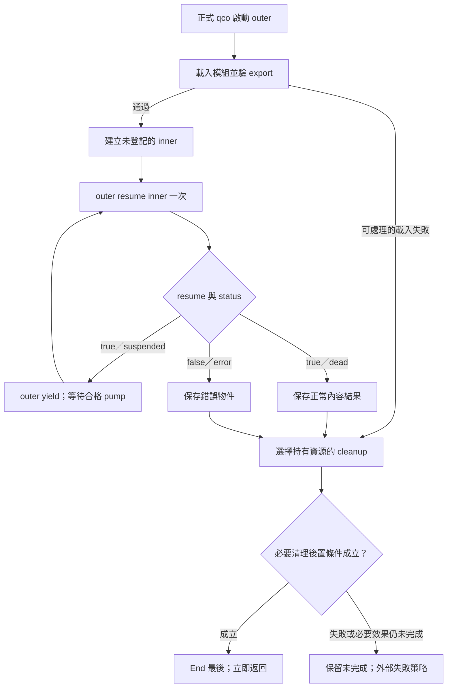

# `.mef` 完整控制流程：錯誤接回、資源清理與演出觀察

研究基準時間：2026-11-16 09:21:38（Asia/Taipei）。工作分支 **`extra/roy1`**。本稿接續已公開的 R9 `ad9ea950216923b5e351a7501d38e006df57a4c6`；開工時最新 main 仍為 `03b3ea5eae2cb92f9fc373d432edeaf635d6c5fc`，已在本分支祖先鏈內，無新增上游差異需要合併，沒有建立新 branch。

## 1. 本次進度與交付結論

**本輪已把既有有限 Q 演出的完整流程，延伸到「腳本出錯如何接回控制、依實際持有資源清理、哪些演出狀態能觀察到完成」。** 新增四組原件分析與可重驗節錄，並將具體差異列入 Server 開發交接。

核心進展不是將未知 MEF 行為補猜成 API，而是以下四個已具體閉合的部分：

| 分題 | 本輪新增的完整鏈 | 對開發的影響 |
|---|---|---|
| [外層 supervisor](MEF-control-flow-20261116/supervisor/report.md) | public coroutine binding → child thread／protected error frame → C-depth／yield → 原 MoCo caller → return／error 分支 | 可設計一個登記於 qco 的 outer，逐次 resume 未另外登記的 inner；inner 一般 Lua error 可回到 outer 選擇清理。 |
| [演出資源清理](MEF-control-flow-20261116/presentation/report.md) | End／Stop guard與順序、CameraWorks binding／tick、Q camera slot、camera snapshot stack、map backup、render／slow／letterbox／sepia consumers | End 前先依 acquisition ledger 清理；CameraWorks、override、map、顯示效果各自有 owner，不能用一個 reset 取代。 |
| [背景 runner 候選](MEF-control-flow-20261116/runner/report.md) | 45 個 lb／Tutorial binding 身分核對；六個候選的參數、保存、RTTI、tick／draw／UI switch、取消 | RegisterSkip／Scaling 是圖片，fixed PostUIMessage 是特定頁面的 UI 事件；這些候選沒有提供普通背景 Lua callable pump。 |
| [演出完成 observer](MEF-control-flow-20261116/world/report.md) | Prolog 建立／文字隊列／OnClose／getter；Book state／native tick／ended；FlyingImage handle／狀態／取消與 sweep | 可區分文字、書本、圖片的完成與取消；這些都不能代替 ordinary 怪物死亡或群組結果。 |

**原生 MapList `.mef` 首載入／schema／executor 與普通戰鬥全面替代仍未完成。** 本輪有新的正向流程與有界排除，但仍缺適用普通戰鬥的 callable runner、可跨 Lua／Server 使用的世界 typed identity，以及死亡／清組結果 observer。這三類是 Client 介面待逆向；Server 的內容發布、權威流程、結果對帳、取消策略與持久化則可以按已證契約開發。[Server 交接](MEF-control-flow-20261116/server-handoff.md)

本次沒有啟動 Client、執行 Lua／Server、編譯或產出可部署 `.seq/.mef`，也沒有修改原始遊戲資源。核對通過是證據一致性，不等於 T01 FULL-PASS、RR ACCEPTED、Server 已實作或可玩驗收。

## 2. 分支、來源與進度基準

### 2.1 已同步 main，承接已公開成果

| 項目 | 固定值／狀態 |
|---|---|
| repository／branch | `we88ec3-prog/ttr_anal_multi`／`extra/roy1` |
| 開工時 remote main | `03b3ea5eae2cb92f9fc373d432edeaf635d6c5fc` |
| 開工時 remote branch／本輪 parent | `ad9ea950216923b5e351a7501d38e006df57a4c6` |
| main 同步狀態 | 上述 main 已是 parent 的祖先；沒有新差異或衝突 |
| 前輪待推送成果 | R8、main merge 與 R9 已在前輪完成公開；本輪從其真實 public commit 接續 |
| 本輪範圍 | 自有 `kr-extra-roy/` 主稿與 `MEF-control-flow-20261116/` 證據；不改正式 RR／REQ／Task owner／共用驗收狀態 |

已讀 `02-PROJECT-SHARED-INSTRUCTIONS.md` 的本次提供檔，並依同一對話可復用治理基準的規則承接 R9 的完整 main／AGENTS／RR／Task readset。因 main SHA 未變，不重複掃描未變動治理檔。固定原件與來源 identity、前輪證據 pin、分支祖先關係見 [source-manifest.json](MEF-control-flow-20261116/source-manifest.json)；[發布說明](MEF-control-flow-20261116/publication-note.md)記錄本次公開範圍。

### 2.2 原件不混用

| 原件 | SHA-256 | 本輪用途 |
|---|---|---|
| KR BIN | `9741d1975327b9309d82b52f631165bc410757694d7c183a5eed970a53ebef91` | 所有新 native code／data 裁決；12,472,320 bytes，PE32 i386，ImageBase `0x400000` |
| Launcher EXE | `03771b8e1c1e66248f54585fadf9a5e926eb77228721325bb9be5febc53b3b5f` | 身分核對，沿用原已證交付鏈 |
| Event.stp | `2e68e0202565530e574e0810ad7f758a2fc8d6826a0de0975ccaff12c2d4718b` | 選定 qbase bytecode 原件 operand 核對；只解析為資料 |
| Table.stp | `09e2cc48be98ad491afe394f966feb5812983fbf35da9037a8fa477d9848a442` | 身分核對，沿用已證表格／索引關係 |
| Coroutine carrier | `c3feac03a40d24a54adf7615781cab175aa4876a2bdad8763987e413d0c2a808` | 已有 Git blob 的原版 MoCo；本輪不再上傳完整 member |

bulk `.c` 只作導覽；新的關鍵主張回到 BIN 指令、真實 receiver、vtable／RTTI、switch data、原版 Lua operands。沒有把 `.mef` 字串、檔案存在、猜測的欄位名稱、反編譯簽名當成正向執行證據。原始 BIN、STP、完整解包資源均未列入本輪交付。

## 3. `.mef` 從交付到結束的完整流程

以下以**已證原生路徑＋明確標示的新內容設計**串接。既有細節固定復用 [R9 端到端主稿](20261116-040128-chatgpt-web-roy1-MEF-end-to-end.md)，不因本輪增加錯誤／清理層而改寫成「原版已自動執行任意 MEF」。

| 階段 | Producer → consumer／保存內容 | 成立條件與目前界線 |
|---|---|---|
| 1. 發布與落地 | launcher manifest → HTTP／gzip → 普通檔 writer → 啟動 BIN | 是啟動前交付；不是新增 game TCP MEF blob 封包。直接啟動 BIN 不等於走過更新流程。[交付](20261114-183651-chatgpt-web-roy1-MEF-delivery-windows.md) |
| 2. resource 可見性 | `0x714770` 與 package／ordinary fallback／checksum／index cache | 同名優先與已載入索引影響實際選擇；磁碟有檔不等於 loader 開到，不能承諾一般熱更新。[resource gates](MEF-complete-flow-20261115/resource-gates/report.md) |
| 3. 索引與原生 MEF 邊界 | SceneList 保存雙鍵→funcName；MapList `0xFB74C0` 保存 TRIGGER 名稱 | TRIGGER 不是 MEF bytes。已查 first-getter 結果被覆寫，尚未找到其 path→open→parser 的正向首載入鏈。[native root](MEF-trigger-callers-20261115/native-root/report.md) |
| 4. 啟動請求 | S2C `0047` → `0x494440` → `0x503040`／`0x561760` | 兩個 signed WORD 雙鍵，形成 `Event/Sequences/<funcName>.seq`；不帶任意 filename/blob。[entry](MEF-entry-lifecycle-events-20261114/entry.md) |
| 5. 接納／busy | Q manager active、mode、雙鍵與已看／review分支 | busy 不排隊，mode 可能先被寫；重送不是無副作用冪等。缺 row 與已看略過不等於內容已播放。[R9 flow](MEF-end-to-end-20261116/flow-contract.json) |
| 6. 獨立 prepass | `0x55D6A0→0x6F4A50`；prepass Register 同步執行 | 限定有限依賴宣告；錯誤可能被既有 protected call 吃掉而留下部分 collector；不能等待遊戲事件。[bridge](MEF-content-contracts-20261116/bridge/report.md) |
| 7. 依賴工作 | WORD slot／model／action collector → `M+0x70` → model與motion工作 | 索引、宣告與實際正式動作必須一致；native event 或 wait 返回不等於所有資源成功。 |
| 8. formal 登記 | 正式 VM `0xFDF3C8` 載入 seq；qbase Register → coroutine → qco list | callback 延後到合格 Q pump；與 prepass VM `0xFE1EEC` 的 globals／local 不共享。[scheduler](MEF-runtime-contracts-20261115/scheduler/report.md) |
| 9. 新 caller 與模組 | **條件式設計**：本次 lexical phase → global DoFile → 驗當次 export／版本 | 原 binding 與非重入等前提成立才可用。DoFile `0x6F48A0` 回 number 0成功／1失敗，兩者都 truthy；不是 module table。[R9 caller](MEF-end-to-end-20261116/entry/report.md) |
| 10. parser／executor | `0x6FE990/0x6FE860` → binary `0x70D680` 或 text `0x70E420` → Proto／closure／VM | 依 bytes／Lua header分流，不依副檔名。source copy與VM持有物件分別釋放；module頂層須有限返回，不跨DoFile C層yield。[parser](MEF-parser-executor-storage-20261114/parser.md) |
| 11. 本輪 outer／inner | **條件式設計**：qco只登記outer；outer建立inner並每次最多resume一次 | inner suspended後outer自己yield；inner return／error分開接回；不使用包住yielding entry的同thread pcall。[supervisor](MEF-control-flow-20261116/supervisor/report.md) |
| 12. 演出執行／觀察 | Q私有slot→CEventActor；Prolog／Book／FlyingImage各有native owner | Q停止、文字結束、書本結束、圖片刪除各有語義；都不是ordinary死亡／清組。[world](MEF-control-flow-20261116/world/report.md) |
| 13. 可達的錯誤處理 | inner一般Lua error→resume(false,error TValue)→outer選擇清理 | 正常return false仍是resume(true,false)；native crash、建立／容量失敗、outer錯誤、無yield無限迴圈、外部移除不保證接回。 |
| 14. 資源清理 | 持有紀錄→camera works／Q actors／images／map／override／顯示flags | 部分動作非冪等，有些需要後續native更新；「已發請求」與「已恢復」分開。[presentation](MEF-control-flow-20261116/presentation/report.md) |
| 15. 明確 End | normal End `0x561DB0`；native Stop的bulk主段最後才End | 正常return、removeAll、End、Stop不同；End先清active後再Stop會跳bulk清理。 |
| 16. 回報與等待解除 | C2S003F application 8 bytes；S2C00EB application `EB 00` | 003F雙鍵low16＋末WORD1，skip也可送；nonzero quest還有confirmation條件。00EB只解wait／mask，不停Q、不清qco或controller。[wire](MEF-world-integration-20261115/wire/report.md) |
| 17. Server 對帳／再入 | Server自有run／generation／結果／保存→下一段內容 | 不把自訂run欄位塞入原wire未有位置；遲到回報、取消、重送與副作用需Server仲裁；權威發獎不能只看003F。 |

這條有限 Q 路徑可支持相容新 Lua 內容的開發規格，但它有 active Q 的輸入與場景限制。它不能直接代替普通戰鬥長駐 runner。新內容檔名叫 `.mef` 也不會自行補上 first caller、schema、合法資源或 typed world observer。

## 4. 本輪補到的控制流：一般 Lua error 能回到外層

R9 已證 closure／Register phase 可以將有限模組 entry 放入正式 Q coroutine，但「直接呼叫 entry 後寫 cleanup」遇到逃出的錯誤時，後段不會自動執行。本輪補的是另一條受原版 Lua thread／resume 支持的 caller 設計：**outer 由 qco 持有，inner 只由 outer 持有；entry 在 inner 執行，outer 用 public resume 觀察其狀態。**

關鍵原件並非泛泛套用 Lua 經驗：`0x7071C3/C7` 把 caller 的 `nCcalls` 複製到 child；`0x6FE70E..713` 對 child 建立自己的 `baseCcalls`；yield `0x70748B..496` 檢查的是當前 child 的深度。child yield 回 outer 的 resume 之後，outer 才呼自己的 yield，避免在同一條受保護 C 呼叫鏈下硬跨越 yield。每個 thread 的 error frame、resume thunk／poscall 以及 Q native API 使用 current Lua state 的鏈都在 [supervisor 原件與契約](MEF-control-flow-20261116/supervisor/report.md) 中。

原 MoCo 的 P7 resume **只傳 thread**，沒有把 native frame delta、時間或 yield payload 轉回 resumed coroutine。新 adapter 因此每個 outer visit 最多前進 child 一次，零參數 resume；entry context 用 Lua closure捕捉傳入，不能假設 yield 後收到時間。正常 return false 是正常 Lua return，不能誤判成 resume 失敗；業務結果仍需自己的明確契約。

同時，inner與outer共用 Lua global state／環境；child不是隔離沙箱。entry不得改寫原bindings、再次Register、End／Stop、移除outer或重入scheduler，否則破壞前提。取消旗標若要可觀察，必須有真正producer並在outer仍可執行的邊界檢查；本輪沒有造出新的Server取消API。外部removeAll／End／Stop不保證執行outer尾段；suspended child失去引用也不等於native資源被清掉。

## 5. 清理與完成：本次新增的實作差異

### 5.1 End 必須在選定清理之後

`0x56251E` 檢查 active，inactive分支在 `0x562521` 直接略過Stop bulk；bulk主段才有 RestoreMap `0x563FA0`、DeleteAllObject `0x563A70`、EndCameraOverride `0x562B00`，最後 `0x56288C→0x561DB0` End。反過來先End使active清0，再Stop，不能期待補救前述資源。[完整分支](MEF-control-flow-20261116/presentation/report.md)

這也限制了 supervisor：能接住entry錯誤，只代表可以選擇清理；cleanup自身仍可能出錯或需要後續pump。選定骨架只有在cleanup policy確認必要後置條件成立時才最後End；失敗或必要效果仍pending時，交由已選外部失敗策略，不能把outer return當完成。每個步驟須依實際owner與已完成的副作用決定，不能一律套用原qbase演出尾段或任意重複Stop。Stop末端只是G selective sweep，本身不標記或清空Tutorial tracking，也不保證Skip／Scaling圖片被取消。

### 5.2 相機與地圖不是可任意重試的 reset

| 資源 | 實際結構／消費 | 清理設計的必要限制 |
|---|---|---|
| CameraWorks | current pointer `0xFB7620`；main update `0x492410..428` → virtual `+0x10`；公開Stop／IsEnded有真實binding | 這條tick對Attach有實際更新；KeyFrame同槽是`ret 4`，不能用它證明KeyFrame進度。Stop、Detach、popoverride分開，也不表示Lua／戰鬥完成。 |
| AttachCamera | singleton `0xFB766C`；保存數值slot；查 `0xFB73DC` 的Q tree與`CAMERA_DUMMY01` | 參數是Q-local slot，不是普通世界EntityId；需要有效對象及模型節點。 |
| Camera override | `0x48` bytes snapshots，標籤`QSceneCam`；`0x7986E0`先還原與erase，後比對名稱 | 不匹配仍繼續pop，可能消耗別的snapshot；須記錄平衡取得／釋放，禁止盲目重試。 |
| Map backup | `M+0x30`同一camera buffer＋`M+0x34`同一map欄位 | 重複LoadMap覆寫；RestoreMap也重寫map欄位，沒有多層交易或整體成功ACK。 |
| RestoreMap來源 | `0x564090 ECX=0xFB74B0` → getter → `0x7C1E00` FLD loader | 不是TRIGGER root `0xFB74C0`，不能以此關閉原生MEF首次載入缺口。 |

### 5.3 顯示效果的釋放時點不同

EnableObjRender只清 `0xFAB1D8`，對應特定world rendering gate，並不停止或完成世界模擬。EndSlowMotion只清Q flag `0xFAB1E0`；另一個 `0xFAB1DC>0` countdown仍可使選定actor animation delta約為原值0.2，field與controller另收原delta，不是統一Server時鐘。[owner與實際consumer](MEF-control-flow-20261116/presentation/report.md)

HideLetterbox清 `0xFE36EC`，實際draw `0x55ECC0` 在該flag為0時不畫兩塊letterbox。EndSepia則置phase4，必須經三次合格native Q更新 **4→5→6→0**。這段更新位於Q active／qco gate之後，因此不要求qco仍active，但仍要求native frame與renderer context有效、沒有其他寫者覆蓋狀態。請求已發不等於畫面已完成恢復。

Tutorial 的Skip／Scaling圖片取消則又不同：先清lifetime／T tracking，selective sweep因兩類`v+0x28=1`而保留；下一次合格G tick由`v+0x24`讀0才release/destruct/erase。Q的CFlyingImage用另一個`v+0x28` predicate，因此共用sweep可能直接刪到它；namespace不同不保證owner隔離。[runner取消鏈](MEF-control-flow-20261116/runner/report.md)、[Q圖片鏈](MEF-control-flow-20261116/world/report.md)

## 6. 真正可觀察到什麼完成

| 觀察入口／動作 | 本輪閉合的producer與consumer | 不可換名的語義 |
|---|---|---|
| `Q.IsPrologRunning` | `Q.Prolog→0x55F780` 建立／設active；CPrologBookPanel的鍵／UI事件消費文字；已註冊`Prolog.OnClose`→`0x55F950/0x55F8A0`清active並發UI事件；getter讀`0xFC1B18` | 文字演出是否running；結束也可能是明確關閉／失敗，不是普通任務結算。 |
| `Q.IsBookFlying` | `Q.Book→0x57F950`；native `0x492822→0x57FA40`驅動四種CBookState；State2另須`FB72AC==0`；末段predicate成立才由`0x57FBD4`清`0xFC1C6C` | 書本演出的狀態；不保證外部gate永遠解除，也不是怪物／群組完成。 |
| `Q.FlyingObject` | string＋六個轉整數值；建立CFlyingImage；內部DWORD handle僅存`M+0x40`；最後非零參數可使hold counter為−1 | 可有限淡出或持續hold，沒有把ID推回Lua、沒有每張圖片公開完成query；G首棵tree另有ordering gate，不能用參數和保證結束時刻。原helper只yield一次，不wait圖片。 |
| `Q.DelFlyingObject` | 以Q保存的內部handle查G，標alive=0，之後由G回收；共用selective sweep另有型別差異 | 取消／回收圖片，不是世界actor死亡，也不是具備結果payload的task完成。 |
| `Q.IsAllObjectsStopped`（復用） | 整棵Q tree的pending bit | 停止不等於自然抵達、死亡、指定群組清除。 |

native Stop另直接在`0x5625F5`清Book active；只有Stop參數非零，才於`0x5626DA`呼Prolog close。這是同輪[presentation的Stop完整窗口](MEF-control-flow-20261116/presentation/report.md)裡的取消writer，進一步證明observer回0不等於正常播完。細部原版Lua分支、完整type／owner／vtable／bytecode與來源pins見 [world/report.md](MEF-control-flow-20261116/world/report.md)。本輪沒有用這些演出observer替代既有缺失的ordinary world typed identity或death/group observer。

## 7. 普通背景 runner：新候選為何仍不能成立

本輪已從實際lb／Tutorial bootstrap核對 **14＋31個固定binding tuple**，再完整追六個相關候選。這是binding身分清單及選定consumer閉合，不是宣告45個member或整個Client語意均已窮盡。[完整讀集與停止條件](MEF-control-flow-20261116/runner/report.md)

`Tutorial.RegisterSkipMessage`接受texture path；`RegisterScalingObject`接受path、width、height。實際建立的CSkipMessage與CScalingObject都有持續native tick／draw，但其update virtual是`ret`，沒有保存Lua callable。`DestroyFlyingObjects`處理native圖片lifetime，不會恢復登記者的Lua coroutine。

兩個PostUIMessage入口的event／payload固定：EmployChar為`F431F`加一整數，TutoMsg為`F43FD`加兩整數。普通Mission／Scenario的具體vtable、router、前置共用handler、switch map與destination均已讀到default；報告同時保存Tutorial／Result的正向路徑，所以不擴成所有頁面均無作用。queue在dequeue時決定currentpage，drain不保證下一frame；自我post不能直接當timer。

既有debug hook仍是Lua指令計數／thread registry，沒有新增native resume producer；Q active仍先寫controller+0x58，再看pause；輸入mask `0x2`（**bit index 1**）被清不代表controller owner解除。新圖片／UI候選無法把這些不同系統的局部行為拼成合法普通背景runner。

## 8. Server 開發需求、整合與驗收分工

本輪沿用既有 `REQ-0019`、`REQ-0021`及相關Flow／Scene／Character規格，不自行建立新正式REQ或修改RR狀態。詳細實作清單在 [server-handoff.md](MEF-control-flow-20261116/server-handoff.md)。

| 分工 | 本次交接的可執行工作 |
|---|---|
| **Server 待開發** | 內容版本／依賴發布；雙鍵與索引生命週期；busy序列化；自有run／generation與late report對帳；entry結果、cleanup請求／錯誤／pending、原003F與權威完成分開保存；相容等待解除；取消／重送策略；任務與資產權威提交。 |
| **跨功能待整合** | R9 phase bridge＋本輪outer/inner adapter；當次export與context；camera/map/Q/image acquisition ledger；外部Stop／轉場對outer與共用G的取消仲裁；共享native owner的排他性；不虛構wire內未有的run token。 |
| **Client 待逆向** | nativeMEF首載入→schema→executor；ordinary callable登記／recurringproducer／owner／input/cancel；世界typedidentity回傳；ordinary死亡／清組reader或callback。 |
| **待遊玩驗證** | 合法內容的一條正常完成路徑；實際選到的資源、兩VM宣告、正式entry、Q對象、顯示效果、End、原回報／等待解除與輸入恢復。失敗／取消／重入等策略只列規格，依既有測試優先序再安排，不擅自啟動。 |

驗收須能指出停發哪個原Server指令後，同一操作真的改由Client完成；Server仍代做生怪／開門／清組的情形不能被記成MEF已接手。Server業務演算法可以獨立設計，但Client介面、opcode、合法key、模型與位置不可猜填。普通怪自主行為仍屬既有T13／RR-0013責任範圍，本輪不改其QUEUED狀態。

## 9. 交付、核對與仍未閉合的精確邊

本次四組分題皆附原件節錄、固定來源、契約與唯讀verifier，總控核對原件identity、Git pins、整包hash／檔案清單、相對連結、flow分類、各分題重跑結果，以及R9固定成果的延續。[README與重跑方式](MEF-control-flow-20261116/README.md)、[本輪驗證結果](MEF-control-flow-20261116/verification-result.json)、[flow-contract.json](MEF-control-flow-20261116/flow-contract.json)

本輪的新增目標已落到具體callers與consumers：一般Luaerror回到outer、Q清理owner與順序、具體圖片／UIrunner候選、演出完成狀態。沒有因到達輪數而將未完成項隱去；剩餘阻擋及可解除條件如下。

| 尚缺項目 | 已查／不能充當答案的路徑 | 解除條件 |
|---|---|---|
| 原生MEF首次consumer | R4/R5已查TRIGGER caller／alias；本輪RestoreMap為另一root／FLD；通用Lua loader與新caller設計仍非原生證據 | 正向TRIGGER name→實際path/buffer→open→parser/executor資料流，或有來源的完整格式／caller證據。 |
| 普通背景Lua runner | R7/R8場景pump／checkpoint、R9debughook與input、本輪Skip／Scaling／fixedUIevent均有具體限制 | 真實接受callable的binding／storage，普通context持續consumer，同owner的input/pause/cancel/reentry閉合。 |
| 普通世界身分與結果 | Q slots、圖片handle、固定Tutorial物件、Prolog/Book flags均不同域；lbCreateObjectEx無ID回傳，0007碰撞不採用 | 已註冊且可達的typed handle/ID及可靠更新／回收關係；同對象／群組的死亡或結果writer→Lua reader/callback。 |
| 實際內容完成與復原 | 原件staticbytes不提供執行trace；cleanup請求可能延後、失敗或被外部移除中斷 | 已配置合法內容、完成整合，按正常流程及後續授權排程取得實際Client與Server對照驗收。 |

這些阻擋分別保留為Client逆向、Server開發、跨功能整合與待遊玩驗證，沒有用單一「MEF完成」狀態遮住它們。
