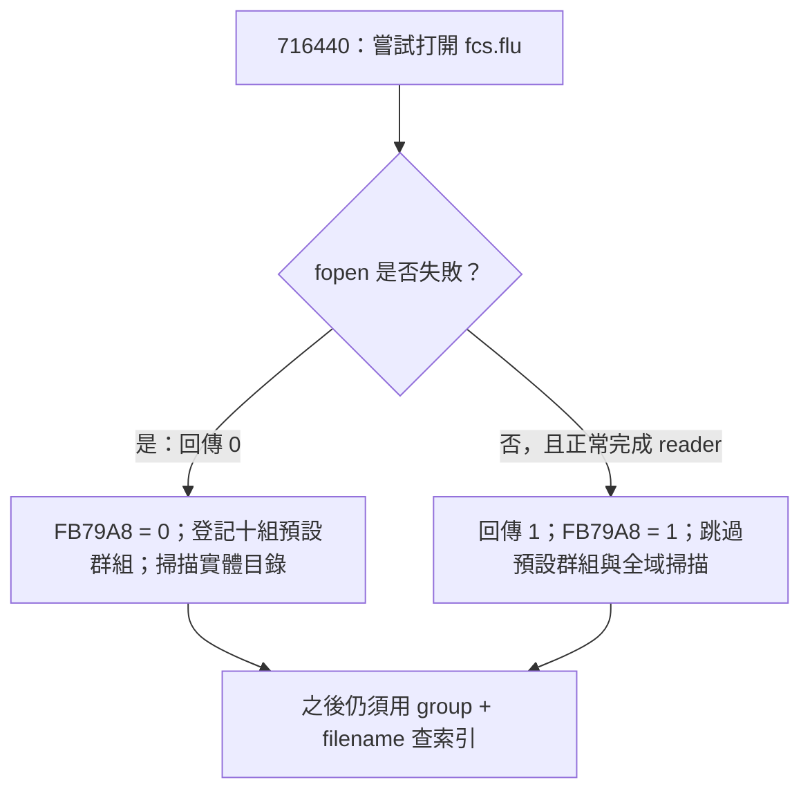

# P0 續接：`fcs.flu`、資源索引與實際選檔的完整分界

## 1. 本輪結論與玩家可理解的進度

**現有 BIN 已足以固定「怎麼找素材」的選取政策，但還不能填入這次安裝實際選到的角色／地圖檔案。** 本輪閉合的是 `fcs.flu` 開檔 → 記錄讀取 → 群組／檔名索引 → 無快取掃描 → 實際查詢者之間原先未完整說明的必要分支。完整 `Master.stp` 已由前輪解析；本輪直接沿用其掛載樹、父 provider 優先、EMF／ETF 結果，不重算為新成果。[來源與原件身份](source-manifest.json)

對玩家而言，`fcs.flu` 像遊戲用來找素材的索引簿。這個版本的程式**能打開索引簿，不代表裡面有要找的怪物或地圖**；而且打開後正常返回，就會跳過那套預設的資料夾重掃流程。因此不能把「有 Master」、「有某個同名 ABF」或「cache 檔可打開」直接寫成角色、場景已經可顯示。本輪提供能檢查這件事的只讀工具，但目前沒有真實 `fcs.flu` 可代入。[原生視窗 `cache_file_reader`、`cache_state_normal_init`](native-evidence.json) [實際材料可見範圍](source-availability.json)

| 本輪問題 | 結果 | 對玩家的意義 |
|---|---|---|
| 快取記錄結構與建立索引順序 | 靜態分析完成 | 知道要檢查索引簿的哪些資料 |
| 打開、讀取、有效覆蓋與 fallback 是否同一件事 | 靜態分析完成 | 可以避免「有檔卻找不到怪物」被誤判為完成 |
| 重複群組／重複檔名誰保留 | 靜態分析完成；檔名首筆規則復用舊證 | 同名素材不會靠猜目錄決定 |
| 無 cache 時的十組預設搜尋與目錄先後 | 靜態分析完成 | 知道遊戲實際會掃哪些實體資料夾 |
| lookup miss 與特定 PTC 本地補掃例外 | 靜態分析完成 | 不把單一查詢失敗或例外誇大成全部群組的行為 |
| 最小補件與離線檢查方法 | 分析／工具完成 | 可以指定真正需要的索引和素材，不必先補齊整套 897 個載體 |
| 這次安裝真正的 `CHA_ABF`／`MAP_FLD` winner | **尚未完成／受阻** | 還不能保證角色和地圖選到哪一份檔案 |
| 所選檔案最終可讀、可顯示及正流程遊玩 | **資源待補／跨功能待整合／待遊玩驗證** | 仍不能標成已可玩 |

上表不是整體 P0 百分比，也不是將受阻項算成完成。`full_p0_ready`、`resource_payload_ready`、`playable_verified`、`t01_full_pass` 全部保留 `false`；真正 selected path 保留 `null`。[機器可讀狀態與待辦](contracts.json)

## 2. 來源、限制與舊成果復用

- 工作分支：使用者指定 `extra/roy1`；本子包沒有建立分支或進行 Git mutation。
- 固定研究基準：`15d9501c203c6f656461b64f578a50c96e38a5ff`；共同開工核對之 `origin/main` 基準為 `5ed4833b805949fabe260aea77e3fe0fd8e86bfa`。本子包沒有把後續工作目錄當作 immutable 來源。
- 原始 BIN：`02-Tartaros.bin`，12,472,320 bytes，SHA-256 `9741d1975327b9309d82b52f631165bc410757694d7c183a5eed970a53ebef91`，PE32 i386，image base `0x400000`。
- 原件只讀。未執行／附加 Client，未執行 Lua、DLL、Server、封包或解出 member。Git 不包含原 BIN、STP、ZIP 或完整解出 member。
- 反編譯 C 只作導航；重要主張回到原 BIN 的完整有界函式、分支、欄位與 IAT 驗證。各精確 Git blob SHA-1、SHA-256、長度保存在 [source-manifest.json](source-manifest.json)。

| 前輪來源 | 本輪復用的精確範圍 | 本輪未重做的內容 |
|---|---|---|
| [resource-selection 原稿](../../MEF-comprehensive-contracts-20261117/resource-selection/report.md) | Actor `FILE + .abf` → `CHA_ABF`；entry directory/filename；預設 ASCII uppercase 分支 | ActorList 全表、1086 三列解析、Base 全名單 |
| [content-dependencies 原稿](../../MEF-P0-content-contracts-20261117/content-dependencies/report.md) | cache／scan basename 首筆保留；Actor.ID 後寫；Master parent-provider；FLD caller/consumer | 全依賴圖、全部 ABF、封包與 reader 重新計數 |
| [master-resource-closure 原稿](../../MEF-P0-P1-master-continuation-20261117/master-resource-closure/report.md) | 完整 cache reader／normal-init 原 bytes；Master 掛載／EncSetting；EMF／ETF | Master 原件再次解包、所有 mount、EMF／ETF 再追 |

本輪增加 12 個完整有界視窗，總 span 4,889 bytes，另外復用 10 個已固定視窗。部分新完整視窗包含前輪已有的短摘錄，所以這個 byte 數**不是首次發現的唯一 bytes 數**。新內容在完整分支、輸入有效性分界、群組 definition 首筆規則、掃描順序與例外所有權；不是用重新輸出舊組語提高進度。[native-evidence.json](native-evidence.json) [native-evidence.asm](native-evidence.asm)

## 3. 正常初始化：開啟分支決定是否掃描

`798DE0` 正常初始化的實際 call instruction 是 **`799170 call 716440`**；`79916B` 是其前一個 `push FE1DFC`。前輪將 `79916B` 當作呼叫段起點可以定位同一路徑，本輪把指令位址再精確區分。[舊完整視窗 `cache_state_normal_init`](native-evidence.json)



關鍵指令：

| 位址 | 可證行為 |
|---|---|
| `71647A..716488` | `rb`、`fcs.flu` 傳入開檔 helper |
| `716496..71649C` | 檔案指標為零，回傳值設為零並跳 epilogue |
| `71670C` | opened-input 正常清理後將 `EAX` 設為 1 |
| `799175..799177` | 非零結果跳至 `799456` |
| `799184` | 失敗路徑將 `FB79A8` 設為零 |
| `7991C1..79941C` | 失敗路徑登記十組預設群組 |
| `79944F` | 失敗路徑呼 `716240` 掃描全域群組 |
| `799456` | 非零路徑將 `FB79A8` 設為 1 |

「opened-input 正常完成」是必要限定。不能將它寫成所有損壞檔案都必定回傳 1，也不能保證配置失敗、未終止字串、未宣告群組、CRT 失敗或例外後還會正常返回。可證的是：這個完整函式沒有在讀取失敗或缺少目標群組時，提供一條明確的 `return 0 → defaults` 修復路徑。[`cache_file_reader`](native-evidence.json)

## 4. `fcs.flu` reader 的實際輸入佈局

### 4.1 Header 與兩個連續陣列

reader 先讀 8 bytes header，再讀群組陣列，最後讀 entry 陣列。以正常、完整輸入表示：

```text
header: 8 bytes
groups: header.group_count × 0x158 bytes
entries: header.entry_count × 0x218 bytes
```

| Header offset | 型別 | 原生用途 |
|---|---|---|
| `+0x00` | little-endian u32 | group record count |
| `+0x04` | little-endian u32 | entry record count |

配置使用 count × stride；迴圈的 `jle`／`jl` 條件具有 signed 解讀。不能將這兩個 u32 擴張為「任何 32 位正整數都能安全使用」。乘法 overflow 被併入配置 size 的處理也不等於完整檔案驗證。[`7164A1..716581`，`cache_file_reader`](native-evidence.json)

### 4.2 Group record：stride `0x158` = 344 bytes

| Offset | 相鄰欄位界定的實體 slot | 傳給 `716040` 的用途 |
|---|---:|---|
| `+0x00` | 16 bytes | exact group name |
| `+0x10` | 64 bytes | scan pattern |
| `+0x50` | 260 bytes | scan directory |
| `+0x154` | 4 bytes | recursive flag |

`716590` 以 `ESI=record+0x50`，取 `[ESI+0x104]` 作遞迴旗標，`ESI-0x40` 作 pattern，`ESI-0x50` 作 group name，`ECX=ESI` 作 directory，`EDX=manager`；`7165A3` 呼 `716040`。下一列加 `0x158`。[`cache_file_reader`](native-evidence.json)

### 4.3 Entry record：stride `0x218` = 536 bytes

| Offset | 相鄰欄位界定的實體 slot | 用途 |
|---|---:|---|
| `+0x00` | 16 bytes | 要插入的 exact group name |
| `+0x10` | 260 bytes | entry directory |
| `+0x114` | 260 bytes | entry filename |

`7166B7..7166C7` 取選中 group pointer、加 `0x3C` 取得 file index，將 entry `+0x10`／`+0x114` 傳給 `7198F0`。下一列加 `0x218`。**全部 group definitions 先建立，才按 entry 原始列序插入 entry。** 因此 entry 可以引用 group array 中較後面的定義；不是依兩種記錄混合排序即時處理。[`cache_file_reader`](native-evidence.json)

上表是由位移和 stride 推導的物理欄位槽，不是說 native reader 有做相同的 slot bounds check。實際字串路徑使用尋找 NUL 的迴圈，沒有在每個 slot 結尾強制停止。離線工具要求槽內 NUL，是工具的嚴格接受條件。[`cache_file_reader`、`group_definition_first_wins`](native-evidence.json)

## 5. 為何「開檔成功」不等於「索引有效」

### 5.1 三次 fread 的完成數未用於驗證

| call | 單位 size／count | 接續行為 |
|---|---|---|
| `7164B3` | 8 × 1 | `7164B8` 重新載入 header count，覆寫 `EAX` |
| `716562` | `0x158` × group count | 直接準備下一次讀取，未比較回傳 count |
| `716577` | `0x218` × entry count | 直接初始化／執行 group 與 entry 迴圈，未比較回傳 count |

在完整 reader 中沒有 magic/version 比較、全檔長度相符檢查、要求 `CHA_ABF`／`MAP_FLD` 存在的檢查，或覆蓋不足後再呼 `716240` 的分支。[`cache_file_reader`](native-evidence.json)

一個不需要猜損壞字串的反例是：**已打開、兩個 count 都是 0 的 8-byte header**，在 manager 原先為空、配置／CRT 正常完成的條件下，兩個建立迴圈均跳過，reader 正常回傳 1，初始化跳過預設群組和掃描。此時目標 group 仍不存在。這是原生 CFG 的靜態推導；驗證器的零計數測例只檢查離線工具會保留「沒有目標」，沒有啟動 Client 去執行這個輸入。[`contracts.json → init_decision`](contracts.json) [離線驗證結果](verification-result.json)

### 5.2 entry 引用不存在的群組，不是已證的安全拒絕

`716609` 查 exact group。`716612..716615` 遇到 sentinel 時跳 `716679`，把 manager sentinel 放進暫存 iterator；`716684` 將其載入 `ESI`。完成暫存字串清理後，`7166B7` 仍直接讀 `[ESI+0x28]`，再加 `0x3C` 傳入 entry insert。這段中沒有「如果缺 group 就跳過 entry／回 0」的 guard。[`cache_file_reader`](native-evidence.json)

這足以判定 **不能依賴 missing-group graceful fallback**，但不足以宣稱每種此類輸入必定 crash；sentinel payload、先前狀態、配置與例外處理的具體執行結果不在本輪執行證據內。工具遇到未宣告 exact group 會停止並回傳 profile error，明示這是離線政策，不模擬未定義／異常執行。

## 6. 群組首筆、檔名首筆與路徑欄位必須分開

### 6.1 新閉合：重複 group definition 不覆寫舊設定

`716040` 先經 `7B6F30` lower_bound、`49AE30` 字串比較決定 exact group 是否存在。`7B6F30` 與 `49AE30` 最終使用 `407E70` 的 unsigned byte 比較及長度判斷，沒有走 basename 的 uppercase helper。因此 `CHA_ABF` 與 `cha_abf` 是不同 group keys。[`group_definition_first_wins`、`group_lower_bound`、`group_compare`、`byte_compare`](native-evidence.json)

在 `716115..716118`，已存在 group 直接跳到 `716220` epilogue，繞過配置和全部欄位寫入。新 group 配置 `0x6C` bytes：pattern string 在 `+0x00`，directory string 在 `+0x1C`，recursive 在 `+0x38`，file index 在 `+0x3C`。所以同一 exact group 的後列 directory、pattern、recursive 不會覆寫首個已存在 definition。若 manager 有先前 group，先前項也受同一規則保留；離線工具明示從空 manager 模型開始。[`group_definition_first_wins`](native-evidence.json)

### 6.2 復用：同 group 的 normalized basename 首筆保留

`7198F0` 的 cached entry 與 `718FB0` 的 scan entry 均先查 normalized filename key，已有 key 時不替換原 entry。掃描分支還會組成 `Conflict` 訊息，釋放新配置的 entry；原項仍在。這是前輪已確認的規則，本輪僅連接完整 group／scan 分支。[`cached_basename_first_entry`、`filesystem_scan_complete`](native-evidence.json)

`7198B0` 逐 byte 呼 CRT uppercase helper；前輪已固定 `893704` 的預設分支只對 ASCII `a..z` 減 `0x20`，另有 locale 分支。本工具只模擬**預設 ASCII 分支**，不宣稱已知執行中的 locale。查詢及 cache insert 的 key copy buffer 為 `0x40`；scan insert 的 buffer 為 `0x104`。因此嚴格工具拒絕 64 bytes 以上的 filename/query，避免把未分析的 CRT invalid-parameter 行為當成可安全查詢。[`basename_lookup_complete`、`cache_entry_strings`、`basename_uppercase_loop`、`crt_uppercase_ascii_branch`、`filesystem_scan_complete`](native-evidence.json)

### 6.3 entry.directory 不等於 group.directory

| 物件 | `+0x00` | `+0x1C` | 其他欄位 |
|---|---|---|---|
| group definition | pattern string | scan directory string | `+0x38` recursive；`+0x3C` file index |
| selected resource entry | selected directory string | selected filename string | 配置大小 `0x38` |

快取 entry 的 directory／filename 來自**entry record 自己的欄位**，不是把 group.directory 自動加在前面。cache reader 也未用 group.pattern 或 group.directory 去驗 entry 的副檔名／目錄前綴。最後 candidate literal path 為 `entry.directory + entry.filename`；工具不補 `/`、不做 normpath、不重新解釋相對路徑。這可避免誤把 `Character/`、`Mon/` 或 Base 載體內路徑任意拼在一起。[`cache_file_reader`、`cache_entry_strings`；既有 actual reader 消費鏈](native-evidence.json)

## 7. 無 cache 的十組完整預設清單

只有 `716440` 回傳 0 的這個 normal-init 分支執行以下十筆，全部 `recursive=1`、manager=`FE1DFC`。字串地址和每個 call 前 ABI 參數均由原 BIN 驗證。[`cache_state_normal_init` 與 literal records](native-evidence.json) [typed definitions](contracts.json)

| Group | directory | pattern | `716040` call |
|---|---|---|---|
| `CHA_ABF` | `Character/` | `*.abf` | `7991C1` |
| `MAP_OBJ` | `Map/Object/` | `*.gb3` | `799204` |
| `MAP_PTC` | `Map/` | `*.ptc` | `799247` |
| `MAP_MO3` | `Map/Object/` | `*.mo3` | `79928A` |
| `MAP_DDS` | `Map/Object/` | `*.dds` | `7992CD` |
| `MAP_MRE` | `Map/Map/` | `*.mre` | `799310` |
| `MAP_FLD` | `Map/Map/` | `*.fld` | `799353` |
| `EFF_EFF` | `Effect/` | `*.eff` | `799396` |
| `EFF_DDS` | `Effect/Texture/` | `*.dds` | `7993D9` |
| `COMMON_DDS` | `Panel/` | `*.dds` | `79941C` |

**此清單沒有 `Field`／`*.mef` 群組。** 這只限定上述十筆初始化 definitions，不能推出全程式不存在 MEF reader：cache 本身能登記不同 group names，而 Master 的 Field 虛擬掛載是另一層。本輪已把此有限結果交給同輪 P2 分域使用，沒有將 `.fld` 當 `.mef` 的格式別名。[`contracts.json → boundary`](contracts.json)

## 8. `716240 → 718FB0`：實體 filesystem 掃描與先後次序

### 8.1 先清索引，再掃每個 group

`716240` 從 manager 群組 map 收集 group pointers。對每個 group，`7162AC` 先呼 `718EE0(group+0x3C)` 清除舊 entry，再取 group.pattern、directory、recursive，於 `7163FC` 呼 `718FB0`。`718EE0` 釋放 entry 的兩個 string、entry object 與索引容器狀態。這條路是重建各群組索引，不是把後一次 filesystem scan 一律追加到舊 cache entries 後面。[`group_scan_rebuild`、`index_clear`](native-evidence.json)

### 8.2 先處理當層檔案，再遞迴子資料夾

完整 `718FB0..7197D4` 的控制流程為：

1. recursive 非零時，用 `directory + "*.*"` 列舉當層項目，收集非 hidden 的子資料夾，排除 `.`／`..`；保存回傳列序。
2. 用 `directory + pattern` 列舉當層檔案，排除 directory／hidden bit `0x12`，按列序處理 basename key；只保留首筆。
3. 當層檔案列舉結束後，按已收集的 child name 順序，組合 `directory + child + "/"` 再遞迴。每個 child 的整棵子樹處理完，才輪到下一個 child。

容易誤讀的地方是：原始組語的遞迴區塊地址 `71928F..719307` 比檔案處理區塊 `7193E0..7197C5` 靠前，但 CFG 先從 `719249` 跳到檔案分支；檔案迴圈終止後 `7197C5 → 719256` 才進子目錄遞迴。不能按組語檔案排列順序把它寫成 child-first。[`filesystem_scan_complete`](native-evidence.json)

完整 body 沒有自行排序 child names 或當層 filenames。因而可固定的是**當層優先、再依回傳的 child 列序深度遞迴**；同層／不同 sibling 的實際列舉次序未由 BIN 固定。如果特定 basename 在整個合法搜尋範圍只出現一次，則可另外以唯一性消除此項順序依賴；多候選時不能以字母排序替代原先列序。[同上]

### 8.3 為何 Master／STP 清單不能代替這個 scan

由 PE import table 實際確認：`BD2244=KERNEL32!FindFirstFileA`、`BD22A0=FindNextFileA`、`BD2240=FindClose`。在這個完整 scanner 中，輸入被送到 Win32 filesystem API，不是枚舉 Master/STP 的虛擬 member tree。預設 `Character/`、`Map/Map/` 又是字面相對目錄，當次 process cwd 未提供。[`native_imports`、`filesystem_scan_complete`](native-evidence.json)

所以「Base.stp 裡找到 `Mon/02_Stoncken.abf`」不能自行證明 scanner 會在實體 `Character/` 樹中看到該檔案；Master 掛載某 carrier 也不等於它以 loose-file 形式出現在 Win32 列舉結果。**索引產生、虛擬路徑解析、實際 payload 讀取是三層不同問題。** 另一方面，已取得的 cache entry 可以直接提供 index directory；這時不需要為了推得 directory 再要求掃描整個虛擬樹。

## 9. lookup miss、真正 caller 與 PTC 局部例外

### 9.1 一般 group／filename 查詢

`716740` 對 exact group miss 回傳零；hit 取 tree-node `+0x28` 的 group object，加 `0x3C`，轉交 `7197E0`。`7197E0` 將 query 複製到 64-byte buffer、正規化、查 file index；miss 回零，hit 回 index-node `+0x24` 的 resource entry。兩個完整 body 都沒有 miss 後呼 scan 或 package open 的分支。[`group_lookup_complete`、`basename_lookup_complete`](native-evidence.json)

對本輪 P0 的兩個實際 consumer：

| 輸入／consumer | 復用的原生鏈 | 本輪新增後仍未知的資料 |
|---|---|---|
| ActorList `FILE + ".abf"` | `54105C..541072` → `716740("CHA_ABF", basename)`；既有 model reader 沿 entry strings 讀取 | 實際選中 entry 的 directory、相同 key 前面是否已有其他 entry、最後開到的 carrier/member |
| 場景 FLD | 前輪 `7C1E47..7C1EE3` group gate；`7ED1C0..7ED256` entry 選取；`7ED27E..7ED343` directory／filename 到 XML load | 同版本 `MAP_FLD` 實際 entry 與 bytes；不以 Master Field 命名代替 |

這些 caller／consumer 的舊精確 native windows 由本 verifier 讀取固定 Git blob、再對原 BIN replay；沒有只留下文件名稱而不載入來源。[reused_windows](native-evidence.json) [source-manifest](source-manifest.json)

### 9.2 必須保留的反例：`MAP_PTC` 有 stack-local 補掃

有限 caller census 找到 `718FB0` 的另一個真實呼叫者 `7F6C3D`。完整函式 `7F6B80`：先查全域 `MAP_PTC`，再用 `718CF0` 在 stack local 建立空 file index；如果全域 miss，對該局部物件掃 `Map/*.ptc`、recursive=1，再以 `7197E0` 查同一要求檔名。最後 `7F6D43` 把同一 stack address 交給 `718DD0`，釋放局部 entries、strings 與容器。[`ptc_local_fallback`、`index_constructor`、`index_destructor`](native-evidence.json)

因此不能把一般 lookup 的「自己不補掃」誇大成「所有 caller 都不補掃」。但此例的 local scanner 不是全域 `FE1DFC` group index，也沒有在該完整函式內把選到的 entry 重新 publish 到全域群組；不能套用為 `CHA_ABF` 或 `MAP_FLD` 已經補救成功。沿全域與局部 index 的 ownership／結束清理讀完，是本輪這條例外的靜態終點。

## 10. 搜尋範圍、反證與停止界線

本輪對原 BIN file-backed `.text` 做 E8/E9+rel32 的有限候選搜尋，並逐一確認下列候選在已讀 native 視窗中為真指令：[caller-census.json](caller-census.json)

| 目標 | 已解碼的 direct call 候選 |
|---|---|
| `716440` cache reader | `799170` |
| `716040` group register | `7165A3`；十筆 default calls |
| `716240` all-groups scan | `79944F` |
| `718FB0` recursive scan | `7163FC`、`719302`、`7F6C3D` |
| `7198F0` cache entry insert | `7166C7` |
| `7197E0` basename query | `716808`、`7F6C53` |

這個 census 是 **19 個 decoded direct-call candidates**，不涵蓋所有間接呼叫、vtable、不同載體或整個執行期，不能當全程式 absence proof。沒有為了數量擴展到不相關音效、完整 CRT 或保護殼。

兩個 supplied 原件目錄與 supplemental ZIP central-directory 名單均未見 `fcs.flu`：原件目錄 11 個檔、supplemental 目錄 2 個檔、ZIP 131 個 member names。只查 names 和來源 SHA，未把完整原 member 輸出。本結論限定這些具名材料，不是全機器／網際網路不存在 cache。[source-availability.json](source-availability.json)

**為什麼 actual winner 不能再只靠 BIN 推進：** 已閉合的 source-of-value 恰好是外部 cache 的 entry strings 或實際 filesystem enumeration。BIN 固定演算法，不內嵌這次安裝的記錄順序、檔案樹、cwd 或 selected entry。缺少它們時，至少兩組不同但都符合本 build 演算法的輸入能產生不同 winner；任填一組目錄就是猜測。此阻塞是缺少精確選取輸入，不是泛稱「需要 runtime」後停止仍可分析的 native 分支。

## 11. 只讀工具：提供本地 cache 後可以做什麼

[cache_inspect.py](cache_inspect.py) 只讀指定檔案 bytes，沒有 native execution、沒有開啟 entry 裡的 paths、沒有修改原 cache，也不產出可部署的 cache。它要求：

- 長度恰為 `8 + group_count × 344 + entry_count × 536`；大小／count 受明示離線預算限制。
- 各物理字串 slot 內有 NUL；被分析文字限定 printable ASCII。
- entry 引用已宣告的 exact group；filename/query 長度小於 64 bytes。
- 從空 manager 建立模型，按 group／entry 原始記錄順序保留首筆，使用預設 ASCII uppercase。

以上是**嚴格離線 profile**，不是聲稱 native reader 做了同樣拒絕檢查；native 可能讀取有 trailing bytes 的檔案，工具刻意不把這些情況默認為已完整重建。超出 profile 時輸出明確錯誤，不補猜 locale 或 malformed 行為。

有實際 cache 後的用法：

```bash
python -B kr-extra-roy/MEF-P0-P1-P2-continuation-20261118/p0-selection/cache_inspect.py /path/to/fcs.flu --query CHA_ABF 02_Stoncken.abf
```

這是**待取得真實 cache 後**的命令，不是本輪已經成功解析原 cache 的 receipt。工具輸出 group/entry counts、保留／捨棄的重複 record IDs、查詢的 candidate directory/filename/literal path；`native_selected_path` 仍為 `null`、`native_open_verified=false`。當還沒證明這份 cache 被實際 Client 使用、cwd／provider／payload 也未驗時，不將候選升成 native 成功。

## 12. 可重跑驗證與其意義

從 repository root 執行：

```bash
python -B kr-extra-roy/MEF-P0-P1-P2-continuation-20261118/p0-selection/verify_evidence.py
```

原 BIN 如在別處，可傳 `--binary /absolute/path/02-Tartaros.bin`；Git repository 可傳 `--repo /absolute/path/ttr_anal_multi`。目標 hash、所有來源 commit、Git blob、原 bytes、函式 anchor、指令邊界、PE import、十筆群組 ABI、19 個 caller candidates、artifact hashes 都會重核。程式只將 JSON 印到 stdout，並停用 bytecode cache；不修改原件、不連線、不執行目標。[verify_evidence.py](verify_evidence.py) [evidence_io.py](evidence_io.py)

[verification-result.json](verification-result.json) 保存實際執行結果；包括 21 immutable Git pins、12 個新完整有界視窗、10 個舊視窗 replay、5 個 IAT 身份、31 個 literal records、十筆 default definitions、19 個 decoded call candidates，以及 20 個記憶體內 synthetic profile cases。後者驗證：零計數仍缺目標、group first-wins、entry case-collision first-wins、group 不 casefold、entry directory 不被 group prefix 改寫、missing group/key 分別呈現、缺 NUL／截斷／trailing bytes／超預算 count／未宣告 group／非 ASCII／長 key 拒絕。

結果 `PASS_EVIDENCE_REPLAY_AND_OFFLINE_PROFILE` 的意義限於「這些證據與工具契約可重現」。**不等於實際 fcs 已取得、native payload 成功、整體 P0 完成、正式 T01 FULL-PASS、Server 已開發或玩家已驗收。** 工具測例明確標 `SYNTHETIC_ANALYZER_ONLY`，不能成為原生內容來源。

## 13. 缺件已收斂到最小可行證據

| 優先序 | 應補來源 | 為何需要／取得後做什麼 |
|---|---|---|
| P0 第一選擇 | **同版本實際 `fcs.flu`**，並確認這次安裝採用 cache 分支 | 直接查 `CHA_ABF`／`MAP_FLD` 的所有同鍵 entry 與先後；單一摘出的同名 row 不足以證明它是首筆 |
| P0 替代路線 | 若 cache 開啟失敗：實際 cwd、`Character/` 與 `Map/Map/` loose-file 樹與屬性；有 duplicate 時補實際列序 | 按 hidden／directory／parent-first 規則重建；若整個搜尋範圍只含唯一同鍵候選，則不必再靠列序判勝 |
| P0 payload | 根據選中 literal path 對應的精確 Master provider、同版 carrier 與 payload bytes | 接回已證 parent-provider 優先與 reader，分別證實 selected source、member 身份、實際可解資料 |

不需要先要求補齊所有 897 個 AttachedPackage。先取得 selection input，確定真正 path，再依 Master 樹及父 provider 規則要求最小相關 carriers；但若父 provider／同名 collision 仍有候選，就不能只取較深的看似匹配 carrier。已存在的 Base member 是候選資料，不能自行升成 native winner。[`minimum_missing_evidence`](contracts.json) [既有 Master 完整來源](../../MEF-P0-P1-master-continuation-20261117/master-resource-closure/report.md)

## 14. Server 開發與驗收需求另列

| 分類 | 需求／下一步 | 本輪不冒充的成果 |
|---|---|---|
| 資源待補 | 補 selection input 與被選 payload，讓角色／場景的資源來源能唯一定位 | 不把 missing carrier 寫成 Server 演算法未知 |
| Server 待開發 | 由 S00 去重接收已確認 selector／依賴契約；開發教學／進場需要的出生、狀態、完成條件與持久化規則 | 不猜官方 Server 內部，也不發明下載 opcode 來補 Client 缺檔 |
| 跨功能待整合 | 內容檢查流程分別記錄 cache/scan route、group、key、首筆 record、candidate path、provider、payload hash | 索引候選不等同最終 bytes；不得只設單一「資源已完成」旗標 |
| 待遊玩驗證 | Server 正流程與素材依賴接合後，依既有使用者排程驗收教學、角色顯示和進場 | 本輪沒有跑 Client／Server 或新的壓力、錯誤、競態測試 |

本子包是可交接的技術原稿／工具契約，不另建平行 RR 或 Server 需求台帳，不修改其他 Task owner／歷史 FULL-PASS。整體 P0 的未完成項已保存在 [contracts.json → open_items](contracts.json)，補到精確來源後應接續原問題，而不是重新掃一次所有 Master 或已證 EMF／ETF。
