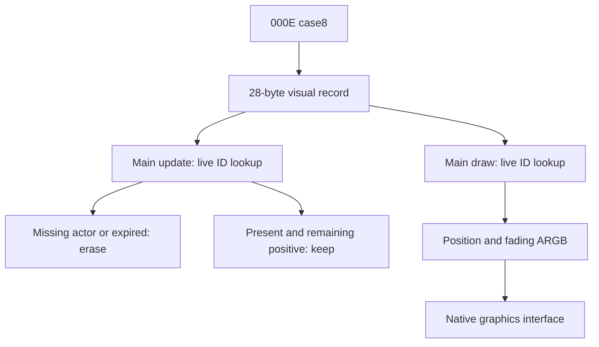

# P1：普通 world 結果到 Lua 的出口——原生 producer、實體生命期及實際 consumer

日期：2026-11-17。工作分支：`extra/roy1`。本輪來源基線：`5ed4833b805949fabe260aea77e3fe0fd8e86bfa`。

## 1. 結論與完成範圍

**本輪已完成所列候選的有界靜態續析；尚不能宣告「普通 world actor 的結果，已進入同 run、同 actor generation 的 Lua 可觀察出口」。** 新證據把原先容易混用的數值、死亡畫面及事件容器分開：`0000` 更新比例通道，`0034` 更新絕對 HP／SP／MP，`000E` 處理結果顯示與部分原生 AI 回饋，`000C` 改死亡等 FSM 狀態，`001A` 移除實體。它們在本輪確認的 producer／consumer 中，只保留當下的 `u16 world EntityId`；沒有足以連到 Lua 的 run、generation、事件序號及移除原因契約。[E1][E2][E3]

此次新增的重點不是再列一份 getter 名稱，而是以下實際資料流：

1. `0000 → actor.v+2C → CMonster/CCharacter 比例欄位 → native bar`，並區別怪物與角色百分比 getter 的不同計算來源。
2. `0034 → typed actor/roster max/current writer → 普通場景 HUD、怪物文字、SubAI 技能資源條件`；用技能表 `hp/sp/mp` 的 parser、16-byte record 與實際 reader，確認三組欄位名稱。
3. `000E case8 → FD9278 的 28-byte 成對 ID 記錄 → 主更新 tick 的到期/缺實體清除 → 主繪圖的當前實體查找及圖形輸出`。這個容器是效果生命期，不能充當死亡事件佇列。
4. 與既有 `0007` 建立、`000C` 死亡狀態、`001A` 移除、Scenario 三英雄槽 AI 回饋及 16 類正常 Lua 觀察出口接合，保留每個身分域的界線。[E1][E2][E3][E4]

交付包含 **31 個新原生程式窗口、21,123 bytes、5,955 條逐指令核對、38 個資料窗口、9 項有限參照 census、17 個既有窗口原件復核、75 個 immutable Git source pins**。`skill_cost_parser` 的完整指令核對，只支持本報告指明的三個成本欄位與容器連接；不把其餘技能格式一併算為語意完成。`update_prefix/draw_prefix` 也明列為 rooted prefix，不算整個主迴圈分析完成。[E1][E5]

| 判定項 | 本輪判定 | 實際意義 |
|---|---|---|
| 所列原生 producer／typed consumer | 已分析並保存原件證據 | 可以據此設計既有 wire 格式的 Server 投影與驗證 |
| 普通 world → 同 run/generation Lua 出口 | **NOT_CLOSED_NO_PROVEN_ENDPOINT** | 缺少具身分關聯的 native→Lua 接合證據，不能靠 native bool／畫面變化升格 |
| Server 權威 HP、死亡、群組、任務與掉落 | **Server 開發需求** | 由 Server 實作，不列成等待 Client 完整還原的阻塞 |
| 原件只讀驗證 | `verification-result.json: PASS` | 證明來源、範圍、指令、typed anchors 與合約一致；不代表 runtime 或整體 native_complete |

### 證據索引

- **[E1]** [native-evidence.json](native-evidence.json)、[native-evidence.asm](native-evidence.asm)：每個窗口有 VA／raw offset／bytes／SHA-256／原 bytes／完整指令與適用範圍；下文以 `window.id` 引用。
- **[E2]** [contracts.json](contracts.json)：wire 欄位、實體身分域、28-byte 效果記錄、候選處置、未閉合條件與 Server 開發需求。
- **[E3]** 基線下 `MEF-world-identity-scene-interaction-20261117/WORLD-IDENTITY-EVENTS.md` 與 `MEF-transition-actor-event-20261117/WORLD-EVENTS.md`；不可變檔案身分在 [source-manifest.json](source-manifest.json)。
- **[E4]** 基線下 `MEF-comprehensive-contracts-20261117/events/report.md`、`observation-catalog.json`；T12 evidence `81a3fe…69b6.txt`、`b031b1…ac34.txt`。完整檔案路徑、Git blob、SHA 與 bytes 均列於 source manifest。
- **[E5]** [read-set.json](read-set.json)、[verify_evidence.py](verify_evidence.py)、[verification-result.json](verification-result.json)。搜尋候選不等於全部語意完成，範圍逐項列出。

## 2. 來源固定、既有成果與本輪新增的分界

唯一用來作原生 bytes 判定的程式是原始 `Tartaros.bin`：12,472,320 bytes，SHA-256 `9741d1975327b9309d82b52f631165bc410757694d7c183a5eed970a53ebef91`，PE32/i386、image base `00400000`。本輪使用 `python -B`、host `objdump` 及 immutable `git show`，沒有執行、附加或修改 Client、Lua、Server、資源與存檔。`Master.stp` 的新資料鏈由同輪其他分析負責；此處原生結論不依賴把 Master 欄位補造成不存在的事件接口。[E1][E5]

已讀共同指令、AGENTS、最新主線 dispatch、T01 及相關 T10/T11/T12 任務範圍。T11 另有佇列研究請求；本輪依使用者最新 MEF P0/P1 續析指示處理，不宣稱接管或完成那些正式請求，亦不改正式 `native_complete`／工作認領狀態。共同指令快照的 SHA-256 為 `624d808521354aa4fb00774839a25cac29e8fdbaa6029c66f39dc43bf7a1bb43`、20,439 bytes。[E5]

下列內容是**復用及原件復核**，不重算新發現：world/Q 分域、0007 actor factory、000C FSM、001A erase、Scenario `54A8F0/54AA60` 三槽回饋、`549660/549C60` 的方向／輸入消費，以及 16 類正常 Lua observation。T12 已有 `000E` header2/row13、row+C 第六 stack 參數、效果數值顯示，以及 `4B18D4` 共享尾段並非固定 result0 的更正，本輪直接採用正確結論。[E3][E4]

本輪對 `4B0640..4B1914` 全 body 重新核原件，補的是其資料流與候選終點的接合。已核對完整 body 不等於所有 virtual callee、圖形 DLL 或全程式別名都完成；仍以窗口 scope、下文處置及明列解除證據限制推論。[E1: `result_000E`][E5]

## 3. 普通 world 的身分與生命期基礎

普通 world owner 為 `FAB130`，actor tree 在 `FAB138`、sentinel 在 `FAB13C`，node+10 保存 actor pointer，actor+4 是 `u16 EntityId`。`0007/4AE4D0` 在已存在 key 時略過該列，不能假設它替同 key actor 更新一個 generation。既有 `lb.CreateObjectEx` 的 counter／插入碰撞風險亦不能用來補足 Server 世代身分。[E3]

Q actor 位於 `FB73C0+1C` 的另一棵樹，建立、執行與查詢路徑不同。Q 演出完成、Q motion stopped、固定角色可見性，皆不足以辨識普通 world tree 某個任意 ID 的死亡或移除。即使 Lua 中碰巧出現相同整數，也必須再有 producer→lookup/storage→consumer 的原生證據才能判定同一實體。[E3][E4]

本輪涉及的六個 Server→Client 通道具有獨立的寫入行為：

| 通道 | 已知列格式 | world side effect | 不可直接替代的事件 |
|---|---|---|---|
| `0007` | header2 + 26×N | factory 建立、插入現有 u16 key 空間 | 同 key 的新 generation 確認 |
| `0000` | header2 + 6×N | actor 比例/參數更新 | 絕對 HP 快照、死亡判決 |
| `0034` | header2 + 18×N | max/current HP／SP／MP 等欄位 | 零 HP 自動死亡回呼 |
| `000E` | header2 + 13×N | 顯示、效果、FrameControl、部分原生英雄回饋 | 權威傷害、唯一死亡事件 |
| `000C` | header2 + 3×N | FSM 狀態，state3 可進 CDeadState | map erase、帶原因的移除 |
| `001A` | header4 + 2×N | cleanup、deleting destructor、tree erase | 有原因的死亡或任務擊殺 |

原生 count 多採 floor 並略過不存在的 actor，沒有把遺失行暫存為可稍後補交 Lua 的事件。在 Server serializer 中應輸出整列長度，這是開發約束，不是把 Client 的寬鬆截尾行為改寫成嚴格 parser 已存在。[E1: `parameter_0000`, `resource_0034`, `result_000E`][E3]

## 4. 新閉合一：`0000` 的 HP 比例 producer 到 native bar

### 4.1 封包、dispatch 與確切型別

`4AFAF0..4AFB7A` 在兩 byte header 後處理 6-byte row。`row+0:u16` 用於 world lookup；`row+2`、`row+4` 在 receiver 零擴展後傳給 actor virtual+2C，concrete callee 再作 signed WORD 解讀。不能只因 receiver 的 `movzx` 就把整個下游值域寫為 unsigned。[E1: `parameter_0000`, `monster_parameter`, `character_parameter`]

| row offset | wire 型別 | concrete 使用 |
|---:|---|---|
| +0 | u16le | world EntityId |
| +2 | 16-bit bits | i16 selector |
| +4 | 16-bit bits | i16 value |

原件 `4AFB20` 讀 ID，`4AFB38` 查 world tree，`4AFB61` 取 v+2C，`4AFB69` 呼叫，`4AFB6B` 前進 6。`CMonster` vtable `C0C9DC+2C → 4D1E10`；`CCharacter` vtable `C07B44+2C → 4CE7F0`。兩個 typed vtable／COL／descriptor 另有資料 bytes pins。[E1][E5]

### 4.2 selector1 的比例與獨立 getter

怪物 selector1 將 signed value 存到 actor+3B0（`4D1E3B`），取 actor+368 的 bar owner，以 byte key0 取得 record，再把比例寫入 record+C（`4D1E64`）。ROM `C556D8` 的實際 f64 值為 `9.999999747378752e-05`，即約 `value/10000`；不是精確十進位常數。此分支未見 bar null guard，不能把沒有 bar 初始化的任意 actor 當成安全接收者。[E1: `monster_parameter`, `bar_record_access`, `ratio_scale`]

角色 selector1 同樣處理 actor+3B0 與 key0 bar，但有自己的 bar guard；角色 selector2/3 使用另外的比例通道。這些分支不會因 value=0 自動轉到 CDeadState，也不等於寫 `actor+3C8` 絕對 currentHP。[E1: `character_parameter`]

| typed getter | 實際來源 | 後續已核 consumer |
|---|---|---|
| CMonster v+70 → `4C7040` | i32 actor+3B0 × 約 0.01，再轉整數 | `4C88F0` 的原生 bar 顯示條件 |
| CCharacter v+70 → `4CD010` | i32 current+3C8 / i32 max+3BC ×100，再轉整數 | 同一原生 bar 路徑 |
| 兩者 v+74 → `4C7060` | 直接返回 actor+3B0 | 本輪只確認此 getter；未把它視作 Lua registration |

`4C88F0..4C89A0` 有實際 virtual+70 caller，再依模型／比例／可見條件交給 native bar submit。CCharacter 百分比 thunk 自身未見 max=0 guard；下面普通 HUD 的 max<1 guard 是另一個 reader 的行為，不能相互套用。這裡閉合的是「參數→原生視覺消費」；並沒有 native Lua stack 的回傳值證據。[E1: `monster_percent_reader`, `character_percent_reader`, `raw_ratio_reader`, `bar_submit`]

## 5. 新閉合二：`0034` 絕對 HP／SP／MP 到實際 HUD 與 native AI

### 5.1 18-byte row 及 typed writer

common registration 的 field+1A4 指向 `4B3090`，依同一表的 opcode 佈局為 `0034`。`4B3090..4B32D1` 的 row 為 `mode:u32@0, worldID:u16@4, valueA:DWORD@6, valueB:DWORD@10, valueC:DWORD@14`。DWORD 在 wire 只表示 32-bit bits；HP／SP／MP 相關 reader 將其作 signed i32 使用。[E1: `resource_0034`; reused `common_primary`]

怪物分支要求 actor+39C=1、mode2、CActor→CMonster cast 成功。`4B313C/4B3142` 分別寫 maxHP+3BC／currentHP+3C8，`4B3148` 設 +430=1，啟用相應的數值文字顯示。此分支不用 valueB。非怪物路徑的 mode2/3/4 則要求 CCharacter cast 成功、actor+88 的 u16 roster index≤9、計算出的 roster address 非零；遠端 actor 也會通過這道 roster guard。actor+9C 是否等於 GameInfo+5F50，只控制要不要同步本機 roster mirror。[E1: `resource_0034`]

| mode | 資源 | valueA → actor 最大值 | valueC → actor 現值 | 本機 roster 最大／現值 |
|---:|---|---|---|---|
| 2 | HP | +3BC | +3C8 | +40／+34 |
| 3 | SP | +3C0 | +3CC | +44／+38 |
| 4 | MP | +3C4 | +3D0 | +48／+3C |

mode1 的三 DWORD 走另一條路：valueB→v+7C，valueA→v+80，valueC→v+78。本輪不替它命名為 HP、EXP 或死亡欄位，也不把未在本輪展開的下游屬性 setter 算入完成範圍。[E1: `resource_0034`][E2]

### 5.2 HP／SP／MP 名稱由 parser 到 reader 的資料流證實

欄位名稱不是只由常見 offset 猜測。`530890..5316C3` 的技能資料 parser，分別在 `5310EA/53111E/531152` 使用 ROM 的 `hp/sp/mp`；解析結果寫到 local WORD −24/−22/−20。`530EBC` 將 owner+60 作為 vector，append 在 `53150C..531517` 將這些 local 複製到 16-byte level record 的 +0/+2/+4。其餘 record 欄位不在本輪語意主張內。[E1: `skill_cost_parser`, `cost_field_names`]

`530530/5305C0/530650` 在既定型別與 level 邊界後，依 16-byte stride 取出 signed WORD +0/+2/+4；關鍵指令為 `53059E/53062E/5306BE`。`549980..549C51` 的實際成本檢查將它們分別對應到 actor+3C8／+3CC／+3D0，使用資源現值加 signed demand 後是否為負作條件。本輪由此確認三組名稱；沒有從這段導出 Server 傷害計算公式。[E1: `hp_cost_reader`, `sp_cost_reader`, `mp_cost_reader`, `native_skill_check`]

`549980` 的有限 E8/E9 候選掃描找到實際 caller `54AE83`。所屬 `54AE70..54AE92` 經 vtable `C0FC84+4` 與 RTTI `SubAI::CSkillCheckCondition` 綁定，最後把結果正規化為 bool。它是有實際 caller 的**原生 AI 條件**，並非 Lua C closure 的回傳證據；不能將 `EAX=0/1` 直接當 Lua 真值。[E1: `native_skill_condition`, `skill_condition_*`, census `0x549980/0x54AE70`]

### 5.3 普通場景 HUD、死亡畫面與怪物 caption

普通場景的具體 UI 路徑已接到 `FUI::CBottomMenuFrameField`：vtable `C21B64+198 → 5D4780`，其 `5D478F` 實際呼叫 `5D1BF0..5D2120`。此 reader 透過當前 controller v+20 取得 actor；正常狀態下讀取上述三組 max/current，max<1 時畫比例0，否則 current/max，更新 native widget 與文字。沒有把它誤算成 Lua observer。[E1: `field_hud_caller`, `field_hud_*`, `hud_resource_update`]

這個 HUD 有一個重要的分離：actor+158 state pointer 為空，或 state+34 非零時，會把畫面上的資源條及快取設為0；**該分支沒有把 actor 的 currentHP 寫成0**。因此「畫面 HP 歸零」不證明 `0034` 已交付零 HP，也不證明 Lua 收到同一死亡事件。反過來，`0034` 寫 currentHP=0 在這個 receiver 內也不會自動呼叫 FSM 死亡 transition。[E1: `hud_resource_update`, `resource_0034`][E3: CDeadState]

怪物另外在 `4D1B90..4D1E01` 經模型／距離等 guard，+430 非零後讀 +3BC/+3C8 並使用 UTF-16 `"{0} / {1}"` 的兩數字格式進入原生文字顯示。完整格式化 ABI 未在此擴成正式 UI 顯示順序主張；已足以確認 snapshot 的實際視覺 consumer，而非假想的生命事件接口。[E1: `monster_caption`, `monster_caption_format`]

## 6. 新閉合三：`000E case8` 的 FD9278 是有期限的視覺記錄

### 6.1 先保留已知 `000E` 的正確型別與 T12 更正

`4B0640..4B1914` 先確認本機 F93930 relation 在 FAB148；缺失時記錄診斷並返回 `80004005`。13-byte row 的 source/target 各以 u16 查當下 world tree，缺任一 actor 時略過。kind 是 signed byte0..8；case7 直接前進。`[4B1914,4B1938)` 是九個 DWORD 的 switch table，必須列為資料，不能當尾段指令。[E1: `result_000E`, `result_jump_table`][E4]

| offset | 正確解讀 | 本輪與既有證據的邊界 |
|---:|---|---|
| +0／+2 | source／target u16 world ID | 無 generation |
| +4 | signed kind | 0..8 的入口已核；未冒名完整官方 enum |
| +5 | signed effect index | 資源索引，正式 enum 未定 |
| +6 | 顯示用 i32 result value | case1 可原地取負；不能當權威 currentHP |
| +A／+B | 兩個未命名 byte | 完整 root 的直接 packet footprint 未讀它們 |
| +C | signed effect argument | **有讀取**；case0/8 經 `5521D0` 第六 stack 參數使用 |

不能再把 +A..+C 三個 byte 一起寫成未讀。T12 已證 `5521D0` 正常及失敗出口皆 `RET18`，row+C 低 byte 經 `4F6F70`；row+5 是資源 index。`7ABCD0` 把 result value 做十進位 glyph/panel，不是 HP setter。selected target membership 分支更新 F942C4 累加值；本輪補到 `458850..458BD5` 的原生十進位 UI 讀取，但 scalar 中沒有 EntityId／序號／移除原因可給 Lua 還原事件。[E1: `result_000E`, `aggregate_display`][E4]

FrameControl 共享尾段的正確路徑仍採 T12：case0/8 是 source motion group + NORMAL0，target group4 + NORMAL0；case4 是 target motion group + BLOCKED1、source group4 + BLOCKED1；case2 是 target motion group + CRITICAL2、source group4 + CRITICAL2。`4B0E55/4B1186` 跳到 `4B18C9`，繞過 `4B18C7` 的清零，因此 `4B18D4` 不能歸納為固定0。本輪 verifier 有直接檢查這個控制流。[E1][E4][E5]

### 6.2 producer、記錄格式與真實 caller

case8 在 `4B1860` 取 `48A400` singleton，在 `4B186C` 呼叫 `6D89C0`。singleton 是 `FD9278` 的三指標容器。`6D89C0..6D8A0A` 的 ABI 為七個 stack slots：manager、source、target、R、G、B、A；duration 另由 XMM0 輸入，`RET1C`。source/target 使用 actor+4 的低 WORD，不能因 stack slot 為 DWORD 就把 ID 型別擴成 u32。[E1: `result_000E`, `pair_store_accessor`, `pair_store_constructor`]

| 記錄 offset | 型別 | case8 初值／用途 |
|---:|---|---|
| +0 | u16 | source world ID |
| +2 | u16 | target world ID |
| +4／+8／+C／+10 | f32×4 | R=2.0、G≈0.2、B≈0.2、A≈1.2 |
| +14 | f32 | total≈0.4（與主更新 delta 同單位） |
| +18 | f32 | remaining，初值同 total |

`6D8A10..6D8A7E` 以七 DWORD 複製、end+=1C，確認每筆28 bytes；增容 callee 不在本輪擴成業務事件語意。原始常數 bytes、兩 ID 寫入、兩 duration 寫入與 `RET1C` 都有獨立 verifier anchor。[E1: `pair_store_append`, `pair_*` data][E5]

後續不只憑名字推測：主更新 root `492040` 的 `4928A8` 確實呼叫 `6D8480`；主繪圖 root `492900` 的 `492EBD` 確實呼叫 `6D8660`，前一個 call `492EB6` 取得同 singleton。prefix 直到這些 call 返回皆逐指令核對。[E1: `update_prefix`, `draw_prefix`]

### 6.3 tick 清除與 draw 消費的完整有限結論

`6D8480..6D865B` 每次用 record 的兩個 u16 ID 再查**當時** FAB138 world tree。任一 actor 缺失便移除28-byte記錄；兩者存在時，remaining 減去 delta，到期亦移除。到期/缺實體分支在這個 body 只有容器壓縮，不發出死亡原因、Lua callback 或 coroutine 喚醒。[E1: `pair_store_tick`]

`6D8660..6D89BC` 再查同樣的兩個 live ID。它以 remaining/total 衰減 RGBA，轉換為飽和 byte 色彩並組合 ARGB；actor virtual+50 經 CMonster/CCharacter typed vtable 均到 `4C8FA0..4C900D`，取得模型 slot0 位置，或 actor+A0/A4/A8 fallback，最後經 `6D8968 → 7CCC00..7CCE36` 到圖形介面。這個路徑可以解釋 paired ID 記錄的可見用途。外部圖形介面 DLL 本體未展開，故不宣稱全程式或所有外部模組都不存在 Lua 呼叫。[E1: `pair_store_draw`, `actor_effect_position`, `pair_graphics_sink`]



這還導出一項有限、可檢驗的身分風險：若舊 actor 被移除，而同 u16 ID 在下一次 tick/draw 前已分配給新 actor，且 remaining 尚大於0，該記錄會查到新 actor。若 next tick 先看到缺 actor，則記錄會被刪除。這是記錄格式與重新查找造成的**條件式靜態結論**，沒有宣稱已在 runtime 觀察到錯畫。它足以排除把這個容器當成精確的 actor generation/death ACK。[E1: `pair_store_constructor`, `pair_store_tick`, `pair_store_draw`][E2]

## 7. 死亡、移除與 native AI：已接合的反證

### 7.1 `000C` 與 `001A` 不能相互代稱

既有 `000C/4B0130` 以 row 的 `u16 ID+i8 state` 查 actor，經 actor+F0 secondary v+8 到 `4CA060`，state3 進 CDeadState。重複 state3 可以 exit/enter 並重設視覺時間，沒有可直接借用的業務去重。死亡 fade 亦不等於 world tree erase。[E3; E1 reused `state_packet`, `fsm_transition`, `state_dead_enter`, `state_dead_update`]

`001A/4B28D0` 的 header+2 WORD 在 receiver body 未讀，不能擅自命名 removal reason。`4DFBC0` 是 actor v+14 cleanup、v+0(1) deleting destructor、再 erase；CMonster 對應 **v+14=4D1F80、v+0=4D18D0**，不能反置。controller 清理與 world erase 並未提供同 run／generation 的 Lua 事件 token。[E1 reused `delete001a`, `world_erase`, `monster_cleanup`, `monster_delete`][E3]

結合新 HP reader，可以精確排除三種誤推：「零 HP snapshot必然已死亡」「死亡畫面HP=0必然是 actor currentHP已被寫零」「刪除一定代表擊殺」。業務上要把這三者關聯，應由 Server 的明確狀態機與事件序號處理。[E1][E2][E3]

### 7.2 三英雄槽 AI、技能條件及技能回覆

Scenario `4C4920` 在 common receiver 成功後，選取 kind0/2/3 送 `54A8F0`，更新 CAIControl 的三英雄槽 target／secondary ID。`54AA60` 的已核 actual consumer `549660/549C60` 用於方向與輸入；這一結論已由 comprehensive/events 完成，本輪復核原件並引用，沒有重新掃一遍 binding 當成新增。[E1 reused `scenario_result_wrapper`, `native_AI_pair_writer`, `native_AI_pair_reader`, `ai_direction_consumer`, `ai_action_consumer`][E3][E4]

新展開的 `54AE70/549980` 則是另一個 SubAI 成本條件。兩條 native AI 路徑都沒有在所列終點出現 Lua stack/payload 或 coroutine 關聯證據。它們也不能被擴為普通怪物完整的決策權威。[E1][E2]

另追查 `000F/4B19D0..4B19F2`：它轉給目前 controller v+3C；本輪兩個 concrete controller vtable 均綁到 `545C50..545E19`，處理動作／資源不足等 UI 回覆。這個候選未成為 `0034` 的替代 HP writer，也未接出死亡／Lua 完成回呼。[E1: `skill_response_000F`, `skill_response_ui`, controller vtable data]

## 8. 尚未閉合的出口：精確缺什麼、已排除哪些候選

目標仍是 `普通 actor 實際結果 producer → 同生命期關聯 → 同一 Lua VM/run 的 observable consumer`。現在剩下的不是含糊的「需要 runtime」，而是下面明確的 native/contract 接點。

| 候選 | 已查範圍與實際終點 | 為何不能解除 world→Lua 缺口 |
|---|---|---|
| 0000 比例 | 完整 receiver、monster/character typed setter、bar accessor、percent getters、實際 bar caller | 是原生視覺狀態，無 run/generation／Lua registration |
| 0034 絕對資源 | 完整 receiver、roster guards、普通 HUD、怪物 caption、技能需求 parser→reader→SubAI caller | snapshot 可顯示及參與 native bool；沒有事件序號／Lua 接合 |
| 000E 顯示／F942C4 | 完整 root bytes；復用 T12 effect ABI；新增 aggregate 顯示 reader | 值可改寫、scalar 不保留每次事件身分 |
| FD9278 paired record | 建立、append、實際更新/繪圖 caller、缺實體/TTL erase、位置/圖形 consumer | 只有兩個 live u16 ID 與顏色/時間；沒有死亡語意或 completion callback |
| 000C／001A | 已有完整狀態與移除窗口原件復核 | 死亡狀態與移除分離；無 generation/reason/seq |
| Scenario 54A8F0/54AA60 | 既有三槽 writer/reader 與兩個真正 consumer | 消費到 native方向/輸入，非 Lua |
| 000F | 目前 controller v+3C 的兩個 typed實現 | UI 回覆；無 HP/death/Lua producer |
| Q／16類正常 Lua observation | 復用完整有限 census，未重掃 | Q 身分域不同，有限 catalog 無任意 world actor 的世代/死亡/移除原因觀察 |

要解除 `WL-01`，至少需取得一條可原件固定的完整接合：實際 world writer/result handler → 保有或可核對生命期身分的 storage/bridge → registered native Lua C closure/callback 的參數或返回值 → 同 VM/coroutine 的 Lua consumer。若改由 Server→script 的合法訊息橋接，亦須有事件 token/schema、同 run 身分及消費端，不能只引用函式名、getter 被註冊、native bool 或一般 Lua runtime 存在。[E2: `unclosed_endpoints`]

本輪的9項 census 對 `.text` 搜 E8/E9 目標，對 `.text/.rdata/.data` 搜 literal DWORD；原始候選位置完整保存。這足以定位此次具體 caller，**不是全程式 alias proof**。沒有因「沒有更多直引」而排除計算出的函式指標、未列 custom closure 或外部模組。下一次應由新增具體 producer／bridge 候選切入；沒有新線索時重做全量 binding census，不會補上身分及同 run 接合。[E1: `candidate_census`][E5]

## 9. 可直接交給 Server 開發的規劃

Server 的權威生命期、敵群、任務、掉落及場景推進應獨立實作，不需要等待原 Client 把任意 world 結果回報給 Lua。以下是**新 Server 設計契約**，不是聲稱原始封包已有這些欄位。[E2: `server_development_requirements`]

| 優先序 | Server 開發需求 | 實作驗收點 |
|---|---|---|
| P0 | 權威 actor lifecycle 與事件紀錄 | internal key至少含 runId、sceneGeneration、worldEntityId、actorGeneration、eventSequence；HP snapshot、唯一 Died transition、Removed(reason)分開 |
| P0 | 已知 wire projection | 按既定 row大小送0007/0000/0034/000E/000C/001A；generation/seq/reason留在Server，不任意附加到legacy wire |
| P1 | ratio與絕對資源投影一致 | 按實際UI需要同步0000比例與0034max/current；檢查signed值域，不用000E顯示數字倒算currentHP |
| P1 | ID重用與舊 outbox隔離 | 以內部generation/seq控制舊訊息；world u16重用不得讓舊事件越過生命期；配合已知視覺TTL訂定策略 |
| P1 | 敵群／任務／MEF內容協調 | 由Server權威事件推進；透過另已確認的內容trigger契約發出合法客戶端演出，不等待視覺erase或Lua numeric0當ACK |

建立、snapshot、state、result、erase 的發布必須以 actor 存在性及 Server 交易/事件順序維持一致。此分析未建立所有情況下唯一正確的 state/result 發送先後，不應杜撰 universal ordering。可先以 Server 事件紀錄作唯一權威，再由各 protocol projector 產出相容訊息，並對重送／斷線／ID重用有明確處理。[E1][E2]

若產品需求確實要求 Client Lua 讀任意 world 結果，則把 typed bridge列為明確新需求：資料含生命期關聯、事件種類、原因、序號；native registration、Lua stack型別、同VM及run綁定、消費/清除規則都要有可驗證實作。現在不應把它偽裝成已存在而只是「還沒測」。Server端可以先完成上述權威邏輯與內容協調。[E2]

## 10. 重跑方式與驗證解讀

在含基線 Git objects的 repository，對原始 BIN 只讀重跑：

```bash
python -B kr-extra-roy/MEF-P0-P1-master-continuation-20261117/world-lua/verify_evidence.py \
  --bin /path/to/Tartaros.bin \
  --repo /path/to/ttr_anal_multi \
  --shared-instructions /path/to/02-PROJECT-SHARED-INSTRUCTIONS.md
```

`--shared-instructions` 可省略；省略時收據會明列未要求該項檢查。本輪實際收據使用已取得的共同指令原檔，該項為 PASS。verifier讀原件、解析PE raw mapping、重新呼叫 host objdump、對全部指令連續性/bytes、資料窗口、immutable Git blob/SHA/bytes、reused窗口、有限參照census、49個固定byte anchors、10個typed/control-flow anchors、14個virtual slots、4個RTTI類別與9個switch目標作檢查。它只輸出JSON，不寫原件或repository。[E5]

`verification-result.json` 的 PASS具有明確界線：證據一致、所列typed欄位和caller可重現；`ordinary_world_lua_bridge_proven`、`same_run_generation_event_endpoint_closed`、`whole_program_alias_absence_proven`、`official_native_complete_promoted` 都是 **false**。沒有以只讀工具驗證成功代替 Client執行結果，也沒有把Server待開發需求寫成Client缺口已修復。[E2][E5]
