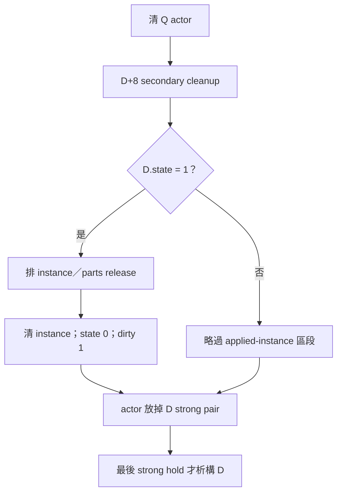
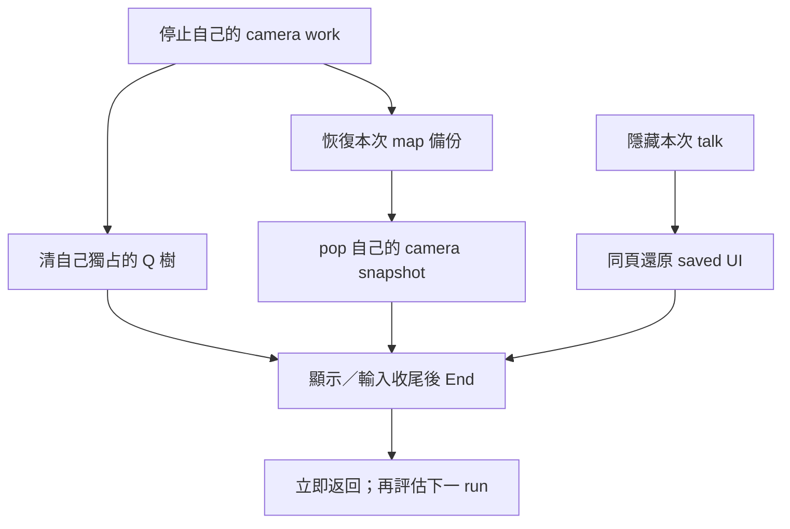

# MEF P0：同一 Client 的執行、資源持有與完整收尾契約

日期：2026-11-17。分支 `extra/roy1`；本題來源固定於 `ac7e668ef19b91f86f05074d660aba10612c9a5f`。這是 [上一包 P0 執行與收尾規劃](../../MEF-comprehensive-contracts-20261117/ANALYSIS-PLAN.md) 的分析交付，與本輪 ABI 採用、內容真實依賴共同使用；沒有修改或執行原 Client／Lua／遊戲，也沒有修改正式研究或 Server 驗收狀態。

## 1. 結論與研究終點

**本題已把正常原件的執行入口、同一 context 的 owner、兩份真實 SEQ 的取得與恢復次序、Q actor／Doll／附件釋放，以及三種 run 策略接成有條件、可檢查的契約。** 新增的主要原件接點是 actor 刪除前的 Doll secondary cleanup：已 apply 的 instance 與 parts 先排釋放、再清欄位與 state；actor destructor 隨後放掉 strong pair。這使「清 Q 樹」與「Doll 析構」之間不再只靠推測。[本包 N01；[native-evidence.json](native-evidence.json)]

必須同時保留四個界線。第一，原 Q.CreateObject 的初始 direct call 是 immediate 1，正常返回前已 apply；不能以泛用 deferred 路徑宣布原 scene 必有 pending callback。第二，真正延後的 release／圖片／聲音／sepia 工作不等於全部已 drain。第三，End 與 coroutine 移除沒有全 owner finally。第四，內容依賴、合法雙鍵與 runtime context 未具備前，分析完成不等於可部署。[既有同資源補證](../../MEF-comprehensive-contracts-20261117/reuse-followup/report.md)、[scheduler](../../MEF-runtime-contracts-20261115/scheduler/report.md)、[run-contracts.json](run-contracts.json)]

| 研究終點 | 本題結果 | 不被混入的後續驗收 |
|---|---|---|
| 同一 Client 的 owner 身分、取得／釋放及共享衝突 | 22 類 owner 已成帳本 | 不稱 Client 有 native run token |
| actor、Doll、parts、模型引用的清理與 callback 對象 | 新增 secondary cleanup 接點；復用同 R lease／reload／原 D 強引用鏈 | 不稱所有失敗原地重試或全部 queue 已 drain |
| camera／map／UI／input／End 合法順序 | 條件式 DAG，對原 SEQ 與 native Stop 兩種順序均成立 | 不以任意盲 pop／RestoreMap 當 reset |
| 有限效果、同 run 多 phase、獨立兩 run | 三類契約與 producer 條件完成 | 沒有替新內容配置鍵、slot、路徑或部署 |
| 原場景的完整收尾模板 | Q119/3、Q2440/5 的來源及 helper 路徑已綁定 | 兩者各自分析，沒有把兩者指定為連續 A／B |
| Server 採用輸入與未知解除條件 | 納入 REQ-0019／REQ-0021 的增量開發建議 | 不改正式狀態、不以 SYN 當 Server 測試 |

「有條件」具體指原 binding／Boot／qbase 正常載入、同一 typed context 和實際 owner 未遭外部替換、真資源可用、正常 native worker／frame 可繼續。這些條件逐項對應下文可識別的欄位、caller 或內容資料，不是一句泛稱需要 runtime。機讀終點及剩餘層別見 [completion-boundaries.json](completion-boundaries.json)。

## 2. 來源、復用與證據邊界

| 第一手材料 | 固定身分 | 本題用途 |
|---|---|---|
| `02-Tartaros.bin` | 12,472,320 bytes；SHA-256 `9741d1975327b9309d82b52f631165bc410757694d7c183a5eed970a53ebef91`；PE32/i386、image base `00400000` | 新接點的原始指令、vtable word、CRT predicate 與復用窗口 |
| `06-Event.stp` | 11,241,597 bytes；SHA-256 `2e68e0202565530e574e0810ad7f758a2fc8d6826a0de0975ccaff12c2d4718b` | 原 qbase 與兩份選定 SEQ，只作資料解析 |
| 原 `Event/qbase.lua` | block 7378；decoded 11,836 bytes；SHA-256 `d6e01d85194f452d56961252d797a0e671d7e34a11fe07e96155220f27ee4cc3` | 全檔解析 76 prototypes／906 words；本包保存 22 個相關 prototypes／225 words |
| Git 保留的 KR Boot chunk | 179 bytes；SHA-256 `cae368ebe57828f9201d7db7f71d95130b5dbc0d908d2d7759e4226bd3ac2bce`；blob `35896d675ccdc02dc0deecb5f19502b8b1c914ae` | 前四條原指令證數字 TRUE=1、FALSE=0；不證 runtime 永不改寫 |
| 既有原稿及 bulk C | 47 個精確 baseline path／Git blob／SHA-256 pins | 原稿復用與 C 導航；C 不取代 BIN |

完整 pin 在 [source-manifest.json](source-manifest.json)。本題新增 7 個窗口，共 2,471 bytes／804 條指令；另重新核 28 個精確復用窗口，共 12,050 bytes／3,706 條指令。新增窗口保存到 body 終點；原稿的 prefix 仍保持 prefix 範圍，沒有被本題提升成全函式驗收。[native-evidence.asm](native-evidence.asm)

重要復用來源分別是：[reuse](../../MEF-comprehensive-contracts-20261117/reuse/report.md) 的替圖／Start／prepass、[reuse-followup](../../MEF-comprehensive-contracts-20261117/reuse-followup/report.md) 的同 R 及原 D 所有權、[presentation](../../MEF-control-flow-20261116/presentation/report.md) 的 camera／map／Stop、[audiovisual](../../MEF-capabilities-20261116/audiovisual/report.md) 的音樂與 Fade、[dialogue](../../MEF-capabilities-20261116/dialogue-ui/report.md) 的 typed UI／共享 voice、[scheduler](../../MEF-runtime-contracts-20261115/scheduler/report.md) 的 qco 語義，以及 [entry](../../MEF-end-to-end-20261116/entry/report.md) 的入口與回報分支。歷史 feature 報告內「新 FlyingObject 不先取消舊圖」已被 reuse 勘誤否定；本題不再引用該舊推論。

## 3. 新增閉合：全 Q 樹刪除如何實際釋放 Doll 與附件

### 3.1 先證 receiver，再解 offset

以 M 表示 Q manager `FB73C0`、A 表示 Q actor、D 表示 A+15C 所指 Doll、R 表示模型 catalog record+54 的 resource。`Q.DeleteAllObject` 清的是 M+18 的**整棵 Q 樹**。每個 actor 先經 v+14 cleanup，再呼 deleting destructor；單一 `Q.DeleteObject` 是 stub，不能當選擇性刪除能力。[復用 `q_delete_all`；[actors](../../MEF-content-contracts-20261116/actors/report.md)]

原資料 `C0C838` 是 CEventActor vtable `C0C824+14`，值為 `4C8360`。該 body 在 `4C8365` 取 A+15C，在 `4C836F` **把 receiver 改成 D+8**，再經 secondary v+8 呼叫。D ctor `7A4CB2` 寫 `[D+8]=C4F6B0`；原 word `C4F6B8=7A57C0`，至此虛擬呼叫不再只是候選。[本包 data `eventactor_cleanup_slot`／`doll_secondary_cleanup_slot`、anchor `actor_secondary_receiver`／`doll_secondary_vptr`；復用 A24／`doll_ctor_state`]

令 **B=D+8**，`7A57C0` 內的 offset 必須平移：

| body 內讀寫 | 真正 D 欄位 | 用途 |
|---|---|---|
| B+10 | D+18 | 模型 key |
| B+14 | D+1C | 已應用 instance |
| B+1C | D+24 | Doll state；此處的 `+1C` 不是 instance |
| B+20 | D+28 | dirty |
| B+64 | D+6C | 已應用 parts map |
| B+98 | D+A0 | 選定 motion reference |

此分別由 N01 的實際指令與上游 adjusted receiver 支持；不能從反編譯中同名 `this` 或相同數值 offset 合併不同物件。[N01、復用 A24／`doll_ctor_state`]

### 3.2 正常 state 1 的順序已閉合

`7A5807` 設比較值 1，`7A580C` 比 B+1C，`7A580F` 在不是 1 時跳到 `7A597D`。state 1 的正常路徑配置 `0x38` release record，將 D.model 放到 release+0、D.instance 放到 release+4，並將 **D+6C 的 applied parts** 複製到 release+28；這不是只釋放預載層，也不是僅清 pointer。[N01 `7A5858..7A5891`]

`7A5909 → 79DE00` 把 record 排到同一模型 manager。之後才在 `7A5911` 清 D.instance、`7A5918` 清 applied parts，放回選定 motion reference，最後 **`7A5949` 寫 D.state=0、`7A594C` 寫 D.dirty=1**。actor destructor 隨後放掉 A+15C／+160 strong pair。D destructor `7A51C0` 的 release 前綴又要求 state 1；正常前述 cleanup 已改為 0，因此不再為同一 applied instance 重複排一次該分支。[N01；復用 A25、`doll_destructor_release_prefix`]

這張圖只表示選定 body 的 owner 鏈。`7A597D` 後仍有附屬 effect／vector／list 的清理，不因 state 不是 1 就整個函式無事可做；但它沒有把 skipped state1 區段補作 state2／3 的取消或 reset。release record 的 worker `79ED00` 以模型 key 查同一 catalog record+54，`79ED76` 才減 R+5C，並處理 instance／parts。因此 cleanup 呼叫返回與 worker 完成是兩個時點。[N01 全 body；復用 `doll_release_worker`；[同 R 對稱引用證據](../../MEF-comprehensive-contracts-20261117/reuse-followup/report.md#6-引用放回替換與工作排序)]

### 3.3 Create 的第九參數與預設 item 都進同一 desired-parts 管線

Q 建立首先在 `56322E → 4D0FE0` 走 immediate 初始化。這個 helper 之後讀 D.model+18、加十進位 31,000，在 **`4D1029 → 7A7240`** 嘗試預設 item；Q.CreateObject 的第九個 user 參數非 0 時，`563275` 取其低 WORD，**`56327C → 7A7240`** 再作顯式 item 選取。預設 key 因 ushort 參數是 `(model低WORD + 31000) & 0xFFFF`，只證 native 嘗試該 key，不能認為相應 descriptor 必然存在。[復用 `q_create_actor`／`q_actor_immediate_init`；本包 N04；來源 `doll` 的 `actor_doll_init`]

資料源並非 world EntityId，也不是從世界 PRE 推一個新 item ID。Q 的分類／模型值進 A+88／+8C，再由共同 init 取選定低 WORD 建 D；真正 item descriptor 與檔案依賴由本輪 [content-dependencies](../content-dependencies/) 接 `Character/Cha/Items.ipk`。例如模型 1086 的預設嘗試為 32086；不能因 `.ipk` 缺席便省略這條依賴，也不能把算出的 key 當已找到原資產。[原 caller 來源 `doll`／`actors`；本包 `q_default_item`；資源分題]

先保留查表條件：本題 Q default／explicit callers 都傳 variant0，`7A7240` 的 model-specific 與 common descriptor 查詢均 miss 時，`7A7389` 測空、`7A7390 → 7A74EA` 回0，不到 install／remove。因此單看 lookup attempt 不能推出 desired map 已改、dirty1 或新增 request；可合法缺省的 default lookup 也不等於必要外觀必定缺失，實際需要的附件由宣告的視覺／功能目標定義。[N04 完整 body；本輪資源分題]

真正到達 setter 時，N02 `7A7510` 插入／替換 D+5C 的 desired parts map 並於 `7A75ED` 置 D+28 dirty；N03 `7A7620` 移除該 slot 及 slot+0x10 的 desired entries，再置 dirty。後續 `7A8E70` 在 `7A8F3F/42` 取 D+5C、request+38，`7A8F61 → 7A1660` 複製到 request。真正 apply 後，舊 applied parts 才由 replacement／cleanup 的 release spec 交給 worker。[N02、N03、N04；復用 `doll_request`／`doll_apply_result`]

**這些 selected item setters 沒有改 D+20 immediate 旗標。** 新的 dirty 只表示下次 request gate 有工作；其等待／deferred 分支仍取決於當時 D+20。這正是不能把「有後續 item」直接寫成「正常 Q scene 一定留下 deferred callback」的原因。模型 catalog／Items descriptor／parts／action payload 和真正 render readiness 仍須各自具備。[N02／N03 完整 body；復用 `doll_request`／`doll_tick_request_gate`]

## 4. Pending callback、取消與 render 必須按真正 producer 分類

### 4.1 正常初始 Q 建立與條件式 deferred 是不同路徑

| producer | 已證模式與完成點 | 本題兩個原 scene 能否直接套用 |
|---|---|---|
| `56322E → 4D0FE0 → 4C7DF0(A,1)` | D+20=1；request state2；正常 worker 先 apply 原 D，再 signal event；caller wait 後返回 | 能；正常返回後不能再把初始 request 說成仍在 state2 |
| 預設／顯式 item 查詢後到達 desired-map setter | 成功到 setter 才改 map／dirty，保留 D+20；之後 tick 使用當時模式；variant0 雙 miss 可直接回0 | 能；不因 lookup attempt 就假定 dirty，也沒有從這些 setter 得到 mode0 writer |
| 共同 actor v+30 的 `4C8050 → 4C7DF0(A,0)` 或其他已成立的 mode0 context | `7A8E70` 的非 immediate 分支可留下 request／result 等待 budgeted apply | 這是條件式背景；不是兩個 scene 的 Q 初始 direct caller |
| state1 cleanup 或後續 apply replacement | 排 native release record；worker 之後才放回引用 | 正常清已 apply actors 時可達；即使初始建立同步也仍須分開計算 |

上述 producer 條件已保存於 [run-contracts.json](run-contracts.json) 的 `pending_work_producers`。初始 wait body 未驗 wait 回傳值、原資產可能失敗，不能把「正常 apply-before-signal」提升為任何異常均成功；也不能反過來把未證異常當本 scene 必有競態。[既有 immediate／worker 原件](../../MEF-comprehensive-contracts-20261117/reuse-followup/report.md#4-qcreateobject-真實-callerimmediate-不是猜測)]

### 4.2 條件式 pending 時，舊結果改的是原 D

在真正 mode0 request 情境，Qreq+68／+6C strong pair 保留原 D；result+8／+C 又保留該 request。deferred consumer `79DC57` 讀 result+8，`79DC5A` 讀 Qreq+68，再 apply；沒有用當前 Q slot 或新 scene key 重查 target。actor 全清放掉自己的 D 引用，不會把 callback 自動改投給 B 的同號 slot。[復用 `doll_request`／`drain_deferred_results`／`request_destructor`；來源 `doll`]

本輪新接點也使判斷更精確：若 D 仍是 state2，`7A57C0` 不走 applied-instance release/reset 區段。原 request/result 可保持 D 存活；後續若正常 apply、最後 request strong hold 釋放而再無其他持有者，D destructor 可按 state1 排它的 instance release。這是有條件的正常生命期合成，**不是必然 leak、必然 callback 取消，亦不是已證兩個 scene 發生了 late apply**。[N01、復用 `doll_destructor_release_prefix`／`request_destructor`；SYN `conditional_late_apply_targets_old_D_not_reused_slot`]

如果此時有人重設模型 catalog 的 key→R identity，worker 重新按 key 查 record 的前提另需成立；已有鏈沒有 native generation guard。故 Server 的 run generation 只能是自己保存的仲裁資訊，不能宣稱 Client callback 已按它拒絕舊結果。[來源 `doll` §6–7]

### 4.3 level job、actor 存在與畫面可見分別驗收

預載層與 Doll 使用同一 R+5C，但各自有 writer。Doll worker 有 `79EB03` 加引用、`79F045 → 7C5BE0(R)` 回載，release worker 有 `79ED76` 減引用；因此 B Start 清 A 的 level3，**不足以證明仍被 D 持有的 A 模型失效**。record+54 留存也不等於 resident；已核的 R+60／R+EC、reload／clone 與 draw gates 才區分狀態。[來源 `doll` §5–8]

模型 manager 的 level job 可以先 signal，後面才處理 request／release；deferred result drain 有 budget。`DeleteAllObject` 的 level-job wait 沒有把全部 native queues 合併成 drain token。它返回後 Q 樹已清及該 level job 已走完選定完成路徑，不等於每份 release、聲音或 renderer 工作已消化。[來源 `doll` `worker_level_request_release`、`drain_deferred_results`；來源 `reuse` `q_delete_all`]

draw 另看 D.instance、D+124、motion／attachment readiness。result.byte0 在 reload／clone 前已寫入，D.state1 也不能單獨證畫面。反過來，state3 會被 `7A5C50` request gate 排除；本輪 N01 只在 state1 reset，沒有把 state3 原地恢復。若要失敗恢復，可在真實全 Q 樹 ownership 下評估已證全清後重建；不能宣稱重新送同一雙鍵就原地重試。[來源 `doll` §5.3／§8；本包 N01]

## 5. 真實 Q119/3 與 Q2440/5 的完整正常收尾

### 5.1 原件身分與實際結構

| selector／函式 | 原 member | actor 數與本題角色 |
|---|---|---|
| Q119/3 `Phindous_YuriandRazed_Boss` | `Event/Sequences/Phindous_YuriandRazed_Boss.seq`；1,571 bytes；SHA-256 `05abe5f9773c3b0b40d5a849f7d984b4f06f57d2e5a5fe8c931e83ec2d7b857a` | 3 次 CreateObject，模型 1086；對原場景執行與恢復作完整鏈核對 |
| Q2440/5 `Aisen_01_After` | `Event/Sequences/Aisen_01_After.seq`；2,353 bytes；SHA-256 `22131443cd236fd9498847353da3e7b8f8862f05cfab3258932e8158c9be3258` | 14 次 CreateObject、9 個顯式非零 item；涵蓋更多 camera／talk／image／Prolog／music owner |

兩者明確選擇**各自一次既有 Start 的原單 run 流程**，不互接成新內容。它們都是單函式直線的原 SEQ。共同前綴為 SetTransitionType(2)、SetFinalMusic(空字串)、HideOriginalObjs(1)、Phase1；接一個 LoadMap。共同尾端是 **RevPhase4 → RevPhase3 → RevPhase2 → Q.DeleteAllObject → RestoreMap → RevPhase1**。bounded 原句、行號、STPD mapping 與雜湊見 [selected-scene-lifecycle.json](selected-scene-lifecycle.json)；全部依賴、原表 selector 與實體缺檔由 [content-dependencies](../content-dependencies/) 負責。

Q119/3 在本輪所核 main 的 Server 主線候選是 Map635 的 **enter scene**；同節點 clear scene 是 Q119/4、return scene 是 Q119/5。Map635 是候選第 4 node、原 Chart sourceNode1。這是已存在 Server 候選的明確配置，並非本題從名稱推定；不能把本 scene 當清組演出，也不能把 Q model1086 與候選 world boss1022 合併。[本輪整合來源與原件核對](../integration/README.md)、[server-context.json](../integration/server-context.json)]

### 5.2 helper 逐段與前提

Boot 的原四條指令依次 LOADK1／SETGLOBAL TRUE、LOADK0／SETGLOBAL FALSE。原 Boot 成功且無後續 global 改寫時，FALSE 是數字 0，TRUE 是數字 1。qbase P62 對第七參數做 `==數值0` 判斷，結果 0 會轉為 native show1，其他轉 show0；因此原 SEQ 的 FALSE 不能照一般 Lua boolean 字面值猜成不可見。其他 Walk／Warp wrapper 的轉換由本輪 ABI bridge 表核對，不跳過 wrapper 直接套 native 參數。[本包 qbase P62／Boot prefix；[ABI bootstrap](../abi-adoption/bootstrap-global-contract.json)、[helper bridge](../abi-adoption/helper-bridge-evidence.json)]

| helper／階段 | 原件行為 | 退出含義 |
|---|---|---|
| P67 Phase1 | DisableInput；依 g_hideOrigObjs 隱藏原物件；hideOtherUI；yield；transition2 與 letterbox；BeginCameraOverride | 同時取得輸入／顯示／UI 與 snapshot 責任，沒有全域交易 token |
| P60 LoadMap | 經 Q.LoadMap 保存單一 map/camera 備份後換圖 | 本內容只一個 LoadMap；不能推多層備份能力 |
| P71 RevPhase4、P73 RevPhase2 | 原 body 只有 RETURN | 名稱不代表隱含清理 |
| P72 RevPhase3 | CameraWorks.Stop | 停 current；沒有 Detach，也沒有 pop snapshot |
| 原尾端 Q.DeleteAllObject | 清整棵 Q 樹、排每個 actor 的 native cleanup、提交空 level3 | 本題 N01 補上釋放前鏈；不是只清本場某幾個 slot |
| P61 RestoreMap | 依備份 map 與 final music 政策換回，寫回 camera buffer | 不是 snapshot stack，也不是 idempotent |
| P74 RevPhase1 | 先 EndCameraOverride；依 transition2 隱黑邊；EndSepia、EndSlowMotion；talk hide、showOtherUI；條件式 EnableObjRender；yield；EnableInput；EndCutScene | 按原既定正常基準清理，最後才 End；並非把所有旗標保存成任意舊值再還原 |

此表所有 helper words、constants、root CLOSURE／SETGLOBAL 綁定均在 [qbase-lifecycle.json](qbase-lifecycle.json) 重驗。它證的是來源指定的呼叫順序。各 restore call 仍可能因資源／typed page／外部 owner 變化失去前提，不能將原始碼存在提升成已成功播放。

原 RevPhase1 的 EndSepia／EndSlowMotion 是無條件呼叫，即使該原 scene 沒有先 Start 對應效果；EnableInput 也不是任意舊 mask 的 snapshot 還原。它們實作既存內容所預定的正常基準。Camera snapshot／map backup 才有明確保存的先前值。因此原單 run 要求共享顯示／輸入 context 的排他權與已知基準；不能把原 cleanup 名稱當成可安全清掉另一個 owner 的證據。DAG 的原序列是操作映射，新作者的條件式節點則須有實際 acquisition，或對該既定基準的排他恢復權。[本包 P74 與 owner ledger；來源 `presentation`／`input`]

**原 P74 PC38 的 Q.EndSepia 雖沒有 user argument，其正常原 C binding 路徑的實際整數入參已閉合為 0。** CALL B=1 在 `6FD036` 將 L.top 設成 function slot+16；C precall 保留這個相對位置，`56A430` 的 -1 因而讀到 tag6 的 callee TValue，非 number／string 分支在 `56A494` push0，`565600` 寫 FE36D8=0。這包含正常 stack grow 的相對位移前提，不是泛稱缺參數等 nil。限制為原 binding 未改、正常返回、無改 stack 的 debug hook。新作者 exact arity 明給一個整數的政策另成立，不能把它的 strict 拒絕誤稱原 scene timer 未知或必定失效。[本包 P74；本輪 [zeroarg-endsepia-contract.json](../abi-adoption/zeroarg-endsepia-contract.json)、[helper audit](../abi-adoption/helper-call-audit.json)]

### 5.3 正常尾端仍會留下甚麼工作

Q2440/5 原圖 `FlyingObject("Image/Prologue/Aisen00_1.dds",50,30,100,100,0,0)` 沒有顯式 Del；holdForever=0 保留 hold100。**這組 fade-out0 的原件分支已閉合：它跳過除法，能沿有限 native phases 到 alive0／manager回收。** 不是只用「原檔有寫」推成功，也不是把原0當未知零分母。[原 scene line59；[selected-image-contract.json](selected-image-contract.json)]

`5649A1 → 553E90` 將 fade-in100 同時寫 total+1C／remaining+28，fade-out0 同時寫 total+20／remaining+2C，hold100 寫+30；constructor alive+14=1、delay+24=0。typed v+4=`560030` 在正常 texture-load／必要記錄返回後，`560080` 設 phase+34=1，即使 texture讀取結果為NULL也仍走該phase writer；圖片可見性另受texture/draw gate，不能將它和生命期推進混合。[復用 `world_native:flying_fade_constructor`／`flying_image_load`；本包原vtableword]

| 原phase | 此原參數的分支 | 除法／終點 |
|---|---|---|
| 1／2 | delay可被shared manager延後；有資格後fade-in remaining100逐次遞減 | 正數remaining才經 `553BAE fidiv[+1C]`，此分母是100；remaining非正時 `553BDA` alpha255、phase3 |
| 3 | hold100逐次遞減至0；`553BF8` 對0不走負值停留分支 | `553BFA` 設phase4；holdForever並未改成-1 |
| 4 | `553C05` 讀remaining_out0，`553C08 test`，**`553C0A jle553C41` 成立** | **跳過 `553C22 fidiv[+20]`**；`553C41` alpha0、`553C45` phase0；此時alive仍可為1 |
| 0 | 下一次合格image tick | `553B79` alive0；同次manager之後讀到0，呼release→deleting destructor→tree erase |

manager在 `55387C` 呼v+14 tick、`553885` 呼v+24 alive reader，為0時依 `553892`／`55389C`／`5538A7` 清texture、delete、erase；CFlyingImage原vtable將各槽分別連到553B60、80F010、553DE0、553E40。五個phase target直接由 `553C50..553C64` data table重驗。有限終點的前提是正常配置／初始化返回、native qualified tick持續、phase1的group延後最終解除、無競爭writer／替換；**沒有固定wall-clock時長，也沒有Lua完成token**。這已閉合該原0值的靜態合法路徑，實際DDS可讀／畫面可見仍由資源與遊玩層驗收。[本包復用 `world_native:flying_fade_tick`／`flying_alive_reader`／`flying_release_tick`／`flying_deleting_destructor`、`runner_native:F11`；[selected-image-contract.json](selected-image-contract.json)]

原尾端沒有全 pool StopMusic。RestoreMap 依現有地圖／final-policy選擇音樂，BGM worker 可延續；EndSepia 是 phase4 請求，正常 native updater 另走 4→5→6→0；actor release queue 亦可能待處理。這些都有自己的 owner 與自然／明確終點，不能因「Q 已 End」把它們當 leak，也不能把它們忽略為已同步回收。[來源 `audiovisual`／`presentation`／`doll`；本包 N01]

## 6. 音樂策略與空字串的精確意義

### 6.1 三種字串操作不是同一 API

Q.SetFinalMusic 的原 body `565560..5655B1` 有三條分支。null input 直接返回；非 null 取第一個 char，`565572 → 895530` 做 native 空白分類；成立則 **`565588 → 402A70` assign empty**；否則 **`5655A6 → 401FC0` append**。後者 input 長度 0 時追加 0 bytes，保留既有字串。[復用 M24／M25；新 N05／N06／N07]

| 操作 | M+44 finalMusic 字串效果 | 不能誤認的用途 |
|---|---|---|
| SetFinalMusic(null)，限 native 層 | 不改 | 不是字串參數的新內容用法 |
| SetFinalMusic(空字串) | append 0，保留現值 | 不是通用 clear |
| 首 char 被 native predicate 判空白 | assign 長度 0，清空 | 不是任意 Unicode whitespace／trim 規則 |
| 非空且首 char 非空白 | 追加至現值 | 第二次呼叫不會替換第一個檔名 |
| accepted Start 的 `561A06..561A17` | 直接呼 **402A70** assign len0 | 確實清空 policy；不同於 setter 空字串 |
| RestoreMap | 讀 policy 決定音樂請求 | 不等於清空 policy 或 Stop 全音訊 |

新證據 N05 完整 body 確認 assign 長度 0 的字串狀態更新；Start 的 `561A17` 不是 append callee，故前包「accepted Start 清 finalMusic」的結論保留。兩個原 scene 開始即 SetFinalMusic(空字串)，在 accepted Start 已清空、期間無其他 writer 的正常前提下只是維持空值；若把相同 helper 拿去同 run 中途呼叫，不能期待清掉前段檔名。[本包 `start_assign_empty`／`setter_assign_empty`／`setter_append`；復用 `q_start`]

### 6.2 只採原 native 字元分類

`895530` 在 `F8CB10==0` 時取 `D62868` 的 ctype table，以 bit8 測試；原資料指向 `BD3CA8`。NUL entry 是 `0020`、沒有 bit8；ASCII TAB／LF／VT／FF／CR entries 是 `0028`，space 是 `0048`。另一分支經 `8954DF` 查 locale table 或 classifier。這是明確的原 bytes／分支，不是 Python `isspace()` 或 Unicode category 的同義替換。[N06／N07；本包 `default_ctype_pointer`／`ctype_nul`／`ctype_ascii_whitespace`／`ctype_ascii_space`]

本題為證明 setter 行為而止於 selected predicate 及原初始表；不擴張成所有 locale 變更的 CRT 審核。工具若提供明確「清 policy」操作，應記它採用的精確 native 前提；不能把使用者輸入任意空白後得到的結果，宣稱成跨 locale 不變的 API。[同上]

### 6.3 policy、voice 與 BGM 是不同 owner

M+44 僅是字串 policy。真正音樂 player 是 `FC0FC8`，primary／secondary／16 stream pool 由 native worker 管理。RestoreMap 的非空 policy 組 `Sound/` 前綴，請求 primary loop1，另處理 map secondary；空 policy 路徑與 active Stop 的 fallback `55FFC0` 另有分支。相同名稱可以延用既有播放／loop；StopMusic 是整個共享 pool 的停止，不是本 run 單軌釋放。[復用 M26；來源 `audiovisual` §5、`feature` §7]

ScenarioTalk／Dialogue／Prolog／Book 的 voice 另共用 `FB72AC`。talk hide 會請求停止共享 voice，並呼 OnEndTalk、隱藏視窗／清 selected；它不等於 BGM stop，也不等於之後所有聲音工作已 drain。故每份內容需選「保留」「明確切回已知地圖／音軌」「合法共享 pool stop」其中的實際政策，不能用一句退出時 Stop 一切遮蔽 owner 範圍。[來源 `dialogue`；[owner-ledger.json](owner-ledger.json)]

## 7. 22-owner 帳本與合法清理偏序

### 7.1 哪些持有必須成對，哪些允許有限延後

完整 identity／offset／取得／釋放／前提在 [owner-ledger.json](owner-ledger.json)。下表集中說明影響退出的差別；每列均對應該 JSON 的 evidence pins。

| owner 群 | 持有或修改範圍 | 退出契約 |
|---|---|---|
| Q execution／formal VM／qco | active、paused、coroutine list；VM 與 globals 可重用 | 最後顯式 End 並返回；不依 empty callback 自動 End，不依 removeAll finally |
| Q actor tree／layer3／Doll+parts | 整樹 slots、預載引用、獨立 Doll lease 與 strong pair | 全樹 ownership 才全清；release event 與 native queue 完成分開 |
| camera current／snapshot | shared current；QSceneCam 同名 snapshot stack | 先 Stop 再選擇性 Detach；只 pop 自己取得且尚未被消耗的 frame |
| map backup | M+30 camera buffer、M+34 map ID 各一份 | 配對 RestoreMap；中途第二個 LoadMap 會覆寫備份，不能當巢狀交易 |
| Q image／Tutorial images | Q M+40 單 handle；Tutorial 另有 tracking；共享 manager | Q 新圖先取消舊圖；取消與實體回收分開；不可當多圖租約或 Tutorial 全清 |
| Fade／sepia／letterbox | 三個不同共享 effect owner | 有限自然終點或明確 owner 清理；sepia 要後續更新，黑邊需明確隱藏 |
| world render／slow | render gate、Q slow flag、獨立 countdown | 依取得時已知基準恢復；不把顯示當模擬，不把清慢速 flag 當所有 dt 正常 |
| input／controller | Q mask0x2、controller+58、UI capture | EnableInput 只處理本 mask；End／00EB／後續 controller update 分開 |
| ScenarioTalk／hidden UI／voice | typed current page、selected row、page+A0 saved set、共享 voice | 同頁 talk hide 後 showOtherUI；不支援任意巢狀或 page 替換後盲還原 |
| BGM／finalMusic | 全 music pool 與 Q policy 字串 | 選明確保留／切換政策；空 setter 不清、End 不 stop pool |
| Prolog／Synopsis／Book／text/panels | 各自 native owner／隊列與顯示生命期 | observer0 包含取消／缺資料；不是業務成功，亦不隨 Q tree 刪除自動全清 |

snapshot pop 會先恢復並移除 frame，再比 label，可能一路消耗不匹配 frame；QSceneCam 名稱不是唯一 run ID。hideOtherUI 的 page+A0 是保存 child IDs 的集合，不是每 run 堆疊。這兩個結構都排除盲重試的安全假設。[來源 `presentation` §3、`dialogue` hideOtherUI／showOtherUI]

### 7.2 清理 DAG：不要虛構普遍的 map／actor 次序

兩個原 SEQ 是 **camera Stop → Q tree clear → RestoreMap → snapshot pop**。native active Stop 卻是 **camera Stop → RestoreMap → Q tree clear → snapshot pop**。所以「一律必須先 restore 才能清角色」或相反次序都太強；本題 DAG 刻意不給 `map_restore` 與 `q_tree_clear` 普遍先後邊。[原 scene 尾端；來源 `presentation` `56268B/562694/56269D`]

圖只顯示主要依存。完整 20 邊在 [cleanup-order.json](cleanup-order.json)：若要 Detach，先 Stop，因 Detach 清 current 後後續 Stop 已失去該入口；若 Attach 依賴 Q slots，先 Stop 才刪 actor；若最後基準是本次 snapshot，RestoreMap 的 camera 寫入須先於 final pop；finalMusic policy 須先於 RestoreMap；其餘實際取得的圖片／顯示／UI／輸入清理先於 End。**Detach 是選擇性節點**，兩個原 SEQ 的 Stop-without-Detach 仍保留為合法來源結構。[來源 `presentation` §3–5；本題 DAG]

「End 前完成」是新內容作者的排程契約，不是聲稱 End 立即跳離目前 Lua function。removeAll 只換掉排程集合，當前 callback 仍可執行同步語句到 yield／return／error；但 Q active 已關、qco 引用被移除後，不保證再次 resume。故原 qco 沒有可靠的 `End; wait; cleanup`，也不能期待 callback error 自動進 finally。需要 yield 的 entry 不能任意包進原 Lua 5.1 的 C protected-call 當可 yield 的 finally。[來源 `scheduler` §6–7、`entry` §6–7、`supervisor`]

## 8. 入口、seen、busy、pump 與回報：同 run 和跨 run 的差別

合法既有外部入口 `0047 → 503040 → 561760` 讀 signed WORD 雙鍵、選已載入的 SceneList row，組 `Event/Sequences/<func>.seq`；不接任意新檔名。Q busy 分支不幫請求排隊，入口還可能先改 normal/review 旗標。quest0 已看分支可以發003F並略過本次 SEQ；非零 quest 只避開特定 seen gate，沒有解除資源／owner／pump條件。[來源 `entry` §2／§7；來源 `reuse` §4]

預掃描 VM 與正式 VM 分開保留；prepass Register 同步執行，正式 Register 只建並登記 coroutine。正常 prepass 錯誤可留下部分 collector；ClearObjects 在 prepass 不清 collector，同一 slot 的 first-model 規則不因正式中途全清而變。正式 callback 要等 loader／Start 尾段之後、Q active／unpaused 及合格 native frame gate 才 resume。active Q tick 在 callback 之前已寫 controller+58，有限插播因此不能被描述成保證不中斷正常戰鬥操控。[來源 `entry` §3／§5、`reuse` §4–5、`one_shot` §3]

| 分支／觀察 | 已證意義 | Server 不得推導 |
|---|---|---|
| quest0 seen skip 發003F | 該入口走略過分支 | 本次 script 已載入／已執行 |
| normal inactive End | 不走本次 active sender／cleanup 主段 | 重呼 End 能補清理或補報 |
| normal active quest0 End | 清 active 後送003F並設等待 mask／dialog | 前一行 EnableInput 已足夠解除全部輸入 |
| normal active 非零 quest End | converted CheckConfirmMessage 恰1才送003F | 一定收到回報；沒有回報就是未執行 |
| normal End sender | sender 早於 qco removeAll | 網路報告到達即所有 callback／native release 已完成 |
| 適用00EB | 解除其特定 wait／mask 路徑 | 清 Q active、qco、controller busy、owner 或資產已 ready |
| coroutine 正常 return／empty list | 原 MoCo 不保證自動 End；傳入的 empty callback 在正常 doCoTask wrapper 被丟掉 | 工作消失等於任務成功或完成 ACK |

此表沿 [entry §7](../../MEF-end-to-end-20261116/entry/report.md)、[input-lifecycle](../../MEF-runtime-contracts-20261115/input-lifecycle/report.md) 及 [scheduler §6](../../MEF-runtime-contracts-20261115/scheduler/report.md)。同 run 的 phase 不重新走 seen／Start；獨立 B run 則必須重走真雙鍵／busy／seen／normal-mode條件，不能拿 A 的 source／報告代替 B 的准入證據。

## 9. 三類 run 策略的可採用契約

### 9.1 有限 native 效果

適用已存在的合法入口，只留下事先宣告可自然結束的 native 效果。新內容先核真資源、符合各owner分支的計數、有限 hold 與 image replace 政策；圖片非正fade remaining會跳過其除法，不能把另一個Fade owner的分母規則直接套來；不持有未配對的 map／snapshot／UI／input／world狀態。要建立 Q actor 就必須先把相應 ownership／cleanup 納入，不能套只留有限圖的簡化契約。[來源 `reuse` §6.1；[run-contracts.json](run-contracts.json)]

新 Q image 會在建立前取消前一張；若要求上一張自然淡完，不能同時用建立新圖替換它。取消只設 alive0／清 Q handle，native manager 之後才 release／delete／erase。沒有圖片 completion token 時，Server 的 timeout 是自己的政策結果，不能命名成 Client 已回收。[來源 `reuse` §3、`feature` §6.3–6.4；本包復用 `q_flying_create`／`q_flying_cancel`]

### 9.2 同一次 Start 內多 phase

適用同一份演出控制權、同一 qco 的可排序內容。phase A 與 B 之間不呼 RevPhase1／End，最後一次才作完整收尾；不能把兩份原 scene 的完整函式直接串接，因第一份已 pop、復原、End。整份 callback 的 collector slot／model／action 必須一起核，同 slot 改模型、低 WORD／低 BYTE alias、action額外預設值與中途全樹清理都需使用真資料表。[來源 `reuse` §5–6、`entry` §5；本輪資源分題]

中途清 layer3 不代表下一個有效 Doll 無法回載；正向 reload 已證。真正條件是 actor清除作用域、camera依賴已停、後段宣告視覺／功能目標所需的模型／parts／actions可取；可合法miss的default lookup不自動變成必需附件，以及沒有覆寫單份 map 備份／錯消耗snapshot。這類策略目前尚未綁一組新的真多phase內容；它是完成的設計契約，不是已交付可播放 payload。[來源 `doll` §5／§8；本包 N01–N04、run profile `same_run_multiphase`]

### 9.3 獨立兩 run

適用 A 退出後，由 Server 依實際配置獨立放行 B。A 在自己的 qco 仍能執行時，按已取得 owner 完成必要清理，End 後返回；B 重新核 selector／seen／busy／版本／ownercontext。B Start 會先替換 level3、重設 finalMusic，**不等於清 Q 樹、全部圖片、camera stack 或所有 globals**。A 的延遲全清不能當成 A-only 操作，否則會清到 B 的新 state。[來源 `reuse` §4／§6.2；本題 owner ledger]

兩 run 的共享 native drain 沒有已證 ACK，故採用規格須明確區分「A 邏輯結束」「已請求 owner 清理」「仍允許有限／引用保護的 native 後續」「B 可按既有上下文條件准入」。不能要求不存在的 token，也不能把003F改名成它；若產品真的要求所有 queue 已靜止，就必須先取得下節的額外同 manager 完成證據。[本題 pending producers、來源 `doll` §6–7、來源 `entry` §7]

兩個選定 selector 各自已有來源；**本題沒有把 Q119/3 與 Q2440/5 配成 A/B，也沒有宣稱任意重播同雙鍵合法。** 真正配對應從目前主線入口／清場／返回配置選出相容 case，連同 Server scene世代、seen政策與資源版本審核。root 的 [Server 採用規格](../SERVER-ADOPTION.md) 定義本輪研究資料如何進現有開發流程。[run-contracts.json]

## 10. 已查到的終點、排除候選與具體解除條件

| 問題／層別 | 已查原件與排除事項 | 下一個真正必要輸入 |
|---|---|---|
| P0 正常 actor／parts 收尾 | QDeleteAll、actor v+14／D+8 secondary slot、N01 state1 gate、D destructor、release worker；已閉合 | 本題原件與真內容 ownership 可直接作採用輸入，不需再重掃同一鏈 |
| P0 正常 Q 初始 pending 判斷 | direct4D0FE0 push1、init／request／worker apply-before-signal；genericvtable push0不是該caller | selected新內容若實際引入mode0 writer，才追加其producer；不能預設現有scene必有此危險 |
| 額外全 queue drain 需求，Client待逆向 | 79DEA0 level/request/release分支、79DB10 budgeted result、7A8E70 request、7AA9A0 strong-release；level signal不是全drain，Qreq+4是first-load非cancel | 同一manager的queue-empty＋in-flight＋apply/release完成之真consumer及可觀察出口；未有新候選前不任意呼raw地址 |
| 同一state3 D原地重試，Client待逆向 | 7A5C50排除state2／3；7A57C0僅state1 reset；render非已證retry | 具體可達D+24 writer／reset caller，或選已證全清重建並具全樹ownership。這是額外失敗恢復，不阻塞正常鏈結論 |
| 原scene資產與實際選擇，資料／整合 | 本輪已綁真SEQ、模型／default item／explicititem／camera／map／talk／audio／image；不把表列或barepointer當resident | 資源分題列明的原carrier、Items.ipk／runtime索引／variant選取；沒有檔案時保持NOT_READY |
| context恢復，跨功能整合 | snapshot、map單備份、page savedset、sharedimage/music、Endactivegate均有明確讀寫 | 同一實際場景／typed page／controller、原取得基準、外部owner仲裁與真正合法入口；不是新增wire |
| Server正常流程 | 已有0047／003F／00EB各分支限制；沒有業務成功ACK | 依REQ-0019／0021實作每Client串行run、合法phase與內容版本、unknown／skip／report／businessresult分離 |
| 待遊玩驗證 | 本輪未執行Client／Server／Lua；SYN只核分析工具 | 完成真資源與接線後，按專案正常旅程驗收鏡頭、圖片、音樂、對話、角色、操控與返回；目前不擴大故障／壓測 |

以上不是以「需要 runtime」停止尚可查的 native 正向鏈。P0 規劃所需的原件邊與採用規則已閉合；未提供的全引擎 drain／原地失敗恢復沒有被偷加成所有 P0 的必要條件，已缺失的真資源與實際內容綁定也沒有被工具 PASS 掩蓋。[completion-boundaries.json](completion-boundaries.json)、[SERVER-HANDOFF.md](SERVER-HANDOFF.md)]

## 11. 驗證與交付

[verify_evidence.py](verify_evidence.py) 先核交付檔雜湊及固定 Git blobs，再檢查原 BIN／Event 身分、PE mapping、7 新窗口＋28 復用窗口的全部 bytes與連續指令邊界、51 anchors、15 direct calls、13 data records。以 pin 過的既有 data-only parser 重讀 qbase、Boot與兩個 SEQ，不執行原 script。另核 22-owner refs、DAG無環、兩種原有清理順序、3runprofiles及所有未部署旗標。[source-manifest.json](source-manifest.json)、[artifact-manifest.json](artifact-manifest.json)]

[reference_model.py](reference_model.py) 的12例是 **SYN投影**：正常state1清理不重複排同instance、正常immediate返回、itemdirty不改immediate、條件式state2／原D callback、兩種清理順序、End／Detach／maprestore錯序，以及finalMusic append／assign差別。模型不模擬所有lease、配置失敗、worker排程、renderer或真正Lua；特別是itemdirty案例只驗mode/state，不聲稱完整replacement引用演算。

重跑命令見 [README](README.md#重跑)，實際結果保存 [verification-result.json](verification-result.json)。PASS是本題資料與有界證據一致，不自動變為T01 FULL-PASS、S00接受、Server實作、官方MEF grammar或可玩。原始BIN/STP與完整解包member仍不在本研究包發布。
