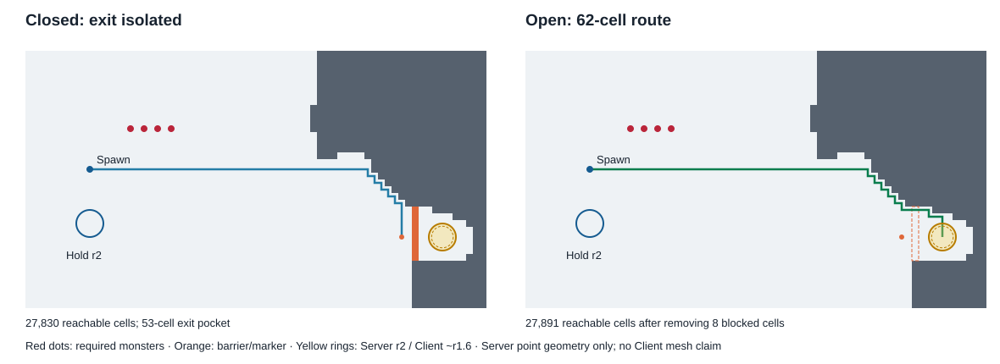

# P0-9／P0-10：門、通路與出口換圖

2026-11-23採用追加：RegionHeld候選已另存到[Q119封路正常路線](../../../design/testing/STORY-SEALED-GATE-NORMAL-ROUTES.md)，五TCP／兩保存配套真實時計Host完成受阻、占點開門、穿越、結算同隊回村。新版本只取本包末圖三欄，原候選／本次靜態分析保持；下表「尚未接入」是本報告原始狀態。clear-delay另一候選仍未採用，Client物理門／外觀缺口不變。

**本輪已把「MEF能封住哪裡、能改哪一種門外觀、按出口後如何接到既有Server」分析到具體可交接的程度。** 找到Map635的真封口作者候選，補出6個事件物件門模型的狀態consumer，並對照目前Server的出口授權、交易規劃及點集重建。真正Client動態碰撞仍是獨立未證能力；本報告不把Server overlay、門動畫與portal亮光混成同一個開門功能。

研究終點為：①原例繞行問題的具體正常內容解法；②門外觀與碰撞的writer／consumer界線；③Client按鍵到既有單出口／分岔／同圖／跨圖與Q交接。這些已各有來源、反例、typed契約及可重跑資料。這次是分析與候選內容，不是Server部署或實機驗收；沒有改正式RR或替他人宣告通過。[來源](source-manifest.json)、[契約](contracts.json)、[原件證據](native-proof.md)

## 1. 先看玩家實際得到什麼

| 項目 | 已分析完成的能力 | 尚缺項目 |
|---|---|---|
| P0-9 規則封路 | MEF旗標控制既有Server barrier；找到關閉時無法從出生側繞到出口、開啟後有路的8格封口。 | 選定新內容版本並接入；Client本地碰撞還不會因這個Server矩形自動改變。 |
| P0-9 門外觀 | 6個type7模型有實際state→avatar／motion資料與參數接收鏈。 | 取得／核對所選模型的動作語意、尺寸與場景適配，再接門外觀adapter。 |
| P0-9 Client物理門 | 已排除把portal status或額外region容器當作有效碰撞開關；追到普通移動／玩家探測的實際回值。 | 仍缺一條真正可寫、而且移動讀得到的動態碰撞鏈。此項保留為Client待逆向，不算已閉合的物理門。 |
| P0-10 出口／分岔 | 按鍵、半徑、latch、選點、001C、Server選定key授權、NextNode／Result及提交生命期已對上。 | 新內容採用正確現有adapter與版本；不是重新開發整套轉場。 |
| P0-10 劇情後接續 | 清場演出後完整重建，與無演出時只改status的條件已按現在原碼核實。 | 只有需要額外多步演出的內容，才新增重建後有限演出hook；003F仍不能證明動畫或setter執行。 |

MEF由Server提供，這些Server規則和內容都屬MEF開發；由Client播放已支持的motion／特效才屬已識別的本地工作。沒有把規則換成JSON就宣稱Server CPU已下降。

## 2. Map635的具體封路候選

### 2.1 原例與新的玩法差異

原件 `_MapList` 的635行：TRIGGER=`scenario_chicken04.mef`、MAP=`mushroom12D`、BOUND=`mushroom12`。實際BND為768×768、world extent768×768；本輪按照**目前Server的layer0／1非零聯集及格心barrier政策**計算。TRIGGER字串只是表中資源選擇欄，不要求先復原該官方MEF才可撰寫自有內容。[geometry-evidence.json](geometry-evidence.json)

原Q119 barrier是 `x∈[385,387), y∈[389,395)`；12個格子周圍有路，仍可用18步繞到原出口。新方案保留四張圖、節點順序、出生與原4隻必要怪，**明確移動末圖出口**，因此不假裝原版站位毫無改變。

| 內容 | 舊值 | 新候選 |
|---|---|---|
| 末圖出生 | `(379.5,391.5)` | 保留 |
| 出口key／category | key4／category0 | 保留 |
| 出口位置 | `(391.5,391.5)` | `(431.5,401.5)`，東側小區 |
| Server出口半徑 | 6 | 2 |
| Client category0作用半徑 | 4.8 | 1.6 |
| 障礙矩形 | `[385,387)×[389,395)` | `[427,428)×[397,405)` |
| 有門標記版本 | `(384.5,393.5), r1, key65011` | `(425.5,401.5), r1, key65011`，在門前 |
| 必要怪物 | 1001×3、1022×1 | 模型順序和出生座標全保留 |
| 占點圈 | `(379.5,399.5), r2` | 保留 |

玩家會多走一段路到東側出口，而且要更靠近出口才可按鍵。原出口到新出口的直線位移約41.23單位；實際可走路徑另算，不能以直線距離代替。此配置不主張東側小區已放好一扇適配的三維門模型。

### 2.2 封口、整個互動圈與必需內容的證明



左圖藍線為出生到門前標記的可走路徑，右圖綠線為開門後到出口的路徑；灰色是靜態阻擋，橘色是新barrier，黃色兩圈是Server與Client作用區。圖只畫所選區域，分量數量則由整張BND計算。

| 可重跑檢查 | 結果 |
|---|---:|
| 新barrier覆蓋的原可走格 | 8／8 |
| 打開時出生連通分量 | 27,891格 |
| 關閉時出生側 | 27,830格 |
| 關閉時出口側 | 53格 |
| 分量分割 | 27,830＋8＋53＝27,891 |
| 允許任何斜向鄰格的保守關閉搜尋 | 仍為27,830格，出口不可達 |
| 開門後出生→出口 | 62個四鄰接步數，折線全部可走 |
| 門前`(426.5,401.5)`→出口直線 | 開啟21個取樣點全可走；關閉4點受阻 |

這次不只查圓心。對圓盤與每個格子的**最近距離**作保守相交判定，包含邊界接觸；每個相交格都檢查原牆、overlay與關門後分量：

| 區域 | 半徑 | 保守相交格 | 所有格所屬 |
|---|---:|---:|---|
| Server出口授權圈 | 2 | 21 | 全在出口側，0牆、0overlay、0出生側 |
| Client出口作用圈 | 1.6 | 21 | 全在出口側，0牆、0overlay、0出生側 |
| 必需占點圈 | 2 | 21 | 全在出生側，0牆、0overlay |
| 門前視覺標記圈 | 1 | 9 | 全在出生側，0牆、0overlay |

因此在此Server位姿／地格政策下，**門還關著時，玩家在出生側不會隔牆先進入出口可按範圍**。這比只有「出口圓心在另一邊」更強。所有必要怪物、占點中心、門前標記和門前接近點另附出生到目標的完整折線；每段同時核對0.25單位取樣及整條軸向線段穿過的格子，不能只用同分量布林值代替路徑。[折線與圓盤證據](geometry-evidence.json)

表中的Client半徑1.6是顯示近似；原件倍率實際是`0.800000011920929`，此候選儲存半徑為float32的`1.600000023841858`。重驗使用實際值，21格保守覆蓋仍相同。[N22與radius資料窗口](native-proof.md)

邊界也保留：這是二維點移動與既有Server政策；沒有聲稱角色有體積時一定合適、Client模型可見門與牆已對齊、攝影機與導航提示可用。8鄰接保守檢查亦不授權跳躍／傳送穿門；任何新的位移能力仍要接相同移動授權。

### 2.3 兩種現有規則直接可表達

[candidate-clear-delay.scenario.json](candidate-clear-delay.scenario.json) 沿用清場後等待5秒的flag producer；[candidate-region-hold.scenario.json](candidate-region-hold.scenario.json) 沿用占點2.5秒和門標記。它們都是**同一`story-quest-119`的互斥候選檔**，保留目前外部override所需ID和主線來源版本，不可合併成重複definition。

ClearDelay不是從怪物剛倒地就算滿5秒：適用Story路徑在清場／Portal提交後，第一次有效位置觀察才開始，清場演出及保存等待不偷吃這個倒數。RegionHeld則可能在清怪前完成，因而先打開通路；出口仍另要求全群清除和`exit-gate-open`。若玩法要「清怪後才能占點」，應新增明確條件或選ClearDelay版本，不能在說明中改寫目前RegionHeld語意。[S-conditions、S-story；contracts.json](contracts.json)

候選已以現行JSON Schema與逐欄delta核對；它們只在本分析package，既有正式內容未改動，也未載入Server。

## 3. 門外觀能用什麼，碰撞還缺什麼

### 3.1 六筆真正對到consumer的門模型

| model／type | `_ActorList.FILE` | PRE／SCALE | EventObjects已宣告 |
|---|---|---|---|
| 20055／7 | `08_TempleGate` | 1／100 | state0,1,2→avatar0；motion1,2,3 |
| 20056／7 | `08_SealGate` | 1／120 | 同上 |
| 20109／7 | `12_AnaisRefuge_Door01` | 1／120 | 同上 |
| 20148／7 | `16c_SecretDoor` | 1／890 | 同上 |
| 20159／7 | `00_TestDoor` | 1／1580 | 同上 |
| 20162／7 | `00_TestDoor` | 1／2200 | 同上 |

實物表有178個EventObjects、473筆STATE。另有category7模型20195 `24_Haberre_Gate`、20199 `24_TempleGate`，但這份EventObjects中沒有相應OBJ；不可套用前六筆的三state。SCALE是表欄位原值，不能在沒有模型／座標轉換驗證時當成門寬單位。[resource-evidence.json](resource-evidence.json)

原生正向鏈為 `0007 type7 → CEventObject → 0000 actor參數 selector0x1C → EventObjects(model,state) → motion/avatar`。此處是**world actor ID**查找，不是checkpoint key。六模型只能確認外觀狀態可選，還不能把motion1／2／3命名成關／開／開啟中，也未證明任何一筆恰好適合Map635的8格口。[native-proof.md §1](native-proof.md)

原本的portal亮光是另一條鏈：category0 point setter透過PORTAL資料挑效果，`_PortalList`有10筆狀態／effect資料。門模型state、portal effect、點可按狀態、Server barrier與Client動態碰撞五者應各有typed接口，讓同一MEF規則協調，不要共用一個含糊的「open」指令。

### 3.2 碰撞線索已追到可證界線

普通actor位置更新和玩家探測都使用world Bound owner的`82CDF0`。它查兩層、OR結果後決定可走。下層`832DA0`雖先掃額外region，最後所有三條return只回傳base bitmap結果；region值僅控制前面的掃描是否繼續，沒有合入最後回值。wrapper建構確實從source region複製enabled及pointer，並非永遠空，但也不是已證的可切換門入口。[native-proof.md §2](native-proof.md)

這一反證可避免把「已找到動態區域」錯升成可用物理門。剩餘原生項目精確限於：找出可達writer、其資料所有者／生命期，以及普通移動確實讀到的collision consumer。所選門模型／motion和對應場景資源還能提供進一步xref；目前材料不足以確定具體動畫語意與場景適配。這些不能用「缺實機」概括，也不阻塞現有Server MEF封路規則與出口整合。

## 4. 出口從按鍵到Server提交

### 4.1 Client選點與Server授權不相同

Client category0使用傳入半徑的0.8倍，嚴格距離小於半徑才合格；Server `InteractZ`接受距離小於或等於原半徑。Client檢查enabled、manual／enter mode與latch；等距時保留較早的vector row。所有點先更新latch再挑贏家，重疊區不適合拿來表達兩個必須各自按的開關。原有page／特殊確認UI也可延後實際送出。[N16–N19]

送出的是原6-byte `001C(category,key)`。目前正常Story做以下語意串接：確認當前Portal phase、沒有待提交敘事、角色仍存活；查同節點**那一個**key是否已開；以Server目前位姿核半徑及必要互動路徑；把key和位姿傳入`LocalStoryRoute.EnterPortal`。後者先fork實例，由`InteractZ`選出NextNode或Result，再規劃pending transition，等既有commit後發布。`PortalUnlocked`只是至少一個出口開啟，不能把另外一個未開分支也放行。[S-story、S-route、S-definition]

`HasClearInteractionPath`在沒有barrier且沒有要求靜態路徑時可以直接通過；有barrier或明確要求時才作segment檢查。因此不能宣稱現在所有沒有barrier的互動都具完整穿牆檢查。本候選的整圓盤在門後，又使用有barrier的正常Story路徑，兩項條件互相補強。[S-pose]

### 4.2 三個既有adapter的適用範圍

| 路徑 | 真實程式已做的事 | MEF整合時不能忽略 |
|---|---|---|
| 正常Story | 明確key、存活、半徑、barrier路徑、fork與commit | 新的正式關卡優先沿用這條權威接線。 |
| 固定兩段Phindos | 載入／角色擁有／存活、固定出口key、`InteractZ` | 該選定出口branch未直接呼`HasClearInteractionPath`；不可因此將所有新barrier內容塞入它。 |
| ContentBranches功能場 | 明確key、path與`InteractZ`，NextNode重建或Result | 此方法本身沒有Story相同的PlayerHealth guard，屬功能場差異；不當成正常遊玩授權模板。 |

這些是源碼差異，沒有執行負面案例或宣告漏洞。若要共用adapter，應保留正常Story的有效角色／phase／key／存活／path／提交條件；不要以測試場比較短就省去它們。[S-world、S-branches、contracts.json]

## 5. 同圖、跨圖、點集與劇情交接

目前 `InitializeStoryPortal` 的實際條件是：**沒有ClearScenes，且所有出口都PreRegisterClosed**，才走保留點集、逐key更新status。否則送Map，重建角色／場景連接，接續完整point collection；其中所有出口、可互動點與marker用已提交flag重新投影，必要的地面物品快照也沿用既有重建流程。[S-story]

這精確取代歷史 [S00-20261111-SCENARIO-BRANCH-CONTRACT](../../../governance/s00-iterations/S00-20261111-SCENARIO-BRANCH-CONTRACT.md)「含ClearScenes的節點仍不允許預登記點」那條當時限制。較新的 [STORY-SCENARIO-OVERRIDES](../../../design/scenario-content/STORY-SCENARIO-OVERRIDES.md) 已記載完整集合恢復，本輪再以Server `e88ac0a…`原碼確認；歷史檔保留，不能繼續當成目前Server缺口。

| 生命期事件 | 對MEF的實際影響 |
|---|---|
| 0012 Map，同圖亦然 | 先清point／reset controller；不能保留先前setter當成新圖狀態。 |
| native loader同MapID早退 | 可跳過graphics／Bound／minimap等後段重載，但前面的清點已發生。 |
| 0027完整快照 | 全部point換代；出口與機關要放同一份集合，不能連發「單點追加」而彼此覆蓋。 |
| 0048或Lua setter | 只找第一個既存category/key並改status，不建立missing點、不搬位置。 |
| NextNode，不論同／跨MapID | node、遭遇、出口與Server範圍切換；MapID不是node ID。 |
| Result | 進結果流程，不直接等於所有永久獎勵已提交；保留既有返回／任務完成服務。 |
| `lb.ChangeMap` | 缺0012預清理，不能替代Server完整轉場。 |
| Q.LoadMap／RestoreMap | 是視覺地圖操作，不等於恢復碰撞、point、actor及Server節點。 |

Client wire沒有run／node／generation token。MEF的排程、等待及快照世代要綁在Server本地作用範圍，不增造Client不讀的欄位。若重用同key，不能聲稱每一個遲到的舊001C都可以從payload單獨辨認世代；現有phase、pending與current-node檢查必須保留。[原生點集與生命期](../../MEF-world-identity-scene-interaction-20261117/SCENE-INTERACTION.md)

loading的0023／0024、field-ready的0014、Q waiting的00EB是不同狀態。0014只有Q inactive才清mask1，00EB處理的mask2也不建actor。003F可能來自持久seen-skip，不能證明新的callback、門motion或本地setter真的跑過。先用現有提交後快照；只有新內容確實需要多步鏡頭／效果演出時，再加有內容版本、seen政策與清理生命期的有限hook。[既有finite-handoff](../../MEF-level-functional-closure-20261118/finite-handoff/report.md)

## 6. 開發與優化建議

1. **先採一個正常內容候選。** 選清場5秒或占點2.5秒版本，保留其實際玩法差異；走既有override、旗標、barrier、Story transition和保存接口。這不需要新官方MEF格式。
2. **把顯示、授權和碰撞分成typed操作。** 同一flag可派送portal status、門model state及Server overlay，但三個結果各自有consumer與驗證。視覺門的新adapter至少保存WorldActorID、model、宣告state、內容版本與生命期，不使用checkpoint key冒充。
3. **完整重建時一次投影，保留世代時只送差額。** 0027與0048本來就有這個分工；避免為單次status再插一個Q，增加啟動、等待與seen政策成本。
4. **沿用既有barrier mask及路徑失效。** 目前敵人poll發現ClosedBarrierMask變更會清追擊／返回繞路快取，新MEF不得只改顯示而保留已過期路徑。若再做快取或事件索引，以實際內容／mask／node為key，保留現有處理時機。[S-combat]
5. **把幾何作者檢查前移。** 保留當前中心可站立檢查，再加本包的整互動圈、必需producer路徑、關閉／開啟可達性；此包可作離線內容檢查依據，不必在每個Server tick重做flood。

真正待做的分類為：Server內容整合（選版本）、Server門外觀adapter、Client模型／動態碰撞證據、跨功能生命期整合、正常Client遊玩確認。完整Client物理門不是所有自有MEF關卡的共同阻塞；需要真正本地擋路的玩法才依賴它。量測優化時分別記規則求值／路徑重建／封包量與Client演出工作，不預報未量測的節省百分比。

## 7. 對MEF種類整理的貢獻

本子題建議至少區分「機關／占點／障礙規則」「門與事件物件外觀」「出口／分岔授權」「地圖／劇情／輸入交接」四種用途，可併入根報告較大的12類。它們是自有MEF的能力分類，並非四種已復原的官方檔案格式。玩家可理解為：**什麼時候能過、眼前的門怎麼動、選哪個出口、走出去後怎麼接下一段**。

## 8. 精確來源與重驗

本分析Git基準 `19005c9f8a8180e6f0deb00faf008a11ef98023f`。真實Server基準 `we88ec3-prog/ttr_server_roy@e88ac0ad5fd6e911b28b1e61b6eedab3bfdfb4b4`；[source-manifest.json](source-manifest.json)逐檔保留blob、SHA256與bytes。完整private程式留在外部scratch，公開包只有來源識別、函式／欄位名稱與語意，未複製大片Server實作。

| 本文來源ID | Server檔案／主要識別 |
|---|---|
| S-definition | `src/Tartaros.Network/LocalScenarioDefinition.cs`：Enter、GroupCleared、InteractZ、LastExitKey、Fork |
| S-conditions | `LocalScenarioConditions.cs`：ValidateConditions、ObservePosition、RegionHeld、EvaluateExits |
| S-bounds | `LocalTutorialBounds.cs`及`LocalTutorialBounds.MonsterRoute.cs`：WithBarriers、CanStand、ValidateBarrierPlacements、ClosedBarrierMask |
| S-pose | `LocalTutorialPose.cs`：Input、Advance、HasClearInteractionPath |
| S-story | `LocalTutorialWorldConnection.Story.cs`：HandleStoryInput、InitializeStoryNode、InitializeStoryPortal、CommitStoryProgress |
| S-route | `LocalStoryRoute.cs`：EnterPortal、Plan、PendingSave、Commit |
| S-world | `LocalTutorialWorldConnection.cs`：InitializePhindosNode、Handle固定出口branch |
| S-branches | `LocalTutorialWorldConnection.ContentBranches.cs`：HandleContentBranchInput |
| S-interactions | `LocalTutorialWorldConnection.Interactions.cs`：InteractionPoints、InteractionStateChanges、IsBarrierMarkerInteraction |
| S-combat | `LocalTutorialCombat.cs`及`LocalTutorialCombat.Leash.cs`：PollEnemies與barrier-aware路徑檢查 |

唯讀重驗命令：

```bash
python -B kr-extra-roy/MEF-P0-level-execution-20261118/gates-transitions/verify.py \
  --repo /path/to/ttr_anal_multi \
  --sources /path/to/project_sources \
  --server-sources /path/to/mef_p0_level_server_sources_20261118 \
  --receipt /tmp/mef-gates-transitions-receipt.json
```

需要Python、jsonschema、GNU objdump。預設不寫檔；指定receipt才寫該路徑。驗證包括固定Git與原件／private source身份、native連續窗口、兩個候選的schema與精確delta、整互動圈／8鄰接閉門分離、必需點折線，以及6個門模型的表交叉。這些是來源／靜態資料檢查，不執行Server、Client或Lua；[verification-result.json](verification-result.json)不等於正式相容性或遊玩驗收。
