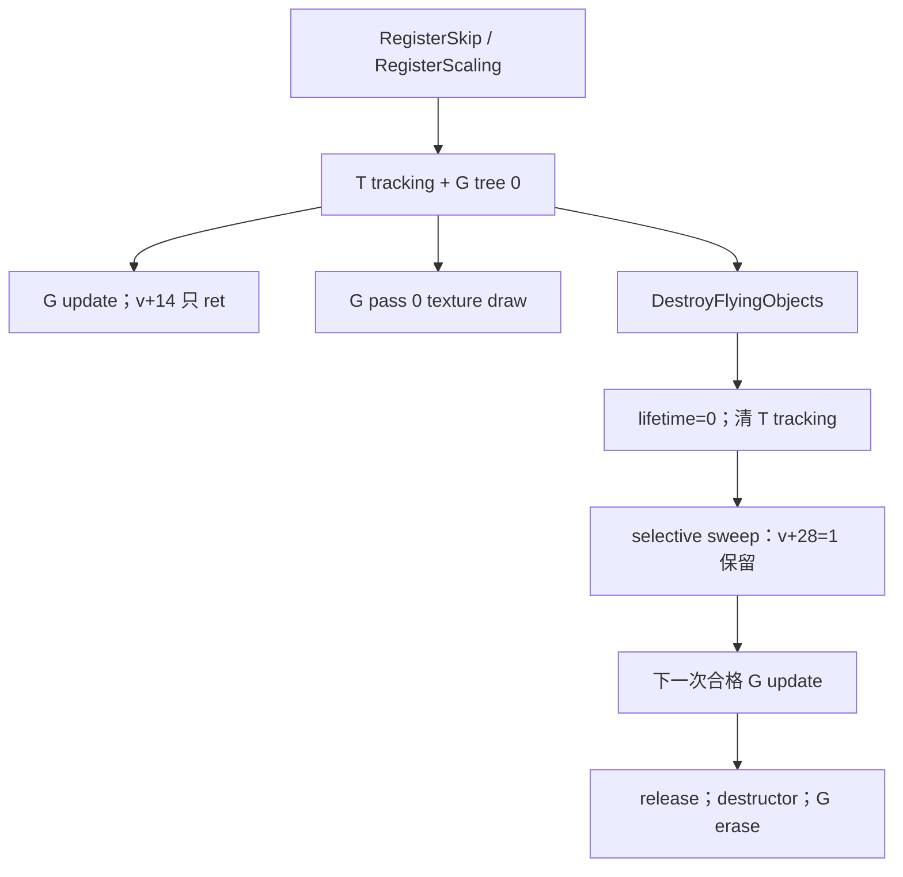

# MEF 第十輪：普通背景 Lua runner 候選、原生顯示物件與固定 UI 事件

## 1. 結論與完成界線

本輪已完成六個指定候選的有界原件核對，**仍未建立能在普通戰鬥維持玩家輸入的背景 Lua runner 契約**。新增證據把兩種容易被名稱誤導的入口分清楚：`Tutorial.RegisterSkipMessage` 與 `Tutorial.RegisterScalingObject` 登記的是具體原生圖片物件；`Tutorial.PostUIMessage_EmployChar` 與 `Tutorial.PostUIMessage_TutoMsg` 送出的是固定編號、固定整數參數的單次 UI 事件。前者確實接上持續的原生更新／繪圖迴圈，但兩個具體類型的 update virtual 均只有 `ret`，並未保存或呼叫 Lua callable。後者在普通 Mission／Scenario 頁面的具體路由落入已驗證的 default return，只有指定 Tutorial／Result 頁面存在已知正向 UI 分支。[原件 B03–B07、A01–A06、F01–F24、U01–U22、VT／COL／TYPE、MAP／DST]

這不是「整個 Client 沒有 timer／callback」的宣告。`binding-candidates.json` 收錄的是已識別的 `lb` 14 個與 `Tutorial` 31 個固定 binding tuple；本輪逐項由 BIN 核對它們的 native slot、Lua closure 和名稱，再深入六個實際候選。其餘 member 的完整語意沿用既有成果或交由另一分題，沒有把 45 個 tuple 的身分核對冒充 45 條完整 consumer 閉合。`CameraWorks` 是整合主題另外識別的原生相機 namespace，也不被排除於全 Client 範圍之外。

本輪的正向成果可直接供相容內容管理與清理規格使用：圖片參數的 ABI、型別／owner、持續顯示的條件、取消後的延後釋放，以及兩個固定 UI 事件的頁面限制均已具體化。普通背景 Lua runner 的總目標仍屬**階段性未完成／具體入口待證**；缺的是一條能保存 Lua callable、由普通場景持續觸發、且具有正確任務 owner 與輸入／暫停／取消／重入契約的 Client 原生入口。本輪已排除的具體候選不能填補這個缺口，Server 也不能用新造的 opcode 或 callback 名稱代替它。

## 2. 原件、版本、方法與復用

### 2.1 固定來源

| 項目 | 固定值／用途 |
|---|---|
| 原件 | `02-Tartaros.bin`，只讀靜態核對 |
| SHA-256 | `9741d1975327b9309d82b52f631165bc410757694d7c183a5eed970a53ebef91` |
| 大小／格式 | 12,472,320 bytes；PE32 i386；ImageBase `0x400000` |
| bulk C 導覽基準 | `03b3ea5eae2cb92f9fc373d432edeaf635d6c5fc` |
| 既有研究復用基準 | `ad9ea950216923b5e351a7501d38e006df57a4c6` |
| bulk C 路徑 | `kr-bulk-roy/<上述 BIN SHA>/functions/0x....c`，只作導覽 |
| 本輪原生證據 | `native-windows.json`、`native-windows.asm` |
| binding／契約 | `binding-candidates.json`、`contracts.json` |
| 來源 pins | `source-manifest.json`；每項有 commit、Git blob、bytes、SHA-256 |

所有新結論均由 BIN 的實際 bytes、呼叫指令、資料欄位、vtable／RTTI 與 switch selector 驗證。`native-windows.json` 每個 window 保存 VA、exclusive end、raw offset、長度、SHA-256、完整 hex；code window 另有逐指令 VA／raw／hex／ASM。資料與 code window 分開，沒有將 jump-table bytes 當作指令。本文 `[原件 F11]` 等標記直接指向該 JSON 的 record ID，完整原始摘錄在同名 ASM 檔。

本工作沒有執行 Client、Lua 或 Server，沒有修改原資源，也未以動態 trace 冒充靜態結果。重跑 verifier 的 PASS 僅代表本包列明的 byte、資料關係與來源 pin 相符，不代表 T01 FULL-PASS、RR 已接受、Server 已實作或可玩驗收。

### 2.2 直接復用，不重做已定型部分

下表各檔均固定於上述 `ad9ea...`；完整 Git blob 與 SHA-256 見 `source-manifest.json`。

| 既有成果 | 本輪復用範圍 |
|---|---|
| `MEF-world-integration-20261115/runner/report.md` | T／Tutorial／Synopsis 等已證 pump 與場景 owner；不能從 Expedition 名稱另造獨立 VM |
| `MEF-content-contracts-20261116/ordinary-runner/report.md` | 普通頁面與 checkpoint 候選的既有有界排除；不重新掃完整 UI |
| `MEF-end-to-end-20261116/runner/report.md` | debug hook、Lua numeric ABI、Q pause 與 input ownership 的既有結果 |
| `MEF-entry-lifecycle-events-20261114/lb-bindings.json` | `lb` 14 個固定 member 清單 |
| `MEF-content-contracts-20261116/observers/bindings.json` | `Tutorial` 31 個固定 member 清單 |
| `MEF-runtime-contracts-20261115/ui-lifecycle/report.md` | UI queue dequeue 時解析 current page、呼叫 page virtual、事件釋放與 queue drain |
| `MEF-runtime-contracts-20261115/input-lifecycle/report.md` | 輸入遮罩與 controller busy 的不同 owner／生命周期 |
| `MEF-trigger-callers-20261115/named-calls/report.md` | 已證固定 named-call producer，包括角色說明 UI query |
| `MEF-end-to-end-20261116/world/report.md` | `CTutoMsgDummy`、Tutorial state 等具體 observer 路徑 |

本輪不重開 R9 已否定的 debug hook timer 假設：其 count 是 Lua 指令分派計數，callback 綁定對應 Lua thread registry；它不是 frame 或毫秒來源，也沒有自行補出休眠 thread 的 native resume producer。輸入與 pause 的正確既有契約另見 §7。

## 3. 已註冊 public surface 與本輪候選

`lb` bootstrap `0x4A0950` 與 `Tutorial` initializer `0x4A88E0` 是本輪採用的具體 native registration 起點。後者把 supplied wrapper 存入 T，再執行 31 個固定 registrar；`lb` 有 14 個固定 registrar。formal Lua wrapper／VM owner 復用既有 `W = 0xFDF3C8`，Tutorial owner 為 `T = 0xFC0F84`。[原件 B01、B02；既有 R7／R9]

這 45 個名字的完整 native tuple 可在 `binding-candidates.json` 查到；verifier 不是只核對文字列表，而是逐項讀 registrar 內 native slot store、Lua closure push 與 name string pointer。

| Namespace | 本次核對身分的固定 members |
|---|---|
| `lb`（14） | SetDebugLevel、GetObjectCount、ChangeMap、CreateObject、CreateObjectEx、SetActorAvatar、AttachActorItem、DetachActorItem、GetTime、DoFile、PrintCurrSceneID、ChangeResolution、LoadMinimap、ChangeKeymapType |
| `Tutorial`（31） | IsSynopsisSkipped、PlayMusic、InsertTutorialCheckPoint、SetCheckPointStatus、SetKeymapEnabled、StopCameraWorks、PushCamera、PopCamera、ApplyDefaultCamera、StartCutScene、IsCutSceneRunning、StopCutScene、PostUIMessage_EmployChar、PostUIMessage_TutoMsg、HideUI、SetUIPage、RegisterSkipMessage、RegisterScalingObject、DestroyFlyingObjects、IsCharacterAvailable、SetControlStatus、GetControlStatus、GetTutorialState、InsertObject、DeleteObject、InsertIsilia、IsIsiliaFound、CheckLeader、IsLeaderDialogOpened、RequestStartScenario、IsScenarioEnded |

六個本輪深入的候選如下；這些不是依字串「沒搜到 timer」作排除，而是順 actual binding、參數轉換、保存內容、native tick 或 UI consumer 完成判定。

| 公開入口 | Registrar／native／closure | 本輪裁決 |
|---|---|---|
| `Tutorial.RegisterSkipMessage` | `4AB080`／`4A9B70`／`4AC4C0` | 字串資源建立 `CSkipMessage`；沒有保存 Lua function |
| `Tutorial.RegisterScalingObject` | `4AB120`／`4A9C80`／`4AC520` | 字串、寬、高建立 `CScalingObject`；尺寸不是週期或 callback |
| `Tutorial.DestroyFlyingObjects` | `4AB1C0`／`4A9DB0`／`4AC580` | 清 T tracking、標 lifetime=0，圖片由後續 G tick 釋放 |
| `Tutorial.PostUIMessage_EmployChar` | `4AAE00`／`4A98D0`／`4AC340` | 一個整數送固定事件 `0xF431F` |
| `Tutorial.PostUIMessage_TutoMsg` | `4AAEA0`／`4A9950`／`4AC3A0` | 兩個整數送固定事件 `0xF43FD` |
| `Tutorial.SetUIPage` | 固定清單見 JSON；native `4A9AE0` | 指定 page `0xF`，不是任意頁面或 callback owner 登記 |

本輪沿既有 Expedition 初始化關係復用 shared Tutorial／Synopsis owner，沒有因為名稱不同就宣告存在另一組 native VM 或 scheduler。主整合的 presentation 分題另保存 `CameraWorks` namespace 的實際 bindings；它操作 native current camera works owner，不構成本包所尋找的 Lua callable registration。這兩項 scope 限定是避免過度推論，並不聲稱所有其他 namespace、動態 alias 或未識別 bootstrap 已經窮盡。

## 4. 兩個 Register 入口實際保存什麼

### 4.1 Lua stack 轉換與 callable 排除

`RegisterSkipMessage` registrar 在 `0xFE1848` 存入 native `0x4A9B70`，登記 Lua closure `0x4AC4C0`。closure 的真實 callsite `0x4AC500` 呼叫 `0x4ACD30`；converter 讀取最後一個 Lua stack 值，接受 tag 4 字串，或經 `0x6FB5D0` 把 tag 3 number 轉字串。tag 6 Lua function 不會被另存 registry、存入物件欄位或作 callback 呼叫。不能因此推薦傳入 function：轉換失敗只會把 native 參數變為空值，而後續 constructor 會處理字串內容，這不是證明了安全的 callback fallback。[原件 B03、A01、A02、A05]

`RegisterScalingObject` 在 `0xFE184C` 存 native `0x4A9C80`，closure `0x4AC520` 的 callsite `0x4AC55A` 呼叫 `0x4ACE70`。實際參數是 stack `-3` 字串、`-2` width、`-1` height。後兩個參數依 number／numeric string 轉換後用 x87 `FISTP` 形成整數；其他不相容 tag 沒有獲得 callable 意義。本文不把該整數轉換簡化為所有情況均朝零截斷，亦不將寬高誤稱時間／次數。[原件 B04、A03、A04]

### 4.2 配置、RTTI 與資料欄位

| 型別 | 配置大小 | vptr | RTTI type descriptor | 已證用途 |
|---|---:|---|---|---|
| `CSkipMessage` | `0x64` | `0xC0694C` | `0xF7DF00`，`.?AVCSkipMessage@@` | 固定位置圖片 |
| `CScalingObject` | `0x74` | `0xC0697C` | `0xF7DEB4`，`.?AVCScalingObject@@` | 依指定寬高計算比例的圖片 |

兩個 native producer 都先走 `0x553C90` 初始化共用物件，再寫入上述具體 vptr。由原件可確認 lifetime `+0x14=1`、texture pointer `+0x44=0`、texture path string 在 `+0x48`；Scaling 額外保存 width `+0x64`、height `+0x68`，並初始化 scale pair `+0x6C/+0x70`。兩者把 draw pass `+0x40` 設為 0。[原件 F01–F03、VT／COL／TYPE Skip 與 Scaling]

`CSkipMessage` 的 load `0x553DA0` 以 stored path 呼叫 texture loader `0x734330`，保存 native texture pointer；position `0x4A87D0` 設為 `(32,32)`，draw `0x4A87E0` 呼叫該 texture 的繪圖 virtual。[原件 F04、F06、F08]

`CScalingObject` 的 load `0x4A8830` 也載入 texture，讀 texture intrinsic width／height `+0x0C/+0x10`。只有 requested width 與 height **兩者皆為 0** 時，才同時採用 intrinsic dimensions；再把 width／intrinsic width 與 height／intrinsic height 存入 scale pair。這不是每個維度各自的零值 fallback。position `0x4A8810` 使用 viewport：`x=width/2`、`y=height/2-60`；draw `0x4A88B0` 把 `object+0x6C` 的 scale pair 傳給 texture renderer。[原件 F05、F07、F09]

### 4.3 兩層容器的 owner 分工

本輪以 T 表示 Tutorial owner `0xFC0F84`，以 G 表示全域顯示管理物件 `0xFB7358`；G 是本報告的描述名稱，不從暫定 C++ 類名另推未證語意。

| 位置 | 已證用途 |
|---|---|
| `T+0x14` | tracking tree 容器；sentinel pointer `T+0x18`、count `T+0x1C`；節點保存物件指標 |
| `G` 起四個 tree，stride `0x10` | 原生物件管理容器；本輪兩個 producer 插入第一棵 tree |
| `G+0x40 = 0xFB7398` | 新物件使用的 DWORD key counter；producer 插入後遞增 |
| G tree node `+0x0C/+0x10` | key／物件 pointer |
| `G+0x54/+0x58` | viewport width／height；constructor 初值 1024／768 |
| `G+0x5C` | manager visibility；constructor 初值 1 |

T 保存的是用於批次標記／清 tracking 的 raw object pointers；具體 texture release、destructor 與 G tree erase 在 G consumer 中。不能把 T tree 清空等同每個物件已同步 destructor。登記也沒有回傳一個帶 pause／cancel／completion 的 Lua task handle；本輪從 native 保存內容和 consumer 沒有取得任何 Lua callable owner。[原件 F01、F02、F11–F13、F20、F21]

## 5. 持續 tick、繪圖與延後取消的完整原生鏈

### 5.1 Tick 是真實存在的，但沒有 Lua resume

`CClient` update `0x490FE0` 內，`0x491E75` 檢查 `[client+0xBFCC]==0`；不成立則 `0x491E7C` 跳往 `0x491F43`，略過這一區塊。進入區塊後 Q tick 在前，接著 `0x491F27` 呼叫 `0x422ED0` 取 G，`0x491F2D` 呼叫 G update `0x5537F0`。因此本輪確認一條原生顯示的持續更新來源，但適用條件是該 Client update gate 允許進入，不能誇張為任何場景／任何載入狀態下無條件執行。[原件 F10、F21]

`0x5537F0` 遍歷 G 的四棵 tree，先呼叫每個物件 vtable `+0x14`，再呼叫 `+0x24` 讀 lifetime；若為 0，呼叫 `+0x08` 釋放 texture、`+0x00` deleting destructor，最後 erase G tree node。[原件 F11、F14、F17、F18]

關鍵是本輪已由 RTTI／vtable 識別的兩個型別共用以下 virtual targets：

| Virtual slot | `CSkipMessage` | `CScalingObject` | 對 runner 的意義 |
|---|---|---|---|
| `+0x14` | `0x5F5D10`，`C3`／`ret` | 同左 | 每次 update 沒有 Lua 呼叫、沒有保存的 function consumer |
| `+0x18` | `0x4A87E0` | `0x4A88B0` | texture rendering |
| `+0x24` | `0x80F010` | 同左 | `mov eax,[ecx+0x14]; ret`，讀 lifetime |
| `+0x28` | `0x87AF60` | 同左 | `mov eax,1; ret`， selective sweep 保留條件 |

原生圖片能在 G 管理下持續存在／繪製，並不意味登記者的 Lua coroutine 能持續被 pump。這個區別由 actual vtable dispatch 直接成立，沒有依函式名稱作猜測。[原件 VT_Skip、VT_Scaling、F14–F16]

繪圖是另一條具體 consumer：Client render `0x492900` 的 `0x492EF3` 準備 pass 0，經 `0x492EF5→0x422ED0`、`0x492EFA→0x5539A0` 進 G draw。後者檢查 manager visibility `G+0x5C`，對 draw pass `object+0x40` 相符者呼叫 `v+0x18`。這也沒有把 arbitrary Lua function 存入每幀繪圖位置。[原件 F22、F23、F08、F09]

### 5.2 `DestroyFlyingObjects` 的取消不是同步全部刪除

`Tutorial.DestroyFlyingObjects` 的 native `0x4A9DB0` 先走 T tracking tree，對每個 tracked object 寫入 `object+0x14=0`，清空 T tree，再由 callsite `0x4A9EE3` 呼叫 `0x553740(G)`。[原件 B05、A06、F13]

`0x553740` 是 selective sweep：逐物件讀 `v+0x28`；**回傳 0 才**執行 `v+0x10` release wrapper、deleting destructor 與 tree erase。對 `CSkipMessage`／`CScalingObject`，該 predicate 是常數 1，所以即使剛被標 lifetime=0，這兩類仍不會在這次 sweep 立即刪除。[原件 F12、F15、F19]

它們會留到下一次符合 gate 的 G update `0x5537F0`，由 `v+0x24` 讀到 lifetime=0，才做 texture release、destructor、G erase。這是已證的延後取消鏈；不能從函式名稱宣告「所有 flying 物件當場清空」，也不能宣告存在返回給 Lua 的完成通知。其他型別可以有不同 `v+0x28`，應以其自己的 vtable／欄位 writer 判定；例如 world 分題的 `CFlyingImage` 不是本輪常數 1 的型別。[原件 F11–F19]



### 5.3 能保證與不能保證的生命周期

已確認的是這兩種具體圖片的建立、保存、更新／繪圖、標記取消、延後釋放；沒有證明任意重入時的 raw pointer／global replacement 安全，也沒有 general task pause／resume／cancel acknowledgment。重複呼叫會建立新的 native 圖片項目，不會建立具備 Lua coroutine owner 的 task。若 Client gate 略過 G update，不能把「下一次 eligible tick」寫成「立刻」或保證固定毫秒數。T tracking clear 與 G erase 是兩個時間點，整合測試與資源 lifecycle 必須保留這個差別。

## 6. 固定 UI event 候選與普通頁面的精確反證

### 6.1 Public ABI 與事件結構

| 公開入口 | Native producer | 結構／編號 | Payload |
|---|---|---|---|
| `PostUIMessage_EmployChar` | `0x4A98D0→0x58AB80` | `FXUIEventI1`，配置 `0x18`；event `+0x10=0xF431F` | 一個整數在 `+0x14` |
| `PostUIMessage_TutoMsg` | `0x4A9950→0x58AC30` | `FXUIEventI2`，配置 `0x1C`；event `+0x10=0xF43FD` | 兩個整數在 `+0x14/+0x18` |

兩個 event constructor 設定 `+0x04/+0x08=-1`、`+0x0C=0`，再送入 `0x804260` queue insertion。公開 closure 使用整數轉換 helper，沒有額外 callable、event name 或 timer period 參數。`PostUIMessage_TutoMsg` 的兩參數 helper `0x4ACD90` 已納入本輪原始 window；一參數 helper `0x4ACB70` 的 numeric ABI 復用 R9。[原件 B06、B07、U01–U07；R9 runner]

UI lifecycle 復用既有 `0x74F000`：**dequeue 時**取得 current page，呼叫 page `v+0x15C(event)`，完成後釋放事件，並繼續 drain queue。producer 並未保存「發送時 page」成為 task owner；也不能由 post 推論「必定下一 frame」。尤其把 event 自我重送當作 yield，可能仍處於同一 queue drain，沒有原件證據可將其改造成合法週期 timer。[既有 ui-lifecycle]

### 6.2 普通 Mission／Scenario owner 的 vtable 身分

| 頁面 | vptr | RTTI | `+0x15C` | `+0x18C` | `+0x198` |
|---|---|---|---|---|---|
| MissionField | `C1D1AC` | `.?AVCMissionFieldPage@FUI@@` | `595D20` | `5AC590` | `5AD630` |
| ScenarioField | `C1D62C` | `.?AVCScenarioFieldPage@FUI@@` | `595D20` | `5AC590` | `5AFE70` |

`0x595D20` 是具體 router：`0xF431F` 位於 `F42D7 < event < F434A`，走 page `+0x18C`；`0xF43FD` 位於 `F435C < event < F4442`，走 `+0x198`。這裡由資料 vtable 與 RTTI 確認 target，沒有把反編譯裡的任意 virtual 當作已解析呼叫。[原件 U08、VT／COL／TYPE Mission 與 Scenario]

### 6.3 `0xF431F` 的 ordinary consumer

普通頁面 `+0x18C=0x5AC590` 先委派 `0x59B420`，自身額外分支只有 `0xF42F1`，與 `0xF431F` 不符。`0x59B420` 前置判斷的 `0xF431D`、`0xF4328` 也不符；其 switch 的 actual selector 如下。[原件 U09、U10]

| 步驟 | 精確原件值 |
|---|---|
| switch base／index | `0xF42D8`；`0xF431F-0xF42D8=0x47` |
| map byte | VA `0x59B89B` = `0x2D` |
| target pointer | VA `0x59B850` = `0x59B795` |
| selected consumer | `0x59B795` default epilogue／return |

因此 **在上述普通頁面 vtable owner**，這個固定 EmployChar event 沒有被轉成新的 Lua callback、周期 task 或角色說明開啟路徑。結論僅涵蓋這個確切 event 與 owner，不含所有 UI event／所有頁面。[原件 MAP_EmployOrdinary、DST_EmployOrdinary、U11]

### 6.4 `0xF43FD` 的 ordinary consumer，包含前置共用 handler

Mission `0x5AD630` 與 Scenario `0x5AFE70` 都委派 `0x59BD80`。Mission 自身額外比較 `F4406/F4363/F43A1/F4427`，Scenario 比較 `F4406/F4401`，都不是 `F43FD`。`0x59BD80` 先呼叫 `0x5A4310`，所以不能只看外層 switch 的 default 就宣告無作用；本輪亦核對該共用 handler。[原件 U12–U16]

| 分派層 | 實際 selector 與去向 |
|---|---|
| `5A4310` 第一 switch | base `F43DB`，index `0x22`；`5A442E=4`；`[5A4408]=5A4357`，進共用 default continuation |
| `5A4310` 後續 switch | base `F4366`，index `0x97` 大於 limit `0x80`，走 `5A43F0` return |
| `59BD80` 自身 switch | base `F4361`，index `0x9C`；`59C168=0x1A`；`[59C0C8]=59C057` default return |

以上先後 consumer 均已查，才得到此 fixed event 在 normal Mission／Scenario route 不啟動 ordinary task 的有界反證。[原件 U14–U16、MAP／DST TutoOrdinary、TutoCommonFirst]

### 6.5 保留正向例外：特定 UI owner 確實處理這些事件

不能把 ordinary default 擴張成「兩個事件完全沒用」。本輪一併保存下列正向分支，作為 owner 限制的具體反例。

| 特定 owner | 已確認的正向 consumer |
|---|---|
| ScenarioResultPage，vptr `C1CBAC`，`+18C=5AAE80` | 接受 `F431F`；非零整數經 `6BF310` 更新角色說明、`596E00` 顯示 panel；零值另有既有短封包分支，本文不延伸為新的協定支援主張 |
| TutorialPage，vptr `C1F5F4`，`+18C=5C32D0` | `F431F→5C36D0`；非零整數更新角色說明並顯示 panel，再構造固定 `F43FD(0,10)` 交給 `6C0170` |
| TutorialPage，`+198=5C3370` | `F43FD→6C0170`，由既有 CTutoMsgDummy consumer 處理 |
| TutorialFieldPage，vptr `C1D7DC`，`+198=5AFFB0` | `F43FD→6C0170` |

這些型別的 RTTI、對應 vtable slot 與 positive branch 均已納入原件包。[原件 U17–U21、VT／COL／TYPE ScenarioResult、Tutorial、TutorialField]

`0x6BF310` 的角色說明路徑包含已證固定 Lua query `g_CharExplain.GetExplain`，因此本文**不聲稱這些正向 UI 分支從不進 Lua**。它是已有的 UI 內容查詢，不等於此 API 能登記任意每幀 callable，也不補出背景 coroutine 的生命周期。[既有 named-calls report]

`Tutorial.SetUIPage` native `0x4A9AE0` 只指定 pending page `0xF`，若已在該頁則走 refresh。它既不接受任意 page number，也不保存 callback；切換到特定 UI owner 並未證明仍保有普通 page 5／7 的玩家輸入與戰鬥生命周期。不能以切到 Tutorial 頁面觸發 positive branch，替代普通背景 runner 的輸入契約。[原件 U22；既有 ordinary-runner]

## 7. 與 input、pause、debug hook、reentry 的關係

以下是本輪候選與 R9 已證契約的整合界線；R9 結果直接復用，沒有用新候選抹去既有問題。

| 面向 | 已證內容與本輪結論 |
|---|---|
| input mask | `Tutorial.SetKeymapEnabled` 使用 **mask value `0x2`，bit index 1**；native 非零時清除 `0x2` 以啟用該輸入 mask，零值時設置 `0x2`。Lua boolean `true` 在這個 numeric ABI 不等於 native 整數 1。 |
| controller busy | Q manager `M=FB73C0` active `+28` 的 tick `561520` 先寫 controller `+58`，再看 pause `M+2C`；只更改 input mask 不會證明這個 busy owner 已解除。 |
| pause | `5615C4` 的 controller writer 先於 `5615C7` pause gate；pause 可以阻止後續 Q pump，但不能倒推出 active Q 對輸入的影響已消失。 |
| native display tick | G update 與 Q 自己的 active／pause 分支分開；具體 Client 外層 gate 仍存在。G 的圖片 update 是 native `ret`，所以它不能替 Lua 提供背景 pump。 |
| debug hook | count 是 Lua instruction dispatch 計數；callback 所屬 thread registry 有界。它沒有新增普通場景 native resume producer。 |
| cancel | 兩個圖片類型採 T 標記／G 延後刪除；沒有 Lua task completion callback 或 task cancel ACK。 |
| reentry | UI 事件由 dequeue 當時頁面處理；同一 queue drain 不等於下一 frame。任意 callback 取代／global alias／raw pointer 競態未在本輪被證明。 |

因此，`SetKeymapEnabled(1)`、`ChangeKeymapType`、暫停 Q、登記靜態圖片或自我 post event，彼此都不能自動組成已證普通背景 task。要給出合法 runner，仍須先找到具體 callable producer／consumer，再把同一 owner 的輸入與取消鏈接起來；不能拿不同 subsystem 的局部成功拼成不存在的 API。

## 8. 開發可用範圍與尚缺的精確邊

### 8.1 本輪已可開始使用的有限契約

Server／內容工具可以在既有相容流程下使用本輪確定的 texture path、width／height、draw pass 與清理限制，為原有腳本資源做靜態檢查，避免把 function 當 texture 或把 display dimensions 當 timer。資源版本與場景取消規格可記錄：T tracking 清掉後，這兩型別仍可能待到下一 eligible G tick 才真正釋放。UI 規格可依當前 page owner 限制 `F431F/F43FD` 的用途，並保留 positive Tutorial／Result route。

這些都是既有 Client 行為的相容要求，沒有新增合法普通背景 Lua 排程介面。Server 權威狀態、既有協定的回覆／取消與內容政策可以列為 Server 開發需求；未證 Client callable、trigger、world query、result observer 或 wire 欄位，仍是 Client 待逆向事項，不能轉嫁為 Server 猜造。

### 8.2 仍未閉合的普通 runner 最小鏈

| 未閉合邊 | 本輪已核對的具體候選／為何不能補足 | 可解除的具體證據 |
|---|---|---|
| 可由普通場景呼叫且接受 Lua callable 的登記入口 | Skip／Scaling 只有字串與尺寸；PostUI 只有固定整數事件；SetUIPage 只有固定 page | 另一個實際 native binding／bootstrap tuple，以及接受 function／registry ref／coroutine 的參數保存指令 |
| 持續 producer 與 callable consumer | G tick 存在，但兩個型別 `v+14=ret`；ordinary UI route 為精確 default | 原件中在普通 context 可達的 update／timer／event producer，解析到保存 callable 的具體 dispatch／resume target |
| 同一 task owner 與玩家輸入共存 | 新候選沒有 Lua task owner；R9 已證 active Q controller writer | 具體 owner 的建立／回收與 controller input writer 關係，或證明該 producer 不進 active Q busy 路徑的完整控制流 |
| pause／cancel／scene teardown／reentry | 圖片有原生延後釋放，UI 有 current-page queue；兩者均未形成 callable task lifecycle | 該同一 callable owner 的 pause state writer／reader、取消時 registry release／resume 禁止、換圖與重入 cleanup |

本輪已跟到的選定候選 consumer 沒有留下未讀的間接 vtable：Skip／Scaling 以 RTTI 解析到 actual methods，ordinary 兩事件以頁面 RTTI、switch map byte 與 target pointer 解析到 default。故可對這些候選作有界排除。尚未取得的是另一個適合的具體原生入口；不能把「六個候選均不能完成」擴成全程式不存在，也不能只憑新增字串或反編譯函式名宣布解除。下一步若找到新 binding／caller 應續查同一最小鏈，無需再重做已定型的 debug hook、checkpoint 或這兩組 fixed UI event。

### 8.3 四種交接狀態

| 類別 | 狀態 |
|---|---|
| Client 待逆向 | 普通 Lua callable registration／recurring producer／owner 及相連 input、pause、cancel、reentry 未閉合。新 API 不能猜造。 |
| Server 待開發 | 依已證 Client 介面管理權威場景與任務狀態、既有回覆／取消、資源版本及有限 UI 流程；規則設計屬 Server，未知 wire 仍須補證。 |
| 跨功能待整合 | 本包共享 G lifetime／sweep consumer 給 world 的 Q.FlyingObject 類型；camera cleanup 由 presentation 分題按其 owner 整合，不混成 Lua timer。 |
| 待遊玩驗證 | 兩種圖片在目標場景的可見效果、取消到真正釋放的幀序、UI page 切換時事件抵達與玩家輸入仍須原版 Client 驗收；本輪未執行。 |

## 9. 原生證據索引與重跑

### 9.1 Window 分組

| IDs | 內容 |
|---|---|
| B01–B07 | namespace bootstrap 與五個主要 fixed registrars |
| A01–A06 | 兩個 Register／Destroy closure、字串與三參數 converter、number-to-string helper |
| F01–F09 | typed producer、共用 constructor、texture load、位置與 draw |
| F10–F16 | Client gate、G tick／sweep、T cancel、lifetime／protection／empty update |
| F17–F24 | release／destructor、G constructor/getter、draw pass consumer、viewport setter |
| U01–U07 | UI closure、numeric helper、fixed event producer／queue structure |
| U08–U16 | ordinary page router、委派、前置共用 handler、default branch |
| U17–U22 | positive Tutorial／Result owner、fixed SetUIPage |
| VT／COL／TYPE | 七個具體型別的 selected vtable extent、RTTI COL 與 type descriptor |
| MAP／DST | 三個 event switch 的 exact selector byte 與 target pointer |
| STR | 五個主要公開 API 的 BIN 字串 |

供 world 分題直接引用的共同 lifecycle windows 固定為：

| ID | VA／raw | 長度 | SHA-256 |
|---|---|---:|---|
| F11 | `5537F0`／`152BF0` | 417 | `4e325989863bc8a60288bc728364ee33ea7be8ce0141af7980c0c37043119bdb` |
| F12 | `553740`／`152B40` | 173 | `a37664fa0059f64e96b8cff86f9b82047a0b13a1ab611c03a3cf69d536f219bc` |
| F13 | `4A9DB0`／`0A91B0` | 330 | `99a168b4cc82f638fdb4b4702f8dc62513907087b990d21657276906fc77351e` |
| F14 | `80F010`／`40E410` | 4 | `01d3abacb68aac3537badfe563d0e21d0244fb61db1d805bcef8f455407fad96` |
| F15 | `87AF60`／`47A360` | 6 | `2db31f4e09597946e56e859813bfdad7046d457c32332c3a882654d1e3ffdf67` |

所有 window 的完整 hex／ASM 均已交付；本文不以只列 hash 代替原始證據。

### 9.2 唯讀 verifier

從任意目錄執行，可把以下 `verify_evidence.py` 路徑換成整合後相對位置；BIN 與 repo 必須為本報告 pins 對應的本機來源。

```bash
python /workspace/scratch/09e9e193ab00/analysis/r10/runner/verify_evidence.py \
  --bin /workspace/scratch/09e9e193ab00/project_sources/02-Tartaros.bin \
  --repo /workspace/scratch/b43c6175f310/ttr_anal_multi
```

Verifier 只讀來源與本包，檢查 BIN hash／PE mapping、91 個 native records、59 個 code windows 的 2,437 條 instruction records 與 9,839 bytes，並由 `objdump` 獨立反組譯重核。它另外核對七組 RTTI／vtable、三個 switch 決策、十個 direct call edges、十組關鍵指令、九個 relationship 引用與 45 個 fixed binding tuples。83 個 source pins 按固定 commit／blob／SHA／長度核對，本機物件缺失即失敗，不 lazy-fetch，不改 refs／index／worktree。

實際執行結果保存在 `verification-result.json`；檔案完整性在 `deliverables-manifest.json`。機讀 status 仍保留 `ordinary_background_lua_runner_not_established`，避免把原生證據檢查 PASS 誤讀成普通背景 runner 已完成。
