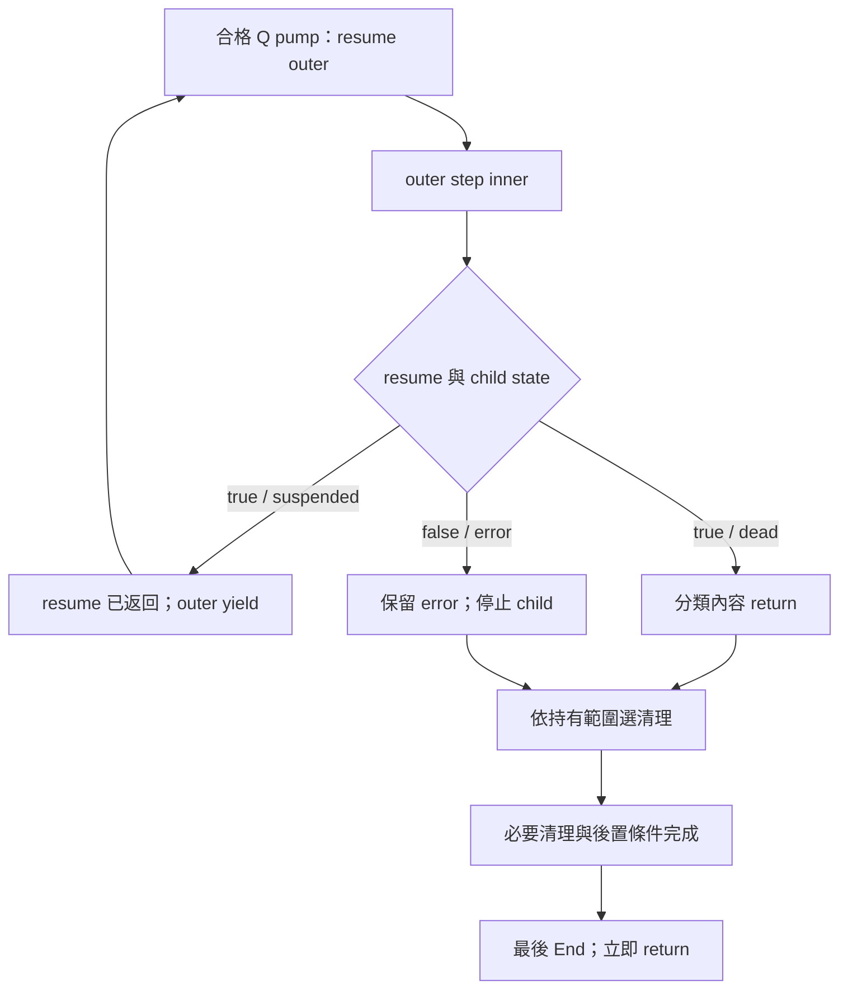

# 外層 Q coroutine 監督 inner entry：可達錯誤收尾、原件 ABI 與取消界線

研究日期：2026-11-16（Asia/Taipei）。工作父提交為已公開 R9 `ad9ea950216923b5e351a7501d38e006df57a4c6`，main 基準 `03b3ea5eae2cb92f9fc373d432edeaf635d6c5fc`。本分題只寫 scratch 分析；未改 Git、原件或遊戲資源，未編譯／執行 Lua、Client 或 Server。本稿使用的函式語義名稱由 ABI／指令資料流辨認，不宣稱原 BIN 含這些除錯符號。

## 1. 結論：這個新 caller 設計有原件支持，但不是普遍 finally

**可以在已登記的正式 Q coroutine 內，建立一個只由它持有、未另行登記 qco 的 inner coroutine；以 public `coroutine.resume` 接住 inner body 逸出的普通 Lua 錯誤，讓 outer 進入明確的清理選擇。** inner 暫停時，先完整返回 outer 的 `resume`，outer 才呼自己的 `coroutine.yield()`。原件會對 inner 設定獨立的 C 呼叫深度基準，因此這與在同一個 coroutine 裡以 `pcall(entry)` 包住需要 yield 的 entry 不同。[`auxresume`、`lua_resume`、`resume_thunk`、`coroutine_yield`、`raw_protected_call`]

這是對 R9 的**條件式新內容設計增補**。R9 所述「直接 Lua 呼 entry 時，entry raise 會使後面的清理不可達」仍然成立；本輪增加的是另一個 caller 結構與實際受保護的 child 執行邊，不是宣告舊直接呼叫已有 finally。[S01]

**outer 自身出錯、外部取消／刪除 outer、Q／VM owner 關閉，以及 native fault，仍沒有自動執行 outer 尾端清理的保證。** 清理自身也可能 yield 或失敗。取得 `false,error` 只讓「選擇並開始收尾」可達，不證明所有 presentation／actor／input 狀態已恢復。清理的具體原介面、取得／釋放平衡與非同步後置條件由同輪 [presentation 分題](../presentation/report.md) 定型；本分題不重做 camera／map 原件。

| 問題 | 本輪裁決 |
|---|---|
| nested inner 是否能合法 yield，再返回 outer？ | 正常原 binding、有效 thread、足夠資源及合法同 thread 深度下可以，已接出原件完整控制鏈。 |
| inner 的一般 Lua error 能否留下 outer 的正常分支？ | 可以；error 在 child 的 protected frame 被接回，再由 public resume 組成 `false,error`。 |
| 原 MoCo 是否需要修改？ | 不需要；它只登記／resume outer，且每次沒有傳入工作引數。inner 的一步由 outer 自行執行。 |
| `wait`／qbase Wait 是否因換了 thread 而失效？ | 所選原件 helper 沒有依賴它是 qco 內的 handle；它們的 yield 在當前 inner state，時間／全域 observer 仍依原契約。這不是全部 API 的通用相容證明。 |
| 正常 `return false` 是否表示 resume 失敗？ | 否，是 `true,false`；業務結果要另按內容契約解讀。 |
| `removeAll`／Stop／VM 關閉會否觸發這個清理？ | 不會因此執行 outer 尾端；原 owner 及 Server 的取消／timeout 責任保留。 |
| 是否找到原生 `.mef`／MapList 首次 caller？ | 否。這仍是新 `.seq → 相容 Lua module` 的設計，未改變原生 first caller 與 ordinary gameplay 的未解邊。 |

本題的有界靜態終點是：確定兩層 coroutine 的實際 ABI、current state、參數／結果／error 移交、MoCo 時序、合法 yield 與必要失敗分支，並形成可審閱的狀態契約。這些已完成；新內容的具體配置、實作、整合與遊玩驗收均未完成。

## 2. 證據與復用邊界

原件身分、公開 commit/path/blob/bytes/SHA-256 pins 保存在 [source-manifest.json](source-manifest.json)。所有直接 Git 來源均固定到上述公開 R9 或 main；沒有使用未公開的原 C0／B0／R9 本機提交作來源依賴。

| 原件 | 大小／SHA-256 | 本題用途 |
|---|---|---|
| `02-Tartaros.bin` | 12,472,320 bytes；`9741d1975327b9309d82b52f631165bc410757694d7c183a5eed970a53ebef91` | 全檔身分、PE32 映射、選定完整 native 函式與資料表。 |
| `06-Event.stp` | 11,241,597 bytes；`2e68e0202565530e574e0810ad7f758a2fc8d6826a0de0975ccaff12c2d4718b` | 固定 `Event/qbase.lua` member；唯讀 XOR／Lua chunk 解析。 |
| 已存在的 Coroutine Git carrier | 2,168 bytes；`c3feac03a40d24a54adf7615781cab175aa4876a2bdad8763987e413d0c2a808` | 原 13 prototypes／187 words；不再搜尋、解包或執行原檔。 |

R6 已證的 public coroutine ABI、MoCo 全 body、毫秒 wait 與 qbase phase，及 R9 的 lexical prepass/formal guard、Register、DoFile、GC 與 End，按固定來源復用。[S01–S08、S11–S14] 本輪新增的研究結合是：`7071C3/C7` 的 caller-depth copy、`6FE6D0` 的 child baseline、`6FE5E0` 恢復 thunk、`6FE4C0` 的 yield-return 參數收束、`6FDBA0/6FDB40` 的 per-thread error frame，以及它們如何讓 outer 保留正常控制流。

完整窗口與逐條反組譯在 [native-windows.json](native-windows.json)、[native-windows.asm](native-windows.asm)；錨點／call edges／表／字串在 [native-assertions.json](native-assertions.json)。[lua-evidence.json](lua-evidence.json) 保存這次需要的原 operands；沒有生成新 Lua bytecode 或可部署遊戲資源。資料表與字串不當作機器指令。

## 3. Public coroutine ABI：到底傳進、傳出什麼

`C0BC68` 的原 coroutine binding table 將 `create/resume/status/yield/running` 分別連到 `707380/707230/707070/707480/7074C0`。表內還有 wrap，但本設計沒有選用 wrap，也不把它的契約混入 resume。

| API | 原件入口與實際 ABI | 本設計的使用限制 |
|---|---|---|
| `coroutine.create(f)` | `707380` 建獨立 thread，要求第 1 個值為 tag6 且 closure+6=0 的 Lua closure；將同一 function TValue 移到 child stack，回 tag8 thread。 | 傳恰一個本內容的 Lua adapter closure。create 在 outer 上執行；型別／配置錯誤不屬於後續 child body catch。 |
| `coroutine.resume(co, ...)` | `707230` 要第 1 值為 tag8 thread；`707265..26E` 以 `(top-base)/16 - 1` 算剩餘引數，交 `707110`。成功回 Boolean true 加所有 yield／return results；失敗回 Boolean false 加一個 error object。 | 選定零參數 step；context 由 adapter 的 captured local 傳給 entry。只保存一個內容 payload，不冒充一般 vararg proxy。 |
| `coroutine.status(co)` | `707070` 以實際 state／CallInfo／stack 判 running、suspended、normal、dead，回一個字串。 | resume=true 後才用 suspended/dead 分流；不以 resume=true 直接當完成。 |
| `coroutine.yield(...)` | `707480` 取 incoming L，保留當前引數為 yield results，檢查本 L 的 depth，設 L+6=1，回 native -1。下次 resume 的引數成為這次 yield call 的回值。 | inner 和 outer 均採零值 yield；outer 在 inner resume 已返回後才 yield。 |
| `coroutine.running()` | `7074C0` 以 incoming L 建 tag8 結果；若是 global_State+70 所指 main thread，最後回 nil。 | inner 的 running handle 是 inner，不是 MoCo 登記的 outer。依賴原 handle identity 的內容不能直接套用。 |

### 3.1 參數和結果沒有字串化或自動業務轉碼

`xmove 6F51D0` 先減來源 top，再按原順序逐個複製 TValue 的 value/tag 欄位到目標 top。auxresume 在 `7071B9` 移入引數；成功時 `7071F1..1F9` 算 child 當前結果個數，`70721C` 全數移回 caller。public resume 在 `707280` 寫 tag1，將 true／false 插到結果前面。[`xmove`、`auxresume`、`coroutine_resume`、`insert_boolean`]

另外，原 base table 的 `error→705650` 也已補入本包。`705686..6AF` 使 error 的第一個 TValue 成為唯一值；只有 tag3／tag4 且 level 合適才走位置字串處理，其餘於 `7056C9 → 705725/727` 直接進 runtime_error。因此 nil、false、table 等非字串 error 並非憑一般 Lua 印象添加的假設。[`base_error`、`base_binding_error`、`base_register_prefix`]

因此下面各情形必須分開：

| child 行為 | public resume 可見結果 | 必要分流 |
|---|---|---|
| `yield()` | `true`；child suspended | outer 讓出，之後才可再 step。 |
| `yield(x, ...)` | `true,x,...`；child suspended | 原 MoCo 不把 x 當 delay。本設計也不轉送／解釋這些 payload。 |
| 正常無值 return | `true`；child dead | 正常返回，但是否是內容成功仍由 RESULT_POLICY 決定。 |
| `return false` | `true,false`；child dead | 不是 Lua 執行失敗。 |
| 未被 child 自己接住的普通 Lua error | `false,errorObject` | outer 可以進入錯誤收尾選擇。errorObject 可以是 nil、false、table 或其他 TValue，不能以 truthiness／字串型別判斷 error 是否存在。 |
| 對 dead／running／normal thread 再 resume | `false,error`（正常 capacity 等前提下） | 屬狀態錯誤；不應將狀態誤用當成預定的正常完成偵測。 |
| 第 1 個 resume 引數根本不是 thread | public callback 走 argument error | 不是上述 false tuple 的可靠來源；可能讓 outer 自己失敗。 |

原 ABI 支援多個回值，包括 nil；本文刻意選「yield 無值、return 至多一個 payload」。若未來要做透明 vararg 中繼，必須明定 arity 與 nil 保存方式，不能用 Lua table 的長度代替結果個數。本輪沒有引入尚未驗證的 pack/unpack adapter。

## 4. 為何 nested inner yield 可以，same-thread pcall 包 yield 不行

### 4.1 兩個 L，各有自己的 C-depth 基準

以下 offset 都屬 **Lua thread L**，不是 Q manager M：

| L offset | 已核用途 |
|---|---|
| +06 | 0 正常／1 yielded／其它 error status。 |
| +08、+0C | top、目前 base，TValue stride 16。 |
| +10 | 共享的 global_State。 |
| +14、+28 | 目前 CallInfo、base CallInfo。 |
| +34、+36 | 16-bit nCcalls 與本次 resume 的 baseCcalls。 |
| +48..+50 | thread 的 global-environment TValue；new thread 從 creator 複製同一值。 |
| +70 | 本 thread 的受保護 error-frame 鏈。 |

`7071C3/C7` 把 **caller L+34** 複製到 **child L+34**。`6FE70E..713` 隨即在 child 上加一，並把相同值寫入 child+36。resume thunk 和 VM 都以這個 child L 執行。`70748B..496` 的 yield gate 只比較 incoming **同一 child L** 的 +34 與 +36；沒有拿 outer 的 baseline 當 child 的上限。

用符號 n 表示正常 outer 當前 C-depth，原件順序是：

```text
outer 呼 resume(inner)
  inner.nCcalls := outer.nCcalls                  7071C3/C7
  inner.nCcalls := inner.nCcalls + 1              6FE70E/70F
  inner.baseCcalls := inner.nCcalls               6FE713
  以 inner 的 protected frame 執行 Lua entry      6FE727 → 6FDBA0
  entry 直接 Lua → Lua → coroutine.yield()
    檢查 inner.nCcalls <= inner.baseCcalls         707492/496
    inner.status := 1；native callback 回 -1     7074B1/B6
  resume(inner) 回到 outer 的正常 Lua 控制流
outer 再呼自己的 coroutine.yield()
```

兩層各自的 yield 都要符合自己的深度條件。這不是任意 C 邊界皆可 yield 的放寬，也不是無限 nested-depth 保證；`6FE6F3..709` 保留 0xC8 深度拒絕路徑。

### 4.2 yield 如何正常退出 inner 的 interpreter，而非穿越 outer

`precall` 在 `6FE35F/360` 把當前 L 作參數交給 C closure callback。當 yield callback 回負數，`6FE367..374` 回傳 dispatch code 2。VM CALL `6FD045` 收到這個結果後，由 `6FD057 → 6FD68A` 離開該次 interpreter。resume thunk 返回，`lua_resume` 在 `6FE757` 讀 child.status=1，auxresume 把 0／1 都接成成功。[`precall`、`vm_call`、`vm_return`、`resume_thunk`、`lua_resume`]

所以 outer 的 native `coroutine.resume` 呼叫是**已返回**後，outer 才繼續 Lua 程式與自己的 yield；並沒有讓 inner 的 yield 直接跳到原 MoCo 排程器。

### 4.3 原 DoFile／pcall 的同 thread 限制仍在

`call_boundary 6FE550` 進 C→Lua 執行前先加 L+34，返回後才減回。global DoFile `6F48A0` 使用 incoming L；`6F49E3/F4` 經 `6F5A50 → 6FE550` 在同一 L 執行 module top-level。若 top-level 企圖 yield，增加的 nCcalls 大於該 L 的 baseCcalls，`70749E → 6F8B60 → 6F8AD0` 走錯誤路徑。[`global_dofile`、`execute_thunk`、`call_boundary`、`error_formatter`、`runtime_error`]

原 base table 的 `pcall→706AC0` 另由 `706B14/1D` 直接把同一 `6F5A50` thunk 交給 `6FE770`，證明這裡的 same-thread protected call 確實會走上述 C→Lua depth increment，不是只引用 Lua 5.1 的一般規則。[`base_pcall`、`base_binding_pcall`、`base_and_coroutine_open`]

本設計因此仍要求 module top-level 有限且不 yield；先讓 DoFile 正常返回，再建立／step inner。**不能用 pcall/xpcall 包住整個需要 yield 的 inner entry，也不能把整個 outer supervisor loop 包在同 thread pcall 內再期待 outer yield 成功。** 本稿沒有另設 protected-call 包裝策略；wrapper／outer 失敗界線明列於第 9 節。

## 5. 第一次 resume 與日後 resume：entry 引數和 yield 回值不同

`resume_thunk 6FE5E0` 按 child.status 分兩支：

- **第一次啟動**：status=0。以 `firstArg-16` 找 function，`6FE5FA → precall` 用 MULTRET 執行入口。create 放入的同一 Lua adapter closure 因而被執行。
- **恢復 yield**：status 非零，先在 `6FE608` 清回0；若目前暫停在 C closure，例如 coroutine.yield，`6FE61B → poscall` 把這次 resume 的引數當成 yield call 的回值，再接回 Lua interpreter。

`poscall 6FE4C0` 退回前一個 CallInfo，按該呼叫要求的結果數複製 TValue；不足的固定結果槽在 `6FE530..539` 補 nil。原 wait 的 coroutine.yield CALL 不要結果，因此 MoCo 的零參數恢復完全符合它的使用方式。不是把第一次 entry 的 context 在每次恢復時再傳一次。

選定的新 adapter 使用 captured `RUN_CONTEXT`，所有 `resume(inner)` 都只有 thread 這一個 public API 引數；child 本體每次收到零個 resume 引數。它在首次執行時自行呼 `entry(RUN_CONTEXT)`。這避免把 MoCo 從未提供的 dt、handle、callback、event 或 run token 填進設計。

## 6. Error 為何留住 outer，哪些錯誤留不住

### 6.1 ordinary child error 的完整 protected 邊

`raw_protected_call 6FDBA0` 將 stack 上的新 error frame 寫入 **傳入 L+70**，保存上一個 frame，執行指定 callback；正常與錯誤返回路徑都恢復同一 L 的前一 frame。`throw_error 6FDB40` 讀同一 L+70，將 status 寫入 frame+44，再走非區域錯誤轉移。child 和 outer 是不同 L，child 的 frame 不會因它們共享 globals 就變成 outer 的 frame。[`new_thread`、`raw_protected_call`、`throw_error`]

當錯誤回到 `lua_resume`，`6FE738` 將 status 寫入 child+6，`6FE73B → set_error_object` 建立最後 error slot；`auxresume 7071DB..1E2` 只把這一個 slot 移回 outer，回 -1；public resume 組成 false/error。runtime error 的 `set_error_object` 分支直接複製原 error TValue，沒有保證它是可列印字串。[`set_error_object`、`error_object_switch`、`auxresume`、`coroutine_resume`]

inner 已無需再執行任何原本位於 error 後面的語句，outer 仍能持有它自己的 local／ledger／原 API references，依已選 policy 收尾。錯誤 thread 的 stack／upvalue 不是在這裡被轉成遊戲資源 rollback；之後放掉 handle／Lua GC 也不等於 camera、actor、input 已恢復。

### 6.2 不屬於這個 catch 的分支

| 發生位置 | 原件／控制流後果 | 不能宣告的保證 |
|---|---|---|
| create 型別／配置錯誤 | create 本身在 outer 執行，child body 尚未進 protected resume。 | 不能保證進到本設計的 entry-error 分支。 |
| resume 第一引數型別錯誤 | `70725D → argument_error`。 | 不是正常 false/error tuple。 |
| auxresume 的引數／結果容量不足 | `707170/707201` 查 capacity；不符時 `707182/707210 → raise_formatted_error`。配置問題還可進其它錯誤路徑。 | 不能說所有 resume API failure 都被轉成 inner false。 |
| status、取消讀取、outer bookkeeping 出錯 | 在 child resume 之外。 | inner 的 protected frame 不保護 outer。 |
| debug hook、finalizer 重入、binding 污染 | 可改變原時序／方法／owner；new thread 亦繼承 hook 設定。 | 新 thread 不是 sandbox 或隔離 VM。 |
| inner 沒有 yield 的無限迴圈／阻塞 native call | outer 必須等 resume 返回才能判斷。 | 這不是 preemptive watchdog；沒有強制搶回執行權。 |
| OOM、panic、native exception、程序終止 | 缺 error frame 分支與 native 配置／外部行為不構成本稿的普通 Lua error 保證。 | 不能宣告 universally safe finally。 |
| inner 自己以 pcall 接住錯誤並回值 | 外層 resume 可能仍為 true。 | supervisor 不會自動知道被 child 隱藏的業務失敗。 |
| cleanup 自身 raise | 發生在 outer 的清理階段。 | 沒有第二層自動補償保證，且不能把進過 cleanup 標為 restored。 |

固定零參數、零值 yield、至多一個 return payload、單一有效 inner handle，可排除設計本身的大量引數／結果擴張，但不把資源不足與 allocator 例外改寫成不可能。

## 7. 接回原 MoCo 與 qbase，沒有新增背景 runner

### 7.1 MoCo 每次只 resume outer，且沒有輸入 payload

原 Coroutine P7 的 PC0..3 讀 `coroutine.resume`，只把其參數 handle 放入下一槽；`CALL A=4 B=2 C=3` 表示恰一個 public API 引數、保留兩個結果。**傳給 coroutine 本體的 resume 引數是零。** P7 只比第一個 Boolean 是否 false，false 時 print 第二槽並回 number0，其餘回 number1。[S05、S07；本包 Coroutine P7]

P8 以入口長度為 for 上界，動態讀 list；遇第一個 runCoroutine=0 就 tail-remove 並返回。P9 沒有轉送原 caller 提供的 End callback，Q wrapper 又丟棄 list 長度。這些 R6 已閉合的事實不因加入 inner 而改變；不能用空 list 或 outer return 代替顯式 End。[S05、S08]

選定結構是 **qco 僅有 outer 的那份工作；inner 不是第二個 qco 工作**。每次 outer 被走訪，最多 step inner 一次；若 inner suspended，outer 零值 yield。下次合格 MoCo 走訪恢復 outer，才再次 step inner。成功完成／error 時同一 outer visit 可立即選清理；若清理需要 yield，則再等待之後的 pump。

「一次 step」不保證一個畫面 frame：native active／pause／frame gate、同 handle 重複登記或 reentry 都影響實際走訪。本設計要求唯一登記、無 scheduler reentry、無其它內容改 qco list；它沒有創造 ordinary battle 可用的背景 runner。[S10]

### 7.2 wait 與選定 Wait helpers

原 Coroutine P1 是：先 `lb.GetTime()`，再 `coroutine.yield()`，恢復後才比較 duration 與 elapsed，未到則再次 yield。qbase P4 的 global `yield()` 是 `wait(0)`。本包再從原 member 核 qbase P10/P11/P12/P13/P24 的全 body；它們透過 yield／wait 輪詢場景、camera、prolog、book、objects-stop，沒有把當前 coroutine handle 當 qco 身分傳入。

inner 的原 helper yield 因而落在 inner state；outer 的 step 返回後另讓出，沒有把 inner 的 yield payload 當 sleep 指令。outer 中繼用保留的 **`coroutine.yield`**，不額外呼 qbase `wait(0)` 加一層計時器。原 wait 的毫秒來源與 signed marshalling／跨邊界限制沿用 R6，未宣稱新的固定時間上限。[S05、S06]

`new_thread 6F7425..7434` 複製的是同一 global-environment TValue，`+10` 也沿 creator 指向同一 global_State。qbase globals、qco、lb、Q 與 observer 因而沒有自動變成 inner 專用副本。`q_objects_stopped_closure 569906/569926..935` 與 `q_running_closure 568B16/568B36..45` 則證明這些代表性 Q getter 把 number 結果寫到 incoming L 的 stack，同時仍使用共享 Q manager receiver。它們不是只會把結果推到 main L。[S09；本包兩個 callback windows]

這只支持所選 helper 與其已證原生介面。每個 observer 的遊戲語意、可能錯誤的物件身分、無止境等待、以及 ordinary death/group-clear 缺口均不由 coroutine adapter 解決。`coroutine.running()` 會改為 inner，故依 running handle 去移除 qco 工作、直接 Register／修改 list、或依固定 thread identity 的內容明列不相容。

### 7.3 原 DoFile 與 End 的位置

global DoFile 仍在 outer 的正常正式分支先執行；回值只判 **number0**，不使用 Lua truthiness。它不把 module 的 return table 作公開回值。當次 export/version/entry 檢查、舊 export 清除、有限無 yield top-level 及資源可見性均保留 R9 條件。[S01–S04]

只有後續 entry 放到 inner。**不得讓 inner 呼 End、Stop、removeAll、Register，或自行跑包含 End 的 RevPhase1**；否則它可能先清掉 outer 的排程所有權，破壞本設計的後續清理承諾。normal entry return、entry error、協作取消，都將結束責任交回 outer。

## 8. 不可部署的控制骨架與完整狀態

以下只展示合法 Lua 5.1 控制語法，不是資源檔案，也未編譯／執行。它位於 R9 lexical guard 的正式分支；所有大寫符號是待配置的設計值／策略，並非新 Client API。`RUN_CONTEXT` 必須是本 run 所有、無任意 metamethod 的正常資料；其取消旗標仍需具體 writer，本稿沒有假造網路或原生 setter。

```lua
-- 正式分支：在 DoFile 前保留當時正常的原函式。
local co_create = coroutine.create
local co_resume = coroutine.resume
local co_status = coroutine.status
local co_yield = coroutine.yield
local raw_get = rawget
local end_cutscene = Q.EndCutScene

-- 此處先完成 R9 的有限 DoFile、numeric 0 與當次 export 檢查。
-- THIS_RUN_VALIDATED_ENTRY 與 RUN_CONTEXT 是待分配設計輸入。
local entry_fn = THIS_RUN_VALIDATED_ENTRY
local context = RUN_CONTEXT
local inner = co_create(function()
    return entry_fn(context)
end)

local terminal_kind, terminal_value
while true do
    if raw_get(context, "cancel_requested") == true then
        terminal_kind = "cooperative_cancel"
        break
    end

    local ok, value = co_resume(inner)  -- 每次零個 resume 引數
    if not ok then
        terminal_kind, terminal_value = "entry_error", value
        break
    end

    local state = co_status(inner)
    if state == "dead" then
        terminal_kind, terminal_value = "entry_returned", value
        break
    end
    if state ~= "suspended" then
        terminal_kind, terminal_value = "contract_error", state
        break
    end
    if raw_get(context, "cancel_requested") == true then
        terminal_kind = "cooperative_cancel"
        break
    end

    co_yield()  -- child 的 resume 已返回；這次讓出的是 outer
end

inner = nil  -- 契約要求沒有外洩 handle；不代表 child 執行過清理

-- 此策略可能 yield，也可能失敗；不是原生 finally。
-- 本骨架採「清理不含 End，由 outer 最後 End」的單一 owner 方案。
local restored = CLEANUP_POLICY(context, terminal_kind, terminal_value)
if restored == true then
    end_cutscene()
    return      -- End 後不再 yield、Register 或執行遊戲操作
end

-- 尚未 restored；交給已選外部 owner／Server failure policy。
-- 不能在此宣稱已清理、成功 ACK，或猜一個通用 Stop/reset。
return
```

`entry_returned` 不是 `success`；RESULT_POLICY 可依明確內容結果分流，沒有標準值可先猜。false/nil error object 也由 resume 的 ok 判斷，不以 value truthiness 決定是否錯誤。CLEANUP_POLICY 返回 false 時，此骨架沒有發明失敗 wire；原 Q 可能仍 active，因此必須有既定外部 timeout／合法取消策略，不能把 return 當完成。



[supervisor-contract.json](supervisor-contract.json) 列 **24 個狀態、47 條條件邊**，另包括載入失敗、outer 失敗、清理 yield／error、外部移除、VM 關閉與 native fault。圖／JSON 的可達性是設計結構核對，不是 runtime trace 或對任意環境的終止性證明。

## 9. 正常、錯誤、取消與再入的必要分支

| 場景 | outer 是否還能正常執行？ | 責任與限制 |
|---|---|---|
| 原 formal parse／Register 尚未成功 | 可能根本沒有登記 outer。 | 本輪新增的 inner catch 尚不存在；R9 外部 timeout／取消責任保留。 |
| DoFile 正常回1／export不符 | 若 outer 自己未 raise，可以。 | 只清當次已持有的部分 export／effects，不把 partial top-level 當 rollback。 |
| entry 合法 yield | 可以，resume 先返回 outer。 | 檢查 local cancel，否則 outer yield；仍需下一次可達 pump。 |
| entry 正常 return | 可以。 | 先用 RESULT_POLICY 分類，再清理；return false 仍走這一支。 |
| entry 普通 Lua error 逸出 | 可以，於本稿正常前提下收到 false/error。 | 不再 resume inner；保留錯誤、依 ledger 選清理。 |
| 協作取消旗標在邊界可見 | 可以，但必須 outer 真正執行到檢查。 | 可以不再 resume child，改由 outer 清理；這不是現成 Server cancel API。 |
| inner 仍在未 yield 的長工作中 | 不可以搶回。 | 無 preemption；必須內容有限合作，或由既有外部 owner 處理。 |
| 外部 remove/removeAll/End/Stop | 當前執行中的語句未必立即中斷；已 suspended outer 不會因此被喚醒清理。 | 不能把「清掉 list」接成 finally；外部 owner 自己負責其取消語義。 |
| 清理中 yield 後才被外部取消 | 尾端不保證可達。 | EnableInput／End／其他後續步驟可能尚未執行，不得標 restored。 |
| inner handle 外洩、被別人再 resume | 設計不變條件破壞。 | 已釋放遊戲 effects 後仍可能繼續舊 body；契約禁止，不宣稱 Lua GC 能阻止它。 |
| VM／scene owner 關閉 | 原 outer 的後續執行不保證存在。 | 以 owner teardown／Server session policy 對帳，不依 suspended thread 尾端。 |
| 同一 outer 重複登記或 scheduler reentry | 同一 pass 可多次 step，或移除錯誤的 list index。 | 沿 R6 已證反例，不能宣稱固定一次／frame；本設計要求避免。 |

移除或放掉 suspended child 並不使它立即變成 dead；status 與排程 membership 不同。Lua GC 僅處理 Lua 可達性，沒有呼 qbase cleanup 的保證。原 qco→outer stack→inner 的強引用與 thread stack marking 沿 R9 選定 GC 證據支持；不把 thread 當弱引用或執行結束即自動釋放 native actors。[S03、S05]

## 10. 清理必須依 effect ownership，不能無條件 RevPhase1

原 qbase P67 Phase1 在不同副作用之間會 yield，直到後段才呼 BeginCameraOverride。P74 RevPhase1 一開始就 EndCameraOverride，後續還有 UI/render／transition 操作；最後 PC54–55 yield，PC56–58 EnableInput，PC59–61 EndCutScene。**進入 Phase1 或遇到 error，不代表已取得 RevPhase1 要釋放的所有 effect；進入 RevPhase1，也不代表其 yield 後尾端已完成。**[S08；本包 qbase P67/P74]

因此本 supervisor 不使用 `if error then RevPhase1()` 作通用補償。需要一份與實際內容匹配的 effect ledger／cleanup policy，記錄實際成功取得的狀態與必要後置條件。ledger 不是交易；native operation 在 error 前可能已部分改變狀態，沒有正常回值時不能直接將它標為「未發生」或「已完整取得」。

同輪 [presentation 分題](../presentation/report.md) 提供 native cleanup 順序與消費者的具體裁決；本包將其轉為以下**設計要求**，不重複宣稱那些 native body 是本包新證：

- 已持有資源的必要釋放應在最後 End 前完成。End 不是 bulk cleanup；先 End 再 Stop 不能作通用補救。
- camera 取得／釋放需平衡本次成功取得的深度；不得把反覆 EndCameraOverride 當無副作用 reset。CameraWorks.Stop 與 Q.DetachCamera 的責任也分開。
- map saved-state 需要本 run 的有效 snapshot／owner；不是任意可疊的 rollback stack。
- cleanup API 的請求與視覺／native 後置條件完成分開。需要後續 native update 的效果，不能在呼叫後立刻寫 restored。
- actor 集合、camera、map、render、輸入 mask、controller、dialog、qco list、module export，各自保留 owner；不以其中一個已清理推定其餘都已清理。

本文骨架選「CLEANUP_POLICY 不含 End；outer 最後唯一 End」。若實際方案選原 RevPhase1 作 final owner，則須另證它對本次 effect 狀態合法，且 outer 之後不得再 End；不能混用兩套結束責任。本包契約不分配 model、slot、坐標、延遲、SceneList key 或 reset 參數。

## 11. Server 開發與剩餘界線

| 分類 | 明確工作／限制 |
|---|---|
| 已確認 Client 有界靜態鏈 | 原 public coroutine ABI、per-thread resume/error/yield 邊、MoCo 零參數 step、所選 qbase wait／phase operands與 current-state marshalling。 |
| 條件式新內容設計 | R9 formal bridge 內的 outer/inner supervisor、context／result／effect／取消契約；尚未製作資源、執行或部署。 |
| Server 待開發 | 有版本與場景／session 所有權的 run 管理、拒絕 busy／重入、timeout、合法既有取消／解除等待、區分 requested/skipped/returned/error/cancelled/timeout，並自行決定持久化／獎勵。 |
| 跨功能待整合 | 實際 module/export/version/entry、有限依賴宣告、唯一 outer owner、具體 effect ledger／cleanup policy、協作取消旗標真正 writer；不得假定存在新的 wire setter。 |
| Client 待逆向 | 原生 MapList.TRIGGER 名稱到第一個 loader caller，以及 ordinary gameplay 的背景 runner、世界身分、死亡／清組 observer 等既有未解必要邊，本題未改寫其狀態。 |
| 待遊玩驗證 | 實際選取／資源版本／雙階段、nested wait 的觀察、正常返回與 error／取消 cleanup 後置條件、UI/input／Server 對帳；本輪不執行故障或 gameplay 測試。 |

**Lua resume／return 的結果不是新的封包。** 既有003F也不能證 module成功；非零 quest 的正常 End 仍須 converted CheckConfirmMessage==1 才走 sender，quest0 seen skip亦可先發003F而沒有跑本次 entry。00EB 是其既有 input/dialog 解除路徑，不是 Stop Q、module result 或帶 run token 的取消 ACK。[S01、S11、S12]

Server 若要辨識這次內容的結果，必須以實際已證介面與自身 run policy 規劃，不能將 supervisor 的 local payload 冒充 Client 已會傳回的新欄位。協作取消的本地 context writer 也沒有因本稿存在而自動變成 Server 可呼 API。需求交由既有 S00 流程整合，不另建 RR／REQ 台帳或自標 ACCEPTED。

## 12. 重驗與實際結果

```sh
python -B verify_evidence.py \
  --bin /path/to/02-Tartaros.bin \
  --event-stp /path/to/06-Event.stp \
  --repo /path/to/ttr_anal_multi
```

原件目錄還須包含 manifest 所列 `09-02-PROJECT-SHARED-INSTRUCTIONS.md`；驗證器以 BIN 同目錄檔案核對本輪提供的共同指示身分。

驗證器只讀原件與固定公開 Git 物件，不 fetch、不改 Git、不執行／編譯 Lua、不載入 Client。它重新核全檔身分／PE mapping／全部 native bytes 與完整指令邊界、錨點、call edges、binding／switch／字串；從固定原 bytes 重解 qbase 與 Coroutine operands；核來源 commit/path/blob/bytes/SHA-256；檢查本包狀態圖與必要反例／限制。跨分題 Markdown 連結由 R10 aggregate 核對，本支獨立 verifier 不假定 presentation 已複製進來。

已實際執行上述唯讀檢查，[verification-result.json](verification-result.json) 為 **PASS**：**63 個 native records、36 個 code windows、5,593 bytes、1,928 條指令、104 個指令錨點、105 條直接 call、8 個 bindings（6 個 coroutine、2 個 base）、3 張資料表、22 個原件字串、366 個選定 Lua instruction words、15 個公開來源 pins，以及24狀態／47條條件邊**。另核對 ASM 可讀稿與 JSON 窗口完全一致。

PASS 僅表示這份有界原件／來源／契約包通過所列一致性檢查；不等於全文 native 語意驗收、T01 FULL-PASS、RR ACCEPTED、Server 已完成或新內容可玩。研究推導應連同報告、完整窗口、原 operands 與設計前提一起審閱。
