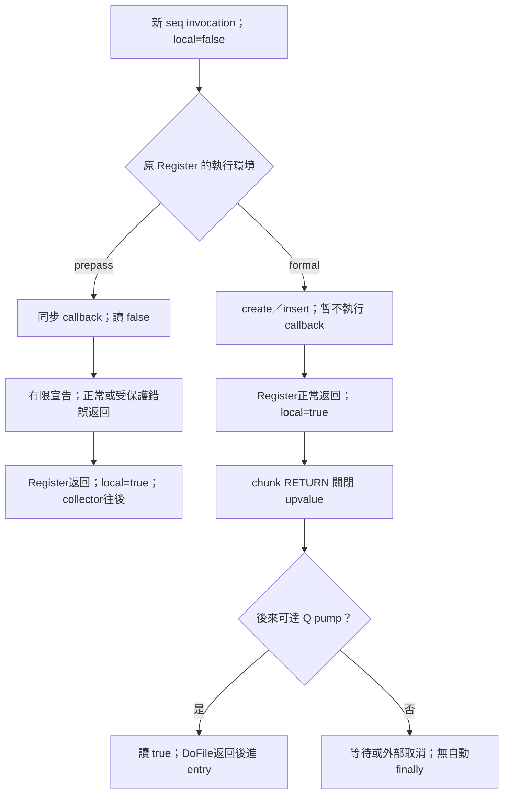

# 第一個新 `.mef` caller：雙 VM 階段判別、closure 生命週期與完整啟停契約

研究日期：2026-11-16（Asia/Taipei）。原本機研究父提交為 `b0bf6bb5986f9c849fcfac4e16db42f0a1cf960c`，已包含 main `03b3ea5eae2cb92f9fc373d432edeaf635d6c5fc`。本分題研究過程只讀原 BIN、Event.stp、既有 Git 原件與研究；未變更 Git、未執行／編譯 Lua、未執行 Client，也未製作或修改可部署 `.seq/.mef`。

發布補充：原本機研究父提交保留作歷史；本包可重驗的來源 carrier 改為同 tree 的公開 merge `15819c892c0a9a23924704daa5883615a09626bf`。原件及所有來源 blob／SHA-256 不變，詳見 [發布對照](../publication-note.md)。

## 1. 結論與完成範圍

**在原始 binding 保持正常、Register 成功且沒有重入的條件下，可以用每次 chunk 自己捕捉的 local，將同一份新 sequence 的「同步預掃描」與「延後正式執行」分開。** 這不依賴在持續存在的 VM 中猜測 `DoFile`、`_G` 或某個 global 是否存在。預掃描 callback 在 `Register` 返回之前看見 `false`；正式 `Register` 只建立並登記 coroutine，外層在它正常返回後才把 local 改為 `true`，日後真正 resume callback 時讀到 `true`。

本輪新增原件證明涵蓋：prepass Register 的同步 protected call／錯誤返回、正式 qbase Register 與 MoCo 的確切 ABI、coroutine.create 對同一 closure 的轉交、local 的 open upvalue、外層 RETURN 關閉 upvalue 的保存方式、強引用到 thread／closure／upvalue 的選定 GC 路徑，以及正式 entry 為何必須在 DoFile 返回後才開始。這使新 `.seq → global DoFile(待分配路徑) → entry` 成為可審閱的條件式內容設計。

**原版 MapList.TRIGGER 的第一個 `.mef` caller 仍未取得正向原件證據。** 本稿不把新 sequence 設計改稱原生 MapList 啟動鏈，不把 `.mef` 副檔名當作官方格式，也不宣告普通戰鬥已由腳本完整接管。第 9 節列出已查範圍、具體缺邊與解除條件。

| 本分題項目 | 狀態 | 精確界線 |
|---|---|---|
| 正常雙 VM 下的 lexical 階段判別 | 有界靜態契約已閉合 | 需要原 Register／MoCo／標準函式與正常非重入控制流；沒有跑新 Lua |
| 新 caller 的選取、資源、載入、entry、End／取消條件 | 已形成完整可審閱設計 | key、路徑、model/action、坐標、版本及 Server 策略均未分配；沒有部署 |
| 原生 MapList.TRIGGER 名稱至檔案 loader | 尚未完成；現有明確候選讀集受阻 | 已知讀取返回的名字尚未接到檔案／parser consumer |
| 驗證器 PASS | 包內原件與契約一致性 | 不是 T01 FULL-PASS、RR 接受、Server 已實作或遊玩通過 |

原件、必要窗口與來源 pin 分別保存在 [native-windows.json](native-windows.json)、[native-windows.asm](native-windows.asm)、[native-assertions.json](native-assertions.json)、[lua-evidence.json](lua-evidence.json) 與 [source-manifest.json](source-manifest.json)。機讀設計是 [caller-contract.json](caller-contract.json)。以下引用 `Sxx` 對應 manifest 中的固定 commit／repository path／blob／SHA-256，引用 native record ID 則可直接查同名窗口。

## 2. 從既有入口到新模組，必須先成立的前提

既有正常入口是 S2C `0047 → 503040 → 561760`。訊息的兩鍵經 signed WORD 解讀，選記憶體中的 SceneList `(questIdx, sceneIdx)`，再組成 `Event/Sequences/<funcName>.seq`；網路欄位沒有傳入任意 `.mef` 路徑。SceneList 在既有初始化時載入，0047 本身不重新讀表。這條入口及資源可見性沿用 S27、S15–S17，不當作本輪新增發現。

本稿所有大寫符號均是**待分配的設計參數**：`QUEST_KEY`、`SCENE_KEY`、`SEQ_FUNC_NAME`、`MODULE_RESOURCE_PATH`、`CONTENT_VERSION`、`MODULE_EXPORT_KEY`、`DECLARATION_MANIFEST`、`SLOT_MODEL_ACTION_ASSIGNMENTS`、`COORDINATES`、`RUN_CONTEXT`、`CLEANUP_POLICY`、`COMPLETION_POLICY`。沒有暗示任何數字鍵、模型、動作或坐標已存在；機讀值全部為 null／assigned=false。

| 順序 | 必要條件 | 未成立時的真實影響 |
|---|---|---|
| 選內容 | 正常 Client／Lua／場景 context；Server 允許該 run；已載入 SceneList 有實際雙鍵 | 有 handler 不等於可安全播放；查無 row 有自己的 End 支線 |
| 避免忽略或略過 | Q 未 busy；符合這次內容的 seen／mode 政策 | busy 不排隊，且入口可先改 normal/review 旗標；seen 分支可發003F而沒有載入本次 seq |
| 看見資源 | 已授權的新 seq 與 module 版本能被原資源層真正解析到；索引與 archive 優先序一致 | 檔案名稱存在或更新磁碟時間不是已讀新版本的證據 |
| 預掃描 | 同一依賴規劃產生有限、exact arity 的宣告；Create 在 action 宣告之前 | callback 錯誤可以被吞掉，collector 部分結果仍往後走 |
| 正式登記 | 原 qbase、MoCo、coroutine.create、table.insert、qco owner 正常，Register 完成 | Register 沒有公開成功 bool／handle；出錯不保證自動 End |
| 實際 resume | 同一工作仍被 qco 保留，Q active、unpaused 且 frame gate 允許 | 登記不保證下一畫面 frame 執行，也沒有固定延遲上限 |
| 進模組 | DoFile 返回數字0；當次 export／version／entry 合法 | 不接受舊 global、數字 truthiness 或 module return 值冒充成功 |
| 結束 | 內容、Q owner、物件、輸入、排程及 Server 收尾政策一致 | End、003F、00EB 各有不同條件，不能合成單一「完成 ACK」 |

`q_start_and_skip` 重新核對 `5617C2` busy、`561830..561834` 非零 quest 分支、`5618C8` skip sender、`5618E9/EC/EF` 保存兩鍵／設 active、`561AF3` prepass 與 `561C7D` formal loader。非零 quest **只避開特定 seen gate**；它不解除其它前提，而且它的 End 回報反而多一個確認條件，詳見第 7 節。

## 3. 原件如何支持兩種 Register 時序

### 3.1 預掃描是同步執行，失敗仍可返回部分 collector

預掃描 owner 是 `FE1EEC`、wrapper `FE1EF0`；它與正式 `FDF3C8` 所持 VM 分開建立，兩者通常持續重用。每次 `55D6A0` 清 native collector／music 並重綁六個收集 callback，沒有重新建立 VM，也不等於清除 globals。正常預掃描初始化沒有開正式標準函式庫、lb、Tutorial 或 global DoFile；已有的72個 no-op 不是正式操作能力。這些初始化差異復用 S06、S10、S15；本輪重核 `prepass_constructor`、`prepass_reload`。

`prepass_register` 保存完整 `55D560..55D5DE`：`55D56E/55D571` 取 top−16 的最後一個引數；`55D57B` 要求 tag6；`55D590` 指定 execution thunk `6F5A50`，`55D597` 要0個結果，`55D59F → 6FE770` protected-call。函式上方沒有其它引數，因此此 callback 以0參數執行。正常路徑要等 callback 返回，Register 才返回。

這個 ABI 要求設計傳**恰一個 Lua closure**。多傳引數時，預掃描用最後一個值，正式固定參數用第一個值；兩邊可能執行不同函式。預掃描只驗 tag6，正式 coroutine.create 還拒絕 C closure，不能把兩個 API 的檢查範圍視為相同。

受保護 callback 失敗時，`55D5A7` 檢查非零 status，錯誤處理後 `55D5D2` pop error，`55D5D7 xor eax,eax` 仍回0個 Lua 結果。外層 `55D6A0` 在 `55D7C2 → 6F4A50` 後直接回 collector，沒有用 loader status 形成成功 gate。因此「Register 返回」「有 collector」「開始資源工作」都不能證明預掃描宣告完整。原 collector 已完成的 writes 沒有 rollback 保證。〔NF1、prepass_register／prepass_reload；S10〕

### 3.2 正式 Register 建立並登記，沒有立即 resume

本輪從原 Event.stp 固定 member 重新解析 qbase，也直接讀現存原 Coroutine carrier，均只當資料。qbase root PC170 `CLOSURE` 建立 P75，PC171 `SETGLOBAL` 綁成 `Register`；不是僅按常數名稱推定。

| 層級 | 原件 body | 實際效果 |
|---|---|---|
| qbase P75，固定1參數 | `f_registerCoroutine(coroutine.create(arg1))`，兩次CALL，最後RETURN無結果 | 外部 Register 不回 thread，也沒有成功布林值 |
| qbase P1，固定1參數 | 查 qco，以 SELF 呼 `registerCoroutine(self, arg1)`，TAILCALL | 使用當時的 qco／method；不是不可變原生指標 |
| Coroutine P6，固定2參數 | `table.insert(self.coroutineList, handle)`，之後RETURN handle | 本體沒有 resume；returned handle 被上一層 Register 丟棄 |
| 原 native create `707380` | 要 tag6 且 closure+6=0；建立 thread，移交 function TValue | 原 closure 指標與 upvalues 沒有被複製成另一份獨立環境 |
| 原 table.insert `70BD80` | 恰2參數走 `70BE3D → 70BEBC`，index=raw length+1，`70BECA → 6F5870` | raw table value copy；append 不是執行 callback |

原始 library opener table `C0C0D8` 包含 `table → 70CBF0`，其 `70CBF6` 指向 `C0B968`；`C0B990` 的 `insert` 項是 `70BD80`。coroutine opener `707790` 以 `C0BC68` 建表，`create → 707380`。這些名字到 target 的原件綁定與函式完整 windows 都在包內。〔NF2；open_libraries／open_table_library／open_coroutine_library／coroutine_create／table_insert／raw_seti〕

兩個 Lua wrapper 與 MoCo body 都以正常 globals／table 查找運作。原 table.insert 的2參數路徑是 raw storage，仍可能經底層配置；本稿不把配置失敗、任意替換 allocator、debug hook、GC finalizer、被改寫的 metamethod／Register 等 exceptional 或污染路徑宣告成同樣的成功時序。

## 4. 新增的 lexical 階段判別：不靠跨次 global

下列**只展示合法 Lua 5.1 語法的控制骨架**。註解中的宣告與正式行為由後續規劃展開；它不是可部署檔案，也不是本輪已編譯／執行的程式：

```lua
local formal_after_register = false

Register(function()
    if not formal_after_register then
        -- 此處只展開已驗證、有限的預掃描資源宣告。
        -- 不呼 DoFile、wait、yield、type、rawget 或正式遊戲操作。
        return
    end

    -- 此處才執行第 6 節的正式載入與 entry 契約。
end)

formal_after_register = true
```

這裡的 local 是**每次執行該 chunk 重新建立**。預掃描與正式 VM 各有自己的值，並沒有把預掃描的 true 複製給正式 VM。區分階段的依據是同一次 invocation 內「callback 與 Register 正常返回的先後」，不是某個 global 是否已被上一個檔案留下。

| 時點 | 預掃描 invocation | 正式 invocation |
|---|---|---|
| chunk 開始 | local=false，建立捕捉它的 closure | 另建 local=false、另一個 closure |
| 呼 Register | 在 protected native call 內立即進 closure，讀false，有限宣告後return | 建 coroutine、將handle插入list；closure尚未執行 |
| Register 正常返回 | local改true；但此 invocation 沒有排入qco | local改true；handle已排入qco |
| 外層 chunk return | 這份prepass local與closure不承擔正式工作 | native RETURN關閉仍存活的upvalue，保留true |
| 後續合格Q pump | 不使用這個prepass callback | resume同一closure，讀true，進正式分支 |

### 4.1 捕捉的 local 為何會保留修改後的 true

本題沒有只引用一般 Lua 語言說明。此 BIN 的 opcode jump table `6FD694` 把 CLOSURE（36）指向 `6FD3FE`、GETUPVAL（4）指向 `6FC65F`、RETURN（30）指向 `6FD629`。

1. `CLOSURE` 由子 prototype 的 nups 配置 Lua closure。對捕捉父 local 的 MOVE initializer，`6FD464/6FD467` 把 index換成16-byte TValue位移、加父frame base；`6FD46E → 6FD7A0` 找或建立指向該stack slot的UpVal。`6FD7DA` 把slot pointer存至UpVal+8。
2. `LOADBOOL` 在 `6FC626` 寫local的值，`6FC628` 寫tag1。closure不是保存建立時的false快照；GETUPVAL在 `6FC666/6FC66A` 先讀UpVal pointer再讀當前value pointer。
3. `RETURN` 在 `6FD639` 查open-upvalue list，`6FD647 → 6FD860` 關閉本frame範圍。對仍存活的UpVal，`6FD8D5..6FD8E5` 複製目前TValue到UpVal+10，`6FD8E8` 把UpVal+8改指向這份自有儲存。
4. native coroutine.create 在 `70742B..707438` 把同一function TValue移到新thread stack；沒有重新載入子函式、沒有建立false的第二份captured local。

因此原來外層frame結束或loader釋放讀檔buffer，均不等於所登記closure丟失捕捉值。這是以**原closure仍可達、正常VM生命週期**為前提的保存契約，不是任意記憶體破壞下的保證。〔NF3；close_and_closure／loadbool／getupval／find_open_upvalue／return_close／close_upvalues／coroutine_create〕

### 4.2 強引用保留也有原件路徑

Coroutine P3 在PC5建立新的普通table，PC6存為 `coroutineList`；不是原生弱值list。原raw_seti把thread TValue寫入該表。選定GC原件接出：普通強表array value在 `6FA2DC` 被mark；tag8 thread入gray list，propagation到 `6FA5E0`；`6FA643` mark thread stack中的closure；Lua closure branch `6FA4C3` 起走prototype與 `+14` upvalue array，關閉UpVal的value pointer在 `6FA566/569` 與自有儲存比較並標記。

包內同時保存單步及完整gray-loop的實際dispatch與type tables，沒有把資料表反組譯成指令。**這只證明所需的正常強引用保留鏈，不是整個GC／所有weak-table／OOM路徑的完整驗證。** 若換掉list、移除工作或讓qco失去引用，不能再套用此保留前提。〔NF4；gc_table／gc_mark／gc_thread_stack_prefix／gc_closure／gc_propagate_one／gc_propagate_all〕

### 4.3 此方法沒有解決的污染與失敗

正式Register、f_registerCoroutine、qco、MoCo method、coroutine.create及table.insert仍可被先前內容改寫。若替換後的Register立即resume，它也會看見false；若先insert再throw，外層未執行true賦值而thread可能已留在list，日後亦可能走錯分支。這是具體反例，不能稱這個local為不可偽造的官方stage旗標。

設計因此要求正常原binding、無重入hook／finalizer、單一預期writer，以及Register後只做這個純local賦值再結束chunk。它減少依賴持久globals的風險，沒有把未知或錯誤的正式環境變成已驗證環境。原 `vm_fetch` 的 `6FC5AE` 也明確保留debug hook入口；本文不把所有執行期callback一概排除。

## 5. 預掃描資源宣告與正式內容必須由同一規劃對齊

同一module的依賴不會因正式DoFile而自動出現在先前的prepass。因此需由 `DECLARATION_MANIFEST` 產生有限宣告；所有實際值仍待已核catalog／地圖資料分配。以下精確ABI及collector規則沿用S10，本輪不重做完整資源鏈：

| 全域宣告 | 精確引數數量 | 收集欄位與順序要求 |
|---|---:|---|
| CreateObject | 9 | slot第1、model第2、action第6；必須先建立該slot的collector record |
| AniObject | 3 | slot第1、action第2；未知slot不暫存 |
| WalkObject | 7 | slot第1、numeric gate第5、action第6；負action改4 |
| WarpObject | 7 | slot第1、numeric gate第6、action第7；負action改1 |
| PlayMusic | 設計固定1 | 取最後字串，後次覆寫前次；不是可無界累積的清單 |

collector slot、model、action的WORD截斷與first-model-wins，要求離線拒絕別名碰撞、同slot不同model、非整數／越界值、未核的資源。正式Q slot是完整DWORD；actor+04合成ID又只有slot低BYTE參與，不能以一個slot命名同時代表三種身分。直接 `Q.WalkObject` 是6參數，與全域7參數wrapper不同。〔S10、S12、S13〕

正常scene把collector交給模型工作並等待，但publisher忙碌、無效handle、catalog缺ID或動作請求尚未完成，沒有共同聚合成「資源全部可用」的回傳。這是內容驗證與Server／整合放行需求；本稿不把event signal當新module執行ACK。

## 6. 正式 DoFile 返回之後，才由 coroutine 直接進 entry

以下是**不可直接執行的設計流程**，大寫項目均為待分配參數或設計步驟，並非新增的Client API：

```text
正式 callback 讀到 formal_after_register == true
  保留此時已核的 global DoFile、rawget、rawset、type 與 global table
  清除自己獨占的 MODULE_EXPORT_KEY 舊值
  status := global DoFile(MODULE_RESOURCE_PATH)       // 恰一個路徑引數
  若 status 不等於數字 0：記錄本地失敗，進可達的失敗收尾
  api := 當次 global table 中的 MODULE_EXPORT_KEY
  以保留的 rawget/type 檢查 api、CONTENT_VERSION、entry function
  若檢查失敗：清除本次部分 export，進可達的失敗收尾
  result := 直接呼 entry(RUN_CONTEXT)                // 此時 DoFile 已返回
             entry 可在合法 coroutine 中 yield/resume
  若 entry 正常返回：按自訂結果契約分類，再進選定的顯式收尾
  若 entry raise：後續正常語句不可假定可達；轉外部取消／timeout責任
```

原global DoFile `6F48A0` 使用incoming current Lua state，能在目前coroutine中讀parse執行；最後只回一個number：`0`成功、`1`失敗。`6F49EC` 內部MULTRET不是對呼叫者返回module table；`6F4A33/37/3E/46` 將最後status包成一個number。**0與1在Lua都truthy，不能寫 `if DoFile(path) then` 判成功。** 同名lb.DoFile有不同owner／錯誤契約，本設計不替換為lb版本。〔global_dofile；S15、S18〕

module top-level應有限、無yield，只建立當次export／entry。它在DoFile的protected C呼叫內立即執行；`707492` 的yield C深度比較會拒絕不合法跨界。把長流程直接在module top-level跑，或讓top-level呼需要yield的entry，並不能因外層有coroutine就繞過此限制。待DoFile正常返回後，從原callback以Lua呼Lua的方式呼entry，才能沿原resume/yield契約進行。**亦不可再用pcall/xpcall包整個需要yield的entry當成finally方案。**〔NF5；coroutine_yield；S02、S16〕

清export與version檢查是避免誤用上次global的設計；它不是原生交易、隔離VM或回滾。即使DoFile回1，其top-level在錯誤前仍可能已寫global／做副作用。故本內容限制top-level不啟動遊戲操作、不自行Register額外Q工作、不自行End；bridge擁有選定的結束責任。`MODULE_EXPORT_KEY`不能與原有qbase／UI globals衝突；保留原helper也不能修復早已污染的環境。

## 7. End、輸入解除與完成回報是三件不同的事

### 7.1 非零 quest 能避 skip，不保證 End 送003F

`q_end` 保存整個 `561DB0..5620AA`。正常非review、active分支在 `561F69` 清M+28，再按M+38分流。非零quest支線於 `561F8A` 呼固定 `CheckConfirmMessage`、`561F9A` 轉換回值、`561F9F` 與1比較；`561FA1` 不相等就跳過sender。這個正常比較條件不能改寫成「呼了End就有回報」。

| 狀態 | 原生結果 | 新內容／Server含義 |
|---|---|---|
| quest0已看skip | `5618C8`發003F，`5618CD`等待；本次正常seq載入被略過 | 003F不能證明新module曾執行 |
| 正常非review、inactive End | 跳至epilogue，不經本次active清理／sender | 重呼End不保證補報或解鎖 |
| 正常非review、active、quest0 End | `561FE0`發003F，`561FE5`設等待mask2／dialog | 前一行EnableInput仍可能被End重新置鎖 |
| 正常非review、active、非零quest End | **只有converted CheckConfirmMessage恰1才在561FB0發003F**；不經561FE5 | Server若只等003F可能等不到；須先定合法確認／完成策略 |
| review End | 清active／qco，但可續播下一review sequence | 本設計不採review作普通場景新caller；一次End不保證永久inactive |

原qbase P19也已直接重解：`g_noTriggered == FALSE` 且 `g_yesTriggered ~= FALSE` 才回數字1，其餘回0。這些是原global值比較，不能擅自替內容設定「yes」來冒充玩家確認或業務成功。callback錯誤或runtime污染時，native caller亦未先以成功status保障後續top值；本稿只將正常原callback條件作可靠設計前提。〔NF6；lua-evidence qbase P19；S22、S23〕

### 7.2 一份有限內容的收尾所有權

entry正常return後，bridge可按照已選定、可驗的 `CLEANUP_POLICY` 清除本次export／presentation副作用，並呼原End。需要actor回收時，既有 `Q.DeleteObject` 不是有效逐物件釋放；已證可回收的是整組 `Q.DeleteAllObject`。因此只有獨占該Q actor集合的內容才可規劃整組清除；不可用同slot重建取代回收。精確順序要由實際使用的Phase／camera／map／actor操作決定，不能用抽象「finally」保證全還原。〔S12、S02〕

原End的sender早於 `56202D → f_removeAllCoroutines`。removeAll只是替換list，不會unwind正在執行的callback；End返回後callback仍可能繼續。因此bridge在選定End之後必須直接結束，不再yield、不再建立actor／工作。被取消的suspended coroutine沒有這個尾端可達保證；清list並不執行entry的cleanup。

輸入也分層：Q active tick曾寫controller+58，EnableInput／00EB處理的是另外的input mask；quest0 End可再設mask2與等待dialog。既有S2C00EB在適用field／callback／時序下解除該mask/dialog，不Stop Q、不清controller、不載模組、不附run token。晚到00EB不能憑空知道它屬於哪個run；Server須自己抑制跨run的過期解除。〔S08、S23〕

**即使失敗cleanup呼End且產生003F，wire上也不能因此分辨module成功與失敗。** 本輪沒有新增未證opcode、成功ACK或filename欄位；Server的成功判定、timeout、合法既有取消路徑與獎勵政策必須獨立設計，不可將003F直接當內容成功憑證。

## 8. 完整狀態與各階段失敗的可達性

機讀契約列21個狀態、33條帶條件的邊。下圖只聚焦兩個VM如何分流；其它詳細狀態以表及JSON為準。



| 失敗／中斷點 | 已證原生行為 | 可要求的新內容／Server處理；不可偷渡的保證 |
|---|---|---|
| busy／seen | 不排隊；seen可先回003F再等待 | Server先判合法run與重入；不能連續預送期待自動串接 |
| SceneList缺row | 正常Q有End支線，review不同 | 處理索引／版本；不可把它推成所有parse失敗均自動End |
| prepass callback error | protected錯誤被丟棄；partial collector可繼續 | 離線依賴與有限宣告必須先驗；無成功ACK可等 |
| 模型publish／wait／catalog問題 | 既有caller不聚合全部資源成功 | 內容catalog／版本驗證及後續整合觀察；不以event當成功 |
| formal parse／Register失敗 | caller不依formal loader status立即cleanup | 此時可能完全沒有bridge callback可收尾；外部停止／timeout責任不能省略 |
| 已queued但未pump | active／pause／frame gate限制 | 不承諾固定frame或時間；場景離開可能改變owner可達性 |
| DoFile正常回1或export驗證失敗 | bridge若仍在正常控制流，可執行所設失敗分支 | 清自身部分export並走選定cleanup；不是所有native／allocation exception都被此分支接住 |
| entry yield | 合法深度下暫停；後續符合gate才resume | 等待必須用已證observer，不把停止／空list解作敵人死亡 |
| entry Lua error | 原resume可回false，MoCo回0並移除第一個失敗工作；沒有finally | 後續bridge cleanup未必可達；外部取消／Server timeout需求 |
| 正常entry return | MoCo本次成功不立即按dead清掉；Q也不因空集合callback自動End | bridge顯式收尾；原doCoTask沒有轉送所傳End callback，舊稿疑問已由S02修正 |
| End／取消之後 | list、actor、controller、mask、dialog與export屬不同owner | 按實際操作逐項核收尾；review可續播，Stop可再經quest0 End置鎖 |

這份設計只適用有限演出內容。Q走位停止observer不是ordinary battle death/group-clear；Q actor slot不是world EntityId；已解析的ordinary field/page更新也沒有因此成為可登記的新Lua背景runner。那些Client缺口及Server玩法需求仍需相應主稿整合。〔S12–S14〕

## 9. 原生 MapList.TRIGGER first caller：實質缺邊、排除範圍及解除條件

### 9.1 已知producer／reader到哪裡

既有原件已把MapList.TRIGGER保存成自有窄字串，owner是root `FB7470+50 = FB74C0`、head在root+54；這不是MEF bytes buffer。getter `4F7DF0` 能返回對應名字。已知 `4DF58D → 4F7DF0` 取得名字後，已初始化支線在 `4DF5B9` 覆寫EAX；未初始化支線進固定 `4F3D80 → 4F4960` 初始化。該名字沒有在已核兩支變成檔名入參。〔S17、S20及其所pin主線原件〕

真正缺的是**同一TRIGGER node字串／其可辨識拷貝，經實際caller流入某個確定的open/read→parse→execute路徑**。已存在 `6F4A50`、globalDoFile、Lua parser、Q pump，只證明有載入／執行能力；沒有補上這個特定名字的producer→consumer關係。

### 9.2 不再重做的已查範圍

| 既有讀集 | 已排除或定型的實際用途 | 保留界線 |
|---|---|---|
| 4F3D80的165個E8候選、425330的32個E8候選 | accessor／初始化各第一consumer已分類；四個保存root caller另向後追 | E8集合不等於所有computed call／alias的形式化證明 |
| FB7470的155個literal命中，120個函式 | 字串cache、Actor主樹、pending IDs、+E0資源表、DamageSound等 | 不是全BSS任意算術指標分析；不能把不同base的+50當同欄位 |
| 491FCC、496793、4D607F、53CC33保存值及4B4152／4BAD73／6D9616長caller | caller覆寫／消滅已記錄，後續冷初始化／font／固定sender／audio cleanup的實際receiver與vtable另由native-aliases接上 | 一般配置失敗handler、CRT error callback、外部DLL與未識別computed writer仍為明示外圍 |
| 動態PlayCameraNoWait／LoadMap／DamageSound名稱 | 已接到相機XML、地形、傷害音效consumer | 動態路徑不因此變成Lua／MEF loader |
| native命名wrapper caller | 6F4DD0的3處、6F4F40的2處、6F5A70的1處、4AD0A0的11處有固定name來源 | 是已有函數、旗標或scheduler操作，不是Server任意檔名入口 |
| 既有Event／bootstrap讀集 | 已有1840 seq＋3 lua及指定啟動檔的內容／常數陰性範圍 | 不把舊全讀當本輪新成果；間接呼叫與未有body的新材料不能由字面陰性排除 |

本輪已讀S19–S22，沒有再次重掃這些相同root、全部Lua或全檔案。冷helper剩餘外圍沒有已識別的遊戲producer將TRIGGER指標交給它們；繼續把任意CRT／DLLcallback展開，不會自動形成可驗的MEF名→loader鏈，且超出現有具體應用程式候選與專案暫緩邊界。

### 9.3 現有讀集為何受阻，哪些證據能解除

阻塞不是「不知道官方Server如何決策」，也不是缺了泛稱的runtime測試。**現有已命名native候選都未提供仍live的TRIGGER filename producer；也沒有一份帶可信引用鏈的新原版MEF／索引／caller材料可導向另一個具體consumer。** 因而不能由這些候選完成原生MapList first caller，更不能下全Client「絕無MEF支援」定論。

可解除且仍可離線推進的具體證據是：

1. 一個新識別的computed writer／alias，其來源能追回 `FB74C0` 的node字串，並在使用前未被覆寫；下一步可從該確切VA追其open／parse consumer與owner生命週期。
2. 一個尚未覆蓋的resource-open或Lua loader caller，caller的檔名入參可追回同一TRIGGER getter／字串拷貝，而非相似offset、另一資源表或固定callback名稱。屆時可靜態核實指令邊界、入參與返回／錯誤路徑。
3. 新／變更的原生BIN或原始資源版本，帶檔案hash及可定位的索引／native引用；只對新增／改變的producer查驗。**單獨取得一個名為`.mef`的檔案只補內容來源，仍不足以證明它由誰首次載入。**

沒有上述具體線索時，本稿保留「原生first caller未完成／現有明確候選讀集受阻」。新seq bridge不依賴這條未知的MapList線，可以繼續完成相容內容設計與Server需求；兩項進度分開記錄，沒有用一項設計成果宣稱另一項原生未知已解。

## 10. Server 開發、整合與驗收交接

| 分類 | 本稿交付的具體需求／界線 |
|---|---|
| Server待開發 | 依session、instance、scene進度、signed16雙鍵與內容版本放行；防busy重送及錯把seen skip認作執行 |
| Server待開發 | 內容版本、資源分發及SceneList可見性；由真實catalog產生有限依賴宣告；不用猜測的MEF傳檔opcode |
| Server待開發 | 明確區分requested／skipped／loaded未證／running未證／ended／cancelled／timeout；003F不證module成功，非零quest End也可能不送003F |
| Server待開發 | 選定合法既有取消／等待解除策略，抑制過期00EB；獎勵／任務持久化依Server規則，不依演出return或空list |
| Client待逆向 | 第9節的原生MapListfirst caller；ordinary戰鬥runner、world entity／death-group observer等由相關分題續接，不能全移交Server冒充已證 |
| 跨功能待整合 | 新seq資源入口、依賴、module export、Q所有權及清理／確認流程的具體配置；需與實際內容操作對齊 |
| 待遊玩驗證 | 首次／重入／取消／錯誤時的實際資源版本、兩階段執行與輸入／actor／Server結果；本輪沒有執行或部署 |

需求應交由既有S00流程去重整合；本稿沒有新增平行需求台帳、認領RR、修改T01狀態或自稱FULL-PASS。使用者目前的Git交付由主代理整合此分析包處理。

## 11. 重驗方法與實際包內結果

```sh
python -B verify_evidence.py \
  --bin /path/to/02-Tartaros.bin \
  --event-stp /path/to/06-Event.stp \
  --repo /path/to/ttr_anal_multi \
  --output /path/outside-repo/verification-result.json
```

驗證器獨立使用標準Python與objdump，唯讀核原件全檔hash／PE mapping／每窗hex與hash／完整指令邊界／47個錨點／28條rel32 call／原library bindings與switch tables；重新解析原qbase與既存Git Coroutine carrier的選定operands；核固定commit/path/blob及來源內容。另核機讀設計的狀態參照／可達性、未分配參數與關鍵限制；**圖的可達性只是設計結構一致，不是執行Client或證明任意環境都會走這些邊。**

本次已實際執行上述唯讀檢查，[verification-result.json](verification-result.json) 結果為 **PASS**：42個native records、其中31個code windows、8,328 bytes、2,560條指令、47個錨點、28條直接call、23筆native bindings、6張switch tables、169個選定Lua指令字、27個固定來源pins，以及21個設計狀態／33條條件邊。PASS僅代表這個有界原件／來源／設計包一致，不能自動提升為語意全文驗收、T01 FULL-PASS、Server開發完成或可玩。
