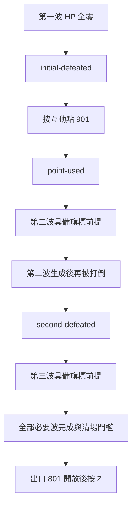

# 關卡 MEF：事件、波次、條件與分支分析閉合

本輪以 `09799b117f01e577be56dee3e909e1cde25b855f` 為唯讀來源，完成 **18 項關卡規則功能、9 種 signal、3 種基本 rule event／4 種 action** 的欄位、現行引擎契約、真實內容配置與改善方向對照。這是 Server 提供、自行編排的 MEF 開發；`NOT_NATIVE_MEF` 區分來源，不排除這些功能屬於 MEF。既有實作紀錄繼續使用，這次沒有重新執行 Server、Client、Lua 或遊玩驗收。方向依 [MEF-CURRENT-DIRECTION](../../MEF-CURRENT-DIRECTION.md)。

**結論：目前資料已能表達進場、順序與定時增援、清波與血量階段、按鍵機關、占點、延遲開門、條件岔路和同場旗標。此次完成的是這些功能的分析與可重跑內容稽核；沒有把「格式通過」寫成「已可玩」。** 空間專題另找出 `branch-example.scenario.json` 的 10 個阻擋中心，見 [空間稽核](../space-mechanisms/report.md)。

## 1. 本輪證據與完成層次

| 層次 | 本輪結果 | 能證明與不能證明的範圍 |
|---|---|---|
| 目前 JSON schema | 67/67 份通過 | 欄位、型別、各欄上限與 enum；不證明完整依賴或地形可達 |
| 有限圖與條件固定點 | 86 份定義出現、399 個節點出現；未發現所列結構／旗標依賴問題 | 查目標、環、entry 可達、唯一 ID/key、必要波次與旗標來源、分支保證交集；假設區域可到、敵人可打倒、有限時間可經過 |
| 實際地形 | 由空間專題獨立核對，已識別示範檔阻擋點 | 圖上的 `NextNode` 可達，並不代表玩家走得到出口；本規則稽核不能取代 BND／動態碰撞 |
| 現有 Server 執行器 | 引用已提交的契約與既有合成／離線驗證紀錄 | 有實作依據；本輪沒有重跑那些測試，也沒有取得新的部署或 Client 畫面證據 |
| 新索引與排程改善 | 7 項語意保持契約完成 | 可交付開發；尚未修改執行器，沒有 CPU 節省百分比 |

完整來源 SHA-256、Git blob 與位元組數在 [source-manifest.json](source-manifest.json)；機器結果在 [content-audit.json](content-audit.json)，逐項功能在 [rule-contracts.json](rule-contracts.json)。67 份檔案包含歷史版、候選與範例，**86 份定義不等於 86 個獨立可玩或已部署副本**。所有下列數量均為來源出現次數。

### 配置覆蓋

| 內容 | 數量 |
|---|---:|
| 初始怪物條目 | 868 |
| 額外波次／額外怪物條目 | 27／27 |
| 順序／定時波 | 18／9 |
| 需要旗標／需要當下位置的波 | 5／7 |
| 預設 `NextNode`／預設 `Result` | 311／88 |
| 替代出口 | 45，全部是 `NextNode` |
| 預設／替代出口有條件 | 12／2 |
| 手動互動點 | 4，其中 2 個要求整場清場、3 個有前置旗標 |
| signal／有 signal 的節點 | 16／12 |
| 有入場保證旗標的下游節點 | 5 |
| 反向旗標索引所在節點／旗標到消費者引用 | 17／26 |

本資料集實際最多只有每定義 9 節點、每節點 3 額外波、6 怪物、2 出口。因此可以說目前資料未超過限制，不能說 256 節點、31 波、255 怪物、8 出口的上限已被本輪實作或遊玩驗證。[目前 schema](../../../design/scenario-content/local-scenario-definition.schema.json)

## 2. 玩家可感受到的功能與真實執行位置

下表的「既有」指有目前契約或實作紀錄可查，並非本輪新增部署。這些規則在現有 Server 執行器內運作，屬於 **Server 執行的 MEF**；沒有因此把 CPU 說成已轉移到 Client。

| 玩家玩法 | MEF 欄位／規則 | 現行行為與完成界線 |
|---|---|---|
| 入場有敵人 | `Entry → SpawnGroup`、`encounters` | 399 個節點明示入場；怪物由既有實體／戰鬥層生成，波次 ID 不能當 actor ID |
| 清一批再來一批 | `reinforcements` | 18 波；依陣列順序、當前全部活怪清空後等延遲，不重建玩家、不補滿血魔 |
| 打到一半援軍加入 | `timedReinforcements` | 9 波；從遭遇建立各自計時，不等先前怪物倒下 |
| 開機關、進區域才出怪 | 波次 `requiredFlags`、`activationRegion` | 旗標、原計時、當下位置全部成立；到期後等旗標不再重算一遍倒數 |
| 先空場，稍後敵人登場 | 空 `encounters`＋非空後續波 | schema 與較新契約支援；公開 67 檔未配置，私有延後 Boss 離線紀錄已存在 |
| 清怪後選岔路 | `alternativeExits`、`NextNode`、`Result` | 有限無環圖，所有路線須合法；有 key 只選該點，沒有 key 才選最近點、等距小 key |
| 機關完成一次後保持 | `signals`、實例旗標 | 同場跨圖保留；放棄或新開副本重置，不是戰鬥中途永久存檔 |
| 演出後出口與互動仍正確 | 預登記點、完整點集合與狀態更新 | `0027` 一次重建完整集合，`0048` 更新既有點；已用互動不因重建而重新可用 |

依據：[順序波](../../../governance/s00-iterations/S00-20261110-SEQUENTIAL-ENCOUNTER-WAVES.md)、[定時波](../../../governance/s00-iterations/S00-20261111-TIMED-REINFORCEMENTS.md)、[旗標增援](../../../design/scenario-content/REINFORCEMENT-FLAGS.md)、[分支契約](../../../governance/s00-iterations/S00-20261111-SCENARIO-BRANCH-CONTRACT.md)、[目前主線接線](../../../design/scenario-content/STORY-SCENARIO-OVERRIDES.md)。

### 九種 signal 全數對照

| signal | 玩家理解 | 觸發與保留語意 | 公開配置 |
|---|---|---|---:|
| `GroupCleared` | 這張圖的必要戰鬥全部完成 | 所有必要波與既有清場門檻完成才鎖存 | 3 |
| `RegionEntered` | 曾走進指定區域 | 觀察到本節點有效位置在圓內即可，可早於清場；離開後旗標仍在 | 0 |
| `CheckpointInteracted` | 靠近機關按 Z | Server 檢查實例、節點、角色存活、可用狀態、位置及 ALL 前置；一次後停用 | 4 |
| `ClearDelayElapsed` | 清場演出結束後再等一下 | 清場後第一個有效位置建立原點；主線必須已提交 Portal 階段 | 3 |
| `WaveCleared` | 某一批怪已倒下 | 該波必須已生成、所有成員 HP=0；其他波仍活著也能觸發 | 2 |
| `WaveHealthReached` | 某批怪剩餘血量到門檻 | `sum(currentHP)/sum(maximumHP) <= healthPercent`；死亡成員最大 HP 仍在分母 | 1 |
| `NodeDelayElapsed` | 開始戰鬥後過了指定時間 | 主線從入場劇情提交、開放戰鬥起算；清場劇情不派送，但時間仍經過 | 2 |
| `RegionHeld` | 連續站在區域內一段時間 | 進區開始，觀察到出區即重設未完成計時；完成後離開不撤銷 | 1 |
| `BossDefeated` | 指定頭目倒下 | `requiredBoss` HP=0，必要時依所屬波識別；不可用頭目倒下來解鎖該頭目自己的生成 | 0 |

來源：[條件旗標](../../../governance/s00-iterations/S00-20261111-CONDITIONAL-EXIT-CONTRACT.md)、[互動](../../../governance/s00-iterations/S00-20261111-MANUAL-INTERACTION-CONTRACT.md)、[清波](../../../design/scenario-content/WAVE-CLEAR-SIGNALS.md)、[血量](../../../design/scenario-content/WAVE-HEALTH-SIGNALS.md)、[清場延遲](../../../design/scenario-content/CLEAR-DELAY-SIGNALS.md)、[節點延遲](../../../design/scenario-content/NODE-DELAY-SIGNALS.md)、[占點](../../../design/scenario-content/REGION-HOLD-SIGNALS.md)、[頭目旗標](../../../design/scenario-content/REINFORCEMENT-FLAGS.md)。

`RegionEntered`、`BossDefeated` 的 **0 是這批公開 JSON 沒有配置**。不能因此說功能不存在。頭目文件另記錄 Q119 合成旗標保留與私有延後 Boss 離線流程；本輪沒有重跑，也沒有把該紀錄當新的 Client 遊玩證明。56 個節點含 `requiredBoss`，目前都未在該欄指定具名波。[機器覆蓋](content-audit.json)

## 3. 容易造成關卡卡住或過早通關的語意，已逐項閉合

### 3.1 三種「清掉」要分開

1. **某波 HP 全零**：可以產生 `WaveCleared`，也可按既有規則產生擊倒掉落。其他波仍可活著。
2. **所有必要波都已生成且打倒**：尚未出場的波仍屬於必要工作，不能因畫面暫時空場而結算。
3. **整場清場提交**：還要保留投射物、既有勝利等待、倒地怪物移除訊息已列入更新的門檻，才進清場劇情或出口階段。

因此「怪物倒下後立刻出下一波」與「清場後開門」可以有不同時點。`UnlockPortal` 也只進入逐出口條件判定；`PortalUnlocked` 只代表至少一個點已開，實際換圖授權必須看該 key 是否在 `OpenExitKeys`。出口不因別的門已開而一起取得權限。[清波契約](../../../design/scenario-content/WAVE-CLEAR-SIGNALS.md)、[目前移除／清場接線](../../../design/scenario-content/STORY-SCENARIO-OVERRIDES.md)、[條件出口](../../../governance/s00-iterations/S00-20261111-CONDITIONAL-EXIT-CONTRACT.md)

### 3.2 同一次更新的已知先後關係

- 戰鬥傷害先結算，再觀察 `WaveCleared`／`WaveHealthReached`，然後檢查後續增援。
- 增援階段先處理符合條件的定時波；同次到期按該陣列順序；再檢查順序波。定時波剛生成活怪，順序波就必須繼續等聚合活怪清空。
- 順序波 `delay=0` 可在當次 Poll 末尾出現；本次已結算命中不倒回去打中新怪。
- 定時波 A 等區域，不應卡住已符合條件的定時波 B。每波的狀態與陣列游標不能混用。

這是已記錄的局部順序，不是虛構一份涵蓋所有 Server callback 的完整 scheduler。新 MEF adapter 應保留現有派送 phase，不能因改成事件索引就把網路 callback 直接變成任意立即生怪點。[清波](../../../design/scenario-content/WAVE-CLEAR-SIGNALS.md)、[血量](../../../design/scenario-content/WAVE-HEALTH-SIGNALS.md)、[定時增援](../../../governance/s00-iterations/S00-20261111-TIMED-REINFORCEMENTS.md)

### 3.3 六種計時原點不能合併成一個 wait

| 計時 | 原點 | 中途條件與派送 |
|---|---|---|
| 定時波 | 遭遇建立 | 到期後仍需旗標、當下區域；下一次有效 Poll 消費 |
| 順序波 | 當前聚合活怪清空 | 若定時波加入活怪，重新等待聚合清空；不能沿舊到期時間越過活怪 |
| 空初始群的首個順序波 | 首次戰鬥更新 | 初始空群不產生初始 `WaveCleared`／血量旗標 |
| `NodeDelayElapsed` | 入場演出提交並開放戰鬥；無演出則進場，lab 則建立節點 | 清場演出抑制派送但不扣除經過時間；首次合格戰鬥更新設立 |
| `ClearDelayElapsed` | 清場後首次有效 Server 玩家位置；主線在清場演出及 Portal 提交後 | 存檔等待與清場演出不能預支倒數；首次正常更新鎖存 |
| `RegionHeld` | 第一次觀察在區內 | 任何觀察到的出區、死亡、主線清場提交重設未完成計時；演出時間不計 |

所以以 Client `Q.wait` 一律代換這些業務倒數，不足以宣稱語意相同。新 adapter 必須保留原時鐘、計時起點、暫停／演出規則、毫秒門檻轉換及首次可派送更新。公開文件沒有完整列出任意小數秒轉換的實作細節，本輪不自行決定 `floor` 或 `ceil`。[延遲與占點文件](rule-contracts.json)、[優化契約 OPT-03](optimization-contracts.json)

### 3.4 實際關卡依賴，不只列 API 名稱

`functional-lab.scenario.json` 的 `content-lab-wave-clear` 已配置這條依賴：



第二、第三波各有 1 秒順序延遲，但**不是按機關後一定再等 1 秒**：順序波倒數起於聚合活怪清空，若等待玩家按機關時延遲早已到，就在後續合格更新出怪。此例同時證明為何第二波不能要求 `GroupCleared`：第二波尚未出場本身就會阻止整場清場，形成互鎖。[實際配置](../../../design/scenario-content/functional-lab.scenario.json)、[波次旗標](../../../design/scenario-content/REINFORCEMENT-FLAGS.md)

另外，`content-lab-wave-health` 用初始波 75% 血量旗標解鎖 `delay=0` 的定時波，能在原怪仍活著時增援；如果改成順序波，仍會等場上活怪清空。Q119 的 `story-q119-node-delay` 則用 5 秒節點旗標控制定時波，`story-q119-region-hold` 用 2.5 秒占點旗標同時解除屏障與滿足出口前提。這些都是具體 MEF 規則編排，不需等待官方 MEF 復原。[血量文件](../../../design/scenario-content/WAVE-HEALTH-SIGNALS.md)、[節點延遲](../../../design/scenario-content/NODE-DELAY-SIGNALS.md)、[占點](../../../design/scenario-content/REGION-HOLD-SIGNALS.md)

### 3.5 分支合流與重新開場

分支下游可用的既有旗標取**所有入口路線都保證取得的交集**。上游保證包含該節點 `GroupCleared` 旗標及所選出口明確要求的旗標；若出口要求一個手動互動旗標，也遞迴納入該互動必要的前置旗標。不能把「另一條路曾能拿到」或「將來節點有 producer」視為現在可用。

本輪固定點稽核因此分清「清場前可取得」與「清場後可取得」。波次只能依賴前者或上游保證；`GroupCleared`／`ClearDelayElapsed` 以及依賴它們的互動不能用來解鎖同圖尚未生成的必要波。產生過的波、用過的互動、已開的出口各自保留一次性狀態。

旗標、分支游標、計時原點與狀態在同一副本實例內；Fork 先複製可變狀態，提交成功才發布，未提交不影響原實例。換節點保留已取得旗標；新開副本重置。永久收益與任務保存仍走已有交易 adapter，不能把記憶體中的波次／flag 當成已完成戰鬥中途存檔。[分支](../../../governance/s00-iterations/S00-20261111-SCENARIO-BRANCH-CONTRACT.md)、[條件旗標](../../../governance/s00-iterations/S00-20261111-CONDITIONAL-EXIT-CONTRACT.md)、[互動閉包](../../../governance/s00-iterations/S00-20261111-MANUAL-INTERACTION-CONTRACT.md)

## 4. 靜態稽核確實檢查了什麼

`analyze_content.py` 對 baseline 的真實 JSON 做以下工作：

1. 用目前 Draft 2020-12 schema 驗證 67 檔；確認當前工作樹來源 bytes 與 baseline 相同。
2. 每檔 definition ID、每定義 node／encounterGroup、每節點三種 rule event、合併波次 ID、出口／marker category0 key、手動 category1 key 的唯一性與跨集合上限。
3. 全部預設與替代出口目標、entry 存在、全圖 entry 可達、拓樸無環；清波／血量 signal 的 wave 引用存在。
4. 64 旗標總上限、旗標 producer 唯一性、消費者有來源、分支入場保證交集、互動前置閉包。
5. 從已生成波與可取得旗標逐步推導清場前可能生成的波；保留每輪新增 flag／wave，檢出自身依賴、不可達波或整場清場依賴的結構互鎖。
6. 清場後才加入 `GroupCleared`、`ClearDelayElapsed` 與可用互動，逐個核對出口、波、互動、屏障、傷害區所需旗標；輸出可供新版 compiler 使用的反向消費者索引。

結果是 **0 schema error、0 本稽核列出的結構／條件依賴 issue**。它是一個「條件存在可完成安排」的靜態推導，不是逐 tick 模擬，也不是私有 Server typed loader 的替代品。它假設敵人可擊敗、計時能進展及區域／互動可到達，沒有查 AI profile 實際傷害、網路派送、實機輸入、BND 或永久交易；這些分層由同輪其他專題處理。[分析程式](analyze_content.py)、[完整結果](content-audit.json)

### 已識別的內容／證據缺口

| 項目 | 缺的是什麼 | 下一步 |
|---|---|---|
| `branch-example` 示範地形 | 空間稽核指出 10 個阻擋中心，有限圖通過不能保證行走 | 正式採用前依真實 BND 重新選點，再以同一版本圖／規則核對；本輪保留原內容 |
| `RegionEntered`、`BossDefeated` 公開配置 | 目前 67 檔沒有各自 signal 的版本化範例 | 補可供編排器／內容接線引用的小型正常流程；沿用既有實作，不重做官方格式搜尋 |
| 初始空場與具名 Boss 波 | schema／實作文件有支援，公開 JSON 未涵蓋 | 把現有私有延後 Boss 驗證中的選定配置整理成可追溯候選，保留與原正式配置的差異 |
| 精確小數計時轉換 | 公開契約有原點與毫秒案例，沒有全部秒數轉換細節 | 接新版 adapter 時固定既有時鐘與轉換實作，不能先自行四捨五入或換 `Q.wait` |
| 人眼可見的互動／轉場 | 文件有合成／離線紀錄，沒有本輪 Client 遊玩 | 沿用既有待驗批次；不因分析通過自填遊玩完成 |
| 更複雜關卡語法 | 現行 schema 無任意腳本、循環／隨機權重路線、可重複計數器、背包／任務道具 predicate、跨實例隊伍同步、中途持久 checkpoint | 若玩法需要，新增 typed MEF 條件／動作與既有 Server adapter；它們仍屬 Server／MEF 開發需求 |

沒有把舊文件中「定時增援／分支／手動 producer 尚未實作」搬成目前缺口。較新契約已補上這些功能；舊分支文件曾限制 `ClearScenes` 搭配預登記點，現行 [STORY-SCENARIO-OVERRIDES](../../../design/scenario-content/STORY-SCENARIO-OVERRIDES.md) 已記錄清場後完整集合重建，應以較新實作接線解讀。

## 5. 優化建議：保留玩法，減少無關規則重算

完整機器契約在 [optimization-contracts.json](optimization-contracts.json)。以下是可直接交給 Server／MEF 執行器開發的分析成果，沒有宣稱已部署。

| 建議 | 改善方法 | 必須保留的玩家行為 |
|---|---|---|
| 事件與反向旗標索引 | 載入時建立 `flag → 波／出口／互動／屏障／傷害區`，旗標變化只喚醒相依消費者 | 同一 update 的原順序、ALL 條件、一次性鎖存與分支交集；本輪已從實際內容建立 26 筆引用 |
| 波次活怪／血量彙總 | 用接受的 HP 與生成變更更新該波計數，避免反覆讀取全部成員 | 死亡成員仍在血量分母；待生成波、投射物與移除提交仍阻止整場清場；新怪不吃舊命中 |
| 分時鐘 deadline queue | 尚未到期只掛計時器；已到期但缺旗標／區域轉成依賴等待 | 六種不同原點、clear cinematic 規則、首次有效 update、原毫秒精度、定時先於順序 |
| 只觀察活躍區域 | 一次性 region signal 完成後退訂；尚未開出口、待出波與占點保留所需觀察 | `activationRegion` 讀當前位置；占點不能漏掉兩 tick 間出區；粗篩後仍精確判邊界 |
| 合併點位狀態發布 | 沿用已實作的完整 `0027` 和逐 key `0048` 策略 | 不覆蓋遺失其他出口、不讓已用機關重生、不因畫面效果提早授權換圖 |
| 不可變編譯計畫＋實例小狀態 | catalog／來源 hash／圖 hash 可共用，只複製 flags、游標、timer、open／used sets | 實例之間不共享可變狀態，Fork 未提交不污染原場，新副本不沿用舊倒數 |
| 等待原因快照 | 將剩餘時間、缺 flag、位置、活怪、投射物、屍體移除分開顯示，狀態變化才組裝診斷 | 玩家不會只看到「門沒開」；能指出還缺哪件事，且不把 Server 已生成當成 Client 已看見 |

血量彙總應使用足夠寬的數值：若直接用允許的 255 隻、各 1,000,000 最大 HP，再乘 100 比百分比，乘積已超過 32-bit 有號整數。這是新實作需避免的設計風險，**不是本輪在既有 Server 找到的溢位缺陷**。[schema 容量](../../../design/scenario-content/local-scenario-definition.schema.json)、[OPT-02](optimization-contracts.json)

效能驗證應先用相同內容 hash 比較「每次變更涉及多少規則、HP observer 次數、deadline pop、位置精確判定次數、實際發布點位包數」，同時比對生成順序、最終 flags、開啟出口及路線完全一致。未取得此量測前，不列節省百分比。把規則從硬編碼改成資料能改善維護；只有實際轉由 Client 執行的能力，才能另計 CPU 外移。有限 Q／native 下放的具體條件由主報告統一處理。

## 6. 可重跑收據與交付

從 repository root 執行：

```bash
python kr-extra-roy/MEF-level-functional-closure-20261118/rules-waves/verify_evidence.py --repo .
```

驗證器核對所有來源 bytes／SHA／Git blob、來源集合，重新產生 schema／圖／依賴分析，比對已保存機器資料，再核對 18 功能、9 signals、上限與收據 hash。文檔依固定 baseline 的 Git 物件取證，讓後續導覽頁／目前方向入口可以更新而不改寫歷史證據；實際分析的 67 份配置 JSON、schema 與任何非文檔來源仍必須和工作樹 bytes 相符，執行的本輪 Python helper 也保留產物 hash 檢查。它只執行本輪離線 Python 分析，**不啟動目標程式、Server、Lua，不更新正式驗收狀態**。執行結果與產物摘要在 [verification-receipt.json](verification-receipt.json)；主報告可讀 [analysis-status.json](analysis-status.json) 取得分層完成狀態。

此子題沒有更改現有 schema、關卡內容、正式 Task 狀態或 Git；整包由主流程檢查與發布到使用者指定的 `extra/roy1`。
