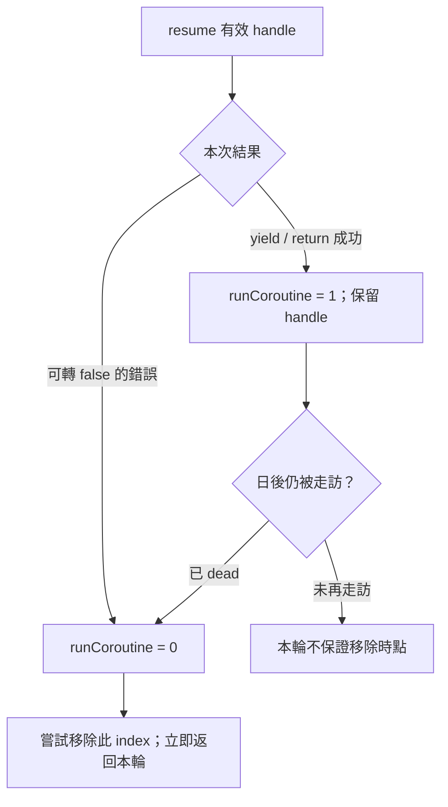

# Coroutine／MoCo 原件恢復與 `.mef` 執行契約補完

研究日期：2026-11-15，Asia/Taipei。Git 基準 `main=ba5f96dfa94d734cbded291fb8887f50426bfa77`；工作基準 `extra/roy1=a16841ac67638da4b29605f186f355722e8cf106`。本支線只寫 scratch 分析；原件、Client 資源與 Git 工作樹未由本支線修改。以下都是固定 KR 原件的靜態結果，沒有執行 Client、Lua 或歷史證據腳本，也不自行提升為 T01 FULL-PASS。

## 1. 本輪已解除的缺口，以及對開發的影響

**`Coroutine.lua` 的原始 body 已找回並完整重解；MoCo 的等待、resume、清除、取消與 callback 行為，現在有可重驗的 13 個 prototype／187 個指令字。** 新確認的核心不是另一個 `.mef` 檔名，而是內容被既有 `.seq`／Tutorial 入口註冊後，實際怎麼執行、何時算不再排程，以及誰必須負責收尾。

| 問題 | 本輪原件結論 | 對內容／Server 整合的意義 |
| --- | --- | --- |
| `wait(n)` 的單位？ | `lb.GetTime → WINMM.dll!timeGetTime`，單位為毫秒；先 yield，恢復後才比較時間差。 | `wait(0)` 仍至少讓出一次；它不是當場返回，也不是固定一個畫面 frame 的保證。 |
| coroutine 正常 `return` 會立即移除嗎？ | 不會。`resume=true` 被轉成數字 `1`，不檢查 `dead`，handle 留在 list。 | 下一次排程器仍被呼叫且走訪同一 handle，dead-resume 失敗時才移除；若 Q 已停止 tick，不能保證有這個「下一次」。 |
| 一次 tick 會清掉所有失敗工作嗎？ | 第一個 `runCoroutine==0` 走 `TAILCALL table.remove`，立即結束 `executeCoroutines`。 | 同一輪其後的工作延後，不是全部繼續跑完。 |
| `qco:doCoTask(Q.EndCutScene)` 會在空集合回呼嗎？ | **不會經這條路徑回呼。** `doCoTask` 只收一個固定參數 self，額外 callback 被裁掉；它呼 `executeCoroutines` 時也只傳 self。 | 不能把「已傳入 End callback」視為「排程器會替內容 End」。 |
| `doCoTask()` 回什麼？ | 回當時 `table.getn(coroutineList)` 的數字。Q wrapper 丟棄，Tutorial wrapper 才傳回 native。 | 數字 0 表示當時集合長度為 0，不等於正常收尾、UI 復原、Server ACK 或業務完成。 |
| `removeCoroutine`／`removeAllCoroutines` 會中斷函數、跑 cleanup 嗎？ | 只移除第一個相符 handle／替換 list，沒有 close、unwind、End 或 cleanup 呼叫。 | 被移除的 suspended thread 仍可被其他 handle 引用；當前正在執行的工作也不會在刪表時自動停下。 |
| 原有正常 SEQ 如何結束？ | 已選定的 `Phindous_YuriandRazed_Boss.seq` 顯式走 `RevPhase1()`；qbase 內它最後依序 yield、`Q.EnableInput()`、`Q.EndCutScene()`。 | 正常內容自身提供 End；出錯或取消未走到尾端時，沒有 MoCo 的自動補償保證。 |

這些結果使前輪「若另准新內容，以既有 `.seq` 入口明確載入名稱為 `.mef` 的相容 Lua 內容」之生命週期契約可以具體化。**這仍是新內容設計方向，不是原版 MapList `.mef` caller 的新證明，也不是授權修改 Client 資源。** 既有原版流程所需的 selector、資料與回覆仍應列為 Server 開發需求；部署新資源與實際遊玩驗證另行區分。相關 loader／phase guard 的既有分析見[前輪 §8](../../MEF-complete-flow-20261115/script-lifecycle/report.md)。

## 2. 原件如何找回：前輪的來源限制需要窄幅更正

前輪 [script-lifecycle 報告 §1、§7](../../MEF-complete-flow-20261115/script-lifecycle/report.md) 保留 S00「已分析 13 prototypes」的歷史事實，但當時讀集未找到可重驗 body 與 SHA。本輪沿 T16-41／T16-45 的精確引用，找到較早的 `shared/integrations/T01-20261028-06/resource-source-audit.json`，而不是繼續對 Event 的 1,843 個 member 重掃。

該 audit 的 KR／TC `Coroutine.lua` 列均記錄原件 SHA、來源及 `direct_source_bytes_match=true`；其 `lua_static_validation` 同時記錄 13 prototypes、187 instruction words、完整消耗與 saved code 比對成功。KR 原來源名是 `E:\Tartaros\origin\Coroutine.lua`，舊 saved decode 名為 `kr-temp-roy/T16-local-20261028/evidence/lua-static/kr-Coroutine.lua.json`。那些歷史路徑用來辨認來源，不是假定目前工作區仍有那個磁碟或 JSON。

| 可重驗來源 | 固定值 |
| --- | --- |
| 現存 Git carrier | `kr/evidence/c3feac03a40d24a54adf7615781cab175aa4876a2bdad8763987e413d0c2a808.txt` |
| 取得版本 | `ba5f96dfa94d734cbded291fb8887f50426bfa77` |
| Git blob SHA | `4d7434d97774c966a061e306d85718896db9833d` |
| 原件 bytes／SHA256 | `2168`／`c3feac03a40d24a54adf7615781cab175aa4876a2bdad8763987e413d0c2a808` |
| chunk header | `1b4c75615100010404040800`，本 build 所用 Lua 5.1 little-endian／int4／size_t4／number8 |
| audit blob／SHA256 | `2c2061abef132ca2e9df784bff92f79b0de75f53`／`71ced39827caa647a1d0dbd57cc88331289822562e6dfb281c7ef92051971ef7` |
| carrier path 的 commit history | `d370a01645218615ad42595071c5328077e643a7`，2026-10-26T18:54:54Z 已納入 |

GitHub 介面以 base64 取得非 UTF-8 carrier；本輪**先比對 SHA256、長度與 Git blob SHA，再將 bytes 當資料解析**。這不是依解碼結果猜原件身份。解析器確認完整消耗 2168 bytes，13 個 prototype 都沒有 captured upvalue，總計 187 個 instruction words，與舊 audit 數量相符。[來源鏈與精確 audit 列](provenance.json)；[全部來源 pin](source-manifest.json)

因此應更正的是「前輪查閱範圍未找到可取回的原件」，不能繼續說整個已發布倉庫沒有 SHA／body。也不能反過來說 S00 以前從未分析 Coroutine。歷史 S00 commit `ef3ca03fe31fb25357b158d6097f6d8291d4fbfa` 增補的是已分析來源的紀錄；本輪是解除**本分析包可重驗原件與新語義**的缺口。早期 `anal/...`／根目錄 `Coroutine.lua` 路徑查詢及 incomplete code search 的陰性，只用於導航，不作不存在證明。

恢復的完整原 bytes、下載內容和完整原 SEQ 留在 scratch；本包不重上傳原件。Git 保存以下解碼分析、必要原文片段、來源 pin 與 verifier。TC audit 的 byte-identical 紀錄也不等於 TC native binding／timer／場景生命週期已一併核對。

## 3. 完整 body 覆蓋與函數綁定

完整機械輸出見 [coroutine-evidence.json](coroutine-evidence.json) 與便於閱讀的 [coroutine-disassembly.txt](coroutine-disassembly.txt)。本報告的 `P#／PC#` 使用 prototype index 與 **0-based PC**；`code` 是解碼 chunk 內 offset，不是 BIN VA。root 的 `CLOSURE → SETGLOBAL／SETTABLE` 實際建立下列名稱，並非按附近字串猜函數。

| Proto | root 綁定後名稱 | code offset | 指令字 | 固定參數 | 內容 |
| --- | --- | ---: | ---: | ---: | --- |
| P0 | root chunk | `0x20` | 40 | 0 | 建立 `wait`、`yield`、`MoCo` table、`__index` 和 10 個 methods。 |
| P1 | `wait` | `0x1CC` | 13 | 1 | 記時間、先 yield、重讀時間、比較差值。 |
| P2 | `yield` | `0x257` | 4 | 0 | 直接 `coroutine.yield()`。 |
| P3 | `MoCo.new` | `0x2A9` | 11 | 0 | 建 table／metatable，空 list、`numMaxCoroutine=25`、`initialized=0`。 |
| P4 | `MoCo.initCoroutines` | `0x364` | 2 | 1 | 只把 `initialized` 設為 1。 |
| P5 | `MoCo.createCoroutine` | `0x3AE` | 6 | 2 | tail-call `coroutine.create(function)`。 |
| P6 | `MoCo.registerCoroutine` | `0x409` | 7 | 2 | `table.insert(list,handle)`，返回 handle。 |
| P7 | `MoCo.runCoroutine` | `0x477` | 17 | 2 | resume；false 時 print error／回數字 0，否則回數字 1。 |
| P8 | `MoCo.executeCoroutines` | `0x51D` | 40 | 2 | 空集合 optional callback；固定上界遍歷；首次失敗 tail-remove。 |
| P9 | `MoCo.doCoTask` | `0x657` | 14 | **1** | 不傳 callback 執行 P8；記錄移除值；返回 list 長度。 |
| P10 | `MoCo.removeCoroutine` | `0x70F` | 20 | 2 | 找到第一個相同 handle 後 tail-remove。 |
| P11 | `MoCo.removeAllCoroutines` | `0x7C4` | 3 | 1 | `self.coroutineList={}`。 |
| P12 | `MoCo.isCoroutineAlive` | `0x80B` | 10 | 2 | `coroutine.status(handle) ~= "dead"`。 |

除 root 為原 chunk 的 vararg 形式，這些函數的 `vararg=0`。完整 body 中沒有依 `numMaxCoroutine` 阻擋註冊的分支，也沒有讀 `initialized` 決定能否跑任務的分支；不能把欄位 `25` 寫成已實作的 25 工作上限，也不能把 `initCoroutines()` 當必要初始化 gate。

此檔的實際外部查找集中於 `lb.GetTime`、`coroutine.create/resume/yield/status`、`table.insert/remove/getn`、`setmetatable`、`print` 及自身 methods。新 body 裡沒有直接的 `DoFile`／`lb.DoFile` 呼叫，但它會 resume 傳入的 Lua function，methods 與 globals 又可以被重綁，故這不是整個 Client 不可能動態載檔的定理。前輪 qbase／Tutorial 三個原 chunk 的 255 個 CALL 來源索引直接[復用](../../MEF-complete-flow-20261115/script-lifecycle/lua-call-source-index.json)，不重新把小寫 loader 常數陰性包裝成新成果。

## 4. 等待契約：毫秒、先讓出、由後續 tick 輪詢

### 4.1 `wait` 的真正順序

P1 的關鍵 operands 是：

```text
PC 0..2   R1 = lb.GetTime()          CALL B=1 C=2
PC 3..5   coroutine.yield()          CALL B=1 C=1
PC 6..8   R2 = lb.GetTime()          CALL B=1 C=2
PC 9      R2 = R2 - R1              SUB A=2 B=2 C=1
PC 10     compare waitArg <= R2      LE A=0 B=0 C=2
PC 11     jump back to PC 3 unless comparison completes the wait
PC 12     return
```

這是 `repeat yield(); elapsed=GetTime()-start until duration<=elapsed` 的順序，不是先測 deadline 再決定要不要 yield。`wait(0)` 或負值參數仍會先讓出；恢復時再檢查條件。qbase 的 P4 又把全域 `yield()` 定義成 `wait(0)`，所以正式 qbase 環境的常用 `yield` 仍會走這個至少一次讓出的順序。[Coroutine P1/P2；bridge qbase P4]

MoCo 沒有按 deadline 把工作移到獨立 timer queue。`doCoTask` 仍會在遍歷到 handle 時 resume 它，`wait` 自己重讀時間後決定再次 yield 或返回。`coroutine.yield(數字)` 也不會被 MoCo 解釋成睡眠時間：P7 只檢查 public resume 的第一個 boolean，其他 yield／return payload 不作排程指令。

### 4.2 `lb.GetTime` 的原生來源已閉合

lb 與正式 Q 使用同一主 wrapper 的事實，復用 [parser §環境](../../MEF-parser-executor-storage-20261114/parser.md) 的 `4A09AB → 4A14D0`、`FE1774` 與 `C06220="lb"`。本輪沿具體 GetTime method 補上：

| 原件位置 | 可核事實 |
| --- | --- |
| `4A1AC8` | 將 `FE179C` 寫成 `4A0B70`。 |
| `4A1B08`／`4A1B19` | 以 `D6AE0C="GetTime"` 與 C callback `4A2190` 註冊 table field。 |
| `4A21CD` | callback 間接呼叫 `[FE179C]`。 |
| `4A0B70` | `jmp dword ptr [BD25A0]`，沒有遊戲 dt 換算。 |
| PE import descriptor `D5D9DC` | `OriginalFirstThunk=D5E01C`、`FirstThunk=BD25A0`、DLL name `D5F01A="WINMM.dll"`。 |
| thunk 的 hint/name `D5F00C` | hint 148，name `timeGetTime`。 |
| `4A21D3..E5` | EAX 先存成 dword，以 **signed `FILD dword`** 轉 double，寫 `TValue tag=3`，推進一槽。 |

Windows 官方文件明確將 `timeGetTime` 定義為 Windows 啟動後經過的毫秒，回傳 DWORD，原值約每 `2^32` ms 循環；單位與 API 性質引自 [Microsoft Learn](https://learn.microsoft.com/en-us/windows/win32/api/timeapi/nf-timeapi-timegettime)，**實際使用哪個 import 及 signed marshalling 則由本 BIN 證明**。[N01–N03；D06–D09；`time_import`]

由這兩份證據可以推導一個有界限制：marshaller 先把原 DWORD 解作 signed32，Lua 再以 double 做減法；跨 `0x7FFFFFFF → 0x80000000` 時，當次差值會負跳，P1 沒有 unsigned modular 修正。這是原 bytes 的靜態算術推論，不是宣稱本輪觀察到玩家等待卡住。不要把這裡改寫成遊戲啟動後的獨立單調秒數，或精確 timer 喚醒保證。

## 5. resume、dead 與錯誤：三種不同的結果

### 5.1 native API 回 boolean；MoCo 再轉成數字

coroutine registration table `C0BC68..C0BC9F` 與原字串直接對應 `create→707380`、`resume→707230`、`status→707070`、`yield→707480`、`running→7074C0`。其註冊入口 `707790`／通用 `6F6590` 的機制沿用舊[原件分析](../../MEF-trigger-callers-20261115/alternate-entry/report.md)；本包保存本次使用的表與 body。[D01；`function_bindings`]

`707230` 的第一個回傳槽是 **tag 1 的 Lua boolean**。它呼 `707110` 後，負數結果產生 `false,error`，非負結果產生 `true,results...`。`707110` 接受 `6FE6D0` 的 status **0 或 1**，因此成功 return 與成功 yield 都對外回 true。P7 的 `CALL A=4 B=2 C=3` 只保留前兩個回值，再把第一個 boolean 與 literal `false` 比較；false 分支 print 第二個值並回 **數字 0**，另一分支回 **數字 1**。[N05/N06；P7 PC0–15]

| 層 | 成功／非錯誤值 | 失敗值 | 這個值不代表什麼 |
| --- | --- | --- | --- |
| 全域 `DoFile`，既有原件 | number `0` | number `1` | 不代表 module entry／場景完成；module return 值不公開為 DoFile 回值。 |
| public `coroutine.resume` | boolean `true`，包含 yield 和 return | boolean `false` 加 error（可被這層包住的錯誤） | 不區分工作正常結束或只是暫停。 |
| `MoCo.runCoroutine` | number `1` | number `0` | 不傳遞 entry 的業務 return payload。 |
| `MoCo.doCoTask` | 當時 list 邊界長度 | 沒有獨立業務失敗碼 | `0` 不是 UI cleanup／Server completion ACK。 |

DoFile 的數字 0／1 都是 Lua truthy，不能照 `coroutine.resume` 的 boolean 判讀；反之，工作 `return false` 也不會讓 public resume 的成功 boolean 變 false。既有 numeric DoFile 與外層結果槽契約直接[復用前輪 §3](../../MEF-complete-flow-20261115/script-lifecycle/report.md)。

### 5.2 正常完成為什麼還留在 list

P8 只有 `runCoroutine(...) == 0` 才移除，沒有呼 `coroutine.status` 的成功後分支。因此穩定 list 中：工作 return → native resume true → P7 number 1 → 本次 P8 保留 handle。之後若同一 scheduler 又被呼叫且走訪這個 handle，native status 分類把已無活動 frame／無待執行 stack value 的 thread 當 dead；`707110` 回「cannot resume dead coroutine」的 false/error 路徑，才使 P8 移除它。[P8 PC21–34；N06/N07/N23；D01 狀態字串表]



「下次」不可簡寫成必然的下一畫面 frame。正常 Q 內容可先 `Q.EndCutScene` 關掉 active／tick gate；這種情況下，dead handle 可能等到後續 removeAll／VM 關閉才失去這一份排程引用。具體 gate／owner 關閉另由本輪主報告整合，這裡只陳述 MoCo 的條件。

### 5.3 錯誤被轉 false 與外層錯誤不可混為一談

對有效 thread，在 coroutine body 內產生的受保護 Lua error，或再 resume dead／running／normal thread 的不允許狀態，可進入上述 false/error → number 0 → tail-remove 鏈。`707070` 的狀態文字表明確區分 running、suspended、normal、dead；不是用 list membership 判斷。[N05–N07]

但 `coroutine.resume` 參數本身不是 thread 時，public callback 走 `6F5DA0` argument error，而不是回 false tuple；auxresume 的 stack-capacity error 也透過 `6F5F30 → 6F8AD0 → 6FDB40` raise。P7 在 `resume` 之外沒有自己的 protected-call；其後的 `print` 亦不在一個 MoCo cleanup finally 內。所以不能把所有輸入錯誤／記錄錯誤都寫成「一定刪除此工作」。[N20/N24–N27；P7 完整 body]

正常 qbase `Register` 先經 `coroutine.create`，native `707380` 要求 tag 6 且不是 C closure 的 **Lua function**，成功才返回 tag 8 thread；這條正常入口避免把任意值直接排進 list。但 P6 的 `registerCoroutine` 自身沒有 thread 型別／重複／狀態檢查；新內容若直接使用這個低層入口，不能假設已有相同保障。[N04；P5/P6；qbase P75]

## 6. 空集合 callback 的關鍵反證

### 6.1 兩個原 caller 都傳了 callback，但實際 callee 不接

qbase 的 `f_doCoTask`（P2，code `0x96A`）做：

```text
PC 0..1   qco 的 doCoTask，SELF 保留 self
PC 2..3   讀 Q.EndCutScene
PC 4      CALL A=0 B=3 C=1    ; self + callback，丟棄所有結果
```

TutorialBase 的 `t_doCoTask`（P2，code `0x406`）也讀 `Q.EndCutScene`，但 PC4 是 `TAILCALL A=0 B=3 C=0`，因此把 callee 結果傳回去。[完整 bridge operands](bridge-evidence.json)

恢復的 Coroutine **P9 `doCoTask` 是 params=1、vararg=0**，只接 self。其 PC0 `SELF` 後，PC1 為 `CALL A=1 B=2 C=2`，只把 self 傳給 P8，沒有 callback register／轉送。這裡有兩個獨立證據：caller 額外傳的值不屬於 callee 固定參數，以及 callee 呼下一層時沒有傳出它。

native 也有直接對應：binary Proto loader 在 `70D54B` 寫 `Proto+49=params`，`70D574` 寫 `+4A=vararg`，`70D59B` 寫 `+4B=maxstack`；`6FE22D` 測 `+4A==0` 時，`6FE233..244` 依 `+49` 將多餘 arguments 從 top 裁掉。`6FE2A8..2B9` 又把未給到的後續 registers 補 nil。因此 P8 在此路徑收到的 callback 是 nil，不是留在 stack 裡可偶然被呼叫的 `Q.EndCutScene`。[N10/N16]

### 6.2 真正有 callback 的位置與條件

P8 `executeCoroutines(self, callback)` 的確寫有 optional callback：入口先取 `n=table.getn(list)`；只有 **n 在本次入口就是 0** 時，PC6 比 callback 是否 nil，PC8–9 才以零參數呼叫它。接著返回 nil。當 n 非零時，即使某次移除使集合變空，也不會回頭進入這條 callback 分支。[P8 PC0–15、PC30–38]

因此精確結論是：**直接另行呼 `executeCoroutines(nonNilCallback)`，而入口 list 已空，才有這份 body 的 callback 路徑；既有 f/t `doCoTask` wrapper 沒有把 callback 送到該位置。** 這不是 API 名字誤植的猜測，也不需要執行 Client 才能判定。

若空 callback 自己註冊新工作，P8 仍按當下已選的空分支返回 nil，不在同一次呼叫重進遍歷；若直接帶 callback 反覆在空集合呼叫，也沒有只觸發一次的旗標。這是新內容自行選用低層 method 時才相關的條件推論，不是說原 f/t caller 已如此使用。

### 6.3 空集合的數字 0 被誰消費

P9 最後 `TAILCALL table.getn(self.coroutineList)`。沿用前輪原件：

| 路徑 | 實際 consumer | 可保證範圍 |
| --- | --- | --- |
| Q | qbase P2 `CALL C=1` 丟棄 P9 數字；`5615D8 → 6F4DD0("f_doCoTask")` 後繼續 actor update。 | 空集合沒有由這條回值鏈觸發 Q.EndCutScene。 |
| Tutorial | TutorialBase P2 tail-return 數字；`4A8BA6 → 4AD0A0("t_doCoTask",1)` 要一槽，`4A8BAF` 後轉換 stack top 並寫 `T+34`。 | 正常成功 call 下，list 0 會使該布林欄位為 0；不代表已執行 End callback。 |
| Tutorial named call 出錯 | caller 不先檢查 `4AD0A0` status 就讀 top。 | 不能把所有失敗情境的 top 猜成數字 0，亦不能稱為成功完成。 |

來源：[前輪 E05/E06/E09](../../MEF-complete-flow-20261115/script-lifecycle/native-windows.json) 與[說明 §4](../../MEF-complete-flow-20261115/script-lifecycle/report.md)。這些 native caller 是既有成果，本輪的新結果是它們現在能接到原件 P8/P9，而不再留下「或許 MoCo 會自動 End」的空白。

## 7. 迭代、註冊、取消與再入的完整條件

### 7.1 固定上界、動態讀表與首次移除早退

P8 PC3 只在入口讀一次 n，PC12–15 以 `for i=1,n,1` 準備；PC16／PC22／PC32 卻每次重新讀 `self.coroutineList`。PC34 是 `TAILCALL table.remove(list,i)`，不是無回值地呼 remove 後繼續 for。

本輪也核對這個 build 的 table library，避免只套一般 Lua 印象：`C0B980` 的 getn→`70BBE0`、`C0B990` 的 insert→`70BD80`、`C0B998` 的 remove→`70BEF0`。insert 的兩參數路徑取長度加一後寫入；remove 保留原 index 的值，把後項向前搬，最後寫 nil，成功返回一個被移除值。getn 對 table 使用 `6F9F10`／`6F9DE0` 邊界搜尋，不是逐個數非 nil 元素。[N11–N19；D02–D05]

以下表格是上述 operands 推導的行為，不是執行測試。以未任意挖洞的 dense list 為前提；直接寫任意 key／nil 造成 holes 時，不把 getn 邊界當元素總數。

| 本輪工作執行中發生的變化 | 後續可推導行為 |
| --- | --- |
| 只 append 新 handle、沒有刪除／換表 | 新 index 大於入口 n，等下次 doCoTask 才有機會走訪。 |
| 移除前面或當前 index，後項左移 | for 的 i 仍向上增加，移入已走過 index 的工作可能跳過本輪。 |
| remove 後再 append | 新項可能落在舊 n 範圍內，因此不能無條件說所有新工作都延後一輪。 |
| `removeAllCoroutines()` 換新 list | 現在的 resume 不會被換表打斷；後續迭代讀新 list，仍用舊 n 上界。 |
| 當前工作先改 list，再因 body error 使 runCoroutine 回 0 | P8 沒有重核 handle identity，會對此刻 list 的原 i 呼 remove；可能移除不同 handle，或已超出範圍而無值可刪。 |
| list 存有相同 handle 兩次 | 同一輪可 resume 同一工作兩次；前一次 yield 後，第二次可立即恢復，`wait(0)` 因此不代表一個畫面 frame。 |
| 某一項 runCoroutine 回 0 | tail-remove 使整個 pass 返回；其後尚未走訪者延後。 |

`numMaxCoroutine=25` 沒有參與這些分支；register 也沒有去重。這些限制需轉成新內容的使用約定，不能假稱引擎已提供註冊佇列、穩定 snapshot 或刪除後自動修正 cursor。

### 7.2 remove 的語義只到集合 membership

P10 掃描時遇第一個相等 handle 就 tail-return remove，後面的相同 handle 留著。P11 僅用新的空 table 覆蓋 `coroutineList`。兩者都沒有 `coroutine.resume`、`status`、close、Q.End、camera／input cleanup 或腳本 cancel callback。

P12 `isCoroutineAlive` 則只問 status 是否不是 dead。原 native `707070` 能返回 running／normal／suspended／dead；因此：

- 已從 scheduler 移除但仍 suspended 的 handle，可以繼續被判為 alive。
- 成功 return 的 handle，即使仍在 list 裡，也已可被判為 dead。
- 刪掉當前排程引用不會讓正在跑的 Lua 指令自動跳到函數尾端；內容仍會執行到自己的下一次 yield、return 或 error。

這也解釋已分析的 Tutorial skip 為何不能只等待 `t_isCoroutineAlive` 自動變 false：TutorialMain P7/P8 的 skip 分支在 `t_removeCoroutine` 後，另清 local handle／走出等待分支。原 operands 與 callable 來源直接[復用前輪選定證據](../../MEF-complete-flow-20261115/script-lifecycle/selected-lua-evidence.json)，本輪不重新展開整份教學業務。

### 7.3 再入沒有 MoCo 自帶 guard

13 個 prototype 中沒有 in-progress／depth／遞延操作欄位。若新內容在 A 正被 scheduler resume 時，再呼同一 qco／tco 的 `doCoTask`，可再次走訪 A；native auxresume 會將 running thread 視為不可 resume，回 false/error；內層 P8 因而有機會從 list 移除 A，但外層正在執行的 A 不會因此被中斷。[P8/P9；N06/N07]

例如條件式序列 `[A,B]`：外層 i=1 執行 A；A 再入同一 scheduler；內層 i=1 對 running A 失敗並移除，list 成 `[B]`，內層立即返回；A 繼續並 yield；外層 i 變 2，讀不到 index 2，B 本輪未執行。這是用原控制流可推導的再入反例，**沒有聲稱原本已選定 SEQ 會故意這樣做**。

新內容的可實作約定應避免在工作 body 再入同一 scheduler，並明確決定 nested Register、去重與取消誰負責。MoCo 本身沒有自動把這些操作延到 tick 尾端，也沒有可當作業務 transaction 的 rollback。

## 8. 接回原入口與顯式收尾：Phase1／Phase2／RevPhase1

### 8.1 正常入口的重用證據

既有 native selector 依 SceneList 的 funcName 形成 `Event/Sequences/<funcName>.seq`，前置 VM 做依賴收集，正式 VM 再執行相同 SEQ。前置 `Register` 立即叫傳入函數；正式 qbase `Register`（P75）則 `coroutine.create(f) → f_registerCoroutine → qco:registerCoroutine`，不直接執行 f，也不向 SEQ caller 回傳 handle。這兩種 Register 的差別沿用[executor](../../MEF-parser-executor-storage-20261114/executor.md)，沒有因取回 MoCo 就消失。[bridge qbase P1/P75；Coroutine P6]

本輪只複用先前已選定、SceneList 已映射的正常例子：questIdx 119／sceneIdx 3 的 `Phindous_YuriandRazed_Boss`。這是表資料定位，不把這兩個數字自行編造成新網路封包格式。

| member pin | 值 |
| --- | --- |
| Event.stp | SHA256 `2e68e0202565530e574e0810ad7f758a2fc8d6826a0de0975ccaff12c2d4718b` |
| member | `Event/Sequences/Phindous_YuriandRazed_Boss.seq` |
| block／stored offset／length | `6845`／`9173008`／`1571` |
| decoded SHA256 | `05abe5f9773c3b0b40d5a849f7d984b4f06f57d2e5a5fe8c931e83ec2d7b857a` |

原件必要片段顯示：函數開頭設定 transition／hide 設定並呼 Phase1；中間呼 Phase2／3／4 和 `wait(500)` 等；結尾呼 RevPhase4／3／2、`Q.DeleteAllObject`、`RestoreMap`、`RevPhase1`；chunk 尾端 `Register(Phindous_YuriandRazed_Boss)`。[bridge-evidence 的逐行片段](bridge-evidence.json)

### 8.2 Phase helpers 的實際決策

qbase 完整 chunk 仍按固定 SHA `d6e01d85194f452d56961252d797a0e671d7e34a11fe07e96155220f27ee4cc3` 複核，這裡只保存所需 prototypes，不重報 camera／map API 的舊原生實作。

| helper | 原件的順序 | 對 failure／cancel 的含意 |
| --- | --- | --- |
| Phase1，P67 | 設 yes/no globals；`Q.DisableInput`；依 hide flag 可 `DisableObjRender`；`ScenarioTalkTable.hideOtherUI`；yield；依 transition flag 做 transition／letterbox／fade 與 wait；最後 `Q.BeginCameraOverride`。 | 部分副作用呼叫發生在首次 yield 之前。中途 error 不會因 coroutine return／remove 就自動反向復原。 |
| Phase2，P68 | **只有一條 RETURN。** | 本原件裡不是排程或完成 gate；不能按名稱添加不存在的階段責任。 |
| RevPhase1，P74 | `EndCameraOverride`；transition／hide letterbox／fade；`EndSepia`、`EndSlowMotion`；`ScenarioTalkTable.hide`／`showOtherUI`；必要時 EnableObjRender；**yield；EnableInput；EndCutScene**。 | 收尾本身也有 yield。若在這個 yield 後被移除，最後 EnableInput／End 尚未執行；不能把「進入 RevPhase1」當已完成 cleanup。 |

精確尾端是 P74 PC54–55 yield、PC56–58 `Q.EnableInput()`、PC59–61 `Q.EndCutScene()`、PC62 RETURN。這是正常 SEQ 的**顯式收尾路徑**，不是 MoCo 空集合 callback。對 Q.End 之後的 native active／UI／事件投遞，接本輪主稿與既有 lifecycle 結果；本節不虛構 Server 已收到一個 coroutine 完成 ACK。

### 8.3 錯誤與取消沒有 finally 保證

普通 Lua 控制流只在順利到達尾端時執行上述還原。P7/P8 對 body error 的典型處置是記錄、移除、提前返回；沒有跳轉至 `RevPhase1`。外部 removeAll 同樣沒有呼它。前輪已證 Q 有效 row 的 formal load failure 也不由其 caller 依 loader status 立即 End；現在 P8/P9 的原 body 又排除了依原 f_doCoTask 空集合 callback 自動補救的想像。[前輪 E09；本輪 P7–P11]

這不等於斷言任何失敗都永久鎖住 UI：其他 native exit／skip／owner teardown 仍可能有各自還原流程。正確的內容契約是為「載入成功、entry 啟動、正常返回、跳過、body error、取消」逐一指定已知責任人，不以 list 長度或一個 status 代替所有終態。

## 9. 如果未來另准新內容，現在可以寫清哪些 `.mef` 契約

本節是條件式內容設計要求；沒有產生或修改可執行 `.seq`／`.mef`，也沒有更改 Client binary。全域 DoFile 能否讀到某資源仍需 resource gate、版本與 namespace 成立；原版 MapList `.mef` 正向 caller 未由本輪新增證據閉合。

| 內容責任 | 已有根據，可具體寫入規格的要求 |
| --- | --- |
| 入口與 phase | 沿已證可達 SEQ 入口。prepass `Register` 立即執行；formal Register 只註冊 coroutine。phase guard 是依已核初始環境制定的內容約定，不是引擎原生 phase API，globals 可能被重綁。 |
| module 格式與匯出 | 名稱 `.mef` 不能取代格式契約；內容須是該 build 可讀的 Lua source／相容 5.1 chunk。DoFile 外層只回 numeric status；以本次 namespace／版本／entry 驗證匯出，不依賴 `return function/table` 當 DoFile 回值。 |
| 頂層與等待 | module 頂層有限完成；DoFile 返回後由原 SEQ coroutine 直接呼本次 entry。不能在 DoFile 的 protected C 執行層中假設 yield 可穿越；後續 wait 單位是 ms、至少讓出一次。 |
| 回值 | 全域 DoFile 必須檢查 `==0`；entry 的 coroutine return／yield payload 不會被 MoCo 當業務結果。`lb.DoFile==0` 的 missing-file 歧義仍沿用前輪限制。 |
| 排程 | 初始 list 沒有強制 25 上限或去重；只 append 的 child 通常等下次 pass，若同時刪項／換表則須按 §7 的 index 規則處理。不得再入同一 scheduler。 |
| 正常結束 | 依原 Q／Tutorial 的具體流程顯式收尾；不能依賴 `doCoTask(Q.EndCutScene)` 的傳入參數。也不能把 coroutine `return` 或 `getn==0` 等同 input／camera 已還原。 |
| 取消／失敗 | remove 只是取消排程引用；若工作握有 UI／camera／物件狀態，需有可到達的獨立 cleanup 責任。等待子工作時，取消旗標／handle 清除與 status 判斷要分開。 |
| Server 權威 | 用既有已證 wire／handler／場景 gate 規範 selector、事件順序、進度、重複事件與恢復政策；不得把 Client numeric／boolean 本地結果當新增 wire ACK。 |

前輪曾把 MoCo wait／錯誤／取消語義列為新內容規格的明確缺口；本輪已補上本報告的固定 body 決策。接下來不必為這些已證語義重找 body，也不必把「原生 `.mef` caller 尚未找到」誤寫成任何 Server 開發都不能開始。尚需區分的工作如下。

| 分類 | 本輪之後的狀態 |
| --- | --- |
| Client 已證 | 本 body 的完整初始化、註冊、等待、tick、return／error、取消、重入條件，以及原 Q/T wrapper 和正常 SEQ 顯式 End 的接點。 |
| Client 待逆向 | 本輪沒有新增原版 MapList trigger→`.mef` 的 caller；其他版本或非這份來源的 scheduler／被重綁後行為不在證明範圍。owner／VM lifetime、End native 與 UI 路徑由本輪其他支線接續整合，不能因本節未重述而稱其全未知。 |
| Server 待開發 | 對既有遊玩場景提供已證介面要求的 selector／資料／事件與回覆，設計進度持久化、重複／跳過／重入政策，將 Client 本地播放與 Server 業務狀態分開。原版 Server 的內部演算法不必還原；未知 Client wire 欄位不能猜填。 |
| 跨功能待整合 | 將 resource 可見性／版本、prepass collector、formal VM、原場景 End／UI 與既有 Server 契約接成同一個情境；若日後另准新內容，另制定自己的 namespace／loader／cleanup 約定。 |
| 待遊玩驗證 | 真實更新頻率、skip／場景切換抵達順序、實際資源部署與完整可玩結果。本輪沒有執行測試，不把機械 verifier PASS 當 runtime 通過。 |

## 10. 可重驗方式、檔案範圍與停止界線

本輪靜態目標是找回可追溯完整 MoCo body，解釋其全部執行決策，並接到既有 Q/T entry、tick 與正常顯式 End。本報告已對這個固定範圍回答上述問題；不因取得 SHA 就停在「找到檔案」，也不擴成無關戰鬥 AI 或重掃全部 Event。

提交檔案包含：本報告、全部 Coroutine prototype／operands／CFG、可讀 disassembly、選定 qbase／TutorialBase／SEQ bridge、BIN windows／binding／PE import、來源 manifest／歷史 audit 摘錄，以及只讀 verifier 與結果。原始 raw chunk 和完整 SEQ 不另提交。

```bash
python -B kr-extra-roy/MEF-runtime-contracts-20261115/scheduler/verify_evidence.py \
  --repo /path/to/ttr_anal_multi \
  --sources /path/to/read_only_originals \
  --coroutine /path/to/exact/Coroutine.lua \
  --out /path/to/verification-result.json
```

`--sources` 內使用本輪原件名稱 `02-Tartaros.bin`、`06-Event.stp`。若 checkout 已含既有 `kr/evidence/<SHA>.txt` 原 bytes，可省略 `--coroutine`；副檔名 `.txt` 不表示它是文字。解析 helper 使用已 pin 的舊 verifier，SHA256 `8eb16bbc06940769197b2a3446c66a024a3e98d1c44f035ce69c4fee36212a56`；本 verifier 不連網、不執行 git、不執行 Lua。

本輪 [verification-result.json](verification-result.json) 的 PASS 範圍為：原件 size／SHA／Git blob、一致的 13／187 全量解碼與 CFG、15 個重用 bridge prototypes、指定 SEQ 片段、55 個 code/data/string windows 共 4,805 bytes、實際 coroutine／table binding 與 GetTime PE import mapping，以及關鍵 bytecode shape assertions。Native assembly 另核無截斷 `.byte`／bad instruction；jump tables 以 data windows 保存，不把資料誤反組譯成程式碼。

這個 PASS 驗證的是分析包與固定來源的一致性；正文的條件推導仍需按完整 operands／分支閱讀，不等於所有 runtime、Server 設計或 T01 品質審查通過。全部來源、完整讀集與排除項目可查 [source-manifest.json](source-manifest.json)；來源恢復與前輪更正可查 [provenance.json](provenance.json)。
