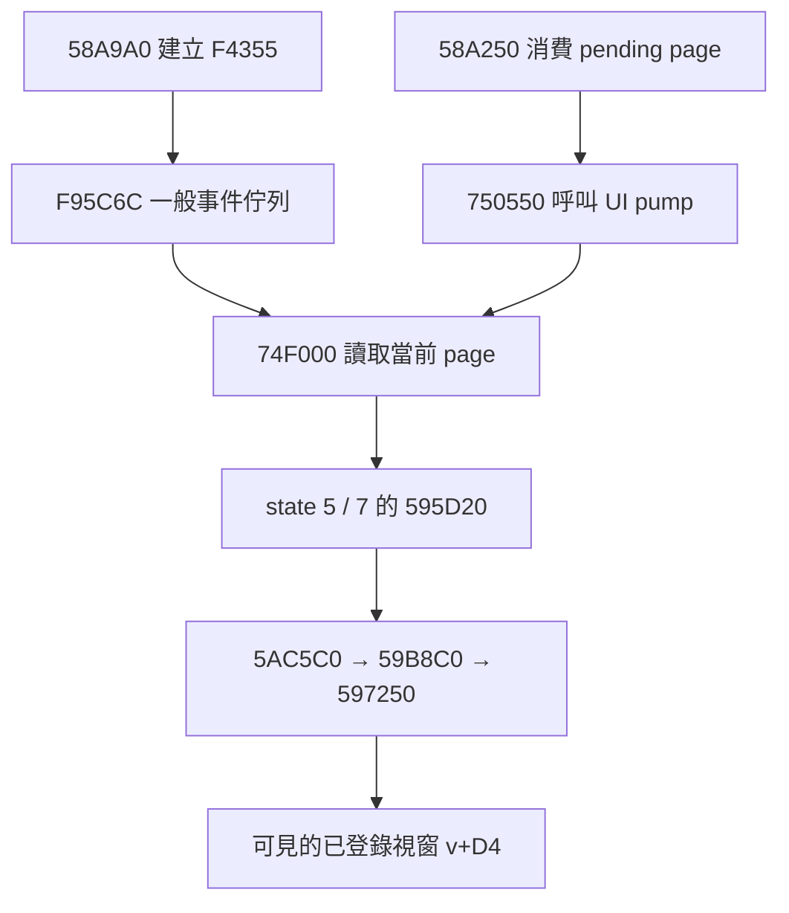

# 普通場景切換後的 UI 事件與 Q 結束等待：F4355 / F4322

## 1. 本輪結論

**普通 Scenario / Mission 新場景初始化所排入的 `F4355`，已追到真正的 UI consumer。它在這兩種 page 上的固定效果，是走訪三個已登錄視窗集合，對可見視窗呼叫隱藏虛函式；這條固定路徑沒有形成可依賴的 Q / tco 取消契約。** 因為最後一步仍會進入執行期視窗的 `vtable + D4`，本結論保留具體視窗型別與其子控制項覆寫的邊界，沒有把有限追蹤寫成整個 Client 不可能間接取消。[原件 U01–U04、U17–U20；表 VT_CMissionFieldPage、VT_CScenarioFieldPage]

**`F4355` 也沒有綁定產生事件時的 page。** 一次 Client UI 更新會先消費 pending page 變更，之後才處理事件佇列；consumer 逐筆從 UI engine 重新取出當時的 current page。這使它不能當成「舊場景的 runner 已完成清理」或「新場景腳本可以啟動」的確認訊號。[原件 U05–U11]

**Q 的部分 End 路徑產生的 `F4322` 則屬於另一套所有權：它是 type 200 等待對話框附帶的識別事件，並未送入上述一般事件佇列。** 對話框存於 UI engine 的 active-dialog list。明確的解除函式 `562250` 以該識別值移除對話框，然後另外清除 `FB8830` 的 `0x2` 輸入鎖；兩個動作不可混為一個 page event 的自動回呼。[原件 E01–E03、E08–E12]

本分題沒有發現新的 `.mef` 路徑或內容載入入口。新增的是已證 Q 流程，以及條件式新 MEF 設計所需的跨場景與結束等待契約，並將上輪仍停在 queue producer 的支線追到 consumer。Server 仍須依據實際 Q 結束、解除與場景順序安排生命週期，不能把普通 UI 隱藏當作已取消 runner。

## 2. 原件、版本與引用方式

所有 native 結論直接核對 `02-Tartaros.bin`，沒有啟動 Client 或 Lua，也沒有修改原件或 Git。反編譯 `.c` 只作導航；資料表、vtable、RTTI、呼叫與分支均以原件 bytes 為準。

| 項目 | 固定版本 |
|---|---|
| BIN | 12,472,320 bytes；SHA-256 `9741d1975327b9309d82b52f631165bc410757694d7c183a5eed970a53ebef91` |
| 本輪 main | `ba5f96dfa94d734cbded291fb8887f50426bfa77` |
| 上輪已讀 main | `909754f28bd2e54c8ede00e3a56021cf59facd14` |
| 開始時 extra/roy1 HEAD | `a16841ac67638da4b29605f186f355722e8cf106` |
| 共用指示 | `09-02-PROJECT-SHARED-INSTRUCTIONS.md`；SHA-256 `624d808521354aa4fb00774839a25cac29e8fdbaa6029c66f39dc43bf7a1bb43` |

本文的 `Uxx`、`Exx`、`Dxx`、`VT_`、`COL_`、`RTTI_` 是 [native-windows.json](native-windows.json) 的 record ID；每筆含 VA、raw offset、原始 hex、SHA-256 與指令。可讀反組譯在 [native-disassembly.txt](native-disassembly.txt)，機器可核對的 owner、表格選取與有限呼叫集合在 [routes.json](routes.json)。每個導航來源與舊稿的 commit、完整路徑、Git blob、SHA-256 均列於 [source-manifest.json](source-manifest.json)。

本輪亦讀取上述兩個 main 之間、限定以下兩檔的 [governance-diff.patch](governance-diff.patch)：`governance/MEF-FUNCTIONAL-COMPLETION.md` 刪去一段 2026-11-14 extra/roy1 整合摘要；`governance/s00-iterations/S00-20261101-MEF-RECEIVE-FEASIBILITY.md` 刪去連往該摘要的文字。這是已記錄的文件版本差異；該 diff 沒有提供原件推導被撤回或 review 退回的證據，不能據此更改 native 結論。

## 3. F4355：從新場景初始化到當前 page

### 3.1 與上輪 005F 結論的接點

上輪 [scene-cancellation/report.md](../../MEF-complete-flow-20261115/scene-cancellation/report.md) 已閉合實際 `005F` handler `4B99C0`、替換 helper `4B7D50`、`4B7DA7` 安裝新 field，以及 `4B7DBC` 呼叫新 field 的 init 虛函式。普通 Scenario / Mission 在此 init 中的 UI 動作，本輪再追下游；本文不把 `F4355` 稱作 wire opcode，也不重做所有場景類別的 exit 清冊。

| 普通新 field | init 內條件 | 不同 UI state | 已在目標 UI state |
|---|---|---|---|
| Scenario (`4C4750`) | `4C4855` 比較 current 與 `7` | `4C485D` 寫 pending=`7` | `4C4875` 呼叫 `58A9A0` |
| Mission (`4BC750`) | `4BC8EC` 比較 current 與 `5` | `4BC8F4` 寫 pending=`5` | `4BC90D` 呼叫 `58A9A0` |

這兩條分支在 current 已相同時只是排事件，沒有同時清掉既存 pending。這是一個資料流事實；是否有另一操作在此前寫入 pending，須由當次執行時序決定。[原件 U01、U02]

### 3.2 兩個 UI owner 與事件的完整 payload

| owner | 欄位 | VA / offset | 本輪用途 |
|---|---|---|---|
| UI state manager | owner | `FAADD8` | 管理 page code 與 pending 切換 |
| 同上 | current code | `FAADEC` / `+14` | 初始化為 `-1` |
| 同上 | pending code | `FAADF0` / `+18` | 初始化為 `-1` |
| 同上 | page map pointer | `+2C` | 以 code 找 page |
| FoxUI engine | owner | `F94810` | 實際 UI 更新與事件消費 |
| 同上 | current page | `F95BD4` / `+13C4` | event dispatch 的 receiver |
| 同上 | 一般 event deque | `F95C6C` / `+145C` | `804260` 追加、`74F000` 消費 |
| 同上 | dialog template map | `F95C20` / `+1410` | type 200 模板 |
| 同上 | active-dialog list | `F95C30` / `+1420` | F4322 等待對話框 |

`58A9A0` 配置 `0x14` bytes 的 `FXUIEvent`，逐欄寫入如下，再於 `58AA33` 呼叫 `804260` 追加指標。`804260` 存放事件指標、更新 deque 計數；沒有在追加當下呼叫 page handler。[原件 U03、U04；表 VT_FXUIEvent]

| event offset | 寫入值 | 原件錨點 |
|---|---|---|
| `+00` | vtable `C47B0C` | `58A9D4` |
| `+04` | `FFFFFFFF` | `58A9DA` |
| `+08` | `FFFFFFFF` | `58A9E1` |
| `+0C` | `00000000` | `58A9E8` |
| `+10` | `000F4355` | `58A9EB` |

這是該配置大小內的完整欄位集合，沒有 producer page、field 指標或場景代數。本文不替 `+0C` 發明未驗證的欄位名稱。

### 3.3 真正的更新入口與先後順序

`CClient` 的原件 RTTI / vtable `C05AA4` 將 slot `+30` 指向 `490FE0`；其 `49152B` 呼叫 `58A250(&FAADD8)`。FoxUI engine 的 constructor 於 `74D9C3` 安裝 `C4790C`；該表 slot `+14` 指向真正 deque consumer `74F000`。[原件 U06、U09；表 VT_CClient、COL_CClient、RTTI_CClient、VT_FXUI]

`58A250` 在同一次呼叫內依下列順序處理：

1. `58A27F` 檢查 pending 是否不是 `-1`，若有待切換 code，查找舊 page。
2. 呼叫舊 page 的 `+174`、`+10C`；`58A315` 清 engine current page，之後呼叫舊 page 的 `+17C`。
3. 查找新 page，呼叫 `+170`；`58A399` 將新 page 安裝為 engine current page，呼叫 `+108` 及相關版面／顯示 hook。
4. `58A423` 將 pending code 寫入 current code，`58A429` 將 pending 清為 `-1`。
5. 後段 `58A729` 才呼叫 `750550(&F94810)`。該函式於 `75062E` 呼叫 engine `vtable +14 = 74F000`。

因此 **pending page 的消費先於一般事件 deque 的消費**。即使 `F4355` 是在另一個 page 尚為 current 時建立，payload 也沒有保留那個 page。本文只據此判定 receiver 選擇與 native 呼叫順序，沒有從靜態碼推定封包抵達時間、固定幀數或必達的牆鐘期限。[原件 U07、U08、U10]

兩個需要保留的 gate：`750550` 若進入時 current page 為空，會跳過包含 queue pump 的該段更新；`74F000` 自己若在被呼叫時發現 current page 為空，則會透過 `753890` 刪除 deque 裡的事件。後者不是「每幀 current page 空就會丟棄佇列」的保證，因為前者可能先跳過呼叫。[原件 U10、U11、U13]

### 3.4 逐筆消費與 ordinary page 的 handler

`74F000` 由 owner `+145C` 取 deque front；每筆於 `74F067` 重新讀取 `owner+13C4`，`74F076` 呼叫該 page 的 slot `+15C(event)`。返回後經 event 的 `+10 = 753A00` 刪除事件，再更新 deque head 與 count，繼續處理下一筆。事件物件的刪除只是釋放，不是發回 Server 的 ACK。[原件 U11、U12、U28]

state `5` / `7` 的實際 page 類別由 factory 與 constructor 閉合，而非只按類名猜測：

| state | 原件建立與登錄 | vtable / RTTI | `+15C` | `+190` |
|---|---|---|---|---|
| `5` | `587AF3 → 5ACCF0`；key `5` 於 `587B1A` / `587B34` | `C1D1AC` / `CMissionFieldPage` | `595D20` | `5AC5C0` |
| `7` | `587F57 → 598760`；`587F68` 安裝表，key `7` 於 `587F98` / `587FB2` | `C1D62C` / `CScenarioFieldPage` | `595D20` | `5AC5C0` |

`595D20` 將 `F434A < event < F435C` 分派到 `+190`，所以 `F4355` 進 `5AC5C0`。後者 `5AC5CB` 先呼叫 `59B8C0`，自身額外分支只處理 `F4351`。`59B8C0` 對 `F4355` 在 `59B8DF` 呼叫 `597250`；後面的第二個 switch 對同事件選 default return：index=`10`，`59B9DA` byte=`7`，`59B9CC` dword=`59B9A8`。[原件 U14–U19、D01；表 VT_CMissionFieldPage、VT_CScenarioFieldPage]



### 3.5 最終效果、取消邊界與相近事件的區別

`597250` 走訪 page 從 `+C4` 開始、間隔 `0x10` 的三棵集合樹；每個節點 `+0C` 為視窗指標。只有視窗 `+28` 的 `0x100` 位元已設時，`597285` 才呼叫該視窗 `vtable +D4`。函式本身不移除這三棵樹的節點，也沒有改寫 Q manager、移除 qco，或呼叫 MEF loader。[原件 U20]

普通 page 的切換前 hook `+174 = 595E30` 另會呼叫 `596C90`。後者對同三棵集合做條件式 `v+D4`，再清除其 UI 樹節點；它清的是 page 的視窗登錄集合，不能解讀成 coroutine task 集合。新 page 的 `+170 = 5A3950` 則重設數個 UI 狀態欄位。[原件 U21–U23；表 VT_CMissionFieldPage、VT_CScenarioFieldPage]

因此，已解出的固定 handler 效果確實偏向 UI 隱藏／登錄清理；**仍未封死的是樹中執行期視窗的覆寫及其子控制項行為**。任何「某種特定視窗 hide 會另外 stop Q」的主張，都需要該實際物件型別及其 `+D4` 下游證據；不能用泛稱 UI callback 補上，也不能因沒有直接呼叫就宣稱全程不可能間接取消。

對照上，另一組共同 handler `596630` 的 switch 明確將 `F43DB` 送往 `5966C0`、`F43DC` 送往 `596830`、`F43FF` 送往 `5978D0`；其中可見 `596810`、`5968CB`、`597965` 呼叫 `5624B0` 的 Q stop 錨點。這些是不同的內部事件分支，不能把它們的效果套到本輪已算出的 `F4355 → +190` 路由；本包也沒有將這三筆擴寫成全部 Q stop caller 清冊。[原件 U24–U27、D02]

## 4. F4322：Q End 所附的等待對話框與明確解除

### 4.1 建立者使用的不是一般事件佇列

上游 End 條件及完整輸入契約由同輪 [input-lifecycle/report.md](../input-lifecycle/report.md) 整理。本分題從其 `5620B0` 開始核對：`56210C` 對 `FB8830` 做 `OR 0x2`，然後建立另一個 `0x14` bytes 的 `FXUIEvent`，在 `562157` 將 `+10` 設為 `F4322`。`562226` 傳 type `200`，`562232` 呼叫 `58B270`。這裡沒有呼叫 `804260`。[原件 E01]

`58B270` 將 type、文字參數、event pointer 與最後一個值 `0` 轉交 `7532B0(&F94810, …)`。文字來源含 locale key `1BE`；本分題未解析顯示字串，不由 key 或 RTTI 名稱發明對話框標題。[原件 E01、E02]

### 4.2 type 200 模板、clone、tag 所有權

type 200 的建立／登錄可由原件閉合：`588B9E` 配置 `0xF4` bytes，`588BBD` 呼叫 base constructor，`588BCF` 安裝 `C19764`，`588BDA` 傳 `0xC8` 給資源載入側。後段以 `200` 查找已建立物件，將匹配物件作為值登錄到 `F95C20` template map。`C19764` 的 RTTI 名為 `CMsgBoxWaitAndEnableChat`；clone slot `+28 = 585BC0` 也配置同大小並安裝同一張表。[原件 E04–E07；表 VT_CMsgBoxWaitAndEnableChat、COL_CMsgBoxWaitAndEnableChat、RTTI_CMsgBoxWaitAndEnableChat]

`7532B0` 的成功路徑：

| 原件錨點 | 動作 |
|---|---|
| `7532FA` | 在 engine `+1410` 以 type 查 template |
| `75333A` | 呼叫 template `v+28` clone |
| `75334A` / `753354` | 將 clone 追加到 engine `+1420` active-dialog list |
| `753365` | 呼叫 current page `v+70` 附加 dialog |
| `753367` / `753374` | 取 `dialog+80` 綁定物件，將 event pointer 存在該物件 `+D4` |
| `7533E5` | 在綁定物件 `+D0` 存入最後參數 `0` |
| `7533F5` / `753401` | 呼叫 dialog `v+D0` 顯示、`v+C8` 版面 hook |
| `753403` / `753409` | 更新 engine 的 dialog 狀態欄位 |

`dialog+80` 由 `755E50` 的 key `11` 綁定處理填入；本輪只使用這個可核的存取鏈，沒有宣稱該物件的完整類別。若找不到 template、當前 page 為空，或 clone 失敗，`7532B0` 可直接回傳 `0`；`58B270` 沒有因此替 Q 清除 `FB8830` 的位元。顯示成功本身也不代表已收到 Server 許可。[原件 E02、E03、E17]

上述 active-dialog list `engine+1420`，與 `F4355` 走訪的 page 三棵集合是不同 owner / 欄位。普通 `v+70 = 746640` 是 parent / child 附加，不能僅憑此呼叫推定 clone 已自動登錄進 `+C4/+D4/+E4` 三棵樹；本包不排除其他執行期別名或額外登錄。[原件 E16、U20]

### 4.3 明確移除與輸入解鎖是兩個動作

`562250` 在 `5622D1` 傳 `F4322`，以 EAX=`F94810` 呼叫 `753440`。後者走訪 active-dialog list，對每個 dialog 依 `dialog+80 → bound object +D4 → event +10` 比較識別值。匹配時會清理 focus；若 current page 存在，呼叫 dialog `v+D4` 隱藏並透過 current page `v+74` detach；再呼叫 dialog 的 deleting destructor、刪 list node 與更新 count。這是以附帶 event 作為 dialog tag 的移除 API。[原件 E08、E09]

`562250` **不檢查 `753440` 的找到／未找到回傳值**，後續仍於 `562307` 對 `FB8830` 做 `AND FFFFFFFD`，明確清掉 `0x2`。因此輸入解除來自 `562250` 的後半段，不能說成「刪除了對話框，所以所有輸入自動恢復」。使 `562250` 可達的既有 native / Server 路由由同輪 input 分題交付；本 UI 分題以這個明確解除入口為交界。[原件 E08；同輪 input-lifecycle/report.md]

### 4.4 對話框自身與一般 page 的 event handler 均不能替代上述解除

type 200 的 vtable `+15C = 476430` 是 `ret 4` 空 handler。其 `+D4 = 757000` 轉交 `745930` 執行一般隱藏：先處理可見子視窗，再清除**視窗本身** `+28` 的 `0x100` 可見位元並更新畫面。這個位元、owner 及作用均不同於 Q / 輸入 manager 的 `FB8830 & 0x2`。RTTI 中的 `EnableChat` 字樣不能代替實際輸入 mask 證據。[原件 E10–E12；表 VT_CMsgBoxWaitAndEnableChat]

另外，若單獨把同值 `F4322` 交給普通 page 的一般 event router，其路由也不是解鎖：`595D20 → +18C = 5AC590 → 59B420`；第二段 switch 的 index=`0x4A`，`59B89E` byte=`0x2D`，`59B850` dword=`59B795`，選到 default return。這是額外核實值語義的對照；**實際 `5620B0` 傳送方式仍是附帶在對話框上的 tag，並非該一般 event 路由。** [原件 U17、E13–E15、D03；表 VT_CMissionFieldPage、VT_CScenarioFieldPage]

type 200 綁定的資源子控制項及可能的動態覆寫仍保留型別邊界。本結論沒有否定每一個未解析按鈕、視窗或外部呼叫者的副作用；它釘住的是已知 clone 自身的固定 event / hide virtual，以及唯一在本分題明確寫入輸入解鎖位元的 `562250` 路徑。

## 5. 對完整 MEF 使用流程與 Server 開發的意義

| 已證 Client 行為 | Server 開發需要採用的契約 |
|---|---|
| `005F` ordinary init 可能只改 pending，或只排 `F4355` | 不以 scene init / UI event 已排入作為 Q runner 已取消的條件；需安排明確停止／結束與新場景的先後 |
| pending page 在 deque 消費前處理，event 沒有 producer page 身分 | 若 Server 要等待特定場景已就緒，必須依既有且已證實的場景／生命週期資訊設計判定，不能把內部 `F4355` 當 ACK |
| `F4355` 固定效果是 registered-window hide；末端仍有執行期視窗 callback | 不把 UI 隱藏等同 qco/tco remove，也不假設所有視窗覆寫相同 |
| Q End 的部分路徑另置輸入鎖並附加 F4322 wait dialog | Server 流程需涵蓋實際解除入口與其適用條件；不能僅因 Q active 清零、End 已返回或 dialog 已不可見，就假設輸入已解除 |
| `562250` 可在沒有匹配 dialog 時仍清除 mask | 顯示狀態與輸入狀態分開驗證；具體可達 route 與封包條件見 input 分題 |

這些是 Server 待實作／驗證的排程需求，不是要求找一份不存在的 Server 原件才能完成 Client 分析。本包沒有新增 wire opcode、封包格式或新的 MEF 傳輸功能，也沒有把 Client 的 internal UI event 假設成 Server 可直接傳送的事件。

本輪已收斂的界線，是普通 state `5` / `7` 固定 UI 路由與 type `200` 等待 dialog；仍需要不同證據才能擴張的部分，是執行期視窗／資源子控制項覆寫，以及 Server 端實際採用的時序。已知 coroutine 的自然結束與 Q callback 行為另見同輪 [scheduler/report.md](../scheduler/report.md)，VM 活期與 teardown 見 [vm-lifetime/report.md](../vm-lifetime/report.md)，不在此重建 Lua stdlib 或所有 scene 分類。

## 6. 有限證據集合與唯讀重驗

本包含 **66 個原件 records、8,820 bytes、45 個 code windows、2,248 條 decoded instructions、6 組 vtable / RTTI、5 組精確 switch 選取**。`routes.json` 的 **206 筆 call / jump / indirect call** 僅是這些窗口內可重算的集合，不是 whole-program call graph，也不提供「不存在其他入口」的證明。

來源 pin 共 **51 筆**：45 筆導航 `.c`、4 筆 governance 版本內容、2 筆重用舊分析。導航 `.c` 的來源 bytes 在採集時已與 Git blob SHA-1 對上，SHA-256 另存於 manifest；最小發布包不複製那些原始導航檔。

在 repository root 執行：

```bash
python kr-extra-roy/MEF-runtime-contracts-20261115/ui-lifecycle/reproduce.py \
  --bin /absolute/path/to/02-Tartaros.bin \
  --repo . \
  --check-deliverables
```

重驗器只讀取 BIN、發布包與指定 Git object / tree，不抓取網路、不 checkout、不寫入原件或 repository。它核對完整 BIN hash、PE 映射、每個原件窗口的 bytes / hash / 指令邊界、vtable / RTTI、switch 選取、有限呼叫集合、關鍵 owner / payload / 呼叫順序 anchors、51 個版本樹 pin、6 個已存 Git 內容來源及兩檔的精確版本 diff。反組譯從導航定位的函式起點開始並跨過窗口尾端 15 bytes，再確認窗口從完整指令邊界開始及結束，避免只從任意 byte 起解碼或把最後一條指令截短。

如另保留採集時的 `.c`，可加 `--navigation-dir /path/to/sources` 逐一重算45筆導航檔的 SHA-1 blob / SHA-256；不加該選項時，報告會明確區分「tree pin 已核」與「導航原始內容未重新提供」。

本輪原件／來源重驗結果在 [validation.json](validation.json)，該次亦核對採集時的45筆導航內容。交付檔案 hash 在 [deliverables-manifest.json](deliverables-manifest.json)；manifest 本身不自我雜湊。manifest 產生後另以 `--check-deliverables` 核對8個交付檔，避免讓 validation 與 manifest 互相自我雜湊。成功的 byte / tree 重驗只證明本報告的證據可重現，不會把保留的動態 callback 邊界變成全程行為證明。
