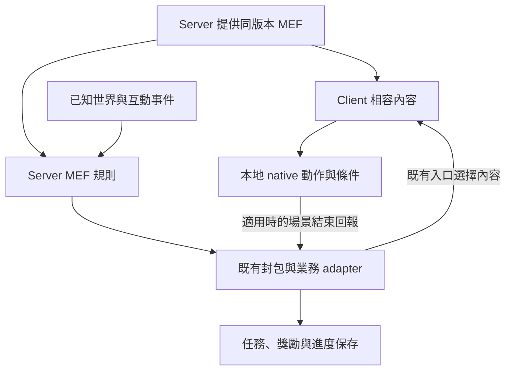

# MEF 重新分析：以可實作功能與 Server 減負為目標

**MEF 是 Server 開發的一部分；Server 提供內容，能在 Client 的 MEF／native 執行鏈完成的工作優先下放。關卡規則、戰鬥條件與獎勵政策也可以由 Server 端 MEF 規則執行，沿用現有 world、交易與保存接口。** 本輪不以官方 `.mef` 復原作目標，也不因「Server 負責」把玩法排除於 MEF。

工作分支 `extra/roy1`；研究基線 `60c1c1a5dc7a73902d9dbb50361d5148e8b30058`；已核對 main `5ed4833b805949fabe260aea77e3fe0fd8e86bfa`。KR BIN SHA-256：`9741d1975327b9309d82b52f631165bc410757694d7c183a5eed970a53ebef91`。原件／Git 來源身份與本輪驗證收據在本包索引。

## 1. 本輪改正了什麼

先前 extra 研究把官方格式、普通背景 Lua 和特定舊場景資源，放在過於廣泛的完成門檻；又把部分 Server 責任當成 MEF 的能力界線。本輪依使用者要求修正這兩點。main 的現有功能追蹤原已採「不等官方樣本」方向，這次也把 extra 的分析重新對齊。[方向決策](DECISIONS.md)、[現有成果](SERVER-REUSE.md)

現在對每項玩法逐段問：**規則由誰定義、在哪裡執行、能觀察哪個真實事件、需要哪個既有接口、最後保存什麼？** 可由 MEF 做的部分先保留在 MEF；尚未接上的部分寫成具體開發或整合差額。

## 2. 使用者指定的七項功能

| 功能 | 優先放進 MEF 的工作 | 已有可用能力／接線 | 真正還缺什麼 |
|---|---|---|---|
| **生怪** | 模型、位置、時機、批次／波次、行為設定；符合 profile 的本地生成 | `lb.CreateObjectEx` 可生成進入 world 更新的 `CMonster`；已有 Server 內容化出生、逐出生 profile 與波次引擎 | 實際模型／位置依賴、新內容入口及生命期；需要共享敵對物件時，補身分、行為指令與事件對齊。沒有 ID 回值不否定本地生成 |
| **戰鬥判定** | 技能選擇、節奏、條件、傷害／效果規則；native 已能執行的移動與動作交由 Client | world actor 有本地 frame 移動／動畫鏈；現有 Server 規則與戰鬥 adapter 可復用 | 若要把敵方決策／命中計算移至 Client MEF，仍要精確輸入與回報接口；技能動畫與戰鬥面板不等於扣 HP |
| **敵群清空** | 哪些怪屬同一波、哪些死亡算完成、完成後選哪個節點 | 既有 GroupCleared、指定波清／血量旗標可進 Server MEF 規則；普通死亡與刪除有 native 消費鏈 | 普通死亡／指定群組結果直接進 Client Lua 的通用橋尚未閉合。不能用 `lb.GetObjectCount` 或 Q 停止冒充存活數 |
| **開出口** | 條件、等待／演出、開哪個點、通往哪個節點 | 入場 `0027` 配置點；MEF `Tutorial.SetCheckPointStatus` 與 `0048` 共用 setter，可真的改既有點 | 點存在且鍵／類別正確。Server MEF 收群清後可用一次 `0047` 選 finite 內容，Client 自行演出再開門；單一開門亦可用 `0048`。只有把動態事件注入持續 Lua 的方案才另需通用橋 |
| **任務結算** | 達成條件、終點／返回要求、受益範圍、下一任務 | 主線完成事件與普通任務 Accepted／Ready／Completed 服務已存在 | 新 MEF 規則映射到既有完成入口；Q 結束、對話結束、結果頁顯示都須按本次流程的含義使用 |
| **獎勵** | 經驗／金錢／熟練度／道具的規則、數值、資格與發放時點 | 已有經驗、錢包、熟練度與資產發布／帳本；Q119 的三個 RewardsEtc 類別已有可用解讀 | 新規則版本與既有服務接線、所需新增品項／目標的 adapter；不要另建重複錢包，也不能把畫面數字當入帳 |
| **進度保存** | 要保存的任務／節點／已領獎里程碑、登入後怎麼續接 | 已有主線游標、任務進度、角色成長、資產與結算帳本 | 把新 MEF 的業務狀態映射至既有存檔並保留版本；中途戰鬥續玩需明確設計，不預設保存整個 Lua VM |

生怪／戰鬥／群清的原件鏈與排除候選見 [world-offload](world-offload/report.md)；點、NPC、任務、獎勵與保存的方向別 wire、現有實作來源及自有內容模型見 [npc-progression](npc-progression/report.md)。各列是功能分析與開發落點，並非宣告本輪已部署七項新功能。

## 3. 已有三條可用路線，另有一條特定缺口

| 執行路線 | 能承擔的內容 | 適用限制 |
|---|---|---|
| **有限 Q** | 一次載入多步內容；等待、鏡頭／動作／聲音／文字、已知條件、既有點開關與收尾 | `0047` 選已配置 scene 雙鍵；接受 Q 的輸入／UI 影響。prepass 與正式 coroutine 分開，必須顯式 End |
| **Tutorial 互動流程** | 提示、抵達／已映射操作、教學控制旗標、串接 Q、scenario 請求與等待 | 使用真正 Tutorial field／controller／page；其 pump 不要求 Q active，但不能搬用到普通場景就宣稱相同 |
| **已啟動的 native 持續操作** | 個別有限效果、world actor 動作等交給各自 native update | 每項有自己的 gate／owner／完成與回收；不表示 End 後 qco 還會繼續排新工作 |
| **普通場景常駐 Lua B** | 目標是保留普通 Mission／Scenario 操控，同時常駐自訂背景邏輯 | 首次 producer、持續 pump、取消／重入與輸入 owner 尚未形成完整可用 adapter；只約束這個 profile，不是其他路線共同門檻 |

有限 Q 的具體作者範本已收於 [authoring-contract.md](delivery-profiles/authoring-contract.md)：前置不做 gameplay、正式 callback 本地等待→開既有點→顯式 End。它是可實作規格，尚未綁定真實發布品，沒有修改遊戲資源或執行 Lua。[入口／交付詳解](delivery-profiles/report.md)

### 普通關卡清組後，已有可組成的有限流程

既有 **Server MEF 收到同一實例的 GroupCleared → 在允許 Q 演出的時點送一次 `0047`，選擇已發布的新內容 → Client 自行等待、演出、切換預放出口 → 明確 End**。採 quest0 的正常收尾政策時，再由 `003F`／`00EB` 接回既有等待解除。非零 quest 仍有自己的確認條件。

這是以真實群清條件「選擇並開始哪一份內容」，並未把一般事件 payload 注入正在執行的背景 Lua，所以**不需要先完成通用普通事件橋**。尚需綁定 selector／literal／點快照與發布版本，使用同 field／generation，並接受有限 Q 的操控影響；`003F` 只表示適用的收尾回報，不是 setter 或通關成功。這條組合已足以規劃清場後多步內容的下放；普通 Client 自己判斷群清仍是另一項接口工作。[有限作者契約](delivery-profiles/authoring-contract.md)、[出口四種配置](npc-progression/report.md)

## 4. Server 提供內容，實際執行位置分開配置

這張圖是建議分工，不是新增協定。Client 的普通 `.seq` consumer 接 Lua 文字；Server 的自有規則由既有內容引擎或其編譯映射處理。圖中的場景結束回報 `003F` **不含一般動作成功、群清或獎勵成功**，不能直接沿箭頭跳過真正的任務條件。Server adapter 只有在目前 run 的既有完成依據成立後才提交相應結果。[作者契約](delivery-profiles/authoring-contract.md)、[結算契約](npc-progression/report.md)

Master 的 Event 路由與已有 updater／資源 resolver 研究提供可用發布路線。自有內容開發不需要官方 `.mef` grammar；發布仍要確保載入的是正確內容版本。遊戲內的 `0047` 是選擇已安裝內容，不是任意 script bytes 傳輸；不為了「Server 提供」而虛構新 opcode。[交付報告](delivery-profiles/report.md)

## 5. 全功能覆蓋與容易誤用的接口

重新分類完整 **121 個正常 binding、15 個功能域**：116 個名稱有可引用的有界作用／查詢，4 個 stub，1 個不提供名稱暗示的 count。這是接口覆蓋，不是 121 個獨立玩法，也不能換成整體完成率。[全表](BINDING-OFFLOAD-MAP.md)、[機讀契約](binding-offload-map.json)

因此 MEF 的能力不只七項核心關卡流程，還包括 Q 角色、世界外觀、鏡頭、聲音、圖片、字幕／對白／書本、教學條件、地圖／小地圖、輸入控制、淡幕／轉場／慢動作等。它們都可作 MEF 內容的本地執行部分；需依原 ABI、資源與 owner 使用。

較高層的 [75 個 qbase 頂層 helper](../MEF-capabilities-20261116/helper-catalog.md) 也繼續復用：包含 Register／協程、等待、演出階段、動作與對話包裝。它們不是額外 75 種 native 功能，helper 的參數、等待與回呼條件需按自己的契約使用；例如 StartLoading／EndLoading 只 yield，空的 Phase helper 不會自動完成 gameplay，定義了 callback 名稱也不證有 native 事件來源。本輪沒有重做已完成的全部 parser／sink census。

幾個會直接影響開發的界線：

- `Q.CreateObject` 是演出角色；`lb.CreateObjectEx` 可是 world `CMonster`，兩者不能互相替代身分。
- `Q.DeleteObject`、`Q.BalloonTalk`、`Tutorial.InsertObject`、`lb.PrintCurrSceneID` 的正常 target 是 stub；`lb.GetObjectCount` 不是可用的敵人計數。
- Q 物件都停止只表示該樹的移動 pending 狀態，空樹也可能成立；不表示敵群死亡。
- 數字 0 在 Lua 為真；沒有新增回傳值的 setter 不能寫成成功布林。loader 的數字回值與當次 export／version 要依精確契約使用。
- 完成、取消、畫面消失、資源回收、任務提交是不同事件。先分清 consumer，才能將更多工作交給 MEF 而不丟掉正確流程。

這些是可證的 API 約束，不是把功能排除於 MEF 的理由；缺的 adapter 或內容檢查列為具體開發需求。

## 6. 減負與優先序

最先可省的是內容中間步驟的 Server 排程與派送。對世界動作，Client 原本就有逐 frame update，應使用高階指令而不是重複下每幀位置；已存在的 native 工作不能全算成此次新增收益。對關卡判斷，Server MEF 可把重複程式變成共用規則，若規則仍在 Server 求值，CPU 仍在 Server。[量測方法](LOAD-REDUCTION.md)

新優先序：**P0 接通一段自製有限內容與既有規則／保存；P1 把生怪、戰鬥事件、群清、出口及結算組成完整關卡；P2 做可重用內容建置、版本／重入／保存與減負量測。** 各階段的已分析內容、差額與可驗收結果見 [開發計畫](DEVELOPMENT-PLAN.md)。官方格式搜尋退出這個優先序，不再要求補官方檔案才能前進。

## 7. 本次完成與尚未完成

本輪交付：目標修正、全正常 binding 的能力重新分類、三條可用執行路線與一條選用缺口、七項玩法的 MEF／adapter 分解、world 原件增量、NPC／任務／結算來源更新、作者範本、既有 Server 復用表、開發與量測契約。

仍須做的事：新內容發布綁定與接線；若選擇本地自主普通戰鬥或向持續腳本送動態結果，補其 world 事件至 Client Lua 通路；新規則與既有業務保存的映射；實際素材／場景資料及既定正常流程遊玩驗證。Server MEF 收事件後選 finite 內容的方案不受那個通用橋缺口阻塞。這些各有適用範圍，沒有「因官方 MEF 不在所以全部未完成」這個共同阻塞。

本輪未執行遊戲／Lua／Server、未改原件／現行內容／資料庫，未更新正式 RR 或 T01／S00 驗收狀態。已有 Server 實作與人測結果依原收據保留；本包離線 PASS 只覆蓋明列的來源、原件窗口與契約核對。
