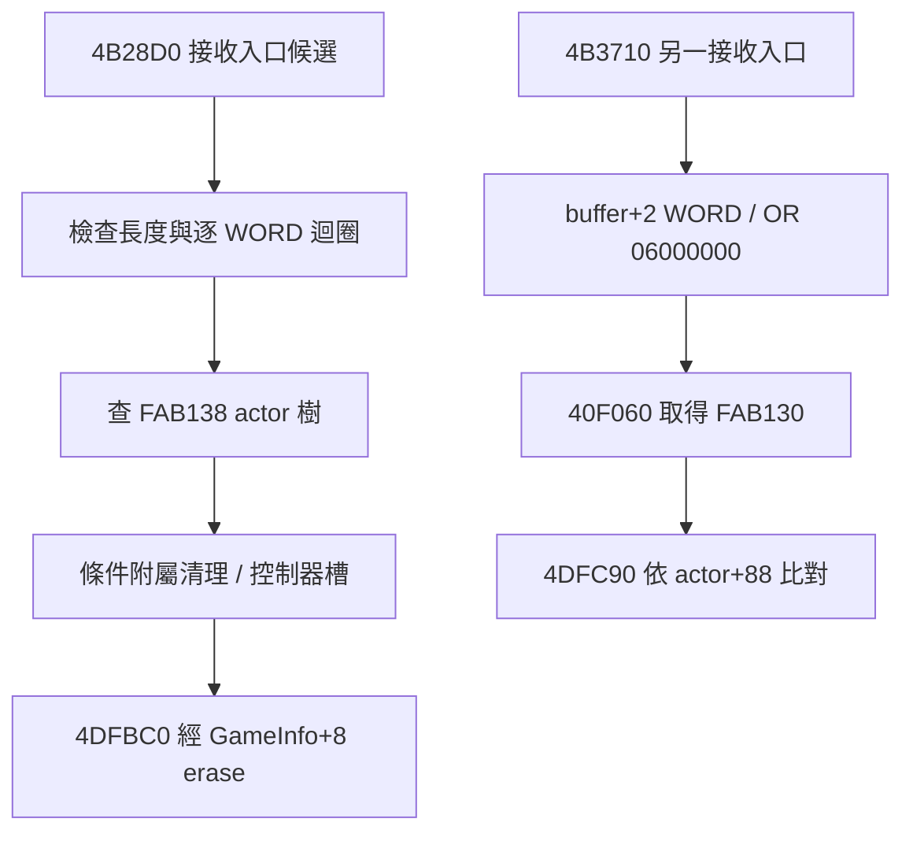

# KR T08-157 — packet row removal receiver boundaries

- 研究時間：2026-10-28T01:52:16+08:00（Asia/Taipei）；研究者：`chatgpt-web roy`。
- 第一手來源：唯讀 `Tartaros.bin`，12,472,320 bytes，SHA256 `9741d1975327b9309d82b52f631165bc410757694d7c183a5eed970a53ebef91`，GNU objdump 對 PE `.text` VA 反組譯。
- 正式 Task：GitHub KR T08 只負責 `0007` 實體建立／登記／移除的資料介面；dispatch 框架屬 T02、場景重置屬 T06/T07，僅交叉參照，不更動其他任務。
- 分級：**原始 bytes**／**已證局部 data-flow**／**有條件推論**／**未知**。線性反組譯與直接呼叫搜尋不代表完整 CFG；外部封包來源與 runtime 未驗證。
- 參照：`T08-153`、`T08-154`、`T08-155`、`T08-156`；上批保留的映射差異與 `T01-20261027-05` 部分驗收限制持續適用。
- 無遊戲執行、修改主程式、服務或存檔。本文不是可直接部署的 C++ 原始碼。

## 研究問題

延續 T08-154 的 `0x4B28D0..0x4B2AEB`，查明 single-ID remove 上層的**長度、起始 offset、找不到鍵時分支、類型差異與另一 0007 建立路徑之關係**；再抽取 `0x4B3710` 的平行邊界。無 registration table 明證時不將函式硬命名為正式封包 opcode。

### 1. `0x4B28D0` 的入口與迴圈形成

入口 `mov eax,[ebp+0xC]` 取長度；`cmp eax,4` 決定是否有至少 4 bytes；從 `[ebp+8]` 指向的 buffer 前置資料開始讀取。後續 `0x4B2958` 每回合依 cursor 讀 `WORD`，查找全域 `0xFAB138` 對應的樹，找不到時先記錄診斷再跳到 `0x4B2AC7` 前進下一筆；它**不是遇一個不存在的 ID 就中止整個處理**。迴圈 `0x4B2AC7 +=2`、`0x4B2ACC` 減少剩餘項目，回邊到 `0x4B2928`。

原生 loop-bound 值必須依 `0x4B2900..0x4B2928` 實際指令解釋，不能只從 `+=2` 猜 length 中所含的 header；`cmp eax,4` 是明示的最低長度門檻，非完整 buffer safety 證明。下列完整片段供復核。

```asm
  4b28d0:	55                   	push   ebp
  4b28d1:	8b ec                	mov    ebp,esp
  4b28d3:	83 e4 f8             	and    esp,0xfffffff8
  4b28d6:	6a ff                	push   0xffffffff
  4b28d8:	68 1c 6d 93 00       	push   0x936d1c
  4b28dd:	64 a1 00 00 00 00    	mov    eax,fs:0x0
  4b28e3:	50                   	push   eax
  4b28e4:	83 ec 28             	sub    esp,0x28
  4b28e7:	53                   	push   ebx
  4b28e8:	56                   	push   esi
  4b28e9:	57                   	push   edi
  4b28ea:	a1 20 1f d6 00       	mov    eax,ds:0xd61f20
  4b28ef:	33 c4                	xor    eax,esp
  4b28f1:	50                   	push   eax
  4b28f2:	8d 44 24 38          	lea    eax,[esp+0x38]
  4b28f6:	64 a3 00 00 00 00    	mov    fs:0x0,eax
  4b28fc:	8b 45 0c             	mov    eax,DWORD PTR [ebp+0xc]
  4b28ff:	83 f8 04             	cmp    eax,0x4
  4b2902:	73 04                	jae    0x4b2908
  4b2904:	33 c0                	xor    eax,eax
  4b2906:	eb 05                	jmp    0x4b290d
  4b2908:	83 c0 fc             	add    eax,0xfffffffc
  4b290b:	d1 e8                	shr    eax,1
  4b290d:	85 c0                	test   eax,eax
  4b290f:	0f 84 c1 01 00 00    	je     0x4b2ad6
  4b2915:	8b 4d 08             	mov    ecx,DWORD PTR [ebp+0x8]
  4b2918:	83 c1 04             	add    ecx,0x4
  4b291b:	89 4c 24 14          	mov    DWORD PTR [esp+0x14],ecx
  4b291f:	89 44 24 18          	mov    DWORD PTR [esp+0x18],eax
  4b2923:	bb 01 00 00 00       	mov    ebx,0x1
  4b2928:	84 1d 2c b2 fa 00    	test   BYTE PTR ds:0xfab22c,bl
  4b292e:	75 28                	jne    0x4b2958
  4b2930:	09 1d 2c b2 fa 00    	or     DWORD PTR ds:0xfab22c,ebx
  4b2936:	c7 44 24 40 00 00 00 	mov    DWORD PTR [esp+0x40],0x0
  4b293d:	00 
  4b293e:	e8 4d c3 02 00       	call   0x4dec90
  4b2943:	68 30 ce bc 00       	push   0xbcce30
  4b2948:	e8 cd f9 3d 00       	call   0x89231a
  4b294d:	83 c4 04             	add    esp,0x4
  4b2950:	c7 44 24 40 ff ff ff 	mov    DWORD PTR [esp+0x40],0xffffffff
  4b2957:	ff 
  4b2958:	8b 54 24 14          	mov    edx,DWORD PTR [esp+0x14]
  4b295c:	0f b7 02             	movzx  eax,WORD PTR [edx]
  4b295f:	8d 4c 24 1c          	lea    ecx,[esp+0x1c]
  4b2963:	89 44 24 1c          	mov    DWORD PTR [esp+0x1c],eax
  4b2967:	51                   	push   ecx
  4b2968:	8d 44 24 24          	lea    eax,[esp+0x24]
  4b296c:	b9 38 b1 fa 00       	mov    ecx,0xfab138
  4b2971:	e8 8a c5 37 00       	call   0x82ef00
  4b2976:	8b 44 24 20          	mov    eax,DWORD PTR [esp+0x20]
  4b297a:	3b 05        	cmp    eax,DWORD PTR ds:0xfab13c
```

### 2. 分支區分：不同 actor 類型與附屬欄位

`0x4B299B movzx eax,word [esi+4]` 後，以 **actor ID 的低 byte** 分流 `0/6/7` 與其他；`0x4B29B7 [esi+0x15C]`、`0x4B29D9 [esi+0x370]` 均出現在限定分支，而非所有 actor 一定有同義欄位。與 T08-153 的 `GameInfo` actor map 查找和 T08-154 提到的控制器前置處理保持分離。`0x4B2A56` 開始會看 `[0xFBA7A4]` 並掃三個槽，於 `0x4B2AC2` 才調用共用的 `4DFBC0`。

```asm
  4b297c:	3c b1                	cmp    al,0xb1
  4b297e:	fa                   	cli
  4b297f:	00 74 07 8b          	add    BYTE PTR [edi+eax*1-0x75],dh
  4b2983:	70 10                	jo     0x4b2995
  4b2985:	85 f6                	test   esi,esi
  4b2987:	75 12                	jne    0x4b299b
  4b2989:	68 e0 6c c0 00       	push   0xc06ce0
  4b298e:	e8 cd b1 23 00       	call   0x6edb60
  4b2993:	83 c4 04             	add    esp,0x4
  4b2996:	e9 2c 01 00 00       	jmp    0x4b2ac7
  4b299b:	0f b7 46 04          	movzx  eax,WORD PTR [esi+0x4]
  4b299f:	3a c3                	cmp    al,bl
  4b29a1:	74 0c                	je     0x4b29af
  4b29a3:	3c 06                	cmp    al,0x6
  4b29a5:	74 08                	je     0x4b29af
  4b29a7:	84 c0                	test   al,al
  4b29a9:	74 04                	je     0x4b29af
  4b29ab:	3c 07                	cmp    al,0x7
  4b29ad:	75 66                	jne    0x4b2a15
  4b29af:	f3 0f 10 05 c0 56 c4 	movss  xmm0,DWORD PTR ds:0xc456c0
  4b29b6:	00 
  4b29b7:	8b 86 5c 01 00 00    	mov    eax,DWORD PTR [esi+0x15c]
  4b29bd:	f3 0f 11 44 24 24    	movss  DWORD PTR [esp+0x24],xmm0
  4b29c3:	f3 0f 11 44 24 28    	movss  DWORD PTR [esp+0x28],xmm0
  4b29c9:	f3 0f 11 44 24 2c    	movss  DWORD PTR [esp+0x2c],xmm0
  4b29cf:	f3 0f 11 44 24 30    	movss  DWORD PTR [esp+0x30],xmm0
  4b29d5:	85 c0                	test   eax,eax
  4b29d7:	74 3c                	je     0x4b2a15
  4b29d9:	83 be 70 03 00 00 00 	cmp    DWORD PTR [esi+0x370],0x0
  4b29e0:	74 33                	je     0x4b2a15
  4b29e2:	6a 00                	push   0x0
  4b29e4:	50                   	push   eax
  4b29e5:	e8 d6 52 2f 00       	call   0x7a7cc0
  4b29ea:	8b 54 24 24          	mov    edx,DWORD PTR [esp+0x24]
  4b29ee:	8b 86 5c 01 00 00    	mov    eax,DWORD PTR [esi+0x15c]
  4b29f4:	83 ec 10             	sub    esp,0x10
  4b29f7:	8b cc                	mov    ecx,esp
  4b29f9:	89 11                	mov    DWORD PTR [ecx],edx
  4b29fb:	8b 54 24 38          	mov    edx,DWORD PTR [esp+0x38]
  4b29ff:	89 51 04             	mov    DWORD PTR [ecx+0x4],edx
  4b2a02:	8b 54 24 3c          	mov    edx,DWORD PTR [esp+0x3c]
  4b2a06:	89 51 08             	mov    DWORD PTR [ecx+0x8],edx
  4b2a09:	8b 54 24 40          	mov    edx,DWORD PTR [esp+0x40]
  4b2a0d:	89 51 0c             	mov    DWORD PTR [ecx+0xc],edx
  4b2a10:	e8 db 51 2f 00       	call   0x7a7bf0
  4b2a15:	0f b7 46 04          	movzx  eax,WORD PTR [esi+0x4]
  4b2a19:	3c 02                	cmp    al,0x2
  4b2a1b:	74 08                	je     0x4b2a25
  4b2a1d:	3c 08                	cmp    al,0x8
  4b2a1f:	74 04                	je     0x4b2a25
  4b2a21:	3c 09                	cmp    al,0x9
  4b2a23:	75 31                	jne    0x4b2a56
  4b2a25:	83 be f4 00 00 00 00 	cmp    DWORD PTR [esi+0xf4],0x0
  4b2a2c:	74 28                	je     0x4b2a56
  4b2a2e:	83 be 24 01 00 00 00 	cmp    DWORD PTR [esi+0x124],0x0
  4b2a35:	75 1f                	jne    0x4b2a56
  4b2a37:	d9 86 34 01 00 00    	fld    DWORD PTR [esi+0x134]
  4b2a3d:	d8 b6 30 01 00 00    	fdiv   DWORD PTR [esi+0x130]
  4b2a43:	dd 05 f0 57 c5 00    	fld    QWORD PTR ds:0xc557f0
  4b2a49:	d9 c9                	fxch   st(1)
  4b2a4b:	df f1                	fcomip st,st(1)
  4b2a4d:	dd d8                	fstp   st(0)
  4b2a4f:	76 05                	jbe    0x4b2a56
  4b2a51:	e8 5a 9e 01 00       	call   0x4cc8b0
  4b2a56:	8b 0d a4 a7 fb 00    	mov    ecx,DWORD PTR ds:0xfba7a4
  4b2a5c:	66 8b 76 04          	mov    si,WORD PTR [esi+0x4]
  4b2a60:	33 c0                	xor    eax,eax
  4b2a62:	8d 51 0c             	lea    edx,[ecx+0xc]
  4b2a65:	8b 3a                	mov    edi,DWORD PTR [edx]
  4b2a67:	85 ff                	test   edi,edi
  4b2a69:	74 06                	je     0x4b2a71
  4b2a6b:	66 39 77 04          	cmp    WORD PTR [edi+0x4],si
  4b2a6f:	74 0c                	je     0x4b2a7d
  4b2a71:	03 c3                	add    eax,ebx
  4b2a73:	83 c2 0c             	add    edx,0xc
  4b2a76:	83 f8 03             	cmp    eax,0x3
  4b2a79:	7c ea                	jl     0x4b2a65
  4b2a7b:	eb 0c                	jmp    0x4b2a89
  4b2a7d:	83 f8 ff             	cmp    eax,0xffffffff
  4b2a80:	74 07                	je     0x4b2a89
  4b2a82:	8b 01                	mov    eax,DWORD PTR [ecx]
  4b2a84:	8b 50 14             	mov    edx,DWORD PTR [eax+0x14]
  4b2a87:	ff d2                	call   edx
  4b2a89:	84 1d 2c b2 fa 00    	test   BYTE PTR ds:0xfab22c,bl
  4b2a8f:	75 24                	jne    0x4b2ab5
  4b2a91:	09 1d 2c b2 fa 00    	or     DWORD PTR ds:0xfab22c,ebx
  4b2a97:	89 5c 24 40          	mov    DWORD PTR [esp+0x40],ebx
  4b2a9b:	e8 f0 c1 02 00       	call   0x4dec90
  4b2aa0:	68 30 ce bc 00       	push   0xbcce30
  4b2aa5:	e8 70 f8 3d 00       	call   0x89231a
  4b2aaa:	83 c4 04             	add    esp,0x4
  4b2aad:	c7 44 24 40 ff ff ff 	mov    DWORD PTR [esp+0x40],0xffffffff
  4b2ab4:	ff 
  4b2ab5:	8b 44 24 14          	mov    eax,DWORD PTR [esp+0x14]
  4b2ab9:	0f b7 08             	movzx  ecx,WORD PTR [eax]
  4b2abc:	51                   	push   ecx
  4b2abd:	b8 30 b1 fa 00       	mov    eax,0xfab130
  4b2ac2:	e8 f9 d0 02 00       	call   0x4dfbc0
  4b2ac7:	83 44 24 14 02       	add    DWORD PTR [esp+0x14],0x2
  4b2acc:	29 5c 24 18          	sub    DWORD PTR [esp+0x18],ebx
  4b2ad0:	0f 85 52 fe ff ff    	jne    0x4b2928
  4b2ad6:	33 c0                	xor    eax,eax
  4b2ad8:	8b 4c 24 38          	mov    ecx,DWORD PTR [esp+0x38]
  4b2adc:	64 89 0d 00 00 00 00 	mov    DWORD PTR fs:0x0,ecx
  4b2ae3:	59                   	pop    ecx
  4b2ae4:	5f                   	pop    edi
  4b2ae5:	5e                   	pop    esi
  4b2ae6:	5b                   	pop    ebx
  4b2ae7:	8b e5                	mov    esp,ebp
  4b2ae9:	5d                   	pop    ebp
  4b2aea:	c2               	ret    0xc
```

### 3. 相似卻不同的批次刪除 `0x4B3710`

此函式使用 `[ebp+0xC]` 長度計算 `count = max(0,(len-2)>>1)`，buffer+2 開始逐 `WORD`，`OR 0x06000000` 建立複合 DWORD，然後在 stack 保留該 DWORD，呼叫 `0x40F060` 取得 GameInfo 接收器，傳給 `0x4DFC90`。**與 `4B28D0` 用 WORD actor ID 查找後調 `4DFBC0` 完全不同。** 本段不把值域 `0x06xxxxxx` 定義為 owner 或怪物 ID。

```asm
  4b3710:	55                   	push   ebp
  4b3711:	8b ec                	mov    ebp,esp
  4b3713:	8b 45 0c             	mov    eax,DWORD PTR [ebp+0xc]
  4b3716:	57                   	push   edi
  4b3717:	83 f8 02             	cmp    eax,0x2
  4b371a:	73 04                	jae    0x4b3720
  4b371c:	33 ff                	xor    edi,edi
  4b371e:	eb 05                	jmp    0x4b3725
  4b3720:	8d 78 fe             	lea    edi,[eax-0x2]
  4b3723:	d1 ef                	shr    edi,1
  4b3725:	85 ff                	test   edi,edi
  4b3727:	74 21                	je     0x4b374a
  4b3729:	56                   	push   esi
  4b372a:	8b 75 08             	mov    esi,DWORD PTR [ebp+0x8]
  4b372d:	83 c6 02             	add    esi,0x2
  4b3730:	0f b7 06             	movzx  eax,WORD PTR [esi]
  4b3733:	0d 00 00 00 06       	or     eax,0x6000000
  4b3738:	50                   	push   eax
  4b3739:	e8 22 b9 f5 ff       	call   0x40f060
  4b373e:	e8 4d c5 02 00       	call   0x4dfc90
  4b3743:	83 c6 02             	add    esi,0x2
  4b3746:	4f                   	dec    edi
  4b3747:	75 e7                	jne    0x4b3730
  4b3749:	5e                   	pop    esi
  4b374a:	33 c0                	xor    eax,eax
  4b374c:	5f                   	pop    edi
  4b374d:	5d                   	pop    ebp
  4b374e:	c2 0c 00             	ret    0xc
```

### 4. 連結圖與負面界線



| 結論 | 證據級別 | 不足之處 |
|---|---|---|
| 4B28D0 存在長度/封包狀的陣列解析 | 原始指令確認 | dispatcher opcode 尚未由註冊表獨立定位 |
| 單鍵 erase 調 4DFBC0 | 原始 E8 bytes 確認 | vtable callee 全型別析構未完成 |
| 4B3710 的 key 先 `OR 0x06000000` | 原始指令確認 | key 最終欄位語意未命名 |
| `4B28D0` 是 CMonster 唯一移除入口 | **不成立** | 另有腳本、type bulk、clear-all 路徑 |

## 建議後續

T08-158 釐清 `0x40F060` 的 ABI／receiver 綁定並回溯 `0x4DFC90` 的遍歷與 key 比較，修正 T08-154/156 對「轉換」的不嚴謹描述。T02 應獨立驗證 opcode→handler 表，不自行認領。