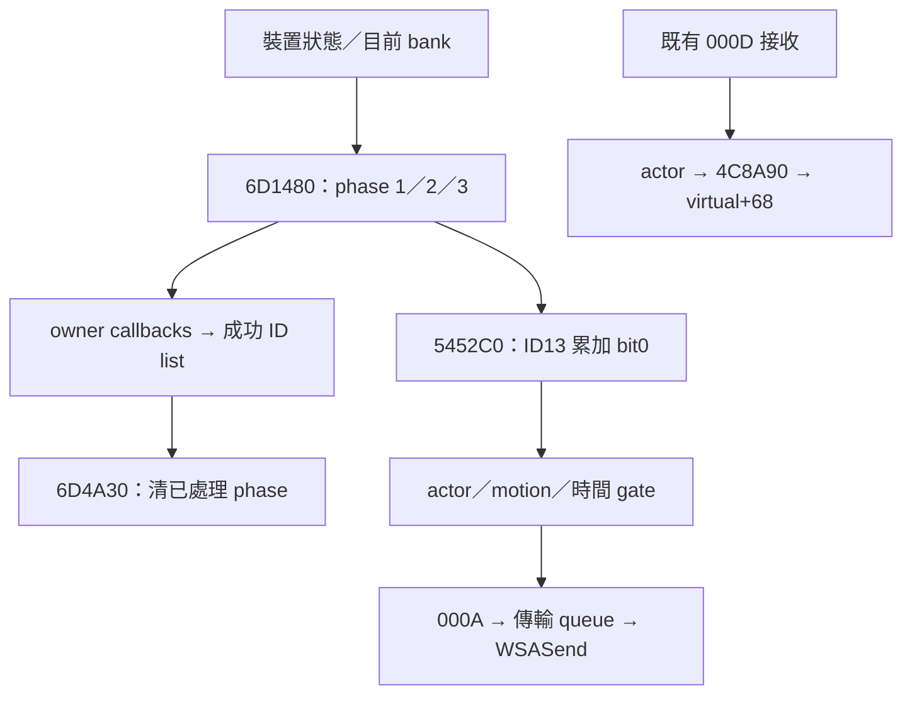

# T10-101 — phase 非零 writer、成功事件消耗與戰鬥傳輸界面

## 交付範圍與結論

本段依使用者指示優先研究 phase writer、結果容器下游、vtable 與角色 motion；以短按 Z 為玩家情境檢查封包界面。只做原始 BIN 的離線讀取，沒有執行、附加、修改遊戲，沒有 Commit／Push，也沒有修改遠端 task owner／catalog。此檔是本段完整原稿，附有此次實際檢查的機器碼與資料視窗，不是交接摘要。

**本段重大增量**：

1. 找到真正普通 phase 非零 writer `0x6D1480`：由實際 caller `0x4914AC..B1` 證明 ECX=`0xFB8830`，writer 的 `object+0x7D4` 正是 `0xFB9004`。40 個 byte 全部有前後幀比較，phase 1=按下、2=持續按住、3=放開、0=未按。這不是由 callback 名字猜出的語意。
2. 另有 `object+0x80C/+0x810` 的 8-byte record vector 在上述計算後覆寫 phase，隨後清空 vector；其 producer 未定位，不可將所有 phase1 都歸因實體按鍵。
3. 成功事件 list 已閉合至具體全域 `0xF95CD8`：manager=`0xF94810`、list offset=`+0x14C8`；`0x74F780` 交給目前 owner 的 `virtual+0x16C`，相容表指向 `0x5961C0`。同輪稍後 `0x490D40→0x6D4A30` 依 list 的 ID 清 phase，再由 `0x750550` 釋放 nodes。其用途已證實為輸入消耗／去重界面，**沒有證實為連段排程**。
4. 以 constructor 原始 stores 與 table bytes 確認兩組 owner vtable 的 `+0xEC/+0xF0/+0x16C` 實作，不再只有抽象 slot。這兩組不是全部角色或所有模式的實作。
5. ID13 的 phase1/2 在 `0x54543C..480` 置 controller `+0x5C` bit0；再經 `0x546780` 帶入 row input，並由 `0x5452C0` 的有條件批次路徑送往 C2S `0x000A`。因此現在已接通「邏輯 ID13 → 已知戰鬥發送管線」的靜態條件鏈，尚未宣稱每次實體 Z 都送一包。

## 來源、工具與地址映射

本地重新 SHA256：

- KR BIN：`9741d1975327b9309d82b52f631165bc410757694d7c183a5eed970a53ebef91`。
- EXE：`03771b8e1c1e66248f54585fadf9a5e926eb77228721325bb9be5febc53b3b5f`。
- 第一手檔案為本對話提供的 BIN／EXE；EXE 只驗版本，研究地址全部為 BIN PE32 ImageBase `0x400000`。
- 使用 GNU objdump Intel x86 靜態反組譯與 Python struct 讀取 PE／DWORD；本環境沒有 capstone，沒有假稱啟動 REA／Ghidra。GitHub bulk Ghidra 偽碼只作導航，核心結論均以下附 BIN 指令為據。線性 disassembly 的跳表資料不當作指令；不宣稱全量 CFG 語意審核。

| Section | VA | raw | VirtualSize | SizeOfRawData |
|---|---:|---:|---:|---:|
| .text | 0x401000 | 0x400 | 8192496 | 8192512 |
| .rdata | 0xBD2000 | 0x7D0600 | 1630332 | 1630720 |
| .data | 0xD61000 | 0x95E800 | 2651096 | 2275328 |
| .rsrc | 0xFE9000 | 0xB8A000 | 372568 | 372736 |

.text raw=VA−0x400C00；.rdata raw=VA−0x401A00。**FB9004 等全域落於 .data 的 zero-fill 虛擬尾部，不存在相同意義的檔案初始 bytes，不能套用 raw 映射讀出其執行時內容。** 對全域的證據來自 .text 的實際取址、寫入與 def-use。

## 遠端規範與導航核對

已讀目前 main 的 AGENTS.md、HANDOFF.md、shared/CLIENT-MODIFICATION-POLICY.md、T10 README/task.json、T01-BULK-20261026-02 與 T01-20261028-06 README。T10 仍未認領／未完成，README 未列 T01 NEEDS_FIX 專區；不因本段分析改寫 native_complete。AGENTS 的 owner 登記要求涉及遠端寫入，依使用者本次明確「不得 Commit／Push」權限保留遠端原狀，研究限本地交付。

讀取的導航及 Git blob SHA：

- `AGENTS.md`：a1dcfdb989c47162a081632c2bdd8a5297491cef。
- `kr/tasks/T10/task.json`：5ffeb6a3e375513d463bf3550e6c9891b6ecccc3。
- bulk `functions/0x6d1480.c`：6f7613d0c5f1c2a83369c79d2e4ea9471dba7352。
- bulk `functions/0x5961c0.c`：09a15b7b169d3b820638ff20c3148995c16aaa58。
- bulk `functions/0x597380.c`：37e098a58fb1d67d7596dc06233be2f0782cf331。
- `kr/evidence/1e15689d7bbdf4c4a83ae76cf1813d538b8cb38db79098c6b85ba386056dab36.txt`：3710f1360acbac739247ffd9cbdb8cee054349c4（T02 傳輸鏈引用）。
- `kr/evidence/91830956fb04388f5eabd1c876f283c6e78e9f001e953e978345472ff3572866.txt`：686a9def33b3484031cc62b4a6d8d4a3a6549add（motion16 邊界／拾取後續更正）。
- `unclassified/evidence/7bafd3143273877097a98dd0c42dc0f1c7e30719d0e86821318db4612473f89f.txt`：a0a294ab559bebd5004ed5b781fdaf0f7cc865fd（控制器、S2C0D 導航）。

bulk 根目錄固定為 `kr-bulk-roy/9741d1975327b9309d82b52f631165bc410757694d7c183a5eed970a53ebef91/`。嘗試 `0x4910c0.c` 返回404；沒有把它當入口，後由 BIN prologue 確認上層函式入口為 `0x490FE0`。舊 T10-097 已讀回，其「結果 list 不等連段 queue」的界線保留。

## 一、phase writer：基址、鍵位 bank 與前後幀方向

`0x4914AC mov ecx,0xFB8830; 0x4914B1 call 0x6D1480` 是具體 caller，不是字面量掃描推測。`0x6D14AB` 保存 ECX 到 EDI、`[ebp-0x48]`；若 `+0x7FC` 為0，預設指向 `object+4`，否則使用目前 bank。`0x6D1A70` 寫 `FB902C = FB8834 + bank*0x280`；FB902C 正是 FB8830+7FC，所以選 bank 確實影響此次事件 producer。另核對6D0750初始化：6D0808 push2／6D080A call6D1A70，初始選第三工作bank；這不代表工作bank2內容等同XML Type0，也不代表其後不會切換。

資料結構暫名 InputMappingState（無符號，不宣稱原版類別名）：

| Offset | 已確認用途 | 全域地址（base=FB8830） |
|---:|---|---:|
| +4 | bank0 第一個 16-byte vector descriptor | FB8834 |
| +0x7AC | 前一次完成更新的40個映射後按住 byte | FB8FDC |
| +0x7D4 | 40個 phase byte | FB9004 |
| +0x7FC | 目前 bank 指標 | FB902C |
| +0x800 | bank 選號保存 | FB9030 |
| +0x808 | 額外事件路徑旗標 | FB9038 |
| +0x80C/+0x810/+0x814 | phase 覆寫 vector 的 begin/end/capacity（後者初始化與析構可見） | FB903C/40/44 |

producer 讀 `[FBA80C]` input manager，依 `+0x20` 選 `+0x60` 或 `+0x260` 的256-byte鍵狀態視圖。每個 bank slot stride0x10，vector 內每筆 packed DWORD：低8位為鍵索引，bits16..23 為 modifier 索引。鍵索引0跳過；modifier0在 Ctrl候選索引0x1D/0x9D任一非零時被抑制，非零 modifier 則查該索引。OR所有有效鍵狀態後正規化為0／0x80，寫入本次局部40-byte陣列。

`0x6D18D7..1915` 的 ID5 與 ID1..4 重映射至6..9 另行保留；不能把方向 ID 混作13。額外輸入 `0x6F33F0`、FC1800/FC1820 等表也能影響局部陣列；本段未完整還原這些來源。

核心演算法在 `0x6D1915..19CD`：舊值從 object+7AC 讀，本次值從局部陣列讀，先算 phase，再把局部複製回 object+7AC。因此：

| 舊按住值 | 本次按住值 | phase | 語意（以正規化狀態為界） |
|---:|---:|---:|---|
| 0 | 0 | 0 | 持續未按 |
| 0 | 0x80 | 1 | 按下邊沿 |
| 0x80 | 0x80 | 2 | 持續按住 |
| 0x80 | 0 | 3 | 放開邊沿 |

```cpp
// 暫定偽碼；old/new均為0或0x80
phase[i] = old[i] != now[i] ? ((old[i] | 0x40) >> 6)
                               : ((old[i] >> 6) & 2);
memcpy(old, now, 40);
for (record : overrides) phase[record.id] = record.value;
overrides.end = overrides.begin;
```

8次迴圈、每次5個byte，合計40。`0x6D19F2` 的覆寫未見此處 bounds check，不能捏造其producer必定合法；本段只確認 record為8 bytes、ID DWORD + phase byte。**未找到覆寫 record 的追加者，不能聲稱來源已完整閉合。**

KeyMapping Type0 Key44/MapButton13 仍引用交接；本段已證實 packed key index 直接用於256-byte狀態視圖，但沒有完成 DirectInput 建構／裝置格式到該視圖的全鏈驗證，故「實體 Z」仍是有明確剩餘缺口的候選。不能宣稱目前玩家 bank0、自訂配置或鍵盤模式已知。

## 二、成功事件 list 的 downstream 與生命週期

全域 manager `M=0xF94810` 在 `0x74D9C3` 寫入 vtable `0xC4790C`。`M+14C8=0xF95CD8` 是結果 list，`+14CC` count。初始化 `0x74DBCF..DBF1`：count=0、配置0xC sentinel、雙向自指。

已驗證 manager vtable（.rdata 原始DWORD）：

| byte slot | target | 本段用途 |
|---:|---:|---|
| +4 | 750100 | update 第一階段，僅導航，未完整語意驗收 |
| +0x18 | 74F3B0 | 本段未完整展開 |
| +0x1C | 74F780 | 送出 owner 輸入分派與結果 list |
| +0x20 | 750050 | 另一個 +1480 list 更新／清理，**不是結果list** |
| +0x24 | 7500D0 | manager計時累加 |

`0x58A721 mov esi,F94810; call 750550`：750550先清空上一輪list及釋放nodes，再作update；若 M+13C4 非零、M+140C為0，依 manager virtual+18、+1C 執行。+1C實作74F780若 M+13D0存在且其virtual+84回傳非零則跳過；否則對 `[M+13C4]` owner 呼叫 virtual+16C，傳 `&M->resultList`。

`0x5961C0` 的相容 vtable+16C 實作追加成功事件ID，node `{next,prev,id}`，成功狀態不是伺服器接受。phase1走+EC，phase3走+F0，其他phase不走這兩個普通邊沿callback（不等遊戲其他consumer不讀phase2）。

下一次上層更新的已確認同路徑順序：`0x4914B1` 重新生成phase → `0x49152B` 呼叫58A250（其中750550清舊list並生成本輪list）→ `0x491530` 呼叫490D40 → `0x490DFC` 呼叫6D4A30(flag,&F95CD8)。6D4A30若flag非零全部清phase；flag為0且FB8830全域gate非零亦有全清；一般路徑遍歷成功ID，普通ID在6D4CAE清FB9004+ID，特殊ID查FDF630節點再清node+10。**這是同一個外層更新內分派後消耗；不是等下一次鍵盤scan才清phase。** list本身的node保留到下一次750550開頭再釋放。

需區分「生成本輪結果前清舊list」與「生成本輪結果後清對應phase」，這兩個清理時點不能顛倒。flag由FAADFA讀出，尚未還原其所有writer。此路徑能讓UI/owner成功處理的事件不再給下游讀到，但真正戰鬥tick與這個外層更新的跨系統總排程尚未完全定位，不能推定所有攔截一律擋普攻。

```cpp
// 暫定流程，條件詳原始片段
updateDevice();
updateMappedPhase(&mapping);       // 4914B1 -> 6D1480
updateUiAndDispatch();             // 49152B -> 58A250 -> 750550
consumeHandledPhase(flag, &list);  // 491530 -> 490D40 -> 6D4A30
// 下一次 updateUiAndDispatch 先釋放舊結果nodes
```

## 三、vtable 實作：已驗證兩組，不能直接命名攻擊回呼

| constructor/store | vtable base | +EC | +F0 | +16C |
|---|---:|---:|---:|---:|
| 595A95、595CAD | C1B36C | 597380 | 4067E0 | 5961C0 |
| 598872 | C1B5D4 | 59CC50 | 4067E0 | 5961C0 |

這裡table base不是僅以連續code pointers猜測，已由程式對物件首DWORD寫入驗證。`0x4067E0 xor al,al; ret4` 為固定false。`0x597380` 處理0x290D/0x2AF9並讀FB73E8；普通ID13不在其直接特例內，不能將它稱為AttackPress。`0x59CC50` 的主要switch範圍為0x2904..0x291A、另0x2AF9，其他轉`0x5A4B90`；後者普通13小於其switch下限0x283C，會進default（保留完整片段），沒有由這兩組owner得到「ID13啟動攻擊motion」的證據。

FB73E8非零writer仍未定位，本段沒有因找到phase writer就聲稱gate writer已解。角色motion用的actor+158和此owner+158是不同物件域，沒有混同。

## 四、ID13 到 C2S000A 的條件鏈與 motion gate

### 4.1 邏輯位元來源

`0x54543C` 檢查FB9011==1；否則`0x545477`檢查==2；兩者任一成立，`0x545480` 將controller+5C OR1。FB9011=FB9004+13，因此已由本段phase語意連成**按下／持按有效，放開phase3不直接置此bit**。

ID14/15相同處理分別OR2／OR4。其他ID22、24、25、26也可OR10／3／6／5；bit0不專屬ID13，不能逆向從封包bit0唯一推回Z。

`0x546780` 讀 `[controller+5C]` 入EBX；移動與其他輸入helper後，`0x5467F4` 寫 output WORD。`0x546100` 在條件成立時將輸入低15位寫 row+2；actor model>9、資料缺失、actor gate、狀態查詢、可用性54F270等均可阻止有效輸出或改變返回值。

### 4.2 一般控制器與 motion

已讀先前 T02/T10 導航，並重新 BIN 核對 CSingleController既有table `C0FAC4` 的+48=548A20、+2C=548A90（table bytes另附）。548A20若actor+38C==0x10或controller+A4非零，改輸出input=0，使用+BC控制一次性返回；否則尾跳546100。**motion0x10的名稱與普攻無直接證據；已有來源將相關本機路徑限定為拾取，不把它當普攻動畫。**

548A90先5452C0，再條件式49C5C0及544A00。這說明仍有本機互動路徑，不能推論所有動畫必等Server；但沒有找到基準Z普攻的本機先播證據。548A90尾部也讀ID13 phase1轉給544A00，故同一按鍵ID不只有戰鬥row consumer。

### 4.3 組包與發送條件

5452C0要求controller+4非零、+78為0、virtual+18回傳0、actor+C存在、FBA7B0有號值>0、時間差大於動態threshold。threshold從D6A62C/30/34/38依計數分支取值，再與2*[FB1318+BF74]取unsigned較大值。本段不替其定義毫秒或固定連段窗口。

每個主要slot還要求actor非空、slot+14有效、virtual+48回傳非零；特殊controller+58可改成零輸入。組包上限0x1000，最後長度>6才交網路。controller+5C在到達545B73後清零；若先前跳545B7D，清零被跳過，故可跨tick保存輸入bit。**不能把phase3當成取消既已保存的bit0，也不能從edge直接推每按一次=一包。**

| payload offset | width | 值來源 |
|---:|---:|---|
| 0 | WORD | 000A |
| 2 | DWORD | F93944，全語意未知 |
| 6+5n | WORD | actor+4 |
| 8+5n | WORD | controller virtual+48 產出的 input |
| 10+5n | BYTE | heading（通常actor+B0與helper輸出） |

長度為6+5N；N由真正通過的主要／額外slots決定，不能固定填11。545B69..B71傳len、FE38D0、slot0到network virtual+10。傳輸後端沿既有T02限定證據引用：8069A0→8060D0→806060→8061A0/804A40→8068B0→WSASend。附錄重讀上述helper bytes；封裝演算法、異步實際送出時間、socket錯誤重試不是此次完整重建。IAT BD25B8=WSASend由PE import核對，不把網路queue加入視為已成功上線。

## 五、S2C motion consumer 的有界核對

沿先前S2C000D導航，BIN的4B01C0以 `floor((length-2)/9)` 算筆數（length<2時0），每筆9 bytes：actor WORD、heading BYTE、motion WORD、float參數。用actor ID查FAB138樹，查不到走記錄錯誤；查到先actor virtual+58設方向，再將motion/float送4C8A90。不是只有本機actor能走這條共用路徑。

| 整包offset（第n筆） | width | consumer |
|---:|---:|---|
| 2+9n | WORD | actor查找 |
| 4+9n | BYTE | virtual+58方向 |
| 5+9n | WORD | motion，4C8A90最終movsx WORD |
| 7+9n | FLOAT | 傳actor virtual+68參數，確切語意未定名 |

4C8A90處理actor+D8/DC殘餘位移、方向附加元件後，於4C8B6B..7E呼叫actor virtual+68。共用呼叫在4B031A，之後才在4B0357比較actor+9C與F93930，且只對motion0x12有額外分支。故此處的本機／遠端差異不先於共用motion呼叫；不能把這個比較擴張成整場權威判定。

本段沒有重新定位socket receive→opcode0D註冊的全部上游，0D名稱仍明確屬既有證據引用；也沒有官方流量證明某次000A必回000D，更沒有本次靜態片段提供接受／拒絕的一一配對。motion編號對應哪一段普通攻擊、何時命中與連段裁決尚未知。

## 六、玩家情境矩陣與時序

| 情境 | Client判斷 | C→S | S→C | 動作結果 | 分工／證據 |
|---|---|---|---|---|---|
| 站立、短按實體Z | Key44/ID13仍需裝置索引與目前bank驗證 | 基準實體操作是否發送尚未確認 | 與該次按鍵配對回包未知 | 普攻起手／動畫先播未知 | 實體端到端未閉合 |
| 已映射ID13由未按變按住 | phase1；可被成功callback list清掉；若戰鬥producer讀到1則累加bit0 | 有條件進000A；不是固定一包 | 共用motion接收存在，配對未知 | actor狀態及motion16會影響輸出 | writer、bit來源已確認；完整遊玩部分確認 |
| ID13持按一輪 | phase2；邊沿dispatcher不為它呼叫EC/F0；戰鬥producer仍讀2置bit0 | 重複／節流由5452C0 gate控制，頻率未知 | 尚未確認 | 連段是否自動續接未知 | 靜態條件確認 |
| ID13放開 | phase3；普通edge走F0；不直接置bit0 | 此分支未編碼獨立release bit；其他路徑／先前累積bit可能仍送 | 尚未確認 | 不可推論立即停止攻擊 | 有界否定：只限54543C..480 |
| owner成功處理ID13 | 結果list記錄13；6D4A30清phase | 是否先於該模式戰鬥tick仍待排程核對 | 尚未確認 | 不可直接說UI必取消攻擊 | 消耗鏈確認，跨系統時序未知 |
| 收到既有0D motion記錄 | 查actor、方向、motion consumer | 不由此函式直接決定按鍵請求 | 2+9N結構、共用actor路徑 | virtual+68動作呼叫 | consumer確認，Server決策未知 |



圖中B→E與B→C不是已證實的跨系統先後順序；G與H沒有畫配對箭頭，因該配對尚未證實。C→D在所追外層更新內有callsite順序證據。

## 七、Server責任分級

- **Client／封包證據支持**：外部端若要相容此已知戰鬥路徑，需要理解000A的批次actor/input/heading格式；Client有外部motion記錄consumer。此為相容界面責任，不宣稱Server源碼已還原。
- **合理推測、尚欠原生裁決證據**：Server需做普攻合法性、連段接續、資源／冷卻／取消、廣播與拒絕修正；不可自行填時窗、每按一次的回覆數或motion對照。
- **分工未知**：基準Z攻擊何時起手、本機預播是否存在、000A到0D因果配對、持按續段頻率、技能中Z／鍵盤移動／滑鼠移動的取消裁決。

## 八、搜尋覆蓋、失敗路徑與後續入口

本次先對整個BIN .text產生objdump線性導航，搜尋FB9004/FB9000/FB902x literals及5961C0指標。5961C0無直接E8 caller、存在多個.rdata pointer，最後以constructor與manager virtual+16C定位caller；不把無直接call誤判無caller。絕對phase搜尋只找到reset與reader，改查相對+7D4後找到6D19F2及其上游6D1915，並用4914AC的ECX閉合基址。否定搜尋不涵蓋所有別名、DLL或運算後指標。

保留缺口：

1. 6F input裝置建構／vtable+1C鍵狀態視圖到DIK44的原生裝置格式；接續6F1370、6F16B0、6F1790與實際裝置實作。
2. 覆寫vector record追加者：定位FB8830別名的+80C append，不能只grep FB903C。
3. 真正遊戲模式owner的construct／install至M+13C4、子物件761010、其EC/F0 concrete targets；本段兩張表只是已驗證例子。
4. controller `+5C bit0`與54F270/actor狀態的原版普攻語意，接續546100之+1F4角色資料及54F270；不將技能查詢混作普攻完整裁決。
5. 外層490FE0的phase消耗和實際548A90戰鬥tick的總排程順序；若phase已被吃掉，累積bit是否仍生效要分路查。
6. FB73E8非零writer、官方000A→0D配對與普攻motion表均未閉合。

第1輪T10-101已達重大新發現門檻：過往未知phase非零writer及語意、結果list具體消耗／釋放鏈皆有BIN第一手連續證據，並新增ID13→000A條件接口。因此T10-101-2／101-3 **未啟動**，不是捏造補充輪；本段可以結束，但不宣稱普通攻擊系統完成。下一正式段可從上述實體輸入格式／戰鬥排程阻塞延伸。

## 附錄A：本次原始 BIN 指令摘錄（VA／bytes／raw範圍）

下列由已驗證SHA的BIN直接反組譯；每段給text VA與raw，完整保留本段用到的周邊分支。int3 padding、jump-table bytes僅供原始核對，不將其反組譯結果認成可執行CFG。函式命名皆以地址為準。

### VA 0x00444960..0x004449C2（exclusive），raw 0x43D60..0x43DC2

```asm
  444960:	55                   	push   ebp
  444961:	8b ec                	mov    ebp,esp
  444963:	6a ff                	push   0xffffffff
  444965:	68 be 58 92 00       	push   0x9258be
  44496a:	64 a1 00 00 00 00    	mov    eax,fs:0x0
  444970:	50                   	push   eax
  444971:	a1 20 1f d6 00       	mov    eax,ds:0xd61f20
  444976:	33 c5                	xor    eax,ebp
  444978:	50                   	push   eax
  444979:	8d 45 f4             	lea    eax,[ebp-0xc]
  44497c:	64 a3 00 00 00 00    	mov    fs:0x0,eax
  444982:	b8 01 00 00 00       	mov    eax,0x1
  444987:	84 05 14 7c fb 00    	test   BYTE PTR ds:0xfb7c14,al
  44498d:	75 1f                	jne    0x4449ae
  44498f:	09 05 14 7c fb 00    	or     DWORD PTR ds:0xfb7c14,eax
  444995:	c7 45 fc 00 00 00 00 	mov    DWORD PTR [ebp-0x4],0x0
  44499c:	e8 af bd 28 00       	call   0x6d0750
  4449a1:	68 30 d5 bc 00       	push   0xbcd530
  4449a6:	e8 6f d9 44 00       	call   0x89231a
  4449ab:	83 c4 04             	add    esp,0x4
  4449ae:	b8 30 88 fb 00       	mov    eax,0xfb8830
  4449b3:	8b 4d f4             	mov    ecx,DWORD PTR [ebp-0xc]
  4449b6:	64 89 0d 00 00 00 00 	mov    DWORD PTR fs:0x0,ecx
  4449bd:	59                   	pop    ecx
  4449be:	8b e5                	mov    esp,ebp
  4449c0:	5d                   	pop    ebp
  4449c1:	c3                   	ret
```

### VA 0x00490D40..0x00490E14（exclusive），raw 0x90140..0x90214

```asm
  490d40:	55                   	push   ebp
  490d41:	8b ec                	mov    ebp,esp
  490d43:	6a ff                	push   0xffffffff
  490d45:	68 ea 79 92 00       	push   0x9279ea
  490d4a:	64 a1 00 00 00 00    	mov    eax,fs:0x0
  490d50:	50                   	push   eax
  490d51:	51                   	push   ecx
  490d52:	53                   	push   ebx
  490d53:	a1 20 1f d6 00       	mov    eax,ds:0xd61f20
  490d58:	33 c5                	xor    eax,ebp
  490d5a:	50                   	push   eax
  490d5b:	8d 45 f4             	lea    eax,[ebp-0xc]
  490d5e:	64 a3 00 00 00 00    	mov    fs:0x0,eax
  490d64:	bb 01 00 00 00       	mov    ebx,0x1
  490d69:	84 1d d4 ad fa 00    	test   BYTE PTR ds:0xfaadd4,bl
  490d6f:	75 26                	jne    0x490d97
  490d71:	09 1d d4 ad fa 00    	or     DWORD PTR ds:0xfaadd4,ebx
  490d77:	c7 45 fc 00 00 00 00 	mov    DWORD PTR [ebp-0x4],0x0
  490d7e:	e8 fd 66 0f 00       	call   0x587480
  490d83:	68 c0 cc bc 00       	push   0xbcccc0
  490d88:	e8 8d 15 40 00       	call   0x89231a
  490d8d:	83 c4 04             	add    esp,0x4
  490d90:	c7 45 fc ff ff ff ff 	mov    DWORD PTR [ebp-0x4],0xffffffff
  490d97:	84 1d d0 ad fa 00    	test   BYTE PTR ds:0xfaadd0,bl
  490d9d:	75 22                	jne    0x490dc1
  490d9f:	09 1d d0 ad fa 00    	or     DWORD PTR ds:0xfaadd0,ebx
  490da5:	89 5d fc             	mov    DWORD PTR [ebp-0x4],ebx
  490da8:	e8 e3 cb 2b 00       	call   0x74d990
  490dad:	68 70 cc bc 00       	push   0xbccc70
  490db2:	e8 63 15 40 00       	call   0x89231a
  490db7:	83 c4 04             	add    esp,0x4
  490dba:	c7 45 fc ff ff ff ff 	mov    DWORD PTR [ebp-0x4],0xffffffff
  490dc1:	84 1d d4 ad fa 00    	test   BYTE PTR ds:0xfaadd4,bl
  490dc7:	75 26                	jne    0x490def
  490dc9:	09 1d d4 ad fa 00    	or     DWORD PTR ds:0xfaadd4,ebx
  490dcf:	c7 45 fc 02 00 00 00 	mov    DWORD PTR [ebp-0x4],0x2
  490dd6:	e8 a5 66 0f 00       	call   0x587480
  490ddb:	68 c0 cc bc 00       	push   0xbcccc0
  490de0:	e8 35 15 40 00       	call   0x89231a
  490de5:	83 c4 04             	add    esp,0x4
  490de8:	c7 45 fc ff ff ff ff 	mov    DWORD PTR [ebp-0x4],0xffffffff
  490def:	0f b6 05 fa ad fa 00 	movzx  eax,BYTE PTR ds:0xfaadfa
  490df6:	68 d8 5c f9 00       	push   0xf95cd8
  490dfb:	50                   	push   eax
  490dfc:	e8 2f 3c 24 00       	call   0x6d4a30
  490e01:	83 c4 08             	add    esp,0x8
  490e04:	8b 4d f4             	mov    ecx,DWORD PTR [ebp-0xc]
  490e07:	64 89 0d 00 00 00 00 	mov    DWORD PTR fs:0x0,ecx
  490e0e:	59                   	pop    ecx
  490e0f:	5b                   	pop    ebx
  490e10:	8b e5                	mov    esp,ebp
  490e12:	5d                   	pop    ebp
  490e13:	c3                   	ret
```

### VA 0x004913D0..0x00491541（exclusive），raw 0x907D0..0x90941

```asm
  4913d1:	83 0d 90 43 f9 00 01 	or     DWORD PTR ds:0xf94390,0x1
  4913d8:	c7 84 24 58 03 00 00 	mov    DWORD PTR [esp+0x358],0x5
  4913df:	05 00 00 00 
  4913e3:	e8 a8 01 05 00       	call   0x4e1590
  4913e8:	68 80 cc bc 00       	push   0xbccc80
  4913ed:	e8 28 0f 40 00       	call   0x89231a
  4913f2:	83 c4 04             	add    esp,0x4
  4913f5:	c7 84 24 58 03 00 00 	mov    DWORD PTR [esp+0x358],0xffffffff
  4913fc:	ff ff ff ff 
  491400:	bf e0 d9 f8 00       	mov    edi,0xf8d9e0
  491405:	e8 56 08 05 00       	call   0x4e1c60
  49140a:	a1 0c a8 fb 00       	mov    eax,ds:0xfba80c
  49140f:	33 db                	xor    ebx,ebx
  491411:	3b c3                	cmp    eax,ebx
  491413:	75 21                	jne    0x491436
  491415:	68 7c 05 00 00       	push   0x57c
  49141a:	e8 49 fe 3f 00       	call   0x891268
  49141f:	83 c4 04             	add    esp,0x4
  491422:	3b c3                	cmp    eax,ebx
  491424:	74 09                	je     0x49142f
  491426:	8b f0                	mov    esi,eax
  491428:	e8 43 ff 25 00       	call   0x6f1370
  49142d:	eb 02                	jmp    0x491431
  49142f:	33 c0                	xor    eax,eax
  491431:	a3 0c a8 fb 00       	mov    ds:0xfba80c,eax
  491436:	50                   	push   eax
  491437:	e8 74 02 26 00       	call   0x6f16b0
  49143c:	f6 05 70 1a fc 00 01 	test   BYTE PTR ds:0xfc1a70,0x1
  491443:	bf 01 00 00 00       	mov    edi,0x1
  491448:	75 22                	jne    0x49146c
  49144a:	09 3d 70 1a fc 00    	or     DWORD PTR ds:0xfc1a70,edi
  491450:	c7 84 24 58 03 00 00 	mov    DWORD PTR [esp+0x358],0x6
  491457:	06 00 00 00 
  49145b:	e8 f0 e7 23 00       	call   0x6cfc50
  491460:	83 ce ff             	or     esi,0xffffffff
  491463:	89 b4 24 58 03 00 00 	mov    DWORD PTR [esp+0x358],esi
  49146a:	eb 03                	jmp    0x49146f
  49146c:	83 ce ff             	or     esi,0xffffffff
  49146f:	68 78 1a fc 00       	push   0xfc1a78
  491474:	e8 77 e8 23 00       	call   0x6cfcf0
  491479:	f6 05 14 7c fb 00 01 	test   BYTE PTR ds:0xfb7c14,0x1
  491480:	75 2a                	jne    0x4914ac
  491482:	09 3d 14 7c fb 00    	or     DWORD PTR ds:0xfb7c14,edi
  491488:	c7 84 24 58 03 00 00 	mov    DWORD PTR [esp+0x358],0x7
  49148f:	07 00 00 00 
  491493:	e8 b8 f2 23 00       	call   0x6d0750
  491498:	68 30 d5 bc 00       	push   0xbcd530
  49149d:	e8 78 0e 40 00       	call   0x89231a
  4914a2:	83 c4 04             	add    esp,0x4
  4914a5:	89 b4 24 58 03 00 00 	mov    DWORD PTR [esp+0x358],esi
  4914ac:	b9 30 88 fb 00       	mov    ecx,0xfb8830
  4914b1:	e8 ca ff 23 00       	call   0x6d1480
  4914b6:	f6 05 ec f3 fd 00 01 	test   BYTE PTR ds:0xfdf3ec,0x1
  4914bd:	75 2a                	jne    0x4914e9
  4914bf:	09 3d ec f3 fd 00    	or     DWORD PTR ds:0xfdf3ec,edi
  4914c5:	c7 84 24 58 03 00 00 	mov    DWORD PTR [esp+0x358],0x8
  4914cc:	08 00 00 00 
  4914d0:	e8 cb 08 24 00       	call   0x6d1da0
  4914d5:	68 30 e3 bc 00       	push   0xbce330
  4914da:	e8 3b 0e 40 00       	call   0x89231a
  4914df:	83 c4 04             	add    esp,0x4
  4914e2:	89 b4 24 58 03 00 00 	mov    DWORD PTR [esp+0x358],esi
  4914e9:	68 f0 f3 fd 00       	push   0xfdf3f0
  4914ee:	e8 7d 29 24 00       	call   0x6d3e70
  4914f3:	f6 05 d4 ad fa 00 01 	test   BYTE PTR ds:0xfaadd4,0x1
  4914fa:	75 2a                	jne    0x491526
  4914fc:	09 3d d4 ad fa 00    	or     DWORD PTR ds:0xfaadd4,edi
  491502:	c7 84 24 58 03 00 00 	mov    DWORD PTR [esp+0x358],0x9
  491509:	09 00 00 00 
  49150d:	e8 6e 5f 0f 00       	call   0x587480
  491512:	68 c0 cc bc 00       	push   0xbcccc0
  491517:	e8 fe 0d 40 00       	call   0x89231a
  49151c:	83 c4 04             	add    esp,0x4
  49151f:	89 b4 24 58 03 00 00 	mov    DWORD PTR [esp+0x358],esi
  491526:	68 d8 ad fa 00       	push   0xfaadd8
  49152b:	e8 20 8d 0f 00       	call   0x58a250
  491530:	e8 0b f8 ff ff       	call   0x490d40
  491535:	8b 7c 24 20          	mov    edi,DWORD PTR [esp+0x20]
  491539:	8d 77 f8             	lea    esi,[edi-0x8]
  49153c:	e8 df f8 ff ff       	call   0x490e20
```

### VA 0x006D1480..0x006D1A6E（exclusive），raw 0x2D0880..0x2D0E6E

```asm
  6d1480:	55                   	push   ebp
  6d1481:	8b ec                	mov    ebp,esp
  6d1483:	6a ff                	push   0xffffffff
  6d1485:	68 5b 8a 92 00       	push   0x928a5b
  6d148a:	64 a1 00 00 00 00    	mov    eax,fs:0x0
  6d1490:	50                   	push   eax
  6d1491:	83 ec 6c             	sub    esp,0x6c
  6d1494:	a1 20 1f d6 00       	mov    eax,ds:0xd61f20
  6d1499:	33 c5                	xor    eax,ebp
  6d149b:	89 45 f0             	mov    DWORD PTR [ebp-0x10],eax
  6d149e:	53                   	push   ebx
  6d149f:	56                   	push   esi
  6d14a0:	57                   	push   edi
  6d14a1:	50                   	push   eax
  6d14a2:	8d 45 f4             	lea    eax,[ebp-0xc]
  6d14a5:	64 a3 00 00 00 00    	mov    fs:0x0,eax
  6d14ab:	8b f9                	mov    edi,ecx
  6d14ad:	83 bf fc 07 00 00 00 	cmp    DWORD PTR [edi+0x7fc],0x0
  6d14b4:	89 7d b8             	mov    DWORD PTR [ebp-0x48],edi
  6d14b7:	75 09                	jne    0x6d14c2
  6d14b9:	8d 47 04             	lea    eax,[edi+0x4]
  6d14bc:	89 87 fc 07 00 00    	mov    DWORD PTR [edi+0x7fc],eax
  6d14c2:	6a 27                	push   0x27
  6d14c4:	8d 4d c9             	lea    ecx,[ebp-0x37]
  6d14c7:	6a 00                	push   0x0
  6d14c9:	51                   	push   ecx
  6d14ca:	c6 45 c8 00          	mov    BYTE PTR [ebp-0x38],0x0
  6d14ce:	e8 8d d3 1c 00       	call   0x89e860
  6d14d3:	a1 0c a8 fb 00       	mov    eax,ds:0xfba80c
  6d14d8:	83 c4 0c             	add    esp,0xc
  6d14db:	85 c0                	test   eax,eax
  6d14dd:	75 21                	jne    0x6d1500
  6d14df:	68 7c 05 00 00       	push   0x57c
  6d14e4:	e8 7f fd 1b 00       	call   0x891268
  6d14e9:	83 c4 04             	add    esp,0x4
  6d14ec:	85 c0                	test   eax,eax
  6d14ee:	74 09                	je     0x6d14f9
  6d14f0:	8b f0                	mov    esi,eax
  6d14f2:	e8 79 fe 01 00       	call   0x6f1370
  6d14f7:	eb 02                	jmp    0x6d14fb
  6d14f9:	33 c0                	xor    eax,eax
  6d14fb:	a3 0c a8 fb 00       	mov    ds:0xfba80c,eax
  6d1500:	83 78 20 00          	cmp    DWORD PTR [eax+0x20],0x0
  6d1504:	75 07                	jne    0x6d150d
  6d1506:	05 60 02 00 00       	add    eax,0x260
  6d150b:	eb 03                	jmp    0x6d1510
  6d150d:	83 c0 60             	add    eax,0x60
  6d1510:	80 78 1d 00          	cmp    BYTE PTR [eax+0x1d],0x0
  6d1514:	89 45 c4             	mov    DWORD PTR [ebp-0x3c],eax
  6d1517:	c6 45 c3 00          	mov    BYTE PTR [ebp-0x3d],0x0
  6d151b:	75 09                	jne    0x6d1526
  6d151d:	80 b8 9d 00 00 00 00 	cmp    BYTE PTR [eax+0x9d],0x0
  6d1524:	74 04                	je     0x6d152a
  6d1526:	c6 45 c3 01          	mov    BYTE PTR [ebp-0x3d],0x1
  6d152a:	8b bf fc 07 00 00    	mov    edi,DWORD PTR [edi+0x7fc]
  6d1530:	33 db                	xor    ebx,ebx
  6d1532:	89 7d bc             	mov    DWORD PTR [ebp-0x44],edi
  6d1535:	eb 03                	jmp    0x6d153a
  6d1537:	8b 7d bc             	mov    edi,DWORD PTR [ebp-0x44]
  6d153a:	8b 0f                	mov    ecx,DWORD PTR [edi]
  6d153c:	8b 47 04             	mov    eax,DWORD PTR [edi+0x4]
  6d153f:	2b c1                	sub    eax,ecx
  6d1541:	c1 f8 02             	sar    eax,0x2
  6d1544:	85 c0                	test   eax,eax
  6d1546:	74 47                	je     0x6d158f
  6d1548:	8b f1                	mov    esi,ecx
  6d154a:	8b f8                	mov    edi,eax
  6d154c:	8d 64 24 00          	lea    esp,[esp+0x0]
  6d1550:	8b 0e                	mov    ecx,DWORD PTR [esi]
  6d1552:	8b c1                	mov    eax,ecx
  6d1554:	c1 e8 10             	shr    eax,0x10
  6d1557:	ba 01 00 00 00       	mov    edx,0x1
  6d155c:	84 c0                	test   al,al
  6d155e:	74 0c                	je     0x6d156c
  6d1560:	8b 55 c4             	mov    edx,DWORD PTR [ebp-0x3c]
  6d1563:	0f b6 c0             	movzx  eax,al
  6d1566:	0f b6 14 10          	movzx  edx,BYTE PTR [eax+edx*1]
  6d156a:	eb 08                	jmp    0x6d1574
  6d156c:	80 7d c3 00          	cmp    BYTE PTR [ebp-0x3d],0x0
  6d1570:	74 02                	je     0x6d1574
  6d1572:	33 d2                	xor    edx,edx
  6d1574:	84 c9                	test   cl,cl
  6d1576:	74 11                	je     0x6d1589
  6d1578:	85 d2                	test   edx,edx
  6d157a:	74 0d                	je     0x6d1589
  6d157c:	0f b6 c1             	movzx  eax,cl
  6d157f:	8b 4d c4             	mov    ecx,DWORD PTR [ebp-0x3c]
  6d1582:	8a 14 08             	mov    dl,BYTE PTR [eax+ecx*1]
  6d1585:	08 54 1d c8          	or     BYTE PTR [ebp+ebx*1-0x38],dl
  6d1589:	83 c6 04             	add    esi,0x4
  6d158c:	4f                   	dec    edi
  6d158d:	75 c1                	jne    0x6d1550
  6d158f:	80 7c 1d c8 00       	cmp    BYTE PTR [ebp+ebx*1-0x38],0x0
  6d1594:	74 05                	je     0x6d159b
  6d1596:	c6 44 1d c8 80       	mov    BYTE PTR [ebp+ebx*1-0x38],0x80
  6d159b:	83 45 bc 10          	add    DWORD PTR [ebp-0x44],0x10
  6d159f:	43                   	inc    ebx
  6d15a0:	83 fb 28             	cmp    ebx,0x28
  6d15a3:	7c 92                	jl     0x6d1537
  6d15a5:	33 db                	xor    ebx,ebx
  6d15a7:	33 ff                	xor    edi,edi
  6d15a9:	89 5d a0             	mov    DWORD PTR [ebp-0x60],ebx
  6d15ac:	89 7d a4             	mov    DWORD PTR [ebp-0x5c],edi
  6d15af:	89 5d a8             	mov    DWORD PTR [ebp-0x58],ebx
  6d15b2:	89 5d fc             	mov    DWORD PTR [ebp-0x4],ebx
  6d15b5:	f6 05 28 88 fb 00 01 	test   BYTE PTR ds:0xfb8828,0x1
  6d15bc:	8d 73 01             	lea    esi,[ebx+0x1]
  6d15bf:	75 20                	jne    0x6d15e1
  6d15c1:	09 35 28 88 fb 00    	or     DWORD PTR ds:0xfb8828,esi
  6d15c7:	c6 45 fc 01          	mov    BYTE PTR [ebp-0x4],0x1
  6d15cb:	e8 80 e2 e7 ff       	call   0x54f850
  6d15d0:	68 80 d5 bc 00       	push   0xbcd580
  6d15d5:	e8 40 0d 1c 00       	call   0x89231a
  6d15da:	83 c4 04             	add    esp,0x4
  6d15dd:	c6 45 fc 00          	mov    BYTE PTR [ebp-0x4],0x0
  6d15e1:	80 3d 11 91 fb 00 00 	cmp    BYTE PTR ds:0xfb9111,0x0
  6d15e8:	74 40                	je     0x6d162a
  6d15ea:	a1 18 13 fb 00       	mov    eax,ds:0xfb1318
  6d15ef:	8b 70 10             	mov    esi,DWORD PTR [eax+0x10]
  6d15f2:	ff 15 5c 24 bd 00    	call   DWORD PTR ds:0xbd245c
  6d15f8:	3b c6                	cmp    eax,esi
  6d15fa:	75 29                	jne    0x6d1625
  6d15fc:	f6 05 6c 1a fc 00 01 	test   BYTE PTR ds:0xfc1a6c,0x1
  6d1603:	75 14                	jne    0x6d1619
  6d1605:	83 0d 6c 1a fc 00 01 	or     DWORD PTR ds:0xfc1a6c,0x1
  6d160c:	68 b0 e3 bc 00       	push   0xbce3b0
  6d1611:	e8 04 0d 1c 00       	call   0x89231a
  6d1616:	83 c4 04             	add    esp,0x4
  6d1619:	8d 4d a0             	lea    ecx,[ebp-0x60]
  6d161c:	51                   	push   ecx
  6d161d:	e8 ce 1d 02 00       	call   0x6f33f0
  6d1622:	8b 7d a4             	mov    edi,DWORD PTR [ebp-0x5c]
  6d1625:	be 01 00 00 00       	mov    esi,0x1
  6d162a:	f6 05 24 17 fc 00 01 	test   BYTE PTR ds:0xfc1724,0x1
  6d1631:	0f 85 88 00 00 00    	jne    0x6d16bf
  6d1637:	09 35 24 17 fc 00    	or     DWORD PTR ds:0xfc1724,esi
  6d163d:	c6 45 fc 02          	mov    BYTE PTR [ebp-0x4],0x2
  6d1641:	6a 30                	push   0x30
  6d1643:	89 1d 30 17 fc 00    	mov    DWORD PTR ds:0xfc1730,ebx
  6d1649:	e8 1a fc 1b 00       	call   0x891268
  6d164e:	83 c4 04             	add    esp,0x4
  6d1651:	3b c3                	cmp    eax,ebx
  6d1653:	0f 84 c4 00 00 00    	je     0x6d171d
  6d1659:	a3 2c 17 fc 00       	mov    ds:0xfc172c,eax
  6d165e:	89 00                	mov    DWORD PTR [eax],eax
  6d1660:	a1 2c 17 fc 00       	mov    eax,ds:0xfc172c
  6d1665:	89 40 04             	mov    DWORD PTR [eax+0x4],eax
  6d1668:	a1 2c 17 fc 00       	mov    eax,ds:0xfc172c
  6d166d:	89 40 08             	mov    DWORD PTR [eax+0x8],eax
  6d1670:	8b 15 2c 17 fc 00    	mov    edx,DWORD PTR ds:0xfc172c
  6d1676:	c6 42 2c 01          	mov    BYTE PTR [edx+0x2c],0x1
  6d167a:	a1 2c 17 fc 00       	mov    eax,ds:0xfc172c
  6d167f:	c6 40 2d 01          	mov    BYTE PTR [eax+0x2d],0x1
  6d1683:	68 3c 17 fc 00       	push   0xfc173c
  6d1688:	c6 45 fc 03          	mov    BYTE PTR [ebp-0x4],0x3
  6d168c:	e8 6f b5 ff ff       	call   0x6ccc00
  6d1691:	68 bc 17 fc 00       	push   0xfc17bc
  6d1696:	c6 45 fc 04          	mov    BYTE PTR [ebp-0x4],0x4
  6d169a:	e8 61 b5 ff ff       	call   0x6ccc00
  6d169f:	c6 45 fc 05          	mov    BYTE PTR [ebp-0x4],0x5
  6d16a3:	89 35 78 17 fc 00    	mov    DWORD PTR ds:0xfc1778,esi
  6d16a9:	e8 32 ba ff ff       	call   0x6cd0e0
  6d16ae:	68 c0 e3 bc 00       	push   0xbce3c0
  6d16b3:	e8 62 0c 1c 00       	call   0x89231a
  6d16b8:	83 c4 04             	add    esp,0x4
  6d16bb:	c6 45 fc 00          	mov    BYTE PTR [ebp-0x4],0x0
  6d16bf:	f6 05 70 1a fc 00 01 	test   BYTE PTR ds:0xfc1a70,0x1
  6d16c6:	75 13                	jne    0x6d16db
  6d16c8:	09 35 70 1a fc 00    	or     DWORD PTR ds:0xfc1a70,esi
  6d16ce:	c6 45 fc 06          	mov    BYTE PTR [ebp-0x4],0x6
  6d16d2:	e8 79 e5 ff ff       	call   0x6cfc50
  6d16d7:	c6 45 fc 00          	mov    BYTE PTR [ebp-0x4],0x0
  6d16db:	39 35 78 1a fc 00    	cmp    DWORD PTR ds:0xfc1a78,esi
  6d16e1:	0f 85 84 01 00 00    	jne    0x6d186b
  6d16e7:	8b c7                	mov    eax,edi
  6d16e9:	2b 45 a0             	sub    eax,DWORD PTR [ebp-0x60]
  6d16ec:	33 f6                	xor    esi,esi
  6d16ee:	c1 f8 02             	sar    eax,0x2
  6d16f1:	89 45 bc             	mov    DWORD PTR [ebp-0x44],eax
  6d16f4:	3b c3                	cmp    eax,ebx
  6d16f6:	0f 86 62 01 00 00    	jbe    0x6d185e
  6d16fc:	8b 3d 20 18 fc 00    	mov    edi,DWORD PTR ds:0xfc1820
  6d1702:	8b 47 04             	mov    eax,DWORD PTR [edi+0x4]
  6d1705:	80 78 19 00          	cmp    BYTE PTR [eax+0x19],0x0
  6d1709:	8b 5d a0             	mov    ebx,DWORD PTR [ebp-0x60]
  6d170c:	8b 14 b3             	mov    edx,DWORD PTR [ebx+esi*4]
  6d170f:	8b cf                	mov    ecx,edi
  6d1711:	75 38                	jne    0x6d174b
  6d1713:	39 50 0c             	cmp    DWORD PTR [eax+0xc],edx
  6d1716:	7d 29                	jge    0x6d1741
  6d1718:	8b 40 08             	mov    eax,DWORD PTR [eax+0x8]
  6d171b:	eb 28                	jmp    0x6d1745
  6d171d:	8d 4d bc             	lea    ecx,[ebp-0x44]
  6d1720:	51                   	push   ecx
  6d1721:	8d 4d 8c             	lea    ecx,[ebp-0x74]
  6d1724:	89 5d bc             	mov    DWORD PTR [ebp-0x44],ebx
  6d1727:	e8 7d f9 1b 00       	call   0x8910a9
  6d172c:	68 a8 57 c8 00       	push   0xc857a8
  6d1731:	8d 55 8c             	lea    edx,[ebp-0x74]
  6d1734:	52                   	push   edx
  6d1735:	c7 45 8c a4 2c bd 00 	mov    DWORD PTR [ebp-0x74],0xbd2ca4
  6d173c:	e8 af b2 1c 00       	call   0x89c9f0
  6d1741:	8b c8                	mov    ecx,eax
  6d1743:	8b 00                	mov    eax,DWORD PTR [eax]
  6d1745:	80 78 19 00          	cmp    BYTE PTR [eax+0x19],0x0
  6d1749:	74 c8                	je     0x6d1713
  6d174b:	89 4d c4             	mov    DWORD PTR [ebp-0x3c],ecx
  6d174e:	3b cf                	cmp    ecx,edi
  6d1750:	74 0a                	je     0x6d175c
  6d1752:	3b 51 0c             	cmp    edx,DWORD PTR [ecx+0xc]
  6d1755:	7c 05                	jl     0x6d175c
  6d1757:	8d 45 c4             	lea    eax,[ebp-0x3c]
  6d175a:	eb 06                	jmp    0x6d1762
  6d175c:	89 7d 98             	mov    DWORD PTR [ebp-0x68],edi
  6d175f:	8d 45 98             	lea    eax,[ebp-0x68]
  6d1762:	39 38                	cmp    DWORD PTR [eax],edi
  6d1764:	74 0c                	je     0x6d1772
  6d1766:	c7 04 b3 00 00 00 00 	mov    DWORD PTR [ebx+esi*4],0x0
  6d176d:	e9 d7 00 00 00       	jmp    0x6d1849
  6d1772:	8d 45 c4             	lea    eax,[ebp-0x3c]
  6d1775:	50                   	push   eax
  6d1776:	8d 45 9c             	lea    eax,[ebp-0x64]
  6d1779:	b9 0c 18 fc 00       	mov    ecx,0xfc180c
  6d177e:	89 55 c4             	mov    DWORD PTR [ebp-0x3c],edx
  6d1781:	e8 8a c3 f5 ff       	call   0x62db10
  6d1786:	8b 45 9c             	mov    eax,DWORD PTR [ebp-0x64]
  6d1789:	3b 05 10 18 fc 00    	cmp    eax,DWORD PTR ds:0xfc1810
  6d178f:	74 0c                	je     0x6d179d
  6d1791:	8b 48 14             	mov    ecx,DWORD PTR [eax+0x14]
  6d1794:	89 0c b3             	mov    DWORD PTR [ebx+esi*4],ecx
  6d1797:	8b 3d 20 18 fc 00    	mov    edi,DWORD PTR ds:0xfc1820
  6d179d:	8b 55 a0             	mov    edx,DWORD PTR [ebp-0x60]
  6d17a0:	8b 04 b2             	mov    eax,DWORD PTR [edx+esi*4]
  6d17a3:	8d 4d c4             	lea    ecx,[ebp-0x3c]
  6d17a6:	89 45 c4             	mov    DWORD PTR [ebp-0x3c],eax
  6d17a9:	51                   	push   ecx
  6d17aa:	8d 45 b4             	lea    eax,[ebp-0x4c]
  6d17ad:	b9 2c 18 fc 00       	mov    ecx,0xfc182c
  6d17b2:	e8 59 c3 f5 ff       	call   0x62db10
  6d17b7:	8b 5d b4             	mov    ebx,DWORD PTR [ebp-0x4c]
  6d17ba:	3b 1d 30 18 fc 00    	cmp    ebx,DWORD PTR ds:0xfc1830
  6d17c0:	0f 84 89 00 00 00    	je     0x6d184f
  6d17c6:	8b 55 b8             	mov    edx,DWORD PTR [ebp-0x48]
  6d17c9:	80 ba 08 08 00 00 00 	cmp    BYTE PTR [edx+0x808],0x0
  6d17d0:	75 7d                	jne    0x6d184f
  6d17d2:	f6 05 ec f3 fd 00 01 	test   BYTE PTR ds:0xfdf3ec,0x1
  6d17d9:	75 21                	jne    0x6d17fc
  6d17db:	83 0d ec f3 fd 00 01 	or     DWORD PTR ds:0xfdf3ec,0x1
  6d17e2:	c6 45 fc 07          	mov    BYTE PTR [ebp-0x4],0x7
  6d17e6:	e8 b5 05 00 00       	call   0x6d1da0
  6d17eb:	68 30 e3 bc 00       	push   0xbce330
  6d17f0:	e8 25 0b 1c 00       	call   0x89231a
  6d17f5:	83 c4 04             	add    esp,0x4
  6d17f8:	c6 45 fc 00          	mov    BYTE PTR [ebp-0x4],0x0
  6d17fc:	8b 7b 14             	mov    edi,DWORD PTR [ebx+0x14]
  6d17ff:	8d 45 c4             	lea    eax,[ebp-0x3c]
  6d1802:	50                   	push   eax
  6d1803:	8d 45 b0             	lea    eax,[ebp-0x50]
  6d1806:	b9 30 f6 fd 00       	mov    ecx,0xfdf630
  6d180b:	89 7d c4             	mov    DWORD PTR [ebp-0x3c],edi
  6d180e:	e8 ed d6 15 00       	call   0x82ef00
  6d1813:	8b 4d b0             	mov    ecx,DWORD PTR [ebp-0x50]
  6d1816:	3b 0d 34 f6 fd 00    	cmp    ecx,DWORD PTR ds:0xfdf634
  6d181c:	74 17                	je     0x6d1835
  6d181e:	89 7d 90             	mov    DWORD PTR [ebp-0x70],edi
  6d1821:	8d 45 90             	lea    eax,[ebp-0x70]
  6d1824:	bf 6c f6 fd 00       	mov    edi,0xfdf66c
  6d1829:	c7 45 94 01 00 00 00 	mov    DWORD PTR [ebp-0x6c],0x1
  6d1830:	e8 2b cd d4 ff       	call   0x41e560
  6d1835:	8b 55 a0             	mov    edx,DWORD PTR [ebp-0x60]
  6d1838:	8b 45 b8             	mov    eax,DWORD PTR [ebp-0x48]
  6d183b:	c7 04 b2 00 00 00 00 	mov    DWORD PTR [edx+esi*4],0x0
  6d1842:	c6 80 08 08 00 00 01 	mov    BYTE PTR [eax+0x808],0x1
  6d1849:	8b 3d 20 18 fc 00    	mov    edi,DWORD PTR ds:0xfc1820
  6d184f:	8b 45 bc             	mov    eax,DWORD PTR [ebp-0x44]
  6d1852:	46                   	inc    esi
  6d1853:	3b f0                	cmp    esi,eax
  6d1855:	0f 82 a7 fe ff ff    	jb     0x6d1702
  6d185b:	8b 7d a4             	mov    edi,DWORD PTR [ebp-0x5c]
  6d185e:	85 c0                	test   eax,eax
  6d1860:	75 09                	jne    0x6d186b
  6d1862:	8b 4d b8             	mov    ecx,DWORD PTR [ebp-0x48]
  6d1865:	88 81 08 08 00 00    	mov    BYTE PTR [ecx+0x808],al
  6d186b:	2b 7d a0             	sub    edi,DWORD PTR [ebp-0x60]
  6d186e:	33 db                	xor    ebx,ebx
  6d1870:	c1 ff 02             	sar    edi,0x2
  6d1873:	89 7d bc             	mov    DWORD PTR [ebp-0x44],edi
  6d1876:	85 ff                	test   edi,edi
  6d1878:	74 5d                	je     0x6d18d7
  6d187a:	8b 35 00 18 fc 00    	mov    esi,DWORD PTR ds:0xfc1800
  6d1880:	8b 7e 04             	mov    edi,DWORD PTR [esi+0x4]
  6d1883:	8b 55 a0             	mov    edx,DWORD PTR [ebp-0x60]
  6d1886:	8b 14 9a             	mov    edx,DWORD PTR [edx+ebx*4]
  6d1889:	8b c7                	mov    eax,edi
  6d188b:	80 78 19 00          	cmp    BYTE PTR [eax+0x19],0x0
  6d188f:	8b ce                	mov    ecx,esi
  6d1891:	75 14                	jne    0x6d18a7
  6d1893:	39 50 0c             	cmp    DWORD PTR [eax+0xc],edx
  6d1896:	7d 05                	jge    0x6d189d
  6d1898:	8b 40 08             	mov    eax,DWORD PTR [eax+0x8]
  6d189b:	eb 04                	jmp    0x6d18a1
  6d189d:	8b c8                	mov    ecx,eax
  6d189f:	8b 00                	mov    eax,DWORD PTR [eax]
  6d18a1:	80 78 19 00          	cmp    BYTE PTR [eax+0x19],0x0
  6d18a5:	74 ec                	je     0x6d1893
  6d18a7:	89 4d b0             	mov    DWORD PTR [ebp-0x50],ecx
  6d18aa:	3b ce                	cmp    ecx,esi
  6d18ac:	74 0a                	je     0x6d18b8
  6d18ae:	3b 51 0c             	cmp    edx,DWORD PTR [ecx+0xc]
  6d18b1:	7c 05                	jl     0x6d18b8
  6d18b3:	8d 45 b0             	lea    eax,[ebp-0x50]
  6d18b6:	eb 06                	jmp    0x6d18be
  6d18b8:	89 75 b4             	mov    DWORD PTR [ebp-0x4c],esi
  6d18bb:	8d 45 b4             	lea    eax,[ebp-0x4c]
  6d18be:	8b 00                	mov    eax,DWORD PTR [eax]
  6d18c0:	3b c6                	cmp    eax,esi
  6d18c2:	74 0d                	je     0x6d18d1
  6d18c4:	8b 40 14             	mov    eax,DWORD PTR [eax+0x14]
  6d18c7:	83 f8 28             	cmp    eax,0x28
  6d18ca:	7d 05                	jge    0x6d18d1
  6d18cc:	c6 44 05 c8 80       	mov    BYTE PTR [ebp+eax*1-0x38],0x80
  6d18d1:	43                   	inc    ebx
  6d18d2:	3b 5d bc             	cmp    ebx,DWORD PTR [ebp-0x44]
  6d18d5:	72 ac                	jb     0x6d1883
  6d18d7:	80 7d cd 00          	cmp    BYTE PTR [ebp-0x33],0x0
  6d18db:	74 38                	je     0x6d1915
  6d18dd:	80 7d c9 00          	cmp    BYTE PTR [ebp-0x37],0x0
  6d18e1:	74 08                	je     0x6d18eb
  6d18e3:	c6 45 ce 80          	mov    BYTE PTR [ebp-0x32],0x80
  6d18e7:	c6 45 c9 00          	mov    BYTE PTR [ebp-0x37],0x0
  6d18eb:	80 7d cb 00          	cmp    BYTE PTR [ebp-0x35],0x0
  6d18ef:	74 08                	je     0x6d18f9
  6d18f1:	c6 45 d0 80          	mov    BYTE PTR [ebp-0x30],0x80
  6d18f5:	c6 45 cb 00          	mov    BYTE PTR [ebp-0x35],0x0
  6d18f9:	80 7d cc 00          	cmp    BYTE PTR [ebp-0x34],0x0
  6d18fd:	74 08                	je     0x6d1907
  6d18ff:	c6 45 d1 80          	mov    BYTE PTR [ebp-0x2f],0x80
  6d1903:	c6 45 cc 00          	mov    BYTE PTR [ebp-0x34],0x0
  6d1907:	80 7d ca 00          	cmp    BYTE PTR [ebp-0x36],0x0
  6d190b:	74 08                	je     0x6d1915
  6d190d:	c6 45 cf 80          	mov    BYTE PTR [ebp-0x31],0x80
  6d1911:	c6 45 ca 00          	mov    BYTE PTR [ebp-0x36],0x0
  6d1915:	8b 45 b8             	mov    eax,DWORD PTR [ebp-0x48]
  6d1918:	8d 55 c9             	lea    edx,[ebp-0x37]
  6d191b:	05 d4 07 00 00       	add    eax,0x7d4
  6d1920:	be 08 00 00 00       	mov    esi,0x8
  6d1925:	8a 48 d8             	mov    cl,BYTE PTR [eax-0x28]
  6d1928:	3a 4a ff             	cmp    cl,BYTE PTR [edx-0x1]
  6d192b:	0f b6 c9             	movzx  ecx,cl
  6d192e:	74 08                	je     0x6d1938
  6d1930:	83 c9 40             	or     ecx,0x40
  6d1933:	c1 e9 06             	shr    ecx,0x6
  6d1936:	eb 06                	jmp    0x6d193e
  6d1938:	c1 e9 06             	shr    ecx,0x6
  6d193b:	83 e1 02             	and    ecx,0x2
  6d193e:	88 08                	mov    BYTE PTR [eax],cl
  6d1940:	8a 48 d9             	mov    cl,BYTE PTR [eax-0x27]
  6d1943:	3a 0a                	cmp    cl,BYTE PTR [edx]
  6d1945:	0f b6 c9             	movzx  ecx,cl
  6d1948:	74 08                	je     0x6d1952
  6d194a:	83 c9 40             	or     ecx,0x40
  6d194d:	c1 e9 06             	shr    ecx,0x6
  6d1950:	eb 06                	jmp    0x6d1958
  6d1952:	c1 e9 06             	shr    ecx,0x6
  6d1955:	83 e1 02             	and    ecx,0x2
  6d1958:	88 48 01             	mov    BYTE PTR [eax+0x1],cl
  6d195b:	8a 48 da             	mov    cl,BYTE PTR [eax-0x26]
  6d195e:	3a 4a 01             	cmp    cl,BYTE PTR [edx+0x1]
  6d1961:	0f b6 c9             	movzx  ecx,cl
  6d1964:	74 08                	je     0x6d196e
  6d1966:	83 c9 40             	or     ecx,0x40
  6d1969:	c1 e9 06             	shr    ecx,0x6
  6d196c:	eb 06                	jmp    0x6d1974
  6d196e:	c1 e9 06             	shr    ecx,0x6
  6d1971:	83 e1 02             	and    ecx,0x2
  6d1974:	88 48 02             	mov    BYTE PTR [eax+0x2],cl
  6d1977:	8a 48 db             	mov    cl,BYTE PTR [eax-0x25]
  6d197a:	3a 4a 02             	cmp    cl,BYTE PTR [edx+0x2]
  6d197d:	0f b6 c9             	movzx  ecx,cl
  6d1980:	74 08                	je     0x6d198a
  6d1982:	83 c9 40             	or     ecx,0x40
  6d1985:	c1 e9 06             	shr    ecx,0x6
  6d1988:	eb 06                	jmp    0x6d1990
  6d198a:	c1 e9 06             	shr    ecx,0x6
  6d198d:	83 e1 02             	and    ecx,0x2
  6d1990:	88 48 03             	mov    BYTE PTR [eax+0x3],cl
  6d1993:	8a 48 dc             	mov    cl,BYTE PTR [eax-0x24]
  6d1996:	3a 4a 03             	cmp    cl,BYTE PTR [edx+0x3]
  6d1999:	0f b6 c9             	movzx  ecx,cl
  6d199c:	74 08                	je     0x6d19a6
  6d199e:	83 c9 40             	or     ecx,0x40
  6d19a1:	c1 e9 06             	shr    ecx,0x6
  6d19a4:	eb 06                	jmp    0x6d19ac
  6d19a6:	c1 e9 06             	shr    ecx,0x6
  6d19a9:	83 e1 02             	and    ecx,0x2
  6d19ac:	88 48 04             	mov    BYTE PTR [eax+0x4],cl
  6d19af:	83 c0 05             	add    eax,0x5
  6d19b2:	83 c2 05             	add    edx,0x5
  6d19b5:	4e                   	dec    esi
  6d19b6:	0f 85 69 ff ff ff    	jne    0x6d1925
  6d19bc:	8b 5d b8             	mov    ebx,DWORD PTR [ebp-0x48]
  6d19bf:	8d bb ac 07 00 00    	lea    edi,[ebx+0x7ac]
  6d19c5:	b9 0a 00 00 00       	mov    ecx,0xa
  6d19ca:	8d 75 c8             	lea    esi,[ebp-0x38]
  6d19cd:	f3 a5                	rep movs DWORD PTR es:[edi],DWORD PTR ds:[esi]
  6d19cf:	8b 8b 10 08 00 00    	mov    ecx,DWORD PTR [ebx+0x810]
  6d19d5:	2b 8b 0c 08 00 00    	sub    ecx,DWORD PTR [ebx+0x80c]
  6d19db:	33 c0                	xor    eax,eax
  6d19dd:	c1 f9 03             	sar    ecx,0x3
  6d19e0:	85 c9                	test   ecx,ecx
  6d19e2:	74 29                	je     0x6d1a0d
  6d19e4:	8b 93 0c 08 00 00    	mov    edx,DWORD PTR [ebx+0x80c]
  6d19ea:	8d 0c c2             	lea    ecx,[edx+eax*8]
  6d19ed:	8b 11                	mov    edx,DWORD PTR [ecx]
  6d19ef:	8a 49 04             	mov    cl,BYTE PTR [ecx+0x4]
  6d19f2:	88 8c 13 d4 07 00 00 	mov    BYTE PTR [ebx+edx*1+0x7d4],cl
  6d19f9:	8b 93 10 08 00 00    	mov    edx,DWORD PTR [ebx+0x810]
  6d19ff:	2b 93 0c 08 00 00    	sub    edx,DWORD PTR [ebx+0x80c]
  6d1a05:	40                   	inc    eax
  6d1a06:	c1 fa 03             	sar    edx,0x3
  6d1a09:	3b c2                	cmp    eax,edx
  6d1a0b:	72 d7                	jb     0x6d19e4
  6d1a0d:	8b 83 0c 08 00 00    	mov    eax,DWORD PTR [ebx+0x80c]
  6d1a13:	8b 93 10 08 00 00    	mov    edx,DWORD PTR [ebx+0x810]
  6d1a19:	3b c2                	cmp    eax,edx
  6d1a1b:	74 25                	je     0x6d1a42
  6d1a1d:	8b ca                	mov    ecx,edx
  6d1a1f:	3b d2                	cmp    edx,edx
  6d1a21:	74 19                	je     0x6d1a3c
  6d1a23:	8b f2                	mov    esi,edx
  6d1a25:	2b f0                	sub    esi,eax
  6d1a27:	8b 39                	mov    edi,DWORD PTR [ecx]
  6d1a29:	89 38                	mov    DWORD PTR [eax],edi
  6d1a2b:	8b 7c 06 04          	mov    edi,DWORD PTR [esi+eax*1+0x4]
  6d1a2f:	89 78 04             	mov    DWORD PTR [eax+0x4],edi
  6d1a32:	83 c1 08             	add    ecx,0x8
  6d1a35:	83 c0 08             	add    eax,0x8
  6d1a38:	3b ca                	cmp    ecx,edx
  6d1a3a:	75 eb                	jne    0x6d1a27
  6d1a3c:	89 83 10 08 00 00    	mov    DWORD PTR [ebx+0x810],eax
  6d1a42:	8b 45 a0             	mov    eax,DWORD PTR [ebp-0x60]
  6d1a45:	85 c0                	test   eax,eax
  6d1a47:	74 09                	je     0x6d1a52
  6d1a49:	50                   	push   eax
  6d1a4a:	e8 bd f7 1b 00       	call   0x89120c
  6d1a4f:	83 c4 04             	add    esp,0x4
  6d1a52:	8b 4d f4             	mov    ecx,DWORD PTR [ebp-0xc]
  6d1a55:	64 89 0d 00 00 00 00 	mov    DWORD PTR fs:0x0,ecx
  6d1a5c:	59                   	pop    ecx
  6d1a5d:	5f                   	pop    edi
  6d1a5e:	5e                   	pop    esi
  6d1a5f:	5b                   	pop    ebx
  6d1a60:	8b 4d f0             	mov    ecx,DWORD PTR [ebp-0x10]
  6d1a63:	33 cd                	xor    ecx,ebp
  6d1a65:	e8 97 f5 1b 00       	call   0x891001
  6d1a6a:	8b e5                	mov    esp,ebp
  6d1a6c:	5d                   	pop    ebp
  6d1a6d:	c3                   	ret
```

### VA 0x006D1A70..0x006D1B44（exclusive），raw 0x2D0E70..0x2D0F44

```asm
  6d1a70:	55                   	push   ebp
  6d1a71:	8b ec                	mov    ebp,esp
  6d1a73:	6a ff                	push   0xffffffff
  6d1a75:	68 2e ab 90 00       	push   0x90ab2e
  6d1a7a:	64 a1 00 00 00 00    	mov    eax,fs:0x0
  6d1a80:	50                   	push   eax
  6d1a81:	53                   	push   ebx
  6d1a82:	a1 20 1f d6 00       	mov    eax,ds:0xd61f20
  6d1a87:	33 c5                	xor    eax,ebp
  6d1a89:	50                   	push   eax
  6d1a8a:	8d 45 f4             	lea    eax,[ebp-0xc]
  6d1a8d:	64 a3 00 00 00 00    	mov    fs:0x0,eax
  6d1a93:	8b 5d 08             	mov    ebx,DWORD PTR [ebp+0x8]
  6d1a96:	83 fb 03             	cmp    ebx,0x3
  6d1a99:	0f 8d 95 00 00 00    	jge    0x6d1b34
  6d1a9f:	8d 04 9b             	lea    eax,[ebx+ebx*4]
  6d1aa2:	c1 e0 07             	shl    eax,0x7
  6d1aa5:	05 34 88 fb 00       	add    eax,0xfb8834
  6d1aaa:	a3 2c 90 fb 00       	mov    ds:0xfb902c,eax
  6d1aaf:	b8 01 00 00 00       	mov    eax,0x1
  6d1ab4:	89 1d 30 90 fb 00    	mov    DWORD PTR ds:0xfb9030,ebx
  6d1aba:	84 05 28 88 fb 00    	test   BYTE PTR ds:0xfb8828,al
  6d1ac0:	75 1f                	jne    0x6d1ae1
  6d1ac2:	09 05 28 88 fb 00    	or     DWORD PTR ds:0xfb8828,eax
  6d1ac8:	c7 45 fc 00 00 00 00 	mov    DWORD PTR [ebp-0x4],0x0
  6d1acf:	e8 7c dd e7 ff       	call   0x54f850
  6d1ad4:	68 80 d5 bc 00       	push   0xbcd580
  6d1ad9:	e8 3c 08 1c 00       	call   0x89231a
  6d1ade:	83 c4 04             	add    esp,0x4
  6d1ae1:	8a 0d eb 91 fb 00    	mov    cl,BYTE PTR ds:0xfb91eb
  6d1ae7:	8a c3                	mov    al,bl
  6d1ae9:	3a d9                	cmp    bl,cl
  6d1aeb:	76 02                	jbe    0x6d1aef
  6d1aed:	8a c1                	mov    al,cl
  6d1aef:	8a 0d ea 91 fb 00    	mov    cl,BYTE PTR ds:0xfb91ea
  6d1af5:	3a c1                	cmp    al,cl
  6d1af7:	73 02                	jae    0x6d1afb
  6d1af9:	8a c1                	mov    al,cl
  6d1afb:	a2 e9 91 fb 00       	mov    ds:0xfb91e9,al
  6d1b00:	33 c0                	xor    eax,eax
  6d1b02:	a3 04 90 fb 00       	mov    ds:0xfb9004,eax
  6d1b07:	a3 08 90 fb 00       	mov    ds:0xfb9008,eax
  6d1b0c:	a3 0c 90 fb 00       	mov    ds:0xfb900c,eax
  6d1b11:	a3 10 90 fb 00       	mov    ds:0xfb9010,eax
  6d1b16:	a3 14 90 fb 00       	mov    ds:0xfb9014,eax
  6d1b1b:	a3 18 90 fb 00       	mov    ds:0xfb9018,eax
  6d1b20:	a3 1c 90 fb 00       	mov    ds:0xfb901c,eax
  6d1b25:	a3 20 90 fb 00       	mov    ds:0xfb9020,eax
  6d1b2a:	a3 24 90 fb 00       	mov    ds:0xfb9024,eax
  6d1b2f:	a3 28 90 fb 00       	mov    ds:0xfb9028,eax
  6d1b34:	8b 4d f4             	mov    ecx,DWORD PTR [ebp-0xc]
  6d1b37:	64 89 0d 00 00 00 00 	mov    DWORD PTR fs:0x0,ecx
  6d1b3e:	59                   	pop    ecx
  6d1b3f:	5b                   	pop    ebx
  6d1b40:	8b e5                	mov    esp,ebp
  6d1b42:	5d                   	pop    ebp
  6d1b43:	c2 04 00             	ret    0x4
```

### VA 0x006D4A30..0x006D4CD2（exclusive），raw 0x2D3E30..0x2D40D2

```asm
  6d4a30:	55                   	push   ebp
  6d4a31:	8b ec                	mov    ebp,esp
  6d4a33:	6a ff                	push   0xffffffff
  6d4a35:	68 f0 68 92 00       	push   0x9268f0
  6d4a3a:	64 a1 00 00 00 00    	mov    eax,fs:0x0
  6d4a40:	50                   	push   eax
  6d4a41:	83 ec 0c             	sub    esp,0xc
  6d4a44:	53                   	push   ebx
  6d4a45:	56                   	push   esi
  6d4a46:	57                   	push   edi
  6d4a47:	a1 20 1f d6 00       	mov    eax,ds:0xd61f20
  6d4a4c:	33 c5                	xor    eax,ebp
  6d4a4e:	50                   	push   eax
  6d4a4f:	8d 45 f4             	lea    eax,[ebp-0xc]
  6d4a52:	64 a3 00 00 00 00    	mov    fs:0x0,eax
  6d4a58:	83 cb ff             	or     ebx,0xffffffff
  6d4a5b:	80 7d 08 00          	cmp    BYTE PTR [ebp+0x8],0x0
  6d4a5f:	8d 73 02             	lea    esi,[ebx+0x2]
  6d4a62:	0f 84 a2 00 00 00    	je     0x6d4b0a
  6d4a68:	f6 05 14 7c fb 00 01 	test   BYTE PTR ds:0xfb7c14,0x1
  6d4a6f:	75 22                	jne    0x6d4a93
  6d4a71:	09 35 14 7c fb 00    	or     DWORD PTR ds:0xfb7c14,esi
  6d4a77:	c7 45 fc 00 00 00 00 	mov    DWORD PTR [ebp-0x4],0x0
  6d4a7e:	e8 cd bc ff ff       	call   0x6d0750
  6d4a83:	68 30 d5 bc 00       	push   0xbcd530
  6d4a88:	e8 8d d8 1b 00       	call   0x89231a
  6d4a8d:	83 c4 04             	add    esp,0x4
  6d4a90:	89 5d fc             	mov    DWORD PTR [ebp-0x4],ebx
  6d4a93:	33 c0                	xor    eax,eax
  6d4a95:	f6 05 ec f3 fd 00 01 	test   BYTE PTR ds:0xfdf3ec,0x1
  6d4a9c:	a3 04 90 fb 00       	mov    ds:0xfb9004,eax
  6d4aa1:	a3 08 90 fb 00       	mov    ds:0xfb9008,eax
  6d4aa6:	a3 0c 90 fb 00       	mov    ds:0xfb900c,eax
  6d4aab:	a3 10 90 fb 00       	mov    ds:0xfb9010,eax
  6d4ab0:	a3 14 90 fb 00       	mov    ds:0xfb9014,eax
  6d4ab5:	a3 18 90 fb 00       	mov    ds:0xfb9018,eax
  6d4aba:	a3 1c 90 fb 00       	mov    ds:0xfb901c,eax
  6d4abf:	a3 20 90 fb 00       	mov    ds:0xfb9020,eax
  6d4ac4:	a3 24 90 fb 00       	mov    ds:0xfb9024,eax
  6d4ac9:	a3 28 90 fb 00       	mov    ds:0xfb9028,eax
  6d4ace:	75 1e                	jne    0x6d4aee
  6d4ad0:	09 35 ec f3 fd 00    	or     DWORD PTR ds:0xfdf3ec,esi
  6d4ad6:	89 75 fc             	mov    DWORD PTR [ebp-0x4],esi
  6d4ad9:	e8 c2 d2 ff ff       	call   0x6d1da0
  6d4ade:	68 30 e3 bc 00       	push   0xbce330
  6d4ae3:	e8 32 d8 1b 00       	call   0x89231a
  6d4ae8:	83 c4 04             	add    esp,0x4
  6d4aeb:	89 5d fc             	mov    DWORD PTR [ebp-0x4],ebx
  6d4aee:	bf 30 f6 fd 00       	mov    edi,0xfdf630
  6d4af3:	e8 58 ed 14 00       	call   0x823850
  6d4af8:	8b 4d f4             	mov    ecx,DWORD PTR [ebp-0xc]
  6d4afb:	64 89 0d 00 00 00 00 	mov    DWORD PTR fs:0x0,ecx
  6d4b02:	59                   	pop    ecx
  6d4b03:	5f                   	pop    edi
  6d4b04:	5e                   	pop    esi
  6d4b05:	5b                   	pop    ebx
  6d4b06:	8b e5                	mov    esp,ebp
  6d4b08:	5d                   	pop    ebp
  6d4b09:	c3                   	ret
  6d4b0a:	f6 05 14 7c fb 00 01 	test   BYTE PTR ds:0xfb7c14,0x1
  6d4b11:	75 22                	jne    0x6d4b35
  6d4b13:	09 35 14 7c fb 00    	or     DWORD PTR ds:0xfb7c14,esi
  6d4b19:	c7 45 fc 02 00 00 00 	mov    DWORD PTR [ebp-0x4],0x2
  6d4b20:	e8 2b bc ff ff       	call   0x6d0750
  6d4b25:	68 30 d5 bc 00       	push   0xbcd530
  6d4b2a:	e8 eb d7 1b 00       	call   0x89231a
  6d4b2f:	83 c4 04             	add    esp,0x4
  6d4b32:	89 5d fc             	mov    DWORD PTR [ebp-0x4],ebx
  6d4b35:	83 3d 30 88 fb 00 00 	cmp    DWORD PTR ds:0xfb8830,0x0
  6d4b3c:	74 5f                	je     0x6d4b9d
  6d4b3e:	f6 05 14 7c fb 00 01 	test   BYTE PTR ds:0xfb7c14,0x1
  6d4b45:	75 22                	jne    0x6d4b69
  6d4b47:	09 35 14 7c fb 00    	or     DWORD PTR ds:0xfb7c14,esi
  6d4b4d:	c7 45 fc 03 00 00 00 	mov    DWORD PTR [ebp-0x4],0x3
  6d4b54:	e8 f7 bb ff ff       	call   0x6d0750
  6d4b59:	68 30 d5 bc 00       	push   0xbcd530
  6d4b5e:	e8 b7 d7 1b 00       	call   0x89231a
  6d4b63:	83 c4 04             	add    esp,0x4
  6d4b66:	89 5d fc             	mov    DWORD PTR [ebp-0x4],ebx
  6d4b69:	33 c0                	xor    eax,eax
  6d4b6b:	a3 04 90 fb 00       	mov    ds:0xfb9004,eax
  6d4b70:	a3 08 90 fb 00       	mov    ds:0xfb9008,eax
  6d4b75:	a3 0c 90 fb 00       	mov    ds:0xfb900c,eax
  6d4b7a:	a3 10 90 fb 00       	mov    ds:0xfb9010,eax
  6d4b7f:	a3 14 90 fb 00       	mov    ds:0xfb9014,eax
  6d4b84:	a3 18 90 fb 00       	mov    ds:0xfb9018,eax
  6d4b89:	a3 1c 90 fb 00       	mov    ds:0xfb901c,eax
  6d4b8e:	a3 20 90 fb 00       	mov    ds:0xfb9020,eax
  6d4b93:	a3 24 90 fb 00       	mov    ds:0xfb9024,eax
  6d4b98:	a3 28 90 fb 00       	mov    ds:0xfb9028,eax
  6d4b9d:	f6 05 14 7c fb 00 01 	test   BYTE PTR ds:0xfb7c14,0x1
  6d4ba4:	75 22                	jne    0x6d4bc8
  6d4ba6:	09 35 14 7c fb 00    	or     DWORD PTR ds:0xfb7c14,esi
  6d4bac:	c7 45 fc 04 00 00 00 	mov    DWORD PTR [ebp-0x4],0x4
  6d4bb3:	e8 98 bb ff ff       	call   0x6d0750
  6d4bb8:	68 30 d5 bc 00       	push   0xbcd530
  6d4bbd:	e8 58 d7 1b 00       	call   0x89231a
  6d4bc2:	83 c4 04             	add    esp,0x4
  6d4bc5:	89 5d fc             	mov    DWORD PTR [ebp-0x4],ebx
  6d4bc8:	83 3d 30 88 fb 00 00 	cmp    DWORD PTR ds:0xfb8830,0x0
  6d4bcf:	74 35                	je     0x6d4c06
  6d4bd1:	f6 05 ec f3 fd 00 01 	test   BYTE PTR ds:0xfdf3ec,0x1
  6d4bd8:	75 22                	jne    0x6d4bfc
  6d4bda:	09 35 ec f3 fd 00    	or     DWORD PTR ds:0xfdf3ec,esi
  6d4be0:	c7 45 fc 05 00 00 00 	mov    DWORD PTR [ebp-0x4],0x5
  6d4be7:	e8 b4 d1 ff ff       	call   0x6d1da0
  6d4bec:	68 30 e3 bc 00       	push   0xbce330
  6d4bf1:	e8 24 d7 1b 00       	call   0x89231a
  6d4bf6:	83 c4 04             	add    esp,0x4
  6d4bf9:	89 5d fc             	mov    DWORD PTR [ebp-0x4],ebx
  6d4bfc:	bf 30 f6 fd 00       	mov    edi,0xfdf630
  6d4c01:	e8 4a ec 14 00       	call   0x823850
  6d4c06:	8b 45 0c             	mov    eax,DWORD PTR [ebp+0xc]
  6d4c09:	8b 00                	mov    eax,DWORD PTR [eax]
  6d4c0b:	8b 38                	mov    edi,DWORD PTR [eax]
  6d4c0d:	89 45 ec             	mov    DWORD PTR [ebp-0x14],eax
  6d4c10:	3b f8                	cmp    edi,eax
  6d4c12:	0f 84 a8 00 00 00    	je     0x6d4cc0
  6d4c18:	eb 06                	jmp    0x6d4c20
  6d4c1a:	8d 9b 00 00 00 00    	lea    ebx,[ebx+0x0]
  6d4c20:	8b 77 08             	mov    esi,DWORD PTR [edi+0x8]
  6d4c23:	8d 8e ef d8 ff ff    	lea    ecx,[esi-0x2711]
  6d4c29:	81 f9 0e 27 00 00    	cmp    ecx,0x270e
  6d4c2f:	77 51                	ja     0x6d4c82
  6d4c31:	f6 05 ec f3 fd 00 01 	test   BYTE PTR ds:0xfdf3ec,0x1
  6d4c38:	75 23                	jne    0x6d4c5d
  6d4c3a:	83 0d ec f3 fd 00 01 	or     DWORD PTR ds:0xfdf3ec,0x1
  6d4c41:	c7 45 fc 06 00 00 00 	mov    DWORD PTR [ebp-0x4],0x6
  6d4c48:	e8 53 d1 ff ff       	call   0x6d1da0
  6d4c4d:	68 30 e3 bc 00       	push   0xbce330
  6d4c52:	e8 c3 d6 1b 00       	call   0x89231a
  6d4c57:	83 c4 04             	add    esp,0x4
  6d4c5a:	89 5d fc             	mov    DWORD PTR [ebp-0x4],ebx
  6d4c5d:	8d 55 08             	lea    edx,[ebp+0x8]
  6d4c60:	52                   	push   edx
  6d4c61:	8d 45 f0             	lea    eax,[ebp-0x10]
  6d4c64:	b9 30 f6 fd 00       	mov    ecx,0xfdf630
  6d4c69:	89 75 08             	mov    DWORD PTR [ebp+0x8],esi
  6d4c6c:	e8 8f a2 15 00       	call   0x82ef00
  6d4c71:	8b 45 f0             	mov    eax,DWORD PTR [ebp-0x10]
  6d4c74:	3b 05 34 f6 fd 00    	cmp    eax,DWORD PTR ds:0xfdf634
  6d4c7a:	74 39                	je     0x6d4cb5
  6d4c7c:	c6 40 10 00          	mov    BYTE PTR [eax+0x10],0x0
  6d4c80:	eb 33                	jmp    0x6d4cb5
  6d4c82:	f6 05 14 7c fb 00 01 	test   BYTE PTR ds:0xfb7c14,0x1
  6d4c89:	75 23                	jne    0x6d4cae
  6d4c8b:	83 0d 14 7c fb 00 01 	or     DWORD PTR ds:0xfb7c14,0x1
  6d4c92:	c7 45 fc 07 00 00 00 	mov    DWORD PTR [ebp-0x4],0x7
  6d4c99:	e8 b2 ba ff ff       	call   0x6d0750
  6d4c9e:	68 30 d5 bc 00       	push   0xbcd530
  6d4ca3:	e8 72 d6 1b 00       	call   0x89231a
  6d4ca8:	83 c4 04             	add    esp,0x4
  6d4cab:	89 5d fc             	mov    DWORD PTR [ebp-0x4],ebx
  6d4cae:	c6 86 04 90 fb 00 00 	mov    BYTE PTR [esi+0xfb9004],0x0
  6d4cb5:	8b 3f                	mov    edi,DWORD PTR [edi]
  6d4cb7:	3b 7d ec             	cmp    edi,DWORD PTR [ebp-0x14]
  6d4cba:	0f 85 60 ff ff ff    	jne    0x6d4c20
  6d4cc0:	8b 4d f4             	mov    ecx,DWORD PTR [ebp-0xc]
  6d4cc3:	64 89 0d 00 00 00 00 	mov    DWORD PTR fs:0x0,ecx
  6d4cca:	59                   	pop    ecx
  6d4ccb:	5f                   	pop    edi
  6d4ccc:	5e                   	pop    esi
  6d4ccd:	5b                   	pop    ebx
  6d4cce:	8b e5                	mov    esp,ebp
  6d4cd0:	5d                   	pop    ebp
  6d4cd1:	c3                   	ret
```

### VA 0x006D4CE0..0x006D4DC0（exclusive），raw 0x2D40E0..0x2D41C0

```asm
  6d4ce0:	55                   	push   ebp
  6d4ce1:	8b ec                	mov    ebp,esp
  6d4ce3:	6a ff                	push   0xffffffff
  6d4ce5:	68 5c 68 92 00       	push   0x92685c
  6d4cea:	64 a1 00 00 00 00    	mov    eax,fs:0x0
  6d4cf0:	50                   	push   eax
  6d4cf1:	83 ec 08             	sub    esp,0x8
  6d4cf4:	a1 20 1f d6 00       	mov    eax,ds:0xd61f20
  6d4cf9:	33 c5                	xor    eax,ebp
  6d4cfb:	50                   	push   eax
  6d4cfc:	8d 45 f4             	lea    eax,[ebp-0xc]
  6d4cff:	64 a3 00 00 00 00    	mov    fs:0x0,eax
  6d4d05:	8d 86 ef d8 ff ff    	lea    eax,[esi-0x2711]
  6d4d0b:	3d 0e 27 00 00       	cmp    eax,0x270e
  6d4d10:	b8 01 00 00 00       	mov    eax,0x1
  6d4d15:	77 59                	ja     0x6d4d70
  6d4d17:	84 05 ec f3 fd 00    	test   BYTE PTR ds:0xfdf3ec,al
  6d4d1d:	75 1f                	jne    0x6d4d3e
  6d4d1f:	09 05 ec f3 fd 00    	or     DWORD PTR ds:0xfdf3ec,eax
  6d4d25:	c7 45 fc 00 00 00 00 	mov    DWORD PTR [ebp-0x4],0x0
  6d4d2c:	e8 6f d0 ff ff       	call   0x6d1da0
  6d4d31:	68 30 e3 bc 00       	push   0xbce330
  6d4d36:	e8 df d5 1b 00       	call   0x89231a
  6d4d3b:	83 c4 04             	add    esp,0x4
  6d4d3e:	8d 4d f0             	lea    ecx,[ebp-0x10]
  6d4d41:	51                   	push   ecx
  6d4d42:	8d 45 ec             	lea    eax,[ebp-0x14]
  6d4d45:	b9 30 f6 fd 00       	mov    ecx,0xfdf630
  6d4d4a:	89 75 f0             	mov    DWORD PTR [ebp-0x10],esi
  6d4d4d:	e8 ae a1 15 00       	call   0x82ef00
  6d4d52:	8b 45 ec             	mov    eax,DWORD PTR [ebp-0x14]
  6d4d55:	3b 05 34 f6 fd 00    	cmp    eax,DWORD PTR ds:0xfdf634
  6d4d5b:	74 51                	je     0x6d4dae
  6d4d5d:	0f b6 40 10          	movzx  eax,BYTE PTR [eax+0x10]
  6d4d61:	8b 4d f4             	mov    ecx,DWORD PTR [ebp-0xc]
  6d4d64:	64 89 0d 00 00 00 00 	mov    DWORD PTR fs:0x0,ecx
  6d4d6b:	59                   	pop    ecx
  6d4d6c:	8b e5                	mov    esp,ebp
  6d4d6e:	5d                   	pop    ebp
  6d4d6f:	c3                   	ret
  6d4d70:	84 05 14 7c fb 00    	test   BYTE PTR ds:0xfb7c14,al
  6d4d76:	75 1b                	jne    0x6d4d93
  6d4d78:	09 05 14 7c fb 00    	or     DWORD PTR ds:0xfb7c14,eax
  6d4d7e:	89 45 fc             	mov    DWORD PTR [ebp-0x4],eax
  6d4d81:	e8 ca b9 ff ff       	call   0x6d0750
  6d4d86:	68 30 d5 bc 00       	push   0xbcd530
  6d4d8b:	e8 8a d5 1b 00       	call   0x89231a
  6d4d90:	83 c4 04             	add    esp,0x4
  6d4d93:	83 fe 27             	cmp    esi,0x27
  6d4d96:	77 16                	ja     0x6d4dae
  6d4d98:	0f b6 86 04 90 fb 00 	movzx  eax,BYTE PTR [esi+0xfb9004]
  6d4d9f:	8b 4d f4             	mov    ecx,DWORD PTR [ebp-0xc]
  6d4da2:	64 89 0d 00 00 00 00 	mov    DWORD PTR fs:0x0,ecx
  6d4da9:	59                   	pop    ecx
  6d4daa:	8b e5                	mov    esp,ebp
  6d4dac:	5d                   	pop    ebp
  6d4dad:	c3                   	ret
  6d4dae:	33 c0                	xor    eax,eax
  6d4db0:	8b 4d f4             	mov    ecx,DWORD PTR [ebp-0xc]
  6d4db3:	64 89 0d 00 00 00 00 	mov    DWORD PTR fs:0x0,ecx
  6d4dba:	59                   	pop    ecx
  6d4dbb:	8b e5                	mov    esp,ebp
  6d4dbd:	5d                   	pop    ebp
  6d4dbe:	c3                   	ret
  6d4dbf:	cc                   	int3
```

### VA 0x00595A40..0x00595DC0（exclusive），raw 0x194E40..0x1951C0

```asm
  595a42:	64 89 0d 00 00 00 00 	mov    DWORD PTR fs:0x0,ecx
  595a49:	59                   	pop    ecx
  595a4a:	5f                   	pop    edi
  595a4b:	5e                   	pop    esi
  595a4c:	5b                   	pop    ebx
  595a4d:	8b 4c 24 10          	mov    ecx,DWORD PTR [esp+0x10]
  595a51:	33 cc                	xor    ecx,esp
  595a53:	e8 a9 b5 2f 00       	call   0x891001
  595a58:	8b e5                	mov    esp,ebp
  595a5a:	5d                   	pop    ebp
  595a5b:	c2 04 00             	ret    0x4
  595a5e:	cc                   	int3
  595a5f:	cc                   	int3
  595a60:	55                   	push   ebp
  595a61:	8b ec                	mov    ebp,esp
  595a63:	6a ff                	push   0xffffffff
  595a65:	68 27 2a 91 00       	push   0x912a27
  595a6a:	64 a1 00 00 00 00    	mov    eax,fs:0x0
  595a70:	50                   	push   eax
  595a71:	83 ec 10             	sub    esp,0x10
  595a74:	53                   	push   ebx
  595a75:	56                   	push   esi
  595a76:	a1 20 1f d6 00       	mov    eax,ds:0xd61f20
  595a7b:	33 c5                	xor    eax,ebp
  595a7d:	50                   	push   eax
  595a7e:	8d 45 f4             	lea    eax,[ebp-0xc]
  595a81:	64 a3 00 00 00 00    	mov    fs:0x0,eax
  595a87:	8b 75 08             	mov    esi,DWORD PTR [ebp+0x8]
  595a8a:	56                   	push   esi
  595a8b:	e8 d0 b2 1c 00       	call   0x760d60
  595a90:	33 db                	xor    ebx,ebx
  595a92:	89 5d fc             	mov    DWORD PTR [ebp-0x4],ebx
  595a95:	c7 06 6c b3 c1 00    	mov    DWORD PTR [esi],0xc1b36c
  595a9b:	6a 14                	push   0x14
  595a9d:	89 9e a8 00 00 00    	mov    DWORD PTR [esi+0xa8],ebx
  595aa3:	e8 c0 b7 2f 00       	call   0x891268
  595aa8:	83 c4 04             	add    esp,0x4
  595aab:	3b c3                	cmp    eax,ebx
  595aad:	0f 84 fc 00 00 00    	je     0x595baf
  595ab3:	89 86 a4 00 00 00    	mov    DWORD PTR [esi+0xa4],eax
  595ab9:	89 00                	mov    DWORD PTR [eax],eax
  595abb:	8b 86 a4 00 00 00    	mov    eax,DWORD PTR [esi+0xa4]
  595ac1:	89 40 04             	mov    DWORD PTR [eax+0x4],eax
  595ac4:	8b 86 a4 00 00 00    	mov    eax,DWORD PTR [esi+0xa4]
  595aca:	89 40 08             	mov    DWORD PTR [eax+0x8],eax
  595acd:	8b 8e a4 00 00 00    	mov    ecx,DWORD PTR [esi+0xa4]
  595ad3:	b0 01                	mov    al,0x1
  595ad5:	88 41 10             	mov    BYTE PTR [ecx+0x10],al
  595ad8:	8b 96 a4 00 00 00    	mov    edx,DWORD PTR [esi+0xa4]
  595ade:	88 42 11             	mov    BYTE PTR [edx+0x11],al
  595ae1:	88 45 fc             	mov    BYTE PTR [ebp-0x4],al
  595ae4:	66 89 9e b0 00 00 00 	mov    WORD PTR [esi+0xb0],bx
  595aeb:	89 9e b4 00 00 00    	mov    DWORD PTR [esi+0xb4],ebx
  595af1:	88 9e b8 00 00 00    	mov    BYTE PTR [esi+0xb8],bl
  595af7:	ff 15 a0 25 bd 00    	call   DWORD PTR ds:0xbd25a0
  595afd:	68 10 5c 59 00       	push   0x595c10
  595b02:	68 40 2c 6d 00       	push   0x6d2c40
  595b07:	6a 03                	push   0x3
  595b09:	89 86 bc 00 00 00    	mov    DWORD PTR [esi+0xbc],eax
  595b0f:	6a 10                	push   0x10
  595b11:	8d 86 c0 00 00 00    	lea    eax,[esi+0xc0]
  595b17:	50                   	push   eax
  595b18:	e8 e6 c4 2f 00       	call   0x892003
  595b1d:	33 c0                	xor    eax,eax
  595b1f:	89 86 f0 00 00 00    	mov    DWORD PTR [esi+0xf0],eax
  595b25:	89 86 f4 00 00 00    	mov    DWORD PTR [esi+0xf4],eax
  595b2b:	89 86 f8 00 00 00    	mov    DWORD PTR [esi+0xf8],eax
  595b31:	89 9e fc 00 00 00    	mov    DWORD PTR [esi+0xfc],ebx
  595b37:	66 89 9e 00 01 00 00 	mov    WORD PTR [esi+0x100],bx
  595b3e:	88 9e 02 01 00 00    	mov    BYTE PTR [esi+0x102],bl
  595b44:	88 9e 04 01 00 00    	mov    BYTE PTR [esi+0x104],bl
  595b4a:	89 9e 08 01 00 00    	mov    DWORD PTR [esi+0x108],ebx
  595b50:	89 9e 0c 01 00 00    	mov    DWORD PTR [esi+0x10c],ebx
  595b56:	66 89 9e 10 01 00 00 	mov    WORD PTR [esi+0x110],bx
  595b5d:	88 9e 12 01 00 00    	mov    BYTE PTR [esi+0x112],bl
  595b63:	88 9e 14 01 00 00    	mov    BYTE PTR [esi+0x114],bl
  595b69:	89 9e 18 01 00 00    	mov    DWORD PTR [esi+0x118],ebx
  595b6f:	89 9e 1c 01 00 00    	mov    DWORD PTR [esi+0x11c],ebx
  595b75:	66 89 9e 20 01 00 00 	mov    WORD PTR [esi+0x120],bx
  595b7c:	88 9e 22 01 00 00    	mov    BYTE PTR [esi+0x122],bl
  595b82:	88 9e 24 01 00 00    	mov    BYTE PTR [esi+0x124],bl
  595b88:	89 9e 28 01 00 00    	mov    DWORD PTR [esi+0x128],ebx
  595b8e:	89 9e 2c 01 00 00    	mov    DWORD PTR [esi+0x12c],ebx
  595b94:	89 9e 30 01 00 00    	mov    DWORD PTR [esi+0x130],ebx
  595b9a:	8b c6                	mov    eax,esi
  595b9c:	8b 4d f4             	mov    ecx,DWORD PTR [ebp-0xc]
  595b9f:	64 89 0d 00 00 00 00 	mov    DWORD PTR fs:0x0,ecx
  595ba6:	59                   	pop    ecx
  595ba7:	5e                   	pop    esi
  595ba8:	5b                   	pop    ebx
  595ba9:	8b e5                	mov    esp,ebp
  595bab:	5d                   	pop    ebp
  595bac:	c2 04 00             	ret    0x4
  595baf:	8d 4d f0             	lea    ecx,[ebp-0x10]
  595bb2:	51                   	push   ecx
  595bb3:	8d 4d e4             	lea    ecx,[ebp-0x1c]
  595bb6:	89 5d f0             	mov    DWORD PTR [ebp-0x10],ebx
  595bb9:	e8 eb b4 2f 00       	call   0x8910a9
  595bbe:	68 a8 57 c8 00       	push   0xc857a8
  595bc3:	8d 55 e4             	lea    edx,[ebp-0x1c]
  595bc6:	52                   	push   edx
  595bc7:	c7 45 e4 a4 2c bd 00 	mov    DWORD PTR [ebp-0x1c],0xbd2ca4
  595bce:	e8 1d 6e 30 00       	call   0x89c9f0
  595bd3:	cc                   	int3
  595bd4:	cc                   	int3
  595bd5:	cc                   	int3
  595bd6:	cc                   	int3
  595bd7:	cc                   	int3
  595bd8:	cc                   	int3
  595bd9:	cc                   	int3
  595bda:	cc                   	int3
  595bdb:	cc                   	int3
  595bdc:	cc                   	int3
  595bdd:	cc                   	int3
  595bde:	cc                   	int3
  595bdf:	cc                   	int3
  595be0:	55                   	push   ebp
  595be1:	8b ec                	mov    ebp,esp
  595be3:	56                   	push   esi
  595be4:	8b f1                	mov    esi,ecx
  595be6:	e8 95 00 00 00       	call   0x595c80
  595beb:	f6 45 08 01          	test   BYTE PTR [ebp+0x8],0x1
  595bef:	74 09                	je     0x595bfa
  595bf1:	56                   	push   esi
  595bf2:	e8 05 c5 2f 00       	call   0x8920fc
  595bf7:	83 c4 04             	add    esp,0x4
  595bfa:	8b c6                	mov    eax,esi
  595bfc:	5e                   	pop    esi
  595bfd:	5d                   	pop    ebp
  595bfe:	c2 04 00             	ret    0x4
  595c01:	cc                   	int3
  595c02:	cc                   	int3
  595c03:	cc                   	int3
  595c04:	cc                   	int3
  595c05:	cc                   	int3
  595c06:	cc                   	int3
  595c07:	cc                   	int3
  595c08:	cc                   	int3
  595c09:	cc                   	int3
  595c0a:	cc                   	int3
  595c0b:	cc                   	int3
  595c0c:	cc                   	int3
  595c0d:	cc                   	int3
  595c0e:	cc                   	int3
  595c0f:	cc                   	int3
  595c10:	55                   	push   ebp
  595c11:	8b ec                	mov    ebp,esp
  595c13:	6a ff                	push   0xffffffff
  595c15:	68 58 f6 90 00       	push   0x90f658
  595c1a:	64 a1 00 00 00 00    	mov    eax,fs:0x0
  595c20:	50                   	push   eax
  595c21:	83 ec 08             	sub    esp,0x8
  595c24:	56                   	push   esi
  595c25:	57                   	push   edi
  595c26:	a1 20 1f d6 00       	mov    eax,ds:0xd61f20
  595c2b:	33 c5                	xor    eax,ebp
  595c2d:	50                   	push   eax
  595c2e:	8d 45 f4             	lea    eax,[ebp-0xc]
  595c31:	64 a3 00 00 00 00    	mov    fs:0x0,eax
  595c37:	8b f9                	mov    edi,ecx
  595c39:	89 7d f0             	mov    DWORD PTR [ebp-0x10],edi
  595c3c:	c7 45 fc 00 00 00 00 	mov    DWORD PTR [ebp-0x4],0x0
  595c43:	8b 47 04             	mov    eax,DWORD PTR [edi+0x4]
  595c46:	8b 08                	mov    ecx,DWORD PTR [eax]
  595c48:	50                   	push   eax
  595c49:	51                   	push   ecx
  595c4a:	8d 75 ec             	lea    esi,[ebp-0x14]
  595c4d:	8b c7                	mov    eax,edi
  595c4f:	e8 cc 14 14 00       	call   0x6d7120
  595c54:	8b 47 04             	mov    eax,DWORD PTR [edi+0x4]
  595c57:	50                   	push   eax
  595c58:	e8 af b5 2f 00       	call   0x89120c
  595c5d:	83 c4 04             	add    esp,0x4
  595c60:	8b 4d f4             	mov    ecx,DWORD PTR [ebp-0xc]
  595c63:	64 89 0d 00 00 00 00 	mov    DWORD PTR fs:0x0,ecx
  595c6a:	59                   	pop    ecx
  595c6b:	5f                   	pop    edi
  595c6c:	5e                   	pop    esi
  595c6d:	8b e5                	mov    esp,ebp
  595c6f:	5d                   	pop    ebp
  595c70:	c3                   	ret
  595c71:	cc                   	int3
  595c72:	cc                   	int3
  595c73:	cc                   	int3
  595c74:	cc                   	int3
  595c75:	cc                   	int3
  595c76:	cc                   	int3
  595c77:	cc                   	int3
  595c78:	cc                   	int3
  595c79:	cc                   	int3
  595c7a:	cc                   	int3
  595c7b:	cc                   	int3
  595c7c:	cc                   	int3
  595c7d:	cc                   	int3
  595c7e:	cc                   	int3
  595c7f:	cc                   	int3
  595c80:	55                   	push   ebp
  595c81:	8b ec                	mov    ebp,esp
  595c83:	6a ff                	push   0xffffffff
  595c85:	68 ef 29 91 00       	push   0x9129ef
  595c8a:	64 a1 00 00 00 00    	mov    eax,fs:0x0
  595c90:	50                   	push   eax
  595c91:	83 ec 0c             	sub    esp,0xc
  595c94:	53                   	push   ebx
  595c95:	56                   	push   esi
  595c96:	57                   	push   edi
  595c97:	a1 20 1f d6 00       	mov    eax,ds:0xd61f20
  595c9c:	33 c5                	xor    eax,ebp
  595c9e:	50                   	push   eax
  595c9f:	8d 45 f4             	lea    eax,[ebp-0xc]
  595ca2:	64 a3 00 00 00 00    	mov    fs:0x0,eax
  595ca8:	8b f9                	mov    edi,ecx
  595caa:	89 7d f0             	mov    DWORD PTR [ebp-0x10],edi
  595cad:	c7 07 6c b3 c1 00    	mov    DWORD PTR [edi],0xc1b36c
  595cb3:	68 10 5c 59 00       	push   0x595c10
  595cb8:	6a 03                	push   0x3
  595cba:	6a 10                	push   0x10
  595cbc:	8d 87 c0 00 00 00    	lea    eax,[edi+0xc0]
  595cc2:	50                   	push   eax
  595cc3:	c7 45 fc 01 00 00 00 	mov    DWORD PTR [ebp-0x4],0x1
  595cca:	e8 c5 c4 2f 00       	call   0x892194
  595ccf:	8d 9f a0 00 00 00    	lea    ebx,[edi+0xa0]
  595cd5:	89 5d ec             	mov    DWORD PTR [ebp-0x14],ebx
  595cd8:	c6 45 fc 02          	mov    BYTE PTR [ebp-0x4],0x2
  595cdc:	8b 43 04             	mov    eax,DWORD PTR [ebx+0x4]
  595cdf:	8b 08                	mov    ecx,DWORD PTR [eax]
  595ce1:	50                   	push   eax
  595ce2:	51                   	push   ecx
  595ce3:	8d 75 e8             	lea    esi,[ebp-0x18]
  595ce6:	8b c3                	mov    eax,ebx
  595ce8:	e8 73 44 f3 ff       	call   0x4ca160
  595ced:	8b 5b 04             	mov    ebx,DWORD PTR [ebx+0x4]
  595cf0:	53                   	push   ebx
  595cf1:	e8 16 b5 2f 00       	call   0x89120c
  595cf6:	83 c4 04             	add    esp,0x4
  595cf9:	8b cf                	mov    ecx,edi
  595cfb:	c7 45 fc ff ff ff ff 	mov    DWORD PTR [ebp-0x4],0xffffffff
  595d02:	e8 b9 b1 1c 00       	call   0x760ec0
  595d07:	8b 4d f4             	mov    ecx,DWORD PTR [ebp-0xc]
  595d0a:	64 89 0d 00 00 00 00 	mov    DWORD PTR fs:0x0,ecx
  595d11:	59                   	pop    ecx
  595d12:	5f                   	pop    edi
  595d13:	5e                   	pop    esi
  595d14:	5b                   	pop    ebx
  595d15:	8b e5                	mov    esp,ebp
  595d17:	5d                   	pop    ebp
  595d18:	c3                   	ret
  595d19:	cc                   	int3
  595d1a:	cc                   	int3
  595d1b:	cc                   	int3
  595d1c:	cc                   	int3
  595d1d:	cc                   	int3
  595d1e:	cc                   	int3
  595d1f:	cc                   	int3
  595d20:	55                   	push   ebp
  595d21:	8b ec                	mov    ebp,esp
  595d23:	8b 55 08             	mov    edx,DWORD PTR [ebp+0x8]
  595d26:	8b 42 10             	mov    eax,DWORD PTR [edx+0x10]
  595d29:	3d d7 42 0f 00       	cmp    eax,0xf42d7
  595d2e:	76 16                	jbe    0x595d46
  595d30:	3d 4a 43 0f 00       	cmp    eax,0xf434a
  595d35:	73 14                	jae    0x595d4b
  595d37:	8b 01                	mov    eax,DWORD PTR [ecx]
  595d39:	52                   	push   edx
  595d3a:	8b 90 8c 01 00 00    	mov    edx,DWORD PTR [eax+0x18c]
  595d40:	ff d2                	call   edx
  595d42:	5d                   	pop    ebp
  595d43:	c2 04 00             	ret    0x4
  595d46:	3d 4a 43 0f 00       	cmp    eax,0xf434a
  595d4b:	76 16                	jbe    0x595d63
  595d4d:	3d 5c 43 0f 00       	cmp    eax,0xf435c
  595d52:	73 0f                	jae    0x595d63
  595d54:	8b 01                	mov    eax,DWORD PTR [ecx]
  595d56:	52                   	push   edx
  595d57:	8b 90 90 01 00 00    	mov    edx,DWORD PTR [eax+0x190]
  595d5d:	ff d2                	call   edx
  595d5f:	5d                   	pop    ebp
  595d60:	c2 04 00             	ret    0x4
  595d63:	3d 40 42 0f 00       	cmp    eax,0xf4240
  595d68:	76 16                	jbe    0x595d80
  595d6a:	3d d7 42 0f 00       	cmp    eax,0xf42d7
  595d6f:	73 0f                	jae    0x595d80
  595d71:	8b 01                	mov    eax,DWORD PTR [ecx]
  595d73:	52                   	push   edx
  595d74:	8b 90 94 01 00 00    	mov    edx,DWORD PTR [eax+0x194]
  595d7a:	ff d2                	call   edx
  595d7c:	5d                   	pop    ebp
  595d7d:	c2 04 00             	ret    0x4
  595d80:	3d 5c 43 0f 00       	cmp    eax,0xf435c
  595d85:	76 12                	jbe    0x595d99
  595d87:	3d 42 44 0f 00       	cmp    eax,0xf4442
  595d8c:	73 0b                	jae    0x595d99
  595d8e:	8b 01                	mov    eax,DWORD PTR [ecx]
  595d90:	52                   	push   edx
  595d91:	8b 90 98 01 00 00    	mov    edx,DWORD PTR [eax+0x198]
  595d97:	ff d2                	call   edx
  595d99:	5d                   	pop    ebp
  595d9a:	c2 04 00             	ret    0x4
  595d9d:	cc                   	int3
  595d9e:	cc                   	int3
  595d9f:	cc                   	int3
  595da0:	55                   	push   ebp
  595da1:	8b ec                	mov    ebp,esp
  595da3:	6a ff                	push   0xffffffff
  595da5:	68 4e ae 91 00       	push   0x91ae4e
  595daa:	64 a1 00 00 00 00    	mov    eax,fs:0x0
  595db0:	50                   	push   eax
  595db1:	56                   	push   esi
  595db2:	a1 20 1f d6 00       	mov    eax,ds:0xd61f20
  595db7:	33 c5                	xor    eax,ebp
  595db9:	50                   	push   eax
  595dba:	8d 45 f4             	lea    eax,[ebp-0xc]
  595dbd:	64 a3 00 00 00 00    	mov    fs:0x0,eax
```

### VA 0x00598810..0x005988E0（exclusive），raw 0x197C10..0x197CE0

```asm
  598812:	89 86 d8 01 00 00    	mov    DWORD PTR [esi+0x1d8],eax
  598818:	89 86 dc 01 00 00    	mov    DWORD PTR [esi+0x1dc],eax
  59881e:	89 86 e0 01 00 00    	mov    DWORD PTR [esi+0x1e0],eax
  598824:	89 86 e4 01 00 00    	mov    DWORD PTR [esi+0x1e4],eax
  59882a:	89 86 e8 01 00 00    	mov    DWORD PTR [esi+0x1e8],eax
  598830:	89 86 ec 01 00 00    	mov    DWORD PTR [esi+0x1ec],eax
  598836:	89 86 f0 01 00 00    	mov    DWORD PTR [esi+0x1f0],eax
  59883c:	89 86 f4 01 00 00    	mov    DWORD PTR [esi+0x1f4],eax
  598842:	89 86 f8 01 00 00    	mov    DWORD PTR [esi+0x1f8],eax
  598848:	89 86 fc 01 00 00    	mov    DWORD PTR [esi+0x1fc],eax
  59884e:	89 86 00 02 00 00    	mov    DWORD PTR [esi+0x200],eax
  598854:	89 86 04 02 00 00    	mov    DWORD PTR [esi+0x204],eax
  59885a:	89 86 08 02 00 00    	mov    DWORD PTR [esi+0x208],eax
  598860:	89 86 0c 02 00 00    	mov    DWORD PTR [esi+0x20c],eax
  598866:	89 86 10 02 00 00    	mov    DWORD PTR [esi+0x210],eax
  59886c:	89 86 14 02 00 00    	mov    DWORD PTR [esi+0x214],eax
  598872:	c7 06 d4 b5 c1 00    	mov    DWORD PTR [esi],0xc1b5d4
  598878:	8b c6                	mov    eax,esi
  59887a:	5e                   	pop    esi
  59887b:	c3                   	ret
  59887c:	cc                   	int3
  59887d:	cc                   	int3
  59887e:	cc                   	int3
  59887f:	cc                   	int3
  598880:	c7 01 84 bf c1 00    	mov    DWORD PTR [ecx],0xc1bf84
  598886:	e9 f5 d3 ff ff       	jmp    0x595c80
  59888b:	cc                   	int3
  59888c:	cc                   	int3
  59888d:	cc                   	int3
  59888e:	cc                   	int3
  59888f:	cc                   	int3
  598890:	55                   	push   ebp
  598891:	8b ec                	mov    ebp,esp
  598893:	83 e4 f8             	and    esp,0xfffffff8
  598896:	6a ff                	push   0xffffffff
  598898:	68 a2 f8 93 00       	push   0x93f8a2
  59889d:	64 a1 00 00 00 00    	mov    eax,fs:0x0
  5988a3:	50                   	push   eax
  5988a4:	83 ec 50             	sub    esp,0x50
  5988a7:	53                   	push   ebx
  5988a8:	56                   	push   esi
  5988a9:	57                   	push   edi
  5988aa:	a1 20 1f d6 00       	mov    eax,ds:0xd61f20
  5988af:	33 c4                	xor    eax,esp
  5988b1:	50                   	push   eax
  5988b2:	8d 44 24 60          	lea    eax,[esp+0x60]
  5988b6:	64 a3 00 00 00 00    	mov    fs:0x0,eax
  5988bc:	8b d9                	mov    ebx,ecx
  5988be:	e8 bd b0 00 00       	call   0x5a3980
  5988c3:	f6 05 10 d9 f8 00 01 	test   BYTE PTR ds:0xf8d910,0x1
  5988ca:	bf 01 00 00 00       	mov    edi,0x1
  5988cf:	75 13                	jne    0x5988e4
  5988d1:	09 3d 10 d9 f8 00    	or     DWORD PTR ds:0xf8d910,edi
  5988d7:	68 60 cc bc 00       	push   0xbccc60
  5988dc:	e8 39 9a 2f 00       	call   0x89231a
```

### VA 0x00596140..0x005965D0（exclusive），raw 0x195540..0x1959D0

```asm
  596140:	55                   	push   ebp
  596141:	8b ec                	mov    ebp,esp
  596143:	83 ec 08             	sub    esp,0x8
  596146:	53                   	push   ebx
  596147:	56                   	push   esi
  596148:	8b f0                	mov    esi,eax
  59614a:	8d 45 fc             	lea    eax,[ebp-0x4]
  59614d:	50                   	push   eax
  59614e:	8d 8e 80 00 00 00    	lea    ecx,[esi+0x80]
  596154:	8d 45 f8             	lea    eax,[ebp-0x8]
  596157:	89 7d fc             	mov    DWORD PTR [ebp-0x4],edi
  59615a:	e8 a1 8d 29 00       	call   0x82ef00
  59615f:	8b 45 f8             	mov    eax,DWORD PTR [ebp-0x8]
  596162:	3b 86 84 00 00 00    	cmp    eax,DWORD PTR [esi+0x84]
  596168:	74 3e                	je     0x5961a8
  59616a:	8b 48 10             	mov    ecx,DWORD PTR [eax+0x10]
  59616d:	8b 59 04             	mov    ebx,DWORD PTR [ecx+0x4]
  596170:	8b 33                	mov    esi,DWORD PTR [ebx]
  596172:	3b f3                	cmp    esi,ebx
  596174:	74 32                	je     0x5961a8
  596176:	8b 45 08             	mov    eax,DWORD PTR [ebp+0x8]
  596179:	83 f8 01             	cmp    eax,0x1
  59617c:	75 0d                	jne    0x59618b
  59617e:	8b 4e 08             	mov    ecx,DWORD PTR [esi+0x8]
  596181:	8b 11                	mov    edx,DWORD PTR [ecx]
  596183:	8b 82 ec 00 00 00    	mov    eax,DWORD PTR [edx+0xec]
  596189:	eb 10                	jmp    0x59619b
  59618b:	83 f8 03             	cmp    eax,0x3
  59618e:	75 12                	jne    0x5961a2
  596190:	8b 4e 08             	mov    ecx,DWORD PTR [esi+0x8]
  596193:	8b 11                	mov    edx,DWORD PTR [ecx]
  596195:	8b 82 f0 00 00 00    	mov    eax,DWORD PTR [edx+0xf0]
  59619b:	57                   	push   edi
  59619c:	ff d0                	call   eax
  59619e:	84 c0                	test   al,al
  5961a0:	75 10                	jne    0x5961b2
  5961a2:	8b 36                	mov    esi,DWORD PTR [esi]
  5961a4:	3b f3                	cmp    esi,ebx
  5961a6:	75 ce                	jne    0x596176
  5961a8:	5e                   	pop    esi
  5961a9:	32 c0                	xor    al,al
  5961ab:	5b                   	pop    ebx
  5961ac:	8b e5                	mov    esp,ebp
  5961ae:	5d                   	pop    ebp
  5961af:	c2 04 00             	ret    0x4
  5961b2:	5e                   	pop    esi
  5961b3:	b0 01                	mov    al,0x1
  5961b5:	5b                   	pop    ebx
  5961b6:	8b e5                	mov    esp,ebp
  5961b8:	5d                   	pop    ebp
  5961b9:	c2 04 00             	ret    0x4
  5961bc:	cc                   	int3
  5961bd:	cc                   	int3
  5961be:	cc                   	int3
  5961bf:	cc                   	int3
  5961c0:	55                   	push   ebp
  5961c1:	8b ec                	mov    ebp,esp
  5961c3:	6a ff                	push   0xffffffff
  5961c5:	68 ea ae 93 00       	push   0x93aeea
  5961ca:	64 a1 00 00 00 00    	mov    eax,fs:0x0
  5961d0:	50                   	push   eax
  5961d1:	83 ec 24             	sub    esp,0x24
  5961d4:	53                   	push   ebx
  5961d5:	56                   	push   esi
  5961d6:	57                   	push   edi
  5961d7:	a1 20 1f d6 00       	mov    eax,ds:0xd61f20
  5961dc:	33 c5                	xor    eax,ebp
  5961de:	50                   	push   eax
  5961df:	8d 45 f4             	lea    eax,[ebp-0xc]
  5961e2:	64 a3 00 00 00 00    	mov    fs:0x0,eax
  5961e8:	8b d9                	mov    ebx,ecx
  5961ea:	89 5d ec             	mov    DWORD PTR [ebp-0x14],ebx
  5961ed:	8b c3                	mov    eax,ebx
  5961ef:	e8 1c ae 1c 00       	call   0x761010
  5961f4:	33 ff                	xor    edi,edi
  5961f6:	89 45 e4             	mov    DWORD PTR [ebp-0x1c],eax
  5961f9:	c6 45 f3 00          	mov    BYTE PTR [ebp-0xd],0x0
  5961fd:	3b c7                	cmp    eax,edi
  5961ff:	74 0e                	je     0x59620f
  596201:	8b 40 28             	mov    eax,DWORD PTR [eax+0x28]
  596204:	c1 e8 0d             	shr    eax,0xd
  596207:	a8 01                	test   al,0x1
  596209:	74 04                	je     0x59620f
  59620b:	c6 45 f3 01          	mov    BYTE PTR [ebp-0xd],0x1
  59620f:	f6 05 b8 73 fb 00 01 	test   BYTE PTR ds:0xfb73b8,0x1
  596216:	75 23                	jne    0x59623b
  596218:	83 0d b8 73 fb 00 01 	or     DWORD PTR ds:0xfb73b8,0x1
  59621f:	89 7d fc             	mov    DWORD PTR [ebp-0x4],edi
  596222:	e8 49 9f fc ff       	call   0x560170
  596227:	68 10 d1 bc 00       	push   0xbcd110
  59622c:	e8 e9 c0 2f 00       	call   0x89231a
  596231:	83 c4 04             	add    esp,0x4
  596234:	c7 45 fc ff ff ff ff 	mov    DWORD PTR [ebp-0x4],0xffffffff
  59623b:	39 3d e8 73 fb 00    	cmp    DWORD PTR ds:0xfb73e8,edi
  596241:	0f 95 45 f1          	setne  BYTE PTR [ebp-0xf]
  596245:	8b f7                	mov    esi,edi
  596247:	c6 45 f2 00          	mov    BYTE PTR [ebp-0xe],0x0
  59624b:	89 7d dc             	mov    DWORD PTR [ebp-0x24],edi
  59624e:	e8 8d ea 13 00       	call   0x6d4ce0
  596253:	80 7d f1 00          	cmp    BYTE PTR [ebp-0xf],0x0
  596257:	74 0e                	je     0x596267
  596259:	83 ff 0d             	cmp    edi,0xd
  59625c:	74 09                	je     0x596267
  59625e:	83 ff 0e             	cmp    edi,0xe
  596261:	0f 85 1f 01 00 00    	jne    0x596386
  596267:	83 f8 01             	cmp    eax,0x1
  59626a:	75 50                	jne    0x5962bc
  59626c:	8b 4d e4             	mov    ecx,DWORD PTR [ebp-0x1c]
  59626f:	85 c9                	test   ecx,ecx
  596271:	74 11                	je     0x596284
  596273:	8b 11                	mov    edx,DWORD PTR [ecx]
  596275:	8b 82 ec 00 00 00    	mov    eax,DWORD PTR [edx+0xec]
  59627b:	57                   	push   edi
  59627c:	ff d0                	call   eax
  59627e:	84 c0                	test   al,al
  596280:	b0 01                	mov    al,0x1
  596282:	75 03                	jne    0x596287
  596284:	8a 45 f2             	mov    al,BYTE PTR [ebp-0xe]
  596287:	80 7d f3 00          	cmp    BYTE PTR [ebp-0xd],0x0
  59628b:	0f 85 bc 00 00 00    	jne    0x59634d
  596291:	84 c0                	test   al,al
  596293:	0f 85 b8 00 00 00    	jne    0x596351
  596299:	6a 01                	push   0x1
  59629b:	8b c3                	mov    eax,ebx
  59629d:	e8 9e fe ff ff       	call   0x596140
  5962a2:	84 c0                	test   al,al
  5962a4:	0f 85 a7 00 00 00    	jne    0x596351
  5962aa:	8b 13                	mov    edx,DWORD PTR [ebx]
  5962ac:	8b 82 ec 00 00 00    	mov    eax,DWORD PTR [edx+0xec]
  5962b2:	57                   	push   edi
  5962b3:	8b cb                	mov    ecx,ebx
  5962b5:	ff d0                	call   eax
  5962b7:	e9 91 00 00 00       	jmp    0x59634d
  5962bc:	83 f8 03             	cmp    eax,0x3
  5962bf:	0f 85 c1 00 00 00    	jne    0x596386
  5962c5:	8b 4d e4             	mov    ecx,DWORD PTR [ebp-0x1c]
  5962c8:	85 c9                	test   ecx,ecx
  5962ca:	74 13                	je     0x5962df
  5962cc:	8b 11                	mov    edx,DWORD PTR [ecx]
  5962ce:	8b 82 f0 00 00 00    	mov    eax,DWORD PTR [edx+0xf0]
  5962d4:	57                   	push   edi
  5962d5:	ff d0                	call   eax
  5962d7:	84 c0                	test   al,al
  5962d9:	74 04                	je     0x5962df
  5962db:	c6 45 f2 01          	mov    BYTE PTR [ebp-0xe],0x1
  5962df:	80 7d f3 00          	cmp    BYTE PTR [ebp-0xd],0x0
  5962e3:	75 65                	jne    0x59634a
  5962e5:	80 7d f2 00          	cmp    BYTE PTR [ebp-0xe],0x0
  5962e9:	75 66                	jne    0x596351
  5962eb:	8d 4d e8             	lea    ecx,[ebp-0x18]
  5962ee:	51                   	push   ecx
  5962ef:	8d 8b 80 00 00 00    	lea    ecx,[ebx+0x80]
  5962f5:	8d 45 e0             	lea    eax,[ebp-0x20]
  5962f8:	89 7d e8             	mov    DWORD PTR [ebp-0x18],edi
  5962fb:	e8 00 8c 29 00       	call   0x82ef00
  596300:	8b 45 e0             	mov    eax,DWORD PTR [ebp-0x20]
  596303:	3b 83 84 00 00 00    	cmp    eax,DWORD PTR [ebx+0x84]
  596309:	74 30                	je     0x59633b
  59630b:	8b 40 10             	mov    eax,DWORD PTR [eax+0x10]
  59630e:	8b 48 04             	mov    ecx,DWORD PTR [eax+0x4]
  596311:	8b 31                	mov    esi,DWORD PTR [ecx]
  596313:	8b d9                	mov    ebx,ecx
  596315:	3b f3                	cmp    esi,ebx
  596317:	74 1f                	je     0x596338
  596319:	8d a4 24 00 00 00 00 	lea    esp,[esp+0x0]
  596320:	8b 4e 08             	mov    ecx,DWORD PTR [esi+0x8]
  596323:	8b 11                	mov    edx,DWORD PTR [ecx]
  596325:	8b 82 f0 00 00 00    	mov    eax,DWORD PTR [edx+0xf0]
  59632b:	57                   	push   edi
  59632c:	ff d0                	call   eax
  59632e:	84 c0                	test   al,al
  596330:	75 1f                	jne    0x596351
  596332:	8b 36                	mov    esi,DWORD PTR [esi]
  596334:	3b f3                	cmp    esi,ebx
  596336:	75 e8                	jne    0x596320
  596338:	8b 5d ec             	mov    ebx,DWORD PTR [ebp-0x14]
  59633b:	8b 13                	mov    edx,DWORD PTR [ebx]
  59633d:	8b 82 f0 00 00 00    	mov    eax,DWORD PTR [edx+0xf0]
  596343:	57                   	push   edi
  596344:	8b cb                	mov    ecx,ebx
  596346:	ff d0                	call   eax
  596348:	eb 03                	jmp    0x59634d
  59634a:	8a 45 f2             	mov    al,BYTE PTR [ebp-0xe]
  59634d:	84 c0                	test   al,al
  59634f:	74 35                	je     0x596386
  596351:	8b 5d 08             	mov    ebx,DWORD PTR [ebp+0x8]
  596354:	8b 33                	mov    esi,DWORD PTR [ebx]
  596356:	8b 56 04             	mov    edx,DWORD PTR [esi+0x4]
  596359:	8d 4d dc             	lea    ecx,[ebp-0x24]
  59635c:	51                   	push   ecx
  59635d:	52                   	push   edx
  59635e:	56                   	push   esi
  59635f:	e8 9c 73 1b 00       	call   0x74d700
  596364:	8b 4b 04             	mov    ecx,DWORD PTR [ebx+0x4]
  596367:	ba fe ff ff 3f       	mov    edx,0x3ffffffe
  59636c:	2b d1                	sub    edx,ecx
  59636e:	83 fa 01             	cmp    edx,0x1
  596371:	0f 82 bc 00 00 00    	jb     0x596433
  596377:	41                   	inc    ecx
  596378:	89 4b 04             	mov    DWORD PTR [ebx+0x4],ecx
  59637b:	8b 5d ec             	mov    ebx,DWORD PTR [ebp-0x14]
  59637e:	89 46 04             	mov    DWORD PTR [esi+0x4],eax
  596381:	8b 48 04             	mov    ecx,DWORD PTR [eax+0x4]
  596384:	89 01                	mov    DWORD PTR [ecx],eax
  596386:	47                   	inc    edi
  596387:	83 ff 28             	cmp    edi,0x28
  59638a:	0f 8c b5 fe ff ff    	jl     0x596245
  596390:	f6 05 ec f3 fd 00 01 	test   BYTE PTR ds:0xfdf3ec,0x1
  596397:	bf 01 00 00 00       	mov    edi,0x1
  59639c:	75 22                	jne    0x5963c0
  59639e:	09 3d ec f3 fd 00    	or     DWORD PTR ds:0xfdf3ec,edi
  5963a4:	89 7d fc             	mov    DWORD PTR [ebp-0x4],edi
  5963a7:	e8 f4 b9 13 00       	call   0x6d1da0
  5963ac:	68 30 e3 bc 00       	push   0xbce330
  5963b1:	e8 64 bf 2f 00       	call   0x89231a
  5963b6:	83 c4 04             	add    esp,0x4
  5963b9:	c7 45 fc ff ff ff ff 	mov    DWORD PTR [ebp-0x4],0xffffffff
  5963c0:	f6 05 ec f3 fd 00 01 	test   BYTE PTR ds:0xfdf3ec,0x1
  5963c7:	a1 24 f6 fd 00       	mov    eax,ds:0xfdf624
  5963cc:	8b 30                	mov    esi,DWORD PTR [eax]
  5963ce:	89 75 e8             	mov    DWORD PTR [ebp-0x18],esi
  5963d1:	75 26                	jne    0x5963f9
  5963d3:	09 3d ec f3 fd 00    	or     DWORD PTR ds:0xfdf3ec,edi
  5963d9:	c7 45 fc 02 00 00 00 	mov    DWORD PTR [ebp-0x4],0x2
  5963e0:	e8 bb b9 13 00       	call   0x6d1da0
  5963e5:	68 30 e3 bc 00       	push   0xbce330
  5963ea:	e8 2b bf 2f 00       	call   0x89231a
  5963ef:	83 c4 04             	add    esp,0x4
  5963f2:	c7 45 fc ff ff ff ff 	mov    DWORD PTR [ebp-0x4],0xffffffff
  5963f9:	8b 0d 24 f6 fd 00    	mov    ecx,DWORD PTR ds:0xfdf624
  5963ff:	89 4d d0             	mov    DWORD PTR [ebp-0x30],ecx
  596402:	3b f1                	cmp    esi,ecx
  596404:	0f 84 ac 01 00 00    	je     0x5965b6
  59640a:	80 7d f1 00          	cmp    BYTE PTR [ebp-0xf],0x0
  59640e:	8b 45 e8             	mov    eax,DWORD PTR [ebp-0x18]
  596411:	8b 70 08             	mov    esi,DWORD PTR [eax+0x8]
  596414:	89 75 d4             	mov    DWORD PTR [ebp-0x2c],esi
  596417:	74 24                	je     0x59643d
  596419:	81 fe f9 2a 00 00    	cmp    esi,0x2af9
  59641f:	72 08                	jb     0x596429
  596421:	81 fe fa 2a 00 00    	cmp    esi,0x2afa
  596427:	76 14                	jbe    0x59643d
  596429:	8b 10                	mov    edx,DWORD PTR [eax]
  59642b:	89 55 e8             	mov    DWORD PTR [ebp-0x18],edx
  59642e:	e9 7a 01 00 00       	jmp    0x5965ad
  596433:	68 34 20 bf 00       	push   0xbf2034
  596438:	e8 f3 76 2e 00       	call   0x87db30
  59643d:	32 db                	xor    bl,bl
  59643f:	e8 9c e8 13 00       	call   0x6d4ce0
  596444:	83 f8 01             	cmp    eax,0x1
  596447:	0f 85 96 00 00 00    	jne    0x5964e3
  59644d:	8b 4d e4             	mov    ecx,DWORD PTR [ebp-0x1c]
  596450:	85 c9                	test   ecx,ecx
  596452:	74 11                	je     0x596465
  596454:	8b 01                	mov    eax,DWORD PTR [ecx]
  596456:	8b 90 ec 00 00 00    	mov    edx,DWORD PTR [eax+0xec]
  59645c:	56                   	push   esi
  59645d:	ff d2                	call   edx
  59645f:	84 c0                	test   al,al
  596461:	74 02                	je     0x596465
  596463:	b3 01                	mov    bl,0x1
  596465:	80 7d f3 00          	cmp    BYTE PTR [ebp-0xd],0x0
  596469:	0f 85 fd 00 00 00    	jne    0x59656c
  59646f:	84 db                	test   bl,bl
  596471:	0f 85 f9 00 00 00    	jne    0x596570
  596477:	8b 7d ec             	mov    edi,DWORD PTR [ebp-0x14]
  59647a:	8d 45 dc             	lea    eax,[ebp-0x24]
  59647d:	50                   	push   eax
  59647e:	8d 8f 80 00 00 00    	lea    ecx,[edi+0x80]
  596484:	8d 45 e0             	lea    eax,[ebp-0x20]
  596487:	89 75 dc             	mov    DWORD PTR [ebp-0x24],esi
  59648a:	e8 71 8a 29 00       	call   0x82ef00
  59648f:	8b 45 e0             	mov    eax,DWORD PTR [ebp-0x20]
  596492:	3b 87 84 00 00 00    	cmp    eax,DWORD PTR [edi+0x84]
  596498:	74 35                	je     0x5964cf
  59649a:	8b 48 10             	mov    ecx,DWORD PTR [eax+0x10]
  59649d:	8b 59 04             	mov    ebx,DWORD PTR [ecx+0x4]
  5964a0:	8b 3b                	mov    edi,DWORD PTR [ebx]
  5964a2:	3b fb                	cmp    edi,ebx
  5964a4:	74 26                	je     0x5964cc
  5964a6:	eb 08                	jmp    0x5964b0
  5964a8:	8d a4 24 00 00 00 00 	lea    esp,[esp+0x0]
  5964af:	90                   	nop
  5964b0:	8b 4f 08             	mov    ecx,DWORD PTR [edi+0x8]
  5964b3:	8b 11                	mov    edx,DWORD PTR [ecx]
  5964b5:	8b 82 f0 00 00 00    	mov    eax,DWORD PTR [edx+0xf0]
  5964bb:	56                   	push   esi
  5964bc:	ff d0                	call   eax
  5964be:	84 c0                	test   al,al
  5964c0:	0f 85 aa 00 00 00    	jne    0x596570
  5964c6:	8b 3f                	mov    edi,DWORD PTR [edi]
  5964c8:	3b fb                	cmp    edi,ebx
  5964ca:	75 e4                	jne    0x5964b0
  5964cc:	8b 7d ec             	mov    edi,DWORD PTR [ebp-0x14]
  5964cf:	8b 17                	mov    edx,DWORD PTR [edi]
  5964d1:	8b 82 ec 00 00 00    	mov    eax,DWORD PTR [edx+0xec]
  5964d7:	56                   	push   esi
  5964d8:	8b cf                	mov    ecx,edi
  5964da:	ff d0                	call   eax
  5964dc:	84 c0                	test   al,al
  5964de:	e9 8b 00 00 00       	jmp    0x59656e
  5964e3:	83 f8 03             	cmp    eax,0x3
  5964e6:	0f 85 b6 00 00 00    	jne    0x5965a2
  5964ec:	8b 4d e4             	mov    ecx,DWORD PTR [ebp-0x1c]
  5964ef:	85 c9                	test   ecx,ecx
  5964f1:	74 11                	je     0x596504
  5964f3:	8b 11                	mov    edx,DWORD PTR [ecx]
  5964f5:	8b 82 f0 00 00 00    	mov    eax,DWORD PTR [edx+0xf0]
  5964fb:	56                   	push   esi
  5964fc:	ff d0                	call   eax
  5964fe:	84 c0                	test   al,al
  596500:	74 02                	je     0x596504
  596502:	b3 01                	mov    bl,0x1
  596504:	80 7d f3 00          	cmp    BYTE PTR [ebp-0xd],0x0
  596508:	75 62                	jne    0x59656c
  59650a:	84 db                	test   bl,bl
  59650c:	75 62                	jne    0x596570
  59650e:	8b 7d ec             	mov    edi,DWORD PTR [ebp-0x14]
  596511:	8d 4d dc             	lea    ecx,[ebp-0x24]
  596514:	51                   	push   ecx
  596515:	8d 8f 80 00 00 00    	lea    ecx,[edi+0x80]
  59651b:	8d 45 d8             	lea    eax,[ebp-0x28]
  59651e:	89 75 dc             	mov    DWORD PTR [ebp-0x24],esi
  596521:	e8 da 89 29 00       	call   0x82ef00
  596526:	8b 45 d8             	mov    eax,DWORD PTR [ebp-0x28]
  596529:	3b 87 84 00 00 00    	cmp    eax,DWORD PTR [edi+0x84]
  59652f:	74 2a                	je     0x59655b
  596531:	8b 50 10             	mov    edx,DWORD PTR [eax+0x10]
  596534:	8b 5a 04             	mov    ebx,DWORD PTR [edx+0x4]
  596537:	8b 3b                	mov    edi,DWORD PTR [ebx]
  596539:	3b fb                	cmp    edi,ebx
  59653b:	74 1b                	je     0x596558
  59653d:	8d 49 00             	lea    ecx,[ecx+0x0]
  596540:	8b 4f 08             	mov    ecx,DWORD PTR [edi+0x8]
  596543:	8b 01                	mov    eax,DWORD PTR [ecx]
  596545:	8b 90 f0 00 00 00    	mov    edx,DWORD PTR [eax+0xf0]
  59654b:	56                   	push   esi
  59654c:	ff d2                	call   edx
  59654e:	84 c0                	test   al,al
  596550:	75 1e                	jne    0x596570
  596552:	8b 3f                	mov    edi,DWORD PTR [edi]
  596554:	3b fb                	cmp    edi,ebx
  596556:	75 e8                	jne    0x596540
  596558:	8b 7d ec             	mov    edi,DWORD PTR [ebp-0x14]
  59655b:	8b 07                	mov    eax,DWORD PTR [edi]
  59655d:	8b 90 f0 00 00 00    	mov    edx,DWORD PTR [eax+0xf0]
  596563:	56                   	push   esi
  596564:	8b cf                	mov    ecx,edi
  596566:	ff d2                	call   edx
  596568:	84 c0                	test   al,al
  59656a:	eb 02                	jmp    0x59656e
  59656c:	84 db                	test   bl,bl
  59656e:	74 32                	je     0x5965a2
  596570:	8b 7d 08             	mov    edi,DWORD PTR [ebp+0x8]
  596573:	8b 37                	mov    esi,DWORD PTR [edi]
  596575:	8b 4e 04             	mov    ecx,DWORD PTR [esi+0x4]
  596578:	8d 45 d4             	lea    eax,[ebp-0x2c]
  59657b:	50                   	push   eax
  59657c:	51                   	push   ecx
  59657d:	56                   	push   esi
  59657e:	e8 7d 71 1b 00       	call   0x74d700
  596583:	8b 4f 04             	mov    ecx,DWORD PTR [edi+0x4]
  596586:	ba fe ff ff 3f       	mov    edx,0x3ffffffe
  59658b:	2b d1                	sub    edx,ecx
  59658d:	83 fa 01             	cmp    edx,0x1
  596590:	0f 82 9d fe ff ff    	jb     0x596433
  596596:	41                   	inc    ecx
  596597:	89 4f 04             	mov    DWORD PTR [edi+0x4],ecx
  59659a:	89 46 04             	mov    DWORD PTR [esi+0x4],eax
  59659d:	8b 48 04             	mov    ecx,DWORD PTR [eax+0x4]
  5965a0:	89 01                	mov    DWORD PTR [ecx],eax
  5965a2:	8b 55 e8             	mov    edx,DWORD PTR [ebp-0x18]
  5965a5:	8b 02                	mov    eax,DWORD PTR [edx]
  5965a7:	8b 4d d0             	mov    ecx,DWORD PTR [ebp-0x30]
  5965aa:	89 45 e8             	mov    DWORD PTR [ebp-0x18],eax
  5965ad:	39 4d e8             	cmp    DWORD PTR [ebp-0x18],ecx
  5965b0:	0f 85 54 fe ff ff    	jne    0x59640a
  5965b6:	8b 4d f4             	mov    ecx,DWORD PTR [ebp-0xc]
  5965b9:	64 89 0d 00 00 00 00 	mov    DWORD PTR fs:0x0,ecx
  5965c0:	59                   	pop    ecx
  5965c1:	5f                   	pop    edi
  5965c2:	5e                   	pop    esi
  5965c3:	5b                   	pop    ebx
  5965c4:	8b e5                	mov    esp,ebp
  5965c6:	5d                   	pop    ebp
  5965c7:	c2 04 00             	ret    0x4
  5965ca:	cc                   	int3
  5965cb:	cc                   	int3
  5965cc:	cc                   	int3
  5965cd:	cc                   	int3
  5965ce:	cc                   	int3
  5965cf:	cc                   	int3
```

### VA 0x00597380..0x005974D0（exclusive），raw 0x196780..0x1968D0

```asm
  597380:	55                   	push   ebp
  597381:	8b ec                	mov    ebp,esp
  597383:	6a ff                	push   0xffffffff
  597385:	68 4a f9 93 00       	push   0x93f94a
  59738a:	64 a1 00 00 00 00    	mov    eax,fs:0x0
  597390:	50                   	push   eax
  597391:	53                   	push   ebx
  597392:	57                   	push   edi
  597393:	a1 20 1f d6 00       	mov    eax,ds:0xd61f20
  597398:	33 c5                	xor    eax,ebp
  59739a:	50                   	push   eax
  59739b:	8d 45 f4             	lea    eax,[ebp-0xc]
  59739e:	64 a3 00 00 00 00    	mov    fs:0x0,eax
  5973a4:	8b f9                	mov    edi,ecx
  5973a6:	8b 45 08             	mov    eax,DWORD PTR [ebp+0x8]
  5973a9:	3d 0d 29 00 00       	cmp    eax,0x290d
  5973ae:	0f 84 82 00 00 00    	je     0x597436
  5973b4:	3d f9 2a 00 00       	cmp    eax,0x2af9
  5973b9:	75 66                	jne    0x597421
  5973bb:	bb 01 00 00 00       	mov    ebx,0x1
  5973c0:	84 1d b8 73 fb 00    	test   BYTE PTR ds:0xfb73b8,bl
  5973c6:	75 26                	jne    0x5973ee
  5973c8:	09 1d b8 73 fb 00    	or     DWORD PTR ds:0xfb73b8,ebx
  5973ce:	c7 45 fc 00 00 00 00 	mov    DWORD PTR [ebp-0x4],0x0
  5973d5:	e8 96 8d fc ff       	call   0x560170
  5973da:	68 10 d1 bc 00       	push   0xbcd110
  5973df:	e8 36 af 2f 00       	call   0x89231a
  5973e4:	83 c4 04             	add    esp,0x4
  5973e7:	c7 45 fc ff ff ff ff 	mov    DWORD PTR [ebp-0x4],0xffffffff
  5973ee:	83 3d e8 73 fb 00 00 	cmp    DWORD PTR ds:0xfb73e8,0x0
  5973f5:	74 1f                	je     0x597416
  5973f7:	e8 44 bb e8 ff       	call   0x422f40
  5973fc:	e8 1f af fc ff       	call   0x562320
  597401:	32 c0                	xor    al,al
  597403:	8b 4d f4             	mov    ecx,DWORD PTR [ebp-0xc]
  597406:	64 89 0d 00 00 00 00 	mov    DWORD PTR fs:0x0,ecx
  59740d:	59                   	pop    ecx
  59740e:	5f                   	pop    edi
  59740f:	5b                   	pop    ebx
  597410:	8b e5                	mov    esp,ebp
  597412:	5d                   	pop    ebp
  597413:	c2 04 00             	ret    0x4
  597416:	68 f9 2a 00 00       	push   0x2af9
  59741b:	57                   	push   edi
  59741c:	e8 af 00 00 00       	call   0x5974d0
  597421:	32 c0                	xor    al,al
  597423:	8b 4d f4             	mov    ecx,DWORD PTR [ebp-0xc]
  597426:	64 89 0d 00 00 00 00 	mov    DWORD PTR fs:0x0,ecx
  59742d:	59                   	pop    ecx
  59742e:	5f                   	pop    edi
  59742f:	5b                   	pop    ebx
  597430:	8b e5                	mov    esp,ebp
  597432:	5d                   	pop    ebp
  597433:	c2 04 00             	ret    0x4
  597436:	bb 01 00 00 00       	mov    ebx,0x1
  59743b:	84 1d b8 73 fb 00    	test   BYTE PTR ds:0xfb73b8,bl
  597441:	75 22                	jne    0x597465
  597443:	09 1d b8 73 fb 00    	or     DWORD PTR ds:0xfb73b8,ebx
  597449:	89 5d fc             	mov    DWORD PTR [ebp-0x4],ebx
  59744c:	e8 1f 8d fc ff       	call   0x560170
  597451:	68 10 d1 bc 00       	push   0xbcd110
  597456:	e8 bf ae 2f 00       	call   0x89231a
  59745b:	83 c4 04             	add    esp,0x4
  59745e:	c7 45 fc ff ff ff ff 	mov    DWORD PTR [ebp-0x4],0xffffffff
  597465:	83 3d e8 73 fb 00 00 	cmp    DWORD PTR ds:0xfb73e8,0x0
  59746c:	74 35                	je     0x5974a3
  59746e:	84 1d b8 73 fb 00    	test   BYTE PTR ds:0xfb73b8,bl
  597474:	75 26                	jne    0x59749c
  597476:	09 1d b8 73 fb 00    	or     DWORD PTR ds:0xfb73b8,ebx
  59747c:	c7 45 fc 02 00 00 00 	mov    DWORD PTR [ebp-0x4],0x2
  597483:	e8 e8 8c fc ff       	call   0x560170
  597488:	68 10 d1 bc 00       	push   0xbcd110
  59748d:	e8 88 ae 2f 00       	call   0x89231a
  597492:	83 c4 04             	add    esp,0x4
  597495:	c7 45 fc ff ff ff ff 	mov    DWORD PTR [ebp-0x4],0xffffffff
  59749c:	e8 7f ae fc ff       	call   0x562320
  5974a1:	eb 0b                	jmp    0x5974ae
  5974a3:	68 0d 29 00 00       	push   0x290d
  5974a8:	57                   	push   edi
  5974a9:	e8 22 00 00 00       	call   0x5974d0
  5974ae:	8a c3                	mov    al,bl
  5974b0:	8b 4d f4             	mov    ecx,DWORD PTR [ebp-0xc]
  5974b3:	64 89 0d 00 00 00 00 	mov    DWORD PTR fs:0x0,ecx
  5974ba:	59                   	pop    ecx
  5974bb:	5f                   	pop    edi
  5974bc:	5b                   	pop    ebx
  5974bd:	8b e5                	mov    esp,ebp
  5974bf:	5d                   	pop    ebp
  5974c0:	c2 04 00             	ret    0x4
  5974c3:	cc                   	int3
  5974c4:	cc                   	int3
  5974c5:	cc                   	int3
  5974c6:	cc                   	int3
  5974c7:	cc                   	int3
  5974c8:	cc                   	int3
  5974c9:	cc                   	int3
  5974ca:	cc                   	int3
  5974cb:	cc                   	int3
  5974cc:	cc                   	int3
  5974cd:	cc                   	int3
  5974ce:	cc                   	int3
  5974cf:	cc                   	int3
```

### VA 0x0059CC50..0x0059CD8C（exclusive），raw 0x19C050..0x19C18C

```asm
  59cc50:	55                   	push   ebp
  59cc51:	8b ec                	mov    ebp,esp
  59cc53:	83 3d 38 ab fb 00 00 	cmp    DWORD PTR ds:0xfbab38,0x0
  59cc5a:	8b c1                	mov    eax,ecx
  59cc5c:	8b 4d 08             	mov    ecx,DWORD PTR [ebp+0x8]
  59cc5f:	56                   	push   esi
  59cc60:	0f 85 00 01 00 00    	jne    0x59cd66
  59cc66:	81 f9 f9 2a 00 00    	cmp    ecx,0x2af9
  59cc6c:	0f 87 fc 00 00 00    	ja     0x59cd6e
  59cc72:	0f 84 de 00 00 00    	je     0x59cd56
  59cc78:	8d 91 fc d6 ff ff    	lea    edx,[ecx-0x2904]
  59cc7e:	83 fa 16             	cmp    edx,0x16
  59cc81:	0f 87 e7 00 00 00    	ja     0x59cd6e
  59cc87:	ff 24 95 8c cd 59 00 	jmp    DWORD PTR [edx*4+0x59cd8c]
  59cc8e:	e8 9d f7 ff ff       	call   0x59c430
  59cc93:	b0 01                	mov    al,0x1
  59cc95:	5e                   	pop    esi
  59cc96:	5d                   	pop    ebp
  59cc97:	c2 04 00             	ret    0x4
  59cc9a:	e8 01 d7 ff ff       	call   0x59a3a0
  59cc9f:	b0 01                	mov    al,0x1
  59cca1:	5e                   	pop    esi
  59cca2:	5d                   	pop    ebp
  59cca3:	c2 04 00             	ret    0x4
  59cca6:	e8 f5 ce ff ff       	call   0x599ba0
  59ccab:	b0 01                	mov    al,0x1
  59ccad:	5e                   	pop    esi
  59ccae:	5d                   	pop    ebp
  59ccaf:	c2 04 00             	ret    0x4
  59ccb2:	e8 b9 ce ff ff       	call   0x599b70
  59ccb7:	b0 01                	mov    al,0x1
  59ccb9:	5e                   	pop    esi
  59ccba:	5d                   	pop    ebp
  59ccbb:	c2 04 00             	ret    0x4
  59ccbe:	8b f0                	mov    esi,eax
  59ccc0:	e8 9b f7 ff ff       	call   0x59c460
  59ccc5:	b0 01                	mov    al,0x1
  59ccc7:	5e                   	pop    esi
  59ccc8:	5d                   	pop    ebp
  59ccc9:	c2 04 00             	ret    0x4
  59cccc:	e8 ef f5 ff ff       	call   0x59c2c0
  59ccd1:	b0 01                	mov    al,0x1
  59ccd3:	5e                   	pop    esi
  59ccd4:	5d                   	pop    ebp
  59ccd5:	c2 04 00             	ret    0x4
  59ccd8:	50                   	push   eax
  59ccd9:	e8 92 cc ff ff       	call   0x599970
  59ccde:	b0 01                	mov    al,0x1
  59cce0:	5e                   	pop    esi
  59cce1:	5d                   	pop    ebp
  59cce2:	c2 04 00             	ret    0x4
  59cce5:	e8 16 f7 ff ff       	call   0x59c400
  59ccea:	b0 01                	mov    al,0x1
  59ccec:	5e                   	pop    esi
  59cced:	5d                   	pop    ebp
  59ccee:	c2 04 00             	ret    0x4
  59ccf1:	e8 da d6 ff ff       	call   0x59a3d0
  59ccf6:	b0 01                	mov    al,0x1
  59ccf8:	5e                   	pop    esi
  59ccf9:	5d                   	pop    ebp
  59ccfa:	c2 04 00             	ret    0x4
  59ccfd:	50                   	push   eax
  59ccfe:	e8 8d 0c 00 00       	call   0x59d990
  59cd03:	b0 01                	mov    al,0x1
  59cd05:	5e                   	pop    esi
  59cd06:	5d                   	pop    ebp
  59cd07:	c2 04 00             	ret    0x4
  59cd0a:	8b f0                	mov    esi,eax
  59cd0c:	e8 ff f4 ff ff       	call   0x59c210
  59cd11:	b0 01                	mov    al,0x1
  59cd13:	5e                   	pop    esi
  59cd14:	5d                   	pop    ebp
  59cd15:	c2 04 00             	ret    0x4
  59cd18:	50                   	push   eax
  59cd19:	e8 e2 cf ff ff       	call   0x599d00
  59cd1e:	b0 01                	mov    al,0x1
  59cd20:	5e                   	pop    esi
  59cd21:	5d                   	pop    ebp
  59cd22:	c2 04 00             	ret    0x4
  59cd25:	e8 b6 d2 ff ff       	call   0x599fe0
  59cd2a:	b0 01                	mov    al,0x1
  59cd2c:	5e                   	pop    esi
  59cd2d:	5d                   	pop    ebp
  59cd2e:	c2 04 00             	ret    0x4
  59cd31:	e8 2a d3 ff ff       	call   0x59a060
  59cd36:	b0 01                	mov    al,0x1
  59cd38:	5e                   	pop    esi
  59cd39:	5d                   	pop    ebp
  59cd3a:	c2 04 00             	ret    0x4
  59cd3d:	50                   	push   eax
  59cd3e:	e8 8d 11 00 00       	call   0x59ded0
  59cd43:	b0 01                	mov    al,0x1
  59cd45:	5e                   	pop    esi
  59cd46:	5d                   	pop    ebp
  59cd47:	c2 04 00             	ret    0x4
  59cd4a:	e8 e1 12 00 00       	call   0x59e030
  59cd4f:	b0 01                	mov    al,0x1
  59cd51:	5e                   	pop    esi
  59cd52:	5d                   	pop    ebp
  59cd53:	c2 04 00             	ret    0x4
  59cd56:	57                   	push   edi
  59cd57:	8b f8                	mov    edi,eax
  59cd59:	e8 d2 d4 ff ff       	call   0x59a230
  59cd5e:	5f                   	pop    edi
  59cd5f:	b0 01                	mov    al,0x1
  59cd61:	5e                   	pop    esi
  59cd62:	5d                   	pop    ebp
  59cd63:	c2 04 00             	ret    0x4
  59cd66:	81 f9 16 29 00 00    	cmp    ecx,0x2916
  59cd6c:	74 0d                	je     0x59cd7b
  59cd6e:	51                   	push   ecx
  59cd6f:	8b c8                	mov    ecx,eax
  59cd71:	e8 1a 7e 00 00       	call   0x5a4b90
  59cd76:	5e                   	pop    esi
  59cd77:	5d                   	pop    ebp
  59cd78:	c2 04 00             	ret    0x4
  59cd7b:	8b f0                	mov    esi,eax
  59cd7d:	e8 0e d1 ff ff       	call   0x599e90
  59cd82:	b0 01                	mov    al,0x1
  59cd84:	5e                   	pop    esi
  59cd85:	5d                   	pop    ebp
  59cd86:	c2 04 00             	ret    0x4
  59cd89:	8d 49 00             	lea    ecx,[ecx+0x0]
```

### VA 0x005A4B90..0x005A5170（exclusive），raw 0x1A3F90..0x1A4570

```asm
  5a4b90:	55                   	push   ebp
  5a4b91:	8b ec                	mov    ebp,esp
  5a4b93:	6a ff                	push   0xffffffff
  5a4b95:	68 84 3c 94 00       	push   0x943c84
  5a4b9a:	64 a1 00 00 00 00    	mov    eax,fs:0x0
  5a4ba0:	50                   	push   eax
  5a4ba1:	83 ec 24             	sub    esp,0x24
  5a4ba4:	a1 20 1f d6 00       	mov    eax,ds:0xd61f20
  5a4ba9:	33 c5                	xor    eax,ebp
  5a4bab:	89 45 f0             	mov    DWORD PTR [ebp-0x10],eax
  5a4bae:	53                   	push   ebx
  5a4baf:	56                   	push   esi
  5a4bb0:	57                   	push   edi
  5a4bb1:	50                   	push   eax
  5a4bb2:	8d 45 f4             	lea    eax,[ebp-0xc]
  5a4bb5:	64 a3 00 00 00 00    	mov    fs:0x0,eax
  5a4bbb:	8b 7d 08             	mov    edi,DWORD PTR [ebp+0x8]
  5a4bbe:	89 4d d0             	mov    DWORD PTR [ebp-0x30],ecx
  5a4bc1:	81 ff f9 2a 00 00    	cmp    edi,0x2af9
  5a4bc7:	0f 87 05 05 00 00    	ja     0x5a50d2
  5a4bcd:	0f 84 f2 04 00 00    	je     0x5a50c5
  5a4bd3:	8d 87 c4 d7 ff ff    	lea    eax,[edi-0x283c]
  5a4bd9:	83 f8 6a             	cmp    eax,0x6a
  5a4bdc:	0f 87 f8 04 00 00    	ja     0x5a50da
  5a4be2:	0f b6 80 70 51 5a 00 	movzx  eax,BYTE PTR [eax+0x5a5170]
  5a4be9:	ff 24 85 08 51 5a 00 	jmp    DWORD PTR [eax*4+0x5a5108]
  5a4bf0:	6a 00                	push   0x0
  5a4bf2:	e8 39 07 00 00       	call   0x5a5330
  5a4bf7:	8b 4d d0             	mov    ecx,DWORD PTR [ebp-0x30]
  5a4bfa:	57                   	push   edi
  5a4bfb:	e8 80 27 ff ff       	call   0x597380
  5a4c00:	e9 e5 04 00 00       	jmp    0x5a50ea
  5a4c05:	6a 01                	push   0x1
  5a4c07:	e8 24 07 00 00       	call   0x5a5330
  5a4c0c:	8b 4d d0             	mov    ecx,DWORD PTR [ebp-0x30]
  5a4c0f:	57                   	push   edi
  5a4c10:	e8 6b 27 ff ff       	call   0x597380
  5a4c15:	e9 d0 04 00 00       	jmp    0x5a50ea
  5a4c1a:	6a 02                	push   0x2
  5a4c1c:	e8 0f 07 00 00       	call   0x5a5330
  5a4c21:	8b 4d d0             	mov    ecx,DWORD PTR [ebp-0x30]
  5a4c24:	57                   	push   edi
  5a4c25:	e8 56 27 ff ff       	call   0x597380
  5a4c2a:	e9 bb 04 00 00       	jmp    0x5a50ea
  5a4c2f:	6a 03                	push   0x3
  5a4c31:	e8 fa 06 00 00       	call   0x5a5330
  5a4c36:	8b 4d d0             	mov    ecx,DWORD PTR [ebp-0x30]
  5a4c39:	57                   	push   edi
  5a4c3a:	e8 41 27 ff ff       	call   0x597380
  5a4c3f:	e9 a6 04 00 00       	jmp    0x5a50ea
  5a4c44:	6a 04                	push   0x4
  5a4c46:	e8 e5 06 00 00       	call   0x5a5330
  5a4c4b:	8b 4d d0             	mov    ecx,DWORD PTR [ebp-0x30]
  5a4c4e:	57                   	push   edi
  5a4c4f:	e8 2c 27 ff ff       	call   0x597380
  5a4c54:	e9 91 04 00 00       	jmp    0x5a50ea
  5a4c59:	6a 05                	push   0x5
  5a4c5b:	e8 d0 06 00 00       	call   0x5a5330
  5a4c60:	8b 4d d0             	mov    ecx,DWORD PTR [ebp-0x30]
  5a4c63:	57                   	push   edi
  5a4c64:	e8 17 27 ff ff       	call   0x597380
  5a4c69:	e9 7c 04 00 00       	jmp    0x5a50ea
  5a4c6e:	6a 06                	push   0x6
  5a4c70:	e8 bb 06 00 00       	call   0x5a5330
  5a4c75:	8b 4d d0             	mov    ecx,DWORD PTR [ebp-0x30]
  5a4c78:	57                   	push   edi
  5a4c79:	e8 02 27 ff ff       	call   0x597380
  5a4c7e:	e9 67 04 00 00       	jmp    0x5a50ea
  5a4c83:	6a 07                	push   0x7
  5a4c85:	e8 a6 06 00 00       	call   0x5a5330
  5a4c8a:	8b 4d d0             	mov    ecx,DWORD PTR [ebp-0x30]
  5a4c8d:	57                   	push   edi
  5a4c8e:	e8 ed 26 ff ff       	call   0x597380
  5a4c93:	e9 52 04 00 00       	jmp    0x5a50ea
  5a4c98:	6a 08                	push   0x8
  5a4c9a:	e8 91 06 00 00       	call   0x5a5330
  5a4c9f:	8b 4d d0             	mov    ecx,DWORD PTR [ebp-0x30]
  5a4ca2:	57                   	push   edi
  5a4ca3:	e8 d8 26 ff ff       	call   0x597380
  5a4ca8:	e9 3d 04 00 00       	jmp    0x5a50ea
  5a4cad:	6a 09                	push   0x9
  5a4caf:	e8 7c 06 00 00       	call   0x5a5330
  5a4cb4:	8b 4d d0             	mov    ecx,DWORD PTR [ebp-0x30]
  5a4cb7:	57                   	push   edi
  5a4cb8:	e8 c3 26 ff ff       	call   0x597380
  5a4cbd:	e9 28 04 00 00       	jmp    0x5a50ea
  5a4cc2:	6a 0a                	push   0xa
  5a4cc4:	e8 67 06 00 00       	call   0x5a5330
  5a4cc9:	8b 4d d0             	mov    ecx,DWORD PTR [ebp-0x30]
  5a4ccc:	57                   	push   edi
  5a4ccd:	e8 ae 26 ff ff       	call   0x597380
  5a4cd2:	e9 13 04 00 00       	jmp    0x5a50ea
  5a4cd7:	6a 0b                	push   0xb
  5a4cd9:	e8 52 06 00 00       	call   0x5a5330
  5a4cde:	8b 4d d0             	mov    ecx,DWORD PTR [ebp-0x30]
  5a4ce1:	57                   	push   edi
  5a4ce2:	e8 99 26 ff ff       	call   0x597380
  5a4ce7:	e9 fe 03 00 00       	jmp    0x5a50ea
  5a4cec:	6a 0c                	push   0xc
  5a4cee:	e8 3d 06 00 00       	call   0x5a5330
  5a4cf3:	8b 4d d0             	mov    ecx,DWORD PTR [ebp-0x30]
  5a4cf6:	57                   	push   edi
  5a4cf7:	e8 84 26 ff ff       	call   0x597380
  5a4cfc:	e9 e9 03 00 00       	jmp    0x5a50ea
  5a4d01:	6a 0d                	push   0xd
  5a4d03:	e8 28 06 00 00       	call   0x5a5330
  5a4d08:	8b 4d d0             	mov    ecx,DWORD PTR [ebp-0x30]
  5a4d0b:	57                   	push   edi
  5a4d0c:	e8 6f 26 ff ff       	call   0x597380
  5a4d11:	e9 d4 03 00 00       	jmp    0x5a50ea
  5a4d16:	6a 0e                	push   0xe
  5a4d18:	e8 13 06 00 00       	call   0x5a5330
  5a4d1d:	8b 4d d0             	mov    ecx,DWORD PTR [ebp-0x30]
  5a4d20:	57                   	push   edi
  5a4d21:	e8 5a 26 ff ff       	call   0x597380
  5a4d26:	e9 bf 03 00 00       	jmp    0x5a50ea
  5a4d2b:	6a 0f                	push   0xf
  5a4d2d:	e8 fe 05 00 00       	call   0x5a5330
  5a4d32:	8b 4d d0             	mov    ecx,DWORD PTR [ebp-0x30]
  5a4d35:	57                   	push   edi
  5a4d36:	e8 45 26 ff ff       	call   0x597380
  5a4d3b:	e9 aa 03 00 00       	jmp    0x5a50ea
  5a4d40:	6a 10                	push   0x10
  5a4d42:	e8 e9 05 00 00       	call   0x5a5330
  5a4d47:	8b 4d d0             	mov    ecx,DWORD PTR [ebp-0x30]
  5a4d4a:	57                   	push   edi
  5a4d4b:	e8 30 26 ff ff       	call   0x597380
  5a4d50:	e9 95 03 00 00       	jmp    0x5a50ea
  5a4d55:	6a 11                	push   0x11
  5a4d57:	e8 d4 05 00 00       	call   0x5a5330
  5a4d5c:	8b 4d d0             	mov    ecx,DWORD PTR [ebp-0x30]
  5a4d5f:	57                   	push   edi
  5a4d60:	e8 1b 26 ff ff       	call   0x597380
  5a4d65:	e9 80 03 00 00       	jmp    0x5a50ea
  5a4d6a:	6a 00                	push   0x0
  5a4d6c:	e8 2f 07 00 00       	call   0x5a54a0
  5a4d71:	8b 4d d0             	mov    ecx,DWORD PTR [ebp-0x30]
  5a4d74:	57                   	push   edi
  5a4d75:	e8 06 26 ff ff       	call   0x597380
  5a4d7a:	e9 6b 03 00 00       	jmp    0x5a50ea
  5a4d7f:	33 db                	xor    ebx,ebx
  5a4d81:	33 c9                	xor    ecx,ecx
  5a4d83:	c7 45 e8 07 00 00 00 	mov    DWORD PTR [ebp-0x18],0x7
  5a4d8a:	89 5d e4             	mov    DWORD PTR [ebp-0x1c],ebx
  5a4d8d:	66 89 4d d4          	mov    WORD PTR [ebp-0x2c],cx
  5a4d91:	6a 7f                	push   0x7f
  5a4d93:	89 5d fc             	mov    DWORD PTR [ebp-0x4],ebx
  5a4d96:	e8 85 08 fe ff       	call   0x585620
  5a4d9b:	8b f0                	mov    esi,eax
  5a4d9d:	e8 8e 05 fe ff       	call   0x585330
  5a4da2:	8d 55 d4             	lea    edx,[ebp-0x2c]
  5a4da5:	52                   	push   edx
  5a4da6:	8b d0                	mov    edx,eax
  5a4da8:	e8 e3 a6 e7 ff       	call   0x41f490
  5a4dad:	39 5d e4             	cmp    DWORD PTR [ebp-0x1c],ebx
  5a4db0:	74 46                	je     0x5a4df8
  5a4db2:	83 7d e8 08          	cmp    DWORD PTR [ebp-0x18],0x8
  5a4db6:	8b 75 d4             	mov    esi,DWORD PTR [ebp-0x2c]
  5a4db9:	73 03                	jae    0x5a4dbe
  5a4dbb:	8d 75 d4             	lea    esi,[ebp-0x2c]
  5a4dbe:	b8 01 00 00 00       	mov    eax,0x1
  5a4dc3:	84 05 e0 11 fb 00    	test   BYTE PTR ds:0xfb11e0,al
  5a4dc9:	75 1f                	jne    0x5a4dea
  5a4dcb:	09 05 e0 11 fb 00    	or     DWORD PTR ds:0xfb11e0,eax
  5a4dd1:	88 45 fc             	mov    BYTE PTR [ebp-0x4],al
  5a4dd4:	e8 37 ff f2 ff       	call   0x4d4d10
  5a4dd9:	68 f0 ce bc 00       	push   0xbccef0
  5a4dde:	e8 37 d5 2e 00       	call   0x89231a
  5a4de3:	83 c4 04             	add    esp,0x4
  5a4de6:	c6 45 fc 00          	mov    BYTE PTR [ebp-0x4],0x0
  5a4dea:	56                   	push   esi
  5a4deb:	53                   	push   ebx
  5a4dec:	68 e8 11 fb 00       	push   0xfb11e8
  5a4df1:	33 c9                	xor    ecx,ecx
  5a4df3:	e8 e8 0c f3 ff       	call   0x4d5ae0
  5a4df8:	c7 45 fc ff ff ff ff 	mov    DWORD PTR [ebp-0x4],0xffffffff
  5a4dff:	83 7d e8 08          	cmp    DWORD PTR [ebp-0x18],0x8
  5a4e03:	0f 82 d1 02 00 00    	jb     0x5a50da
  5a4e09:	8b 45 d4             	mov    eax,DWORD PTR [ebp-0x2c]
  5a4e0c:	50                   	push   eax
  5a4e0d:	e8 fa c3 2e 00       	call   0x89120c
  5a4e12:	8b 4d d0             	mov    ecx,DWORD PTR [ebp-0x30]
  5a4e15:	83 c4 04             	add    esp,0x4
  5a4e18:	57                   	push   edi
  5a4e19:	e8 62 25 ff ff       	call   0x597380
  5a4e1e:	e9 c7 02 00 00       	jmp    0x5a50ea
  5a4e23:	33 c9                	xor    ecx,ecx
  5a4e25:	c7 45 e8 07 00 00 00 	mov    DWORD PTR [ebp-0x18],0x7
  5a4e2c:	c7 45 e4 00 00 00 00 	mov    DWORD PTR [ebp-0x1c],0x0
  5a4e33:	66 89 4d d4          	mov    WORD PTR [ebp-0x2c],cx
  5a4e37:	bb 02 00 00 00       	mov    ebx,0x2
  5a4e3c:	68 80 00 00 00       	push   0x80
  5a4e41:	89 5d fc             	mov    DWORD PTR [ebp-0x4],ebx
  5a4e44:	e8 d7 07 fe ff       	call   0x585620
  5a4e49:	8b f0                	mov    esi,eax
  5a4e4b:	e8 e0 04 fe ff       	call   0x585330
  5a4e50:	8d 55 d4             	lea    edx,[ebp-0x2c]
  5a4e53:	52                   	push   edx
  5a4e54:	8b d0                	mov    edx,eax
  5a4e56:	e8 35 a6 e7 ff       	call   0x41f490
  5a4e5b:	83 7d e4 00          	cmp    DWORD PTR [ebp-0x1c],0x0
  5a4e5f:	74 97                	je     0x5a4df8
  5a4e61:	83 7d e8 08          	cmp    DWORD PTR [ebp-0x18],0x8
  5a4e65:	8b 75 d4             	mov    esi,DWORD PTR [ebp-0x2c]
  5a4e68:	73 03                	jae    0x5a4e6d
  5a4e6a:	8d 75 d4             	lea    esi,[ebp-0x2c]
  5a4e6d:	b8 01 00 00 00       	mov    eax,0x1
  5a4e72:	84 05 e0 11 fb 00    	test   BYTE PTR ds:0xfb11e0,al
  5a4e78:	75 1f                	jne    0x5a4e99
  5a4e7a:	09 05 e0 11 fb 00    	or     DWORD PTR ds:0xfb11e0,eax
  5a4e80:	c6 45 fc 03          	mov    BYTE PTR [ebp-0x4],0x3
  5a4e84:	e8 87 fe f2 ff       	call   0x4d4d10
  5a4e89:	68 f0 ce bc 00       	push   0xbccef0
  5a4e8e:	e8 87 d4 2e 00       	call   0x89231a
  5a4e93:	83 c4 04             	add    esp,0x4
  5a4e96:	88 5d fc             	mov    BYTE PTR [ebp-0x4],bl
  5a4e99:	56                   	push   esi
  5a4e9a:	6a 00                	push   0x0
  5a4e9c:	e9 4b ff ff ff       	jmp    0x5a4dec
  5a4ea1:	33 c9                	xor    ecx,ecx
  5a4ea3:	c7 45 e8 07 00 00 00 	mov    DWORD PTR [ebp-0x18],0x7
  5a4eaa:	c7 45 e4 00 00 00 00 	mov    DWORD PTR [ebp-0x1c],0x0
  5a4eb1:	66 89 4d d4          	mov    WORD PTR [ebp-0x2c],cx
  5a4eb5:	bb 04 00 00 00       	mov    ebx,0x4
  5a4eba:	68 81 00 00 00       	push   0x81
  5a4ebf:	89 5d fc             	mov    DWORD PTR [ebp-0x4],ebx
  5a4ec2:	e8 59 07 fe ff       	call   0x585620
  5a4ec7:	8b f0                	mov    esi,eax
  5a4ec9:	e8 62 04 fe ff       	call   0x585330
  5a4ece:	8d 55 d4             	lea    edx,[ebp-0x2c]
  5a4ed1:	52                   	push   edx
  5a4ed2:	8b d0                	mov    edx,eax
  5a4ed4:	e8 b7 a5 e7 ff       	call   0x41f490
  5a4ed9:	83 7d e4 00          	cmp    DWORD PTR [ebp-0x1c],0x0
  5a4edd:	0f 84 15 ff ff ff    	je     0x5a4df8
  5a4ee3:	83 7d e8 08          	cmp    DWORD PTR [ebp-0x18],0x8
  5a4ee7:	8b 75 d4             	mov    esi,DWORD PTR [ebp-0x2c]
  5a4eea:	73 03                	jae    0x5a4eef
  5a4eec:	8d 75 d4             	lea    esi,[ebp-0x2c]
  5a4eef:	b8 01 00 00 00       	mov    eax,0x1
  5a4ef4:	84 05 e0 11 fb 00    	test   BYTE PTR ds:0xfb11e0,al
  5a4efa:	75 9d                	jne    0x5a4e99
  5a4efc:	09 05 e0 11 fb 00    	or     DWORD PTR ds:0xfb11e0,eax
  5a4f02:	c6 45 fc 05          	mov    BYTE PTR [ebp-0x4],0x5
  5a4f06:	e9 79 ff ff ff       	jmp    0x5a4e84
  5a4f0b:	33 c9                	xor    ecx,ecx
  5a4f0d:	c7 45 e8 07 00 00 00 	mov    DWORD PTR [ebp-0x18],0x7
  5a4f14:	c7 45 e4 00 00 00 00 	mov    DWORD PTR [ebp-0x1c],0x0
  5a4f1b:	66 89 4d d4          	mov    WORD PTR [ebp-0x2c],cx
  5a4f1f:	bb 06 00 00 00       	mov    ebx,0x6
  5a4f24:	68 82 00 00 00       	push   0x82
  5a4f29:	89 5d fc             	mov    DWORD PTR [ebp-0x4],ebx
  5a4f2c:	e8 ef 06 fe ff       	call   0x585620
  5a4f31:	8b f0                	mov    esi,eax
  5a4f33:	e8 f8 03 fe ff       	call   0x585330
  5a4f38:	8d 55 d4             	lea    edx,[ebp-0x2c]
  5a4f3b:	52                   	push   edx
  5a4f3c:	8b d0                	mov    edx,eax
  5a4f3e:	e8 4d a5 e7 ff       	call   0x41f490
  5a4f43:	83 7d e4 00          	cmp    DWORD PTR [ebp-0x1c],0x0
  5a4f47:	0f 84 ab fe ff ff    	je     0x5a4df8
  5a4f4d:	83 7d e8 08          	cmp    DWORD PTR [ebp-0x18],0x8
  5a4f51:	8b 75 d4             	mov    esi,DWORD PTR [ebp-0x2c]
  5a4f54:	73 03                	jae    0x5a4f59
  5a4f56:	8d 75 d4             	lea    esi,[ebp-0x2c]
  5a4f59:	b8 01 00 00 00       	mov    eax,0x1
  5a4f5e:	84 05 e0 11 fb 00    	test   BYTE PTR ds:0xfb11e0,al
  5a4f64:	0f 85 2f ff ff ff    	jne    0x5a4e99
  5a4f6a:	09 05 e0 11 fb 00    	or     DWORD PTR ds:0xfb11e0,eax
  5a4f70:	c6 45 fc 07          	mov    BYTE PTR [ebp-0x4],0x7
  5a4f74:	e9 0b ff ff ff       	jmp    0x5a4e84
  5a4f79:	33 c9                	xor    ecx,ecx
  5a4f7b:	c7 45 e8 07 00 00 00 	mov    DWORD PTR [ebp-0x18],0x7
  5a4f82:	c7 45 e4 00 00 00 00 	mov    DWORD PTR [ebp-0x1c],0x0
  5a4f89:	66 89 4d d4          	mov    WORD PTR [ebp-0x2c],cx
  5a4f8d:	bb 08 00 00 00       	mov    ebx,0x8
  5a4f92:	68 83 00 00 00       	push   0x83
  5a4f97:	89 5d fc             	mov    DWORD PTR [ebp-0x4],ebx
  5a4f9a:	e8 81 06 fe ff       	call   0x585620
  5a4f9f:	8b f0                	mov    esi,eax
  5a4fa1:	e8 8a 03 fe ff       	call   0x585330
  5a4fa6:	8d 55 d4             	lea    edx,[ebp-0x2c]
  5a4fa9:	52                   	push   edx
  5a4faa:	8b d0                	mov    edx,eax
  5a4fac:	e8 df a4 e7 ff       	call   0x41f490
  5a4fb1:	83 7d e4 00          	cmp    DWORD PTR [ebp-0x1c],0x0
  5a4fb5:	74 47                	je     0x5a4ffe
  5a4fb7:	8b 75 d4             	mov    esi,DWORD PTR [ebp-0x2c]
  5a4fba:	39 5d e8             	cmp    DWORD PTR [ebp-0x18],ebx
  5a4fbd:	73 03                	jae    0x5a4fc2
  5a4fbf:	8d 75 d4             	lea    esi,[ebp-0x2c]
  5a4fc2:	b8 01 00 00 00       	mov    eax,0x1
  5a4fc7:	84 05 e0 11 fb 00    	test   BYTE PTR ds:0xfb11e0,al
  5a4fcd:	75 20                	jne    0x5a4fef
  5a4fcf:	09 05 e0 11 fb 00    	or     DWORD PTR ds:0xfb11e0,eax
  5a4fd5:	c6 45 fc 09          	mov    BYTE PTR [ebp-0x4],0x9
  5a4fd9:	e8 32 fd f2 ff       	call   0x4d4d10
  5a4fde:	68 f0 ce bc 00       	push   0xbccef0
  5a4fe3:	e8 32 d3 2e 00       	call   0x89231a
  5a4fe8:	83 c4 04             	add    esp,0x4
  5a4feb:	c6 45 fc 08          	mov    BYTE PTR [ebp-0x4],0x8
  5a4fef:	56                   	push   esi
  5a4ff0:	6a 00                	push   0x0
  5a4ff2:	68 e8 11 fb 00       	push   0xfb11e8
  5a4ff7:	33 c9                	xor    ecx,ecx
  5a4ff9:	e8 e2 0a f3 ff       	call   0x4d5ae0
  5a4ffe:	c7 45 fc ff ff ff ff 	mov    DWORD PTR [ebp-0x4],0xffffffff
  5a5005:	39 5d e8             	cmp    DWORD PTR [ebp-0x18],ebx
  5a5008:	e9 f6 fd ff ff       	jmp    0x5a4e03
  5a500d:	33 ff                	xor    edi,edi
  5a500f:	33 c9                	xor    ecx,ecx
  5a5011:	c7 45 e8 07 00 00 00 	mov    DWORD PTR [ebp-0x18],0x7
  5a5018:	89 7d e4             	mov    DWORD PTR [ebp-0x1c],edi
  5a501b:	66 89 4d d4          	mov    WORD PTR [ebp-0x2c],cx
  5a501f:	bb 0a 00 00 00       	mov    ebx,0xa
  5a5024:	68 84 00 00 00       	push   0x84
  5a5029:	89 5d fc             	mov    DWORD PTR [ebp-0x4],ebx
  5a502c:	e8 ef 05 fe ff       	call   0x585620
  5a5031:	8b f0                	mov    esi,eax
  5a5033:	e8 f8 02 fe ff       	call   0x585330
  5a5038:	8d 55 d4             	lea    edx,[ebp-0x2c]
  5a503b:	52                   	push   edx
  5a503c:	8b d0                	mov    edx,eax
  5a503e:	e8 4d a4 e7 ff       	call   0x41f490
  5a5043:	39 7d e4             	cmp    DWORD PTR [ebp-0x1c],edi
  5a5046:	74 46                	je     0x5a508e
  5a5048:	83 7d e8 08          	cmp    DWORD PTR [ebp-0x18],0x8
  5a504c:	8b 75 d4             	mov    esi,DWORD PTR [ebp-0x2c]
  5a504f:	73 03                	jae    0x5a5054
  5a5051:	8d 75 d4             	lea    esi,[ebp-0x2c]
  5a5054:	b8 01 00 00 00       	mov    eax,0x1
  5a5059:	84 05 e0 11 fb 00    	test   BYTE PTR ds:0xfb11e0,al
  5a505f:	75 1f                	jne    0x5a5080
  5a5061:	09 05 e0 11 fb 00    	or     DWORD PTR ds:0xfb11e0,eax
  5a5067:	c6 45 fc 0b          	mov    BYTE PTR [ebp-0x4],0xb
  5a506b:	e8 a0 fc f2 ff       	call   0x4d4d10
  5a5070:	68 f0 ce bc 00       	push   0xbccef0
  5a5075:	e8 a0 d2 2e 00       	call   0x89231a
  5a507a:	83 c4 04             	add    esp,0x4
  5a507d:	88 5d fc             	mov    BYTE PTR [ebp-0x4],bl
  5a5080:	56                   	push   esi
  5a5081:	57                   	push   edi
  5a5082:	68 e8 11 fb 00       	push   0xfb11e8
  5a5087:	33 c9                	xor    ecx,ecx
  5a5089:	e8 52 0a f3 ff       	call   0x4d5ae0
  5a508e:	c7 45 fc ff ff ff ff 	mov    DWORD PTR [ebp-0x4],0xffffffff
  5a5095:	83 7d e8 08          	cmp    DWORD PTR [ebp-0x18],0x8
  5a5099:	72 0c                	jb     0x5a50a7
  5a509b:	8b 45 d4             	mov    eax,DWORD PTR [ebp-0x2c]
  5a509e:	50                   	push   eax
  5a509f:	e8 68 c1 2e 00       	call   0x89120c
  5a50a4:	83 c4 04             	add    esp,0x4
  5a50a7:	33 c9                	xor    ecx,ecx
  5a50a9:	89 7d e4             	mov    DWORD PTR [ebp-0x1c],edi
  5a50ac:	8b 7d 08             	mov    edi,DWORD PTR [ebp+0x8]
  5a50af:	66 89 4d d4          	mov    WORD PTR [ebp-0x2c],cx
  5a50b3:	8b 4d d0             	mov    ecx,DWORD PTR [ebp-0x30]
  5a50b6:	57                   	push   edi
  5a50b7:	c7 45 e8 07 00 00 00 	mov    DWORD PTR [ebp-0x18],0x7
  5a50be:	e8 bd 22 ff ff       	call   0x597380
  5a50c3:	eb 25                	jmp    0x5a50ea
  5a50c5:	e8 76 01 00 00       	call   0x5a5240
  5a50ca:	84 c0                	test   al,al
  5a50cc:	74 0c                	je     0x5a50da
  5a50ce:	b0 01                	mov    al,0x1
  5a50d0:	eb 18                	jmp    0x5a50ea
  5a50d2:	81 ff fa 2a 00 00    	cmp    edi,0x2afa
  5a50d8:	74 0b                	je     0x5a50e5
  5a50da:	8b 4d d0             	mov    ecx,DWORD PTR [ebp-0x30]
  5a50dd:	57                   	push   edi
  5a50de:	e8 9d 22 ff ff       	call   0x597380
  5a50e3:	eb 05                	jmp    0x5a50ea
  5a50e5:	e8 06 fa ff ff       	call   0x5a4af0
  5a50ea:	8b 4d f4             	mov    ecx,DWORD PTR [ebp-0xc]
  5a50ed:	64 89 0d 00 00 00 00 	mov    DWORD PTR fs:0x0,ecx
  5a50f4:	59                   	pop    ecx
  5a50f5:	5f                   	pop    edi
  5a50f6:	5e                   	pop    esi
  5a50f7:	5b                   	pop    ebx
  5a50f8:	8b 4d f0             	mov    ecx,DWORD PTR [ebp-0x10]
  5a50fb:	33 cd                	xor    ecx,ebp
  5a50fd:	e8 ff be 2e 00       	call   0x891001
  5a5102:	8b e5                	mov    esp,ebp
  5a5104:	5d                   	pop    ebp
  5a5105:	c2 04 00             	ret    0x4
  5a5108:	f0 4b                	lock dec ebx
  5a510a:	5a                   	pop    edx
  5a510b:	00 05 4c 5a 00 1a    	add    BYTE PTR ds:0x1a005a4c,al
  5a5111:	4c                   	dec    esp
  5a5112:	5a                   	pop    edx
  5a5113:	00 2f                	add    BYTE PTR [edi],ch
  5a5115:	4c                   	dec    esp
  5a5116:	5a                   	pop    edx
  5a5117:	00 44 4c 5a          	add    BYTE PTR [esp+ecx*2+0x5a],al
  5a511b:	00 59 4c             	add    BYTE PTR [ecx+0x4c],bl
  5a511e:	5a                   	pop    edx
  5a511f:	00 6e 4c             	add    BYTE PTR [esi+0x4c],ch
  5a5122:	5a                   	pop    edx
  5a5123:	00 83 4c 5a 00 98    	add    BYTE PTR [ebx-0x67ffa5b4],al
  5a5129:	4c                   	dec    esp
  5a512a:	5a                   	pop    edx
  5a512b:	00 ad 4c 5a 00 c2    	add    BYTE PTR [ebp-0x3dffa5b4],ch
  5a5131:	4c                   	dec    esp
  5a5132:	5a                   	pop    edx
  5a5133:	00 d7                	add    bh,dl
  5a5135:	4c                   	dec    esp
  5a5136:	5a                   	pop    edx
  5a5137:	00 ec                	add    ah,ch
  5a5139:	4c                   	dec    esp
  5a513a:	5a                   	pop    edx
  5a513b:	00 01                	add    BYTE PTR [ecx],al
  5a513d:	4d                   	dec    ebp
  5a513e:	5a                   	pop    edx
  5a513f:	00 16                	add    BYTE PTR [esi],dl
  5a5141:	4d                   	dec    ebp
  5a5142:	5a                   	pop    edx
  5a5143:	00 2b                	add    BYTE PTR [ebx],ch
  5a5145:	4d                   	dec    ebp
  5a5146:	5a                   	pop    edx
  5a5147:	00 40 4d             	add    BYTE PTR [eax+0x4d],al
  5a514a:	5a                   	pop    edx
  5a514b:	00 55 4d             	add    BYTE PTR [ebp+0x4d],dl
  5a514e:	5a                   	pop    edx
  5a514f:	00 6a 4d             	add    BYTE PTR [edx+0x4d],ch
  5a5152:	5a                   	pop    edx
  5a5153:	00 7f 4d             	add    BYTE PTR [edi+0x4d],bh
  5a5156:	5a                   	pop    edx
  5a5157:	00 23                	add    BYTE PTR [ebx],ah
  5a5159:	4e                   	dec    esi
  5a515a:	5a                   	pop    edx
  5a515b:	00 a1 4e 5a 00 0b    	add    BYTE PTR [ecx+0xb005a4e],ah
  5a5161:	4f                   	dec    edi
  5a5162:	5a                   	pop    edx
  5a5163:	00 79 4f             	add    BYTE PTR [ecx+0x4f],bh
  5a5166:	5a                   	pop    edx
  5a5167:	00 0d 50 5a 00 da    	add    BYTE PTR ds:0xda005a50,cl
  5a516d:	50                   	push   eax
  5a516e:	5a                   	pop    edx
  5a516f:	00 00                	add    BYTE PTR [eax],al
```

### VA 0x004067E0..0x004067E5（exclusive），raw 0x5BE0..0x5BE5

```asm
  4067e0:	32 c0                	xor    al,al
  4067e2:	c2 04 00             	ret    0x4
```

### VA 0x0058A250..0x0058A7FE（exclusive），raw 0x189650..0x189BFE

```asm
  58a250:	55                   	push   ebp
  58a251:	8b ec                	mov    ebp,esp
  58a253:	83 e4 f8             	and    esp,0xfffffff8
  58a256:	6a ff                	push   0xffffffff
  58a258:	68 da f9 93 00       	push   0x93f9da
  58a25d:	64 a1 00 00 00 00    	mov    eax,fs:0x0
  58a263:	50                   	push   eax
  58a264:	83 ec 30             	sub    esp,0x30
  58a267:	53                   	push   ebx
  58a268:	56                   	push   esi
  58a269:	57                   	push   edi
  58a26a:	a1 20 1f d6 00       	mov    eax,ds:0xd61f20
  58a26f:	33 c4                	xor    eax,esp
  58a271:	50                   	push   eax
  58a272:	8d 44 24 40          	lea    eax,[esp+0x40]
  58a276:	64 a3 00 00 00 00    	mov    fs:0x0,eax
  58a27c:	8b 5d 08             	mov    ebx,DWORD PTR [ebp+0x8]
  58a27f:	83 7b 18 ff          	cmp    DWORD PTR [ebx+0x18],0xffffffff
  58a283:	0f 84 b2 01 00 00    	je     0x58a43b
  58a289:	8b 43 14             	mov    eax,DWORD PTR [ebx+0x14]
  58a28c:	83 f8 ff             	cmp    eax,0xffffffff
  58a28f:	0f 84 96 00 00 00    	je     0x58a32b
  58a295:	8b 73 2c             	mov    esi,DWORD PTR [ebx+0x2c]
  58a298:	89 44 24 10          	mov    DWORD PTR [esp+0x10],eax
  58a29c:	8d 44 24 10          	lea    eax,[esp+0x10]
  58a2a0:	50                   	push   eax
  58a2a1:	8d 4e 04             	lea    ecx,[esi+0x4]
  58a2a4:	8d 44 24 18          	lea    eax,[esp+0x18]
  58a2a8:	e8 53 4c 2a 00       	call   0x82ef00
  58a2ad:	8b 76 08             	mov    esi,DWORD PTR [esi+0x8]
  58a2b0:	8b 44 24 14          	mov    eax,DWORD PTR [esp+0x14]
  58a2b4:	3b c6                	cmp    eax,esi
  58a2b6:	74 73                	je     0x58a32b
  58a2b8:	8b 70 10             	mov    esi,DWORD PTR [eax+0x10]
  58a2bb:	85 f6                	test   esi,esi
  58a2bd:	74 6c                	je     0x58a32b
  58a2bf:	8b 16                	mov    edx,DWORD PTR [esi]
  58a2c1:	8b 82 74 01 00 00    	mov    eax,DWORD PTR [edx+0x174]
  58a2c7:	8b ce                	mov    ecx,esi
  58a2c9:	ff d0                	call   eax
  58a2cb:	8b ce                	mov    ecx,esi
  58a2cd:	e8 3e c9 1b 00       	call   0x746c10
  58a2d2:	8b ce                	mov    ecx,esi
  58a2d4:	e8 a7 c8 1b 00       	call   0x746b80
  58a2d9:	e8 c2 a7 e7 ff       	call   0x404aa0
  58a2de:	8b f8                	mov    edi,eax
  58a2e0:	e8 eb 46 1c 00       	call   0x74e9d0
  58a2e5:	56                   	push   esi
  58a2e6:	e8 75 6d 1d 00       	call   0x761060
  58a2eb:	56                   	push   esi
  58a2ec:	e8 8f c4 1b 00       	call   0x746780
  58a2f1:	8b 16                	mov    edx,DWORD PTR [esi]
  58a2f3:	8b 82 0c 01 00 00    	mov    eax,DWORD PTR [edx+0x10c]
  58a2f9:	8b ce                	mov    ecx,esi
  58a2fb:	ff d0                	call   eax
  58a2fd:	e8 9e a7 e7 ff       	call   0x404aa0
  58a302:	8b d0                	mov    edx,eax
  58a304:	8b 8a c4 13 00 00    	mov    ecx,DWORD PTR [edx+0x13c4]
  58a30a:	85 c9                	test   ecx,ecx
  58a30c:	74 11                	je     0x58a31f
  58a30e:	6a 00                	push   0x0
  58a310:	e8 db e3 1b 00       	call   0x7486f0
  58a315:	c7 82 c4 13 00 00 00 	mov    DWORD PTR [edx+0x13c4],0x0
  58a31c:	00 00 00 
  58a31f:	8b 16                	mov    edx,DWORD PTR [esi]
  58a321:	8b 82 7c 01 00 00    	mov    eax,DWORD PTR [edx+0x17c]
  58a327:	8b ce                	mov    ecx,esi
  58a329:	ff d0                	call   eax
  58a32b:	8b 43 18             	mov    eax,DWORD PTR [ebx+0x18]
  58a32e:	83 f8 ff             	cmp    eax,0xffffffff
  58a331:	0f 84 e9 00 00 00    	je     0x58a420
  58a337:	8b 73 2c             	mov    esi,DWORD PTR [ebx+0x2c]
  58a33a:	8d 4c 24 14          	lea    ecx,[esp+0x14]
  58a33e:	89 44 24 14          	mov    DWORD PTR [esp+0x14],eax
  58a342:	51                   	push   ecx
  58a343:	8d 4e 04             	lea    ecx,[esi+0x4]
  58a346:	8d 44 24 14          	lea    eax,[esp+0x14]
  58a34a:	e8 b1 4b 2a 00       	call   0x82ef00
  58a34f:	8b 76 08             	mov    esi,DWORD PTR [esi+0x8]
  58a352:	8b 44 24 10          	mov    eax,DWORD PTR [esp+0x10]
  58a356:	3b c6                	cmp    eax,esi
  58a358:	0f 84 c2 00 00 00    	je     0x58a420
  58a35e:	8b 70 10             	mov    esi,DWORD PTR [eax+0x10]
  58a361:	85 f6                	test   esi,esi
  58a363:	0f 84 b7 00 00 00    	je     0x58a420
  58a369:	8b 16                	mov    edx,DWORD PTR [esi]
  58a36b:	8b 82 70 01 00 00    	mov    eax,DWORD PTR [edx+0x170]
  58a371:	8b ce                	mov    ecx,esi
  58a373:	ff d0                	call   eax
  58a375:	e8 26 a7 e7 ff       	call   0x404aa0
  58a37a:	8b d0                	mov    edx,eax
  58a37c:	8b 8a c4 13 00 00    	mov    ecx,DWORD PTR [edx+0x13c4]
  58a382:	3b ce                	cmp    ecx,esi
  58a384:	74 19                	je     0x58a39f
  58a386:	85 c9                	test   ecx,ecx
  58a388:	74 07                	je     0x58a391
  58a38a:	6a 00                	push   0x0
  58a38c:	e8 5f e3 1b 00       	call   0x7486f0
  58a391:	52                   	push   edx
  58a392:	8b ce                	mov    ecx,esi
  58a394:	e8 57 e3 1b 00       	call   0x7486f0
  58a399:	89 b2 c4 13 00 00    	mov    DWORD PTR [edx+0x13c4],esi
  58a39f:	8b 16                	mov    edx,DWORD PTR [esi]
  58a3a1:	8b 82 08 01 00 00    	mov    eax,DWORD PTR [edx+0x108]
  58a3a7:	8b ce                	mov    ecx,esi
  58a3a9:	ff d0                	call   eax
  58a3ab:	e8 f0 a6 e7 ff       	call   0x404aa0
  58a3b0:	8b f8                	mov    edi,eax
  58a3b2:	e8 19 46 1c 00       	call   0x74e9d0
  58a3b7:	8b 43 24             	mov    eax,DWORD PTR [ebx+0x24]
  58a3ba:	8b 90 a0 00 00 00    	mov    edx,DWORD PTR [eax+0xa0]
  58a3c0:	8b 88 a4 00 00 00    	mov    ecx,DWORD PTR [eax+0xa4]
  58a3c6:	8b 3e                	mov    edi,DWORD PTR [esi]
  58a3c8:	89 54 24 14          	mov    DWORD PTR [esp+0x14],edx
  58a3cc:	33 d2                	xor    edx,edx
  58a3ce:	83 ec 10             	sub    esp,0x10
  58a3d1:	8b c4                	mov    eax,esp
  58a3d3:	89 10                	mov    DWORD PTR [eax],edx
  58a3d5:	89 50 04             	mov    DWORD PTR [eax+0x4],edx
  58a3d8:	89 54 24 40          	mov    DWORD PTR [esp+0x40],edx
  58a3dc:	8b 54 24 24          	mov    edx,DWORD PTR [esp+0x24]
  58a3e0:	89 50 08             	mov    DWORD PTR [eax+0x8],edx
  58a3e3:	89 48 0c             	mov    DWORD PTR [eax+0xc],ecx
  58a3e6:	8b 87 bc 00 00 00    	mov    eax,DWORD PTR [edi+0xbc]
  58a3ec:	8b ce                	mov    ecx,esi
  58a3ee:	ff d0                	call   eax
  58a3f0:	8b ce                	mov    ecx,esi
  58a3f2:	e8 d9 c7 1b 00       	call   0x746bd0
  58a3f7:	8b ce                	mov    ecx,esi
  58a3f9:	e8 32 c7 1b 00       	call   0x746b30
  58a3fe:	8b 16                	mov    edx,DWORD PTR [esi]
  58a400:	8b 82 78 01 00 00    	mov    eax,DWORD PTR [edx+0x178]
  58a406:	8b ce                	mov    ecx,esi
  58a408:	ff d0                	call   eax
  58a40a:	8b 16                	mov    edx,DWORD PTR [esi]
  58a40c:	8b 82 c8 00 00 00    	mov    eax,DWORD PTR [edx+0xc8]
  58a412:	8b ce                	mov    ecx,esi
  58a414:	ff d0                	call   eax
  58a416:	e8 85 a6 e7 ff       	call   0x404aa0
  58a41b:	e8 60 93 1c 00       	call   0x753780
  58a420:	8b 4b 18             	mov    ecx,DWORD PTR [ebx+0x18]
  58a423:	89 4b 14             	mov    DWORD PTR [ebx+0x14],ecx
  58a426:	8b 4b 38             	mov    ecx,DWORD PTR [ebx+0x38]
  58a429:	c7 43 18 ff ff ff ff 	mov    DWORD PTR [ebx+0x18],0xffffffff
  58a430:	85 c9                	test   ecx,ecx
  58a432:	74 07                	je     0x58a43b
  58a434:	8b 11                	mov    edx,DWORD PTR [ecx]
  58a436:	8b 42 20             	mov    eax,DWORD PTR [edx+0x20]
  58a439:	ff d0                	call   eax
  58a43b:	ff 15 5c 24 bd 00    	call   DWORD PTR ds:0xbd245c
  58a441:	3b 03                	cmp    eax,DWORD PTR [ebx]
  58a443:	75 69                	jne    0x58a4ae
  58a445:	8d 4c 24 14          	lea    ecx,[esp+0x14]
  58a449:	51                   	push   ecx
  58a44a:	ff 15 7c 24 bd 00    	call   DWORD PTR ds:0xbd247c
  58a450:	8b 03                	mov    eax,DWORD PTR [ebx]
  58a452:	8d 54 24 14          	lea    edx,[esp+0x14]
  58a456:	52                   	push   edx
  58a457:	50                   	push   eax
  58a458:	ff 15 80 24 bd 00    	call   DWORD PTR ds:0xbd2480
  58a45e:	8b 3d 0c a8 fb 00    	mov    edi,DWORD PTR ds:0xfba80c
  58a464:	8b 4c 24 14          	mov    ecx,DWORD PTR [esp+0x14]
  58a468:	8b 54 24 18          	mov    edx,DWORD PTR [esp+0x18]
  58a46c:	89 8b 3c 01 00 00    	mov    DWORD PTR [ebx+0x13c],ecx
  58a472:	89 93 40 01 00 00    	mov    DWORD PTR [ebx+0x140],edx
  58a478:	85 ff                	test   edi,edi
  58a47a:	75 24                	jne    0x58a4a0
  58a47c:	68 7c 05 00 00       	push   0x57c
  58a481:	e8 e2 6d 30 00       	call   0x891268
  58a486:	83 c4 04             	add    esp,0x4
  58a489:	85 c0                	test   eax,eax
  58a48b:	74 09                	je     0x58a496
  58a48d:	8b f0                	mov    esi,eax
  58a48f:	e8 dc 6e 16 00       	call   0x6f1370
  58a494:	eb 02                	jmp    0x58a498
  58a496:	33 c0                	xor    eax,eax
  58a498:	8b f8                	mov    edi,eax
  58a49a:	89 3d 0c a8 fb 00    	mov    DWORD PTR ds:0xfba80c,edi
  58a4a0:	e8 1b 77 16 00       	call   0x6f1bc0
  58a4a5:	8b 40 08             	mov    eax,DWORD PTR [eax+0x8]
  58a4a8:	89 83 44 01 00 00    	mov    DWORD PTR [ebx+0x144],eax
  58a4ae:	8b 0d 0c a8 fb 00    	mov    ecx,DWORD PTR ds:0xfba80c
  58a4b4:	33 ff                	xor    edi,edi
  58a4b6:	f6 05 1c 13 fb 00 01 	test   BYTE PTR ds:0xfb131c,0x1
  58a4bd:	75 2f                	jne    0x58a4ee
  58a4bf:	83 0d 1c 13 fb 00 01 	or     DWORD PTR ds:0xfb131c,0x1
  58a4c6:	c7 44 24 48 00 00 00 	mov    DWORD PTR [esp+0x48],0x0
  58a4cd:	00 
  58a4ce:	e8 ed 69 fe ff       	call   0x570ec0
  58a4d3:	68 50 cf bc 00       	push   0xbccf50
  58a4d8:	e8 3d 7e 30 00       	call   0x89231a
  58a4dd:	c7 44 24 4c ff ff ff 	mov    DWORD PTR [esp+0x4c],0xffffffff
  58a4e4:	ff 
  58a4e5:	8b 0d 0c a8 fb 00    	mov    ecx,DWORD PTR ds:0xfba80c
  58a4eb:	83 c4 04             	add    esp,0x4
  58a4ee:	83 3d 2c 13 fb 00 00 	cmp    DWORD PTR ds:0xfb132c,0x0
  58a4f5:	0f 85 85 00 00 00    	jne    0x58a580
  58a4fb:	f6 05 90 43 f9 00 01 	test   BYTE PTR ds:0xf94390,0x1
  58a502:	75 2f                	jne    0x58a533
  58a504:	b8 01 00 00 00       	mov    eax,0x1
  58a509:	09 05 90 43 f9 00    	or     DWORD PTR ds:0xf94390,eax
  58a50f:	89 44 24 48          	mov    DWORD PTR [esp+0x48],eax
  58a513:	e8 78 70 f5 ff       	call   0x4e1590
  58a518:	68 80 cc bc 00       	push   0xbccc80
  58a51d:	e8 f8 7d 30 00       	call   0x89231a
  58a522:	c7 44 24 4c ff ff ff 	mov    DWORD PTR [esp+0x4c],0xffffffff
  58a529:	ff 
  58a52a:	8b 0d 0c a8 fb 00    	mov    ecx,DWORD PTR ds:0xfba80c
  58a530:	83 c4 04             	add    esp,0x4
  58a533:	80 3d a4 42 f9 00 00 	cmp    BYTE PTR ds:0xf942a4,0x0
  58a53a:	74 44                	je     0x58a580
  58a53c:	85 c9                	test   ecx,ecx
  58a53e:	75 24                	jne    0x58a564
  58a540:	68 7c 05 00 00       	push   0x57c
  58a545:	e8 1e 6d 30 00       	call   0x891268
  58a54a:	83 c4 04             	add    esp,0x4
  58a54d:	85 c0                	test   eax,eax
  58a54f:	74 09                	je     0x58a55a
  58a551:	8b f0                	mov    esi,eax
  58a553:	e8 18 6e 16 00       	call   0x6f1370
  58a558:	eb 02                	jmp    0x58a55c
  58a55a:	33 c0                	xor    eax,eax
  58a55c:	8b c8                	mov    ecx,eax
  58a55e:	89 0d 0c a8 fb 00    	mov    DWORD PTR ds:0xfba80c,ecx
  58a564:	83 79 20 00          	cmp    DWORD PTR [ecx+0x20],0x0
  58a568:	8d 81 60 02 00 00    	lea    eax,[ecx+0x260]
  58a56e:	74 03                	je     0x58a573
  58a570:	8d 41 60             	lea    eax,[ecx+0x60]
  58a573:	80 3c 38 00          	cmp    BYTE PTR [eax+edi*1],0x0
  58a577:	0f 95 c2             	setne  dl
  58a57a:	88 54 3b 3c          	mov    BYTE PTR [ebx+edi*1+0x3c],dl
  58a57e:	eb 05                	jmp    0x58a585
  58a580:	c6 44 3b 3c 00       	mov    BYTE PTR [ebx+edi*1+0x3c],0x0
  58a585:	47                   	inc    edi
  58a586:	81 ff 00 01 00 00    	cmp    edi,0x100
  58a58c:	0f 8c 24 ff ff ff    	jl     0x58a4b6
  58a592:	f6 05 1c 13 fb 00 01 	test   BYTE PTR ds:0xfb131c,0x1
  58a599:	75 29                	jne    0x58a5c4
  58a59b:	83 0d 1c 13 fb 00 01 	or     DWORD PTR ds:0xfb131c,0x1
  58a5a2:	c7 44 24 48 02 00 00 	mov    DWORD PTR [esp+0x48],0x2
  58a5a9:	00 
  58a5aa:	e8 11 69 fe ff       	call   0x570ec0
  58a5af:	68 50 cf bc 00       	push   0xbccf50
  58a5b4:	e8 61 7d 30 00       	call   0x89231a
  58a5b9:	83 c4 04             	add    esp,0x4
  58a5bc:	c7 44 24 48 ff ff ff 	mov    DWORD PTR [esp+0x48],0xffffffff
  58a5c3:	ff 
  58a5c4:	83 3d 2c 13 fb 00 00 	cmp    DWORD PTR ds:0xfb132c,0x0
  58a5cb:	0f 84 8b 00 00 00    	je     0x58a65c
  58a5d1:	6a 0c                	push   0xc
  58a5d3:	c7 44 24 1c 00 00 00 	mov    DWORD PTR [esp+0x1c],0x0
  58a5da:	00 
  58a5db:	e8 88 6c 30 00       	call   0x891268
  58a5e0:	8b f0                	mov    esi,eax
  58a5e2:	33 ff                	xor    edi,edi
  58a5e4:	83 c4 04             	add    esp,0x4
  58a5e7:	3b f7                	cmp    esi,edi
  58a5e9:	0f 84 a0 01 00 00    	je     0x58a78f
  58a5ef:	89 36                	mov    DWORD PTR [esi],esi
  58a5f1:	89 74 24 14          	mov    DWORD PTR [esp+0x14],esi
  58a5f5:	89 76 04             	mov    DWORD PTR [esi+0x4],esi
  58a5f8:	8d 44 24 14          	lea    eax,[esp+0x14]
  58a5fc:	50                   	push   eax
  58a5fd:	6a 01                	push   0x1
  58a5ff:	c7 44 24 50 03 00 00 	mov    DWORD PTR [esp+0x50],0x3
  58a606:	00 
  58a607:	e8 24 a4 14 00       	call   0x6d4a30
  58a60c:	89 bb 3c 01 00 00    	mov    DWORD PTR [ebx+0x13c],edi
  58a612:	89 bb 40 01 00 00    	mov    DWORD PTR [ebx+0x140],edi
  58a618:	89 bb 44 01 00 00    	mov    DWORD PTR [ebx+0x144],edi
  58a61e:	66 89 bb 48 01 00 00 	mov    WORD PTR [ebx+0x148],di
  58a625:	c6 83 4a 01 00 00 00 	mov    BYTE PTR [ebx+0x14a],0x0
  58a62c:	c7 44 24 50 ff ff ff 	mov    DWORD PTR [esp+0x50],0xffffffff
  58a633:	ff 
  58a634:	8b 06                	mov    eax,DWORD PTR [esi]
  58a636:	83 c4 08             	add    esp,0x8
  58a639:	89 36                	mov    DWORD PTR [esi],esi
  58a63b:	89 76 04             	mov    DWORD PTR [esi+0x4],esi
  58a63e:	3b c6                	cmp    eax,esi
  58a640:	74 11                	je     0x58a653
  58a642:	8b 38                	mov    edi,DWORD PTR [eax]
  58a644:	50                   	push   eax
  58a645:	e8 c2 6b 30 00       	call   0x89120c
  58a64a:	83 c4 04             	add    esp,0x4
  58a64d:	8b c7                	mov    eax,edi
  58a64f:	3b fe                	cmp    edi,esi
  58a651:	75 ef                	jne    0x58a642
  58a653:	56                   	push   esi
  58a654:	e8 b3 6b 30 00       	call   0x89120c
  58a659:	83 c4 04             	add    esp,0x4
  58a65c:	f6 05 90 43 f9 00 01 	test   BYTE PTR ds:0xf94390,0x1
  58a663:	75 29                	jne    0x58a68e
  58a665:	83 0d 90 43 f9 00 01 	or     DWORD PTR ds:0xf94390,0x1
  58a66c:	c7 44 24 48 04 00 00 	mov    DWORD PTR [esp+0x48],0x4
  58a673:	00 
  58a674:	e8 17 6f f5 ff       	call   0x4e1590
  58a679:	68 80 cc bc 00       	push   0xbccc80
  58a67e:	e8 97 7c 30 00       	call   0x89231a
  58a683:	83 c4 04             	add    esp,0x4
  58a686:	c7 44 24 48 ff ff ff 	mov    DWORD PTR [esp+0x48],0xffffffff
  58a68d:	ff 
  58a68e:	80 3d a4 42 f9 00 00 	cmp    BYTE PTR ds:0xf942a4,0x0
  58a695:	75 0e                	jne    0x58a6a5
  58a697:	c6 83 48 01 00 00 00 	mov    BYTE PTR [ebx+0x148],0x0
  58a69e:	c6 83 4b 01 00 00 00 	mov    BYTE PTR [ebx+0x14b],0x0
  58a6a5:	f6 05 d0 ad fa 00 01 	test   BYTE PTR ds:0xfaadd0,0x1
  58a6ac:	75 29                	jne    0x58a6d7
  58a6ae:	83 0d d0 ad fa 00 01 	or     DWORD PTR ds:0xfaadd0,0x1
  58a6b5:	c7 44 24 48 05 00 00 	mov    DWORD PTR [esp+0x48],0x5
  58a6bc:	00 
  58a6bd:	e8 ce 32 1c 00       	call   0x74d990
  58a6c2:	68 70 cc bc 00       	push   0xbccc70
  58a6c7:	e8 4e 7c 30 00       	call   0x89231a
  58a6cc:	83 c4 04             	add    esp,0x4
  58a6cf:	c7 44 24 48 ff ff ff 	mov    DWORD PTR [esp+0x48],0xffffffff
  58a6d6:	ff 
  58a6d7:	8b 93 40 01 00 00    	mov    edx,DWORD PTR [ebx+0x140]
  58a6dd:	d9 05 c8 5d c5 00    	fld    DWORD PTR ds:0xc55dc8
  58a6e3:	81 ec 00 01 00 00    	sub    esp,0x100
  58a6e9:	8b fc                	mov    edi,esp
  58a6eb:	83 ec 14             	sub    esp,0x14
  58a6ee:	8b c4                	mov    eax,esp
  58a6f0:	b9 40 00 00 00       	mov    ecx,0x40
  58a6f5:	8d 73 3c             	lea    esi,[ebx+0x3c]
  58a6f8:	f3 a5                	rep movs DWORD PTR es:[edi],DWORD PTR ds:[esi]
  58a6fa:	8b 8b 3c 01 00 00    	mov    ecx,DWORD PTR [ebx+0x13c]
  58a700:	89 08                	mov    DWORD PTR [eax],ecx
  58a702:	8b 8b 44 01 00 00    	mov    ecx,DWORD PTR [ebx+0x144]
  58a708:	89 50 04             	mov    DWORD PTR [eax+0x4],edx
  58a70b:	8b 93 48 01 00 00    	mov    edx,DWORD PTR [ebx+0x148]
  58a711:	89 48 08             	mov    DWORD PTR [eax+0x8],ecx
  58a714:	8b 8b 4c 01 00 00    	mov    ecx,DWORD PTR [ebx+0x14c]
  58a71a:	89 50 0c             	mov    DWORD PTR [eax+0xc],edx
  58a71d:	51                   	push   ecx
  58a71e:	89 48 10             	mov    DWORD PTR [eax+0x10],ecx
  58a721:	be 10 48 f9 00       	mov    esi,0xf94810
  58a726:	d9 1c 24             	fstp   DWORD PTR [esp]
  58a729:	e8 22 5e 1c 00       	call   0x750550
  58a72e:	33 c0                	xor    eax,eax
  58a730:	66 89 83 4b 01 00 00 	mov    WORD PTR [ebx+0x14b],ax
  58a737:	53                   	push   ebx
  58a738:	88 83 4d 01 00 00    	mov    BYTE PTR [ebx+0x14d],al
  58a73e:	e8 7d 0e 00 00       	call   0x58b5c0
  58a743:	80 7b 22 00          	cmp    BYTE PTR [ebx+0x22],0x0
  58a747:	74 6f                	je     0x58a7b8
  58a749:	f6 05 14 7c fb 00 01 	test   BYTE PTR ds:0xfb7c14,0x1
  58a750:	75 21                	jne    0x58a773
  58a752:	83 0d 14 7c fb 00 01 	or     DWORD PTR ds:0xfb7c14,0x1
  58a759:	c7 44 24 48 06 00 00 	mov    DWORD PTR [esp+0x48],0x6
  58a760:	00 
  58a761:	e8 ea 5f 14 00       	call   0x6d0750
  58a766:	68 30 d5 bc 00       	push   0xbcd530
  58a76b:	e8 aa 7b 30 00       	call   0x89231a
  58a770:	83 c4 04             	add    esp,0x4
  58a773:	83 0d 30 88 fb 00 08 	or     DWORD PTR ds:0xfb8830,0x8
  58a77a:	8b 4c 24 40          	mov    ecx,DWORD PTR [esp+0x40]
  58a77e:	64 89 0d 00 00 00 00 	mov    DWORD PTR fs:0x0,ecx
  58a785:	59                   	pop    ecx
  58a786:	5f                   	pop    edi
  58a787:	5e                   	pop    esi
  58a788:	5b                   	pop    ebx
  58a789:	8b e5                	mov    esp,ebp
  58a78b:	5d                   	pop    ebp
  58a78c:	c2 04 00             	ret    0x4
  58a78f:	8d 4c 24 10          	lea    ecx,[esp+0x10]
  58a793:	51                   	push   ecx
  58a794:	8d 4c 24 24          	lea    ecx,[esp+0x24]
  58a798:	89 7c 24 14          	mov    DWORD PTR [esp+0x14],edi
  58a79c:	e8 08 69 30 00       	call   0x8910a9
  58a7a1:	68 a8 57 c8 00       	push   0xc857a8
  58a7a6:	8d 54 24 24          	lea    edx,[esp+0x24]
  58a7aa:	52                   	push   edx
  58a7ab:	c7 44 24 28 a4 2c bd 	mov    DWORD PTR [esp+0x28],0xbd2ca4
  58a7b2:	00 
  58a7b3:	e8 38 22 31 00       	call   0x89c9f0
  58a7b8:	f6 05 14 7c fb 00 01 	test   BYTE PTR ds:0xfb7c14,0x1
  58a7bf:	75 21                	jne    0x58a7e2
  58a7c1:	83 0d 14 7c fb 00 01 	or     DWORD PTR ds:0xfb7c14,0x1
  58a7c8:	c7 44 24 48 07 00 00 	mov    DWORD PTR [esp+0x48],0x7
  58a7cf:	00 
  58a7d0:	e8 7b 5f 14 00       	call   0x6d0750
  58a7d5:	68 30 d5 bc 00       	push   0xbcd530
  58a7da:	e8 3b 7b 30 00       	call   0x89231a
  58a7df:	83 c4 04             	add    esp,0x4
  58a7e2:	83 25 30 88 fb 00 f7 	and    DWORD PTR ds:0xfb8830,0xfffffff7
  58a7e9:	8b 4c 24 40          	mov    ecx,DWORD PTR [esp+0x40]
  58a7ed:	64 89 0d 00 00 00 00 	mov    DWORD PTR fs:0x0,ecx
  58a7f4:	59                   	pop    ecx
  58a7f5:	5f                   	pop    edi
  58a7f6:	5e                   	pop    esi
  58a7f7:	5b                   	pop    ebx
  58a7f8:	8b e5                	mov    esp,ebp
  58a7fa:	5d                   	pop    ebp
  58a7fb:	c2 04 00             	ret    0x4
```

### VA 0x0074D990..0x0074DC4B（exclusive），raw 0x34CD90..0x34D04B

```asm
  74d990:	55                   	push   ebp
  74d991:	8b ec                	mov    ebp,esp
  74d993:	6a ff                	push   0xffffffff
  74d995:	68 a9 ef 90 00       	push   0x90efa9
  74d99a:	64 a1 00 00 00 00    	mov    eax,fs:0x0
  74d9a0:	50                   	push   eax
  74d9a1:	83 ec 28             	sub    esp,0x28
  74d9a4:	53                   	push   ebx
  74d9a5:	56                   	push   esi
  74d9a6:	a1 20 1f d6 00       	mov    eax,ds:0xd61f20
  74d9ab:	33 c5                	xor    eax,ebp
  74d9ad:	50                   	push   eax
  74d9ae:	8d 45 f4             	lea    eax,[ebp-0xc]
  74d9b1:	64 a3 00 00 00 00    	mov    fs:0x0,eax
  74d9b7:	b8 b8 48 f9 00       	mov    eax,0xf948b8
  74d9bc:	c7 45 e8 10 48 f9 00 	mov    DWORD PTR [ebp-0x18],0xf94810
  74d9c3:	c7 05 10 48 f9 00 0c 	mov    DWORD PTR ds:0xf94810,0xc4790c
  74d9ca:	79 c4 00 
  74d9cd:	e8 fe fe ff ff       	call   0x74d8d0
  74d9d2:	be 3c 49 f9 00       	mov    esi,0xf9493c
  74d9d7:	e8 84 fd ff ff       	call   0x74d760
  74d9dc:	33 db                	xor    ebx,ebx
  74d9de:	6a 18                	push   0x18
  74d9e0:	89 1d 14 5c f9 00    	mov    DWORD PTR ds:0xf95c14,ebx
  74d9e6:	89 1d 10 5c f9 00    	mov    DWORD PTR ds:0xf95c10,ebx
  74d9ec:	89 1d 0c 5c f9 00    	mov    DWORD PTR ds:0xf95c0c,ebx
  74d9f2:	89 1d 08 5c f9 00    	mov    DWORD PTR ds:0xf95c08,ebx
  74d9f8:	89 1d 28 5c f9 00    	mov    DWORD PTR ds:0xf95c28,ebx
  74d9fe:	e8 65 38 14 00       	call   0x891268
  74da03:	83 c4 04             	add    esp,0x4
  74da06:	3b c3                	cmp    eax,ebx
  74da08:	0f 84 d9 05 00 00    	je     0x74dfe7
  74da0e:	a3 24 5c f9 00       	mov    ds:0xf95c24,eax
  74da13:	89 00                	mov    DWORD PTR [eax],eax
  74da15:	a1 24 5c f9 00       	mov    eax,ds:0xf95c24
  74da1a:	89 40 04             	mov    DWORD PTR [eax+0x4],eax
  74da1d:	a1 24 5c f9 00       	mov    eax,ds:0xf95c24
  74da22:	89 40 08             	mov    DWORD PTR [eax+0x8],eax
  74da25:	a1 24 5c f9 00       	mov    eax,ds:0xf95c24
  74da2a:	c6 40 14 01          	mov    BYTE PTR [eax+0x14],0x1
  74da2e:	8b 0d 24 5c f9 00    	mov    ecx,DWORD PTR ds:0xf95c24
  74da34:	c6 41 15 01          	mov    BYTE PTR [ecx+0x15],0x1
  74da38:	89 5d fc             	mov    DWORD PTR [ebp-0x4],ebx
  74da3b:	6a 0c                	push   0xc
  74da3d:	89 1d 34 5c f9 00    	mov    DWORD PTR ds:0xf95c34,ebx
  74da43:	e8 20 38 14 00       	call   0x891268
  74da48:	83 c4 04             	add    esp,0x4
  74da4b:	3b c3                	cmp    eax,ebx
  74da4d:	0f 84 70 05 00 00    	je     0x74dfc3
  74da53:	a3 30 5c f9 00       	mov    ds:0xf95c30,eax
  74da58:	89 00                	mov    DWORD PTR [eax],eax
  74da5a:	a1 30 5c f9 00       	mov    eax,ds:0xf95c30
  74da5f:	89 40 04             	mov    DWORD PTR [eax+0x4],eax
  74da62:	c6 45 fc 01          	mov    BYTE PTR [ebp-0x4],0x1
  74da66:	6a 0c                	push   0xc
  74da68:	89 1d 40 5c f9 00    	mov    DWORD PTR ds:0xf95c40,ebx
  74da6e:	e8 f5 37 14 00       	call   0x891268
  74da73:	83 c4 04             	add    esp,0x4
  74da76:	3b c3                	cmp    eax,ebx
  74da78:	0f 84 d5 05 00 00    	je     0x74e053
  74da7e:	a3 3c 5c f9 00       	mov    ds:0xf95c3c,eax
  74da83:	89 00                	mov    DWORD PTR [eax],eax
  74da85:	a1 3c 5c f9 00       	mov    eax,ds:0xf95c3c
  74da8a:	89 40 04             	mov    DWORD PTR [eax+0x4],eax
  74da8d:	c6 45 fc 02          	mov    BYTE PTR [ebp-0x4],0x2
  74da91:	6a 0c                	push   0xc
  74da93:	89 1d 4c 5c f9 00    	mov    DWORD PTR ds:0xf95c4c,ebx
  74da99:	e8 ca 37 14 00       	call   0x891268
  74da9e:	83 c4 04             	add    esp,0x4
  74daa1:	3b c3                	cmp    eax,ebx
  74daa3:	0f 84 86 05 00 00    	je     0x74e02f
  74daa9:	a3 48 5c f9 00       	mov    ds:0xf95c48,eax
  74daae:	89 00                	mov    DWORD PTR [eax],eax
  74dab0:	a1 48 5c f9 00       	mov    eax,ds:0xf95c48
  74dab5:	89 40 04             	mov    DWORD PTR [eax+0x4],eax
  74dab8:	c6 45 fc 03          	mov    BYTE PTR [ebp-0x4],0x3
  74dabc:	6a 08                	push   0x8
  74dabe:	89 1d 54 5c f9 00    	mov    DWORD PTR ds:0xf95c54,ebx
  74dac4:	e8 9f 37 14 00       	call   0x891268
  74dac9:	83 c4 04             	add    esp,0x4
  74dacc:	3b c3                	cmp    eax,ebx
  74dace:	0f 84 37 05 00 00    	je     0x74e00b
  74dad4:	a3 54 5c f9 00       	mov    ds:0xf95c54,eax
  74dad9:	89 58 04             	mov    DWORD PTR [eax+0x4],ebx
  74dadc:	33 c9                	xor    ecx,ecx
  74dade:	89 08                	mov    DWORD PTR [eax],ecx
  74dae0:	8b 15 54 5c f9 00    	mov    edx,DWORD PTR ds:0xf95c54
  74dae6:	c7 02 54 5c f9 00    	mov    DWORD PTR [edx],0xf95c54
  74daec:	89 1d 58 5c f9 00    	mov    DWORD PTR ds:0xf95c58,ebx
  74daf2:	89 1d 5c 5c f9 00    	mov    DWORD PTR ds:0xf95c5c,ebx
  74daf8:	89 1d 60 5c f9 00    	mov    DWORD PTR ds:0xf95c60,ebx
  74dafe:	89 1d 64 5c f9 00    	mov    DWORD PTR ds:0xf95c64,ebx
  74db04:	c6 45 fc 04          	mov    BYTE PTR [ebp-0x4],0x4
  74db08:	6a 08                	push   0x8
  74db0a:	89 1d 6c 5c f9 00    	mov    DWORD PTR ds:0xf95c6c,ebx
  74db10:	e8 53 37 14 00       	call   0x891268
  74db15:	83 c4 04             	add    esp,0x4
  74db18:	3b c3                	cmp    eax,ebx
  74db1a:	0f 84 7f 04 00 00    	je     0x74df9f
  74db20:	a3 6c 5c f9 00       	mov    ds:0xf95c6c,eax
  74db25:	89 58 04             	mov    DWORD PTR [eax+0x4],ebx
  74db28:	33 c9                	xor    ecx,ecx
  74db2a:	89 08                	mov    DWORD PTR [eax],ecx
  74db2c:	a1 6c 5c f9 00       	mov    eax,ds:0xf95c6c
  74db31:	c7 00 6c 5c f9 00    	mov    DWORD PTR [eax],0xf95c6c
  74db37:	89 1d 70 5c f9 00    	mov    DWORD PTR ds:0xf95c70,ebx
  74db3d:	89 1d 74 5c f9 00    	mov    DWORD PTR ds:0xf95c74,ebx
  74db43:	89 1d 78 5c f9 00    	mov    DWORD PTR ds:0xf95c78,ebx
  74db49:	89 1d 7c 5c f9 00    	mov    DWORD PTR ds:0xf95c7c,ebx
  74db4f:	c6 45 fc 05          	mov    BYTE PTR [ebp-0x4],0x5
  74db53:	6a 18                	push   0x18
  74db55:	89 1d 88 5c f9 00    	mov    DWORD PTR ds:0xf95c88,ebx
  74db5b:	e8 08 37 14 00       	call   0x891268
  74db60:	83 c4 04             	add    esp,0x4
  74db63:	3b c3                	cmp    eax,ebx
  74db65:	0f 84 7c 04 00 00    	je     0x74dfe7
  74db6b:	a3 84 5c f9 00       	mov    ds:0xf95c84,eax
  74db70:	89 00                	mov    DWORD PTR [eax],eax
  74db72:	a1 84 5c f9 00       	mov    eax,ds:0xf95c84
  74db77:	89 40 04             	mov    DWORD PTR [eax+0x4],eax
  74db7a:	c6 45 fc 06          	mov    BYTE PTR [ebp-0x4],0x6
  74db7e:	6a 0c                	push   0xc
  74db80:	89 1d 94 5c f9 00    	mov    DWORD PTR ds:0xf95c94,ebx
  74db86:	e8 dd 36 14 00       	call   0x891268
  74db8b:	83 c4 04             	add    esp,0x4
  74db8e:	3b c3                	cmp    eax,ebx
  74db90:	0f 84 2d 04 00 00    	je     0x74dfc3
  74db96:	a3 90 5c f9 00       	mov    ds:0xf95c90,eax
  74db9b:	89 00                	mov    DWORD PTR [eax],eax
  74db9d:	a1 90 5c f9 00       	mov    eax,ds:0xf95c90
  74dba2:	89 40 04             	mov    DWORD PTR [eax+0x4],eax
  74dba5:	89 1d 9c 5c f9 00    	mov    DWORD PTR ds:0xf95c9c,ebx
  74dbab:	89 1d a0 5c f9 00    	mov    DWORD PTR ds:0xf95ca0,ebx
  74dbb1:	89 1d a4 5c f9 00    	mov    DWORD PTR ds:0xf95ca4,ebx
  74dbb7:	89 1d ac 5c f9 00    	mov    DWORD PTR ds:0xf95cac,ebx
  74dbbd:	89 1d b0 5c f9 00    	mov    DWORD PTR ds:0xf95cb0,ebx
  74dbc3:	89 1d b4 5c f9 00    	mov    DWORD PTR ds:0xf95cb4,ebx
  74dbc9:	c6 45 fc 09          	mov    BYTE PTR [ebp-0x4],0x9
  74dbcd:	6a 0c                	push   0xc
  74dbcf:	89 1d dc 5c f9 00    	mov    DWORD PTR ds:0xf95cdc,ebx
  74dbd5:	e8 8e 36 14 00       	call   0x891268
  74dbda:	83 c4 04             	add    esp,0x4
  74dbdd:	3b c3                	cmp    eax,ebx
  74dbdf:	0f 84 ba 03 00 00    	je     0x74df9f
  74dbe5:	a3 d8 5c f9 00       	mov    ds:0xf95cd8,eax
  74dbea:	89 00                	mov    DWORD PTR [eax],eax
  74dbec:	a1 d8 5c f9 00       	mov    eax,ds:0xf95cd8
  74dbf1:	89 40 04             	mov    DWORD PTR [eax+0x4],eax
  74dbf4:	68 10 5d 5f 00       	push   0x5f5d10
  74dbf9:	68 50 d9 74 00       	push   0x74d950
  74dbfe:	6a 04                	push   0x4
  74dc00:	6a 14                	push   0x14
  74dc02:	68 e4 5c f9 00       	push   0xf95ce4
  74dc07:	c6 45 fc 0a          	mov    BYTE PTR [ebp-0x4],0xa
  74dc0b:	e8 f3 43 14 00       	call   0x892003
  74dc10:	68 10 5d 5f 00       	push   0x5f5d10
  74dc15:	68 70 d9 74 00       	push   0x74d970
  74dc1a:	6a 04                	push   0x4
  74dc1c:	6a 1c                	push   0x1c
  74dc1e:	68 34 5d f9 00       	push   0xf95d34
  74dc23:	c6 45 fc 0b          	mov    BYTE PTR [ebp-0x4],0xb
  74dc27:	e8 d7 43 14 00       	call   0x892003
  74dc2c:	68 10 5d 5f 00       	push   0x5f5d10
  74dc31:	68 70 d9 74 00       	push   0x74d970
  74dc36:	68 00 0c 00 00       	push   0xc00
  74dc3b:	6a 1c                	push   0x1c
  74dc3d:	68 ac 5d f9 00       	push   0xf95dac
  74dc42:	c6 45 fc 0c          	mov    BYTE PTR [ebp-0x4],0xc
  74dc46:	e8 b8 43 14 00       	call   0x892003
```

### VA 0x0074F780..0x0074F7B9（exclusive），raw 0x34EB80..0x34EBB9

```asm
  74f780:	56                   	push   esi
  74f781:	8b f1                	mov    esi,ecx
  74f783:	83 be d0 13 00 00 00 	cmp    DWORD PTR [esi+0x13d0],0x0
  74f78a:	74 14                	je     0x74f7a0
  74f78c:	8b 8e d0 13 00 00    	mov    ecx,DWORD PTR [esi+0x13d0]
  74f792:	8b 01                	mov    eax,DWORD PTR [ecx]
  74f794:	8b 90 84 00 00 00    	mov    edx,DWORD PTR [eax+0x84]
  74f79a:	ff d2                	call   edx
  74f79c:	84 c0                	test   al,al
  74f79e:	75 17                	jne    0x74f7b7
  74f7a0:	8b 8e c4 13 00 00    	mov    ecx,DWORD PTR [esi+0x13c4]
  74f7a6:	8b 01                	mov    eax,DWORD PTR [ecx]
  74f7a8:	8b 90 6c 01 00 00    	mov    edx,DWORD PTR [eax+0x16c]
  74f7ae:	81 c6 c8 14 00 00    	add    esi,0x14c8
  74f7b4:	56                   	push   esi
  74f7b5:	ff d2                	call   edx
  74f7b7:	5e                   	pop    esi
  74f7b8:	c3                   	ret
```

### VA 0x00750550..0x007506B0（exclusive），raw 0x34F950..0x34FAB0

```asm
  750550:	55                   	push   ebp
  750551:	8b ec                	mov    ebp,esp
  750553:	8b 8e c8 14 00 00    	mov    ecx,DWORD PTR [esi+0x14c8]
  750559:	8b 01                	mov    eax,DWORD PTR [ecx]
  75055b:	89 09                	mov    DWORD PTR [ecx],ecx
  75055d:	8b 8e c8 14 00 00    	mov    ecx,DWORD PTR [esi+0x14c8]
  750563:	89 49 04             	mov    DWORD PTR [ecx+0x4],ecx
  750566:	57                   	push   edi
  750567:	c7 86 cc 14 00 00 00 	mov    DWORD PTR [esi+0x14cc],0x0
  75056e:	00 00 00 
  750571:	3b 86 c8 14 00 00    	cmp    eax,DWORD PTR [esi+0x14c8]
  750577:	74 1c                	je     0x750595
  750579:	8d a4 24 00 00 00 00 	lea    esp,[esp+0x0]
  750580:	8b 38                	mov    edi,DWORD PTR [eax]
  750582:	50                   	push   eax
  750583:	e8 84 0c 14 00       	call   0x89120c
  750588:	83 c4 04             	add    esp,0x4
  75058b:	8b c7                	mov    eax,edi
  75058d:	3b be c8 14 00 00    	cmp    edi,DWORD PTR [esi+0x14c8]
  750593:	75 eb                	jne    0x750580
  750595:	8b 06                	mov    eax,DWORD PTR [esi]
  750597:	d9 86 2c 13 00 00    	fld    DWORD PTR [esi+0x132c]
  75059d:	8b 40 04             	mov    eax,DWORD PTR [eax+0x4]
  7505a0:	8d 4d 20             	lea    ecx,[ebp+0x20]
  7505a3:	51                   	push   ecx
  7505a4:	8d 55 0c             	lea    edx,[ebp+0xc]
  7505a7:	52                   	push   edx
  7505a8:	51                   	push   ecx
  7505a9:	8b ce                	mov    ecx,esi
  7505ab:	d9 1c 24             	fstp   DWORD PTR [esp]
  7505ae:	ff d0                	call   eax
  7505b0:	8b c6                	mov    eax,esi
  7505b2:	e8 e9 fe ff ff       	call   0x7504a0
  7505b7:	d9 86 ac 13 00 00    	fld    DWORD PTR [esi+0x13ac]
  7505bd:	d9 ee                	fldz
  7505bf:	dc c9                	fmul   st(1),st
  7505c1:	d9 c9                	fxch   st(1)
  7505c3:	e8 48 e7 1a 00       	call   0x8fed10
  7505c8:	d8 8e b0 13 00 00    	fmul   DWORD PTR [esi+0x13b0]
  7505ce:	89 86 bc 13 00 00    	mov    DWORD PTR [esi+0x13bc],eax
  7505d4:	e8 37 e7 1a 00       	call   0x8fed10
  7505d9:	83 be c4 13 00 00 00 	cmp    DWORD PTR [esi+0x13c4],0x0
  7505e0:	89 86 c0 13 00 00    	mov    DWORD PTR [esi+0x13c0],eax
  7505e6:	0f 84 81 00 00 00    	je     0x75066d
  7505ec:	8b 16                	mov    edx,DWORD PTR [esi]
  7505ee:	d9 45 08             	fld    DWORD PTR [ebp+0x8]
  7505f1:	8b 42 24             	mov    eax,DWORD PTR [edx+0x24]
  7505f4:	51                   	push   ecx
  7505f5:	8b ce                	mov    ecx,esi
  7505f7:	d9 1c 24             	fstp   DWORD PTR [esp]
  7505fa:	ff d0                	call   eax
  7505fc:	d9 45 08             	fld    DWORD PTR [ebp+0x8]
  7505ff:	8b 16                	mov    edx,DWORD PTR [esi]
  750601:	8b 42 20             	mov    eax,DWORD PTR [edx+0x20]
  750604:	51                   	push   ecx
  750605:	8b ce                	mov    ecx,esi
  750607:	d9 1c 24             	fstp   DWORD PTR [esp]
  75060a:	ff d0                	call   eax
  75060c:	80 be 0c 14 00 00 00 	cmp    BYTE PTR [esi+0x140c],0x0
  750613:	75 09                	jne    0x75061e
  750615:	8b 16                	mov    edx,DWORD PTR [esi]
  750617:	8b 42 08             	mov    eax,DWORD PTR [edx+0x8]
  75061a:	8b ce                	mov    ecx,esi
  75061c:	ff d0                	call   eax
  75061e:	8b 16                	mov    edx,DWORD PTR [esi]
  750620:	8b 42 10             	mov    eax,DWORD PTR [edx+0x10]
  750623:	8b ce                	mov    ecx,esi
  750625:	ff d0                	call   eax
  750627:	8b 16                	mov    edx,DWORD PTR [esi]
  750629:	8b 42 14             	mov    eax,DWORD PTR [edx+0x14]
  75062c:	8b ce                	mov    ecx,esi
  75062e:	ff d0                	call   eax
  750630:	80 be 0c 14 00 00 00 	cmp    BYTE PTR [esi+0x140c],0x0
  750637:	75 12                	jne    0x75064b
  750639:	8b 16                	mov    edx,DWORD PTR [esi]
  75063b:	8b 42 18             	mov    eax,DWORD PTR [edx+0x18]
  75063e:	8b ce                	mov    ecx,esi
  750640:	ff d0                	call   eax
  750642:	8b 16                	mov    edx,DWORD PTR [esi]
  750644:	8b 42 1c             	mov    eax,DWORD PTR [edx+0x1c]
  750647:	8b ce                	mov    ecx,esi
  750649:	ff d0                	call   eax
  75064b:	8b 16                	mov    edx,DWORD PTR [esi]
  75064d:	d9 45 08             	fld    DWORD PTR [ebp+0x8]
  750650:	8b 42 28             	mov    eax,DWORD PTR [edx+0x28]
  750653:	51                   	push   ecx
  750654:	8b ce                	mov    ecx,esi
  750656:	d9 1c 24             	fstp   DWORD PTR [esp]
  750659:	ff d0                	call   eax
  75065b:	80 be 0c 14 00 00 00 	cmp    BYTE PTR [esi+0x140c],0x0
  750662:	75 09                	jne    0x75066d
  750664:	8b 16                	mov    edx,DWORD PTR [esi]
  750666:	8b 42 0c             	mov    eax,DWORD PTR [edx+0xc]
  750669:	8b ce                	mov    ecx,esi
  75066b:	ff d0                	call   eax
  75066d:	83 be b4 65 01 00 00 	cmp    DWORD PTR [esi+0x165b4],0x0
  750674:	74 5f                	je     0x7506d5
  750676:	8b be d0 13 00 00    	mov    edi,DWORD PTR [esi+0x13d0]
  75067c:	85 ff                	test   edi,edi
  75067e:	74 46                	je     0x7506c6
  750680:	8b c7                	mov    eax,edi
  750682:	e8 99 5d ff ff       	call   0x746420
  750687:	84 c0                	test   al,al
  750689:	74 3b                	je     0x7506c6
  75068b:	8b 4f 28             	mov    ecx,DWORD PTR [edi+0x28]
  75068e:	c1 e9 07             	shr    ecx,0x7
  750691:	f6 c1 01             	test   cl,0x1
  750694:	74 30                	je     0x7506c6
  750696:	8b 17                	mov    edx,DWORD PTR [edi]
  750698:	8b 82 84 00 00 00    	mov    eax,DWORD PTR [edx+0x84]
  75069e:	8b cf                	mov    ecx,edi
  7506a0:	ff d0                	call   eax
  7506a2:	84 c0                	test   al,al
  7506a4:	74 20                	je     0x7506c6
  7506a6:	8b 8e b4 65 01 00    	mov    ecx,DWORD PTR [esi+0x165b4]
  7506ac:	8b 11                	mov    edx,DWORD PTR [ecx]
  7506ae:	8b 86 d0 13 00 00    	mov    eax,DWORD PTR [esi+0x13d0]
```

### VA 0x005452C0..0x00545B9F（exclusive），raw 0x1446C0..0x144F9F

```asm
  5452c0:	55                   	push   ebp
  5452c1:	8b ec                	mov    ebp,esp
  5452c3:	83 e4 f8             	and    esp,0xfffffff8
  5452c6:	6a ff                	push   0xffffffff
  5452c8:	68 1c 3f 94 00       	push   0x943f1c
  5452cd:	64 a1 00 00 00 00    	mov    eax,fs:0x0
  5452d3:	50                   	push   eax
  5452d4:	83 ec 30             	sub    esp,0x30
  5452d7:	53                   	push   ebx
  5452d8:	56                   	push   esi
  5452d9:	57                   	push   edi
  5452da:	a1 20 1f d6 00       	mov    eax,ds:0xd61f20
  5452df:	33 c4                	xor    eax,esp
  5452e1:	50                   	push   eax
  5452e2:	8d 44 24 40          	lea    eax,[esp+0x40]
  5452e6:	64 a3 00 00 00 00    	mov    fs:0x0,eax
  5452ec:	8b f1                	mov    esi,ecx
  5452ee:	89 74 24 14          	mov    DWORD PTR [esp+0x14],esi
  5452f2:	83 7e 04 00          	cmp    DWORD PTR [esi+0x4],0x0
  5452f6:	0f 84 8e 08 00 00    	je     0x545b8a
  5452fc:	f6 05 90 43 f9 00 01 	test   BYTE PTR ds:0xf94390,0x1
  545303:	75 29                	jne    0x54532e
  545305:	83 0d 90 43 f9 00 01 	or     DWORD PTR ds:0xf94390,0x1
  54530c:	c7 44 24 48 00 00 00 	mov    DWORD PTR [esp+0x48],0x0
  545313:	00 
  545314:	e8 77 c2 f9 ff       	call   0x4e1590
  545319:	68 80 cc bc 00       	push   0xbccc80
  54531e:	e8 f7 cf 34 00       	call   0x89231a
  545323:	83 c4 04             	add    esp,0x4
  545326:	c7 44 24 48 ff ff ff 	mov    DWORD PTR [esp+0x48],0xffffffff
  54532d:	ff 
  54532e:	a1 3c 42 f9 00       	mov    eax,ds:0xf9423c
  545333:	89 44 24 28          	mov    DWORD PTR [esp+0x28],eax
  545337:	2b 46 64             	sub    eax,DWORD PTR [esi+0x64]
  54533a:	89 44 24 1c          	mov    DWORD PTR [esp+0x1c],eax
  54533e:	e8 6d 7b 00 00       	call   0x54ceb0
  545343:	83 c6 10             	add    esi,0x10
  545346:	bb 03 00 00 00       	mov    ebx,0x3
  54534b:	8b 06                	mov    eax,DWORD PTR [esi]
  54534d:	85 c0                	test   eax,eax
  54534f:	74 22                	je     0x545373
  545351:	e8 aa 9e 00 00       	call   0x54f200
  545356:	8b 46 fc             	mov    eax,DWORD PTR [esi-0x4]
  545359:	85 c0                	test   eax,eax
  54535b:	74 16                	je     0x545373
  54535d:	8b 80 58 01 00 00    	mov    eax,DWORD PTR [eax+0x158]
  545363:	83 78 08 03          	cmp    DWORD PTR [eax+0x8],0x3
  545367:	75 0a                	jne    0x545373
  545369:	8b 3e                	mov    edi,DWORD PTR [esi]
  54536b:	8d 7f 04             	lea    edi,[edi+0x4]
  54536e:	e8 fd 27 05 00       	call   0x597b70
  545373:	83 c6 0c             	add    esi,0xc
  545376:	4b                   	dec    ebx
  545377:	75 d2                	jne    0x54534b
  545379:	8b 5c 24 14          	mov    ebx,DWORD PTR [esp+0x14]
  54537d:	8b 4b 34             	mov    ecx,DWORD PTR [ebx+0x34]
  545380:	2b 4b 30             	sub    ecx,DWORD PTR [ebx+0x30]
  545383:	33 ff                	xor    edi,edi
  545385:	c1 f9 03             	sar    ecx,0x3
  545388:	85 c9                	test   ecx,ecx
  54538a:	74 74                	je     0x545400
  54538c:	8d 64 24 00          	lea    esp,[esp+0x0]
  545390:	f6 05 2c b2 fa 00 01 	test   BYTE PTR ds:0xfab22c,0x1
  545397:	8b 53 30             	mov    edx,DWORD PTR [ebx+0x30]
  54539a:	8d 34 fa             	lea    esi,[edx+edi*8]
  54539d:	75 29                	jne    0x5453c8
  54539f:	b8 01 00 00 00       	mov    eax,0x1
  5453a4:	09 05 2c b2 fa 00    	or     DWORD PTR ds:0xfab22c,eax
  5453aa:	89 44 24 48          	mov    DWORD PTR [esp+0x48],eax
  5453ae:	e8 dd 98 f9 ff       	call   0x4dec90
  5453b3:	68 30 ce bc 00       	push   0xbcce30
  5453b8:	e8 5d cf 34 00       	call   0x89231a
  5453bd:	83 c4 04             	add    esp,0x4
  5453c0:	c7 44 24 48 ff ff ff 	mov    DWORD PTR [esp+0x48],0xffffffff
  5453c7:	ff 
  5453c8:	a1 3c b1 fa 00       	mov    eax,ds:0xfab13c
  5453cd:	8b 40 04             	mov    eax,DWORD PTR [eax+0x4]
  5453d0:	80 78 15 00          	cmp    BYTE PTR [eax+0x15],0x0
  5453d4:	0f b7 0e             	movzx  ecx,WORD PTR [esi]
  5453d7:	75 19                	jne    0x5453f2
  5453d9:	8d a4 24 00 00 00 00 	lea    esp,[esp+0x0]
  5453e0:	39 48 0c             	cmp    DWORD PTR [eax+0xc],ecx
  5453e3:	73 05                	jae    0x5453ea
  5453e5:	8b 40 08             	mov    eax,DWORD PTR [eax+0x8]
  5453e8:	eb 02                	jmp    0x5453ec
  5453ea:	8b 00                	mov    eax,DWORD PTR [eax]
  5453ec:	80 78 15 00          	cmp    BYTE PTR [eax+0x15],0x0
  5453f0:	74 ee                	je     0x5453e0
  5453f2:	8b 4b 34             	mov    ecx,DWORD PTR [ebx+0x34]
  5453f5:	2b 4b 30             	sub    ecx,DWORD PTR [ebx+0x30]
  5453f8:	47                   	inc    edi
  5453f9:	c1 f9 03             	sar    ecx,0x3
  5453fc:	3b f9                	cmp    edi,ecx
  5453fe:	72 90                	jb     0x545390
  545400:	83 7b 78 00          	cmp    DWORD PTR [ebx+0x78],0x0
  545404:	0f 85 73 07 00 00    	jne    0x545b7d
  54540a:	f6 05 14 7c fb 00 01 	test   BYTE PTR ds:0xfb7c14,0x1
  545411:	75 29                	jne    0x54543c
  545413:	83 0d 14 7c fb 00 01 	or     DWORD PTR ds:0xfb7c14,0x1
  54541a:	c7 44 24 48 02 00 00 	mov    DWORD PTR [esp+0x48],0x2
  545421:	00 
  545422:	e8 29 b3 18 00       	call   0x6d0750
  545427:	68 30 d5 bc 00       	push   0xbcd530
  54542c:	e8 e9 ce 34 00       	call   0x89231a
  545431:	83 c4 04             	add    esp,0x4
  545434:	c7 44 24 48 ff ff ff 	mov    DWORD PTR [esp+0x48],0xffffffff
  54543b:	ff 
  54543c:	80 3d 11 90 fb 00 01 	cmp    BYTE PTR ds:0xfb9011,0x1
  545443:	74 3b                	je     0x545480
  545445:	f6 05 14 7c fb 00 01 	test   BYTE PTR ds:0xfb7c14,0x1
  54544c:	75 29                	jne    0x545477
  54544e:	83 0d 14 7c fb 00 01 	or     DWORD PTR ds:0xfb7c14,0x1
  545455:	c7 44 24 48 03 00 00 	mov    DWORD PTR [esp+0x48],0x3
  54545c:	00 
  54545d:	e8 ee b2 18 00       	call   0x6d0750
  545462:	68 30 d5 bc 00       	push   0xbcd530
  545467:	e8 ae ce 34 00       	call   0x89231a
  54546c:	83 c4 04             	add    esp,0x4
  54546f:	c7 44 24 48 ff ff ff 	mov    DWORD PTR [esp+0x48],0xffffffff
  545476:	ff 
  545477:	80 3d 11 90 fb 00 02 	cmp    BYTE PTR ds:0xfb9011,0x2
  54547e:	75 05                	jne    0x545485
  545480:	66 83 4b 5c 01       	or     WORD PTR [ebx+0x5c],0x1
  545485:	f6 05 14 7c fb 00 01 	test   BYTE PTR ds:0xfb7c14,0x1
  54548c:	be 04 00 00 00       	mov    esi,0x4
  545491:	75 25                	jne    0x5454b8
  545493:	83 0d 14 7c fb 00 01 	or     DWORD PTR ds:0xfb7c14,0x1
  54549a:	89 74 24 48          	mov    DWORD PTR [esp+0x48],esi
  54549e:	e8 ad b2 18 00       	call   0x6d0750
  5454a3:	68 30 d5 bc 00       	push   0xbcd530
  5454a8:	e8 6d ce 34 00       	call   0x89231a
  5454ad:	83 c4 04             	add    esp,0x4
  5454b0:	c7 44 24 48 ff ff ff 	mov    DWORD PTR [esp+0x48],0xffffffff
  5454b7:	ff 
  5454b8:	80 3d 12 90 fb 00 01 	cmp    BYTE PTR ds:0xfb9012,0x1
  5454bf:	bf 05 00 00 00       	mov    edi,0x5
  5454c4:	74 37                	je     0x5454fd
  5454c6:	f6 05 14 7c fb 00 01 	test   BYTE PTR ds:0xfb7c14,0x1
  5454cd:	75 25                	jne    0x5454f4
  5454cf:	83 0d 14 7c fb 00 01 	or     DWORD PTR ds:0xfb7c14,0x1
  5454d6:	89 7c 24 48          	mov    DWORD PTR [esp+0x48],edi
  5454da:	e8 71 b2 18 00       	call   0x6d0750
  5454df:	68 30 d5 bc 00       	push   0xbcd530
  5454e4:	e8 31 ce 34 00       	call   0x89231a
  5454e9:	83 c4 04             	add    esp,0x4
  5454ec:	c7 44 24 48 ff ff ff 	mov    DWORD PTR [esp+0x48],0xffffffff
  5454f3:	ff 
  5454f4:	80 3d 12 90 fb 00 02 	cmp    BYTE PTR ds:0xfb9012,0x2
  5454fb:	75 05                	jne    0x545502
  5454fd:	66 83 4b 5c 02       	or     WORD PTR [ebx+0x5c],0x2
  545502:	f6 05 14 7c fb 00 01 	test   BYTE PTR ds:0xfb7c14,0x1
  545509:	75 29                	jne    0x545534
  54550b:	83 0d 14 7c fb 00 01 	or     DWORD PTR ds:0xfb7c14,0x1
  545512:	c7 44 24 48 06 00 00 	mov    DWORD PTR [esp+0x48],0x6
  545519:	00 
  54551a:	e8 31 b2 18 00       	call   0x6d0750
  54551f:	68 30 d5 bc 00       	push   0xbcd530
  545524:	e8 f1 cd 34 00       	call   0x89231a
  545529:	83 c4 04             	add    esp,0x4
  54552c:	c7 44 24 48 ff ff ff 	mov    DWORD PTR [esp+0x48],0xffffffff
  545533:	ff 
  545534:	80 3d 13 90 fb 00 01 	cmp    BYTE PTR ds:0xfb9013,0x1
  54553b:	74 3b                	je     0x545578
  54553d:	f6 05 14 7c fb 00 01 	test   BYTE PTR ds:0xfb7c14,0x1
  545544:	75 29                	jne    0x54556f
  545546:	83 0d 14 7c fb 00 01 	or     DWORD PTR ds:0xfb7c14,0x1
  54554d:	c7 44 24 48 07 00 00 	mov    DWORD PTR [esp+0x48],0x7
  545554:	00 
  545555:	e8 f6 b1 18 00       	call   0x6d0750
  54555a:	68 30 d5 bc 00       	push   0xbcd530
  54555f:	e8 b6 cd 34 00       	call   0x89231a
  545564:	83 c4 04             	add    esp,0x4
  545567:	c7 44 24 48 ff ff ff 	mov    DWORD PTR [esp+0x48],0xffffffff
  54556e:	ff 
  54556f:	80 3d 13 90 fb 00 02 	cmp    BYTE PTR ds:0xfb9013,0x2
  545576:	75 04                	jne    0x54557c
  545578:	66 09 73 5c          	or     WORD PTR [ebx+0x5c],si
  54557c:	f6 05 14 7c fb 00 01 	test   BYTE PTR ds:0xfb7c14,0x1
  545583:	75 29                	jne    0x5455ae
  545585:	83 0d 14 7c fb 00 01 	or     DWORD PTR ds:0xfb7c14,0x1
  54558c:	c7 44 24 48 08 00 00 	mov    DWORD PTR [esp+0x48],0x8
  545593:	00 
  545594:	e8 b7 b1 18 00       	call   0x6d0750
  545599:	68 30 d5 bc 00       	push   0xbcd530
  54559e:	e8 77 cd 34 00       	call   0x89231a
  5455a3:	83 c4 04             	add    esp,0x4
  5455a6:	c7 44 24 48 ff ff ff 	mov    DWORD PTR [esp+0x48],0xffffffff
  5455ad:	ff 
  5455ae:	80 3d 1a 90 fb 00 01 	cmp    BYTE PTR ds:0xfb901a,0x1
  5455b5:	74 3b                	je     0x5455f2
  5455b7:	f6 05 14 7c fb 00 01 	test   BYTE PTR ds:0xfb7c14,0x1
  5455be:	75 29                	jne    0x5455e9
  5455c0:	83 0d 14 7c fb 00 01 	or     DWORD PTR ds:0xfb7c14,0x1
  5455c7:	c7 44 24 48 09 00 00 	mov    DWORD PTR [esp+0x48],0x9
  5455ce:	00 
  5455cf:	e8 7c b1 18 00       	call   0x6d0750
  5455d4:	68 30 d5 bc 00       	push   0xbcd530
  5455d9:	e8 3c cd 34 00       	call   0x89231a
  5455de:	83 c4 04             	add    esp,0x4
  5455e1:	c7 44 24 48 ff ff ff 	mov    DWORD PTR [esp+0x48],0xffffffff
  5455e8:	ff 
  5455e9:	80 3d 1a 90 fb 00 02 	cmp    BYTE PTR ds:0xfb901a,0x2
  5455f0:	75 05                	jne    0x5455f7
  5455f2:	66 83 4b 5c 10       	or     WORD PTR [ebx+0x5c],0x10
  5455f7:	f6 05 14 7c fb 00 01 	test   BYTE PTR ds:0xfb7c14,0x1
  5455fe:	75 29                	jne    0x545629
  545600:	83 0d 14 7c fb 00 01 	or     DWORD PTR ds:0xfb7c14,0x1
  545607:	c7 44 24 48 0a 00 00 	mov    DWORD PTR [esp+0x48],0xa
  54560e:	00 
  54560f:	e8 3c b1 18 00       	call   0x6d0750
  545614:	68 30 d5 bc 00       	push   0xbcd530
  545619:	e8 fc cc 34 00       	call   0x89231a
  54561e:	83 c4 04             	add    esp,0x4
  545621:	c7 44 24 48 ff ff ff 	mov    DWORD PTR [esp+0x48],0xffffffff
  545628:	ff 
  545629:	80 3d 1c 90 fb 00 01 	cmp    BYTE PTR ds:0xfb901c,0x1
  545630:	74 3b                	je     0x54566d
  545632:	f6 05 14 7c fb 00 01 	test   BYTE PTR ds:0xfb7c14,0x1
  545639:	75 29                	jne    0x545664
  54563b:	83 0d 14 7c fb 00 01 	or     DWORD PTR ds:0xfb7c14,0x1
  545642:	c7 44 24 48 0b 00 00 	mov    DWORD PTR [esp+0x48],0xb
  545649:	00 
  54564a:	e8 01 b1 18 00       	call   0x6d0750
  54564f:	68 30 d5 bc 00       	push   0xbcd530
  545654:	e8 c1 cc 34 00       	call   0x89231a
  545659:	83 c4 04             	add    esp,0x4
  54565c:	c7 44 24 48 ff ff ff 	mov    DWORD PTR [esp+0x48],0xffffffff
  545663:	ff 
  545664:	80 3d 1c 90 fb 00 02 	cmp    BYTE PTR ds:0xfb901c,0x2
  54566b:	75 05                	jne    0x545672
  54566d:	66 83 4b 5c 03       	or     WORD PTR [ebx+0x5c],0x3
  545672:	f6 05 14 7c fb 00 01 	test   BYTE PTR ds:0xfb7c14,0x1
  545679:	75 29                	jne    0x5456a4
  54567b:	83 0d 14 7c fb 00 01 	or     DWORD PTR ds:0xfb7c14,0x1
  545682:	c7 44 24 48 0c 00 00 	mov    DWORD PTR [esp+0x48],0xc
  545689:	00 
  54568a:	e8 c1 b0 18 00       	call   0x6d0750
  54568f:	68 30 d5 bc 00       	push   0xbcd530
  545694:	e8 81 cc 34 00       	call   0x89231a
  545699:	83 c4 04             	add    esp,0x4
  54569c:	c7 44 24 48 ff ff ff 	mov    DWORD PTR [esp+0x48],0xffffffff
  5456a3:	ff 
  5456a4:	80 3d 1d 90 fb 00 01 	cmp    BYTE PTR ds:0xfb901d,0x1
  5456ab:	74 3b                	je     0x5456e8
  5456ad:	f6 05 14 7c fb 00 01 	test   BYTE PTR ds:0xfb7c14,0x1
  5456b4:	75 29                	jne    0x5456df
  5456b6:	83 0d 14 7c fb 00 01 	or     DWORD PTR ds:0xfb7c14,0x1
  5456bd:	c7 44 24 48 0d 00 00 	mov    DWORD PTR [esp+0x48],0xd
  5456c4:	00 
  5456c5:	e8 86 b0 18 00       	call   0x6d0750
  5456ca:	68 30 d5 bc 00       	push   0xbcd530
  5456cf:	e8 46 cc 34 00       	call   0x89231a
  5456d4:	83 c4 04             	add    esp,0x4
  5456d7:	c7 44 24 48 ff ff ff 	mov    DWORD PTR [esp+0x48],0xffffffff
  5456de:	ff 
  5456df:	80 3d 1d 90 fb 00 02 	cmp    BYTE PTR ds:0xfb901d,0x2
  5456e6:	75 05                	jne    0x5456ed
  5456e8:	66 83 4b 5c 06       	or     WORD PTR [ebx+0x5c],0x6
  5456ed:	f6 05 14 7c fb 00 01 	test   BYTE PTR ds:0xfb7c14,0x1
  5456f4:	75 29                	jne    0x54571f
  5456f6:	83 0d 14 7c fb 00 01 	or     DWORD PTR ds:0xfb7c14,0x1
  5456fd:	c7 44 24 48 0e 00 00 	mov    DWORD PTR [esp+0x48],0xe
  545704:	00 
  545705:	e8 46 b0 18 00       	call   0x6d0750
  54570a:	68 30 d5 bc 00       	push   0xbcd530
  54570f:	e8 06 cc 34 00       	call   0x89231a
  545714:	83 c4 04             	add    esp,0x4
  545717:	c7 44 24 48 ff ff ff 	mov    DWORD PTR [esp+0x48],0xffffffff
  54571e:	ff 
  54571f:	80 3d 1e 90 fb 00 01 	cmp    BYTE PTR ds:0xfb901e,0x1
  545726:	74 3b                	je     0x545763
  545728:	f6 05 14 7c fb 00 01 	test   BYTE PTR ds:0xfb7c14,0x1
  54572f:	75 29                	jne    0x54575a
  545731:	83 0d 14 7c fb 00 01 	or     DWORD PTR ds:0xfb7c14,0x1
  545738:	c7 44 24 48 0f 00 00 	mov    DWORD PTR [esp+0x48],0xf
  54573f:	00 
  545740:	e8 0b b0 18 00       	call   0x6d0750
  545745:	68 30 d5 bc 00       	push   0xbcd530
  54574a:	e8 cb cb 34 00       	call   0x89231a
  54574f:	83 c4 04             	add    esp,0x4
  545752:	c7 44 24 48 ff ff ff 	mov    DWORD PTR [esp+0x48],0xffffffff
  545759:	ff 
  54575a:	80 3d 1e 90 fb 00 02 	cmp    BYTE PTR ds:0xfb901e,0x2
  545761:	75 04                	jne    0x545767
  545763:	66 09 7b 5c          	or     WORD PTR [ebx+0x5c],di
  545767:	8b 13                	mov    edx,DWORD PTR [ebx]
  545769:	8b 42 18             	mov    eax,DWORD PTR [edx+0x18]
  54576c:	8b cb                	mov    ecx,ebx
  54576e:	ff d0                	call   eax
  545770:	84 c0                	test   al,al
  545772:	0f 85 05 04 00 00    	jne    0x545b7d
  545778:	8b 43 18             	mov    eax,DWORD PTR [ebx+0x18]
  54577b:	33 f6                	xor    esi,esi
  54577d:	3b c6                	cmp    eax,esi
  54577f:	74 0e                	je     0x54578f
  545781:	39 b0 a8 03 00 00    	cmp    DWORD PTR [eax+0x3a8],esi
  545787:	74 06                	je     0x54578f
  545789:	89 b0 a8 03 00 00    	mov    DWORD PTR [eax+0x3a8],esi
  54578f:	8b 43 24             	mov    eax,DWORD PTR [ebx+0x24]
  545792:	3b c6                	cmp    eax,esi
  545794:	74 0e                	je     0x5457a4
  545796:	39 b0 a8 03 00 00    	cmp    DWORD PTR [eax+0x3a8],esi
  54579c:	74 06                	je     0x5457a4
  54579e:	89 b0 a8 03 00 00    	mov    DWORD PTR [eax+0x3a8],esi
  5457a4:	8b 15 b0 a7 fb 00    	mov    edx,DWORD PTR ds:0xfba7b0
  5457aa:	83 fa 14             	cmp    edx,0x14
  5457ad:	7e 07                	jle    0x5457b6
  5457af:	a1 2c a6 d6 00       	mov    eax,ds:0xd6a62c
  5457b4:	eb 1b                	jmp    0x5457d1
  5457b6:	83 fa 0f             	cmp    edx,0xf
  5457b9:	7e 07                	jle    0x5457c2
  5457bb:	a1 30 a6 d6 00       	mov    eax,ds:0xd6a630
  5457c0:	eb 0f                	jmp    0x5457d1
  5457c2:	a1 34 a6 d6 00       	mov    eax,ds:0xd6a634
  5457c7:	83 fa 08             	cmp    edx,0x8
  5457ca:	7f 05                	jg     0x5457d1
  5457cc:	a1 38 a6 d6 00       	mov    eax,ds:0xd6a638
  5457d1:	8b 0d 18 13 fb 00    	mov    ecx,DWORD PTR ds:0xfb1318
  5457d7:	8b 89 74 bf 00 00    	mov    ecx,DWORD PTR [ecx+0xbf74]
  5457dd:	03 c9                	add    ecx,ecx
  5457df:	3b c8                	cmp    ecx,eax
  5457e1:	0f 47 c1             	cmova  eax,ecx
  5457e4:	39 73 0c             	cmp    DWORD PTR [ebx+0xc],esi
  5457e7:	0f 84 90 03 00 00    	je     0x545b7d
  5457ed:	39 44 24 1c          	cmp    DWORD PTR [esp+0x1c],eax
  5457f1:	0f 86 86 03 00 00    	jbe    0x545b7d
  5457f7:	3b d6                	cmp    edx,esi
  5457f9:	0f 8e 7e 03 00 00    	jle    0x545b7d
  5457ff:	f6 05 68 72 fe 00 01 	test   BYTE PTR ds:0xfe7268,0x1
  545806:	75 1a                	jne    0x545822
  545808:	83 0d 68 72 fe 00 01 	or     DWORD PTR ds:0xfe7268,0x1
  54580f:	68 30 f2 bc 00       	push   0xbcf230
  545814:	89 35 d0 48 fe 00    	mov    DWORD PTR ds:0xfe48d0,esi
  54581a:	e8 fb ca 34 00       	call   0x89231a
  54581f:	83 c4 04             	add    esp,0x4
  545822:	33 c0                	xor    eax,eax
  545824:	b8 06 00 00 00       	mov    eax,0x6
  545829:	ba 0a 00 00 00       	mov    edx,0xa
  54582e:	66 89 54 24 2c       	mov    WORD PTR [esp+0x2c],dx
  545833:	8b 4c 24 2c          	mov    ecx,DWORD PTR [esp+0x2c]
  545837:	66 8b 54 24 30       	mov    dx,WORD PTR [esp+0x30]
  54583c:	a3 d0 48 fe 00       	mov    ds:0xfe48d0,eax
  545841:	33 c0                	xor    eax,eax
  545843:	f6 05 90 43 f9 00 01 	test   BYTE PTR ds:0xf94390,0x1
  54584a:	89 0d d0 38 fe 00    	mov    DWORD PTR ds:0xfe38d0,ecx
  545850:	66 89 15 d4 38 fe 00 	mov    WORD PTR ds:0xfe38d4,dx
  545857:	66 89 44 24 34       	mov    WORD PTR [esp+0x34],ax
  54585c:	75 29                	jne    0x545887
  54585e:	83 0d 90 43 f9 00 01 	or     DWORD PTR ds:0xf94390,0x1
  545865:	c7 44 24 48 10 00 00 	mov    DWORD PTR [esp+0x48],0x10
  54586c:	00 
  54586d:	e8 1e bd f9 ff       	call   0x4e1590
  545872:	68 80 cc bc 00       	push   0xbccc80
  545877:	e8 9e ca 34 00       	call   0x89231a
  54587c:	83 c4 04             	add    esp,0x4
  54587f:	c7 44 24 48 ff ff ff 	mov    DWORD PTR [esp+0x48],0xffffffff
  545886:	ff 
  545887:	8b 0d 44 39 f9 00    	mov    ecx,DWORD PTR ds:0xf93944
  54588d:	89 0d d2 38 fe 00    	mov    DWORD PTR ds:0xfe38d2,ecx
  545893:	33 ff                	xor    edi,edi
  545895:	8b 44 24 14          	mov    eax,DWORD PTR [esp+0x14]
  545899:	8d 14 7f             	lea    edx,[edi+edi*2]
  54589c:	8b 74 90 0c          	mov    esi,DWORD PTR [eax+edx*4+0xc]
  5458a0:	8d 04 90             	lea    eax,[eax+edx*4]
  5458a3:	85 f6                	test   esi,esi
  5458a5:	0f 84 e5 00 00 00    	je     0x545990
  5458ab:	80 78 14 00          	cmp    BYTE PTR [eax+0x14],0x0
  5458af:	0f 84 db 00 00 00    	je     0x545990
  5458b5:	8b 4c 24 14          	mov    ecx,DWORD PTR [esp+0x14]
  5458b9:	8b 11                	mov    edx,DWORD PTR [ecx]
  5458bb:	8a 9e b0 00 00 00    	mov    bl,BYTE PTR [esi+0xb0]
  5458c1:	8b 52 48             	mov    edx,DWORD PTR [edx+0x48]
  5458c4:	8d 44 24 34          	lea    eax,[esp+0x34]
  5458c8:	50                   	push   eax
  5458c9:	57                   	push   edi
  5458ca:	88 5c 24 20          	mov    BYTE PTR [esp+0x20],bl
  5458ce:	ff d2                	call   edx
  5458d0:	84 c0                	test   al,al
  5458d2:	8b 44 24 14          	mov    eax,DWORD PTR [esp+0x14]
  5458d6:	74 66                	je     0x54593e
  5458d8:	83 78 58 00          	cmp    DWORD PTR [eax+0x58],0x0
  5458dc:	74 1d                	je     0x5458fb
  5458de:	33 c0                	xor    eax,eax
  5458e0:	66 89 44 24 36       	mov    WORD PTR [esp+0x36],ax
  5458e5:	8b 44 24 18          	mov    eax,DWORD PTR [esp+0x18]
  5458e9:	88 5c 24 38          	mov    BYTE PTR [esp+0x38],bl
  5458ed:	8b 16                	mov    edx,DWORD PTR [esi]
  5458ef:	8b 52 58             	mov    edx,DWORD PTR [edx+0x58]
  5458f2:	50                   	push   eax
  5458f3:	8b ce                	mov    ecx,esi
  5458f5:	ff d2                	call   edx
  5458f7:	8b 44 24 14          	mov    eax,DWORD PTR [esp+0x14]
  5458fb:	8a 4c 24 38          	mov    cl,BYTE PTR [esp+0x38]
  5458ff:	85 ff                	test   edi,edi
  545901:	75 0a                	jne    0x54590d
  545903:	8b 54 24 34          	mov    edx,DWORD PTR [esp+0x34]
  545907:	89 50 68             	mov    DWORD PTR [eax+0x68],edx
  54590a:	88 48 6c             	mov    BYTE PTR [eax+0x6c],cl
  54590d:	66 8b 46 04          	mov    ax,WORD PTR [esi+0x4]
  545911:	66 89 44 24 34       	mov    WORD PTR [esp+0x34],ax
  545916:	a1 d0 48 fe 00       	mov    eax,ds:0xfe48d0
  54591b:	8d 50 05             	lea    edx,[eax+0x5]
  54591e:	81 fa 00 10 00 00    	cmp    edx,0x1000
  545924:	77 6a                	ja     0x545990
  545926:	8b 54 24 34          	mov    edx,DWORD PTR [esp+0x34]
  54592a:	8d 80 d0 38 fe 00    	lea    eax,[eax+0xfe38d0]
  545930:	89 10                	mov    DWORD PTR [eax],edx
  545932:	88 48 04             	mov    BYTE PTR [eax+0x4],cl
  545935:	83 05 d0 48 fe 00 05 	add    DWORD PTR ds:0xfe48d0,0x5
  54593c:	eb 52                	jmp    0x545990
  54593e:	83 78 58 00          	cmp    DWORD PTR [eax+0x58],0x0
  545942:	74 4c                	je     0x545990
  545944:	b9 00 80 00 00       	mov    ecx,0x8000
  545949:	66 85 48 6a          	test   WORD PTR [eax+0x6a],cx
  54594d:	74 41                	je     0x545990
  54594f:	8b 4c 24 18          	mov    ecx,DWORD PTR [esp+0x18]
  545953:	33 d2                	xor    edx,edx
  545955:	66 89 54 24 36       	mov    WORD PTR [esp+0x36],dx
  54595a:	88 5c 24 38          	mov    BYTE PTR [esp+0x38],bl
  54595e:	8b 06                	mov    eax,DWORD PTR [esi]
  545960:	8b 50 58             	mov    edx,DWORD PTR [eax+0x58]
  545963:	51                   	push   ecx
  545964:	8b ce                	mov    ecx,esi
  545966:	ff d2                	call   edx
  545968:	85 ff                	test   edi,edi
  54596a:	75 12                	jne    0x54597e
  54596c:	8b 44 24 14          	mov    eax,DWORD PTR [esp+0x14]
  545970:	8b 4c 24 34          	mov    ecx,DWORD PTR [esp+0x34]
  545974:	8a 54 24 38          	mov    dl,BYTE PTR [esp+0x38]
  545978:	89 48 68             	mov    DWORD PTR [eax+0x68],ecx
  54597b:	88 50 6c             	mov    BYTE PTR [eax+0x6c],dl
  54597e:	66 8b 46 04          	mov    ax,WORD PTR [esi+0x4]
  545982:	8d 4c 24 34          	lea    ecx,[esp+0x34]
  545986:	66 89 44 24 34       	mov    WORD PTR [esp+0x34],ax
  54598b:	e8 20 18 00 00       	call   0x5471b0
  545990:	47                   	inc    edi
  545991:	83 ff 03             	cmp    edi,0x3
  545994:	0f 8c fb fe ff ff    	jl     0x545895
  54599a:	8b 44 24 14          	mov    eax,DWORD PTR [esp+0x14]
  54599e:	8b 48 34             	mov    ecx,DWORD PTR [eax+0x34]
  5459a1:	2b 48 30             	sub    ecx,DWORD PTR [eax+0x30]
  5459a4:	c7 44 24 18 00 00 00 	mov    DWORD PTR [esp+0x18],0x0
  5459ab:	00 
  5459ac:	c1 f9 03             	sar    ecx,0x3
  5459af:	85 c9                	test   ecx,ecx
  5459b1:	0f 84 81 01 00 00    	je     0x545b38
  5459b7:	8b 44 24 18          	mov    eax,DWORD PTR [esp+0x18]
  5459bb:	8b 54 24 14          	mov    edx,DWORD PTR [esp+0x14]
  5459bf:	8b 72 30             	mov    esi,DWORD PTR [edx+0x30]
  5459c2:	03 c0                	add    eax,eax
  5459c4:	03 c0                	add    eax,eax
  5459c6:	03 c0                	add    eax,eax
  5459c8:	03 f0                	add    esi,eax
  5459ca:	f6 05 2c b2 fa 00 01 	test   BYTE PTR ds:0xfab22c,0x1
  5459d1:	75 29                	jne    0x5459fc
  5459d3:	83 0d 2c b2 fa 00 01 	or     DWORD PTR ds:0xfab22c,0x1
  5459da:	c7 44 24 48 11 00 00 	mov    DWORD PTR [esp+0x48],0x11
  5459e1:	00 
  5459e2:	e8 a9 92 f9 ff       	call   0x4dec90
  5459e7:	68 30 ce bc 00       	push   0xbcce30
  5459ec:	e8 29 c9 34 00       	call   0x89231a
  5459f1:	83 c4 04             	add    esp,0x4
  5459f4:	c7 44 24 48 ff ff ff 	mov    DWORD PTR [esp+0x48],0xffffffff
  5459fb:	ff 
  5459fc:	0f b7 16             	movzx  edx,WORD PTR [esi]
  5459ff:	8b 35 3c b1 fa 00    	mov    esi,DWORD PTR ds:0xfab13c
  545a05:	8b 46 04             	mov    eax,DWORD PTR [esi+0x4]
  545a08:	80 78 15 00          	cmp    BYTE PTR [eax+0x15],0x0
  545a0c:	8b ce                	mov    ecx,esi
  545a0e:	75 14                	jne    0x545a24
  545a10:	39 50 0c             	cmp    DWORD PTR [eax+0xc],edx
  545a13:	73 05                	jae    0x545a1a
  545a15:	8b 40 08             	mov    eax,DWORD PTR [eax+0x8]
  545a18:	eb 04                	jmp    0x545a1e
  545a1a:	8b c8                	mov    ecx,eax
  545a1c:	8b 00                	mov    eax,DWORD PTR [eax]
  545a1e:	80 78 15 00          	cmp    BYTE PTR [eax+0x15],0x0
  545a22:	74 ec                	je     0x545a10
  545a24:	89 4c 24 20          	mov    DWORD PTR [esp+0x20],ecx
  545a28:	3b ce                	cmp    ecx,esi
  545a2a:	74 0b                	je     0x545a37
  545a2c:	3b 51 0c             	cmp    edx,DWORD PTR [ecx+0xc]
  545a2f:	72 06                	jb     0x545a37
  545a31:	8d 44 24 20          	lea    eax,[esp+0x20]
  545a35:	eb 08                	jmp    0x545a3f
  545a37:	89 74 24 24          	mov    DWORD PTR [esp+0x24],esi
  545a3b:	8d 44 24 24          	lea    eax,[esp+0x24]
  545a3f:	8b 00                	mov    eax,DWORD PTR [eax]
  545a41:	3b c6                	cmp    eax,esi
  545a43:	0f 84 d1 00 00 00    	je     0x545b1a
  545a49:	8b 70 10             	mov    esi,DWORD PTR [eax+0x10]
  545a4c:	85 f6                	test   esi,esi
  545a4e:	0f 84 c6 00 00 00    	je     0x545b1a
  545a54:	8b 86 e0 00 00 00    	mov    eax,DWORD PTR [esi+0xe0]
  545a5a:	8b 7c 24 14          	mov    edi,DWORD PTR [esp+0x14]
  545a5e:	8b 17                	mov    edx,DWORD PTR [edi]
  545a60:	8b 52 44             	mov    edx,DWORD PTR [edx+0x44]
  545a63:	89 44 24 2c          	mov    DWORD PTR [esp+0x2c],eax
  545a67:	8a 8e e4 00 00 00    	mov    cl,BYTE PTR [esi+0xe4]
  545a6d:	8b 47 30             	mov    eax,DWORD PTR [edi+0x30]
  545a70:	88 4c 24 30          	mov    BYTE PTR [esp+0x30],cl
  545a74:	8b 4c 24 18          	mov    ecx,DWORD PTR [esp+0x18]
  545a78:	8a 9e b0 00 00 00    	mov    bl,BYTE PTR [esi+0xb0]
  545a7e:	03 c9                	add    ecx,ecx
  545a80:	03 c9                	add    ecx,ecx
  545a82:	03 c9                	add    ecx,ecx
  545a84:	03 c1                	add    eax,ecx
  545a86:	0f b7 40 02          	movzx  eax,WORD PTR [eax+0x2]
  545a8a:	8d 4c 24 2c          	lea    ecx,[esp+0x2c]
  545a8e:	51                   	push   ecx
  545a8f:	56                   	push   esi
  545a90:	50                   	push   eax
  545a91:	8b cf                	mov    ecx,edi
  545a93:	88 5c 24 28          	mov    BYTE PTR [esp+0x28],bl
  545a97:	ff d2                	call   edx
  545a99:	85 c0                	test   eax,eax
  545a9b:	74 0f                	je     0x545aac
  545a9d:	83 7f 58 00          	cmp    DWORD PTR [edi+0x58],0x0
  545aa1:	74 33                	je     0x545ad6
  545aa3:	33 c0                	xor    eax,eax
  545aa5:	66 89 44 24 2e       	mov    WORD PTR [esp+0x2e],ax
  545aaa:	eb 18                	jmp    0x545ac4
  545aac:	83 7f 58 00          	cmp    DWORD PTR [edi+0x58],0x0
  545ab0:	74 68                	je     0x545b1a
  545ab2:	b8 00 80 00 00       	mov    eax,0x8000
  545ab7:	66 85 47 6a          	test   WORD PTR [edi+0x6a],ax
  545abb:	74 5d                	je     0x545b1a
  545abd:	33 c9                	xor    ecx,ecx
  545abf:	66 89 4c 24 2e       	mov    WORD PTR [esp+0x2e],cx
  545ac4:	8b 44 24 1c          	mov    eax,DWORD PTR [esp+0x1c]
  545ac8:	88 5c 24 30          	mov    BYTE PTR [esp+0x30],bl
  545acc:	8b 16                	mov    edx,DWORD PTR [esi]
  545ace:	8b 52 58             	mov    edx,DWORD PTR [edx+0x58]
  545ad1:	50                   	push   eax
  545ad2:	8b ce                	mov    ecx,esi
  545ad4:	ff d2                	call   edx
  545ad6:	83 7c 24 18 00       	cmp    DWORD PTR [esp+0x18],0x0
  545adb:	8a 4c 24 30          	mov    cl,BYTE PTR [esp+0x30]
  545adf:	75 0a                	jne    0x545aeb
  545ae1:	8b 44 24 2c          	mov    eax,DWORD PTR [esp+0x2c]
  545ae5:	89 47 68             	mov    DWORD PTR [edi+0x68],eax
  545ae8:	88 4f 6c             	mov    BYTE PTR [edi+0x6c],cl
  545aeb:	66 8b 56 04          	mov    dx,WORD PTR [esi+0x4]
  545aef:	a1 d0 48 fe 00       	mov    eax,ds:0xfe48d0
  545af4:	66 89 54 24 2c       	mov    WORD PTR [esp+0x2c],dx
  545af9:	8d 50 05             	lea    edx,[eax+0x5]
  545afc:	81 fa 00 10 00 00    	cmp    edx,0x1000
  545b02:	77 16                	ja     0x545b1a
  545b04:	8b 54 24 2c          	mov    edx,DWORD PTR [esp+0x2c]
  545b08:	8d 80 d0 38 fe 00    	lea    eax,[eax+0xfe38d0]
  545b0e:	89 10                	mov    DWORD PTR [eax],edx
  545b10:	88 48 04             	mov    BYTE PTR [eax+0x4],cl
  545b13:	83 05 d0 48 fe 00 05 	add    DWORD PTR ds:0xfe48d0,0x5
  545b1a:	8b 4c 24 14          	mov    ecx,DWORD PTR [esp+0x14]
  545b1e:	8b 51 34             	mov    edx,DWORD PTR [ecx+0x34]
  545b21:	2b 51 30             	sub    edx,DWORD PTR [ecx+0x30]
  545b24:	8b 44 24 18          	mov    eax,DWORD PTR [esp+0x18]
  545b28:	40                   	inc    eax
  545b29:	c1 fa 03             	sar    edx,0x3
  545b2c:	89 44 24 18          	mov    DWORD PTR [esp+0x18],eax
  545b30:	3b c2                	cmp    eax,edx
  545b32:	0f 82 7f fe ff ff    	jb     0x5459b7
  545b38:	83 3d d0 48 fe 00 06 	cmp    DWORD PTR ds:0xfe48d0,0x6
  545b3f:	8b 74 24 14          	mov    esi,DWORD PTR [esp+0x14]
  545b43:	76 2e                	jbe    0x545b73
  545b45:	8b 44 24 28          	mov    eax,DWORD PTR [esp+0x28]
  545b49:	8b 0d 54 a8 fb 00    	mov    ecx,DWORD PTR ds:0xfba854
  545b4f:	ff 0d b0 a7 fb 00    	dec    DWORD PTR ds:0xfba7b0
  545b55:	c7 46 74 00 00 00 00 	mov    DWORD PTR [esi+0x74],0x0
  545b5c:	89 46 64             	mov    DWORD PTR [esi+0x64],eax
  545b5f:	a1 d0 48 fe 00       	mov    eax,ds:0xfe48d0
  545b64:	8b 11                	mov    edx,DWORD PTR [ecx]
  545b66:	8b 52 10             	mov    edx,DWORD PTR [edx+0x10]
  545b69:	50                   	push   eax
  545b6a:	68 d0 38 fe 00       	push   0xfe38d0
  545b6f:	6a 00                	push   0x0
  545b71:	ff d2                	call   edx
  545b73:	8b 5c 24 14          	mov    ebx,DWORD PTR [esp+0x14]
  545b77:	33 c0                	xor    eax,eax
  545b79:	66 89 46 5c          	mov    WORD PTR [esi+0x5c],ax
  545b7d:	83 7b 58 00          	cmp    DWORD PTR [ebx+0x58],0x0
  545b81:	74 07                	je     0x545b8a
  545b83:	c7 43 58 00 00 00 00 	mov    DWORD PTR [ebx+0x58],0x0
  545b8a:	33 c0                	xor    eax,eax
  545b8c:	8b 4c 24 40          	mov    ecx,DWORD PTR [esp+0x40]
  545b90:	64 89 0d 00 00 00 00 	mov    DWORD PTR fs:0x0,ecx
  545b97:	59                   	pop    ecx
  545b98:	5f                   	pop    edi
  545b99:	5e                   	pop    esi
  545b9a:	5b                   	pop    ebx
  545b9b:	8b e5                	mov    esp,ebp
  545b9d:	5d                   	pop    ebp
  545b9e:	c3                   	ret
```

### VA 0x00546100..0x005464B4（exclusive），raw 0x145500..0x1458B4

```asm
  546100:	55                   	push   ebp
  546101:	8b ec                	mov    ebp,esp
  546103:	83 e4 f8             	and    esp,0xfffffff8
  546106:	6a ff                	push   0xffffffff
  546108:	68 6c fe 93 00       	push   0x93fe6c
  54610d:	64 a1 00 00 00 00    	mov    eax,fs:0x0
  546113:	50                   	push   eax
  546114:	83 ec 28             	sub    esp,0x28
  546117:	53                   	push   ebx
  546118:	56                   	push   esi
  546119:	57                   	push   edi
  54611a:	a1 20 1f d6 00       	mov    eax,ds:0xd61f20
  54611f:	33 c4                	xor    eax,esp
  546121:	50                   	push   eax
  546122:	8d 44 24 38          	lea    eax,[esp+0x38]
  546126:	64 a3 00 00 00 00    	mov    fs:0x0,eax
  54612c:	89 4c 24 18          	mov    DWORD PTR [esp+0x18],ecx
  546130:	83 3d ac a7 fb 00 03 	cmp    DWORD PTR ds:0xfba7ac,0x3
  546137:	8b 79 0c             	mov    edi,DWORD PTR [ecx+0xc]
  54613a:	c6 44 24 17 00       	mov    BYTE PTR [esp+0x17],0x0
  54613f:	75 0a                	jne    0x54614b
  546141:	8b 45 08             	mov    eax,DWORD PTR [ebp+0x8]
  546144:	8d 44 40 03          	lea    eax,[eax+eax*2+0x3]
  546148:	8b 3c 81             	mov    edi,DWORD PTR [ecx+eax*4]
  54614b:	33 f6                	xor    esi,esi
  54614d:	3b fe                	cmp    edi,esi
  54614f:	75 20                	jne    0x546171
  546151:	89 71 7c             	mov    DWORD PTR [ecx+0x7c],esi
  546154:	89 b1 80 00 00 00    	mov    DWORD PTR [ecx+0x80],esi
  54615a:	32 c0                	xor    al,al
  54615c:	8b 4c 24 38          	mov    ecx,DWORD PTR [esp+0x38]
  546160:	64 89 0d 00 00 00 00 	mov    DWORD PTR fs:0x0,ecx
  546167:	59                   	pop    ecx
  546168:	5f                   	pop    edi
  546169:	5e                   	pop    esi
  54616a:	5b                   	pop    ebx
  54616b:	8b e5                	mov    esp,ebp
  54616d:	5d                   	pop    ebp
  54616e:	c2 08 00             	ret    0x8
  546171:	0f b6 87 e4 00 00 00 	movzx  eax,BYTE PTR [edi+0xe4]
  546178:	8b 97 e0 00 00 00    	mov    edx,DWORD PTR [edi+0xe0]
  54617e:	8b 5d 0c             	mov    ebx,DWORD PTR [ebp+0xc]
  546181:	88 44 24 30          	mov    BYTE PTR [esp+0x30],al
  546185:	33 c0                	xor    eax,eax
  546187:	89 54 24 2c          	mov    DWORD PTR [esp+0x2c],edx
  54618b:	8a 97 b0 00 00 00    	mov    dl,BYTE PTR [edi+0xb0]
  546191:	66 89 43 02          	mov    WORD PTR [ebx+0x2],ax
  546195:	8a 87 b0 00 00 00    	mov    al,BYTE PTR [edi+0xb0]
  54619b:	88 43 04             	mov    BYTE PTR [ebx+0x4],al
  54619e:	8b 87 58 01 00 00    	mov    eax,DWORD PTR [edi+0x158]
  5461a4:	88 54 24 1c          	mov    BYTE PTR [esp+0x1c],dl
  5461a8:	89 74 24 20          	mov    DWORD PTR [esp+0x20],esi
  5461ac:	3b c6                	cmp    eax,esi
  5461ae:	74 05                	je     0x5461b5
  5461b0:	39 70 34             	cmp    DWORD PTR [eax+0x34],esi
  5461b3:	74 09                	je     0x5461be
  5461b5:	89 71 7c             	mov    DWORD PTR [ecx+0x7c],esi
  5461b8:	89 b1 80 00 00 00    	mov    DWORD PTR [ecx+0x80],esi
  5461be:	f6 05 90 43 f9 00 01 	test   BYTE PTR ds:0xf94390,0x1
  5461c5:	89 74 24 28          	mov    DWORD PTR [esp+0x28],esi
  5461c9:	75 25                	jne    0x5461f0
  5461cb:	83 0d 90 43 f9 00 01 	or     DWORD PTR ds:0xf94390,0x1
  5461d2:	89 74 24 40          	mov    DWORD PTR [esp+0x40],esi
  5461d6:	e8 b5 b3 f9 ff       	call   0x4e1590
  5461db:	68 80 cc bc 00       	push   0xbccc80
  5461e0:	e8 35 c1 34 00       	call   0x89231a
  5461e5:	83 c4 04             	add    esp,0x4
  5461e8:	c7 44 24 40 ff ff ff 	mov    DWORD PTR [esp+0x40],0xffffffff
  5461ef:	ff 
  5461f0:	0f b7 87 88 00 00 00 	movzx  eax,WORD PTR [edi+0x88]
  5461f7:	8b 0d 04 43 f9 00    	mov    ecx,DWORD PTR ds:0xf94304
  5461fd:	83 f8 09             	cmp    eax,0x9
  546200:	0f 87 54 ff ff ff    	ja     0x54615a
  546206:	69 c0 10 02 00 00    	imul   eax,eax,0x210
  54620c:	03 c1                	add    eax,ecx
  54620e:	39 70 5c             	cmp    DWORD PTR [eax+0x5c],esi
  546211:	0f 84 43 ff ff ff    	je     0x54615a
  546217:	3b c6                	cmp    eax,esi
  546219:	0f 84 3b ff ff ff    	je     0x54615a
  54621f:	05 f4 01 00 00       	add    eax,0x1f4
  546224:	89 44 24 24          	mov    DWORD PTR [esp+0x24],eax
  546228:	3b c6                	cmp    eax,esi
  54622a:	0f 84 2a ff ff ff    	je     0x54615a
  546230:	8b 87 58 01 00 00    	mov    eax,DWORD PTR [edi+0x158]
  546236:	85 c0                	test   eax,eax
  546238:	74 03                	je     0x54623d
  54623a:	8b 70 2c             	mov    esi,DWORD PTR [eax+0x2c]
  54623d:	8b cf                	mov    ecx,edi
  54623f:	e8 8c 3c f8 ff       	call   0x4c9ed0
  546244:	85 f6                	test   esi,esi
  546246:	0f 84 ba 00 00 00    	je     0x546306
  54624c:	85 c0                	test   eax,eax
  54624e:	0f 85 b2 00 00 00    	jne    0x546306
  546254:	8b 44 24 18          	mov    eax,DWORD PTR [esp+0x18]
  546258:	8d 4c 24 20          	lea    ecx,[esp+0x20]
  54625c:	51                   	push   ecx
  54625d:	8d 54 24 20          	lea    edx,[esp+0x20]
  546261:	52                   	push   edx
  546262:	57                   	push   edi
  546263:	e8 18 05 00 00       	call   0x546780
  546268:	89 44 24 28          	mov    DWORD PTR [esp+0x28],eax
  54626c:	e8 ef e6 ef ff       	call   0x444960
  546271:	80 b8 ef 07 00 00 01 	cmp    BYTE PTR [eax+0x7ef],0x1
  546278:	75 0c                	jne    0x546286
  54627a:	b8 00 01 00 00       	mov    eax,0x100
  54627f:	c6 44 24 17 01       	mov    BYTE PTR [esp+0x17],0x1
  546284:	eb 09                	jmp    0x54628f
  546286:	8b 44 24 20          	mov    eax,DWORD PTR [esp+0x20]
  54628a:	66 85 c0             	test   ax,ax
  54628d:	74 13                	je     0x5462a2
  54628f:	66 8b 4b 02          	mov    cx,WORD PTR [ebx+0x2]
  546293:	66 33 c8             	xor    cx,ax
  546296:	ba ff 7f 00 00       	mov    edx,0x7fff
  54629b:	66 23 ca             	and    cx,dx
  54629e:	66 31 4b 02          	xor    WORD PTR [ebx+0x2],cx
  5462a2:	83 3d ac a7 fb 00 01 	cmp    DWORD PTR ds:0xfba7ac,0x1
  5462a9:	74 5b                	je     0x546306
  5462ab:	66 85 c0             	test   ax,ax
  5462ae:	74 56                	je     0x546306
  5462b0:	8b 74 24 24          	mov    esi,DWORD PTR [esp+0x24]
  5462b4:	8b 8f e8 03 00 00    	mov    ecx,DWORD PTR [edi+0x3e8]
  5462ba:	33 d2                	xor    edx,edx
  5462bc:	38 56 02             	cmp    BYTE PTR [esi+0x2],dl
  5462bf:	51                   	push   ecx
  5462c0:	0f 95 c2             	setne  dl
  5462c3:	8a 14 32             	mov    dl,BYTE PTR [edx+esi*1]
  5462c6:	88 54 24 28          	mov    BYTE PTR [esp+0x28],dl
  5462ca:	8b 4c 24 28          	mov    ecx,DWORD PTR [esp+0x28]
  5462ce:	51                   	push   ecx
  5462cf:	8b 4d 08             	mov    ecx,DWORD PTR [ebp+0x8]
  5462d2:	8d 14 49             	lea    edx,[ecx+ecx*2]
  5462d5:	8b 4c 24 20          	mov    ecx,DWORD PTR [esp+0x20]
  5462d9:	8b 4c 91 10          	mov    ecx,DWORD PTR [ecx+edx*4+0x10]
  5462dd:	e8 8e 8f 00 00       	call   0x54f270
  5462e2:	85 c0                	test   eax,eax
  5462e4:	74 07                	je     0x5462ed
  5462e6:	c6 44 24 17 01       	mov    BYTE PTR [esp+0x17],0x1
  5462eb:	eb 19                	jmp    0x546306
  5462ed:	83 bf e8 03 00 00 00 	cmp    DWORD PTR [edi+0x3e8],0x0
  5462f4:	74 07                	je     0x5462fd
  5462f6:	c6 44 24 17 01       	mov    BYTE PTR [esp+0x17],0x1
  5462fb:	eb 09                	jmp    0x546306
  5462fd:	ba 00 80 00 00       	mov    edx,0x8000
  546302:	66 21 53 02          	and    WORD PTR [ebx+0x2],dx
  546306:	f6 05 14 7c fb 00 01 	test   BYTE PTR ds:0xfb7c14,0x1
  54630d:	75 29                	jne    0x546338
  54630f:	b8 01 00 00 00       	mov    eax,0x1
  546314:	09 05 14 7c fb 00    	or     DWORD PTR ds:0xfb7c14,eax
  54631a:	89 44 24 40          	mov    DWORD PTR [esp+0x40],eax
  54631e:	e8 2d a4 18 00       	call   0x6d0750
  546323:	68 30 d5 bc 00       	push   0xbcd530
  546328:	e8 ed bf 34 00       	call   0x89231a
  54632d:	83 c4 04             	add    esp,0x4
  546330:	c7 44 24 40 ff ff ff 	mov    DWORD PTR [esp+0x40],0xffffffff
  546337:	ff 
  546338:	33 c0                	xor    eax,eax
  54633a:	38 05 09 90 fb 00    	cmp    BYTE PTR ds:0xfb9009,al
  546340:	0f 94 c0             	sete   al
  546343:	8b f0                	mov    esi,eax
  546345:	8b 87 58 01 00 00    	mov    eax,DWORD PTR [edi+0x158]
  54634b:	85 c0                	test   eax,eax
  54634d:	0f 84 29 01 00 00    	je     0x54647c
  546353:	83 78 30 00          	cmp    DWORD PTR [eax+0x30],0x0
  546357:	0f 84 1f 01 00 00    	je     0x54647c
  54635d:	8b cf                	mov    ecx,edi
  54635f:	e8 6c 3b f8 ff       	call   0x4c9ed0
  546364:	85 c0                	test   eax,eax
  546366:	0f 85 10 01 00 00    	jne    0x54647c
  54636c:	85 f6                	test   esi,esi
  54636e:	0f 84 08 01 00 00    	je     0x54647c
  546374:	8a 4c 24 1c          	mov    cl,BYTE PTR [esp+0x1c]
  546378:	88 4b 04             	mov    BYTE PTR [ebx+0x4],cl
  54637b:	39 44 24 28          	cmp    DWORD PTR [esp+0x28],eax
  54637f:	0f 84 ea 00 00 00    	je     0x54646f
  546385:	ba ff 7f 00 00       	mov    edx,0x7fff
  54638a:	66 85 53 02          	test   WORD PTR [ebx+0x2],dx
  54638e:	0f 85 db 00 00 00    	jne    0x54646f
  546394:	8b 07                	mov    eax,DWORD PTR [edi]
  546396:	8b 50 60             	mov    edx,DWORD PTR [eax+0x60]
  546399:	8b cf                	mov    ecx,edi
  54639b:	8d b7 a0 00 00 00    	lea    esi,[edi+0xa0]
  5463a1:	ff d2                	call   edx
  5463a3:	dc 0d 70 5a c5 00    	fmul   QWORD PTR ds:0xc55a70
  5463a9:	0f b6 43 04          	movzx  eax,BYTE PTR [ebx+0x4]
  5463ad:	51                   	push   ecx
  5463ae:	d9 5c 24 2c          	fstp   DWORD PTR [esp+0x2c]
  5463b2:	8b ce                	mov    ecx,esi
  5463b4:	d9 44 24 2c          	fld    DWORD PTR [esp+0x2c]
  5463b8:	d9 1c 24             	fstp   DWORD PTR [esp]
  5463bb:	50                   	push   eax
  5463bc:	e8 6f fb ff ff       	call   0x545f30
  5463c1:	8b 4c 24 18          	mov    ecx,DWORD PTR [esp+0x18]
  5463c5:	33 d2                	xor    edx,edx
  5463c7:	89 51 70             	mov    DWORD PTR [ecx+0x70],edx
  5463ca:	3b c2                	cmp    eax,edx
  5463cc:	75 43                	jne    0x546411
  5463ce:	39 51 74             	cmp    DWORD PTR [ecx+0x74],edx
  5463d1:	75 3e                	jne    0x546411
  5463d3:	39 97 a8 03 00 00    	cmp    DWORD PTR [edi+0x3a8],edx
  5463d9:	74 06                	je     0x5463e1
  5463db:	89 97 a8 03 00 00    	mov    DWORD PTR [edi+0x3a8],edx
  5463e1:	8b 87 58 01 00 00    	mov    eax,DWORD PTR [edi+0x158]
  5463e7:	3b c2                	cmp    eax,edx
  5463e9:	74 1b                	je     0x546406
  5463eb:	39 50 28             	cmp    DWORD PTR [eax+0x28],edx
  5463ee:	74 16                	je     0x546406
  5463f0:	0f b7 43 02          	movzx  eax,WORD PTR [ebx+0x2]
  5463f4:	a9 ff 7f 00 00       	test   eax,0x7fff
  5463f9:	75 0b                	jne    0x546406
  5463fb:	0d 00 80 00 00       	or     eax,0x8000
  546400:	66 89 43 02          	mov    WORD PTR [ebx+0x2],ax
  546404:	eb 4d                	jmp    0x546453
  546406:	b8 ff 7f 00 00       	mov    eax,0x7fff
  54640b:	66 21 43 02          	and    WORD PTR [ebx+0x2],ax
  54640f:	eb 42                	jmp    0x546453
  546411:	8b 17                	mov    edx,DWORD PTR [edi]
  546413:	8d 43 04             	lea    eax,[ebx+0x4]
  546416:	50                   	push   eax
  546417:	8b 44 24 20          	mov    eax,DWORD PTR [esp+0x20]
  54641b:	50                   	push   eax
  54641c:	8b 42 60             	mov    eax,DWORD PTR [edx+0x60]
  54641f:	8b cf                	mov    ecx,edi
  546421:	ff d0                	call   eax
  546423:	51                   	push   ecx
  546424:	8b 4c 24 24          	mov    ecx,DWORD PTR [esp+0x24]
  546428:	d9 1c 24             	fstp   DWORD PTR [esp]
  54642b:	8b 51 74             	mov    edx,DWORD PTR [ecx+0x74]
  54642e:	52                   	push   edx
  54642f:	e8 8c 00 00 00       	call   0x5464c0
  546434:	8b 4c 24 18          	mov    ecx,DWORD PTR [esp+0x18]
  546438:	89 41 70             	mov    DWORD PTR [ecx+0x70],eax
  54643b:	b8 00 80 00 00       	mov    eax,0x8000
  546440:	66 09 43 02          	or     WORD PTR [ebx+0x2],ax
  546444:	83 79 70 00          	cmp    DWORD PTR [ecx+0x70],0x0
  546448:	74 09                	je     0x546453
  54644a:	6a 01                	push   0x1
  54644c:	8b f7                	mov    esi,edi
  54644e:	e8 6d 2c f8 ff       	call   0x4c90c0
  546453:	0f b6 43 04          	movzx  eax,BYTE PTR [ebx+0x4]
  546457:	8b 17                	mov    edx,DWORD PTR [edi]
  546459:	8b 52 58             	mov    edx,DWORD PTR [edx+0x58]
  54645c:	50                   	push   eax
  54645d:	8b cf                	mov    ecx,edi
  54645f:	ff d2                	call   edx
  546461:	8a 44 24 30          	mov    al,BYTE PTR [esp+0x30]
  546465:	38 43 04             	cmp    BYTE PTR [ebx+0x4],al
  546468:	74 05                	je     0x54646f
  54646a:	c6 44 24 17 01       	mov    BYTE PTR [esp+0x17],0x1
  54646f:	8b 4c 24 18          	mov    ecx,DWORD PTR [esp+0x18]
  546473:	c7 41 74 00 00 00 00 	mov    DWORD PTR [ecx+0x74],0x0
  54647a:	eb 09                	jmp    0x546485
  54647c:	ba ff 7f 00 00       	mov    edx,0x7fff
  546481:	66 21 53 02          	and    WORD PTR [ebx+0x2],dx
  546485:	66 8b 43 02          	mov    ax,WORD PTR [ebx+0x2]
  546489:	66 33 44 24 2e       	xor    ax,WORD PTR [esp+0x2e]
  54648e:	b9 00 80 00 00       	mov    ecx,0x8000
  546493:	66 85 c1             	test   cx,ax
  546496:	74 05                	je     0x54649d
  546498:	c6 44 24 17 01       	mov    BYTE PTR [esp+0x17],0x1
  54649d:	8a 44 24 17          	mov    al,BYTE PTR [esp+0x17]
  5464a1:	8b 4c 24 38          	mov    ecx,DWORD PTR [esp+0x38]
  5464a5:	64 89 0d 00 00 00 00 	mov    DWORD PTR fs:0x0,ecx
  5464ac:	59                   	pop    ecx
  5464ad:	5f                   	pop    edi
  5464ae:	5e                   	pop    esi
  5464af:	5b                   	pop    ebx
  5464b0:	8b e5                	mov    esp,ebp
  5464b2:	5d                   	pop    ebp
  5464b3:	c2 08 00             	ret    0x8
```

### VA 0x00546780..0x00546843（exclusive），raw 0x145B80..0x145C43

```asm
  546780:	55                   	push   ebp
  546781:	8b ec                	mov    ebp,esp
  546783:	83 e4 f8             	and    esp,0xfffffff8
  546786:	51                   	push   ecx
  546787:	53                   	push   ebx
  546788:	56                   	push   esi
  546789:	57                   	push   edi
  54678a:	8b f8                	mov    edi,eax
  54678c:	8b 45 0c             	mov    eax,DWORD PTR [ebp+0xc]
  54678f:	8a 00                	mov    al,BYTE PTR [eax]
  546791:	0f b7 5f 5c          	movzx  ebx,WORD PTR [edi+0x5c]
  546795:	8d 77 40             	lea    esi,[edi+0x40]
  546798:	88 44 24 0d          	mov    BYTE PTR [esp+0xd],al
  54679c:	88 44 24 0e          	mov    BYTE PTR [esp+0xe],al
  5467a0:	88 44 24 0f          	mov    BYTE PTR [esp+0xf],al
  5467a4:	e8 97 0a 00 00       	call   0x547240
  5467a9:	85 c0                	test   eax,eax
  5467ab:	74 1b                	je     0x5467c8
  5467ad:	83 e8 02             	sub    eax,0x2
  5467b0:	74 13                	je     0x5467c5
  5467b2:	48                   	dec    eax
  5467b3:	74 08                	je     0x5467bd
  5467b5:	48                   	dec    eax
  5467b6:	75 10                	jne    0x5467c8
  5467b8:	83 cb 40             	or     ebx,0x40
  5467bb:	eb 0b                	jmp    0x5467c8
  5467bd:	81 cb 80 00 00 00    	or     ebx,0x80
  5467c3:	eb 03                	jmp    0x5467c8
  5467c5:	83 cb 08             	or     ebx,0x8
  5467c8:	8d 4c 24 0d          	lea    ecx,[esp+0xd]
  5467cc:	51                   	push   ecx
  5467cd:	e8 7e 00 00 00       	call   0x546850
  5467d2:	8b f0                	mov    esi,eax
  5467d4:	8b 45 08             	mov    eax,DWORD PTR [ebp+0x8]
  5467d7:	56                   	push   esi
  5467d8:	8d 54 24 12          	lea    edx,[esp+0x12]
  5467dc:	52                   	push   edx
  5467dd:	50                   	push   eax
  5467de:	8b c7                	mov    eax,edi
  5467e0:	e8 6b 03 00 00       	call   0x546b50
  5467e5:	8d 4c 24 0f          	lea    ecx,[esp+0xf]
  5467e9:	51                   	push   ecx
  5467ea:	8b f8                	mov    edi,eax
  5467ec:	e8 5f 05 00 00       	call   0x546d50
  5467f1:	8b 55 10             	mov    edx,DWORD PTR [ebp+0x10]
  5467f4:	66 89 1a             	mov    WORD PTR [edx],bx
  5467f7:	85 f6                	test   esi,esi
  5467f9:	74 16                	je     0x546811
  5467fb:	8a 4c 24 0d          	mov    cl,BYTE PTR [esp+0xd]
  5467ff:	8b 55 0c             	mov    edx,DWORD PTR [ebp+0xc]
  546802:	0b c7                	or     eax,edi
  546804:	88 0a                	mov    BYTE PTR [edx],cl
  546806:	0b c6                	or     eax,esi
  546808:	5f                   	pop    edi
  546809:	5e                   	pop    esi
  54680a:	5b                   	pop    ebx
  54680b:	8b e5                	mov    esp,ebp
  54680d:	5d                   	pop    ebp
  54680e:	c2 0c 00             	ret    0xc
  546811:	85 ff                	test   edi,edi
  546813:	74 16                	je     0x54682b
  546815:	8a 4c 24 0e          	mov    cl,BYTE PTR [esp+0xe]
  546819:	8b 55 0c             	mov    edx,DWORD PTR [ebp+0xc]
  54681c:	0b c7                	or     eax,edi
  54681e:	88 0a                	mov    BYTE PTR [edx],cl
  546820:	0b c6                	or     eax,esi
  546822:	5f                   	pop    edi
  546823:	5e                   	pop    esi
  546824:	5b                   	pop    ebx
  546825:	8b e5                	mov    esp,ebp
  546827:	5d                   	pop    ebp
  546828:	c2 0c 00             	ret    0xc
  54682b:	85 c0                	test   eax,eax
  54682d:	74 09                	je     0x546838
  54682f:	8a 4c 24 0f          	mov    cl,BYTE PTR [esp+0xf]
  546833:	8b 55 0c             	mov    edx,DWORD PTR [ebp+0xc]
  546836:	88 0a                	mov    BYTE PTR [edx],cl
  546838:	0b c7                	or     eax,edi
  54683a:	5f                   	pop    edi
  54683b:	0b c6                	or     eax,esi
  54683d:	5e                   	pop    esi
  54683e:	5b                   	pop    ebx
  54683f:	8b e5                	mov    esp,ebp
  546841:	5d                   	pop    ebp
  546842:	c2 0c 00             	ret    0xc
```

### VA 0x00548A20..0x00548B8E（exclusive），raw 0x147E20..0x147F8E

```asm
  548a20:	55                   	push   ebp
  548a21:	8b ec                	mov    ebp,esp
  548a23:	8b 41 0c             	mov    eax,DWORD PTR [ecx+0xc]
  548a26:	85 c0                	test   eax,eax
  548a28:	74 58                	je     0x548a82
  548a2a:	83 b8 8c 03 00 00 10 	cmp    DWORD PTR [eax+0x38c],0x10
  548a31:	74 19                	je     0x548a4c
  548a33:	83 b9 a4 00 00 00 00 	cmp    DWORD PTR [ecx+0xa4],0x0
  548a3a:	75 10                	jne    0x548a4c
  548a3c:	c7 81 bc 00 00 00 00 	mov    DWORD PTR [ecx+0xbc],0x0
  548a43:	00 00 00 
  548a46:	5d                   	pop    ebp
  548a47:	e9 b4 d6 ff ff       	jmp    0x546100
  548a4c:	8b 55 08             	mov    edx,DWORD PTR [ebp+0x8]
  548a4f:	83 b9 bc 00 00 00 00 	cmp    DWORD PTR [ecx+0xbc],0x0
  548a56:	8d 54 52 03          	lea    edx,[edx+edx*2+0x3]
  548a5a:	8b 14 91             	mov    edx,DWORD PTR [ecx+edx*4]
  548a5d:	8a 92 b0 00 00 00    	mov    dl,BYTE PTR [edx+0xb0]
  548a63:	56                   	push   esi
  548a64:	8b 75 0c             	mov    esi,DWORD PTR [ebp+0xc]
  548a67:	88 56 04             	mov    BYTE PTR [esi+0x4],dl
  548a6a:	0f 94 c0             	sete   al
  548a6d:	33 d2                	xor    edx,edx
  548a6f:	66 89 56 02          	mov    WORD PTR [esi+0x2],dx
  548a73:	c7 81 bc 00 00 00 01 	mov    DWORD PTR [ecx+0xbc],0x1
  548a7a:	00 00 00 
  548a7d:	5e                   	pop    esi
  548a7e:	5d                   	pop    ebp
  548a7f:	c2 08 00             	ret    0x8
  548a82:	32 c0                	xor    al,al
  548a84:	5d                   	pop    ebp
  548a85:	c2 08 00             	ret    0x8
  548a88:	cc                   	int3
  548a89:	cc                   	int3
  548a8a:	cc                   	int3
  548a8b:	cc                   	int3
  548a8c:	cc                   	int3
  548a8d:	cc                   	int3
  548a8e:	cc                   	int3
  548a8f:	cc                   	int3
  548a90:	55                   	push   ebp
  548a91:	8b ec                	mov    ebp,esp
  548a93:	6a ff                	push   0xffffffff
  548a95:	68 2e 53 94 00       	push   0x94532e
  548a9a:	64 a1 00 00 00 00    	mov    eax,fs:0x0
  548aa0:	50                   	push   eax
  548aa1:	51                   	push   ecx
  548aa2:	53                   	push   ebx
  548aa3:	56                   	push   esi
  548aa4:	57                   	push   edi
  548aa5:	a1 20 1f d6 00       	mov    eax,ds:0xd61f20
  548aaa:	33 c5                	xor    eax,ebp
  548aac:	50                   	push   eax
  548aad:	8d 45 f4             	lea    eax,[ebp-0xc]
  548ab0:	64 a3 00 00 00 00    	mov    fs:0x0,eax
  548ab6:	8b f9                	mov    edi,ecx
  548ab8:	83 7f 04 00          	cmp    DWORD PTR [edi+0x4],0x0
  548abc:	75 14                	jne    0x548ad2
  548abe:	33 c0                	xor    eax,eax
  548ac0:	8b 4d f4             	mov    ecx,DWORD PTR [ebp-0xc]
  548ac3:	64 89 0d 00 00 00 00 	mov    DWORD PTR fs:0x0,ecx
  548aca:	59                   	pop    ecx
  548acb:	5f                   	pop    edi
  548acc:	5e                   	pop    esi
  548acd:	5b                   	pop    ebx
  548ace:	8b e5                	mov    esp,ebp
  548ad0:	5d                   	pop    ebp
  548ad1:	c3                   	ret
  548ad2:	e8 e9 c7 ff ff       	call   0x5452c0
  548ad7:	8b 77 0c             	mov    esi,DWORD PTR [edi+0xc]
  548ada:	89 45 f0             	mov    DWORD PTR [ebp-0x10],eax
  548add:	85 f6                	test   esi,esi
  548adf:	74 3f                	je     0x548b20
  548ae1:	8b 86 58 01 00 00    	mov    eax,DWORD PTR [esi+0x158]
  548ae7:	33 db                	xor    ebx,ebx
  548ae9:	85 c0                	test   eax,eax
  548aeb:	74 03                	je     0x548af0
  548aed:	8b 58 30             	mov    ebx,DWORD PTR [eax+0x30]
  548af0:	8b ce                	mov    ecx,esi
  548af2:	e8 d9 13 f8 ff       	call   0x4c9ed0
  548af7:	85 db                	test   ebx,ebx
  548af9:	74 25                	je     0x548b20
  548afb:	85 c0                	test   eax,eax
  548afd:	75 21                	jne    0x548b20
  548aff:	8b 86 58 01 00 00    	mov    eax,DWORD PTR [esi+0x158]
  548b05:	8b 40 08             	mov    eax,DWORD PTR [eax+0x8]
  548b08:	83 f8 01             	cmp    eax,0x1
  548b0b:	74 05                	je     0x548b12
  548b0d:	83 f8 02             	cmp    eax,0x2
  548b10:	75 0e                	jne    0x548b20
  548b12:	8d 8f 88 00 00 00    	lea    ecx,[edi+0x88]
  548b18:	56                   	push   esi
  548b19:	e8 a2 3a f5 ff       	call   0x49c5c0
  548b1e:	eb 0e                	jmp    0x548b2e
  548b20:	33 c0                	xor    eax,eax
  548b22:	89 87 a4 00 00 00    	mov    DWORD PTR [edi+0xa4],eax
  548b28:	89 87 ac 00 00 00    	mov    DWORD PTR [edi+0xac],eax
  548b2e:	f6 05 14 7c fb 00 01 	test   BYTE PTR ds:0xfb7c14,0x1
  548b35:	75 27                	jne    0x548b5e
  548b37:	83 0d 14 7c fb 00 01 	or     DWORD PTR ds:0xfb7c14,0x1
  548b3e:	c7 45 fc 00 00 00 00 	mov    DWORD PTR [ebp-0x4],0x0
  548b45:	e8 06 7c 18 00       	call   0x6d0750
  548b4a:	68 30 d5 bc 00       	push   0xbcd530
  548b4f:	e8 c6 97 34 00       	call   0x89231a
  548b54:	83 c4 04             	add    esp,0x4
  548b57:	c7 45 fc ff ff ff ff 	mov    DWORD PTR [ebp-0x4],0xffffffff
  548b5e:	80 3d 11 90 fb 00 01 	cmp    BYTE PTR ds:0xfb9011,0x1
  548b65:	75 04                	jne    0x548b6b
  548b67:	6a 01                	push   0x1
  548b69:	eb 02                	jmp    0x548b6d
  548b6b:	6a 00                	push   0x0
  548b6d:	e8 de b6 ee ff       	call   0x434250
  548b72:	8b c8                	mov    ecx,eax
  548b74:	e8 87 be ff ff       	call   0x544a00
  548b79:	8b 45 f0             	mov    eax,DWORD PTR [ebp-0x10]
  548b7c:	8b 4d f4             	mov    ecx,DWORD PTR [ebp-0xc]
  548b7f:	64 89 0d 00 00 00 00 	mov    DWORD PTR fs:0x0,ecx
  548b86:	59                   	pop    ecx
  548b87:	5f                   	pop    edi
  548b88:	5e                   	pop    esi
  548b89:	5b                   	pop    ebx
  548b8a:	8b e5                	mov    esp,ebp
  548b8c:	5d                   	pop    ebp
  548b8d:	c3                   	ret
```

### VA 0x004B01C0..0x004B03C4（exclusive），raw 0xAF5C0..0xAF7C4

```asm
  4b01c0:	55                   	push   ebp
  4b01c1:	8b ec                	mov    ebp,esp
  4b01c3:	83 e4 f8             	and    esp,0xfffffff8
  4b01c6:	6a ff                	push   0xffffffff
  4b01c8:	68 ca 7d 94 00       	push   0x947dca
  4b01cd:	64 a1 00 00 00 00    	mov    eax,fs:0x0
  4b01d3:	50                   	push   eax
  4b01d4:	83 ec 18             	sub    esp,0x18
  4b01d7:	53                   	push   ebx
  4b01d8:	56                   	push   esi
  4b01d9:	57                   	push   edi
  4b01da:	a1 20 1f d6 00       	mov    eax,ds:0xd61f20
  4b01df:	33 c4                	xor    eax,esp
  4b01e1:	50                   	push   eax
  4b01e2:	8d 44 24 28          	lea    eax,[esp+0x28]
  4b01e6:	64 a3 00 00 00 00    	mov    fs:0x0,eax
  4b01ec:	8b 45 0c             	mov    eax,DWORD PTR [ebp+0xc]
  4b01ef:	83 f8 02             	cmp    eax,0x2
  4b01f2:	73 04                	jae    0x4b01f8
  4b01f4:	33 d2                	xor    edx,edx
  4b01f6:	eb 0c                	jmp    0x4b0204
  4b01f8:	8d 48 fe             	lea    ecx,[eax-0x2]
  4b01fb:	b8 39 8e e3 38       	mov    eax,0x38e38e39
  4b0200:	f7 e1                	mul    ecx
  4b0202:	d1 ea                	shr    edx,1
  4b0204:	33 db                	xor    ebx,ebx
  4b0206:	3b d3                	cmp    edx,ebx
  4b0208:	0f 86 a1 01 00 00    	jbe    0x4b03af
  4b020e:	8b 7d 08             	mov    edi,DWORD PTR [ebp+0x8]
  4b0211:	83 c7 05             	add    edi,0x5
  4b0214:	89 7c 24 14          	mov    DWORD PTR [esp+0x14],edi
  4b0218:	89 54 24 18          	mov    DWORD PTR [esp+0x18],edx
  4b021c:	eb 04                	jmp    0x4b0222
  4b021e:	8b ff                	mov    edi,edi
  4b0220:	33 db                	xor    ebx,ebx
  4b0222:	f6 05 2c b2 fa 00 01 	test   BYTE PTR ds:0xfab22c,0x1
  4b0229:	75 25                	jne    0x4b0250
  4b022b:	83 0d 2c b2 fa 00 01 	or     DWORD PTR ds:0xfab22c,0x1
  4b0232:	89 5c 24 30          	mov    DWORD PTR [esp+0x30],ebx
  4b0236:	e8 55 ea 02 00       	call   0x4dec90
  4b023b:	68 30 ce bc 00       	push   0xbcce30
  4b0240:	e8 d5 20 3e 00       	call   0x89231a
  4b0245:	83 c4 04             	add    esp,0x4
  4b0248:	c7 44 24 30 ff ff ff 	mov    DWORD PTR [esp+0x30],0xffffffff
  4b024f:	ff 
  4b0250:	0f b7 57 fd          	movzx  edx,WORD PTR [edi-0x3]
  4b0254:	8d 44 24 1c          	lea    eax,[esp+0x1c]
  4b0258:	50                   	push   eax
  4b0259:	8d 44 24 24          	lea    eax,[esp+0x24]
  4b025d:	b9 38 b1 fa 00       	mov    ecx,0xfab138
  4b0262:	89 54 24 20          	mov    DWORD PTR [esp+0x20],edx
  4b0266:	e8 95 ec 37 00       	call   0x82ef00
  4b026b:	8b 44 24 20          	mov    eax,DWORD PTR [esp+0x20]
  4b026f:	3b 05 3c b1 fa 00    	cmp    eax,DWORD PTR ds:0xfab13c
  4b0275:	74 07                	je     0x4b027e
  4b0277:	8b 70 10             	mov    esi,DWORD PTR [eax+0x10]
  4b027a:	3b f3                	cmp    esi,ebx
  4b027c:	75 12                	jne    0x4b0290
  4b027e:	68 24 6b c0 00       	push   0xc06b24
  4b0283:	e8 d8 d8 23 00       	call   0x6edb60
  4b0288:	83 c4 04             	add    esp,0x4
  4b028b:	e9 0e 01 00 00       	jmp    0x4b039e
  4b0290:	0f b6 47 ff          	movzx  eax,BYTE PTR [edi-0x1]
  4b0294:	8b 16                	mov    edx,DWORD PTR [esi]
  4b0296:	8b 52 58             	mov    edx,DWORD PTR [edx+0x58]
  4b0299:	50                   	push   eax
  4b029a:	8b ce                	mov    ecx,esi
  4b029c:	ff d2                	call   edx
  4b029e:	39 9e a8 03 00 00    	cmp    DWORD PTR [esi+0x3a8],ebx
  4b02a4:	74 06                	je     0x4b02ac
  4b02a6:	89 9e a8 03 00 00    	mov    DWORD PTR [esi+0x3a8],ebx
  4b02ac:	83 be a8 03 00 00 00 	cmp    DWORD PTR [esi+0x3a8],0x0
  4b02b3:	8a 9e b0 00 00 00    	mov    bl,BYTE PTR [esi+0xb0]
  4b02b9:	75 54                	jne    0x4b030f
  4b02bb:	83 be 70 03 00 00 00 	cmp    DWORD PTR [esi+0x370],0x0
  4b02c2:	88 9e a4 03 00 00    	mov    BYTE PTR [esi+0x3a4],bl
  4b02c8:	74 45                	je     0x4b030f
  4b02ca:	8b 86 5c 01 00 00    	mov    eax,DWORD PTR [esi+0x15c]
  4b02d0:	85 c0                	test   eax,eax
  4b02d2:	74 3b                	je     0x4b030f
  4b02d4:	f6 05 18 7c fb 00 01 	test   BYTE PTR ds:0xfb7c18,0x1
  4b02db:	8d 78 04             	lea    edi,[eax+0x4]
  4b02de:	75 0c                	jne    0x4b02ec
  4b02e0:	83 0d 18 7c fb 00 01 	or     DWORD PTR ds:0xfb7c18,0x1
  4b02e7:	e8 e4 46 f9 ff       	call   0x4449d0
  4b02ec:	8b 17                	mov    edx,DWORD PTR [edi]
  4b02ee:	0f b6 c3             	movzx  eax,bl
  4b02f1:	51                   	push   ecx
  4b02f2:	8b cf                	mov    ecx,edi
  4b02f4:	d9 04 85 20 7c fb 00 	fld    DWORD PTR [eax*4+0xfb7c20]
  4b02fb:	8b 42 0c             	mov    eax,DWORD PTR [edx+0xc]
  4b02fe:	d9 5c 24 20          	fstp   DWORD PTR [esp+0x20]
  4b0302:	d9 44 24 20          	fld    DWORD PTR [esp+0x20]
  4b0306:	d9 1c 24             	fstp   DWORD PTR [esp]
  4b0309:	ff d0                	call   eax
  4b030b:	8b 7c 24 14          	mov    edi,DWORD PTR [esp+0x14]
  4b030f:	d9 47 02             	fld    DWORD PTR [edi+0x2]
  4b0312:	51                   	push   ecx
  4b0313:	0f b7 0f             	movzx  ecx,WORD PTR [edi]
  4b0316:	d9 1c 24             	fstp   DWORD PTR [esp]
  4b0319:	51                   	push   ecx
  4b031a:	e8 71 87 01 00       	call   0x4c8a90
  4b031f:	f6 05 90 43 f9 00 01 	test   BYTE PTR ds:0xf94390,0x1
  4b0326:	8b b6 9c 00 00 00    	mov    esi,DWORD PTR [esi+0x9c]
  4b032c:	75 29                	jne    0x4b0357
  4b032e:	b8 01 00 00 00       	mov    eax,0x1
  4b0333:	09 05 90 43 f9 00    	or     DWORD PTR ds:0xf94390,eax
  4b0339:	89 44 24 30          	mov    DWORD PTR [esp+0x30],eax
  4b033d:	e8 4e 12 03 00       	call   0x4e1590
  4b0342:	68 80 cc bc 00       	push   0xbccc80
  4b0347:	e8 ce 1f 3e 00       	call   0x89231a
  4b034c:	83 c4 04             	add    esp,0x4
  4b034f:	c7 44 24 30 ff ff ff 	mov    DWORD PTR [esp+0x30],0xffffffff
  4b0356:	ff 
  4b0357:	3b 35 30 39 f9 00    	cmp    esi,DWORD PTR ds:0xf93930
  4b035d:	75 3f                	jne    0x4b039e
  4b035f:	66 83 3f 12          	cmp    WORD PTR [edi],0x12
  4b0363:	75 39                	jne    0x4b039e
  4b0365:	f6 05 9c b2 fa 00 01 	test   BYTE PTR ds:0xfab29c,0x1
  4b036c:	75 29                	jne    0x4b0397
  4b036e:	83 0d 9c b2 fa 00 01 	or     DWORD PTR ds:0xfab29c,0x1
  4b0375:	c7 44 24 30 02 00 00 	mov    DWORD PTR [esp+0x30],0x2
  4b037c:	00 
  4b037d:	e8 de fa 04 00       	call   0x4ffe60
  4b0382:	68 00 cf bc 00       	push   0xbccf00
  4b0387:	e8 8e 1f 3e 00       	call   0x89231a
  4b038c:	83 c4 04             	add    esp,0x4
  4b038f:	c7 44 24 30 ff ff ff 	mov    DWORD PTR [esp+0x30],0xffffffff
  4b0396:	ff 
  4b0397:	6a 0a                	push   0xa
  4b0399:	e8 b2 12 05 00       	call   0x501650
  4b039e:	83 c7 09             	add    edi,0x9
  4b03a1:	ff 4c 24 18          	dec    DWORD PTR [esp+0x18]
  4b03a5:	89 7c 24 14          	mov    DWORD PTR [esp+0x14],edi
  4b03a9:	0f 85 71 fe ff ff    	jne    0x4b0220
  4b03af:	33 c0                	xor    eax,eax
  4b03b1:	8b 4c 24 28          	mov    ecx,DWORD PTR [esp+0x28]
  4b03b5:	64 89 0d 00 00 00 00 	mov    DWORD PTR fs:0x0,ecx
  4b03bc:	59                   	pop    ecx
  4b03bd:	5f                   	pop    edi
  4b03be:	5e                   	pop    esi
  4b03bf:	5b                   	pop    ebx
  4b03c0:	8b e5                	mov    esp,ebp
  4b03c2:	5d                   	pop    ebp
  4b03c3:	c2 0c 00             	ret    0xc
```

### VA 0x004C8A90..0x004C8B86（exclusive），raw 0xC7E90..0xC7F86

```asm
  4c8a90:	55                   	push   ebp
  4c8a91:	8b ec                	mov    ebp,esp
  4c8a93:	f3 0f 10 8e d8 00 00 	movss  xmm1,DWORD PTR [esi+0xd8]
  4c8a9a:	00 
  4c8a9b:	0f 57 c0             	xorps  xmm0,xmm0
  4c8a9e:	83 ec 10             	sub    esp,0x10
  4c8aa1:	0f 2e c8             	ucomiss xmm1,xmm0
  4c8aa4:	9f                   	lahf
  4c8aa5:	53                   	push   ebx
  4c8aa6:	57                   	push   edi
  4c8aa7:	f6 c4 44             	test   ah,0x44
  4c8aaa:	7a 11                	jp     0x4c8abd
  4c8aac:	f3 0f 10 8e dc 00 00 	movss  xmm1,DWORD PTR [esi+0xdc]
  4c8ab3:	00 
  4c8ab4:	0f 2e c8             	ucomiss xmm1,xmm0
  4c8ab7:	9f                   	lahf
  4c8ab8:	f6 c4 44             	test   ah,0x44
  4c8abb:	7b 55                	jnp    0x4c8b12
  4c8abd:	8b 86 a0 00 00 00    	mov    eax,DWORD PTR [esi+0xa0]
  4c8ac3:	8b 8e a4 00 00 00    	mov    ecx,DWORD PTR [esi+0xa4]
  4c8ac9:	89 45 f8             	mov    DWORD PTR [ebp-0x8],eax
  4c8acc:	d9 45 f8             	fld    DWORD PTR [ebp-0x8]
  4c8acf:	d8 86 d8 00 00 00    	fadd   DWORD PTR [esi+0xd8]
  4c8ad5:	89 4d fc             	mov    DWORD PTR [ebp-0x4],ecx
  4c8ad8:	f3 0f 11 45 f0       	movss  DWORD PTR [ebp-0x10],xmm0
  4c8add:	8b 55 f0             	mov    edx,DWORD PTR [ebp-0x10]
  4c8ae0:	d9 5d f8             	fstp   DWORD PTR [ebp-0x8]
  4c8ae3:	f3 0f 11 45 f4       	movss  DWORD PTR [ebp-0xc],xmm0
  4c8ae8:	d9 86 dc 00 00 00    	fld    DWORD PTR [esi+0xdc]
  4c8aee:	8b 45 f4             	mov    eax,DWORD PTR [ebp-0xc]
  4c8af1:	d8 45 fc             	fadd   DWORD PTR [ebp-0x4]
  4c8af4:	89 96 d8 00 00 00    	mov    DWORD PTR [esi+0xd8],edx
  4c8afa:	8b 16                	mov    edx,DWORD PTR [esi]
  4c8afc:	8b 52 44             	mov    edx,DWORD PTR [edx+0x44]
  4c8aff:	89 86 dc 00 00 00    	mov    DWORD PTR [esi+0xdc],eax
  4c8b05:	d9 5d fc             	fstp   DWORD PTR [ebp-0x4]
  4c8b08:	6a 01                	push   0x1
  4c8b0a:	8d 45 f8             	lea    eax,[ebp-0x8]
  4c8b0d:	50                   	push   eax
  4c8b0e:	8b ce                	mov    ecx,esi
  4c8b10:	ff d2                	call   edx
  4c8b12:	83 be a8 03 00 00 00 	cmp    DWORD PTR [esi+0x3a8],0x0
  4c8b19:	8a 86 b0 00 00 00    	mov    al,BYTE PTR [esi+0xb0]
  4c8b1f:	88 45 fc             	mov    BYTE PTR [ebp-0x4],al
  4c8b22:	75 34                	jne    0x4c8b58
  4c8b24:	83 be 70 03 00 00 00 	cmp    DWORD PTR [esi+0x370],0x0
  4c8b2b:	88 86 a4 03 00 00    	mov    BYTE PTR [esi+0x3a4],al
  4c8b31:	74 25                	je     0x4c8b58
  4c8b33:	8b 86 5c 01 00 00    	mov    eax,DWORD PTR [esi+0x15c]
  4c8b39:	85 c0                	test   eax,eax
  4c8b3b:	74 1b                	je     0x4c8b58
  4c8b3d:	8b 78 04             	mov    edi,DWORD PTR [eax+0x4]
  4c8b40:	8d 58 04             	lea    ebx,[eax+0x4]
  4c8b43:	8b 45 fc             	mov    eax,DWORD PTR [ebp-0x4]
  4c8b46:	50                   	push   eax
  4c8b47:	e8 44 bf f7 ff       	call   0x444a90
  4c8b4c:	8b 57 0c             	mov    edx,DWORD PTR [edi+0xc]
  4c8b4f:	8b cb                	mov    ecx,ebx
  4c8b51:	f3 0f 11 04 24       	movss  DWORD PTR [esp],xmm0
  4c8b56:	ff d2                	call   edx
  4c8b58:	8b 86 f0 00 00 00    	mov    eax,DWORD PTR [esi+0xf0]
  4c8b5e:	8b 50 08             	mov    edx,DWORD PTR [eax+0x8]
  4c8b61:	8d 8e f0 00 00 00    	lea    ecx,[esi+0xf0]
  4c8b67:	6a 0d                	push   0xd
  4c8b69:	ff d2                	call   edx
  4c8b6b:	d9 45 0c             	fld    DWORD PTR [ebp+0xc]
  4c8b6e:	8b 06                	mov    eax,DWORD PTR [esi]
  4c8b70:	8b 50 68             	mov    edx,DWORD PTR [eax+0x68]
  4c8b73:	51                   	push   ecx
  4c8b74:	0f bf 4d 08          	movsx  ecx,WORD PTR [ebp+0x8]
  4c8b78:	d9 1c 24             	fstp   DWORD PTR [esp]
  4c8b7b:	51                   	push   ecx
  4c8b7c:	8b ce                	mov    ecx,esi
  4c8b7e:	ff d2                	call   edx
  4c8b80:	5f                   	pop    edi
  4c8b81:	5b                   	pop    ebx
  4c8b82:	8b e5                	mov    esp,ebp
  4c8b84:	5d                   	pop    ebp
  4c8b85:	c2 08 00             	ret    0x8
```

### VA 0x008069A0..0x008069F6（exclusive），raw 0x405DA0..0x405DF6

```asm
  8069a0:	55                   	push   ebp
  8069a1:	8b ec                	mov    ebp,esp
  8069a3:	51                   	push   ecx
  8069a4:	8b 45 08             	mov    eax,DWORD PTR [ebp+0x8]
  8069a7:	56                   	push   esi
  8069a8:	8b f1                	mov    esi,ecx
  8069aa:	8d 4d 08             	lea    ecx,[ebp+0x8]
  8069ad:	89 45 08             	mov    DWORD PTR [ebp+0x8],eax
  8069b0:	51                   	push   ecx
  8069b1:	8d 4e 18             	lea    ecx,[esi+0x18]
  8069b4:	8d 45 fc             	lea    eax,[ebp-0x4]
  8069b7:	e8 04 cf 03 00       	call   0x8438c0
  8069bc:	8b 45 fc             	mov    eax,DWORD PTR [ebp-0x4]
  8069bf:	3b 46 1c             	cmp    eax,DWORD PTR [esi+0x1c]
  8069c2:	5e                   	pop    esi
  8069c3:	74 07                	je     0x8069cc
  8069c5:	8b 48 10             	mov    ecx,DWORD PTR [eax+0x10]
  8069c8:	85 c9                	test   ecx,ecx
  8069ca:	75 08                	jne    0x8069d4
  8069cc:	33 c0                	xor    eax,eax
  8069ce:	8b e5                	mov    esp,ebp
  8069d0:	5d                   	pop    ebp
  8069d1:	c2 0c 00             	ret    0xc
  8069d4:	8b 45 10             	mov    eax,DWORD PTR [ebp+0x10]
  8069d7:	85 c0                	test   eax,eax
  8069d9:	75 0b                	jne    0x8069e6
  8069db:	b8 01 00 00 00       	mov    eax,0x1
  8069e0:	8b e5                	mov    esp,ebp
  8069e2:	5d                   	pop    ebp
  8069e3:	c2 0c 00             	ret    0xc
  8069e6:	8b 55 0c             	mov    edx,DWORD PTR [ebp+0xc]
  8069e9:	50                   	push   eax
  8069ea:	52                   	push   edx
  8069eb:	e8 e0 f6 ff ff       	call   0x8060d0
  8069f0:	8b e5                	mov    esp,ebp
  8069f2:	5d                   	pop    ebp
  8069f3:	c2 0c 00             	ret    0xc
```

### VA 0x00806060..0x00806191（exclusive），raw 0x405460..0x405591

```asm
  806060:	55                   	push   ebp
  806061:	8b ec                	mov    ebp,esp
  806063:	8b 86 d4 a0 00 00    	mov    eax,DWORD PTR [esi+0xa0d4]
  806069:	57                   	push   edi
  80606a:	50                   	push   eax
  80606b:	ff 15 4c 22 bd 00    	call   DWORD PTR ds:0xbd224c
  806071:	8b be 74 a0 00 00    	mov    edi,DWORD PTR [esi+0xa074]
  806077:	8b 57 04             	mov    edx,DWORD PTR [edi+0x4]
  80607a:	8d 4d 08             	lea    ecx,[ebp+0x8]
  80607d:	51                   	push   ecx
  80607e:	52                   	push   edx
  80607f:	57                   	push   edi
  806080:	e8 7b 76 f4 ff       	call   0x74d700
  806085:	8b 8e 78 a0 00 00    	mov    ecx,DWORD PTR [esi+0xa078]
  80608b:	ba fe ff ff 3f       	mov    edx,0x3ffffffe
  806090:	2b d1                	sub    edx,ecx
  806092:	83 fa 01             	cmp    edx,0x1
  806095:	73 0a                	jae    0x8060a1
  806097:	68 34 20 bf 00       	push   0xbf2034
  80609c:	e8 8f 7a 07 00       	call   0x87db30
  8060a1:	41                   	inc    ecx
  8060a2:	89 8e 78 a0 00 00    	mov    DWORD PTR [esi+0xa078],ecx
  8060a8:	89 47 04             	mov    DWORD PTR [edi+0x4],eax
  8060ab:	8b 48 04             	mov    ecx,DWORD PTR [eax+0x4]
  8060ae:	89 01                	mov    DWORD PTR [ecx],eax
  8060b0:	8b 96 d4 a0 00 00    	mov    edx,DWORD PTR [esi+0xa0d4]
  8060b6:	52                   	push   edx
  8060b7:	ff 15 48 22 bd 00    	call   DWORD PTR ds:0xbd2248
  8060bd:	c6 86 24 a0 00 00 01 	mov    BYTE PTR [esi+0xa024],0x1
  8060c4:	b8 01 00 00 00       	mov    eax,0x1
  8060c9:	5f                   	pop    edi
  8060ca:	5d                   	pop    ebp
  8060cb:	c2 04 00             	ret    0x4
  8060ce:	cc                   	int3
  8060cf:	cc                   	int3
  8060d0:	55                   	push   ebp
  8060d1:	8b ec                	mov    ebp,esp
  8060d3:	6a ff                	push   0xffffffff
  8060d5:	68 5e 99 90 00       	push   0x90995e
  8060da:	64 a1 00 00 00 00    	mov    eax,fs:0x0
  8060e0:	50                   	push   eax
  8060e1:	53                   	push   ebx
  8060e2:	56                   	push   esi
  8060e3:	57                   	push   edi
  8060e4:	a1 20 1f d6 00       	mov    eax,ds:0xd61f20
  8060e9:	33 c5                	xor    eax,ebp
  8060eb:	50                   	push   eax
  8060ec:	8d 45 f4             	lea    eax,[ebp-0xc]
  8060ef:	64 a3 00 00 00 00    	mov    fs:0x0,eax
  8060f5:	8b 5d 0c             	mov    ebx,DWORD PTR [ebp+0xc]
  8060f8:	8b f1                	mov    esi,ecx
  8060fa:	81 be a4 a0 00 00 2c 	cmp    DWORD PTR [esi+0xa0a4],0x12c
  806101:	01 00 00 
  806104:	7e 16                	jle    0x80611c
  806106:	33 c0                	xor    eax,eax
  806108:	8b 4d f4             	mov    ecx,DWORD PTR [ebp-0xc]
  80610b:	64 89 0d 00 00 00 00 	mov    DWORD PTR fs:0x0,ecx
  806112:	59                   	pop    ecx
  806113:	5f                   	pop    edi
  806114:	5e                   	pop    esi
  806115:	5b                   	pop    ebx
  806116:	8b e5                	mov    esp,ebp
  806118:	5d                   	pop    ebp
  806119:	c2 08 00             	ret    0x8
  80611c:	b8 01 00 00 00       	mov    eax,0x1
  806121:	84 05 54 33 fe 00    	test   BYTE PTR ds:0xfe3354,al
  806127:	75 26                	jne    0x80614f
  806129:	09 05 54 33 fe 00    	or     DWORD PTR ds:0xfe3354,eax
  80612f:	c7 45 fc 00 00 00 00 	mov    DWORD PTR [ebp-0x4],0x0
  806136:	e8 e5 0f 00 00       	call   0x807120
  80613b:	68 90 0b bd 00       	push   0xbd0b90
  806140:	e8 d5 c1 08 00       	call   0x89231a
  806145:	83 c4 04             	add    esp,0x4
  806148:	c7 45 fc ff ff ff ff 	mov    DWORD PTR [ebp-0x4],0xffffffff
  80614f:	bf 58 33 fe 00       	mov    edi,0xfe3358
  806154:	e8 17 13 00 00       	call   0x807470
  806159:	8b f8                	mov    edi,eax
  80615b:	81 fb 00 10 00 00    	cmp    ebx,0x1000
  806161:	77 14                	ja     0x806177
  806163:	8b 45 08             	mov    eax,DWORD PTR [ebp+0x8]
  806166:	53                   	push   ebx
  806167:	50                   	push   eax
  806168:	8d 4f 08             	lea    ecx,[edi+0x8]
  80616b:	51                   	push   ecx
  80616c:	e8 5f 7a 09 00       	call   0x89dbd0
  806171:	83 c4 0c             	add    esp,0xc
  806174:	89 5f 04             	mov    DWORD PTR [edi+0x4],ebx
  806177:	57                   	push   edi
  806178:	e8 e3 fe ff ff       	call   0x806060
  80617d:	8b 4d f4             	mov    ecx,DWORD PTR [ebp-0xc]
  806180:	64 89 0d 00 00 00 00 	mov    DWORD PTR fs:0x0,ecx
  806187:	59                   	pop    ecx
  806188:	5f                   	pop    edi
  806189:	5e                   	pop    esi
  80618a:	5b                   	pop    ebx
  80618b:	8b e5                	mov    esp,ebp
  80618d:	5d                   	pop    ebp
  80618e:	c2 08 00             	ret    0x8
```

### VA 0x008061A0..0x008063DE（exclusive），raw 0x4055A0..0x4057DE

```asm
  8061a0:	55                   	push   ebp
  8061a1:	8b ec                	mov    ebp,esp
  8061a3:	6a ff                	push   0xffffffff
  8061a5:	68 2e 99 90 00       	push   0x90992e
  8061aa:	64 a1 00 00 00 00    	mov    eax,fs:0x0
  8061b0:	50                   	push   eax
  8061b1:	83 ec 24             	sub    esp,0x24
  8061b4:	53                   	push   ebx
  8061b5:	56                   	push   esi
  8061b6:	57                   	push   edi
  8061b7:	a1 20 1f d6 00       	mov    eax,ds:0xd61f20
  8061bc:	33 c5                	xor    eax,ebp
  8061be:	50                   	push   eax
  8061bf:	8d 45 f4             	lea    eax,[ebp-0xc]
  8061c2:	64 a3 00 00 00 00    	mov    fs:0x0,eax
  8061c8:	8b 75 08             	mov    esi,DWORD PTR [ebp+0x8]
  8061cb:	8b 86 d4 a0 00 00    	mov    eax,DWORD PTR [esi+0xa0d4]
  8061d1:	50                   	push   eax
  8061d2:	c7 45 e4 01 00 00 00 	mov    DWORD PTR [ebp-0x1c],0x1
  8061d9:	c7 45 e8 00 00 00 00 	mov    DWORD PTR [ebp-0x18],0x0
  8061e0:	ff 15 4c 22 bd 00    	call   DWORD PTR ds:0xbd224c
  8061e6:	8b 86 74 a0 00 00    	mov    eax,DWORD PTR [esi+0xa074]
  8061ec:	8b 18                	mov    ebx,DWORD PTR [eax]
  8061ee:	3b d8                	cmp    ebx,eax
  8061f0:	0f 84 c4 01 00 00    	je     0x8063ba
  8061f6:	8b 7b 08             	mov    edi,DWORD PTR [ebx+0x8]
  8061f9:	8b 57 04             	mov    edx,DWORD PTR [edi+0x4]
  8061fc:	8d 47 08             	lea    eax,[edi+0x8]
  8061ff:	89 45 f0             	mov    DWORD PTR [ebp-0x10],eax
  806202:	0f be 86 2c a0 00 00 	movsx  eax,BYTE PTR [esi+0xa02c]
  806209:	83 e8 00             	sub    eax,0x0
  80620c:	8d 8e 1c 50 00 00    	lea    ecx,[esi+0x501c]
  806212:	89 7d ec             	mov    DWORD PTR [ebp-0x14],edi
  806215:	89 55 e0             	mov    DWORD PTR [ebp-0x20],edx
  806218:	74 15                	je     0x80622f
  80621a:	48                   	dec    eax
  80621b:	74 01                	je     0x80621e
  80621d:	48                   	dec    eax
  80621e:	52                   	push   edx
  80621f:	8b 55 f0             	mov    edx,DWORD PTR [ebp-0x10]
  806222:	52                   	push   edx
  806223:	e8 08 16 00 00       	call   0x807830
  806228:	85 c0                	test   eax,eax
  80622a:	75 23                	jne    0x80624f
  80622c:	8b 55 e0             	mov    edx,DWORD PTR [ebp-0x20]
  80622f:	8b 45 f0             	mov    eax,DWORD PTR [ebp-0x10]
  806232:	52                   	push   edx
  806233:	50                   	push   eax
  806234:	8d be 1c 50 00 00    	lea    edi,[esi+0x501c]
  80623a:	e8 31 18 00 00       	call   0x807a70
  80623f:	85 c0                	test   eax,eax
  806241:	0f 95 c0             	setne  al
  806244:	84 c0                	test   al,al
  806246:	0f 84 58 01 00 00    	je     0x8063a4
  80624c:	8b 7d ec             	mov    edi,DWORD PTR [ebp-0x14]
  80624f:	8b 0b                	mov    ecx,DWORD PTR [ebx]
  806251:	89 4d f0             	mov    DWORD PTR [ebp-0x10],ecx
  806254:	3b 9e 74 a0 00 00    	cmp    ebx,DWORD PTR [esi+0xa074]
  80625a:	74 1f                	je     0x80627b
  80625c:	8b 43 04             	mov    eax,DWORD PTR [ebx+0x4]
  80625f:	89 08                	mov    DWORD PTR [eax],ecx
  806261:	8b 0b                	mov    ecx,DWORD PTR [ebx]
  806263:	8b 53 04             	mov    edx,DWORD PTR [ebx+0x4]
  806266:	53                   	push   ebx
  806267:	89 51 04             	mov    DWORD PTR [ecx+0x4],edx
  80626a:	e8 9d af 08 00       	call   0x89120c
  80626f:	8b 4d f0             	mov    ecx,DWORD PTR [ebp-0x10]
  806272:	83 c4 04             	add    esp,0x4
  806275:	ff 8e 78 a0 00 00    	dec    DWORD PTR [esi+0xa078]
  80627b:	f6 05 54 33 fe 00 01 	test   BYTE PTR ds:0xfe3354,0x1
  806282:	8b d9                	mov    ebx,ecx
  806284:	75 27                	jne    0x8062ad
  806286:	83 0d 54 33 fe 00 01 	or     DWORD PTR ds:0xfe3354,0x1
  80628d:	c7 45 fc 00 00 00 00 	mov    DWORD PTR [ebp-0x4],0x0
  806294:	e8 87 0e 00 00       	call   0x807120
  806299:	68 90 0b bd 00       	push   0xbd0b90
  80629e:	e8 77 c0 08 00       	call   0x89231a
  8062a3:	83 c4 04             	add    esp,0x4
  8062a6:	c7 45 fc ff ff ff ff 	mov    DWORD PTR [ebp-0x4],0xffffffff
  8062ad:	a1 80 33 fe 00       	mov    eax,ds:0xfe3380
  8062b2:	50                   	push   eax
  8062b3:	ff 15 4c 22 bd 00    	call   DWORD PTR ds:0xbd224c
  8062b9:	c7 07 00 00 00 00    	mov    DWORD PTR [edi],0x0
  8062bf:	c7 47 04 00 00 00 00 	mov    DWORD PTR [edi+0x4],0x0
  8062c6:	a1 74 33 fe 00       	mov    eax,ds:0xfe3374
  8062cb:	8b 0d 70 33 fe 00    	mov    ecx,DWORD PTR ds:0xfe3370
  8062d1:	03 c8                	add    ecx,eax
  8062d3:	f6 c1 03             	test   cl,0x3
  8062d6:	75 18                	jne    0x8062f0
  8062d8:	83 c0 04             	add    eax,0x4
  8062db:	c1 e8 02             	shr    eax,0x2
  8062de:	39 05 6c 33 fe 00    	cmp    DWORD PTR ds:0xfe336c,eax
  8062e4:	77 0a                	ja     0x8062f0
  8062e6:	68 64 33 fe 00       	push   0xfe3364
  8062eb:	e8 80 0c e3 ff       	call   0x636f70
  8062f0:	8b 3d 70 33 fe 00    	mov    edi,DWORD PTR ds:0xfe3370
  8062f6:	03 3d 74 33 fe 00    	add    edi,DWORD PTR ds:0xfe3374
  8062fc:	a1 6c 33 fe 00       	mov    eax,ds:0xfe336c
  806301:	8b f7                	mov    esi,edi
  806303:	c1 ee 02             	shr    esi,0x2
  806306:	3b c6                	cmp    eax,esi
  806308:	77 02                	ja     0x80630c
  80630a:	2b f0                	sub    esi,eax
  80630c:	8b 0d 68 33 fe 00    	mov    ecx,DWORD PTR ds:0xfe3368
  806312:	83 3c b1 00          	cmp    DWORD PTR [ecx+esi*4],0x0
  806316:	75 17                	jne    0x80632f
  806318:	6a 10                	push   0x10
  80631a:	e8 49 af 08 00       	call   0x891268
  80631f:	83 c4 04             	add    esp,0x4
  806322:	85 c0                	test   eax,eax
  806324:	74 56                	je     0x80637c
  806326:	8b 15 68 33 fe 00    	mov    edx,DWORD PTR ds:0xfe3368
  80632c:	89 04 b2             	mov    DWORD PTR [edx+esi*4],eax
  80632f:	a1 68 33 fe 00       	mov    eax,ds:0xfe3368
  806334:	8b 0c b0             	mov    ecx,DWORD PTR [eax+esi*4]
  806337:	83 e7 03             	and    edi,0x3
  80633a:	8d 04 b9             	lea    eax,[ecx+edi*4]
  80633d:	85 c0                	test   eax,eax
  80633f:	74 05                	je     0x806346
  806341:	8b 55 ec             	mov    edx,DWORD PTR [ebp-0x14]
  806344:	89 10                	mov    DWORD PTR [eax],edx
  806346:	a1 80 33 fe 00       	mov    eax,ds:0xfe3380
  80634b:	be 01 00 00 00       	mov    esi,0x1
  806350:	01 35 74 33 fe 00    	add    DWORD PTR ds:0xfe3374,esi
  806356:	29 35 7c 33 fe 00    	sub    DWORD PTR ds:0xfe337c,esi
  80635c:	50                   	push   eax
  80635d:	ff 15 48 22 bd 00    	call   DWORD PTR ds:0xbd2248
  806363:	8b 55 08             	mov    edx,DWORD PTR [ebp+0x8]
  806366:	8b 4d f0             	mov    ecx,DWORD PTR [ebp-0x10]
  806369:	89 75 e8             	mov    DWORD PTR [ebp-0x18],esi
  80636c:	8b f2                	mov    esi,edx
  80636e:	3b 8a 74 a0 00 00    	cmp    ecx,DWORD PTR [edx+0xa074]
  806374:	0f 85 7c fe ff ff    	jne    0x8061f6
  80637a:	eb 3e                	jmp    0x8063ba
  80637c:	8d 45 dc             	lea    eax,[ebp-0x24]
  80637f:	50                   	push   eax
  806380:	8d 4d d0             	lea    ecx,[ebp-0x30]
  806383:	c7 45 dc 00 00 00 00 	mov    DWORD PTR [ebp-0x24],0x0
  80638a:	e8 1a ad 08 00       	call   0x8910a9
  80638f:	68 a8 57 c8 00       	push   0xc857a8
  806394:	8d 4d d0             	lea    ecx,[ebp-0x30]
  806397:	51                   	push   ecx
  806398:	c7 45 d0 a4 2c bd 00 	mov    DWORD PTR [ebp-0x30],0xbd2ca4
  80639f:	e8 4c 66 09 00       	call   0x89c9f0
  8063a4:	83 be b4 a0 00 00 01 	cmp    DWORD PTR [esi+0xa0b4],0x1
  8063ab:	75 0d                	jne    0x8063ba
  8063ad:	83 7d e8 00          	cmp    DWORD PTR [ebp-0x18],0x0
  8063b1:	75 07                	jne    0x8063ba
  8063b3:	c7 45 e4 00 00 00 00 	mov    DWORD PTR [ebp-0x1c],0x0
  8063ba:	8b 96 d4 a0 00 00    	mov    edx,DWORD PTR [esi+0xa0d4]
  8063c0:	52                   	push   edx
  8063c1:	ff 15 48 22 bd 00    	call   DWORD PTR ds:0xbd2248
  8063c7:	8b 45 e4             	mov    eax,DWORD PTR [ebp-0x1c]
  8063ca:	8b 4d f4             	mov    ecx,DWORD PTR [ebp-0xc]
  8063cd:	64 89 0d 00 00 00 00 	mov    DWORD PTR fs:0x0,ecx
  8063d4:	59                   	pop    ecx
  8063d5:	5f                   	pop    edi
  8063d6:	5e                   	pop    esi
  8063d7:	5b                   	pop    ebx
  8063d8:	8b e5                	mov    esp,ebp
  8063da:	5d                   	pop    ebp
  8063db:	c2 04 00             	ret    0x4
```

### VA 0x00804A40..0x00804C70（exclusive），raw 0x403E40..0x404070

```asm
  804a40:	55                   	push   ebp
  804a41:	8b ec                	mov    ebp,esp
  804a43:	83 ec 18             	sub    esp,0x18
  804a46:	53                   	push   ebx
  804a47:	8b 1d a0 25 bd 00    	mov    ebx,DWORD PTR ds:0xbd25a0
  804a4d:	56                   	push   esi
  804a4e:	57                   	push   edi
  804a4f:	ff d3                	call   ebx
  804a51:	83 3d 58 a8 fb 00 00 	cmp    DWORD PTR ds:0xfba858,0x0
  804a58:	8b 7d 08             	mov    edi,DWORD PTR [ebp+0x8]
  804a5b:	89 47 48             	mov    DWORD PTR [edi+0x48],eax
  804a5e:	75 15                	jne    0x804a75
  804a60:	83 3d 5c a8 fb 00 00 	cmp    DWORD PTR ds:0xfba85c,0x0
  804a67:	74 07                	je     0x804a70
  804a69:	e8 f2 64 c9 ff       	call   0x49af60
  804a6e:	eb 05                	jmp    0x804a75
  804a70:	e8 8b 65 c9 ff       	call   0x49b000
  804a75:	8b 35 58 a8 fb 00    	mov    esi,DWORD PTR ds:0xfba858
  804a7b:	89 75 f0             	mov    DWORD PTR [ebp-0x10],esi
  804a7e:	c7 45 fc 00 00 00 00 	mov    DWORD PTR [ebp-0x4],0x0
  804a85:	ff d3                	call   ebx
  804a87:	8b 8f 88 00 00 00    	mov    ecx,DWORD PTR [edi+0x88]
  804a8d:	2b c8                	sub    ecx,eax
  804a8f:	bb 01 00 00 00       	mov    ebx,0x1
  804a94:	83 f9 21             	cmp    ecx,0x21
  804a97:	76 09                	jbe    0x804aa2
  804a99:	89 87 88 00 00 00    	mov    DWORD PTR [edi+0x88],eax
  804a9f:	89 5d fc             	mov    DWORD PTR [ebp-0x4],ebx
  804aa2:	8b 7e 04             	mov    edi,DWORD PTR [esi+0x4]
  804aa5:	2b 3e                	sub    edi,DWORD PTR [esi]
  804aa7:	33 c0                	xor    eax,eax
  804aa9:	c1 ff 02             	sar    edi,0x2
  804aac:	89 7d f8             	mov    DWORD PTR [ebp-0x8],edi
  804aaf:	89 45 f4             	mov    DWORD PTR [ebp-0xc],eax
  804ab2:	85 ff                	test   edi,edi
  804ab4:	0f 84 a1 01 00 00    	je     0x804c5b
  804aba:	eb 07                	jmp    0x804ac3
  804abc:	8d 64 24 00          	lea    esp,[esp+0x0]
  804ac0:	8b 75 f0             	mov    esi,DWORD PTR [ebp-0x10]
  804ac3:	8b 16                	mov    edx,DWORD PTR [esi]
  804ac5:	8b 34 82             	mov    esi,DWORD PTR [edx+eax*4]
  804ac8:	83 be ac a0 00 00 00 	cmp    DWORD PTR [esi+0xa0ac],0x0
  804acf:	0f 84 76 01 00 00    	je     0x804c4b
  804ad5:	56                   	push   esi
  804ad6:	e8 c5 16 00 00       	call   0x8061a0
  804adb:	85 c0                	test   eax,eax
  804add:	74 28                	je     0x804b07
  804adf:	8b 86 a4 a0 00 00    	mov    eax,DWORD PTR [esi+0xa0a4]
  804ae5:	01 9e 94 a0 00 00    	add    DWORD PTR [esi+0xa094],ebx
  804aeb:	83 f8 05             	cmp    eax,0x5
  804aee:	73 0c                	jae    0x804afc
  804af0:	c7 86 a4 a0 00 00 00 	mov    DWORD PTR [esi+0xa0a4],0x0
  804af7:	00 00 00 
  804afa:	eb 1e                	jmp    0x804b1a
  804afc:	83 c0 fb             	add    eax,0xfffffffb
  804aff:	89 86 a4 a0 00 00    	mov    DWORD PTR [esi+0xa0a4],eax
  804b05:	eb 13                	jmp    0x804b1a
  804b07:	83 7d fc 00          	cmp    DWORD PTR [ebp-0x4],0x0
  804b0b:	74 0d                	je     0x804b1a
  804b0d:	01 9e 84 a0 00 00    	add    DWORD PTR [esi+0xa084],ebx
  804b13:	83 86 a4 a0 00 00 05 	add    DWORD PTR [esi+0xa0a4],0x5
  804b1a:	c7 45 ec 00 00 00 00 	mov    DWORD PTR [ebp-0x14],0x0
  804b21:	83 be 28 a0 00 00 00 	cmp    DWORD PTR [esi+0xa028],0x0
  804b28:	0f 84 1d 01 00 00    	je     0x804c4b
  804b2e:	8b 86 b8 a0 00 00    	mov    eax,DWORD PTR [esi+0xa0b8]
  804b34:	85 c0                	test   eax,eax
  804b36:	0f 8f 0f 01 00 00    	jg     0x804c4b
  804b3c:	8b 86 28 a0 00 00    	mov    eax,DWORD PTR [esi+0xa028]
  804b42:	8b 0d 54 a8 fb 00    	mov    ecx,DWORD PTR ds:0xfba854
  804b48:	8b 11                	mov    edx,DWORD PTR [ecx]
  804b4a:	8b 52 0c             	mov    edx,DWORD PTR [edx+0xc]
  804b4d:	8d 7d ec             	lea    edi,[ebp-0x14]
  804b50:	57                   	push   edi
  804b51:	50                   	push   eax
  804b52:	8d 86 20 50 00 00    	lea    eax,[esi+0x5020]
  804b58:	50                   	push   eax
  804b59:	56                   	push   esi
  804b5a:	ff d2                	call   edx
  804b5c:	85 c0                	test   eax,eax
  804b5e:	75 1c                	jne    0x804b7c
  804b60:	56                   	push   esi
  804b61:	e8 7a 18 00 00       	call   0x8063e0
  804b66:	8b 0d 54 a8 fb 00    	mov    ecx,DWORD PTR ds:0xfba854
  804b6c:	8b 01                	mov    eax,DWORD PTR [ecx]
  804b6e:	8b 50 24             	mov    edx,DWORD PTR [eax+0x24]
  804b71:	6a 00                	push   0x0
  804b73:	56                   	push   esi
  804b74:	ff d2                	call   edx
  804b76:	89 9e a8 a0 00 00    	mov    DWORD PTR [esi+0xa0a8],ebx
  804b7c:	83 be b0 a0 00 00 00 	cmp    DWORD PTR [esi+0xa0b0],0x0
  804b83:	74 16                	je     0x804b9b
  804b85:	8b 0d 54 a8 fb 00    	mov    ecx,DWORD PTR ds:0xfba854
  804b8b:	8b 01                	mov    eax,DWORD PTR [ecx]
  804b8d:	8b 50 24             	mov    edx,DWORD PTR [eax+0x24]
  804b90:	6a 00                	push   0x0
  804b92:	56                   	push   esi
  804b93:	ff d2                	call   edx
  804b95:	89 9e a8 a0 00 00    	mov    DWORD PTR [esi+0xa0a8],ebx
  804b9b:	81 be a4 a0 00 00 2c 	cmp    DWORD PTR [esi+0xa0a4],0x12c
  804ba2:	01 00 00 
  804ba5:	0f 8e 9d 00 00 00    	jle    0x804c48
  804bab:	83 be a8 a0 00 00 00 	cmp    DWORD PTR [esi+0xa0a8],0x0
  804bb2:	0f 85 90 00 00 00    	jne    0x804c48
  804bb8:	56                   	push   esi
  804bb9:	e8 22 18 00 00       	call   0x8063e0
  804bbe:	8b 45 08             	mov    eax,DWORD PTR [ebp+0x8]
  804bc1:	8b b8 8c 00 00 00    	mov    edi,DWORD PTR [eax+0x8c]
  804bc7:	85 ff                	test   edi,edi
  804bc9:	74 51                	je     0x804c1c
  804bcb:	8b 8e a0 a0 00 00    	mov    ecx,DWORD PTR [esi+0xa0a0]
  804bd1:	8b 96 90 a0 00 00    	mov    edx,DWORD PTR [esi+0xa090]
  804bd7:	8b 86 9c a0 00 00    	mov    eax,DWORD PTR [esi+0xa09c]
  804bdd:	51                   	push   ecx
  804bde:	8b 8e 8c a0 00 00    	mov    ecx,DWORD PTR [esi+0xa08c]
  804be4:	52                   	push   edx
  804be5:	8b 96 98 a0 00 00    	mov    edx,DWORD PTR [esi+0xa098]
  804beb:	50                   	push   eax
  804bec:	8b 86 88 a0 00 00    	mov    eax,DWORD PTR [esi+0xa088]
  804bf2:	51                   	push   ecx
  804bf3:	8b 8e 94 a0 00 00    	mov    ecx,DWORD PTR [esi+0xa094]
  804bf9:	52                   	push   edx
  804bfa:	8b 96 84 a0 00 00    	mov    edx,DWORD PTR [esi+0xa084]
  804c00:	50                   	push   eax
  804c01:	8b 86 a4 a0 00 00    	mov    eax,DWORD PTR [esi+0xa0a4]
  804c07:	51                   	push   ecx
  804c08:	8b 0e                	mov    ecx,DWORD PTR [esi]
  804c0a:	52                   	push   edx
  804c0b:	50                   	push   eax
  804c0c:	51                   	push   ecx
  804c0d:	68 38 14 c5 00       	push   0xc51438
  804c12:	6a 02                	push   0x2
  804c14:	e8 e7 b7 ee ff       	call   0x6f0400
  804c19:	83 c4 30             	add    esp,0x30
  804c1c:	83 be b4 a0 00 00 02 	cmp    DWORD PTR [esi+0xa0b4],0x2
  804c23:	8b 0d 54 a8 fb 00    	mov    ecx,DWORD PTR ds:0xfba854
  804c29:	8b 11                	mov    edx,DWORD PTR [ecx]
  804c2b:	75 0d                	jne    0x804c3a
  804c2d:	8b 42 1c             	mov    eax,DWORD PTR [edx+0x1c]
  804c30:	56                   	push   esi
  804c31:	ff d0                	call   eax
  804c33:	e8 d8 13 00 00       	call   0x806010
  804c38:	eb 08                	jmp    0x804c42
  804c3a:	8b 42 24             	mov    eax,DWORD PTR [edx+0x24]
  804c3d:	6a 00                	push   0x0
  804c3f:	56                   	push   esi
  804c40:	ff d0                	call   eax
  804c42:	89 9e a8 a0 00 00    	mov    DWORD PTR [esi+0xa0a8],ebx
  804c48:	8b 7d f8             	mov    edi,DWORD PTR [ebp-0x8]
  804c4b:	8b 45 f4             	mov    eax,DWORD PTR [ebp-0xc]
  804c4e:	03 c3                	add    eax,ebx
  804c50:	89 45 f4             	mov    DWORD PTR [ebp-0xc],eax
  804c53:	3b c7                	cmp    eax,edi
  804c55:	0f 82 65 fe ff ff    	jb     0x804ac0
  804c5b:	ff 15 a0 25 bd 00    	call   DWORD PTR ds:0xbd25a0
  804c61:	8b 4d 08             	mov    ecx,DWORD PTR [ebp+0x8]
  804c64:	5f                   	pop    edi
  804c65:	5e                   	pop    esi
  804c66:	89 41 4c             	mov    DWORD PTR [ecx+0x4c],eax
  804c69:	5b                   	pop    ebx
  804c6a:	8b e5                	mov    esp,ebp
  804c6c:	5d                   	pop    ebp
  804c6d:	c2 04 00             	ret    0x4
```

### VA 0x008068B0..0x0080699D（exclusive），raw 0x405CB0..0x405D9D

```asm
  8068b0:	55                   	push   ebp
  8068b1:	8b ec                	mov    ebp,esp
  8068b3:	53                   	push   ebx
  8068b4:	56                   	push   esi
  8068b5:	57                   	push   edi
  8068b6:	8b 7d 0c             	mov    edi,DWORD PTR [ebp+0xc]
  8068b9:	8b d9                	mov    ebx,ecx
  8068bb:	85 ff                	test   edi,edi
  8068bd:	0f 84 d0 00 00 00    	je     0x806993
  8068c3:	8b 55 10             	mov    edx,DWORD PTR [ebp+0x10]
  8068c6:	85 d2                	test   edx,edx
  8068c8:	0f 84 c5 00 00 00    	je     0x806993
  8068ce:	8b 75 08             	mov    esi,DWORD PTR [ebp+0x8]
  8068d1:	83 be a8 a0 00 00 00 	cmp    DWORD PTR [esi+0xa0a8],0x0
  8068d8:	0f 85 b5 00 00 00    	jne    0x806993
  8068de:	8d 86 50 a0 00 00    	lea    eax,[esi+0xa050]
  8068e4:	33 c9                	xor    ecx,ecx
  8068e6:	89 08                	mov    DWORD PTR [eax],ecx
  8068e8:	89 48 04             	mov    DWORD PTR [eax+0x4],ecx
  8068eb:	89 48 08             	mov    DWORD PTR [eax+0x8],ecx
  8068ee:	6a 00                	push   0x0
  8068f0:	89 48 0c             	mov    DWORD PTR [eax+0xc],ecx
  8068f3:	50                   	push   eax
  8068f4:	89 48 10             	mov    DWORD PTR [eax+0x10],ecx
  8068f7:	8d 48 14             	lea    ecx,[eax+0x14]
  8068fa:	6a 00                	push   0x0
  8068fc:	89 78 18             	mov    DWORD PTR [eax+0x18],edi
  8068ff:	8d 45 0c             	lea    eax,[ebp+0xc]
  806902:	50                   	push   eax
  806903:	6a 01                	push   0x1
  806905:	89 11                	mov    DWORD PTR [ecx],edx
  806907:	8b 16                	mov    edx,DWORD PTR [esi]
  806909:	51                   	push   ecx
  80690a:	52                   	push   edx
  80690b:	c7 45 0c 00 00 00 00 	mov    DWORD PTR [ebp+0xc],0x0
  806912:	ff 15 b8 25 bd 00    	call   DWORD PTR ds:0xbd25b8
  806918:	8b 4d 14             	mov    ecx,DWORD PTR [ebp+0x14]
  80691b:	8b 55 0c             	mov    edx,DWORD PTR [ebp+0xc]
  80691e:	89 11                	mov    DWORD PTR [ecx],edx
  806920:	83 f8 ff             	cmp    eax,0xffffffff
  806923:	75 55                	jne    0x80697a
  806925:	ff 15 cc 25 bd 00    	call   DWORD PTR ds:0xbd25cc
  80692b:	8b f8                	mov    edi,eax
  80692d:	81 ff e5 03 00 00    	cmp    edi,0x3e5
  806933:	74 2c                	je     0x806961
  806935:	83 7b 58 00          	cmp    DWORD PTR [ebx+0x58],0x0
  806939:	74 1d                	je     0x806958
  80693b:	8b 36                	mov    esi,DWORD PTR [esi]
  80693d:	ff 15 a0 25 bd 00    	call   DWORD PTR ds:0xbd25a0
  806943:	50                   	push   eax
  806944:	57                   	push   edi
  806945:	8b 7b 58             	mov    edi,DWORD PTR [ebx+0x58]
  806948:	56                   	push   esi
  806949:	68 00 16 c5 00       	push   0xc51600
  80694e:	6a 02                	push   0x2
  806950:	e8 ab 9a ee ff       	call   0x6f0400
  806955:	83 c4 14             	add    esp,0x14
  806958:	5f                   	pop    edi
  806959:	5e                   	pop    esi
  80695a:	33 c0                	xor    eax,eax
  80695c:	5b                   	pop    ebx
  80695d:	5d                   	pop    ebp
  80695e:	c2 10 00             	ret    0x10
  806961:	81 c6 b8 a0 00 00    	add    esi,0xa0b8
  806967:	56                   	push   esi
  806968:	ff 15 84 22 bd 00    	call   DWORD PTR ds:0xbd2284
  80696e:	5f                   	pop    edi
  80696f:	5e                   	pop    esi
  806970:	b8 02 00 00 00       	mov    eax,0x2
  806975:	5b                   	pop    ebx
  806976:	5d                   	pop    ebp
  806977:	c2 10 00             	ret    0x10
  80697a:	81 c6 b8 a0 00 00    	add    esi,0xa0b8
  806980:	56                   	push   esi
  806981:	ff 15 84 22 bd 00    	call   DWORD PTR ds:0xbd2284
  806987:	5f                   	pop    edi
  806988:	5e                   	pop    esi
  806989:	b8 01 00 00 00       	mov    eax,0x1
  80698e:	5b                   	pop    ebx
  80698f:	5d                   	pop    ebp
  806990:	c2 10 00             	ret    0x10
  806993:	5f                   	pop    edi
  806994:	5e                   	pop    esi
  806995:	83 c8 ff             	or     eax,0xffffffff
  806998:	5b                   	pop    ebx
  806999:	5d                   	pop    ebp
  80699a:	c2 10 00             	ret    0x10
```

## 附錄B：原始 table bytes 與關鍵VA/raw


Table VA 0xC4790C

| byte slot | VA | raw | bytes | target |
|---:|---:|---:|---|---:|
| 0x0 | 0xC4790C | 0x845F0C | 80 e0 74 00 | 0x74E080 |
| 0x4 | 0xC47910 | 0x845F10 | 00 01 75 00 | 0x750100 |
| 0x8 | 0xC47914 | 0x845F14 | 80 ec 74 00 | 0x74EC80 |
| 0xC | 0xC47918 | 0x845F18 | 50 fb 74 00 | 0x74FB50 |
| 0x10 | 0xC4791C | 0x845F1C | 40 ef 74 00 | 0x74EF40 |
| 0x14 | 0xC47920 | 0x845F20 | 00 f0 74 00 | 0x74F000 |
| 0x18 | 0xC47924 | 0x845F24 | b0 f3 74 00 | 0x74F3B0 |
| 0x1C | 0xC47928 | 0x845F28 | 80 f7 74 00 | 0x74F780 |
| 0x20 | 0xC4792C | 0x845F2C | 50 00 75 00 | 0x750050 |
| 0x24 | 0xC47930 | 0x845F30 | d0 00 75 00 | 0x7500D0 |
| 0x28 | 0xC47934 | 0x845F34 | e0 07 75 00 | 0x7507E0 |
| 0x2C | 0xC47938 | 0x845F38 | b0 2b 75 00 | 0x752BB0 |

Table VA 0xC1B36C

| byte slot | VA | raw | bytes | target |
|---:|---:|---:|---|---:|
| 0xEC | 0xC1B458 | 0x819A58 | 80 73 59 00 | 0x597380 |
| 0xF0 | 0xC1B45C | 0x819A5C | e0 67 40 00 | 0x4067E0 |
| 0x16C | 0xC1B4D8 | 0x819AD8 | c0 61 59 00 | 0x5961C0 |
| 0x170 | 0xC1B4DC | 0x819ADC | 10 5d 5f 00 | 0x5F5D10 |

Table VA 0xC1B5D4

| byte slot | VA | raw | bytes | target |
|---:|---:|---:|---|---:|
| 0xEC | 0xC1B6C0 | 0x819CC0 | 50 cc 59 00 | 0x59CC50 |
| 0xF0 | 0xC1B6C4 | 0x819CC4 | e0 67 40 00 | 0x4067E0 |
| 0x16C | 0xC1B740 | 0x819D40 | c0 61 59 00 | 0x5961C0 |
| 0x170 | 0xC1B744 | 0x819D44 | 50 39 5a 00 | 0x5A3950 |

Table VA 0xC0FAC4

| byte slot | VA | raw | bytes | target |
|---:|---:|---:|---|---:|
| 0x2C | 0xC0FAF0 | 0x80E0F0 | 90 8a 54 00 | 0x548A90 |
| 0x48 | 0xC0FB0C | 0x80E10C | 20 8a 54 00 | 0x548A20 |

## 附錄C：檢驗與可重現方式

原始BIN不寫入。重現：先SHA256核對，再以 objdump -h/-p 讀PE，objdump -d -Mintel 讀.text；以各section地址公式讀取table DWORD。phase四格以下用與BIN相同算式獨立核對，這只測算術，不是模擬遊戲成功攻擊。

- old=0x0, now=0x0 → phase=0
- old=0x0, now=0x80 → phase=1
- old=0x80, now=0x0 → phase=3
- old=0x80, now=0x80 → phase=2

EXE/BIN研究後再次hash見本輪檢查；沒有任何遊戲或Git寫入。原稿附錄覆蓋的是實際讀取視窗，不以視窗數充作完整函式語意驗收。

### PE import thunk 獨立核對

| DLL | import | IAT VA |
|---|---|---:|
| KERNEL32.dll | GetTickCount | 0xbd22d4 |
| USER32.dll | GetForegroundWindow | 0xbd245c |
| WS2_32.dll | WSASend | 0xbd25b8 |

### 初始化與bank2選擇補充：VA 6D0750..6D08BD，raw 2CFB50..2CFCBD

```asm
  6d0750:	55                   	push   ebp
  6d0751:	8b ec                	mov    ebp,esp
  6d0753:	6a ff                	push   0xffffffff
  6d0755:	68 e5 28 92 00       	push   0x9228e5
  6d075a:	64 a1 00 00 00 00    	mov    eax,fs:0x0
  6d0760:	50                   	push   eax
  6d0761:	51                   	push   ecx
  6d0762:	53                   	push   ebx
  6d0763:	56                   	push   esi
  6d0764:	a1 20 1f d6 00       	mov    eax,ds:0xd61f20
  6d0769:	33 c5                	xor    eax,ebp
  6d076b:	50                   	push   eax
  6d076c:	8d 45 f4             	lea    eax,[ebp-0xc]
  6d076f:	64 a3 00 00 00 00    	mov    fs:0x0,eax
  6d0775:	68 e0 08 6d 00       	push   0x6d08e0
  6d077a:	68 c0 08 6d 00       	push   0x6d08c0
  6d077f:	6a 03                	push   0x3
  6d0781:	68 80 02 00 00       	push   0x280
  6d0786:	33 f6                	xor    esi,esi
  6d0788:	68 34 88 fb 00       	push   0xfb8834
  6d078d:	c7 45 f0 30 88 fb 00 	mov    DWORD PTR [ebp-0x10],0xfb8830
  6d0794:	89 35 30 88 fb 00    	mov    DWORD PTR ds:0xfb8830,esi
  6d079a:	e8 64 18 1c 00       	call   0x892003
  6d079f:	89 75 fc             	mov    DWORD PTR [ebp-0x4],esi
  6d07a2:	89 35 2c 90 fb 00    	mov    DWORD PTR ds:0xfb902c,esi
  6d07a8:	89 35 30 90 fb 00    	mov    DWORD PTR ds:0xfb9030,esi
  6d07ae:	89 35 34 90 fb 00    	mov    DWORD PTR ds:0xfb9034,esi
  6d07b4:	89 35 3c 90 fb 00    	mov    DWORD PTR ds:0xfb903c,esi
  6d07ba:	89 35 40 90 fb 00    	mov    DWORD PTR ds:0xfb9040,esi
  6d07c0:	89 35 44 90 fb 00    	mov    DWORD PTR ds:0xfb9044,esi
  6d07c6:	bb 01 00 00 00       	mov    ebx,0x1
  6d07cb:	88 5d fc             	mov    BYTE PTR [ebp-0x4],bl
  6d07ce:	e8 1d 01 00 00       	call   0x6d08f0
  6d07d3:	84 1d 28 88 fb 00    	test   BYTE PTR ds:0xfb8828,bl
  6d07d9:	75 1f                	jne    0x6d07fa
  6d07db:	09 1d 28 88 fb 00    	or     DWORD PTR ds:0xfb8828,ebx
  6d07e1:	c6 45 fc 02          	mov    BYTE PTR [ebp-0x4],0x2
  6d07e5:	e8 66 f0 e7 ff       	call   0x54f850
  6d07ea:	68 80 d5 bc 00       	push   0xbcd580
  6d07ef:	e8 26 1b 1c 00       	call   0x89231a
  6d07f4:	83 c4 04             	add    esp,0x4
  6d07f7:	88 5d fc             	mov    BYTE PTR [ebp-0x4],bl
  6d07fa:	80 3d e9 91 fb 00 02 	cmp    BYTE PTR ds:0xfb91e9,0x2
  6d0801:	75 05                	jne    0x6d0808
  6d0803:	e8 08 05 00 00       	call   0x6d0d10
  6d0808:	6a 02                	push   0x2
  6d080a:	e8 61 12 00 00       	call   0x6d1a70
  6d080f:	33 c0                	xor    eax,eax
  6d0811:	a3 b4 8f fb 00       	mov    ds:0xfb8fb4,eax
  6d0816:	a3 b8 8f fb 00       	mov    ds:0xfb8fb8,eax
  6d081b:	a3 bc 8f fb 00       	mov    ds:0xfb8fbc,eax
  6d0820:	a3 c0 8f fb 00       	mov    ds:0xfb8fc0,eax
  6d0825:	a3 c4 8f fb 00       	mov    ds:0xfb8fc4,eax
  6d082a:	a3 c8 8f fb 00       	mov    ds:0xfb8fc8,eax
  6d082f:	a3 cc 8f fb 00       	mov    ds:0xfb8fcc,eax
  6d0834:	a3 d0 8f fb 00       	mov    ds:0xfb8fd0,eax
  6d0839:	a3 d4 8f fb 00       	mov    ds:0xfb8fd4,eax
  6d083e:	a3 d8 8f fb 00       	mov    ds:0xfb8fd8,eax
  6d0843:	a3 dc 8f fb 00       	mov    ds:0xfb8fdc,eax
  6d0848:	a3 e0 8f fb 00       	mov    ds:0xfb8fe0,eax
  6d084d:	a3 e4 8f fb 00       	mov    ds:0xfb8fe4,eax
  6d0852:	a3 e8 8f fb 00       	mov    ds:0xfb8fe8,eax
  6d0857:	a3 ec 8f fb 00       	mov    ds:0xfb8fec,eax
  6d085c:	a3 f0 8f fb 00       	mov    ds:0xfb8ff0,eax
  6d0861:	a3 f4 8f fb 00       	mov    ds:0xfb8ff4,eax
  6d0866:	a3 f8 8f fb 00       	mov    ds:0xfb8ff8,eax
  6d086b:	a3 fc 8f fb 00       	mov    ds:0xfb8ffc,eax
  6d0870:	a3 00 90 fb 00       	mov    ds:0xfb9000,eax
  6d0875:	a3 04 90 fb 00       	mov    ds:0xfb9004,eax
  6d087a:	a3 08 90 fb 00       	mov    ds:0xfb9008,eax
  6d087f:	a3 0c 90 fb 00       	mov    ds:0xfb900c,eax
  6d0884:	a3 10 90 fb 00       	mov    ds:0xfb9010,eax
  6d0889:	a3 14 90 fb 00       	mov    ds:0xfb9014,eax
  6d088e:	a3 18 90 fb 00       	mov    ds:0xfb9018,eax
  6d0893:	a3 1c 90 fb 00       	mov    ds:0xfb901c,eax
  6d0898:	a3 20 90 fb 00       	mov    ds:0xfb9020,eax
  6d089d:	a3 24 90 fb 00       	mov    ds:0xfb9024,eax
  6d08a2:	a3 28 90 fb 00       	mov    ds:0xfb9028,eax
  6d08a7:	b8 30 88 fb 00       	mov    eax,0xfb8830
  6d08ac:	8b 4d f4             	mov    ecx,DWORD PTR [ebp-0xc]
  6d08af:	64 89 0d 00 00 00 00 	mov    DWORD PTR fs:0x0,ecx
  6d08b6:	59                   	pop    ecx
  6d08b7:	5e                   	pop    esi
  6d08b8:	5b                   	pop    ebx
  6d08b9:	8b e5                	mov    esp,ebp
  6d08bb:	5d                   	pop    ebp
  6d08bc:	c3                   	ret
```
