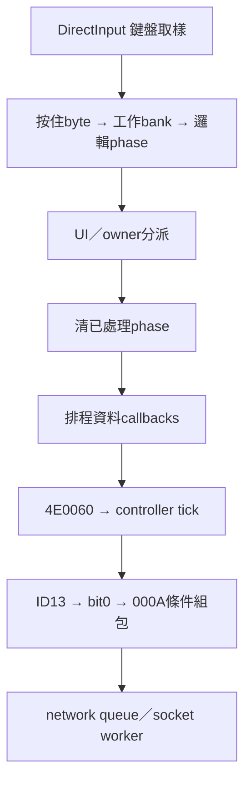

# T10-102 — DirectInput Key44 實體來源與 UI 消耗先於戰鬥 tick 的有界鏈

## 本段成果與驗收邊界

接續T10-101；本段以「角色站立、短按一次Z並放開」為基準，優先填補其裝置來源與跨系統更新順序。全程離線靜態讀取原BIN，不執行、附加或修改遊戲；不修改其他Task、不Commit、不Push、不更動owner/catalog。以下類別暫名無原版符號證據時均為描述性命名。

**重大新發現一：Key44不再只是DIK慣例候選。** 原BIN以DirectInput8Create建立介面、GUID_SysKeyboard建立鍵盤裝置，以實際DIDATAFORMAT描述256個原位置索引，GetDeviceState讀取256 bytes，wrapper+8 buffer按原索引合併至input manager+60，之後映射producer以packed key低8位作索引。Microsoft SDK原始header的DIK_Z=0x2C，44=0x2C；故此已確認鍵盤來源下Key44對應實體Z位置，並非Windows VK_Z。**目前玩家是否使用Type0／bank2是否含該配對仍未知，不能無條件說任何配置的Z都是ID13。**

**重大新發現二：閉合UI事件消耗與戰鬥tick順序。** 在0x490FE0中沿一條可驗證的正常更新路徑，0x491530執行phase消耗，0x491CB6稍後呼叫0x4E0060；後者從FBA7A4取controller，virtual+2C分派。若controller為C0FAC4這組表，target=548A90→5452C0。這填補T10-101中「消耗與戰鬥tick總排程仍未知」的具體一條路徑；不把它擴張為所有模式、所有執行緒或所有early-return分支。

**玩家意義**：在工作bank確實含Key44→ID13、鍵盤模式與取樣成功、沒有攔截／其他覆寫且戰鬥gate通過時，實體Z能沿已知管線進入C2S000A。若UI先成功處理ID13，清為0後戰鬥producer不會由該phase新增bit0；但controller+5C之前保存的bit0不因此自動清除，所以不能把「UI吃掉邊沿」說成保證零發包。每次短按的封包數、Server的逐次回覆、攻擊motion與本機是否先播，仍未閉合。

## 1. 原始來源、PE映射與工具

本輪重新核對SHA256，與T10-101相同：

- BIN：9741d1975327b9309d82b52f631165bc410757694d7c183a5eed970a53ebef91。
- EXE：03771b8e1c1e66248f54585fadf9a5e926eb77228721325bb9be5febc53b3b5f。

全部研究VA為KR BIN PE32 ImageBase400000。沿用已讀02共用規則、03-T10與本對話04；未將T08/T16指令套入。重新讀GitHub AGENTS與T10 README，前者blob a1dcfdb989c47162a081632c2bdd8a5297491cef，後者c28a45bfdacd16f7a2aca68ed8cc3c1e8a18fa0a；未見T10驗收退回事項專區。遠端仍未認領／未native_complete。使用者未授權Git寫入，保留遠端原狀。

| section | VA起點 | raw起點 | raw換算／限制 |
|---|---:|---:|---|
| .text | 401000 | 400 | raw=VA−400C00，包含實際嵌入資料，不能所有bytes都當指令 |
| .rdata | BD2000 | 7D0600 | raw=VA−401A00 |
| .data | D61000 | 95E800 | 只在raw-backed部分映射，FBxxxx全域多為zero-fill尾部 |
| .rsrc | FE9000 | B8A000 | 由section表查，不借用.text公式 |

工具為GNU objdump Intel x86、Python struct/UUID與原始byte比較。bulk Ghidra輸出只用於導航，沒有啟動本機REA/Ghidra或宣稱全函式語意FULL-PASS。

導航來源：bulk根目錄 `kr-bulk-roy/9741d1975327b9309d82b52f631165bc410757694d7c183a5eed970a53ebef91/functions/`：

| 函式檔 | Git blob SHA | 使用界線 |
|---|---|---|
| 0x490fe0.c | 201f5cd23bef5e5c93fe1b35444aef8338be00d8 | 找上層呼叫；正式順序回到BIN |
| 0x6f1790.c | 6929ae6fe67c5bce991a80023430946a2e8f1cc2 | 裝置合併導航 |
| 0x434740.c | 94947afa0ca2627c00f1fca13f334696e7f78dcd | 只確認它是singleton getter，否證它本身為tick |
| 0x4e0060.c | 0a94485b1c9a9a631f67208a38d0aa618b12ad8d | controller+2C的caller |
| 0x804740.c | 0ab4b7a53c8e14a477df791413d2a8270ce6260e | 已排程資料dispatch導航，不冒稱整個socket receive閉合 |

KR KeyMapping.xml實際來源重新讀取 `kr/evidence/6194d2ff4b51eacfb64b03698a10dfea57041b2e714de9a762ea139fffe82b18.txt`，Git blob cb8a9da734567b10e37cc966a981300cb3e7b8bc。KR Table.stp來源audit沿04及T10-101的既有來源界線引用；本段沒有重新取得carrier或重解封裝。

## 2. 外部SDK只用來核定ABI與掃描碼，不替代遊戲BIN

使用Microsoft自有repo的header：

[Microsoft win32metadata dinput.h](https://github.com/microsoft/win32metadata/blob/main/generation/WinSDK/RecompiledIdlHeaders/um/dinput.h)，本次讀取Git blob SHA `9c5c40ef22eb105148594bbb4b4d9bc5d46d5928`（blob識別，不是commit）；具體核對值保存在附錄。此header不是原遊戲build使用的SDK版本證據；使用的是長期相容的DirectInput COM ABI／常數，並以BIN GUID和欄位逐項比對。

另讀[Microsoft Interpreting Keyboard Data](https://learn.microsoft.com/en-us/previous-versions/windows/desktop/ee418271(v=vs.85))確認DirectInput鍵盤資料代表實體掃描位置，而不是Windows虛擬鍵。文件有導覽授權提示但本次工具回傳了主文；沒有登入或繞過存取限制。嘗試raw.githubusercontent header的web讀取失敗，後改用GitHub read-only connector成功取得，不以失敗結果當證據。

| SDK項目 | 核對值 | BIN證據 |
|---|---|---|
| IID_IDirectInput8W | BF798031-483A-4DA2-AA99-5D64ED369700 | BD6784 16 bytes |
| GUID_SysKeyboard | 6F1D2B61-D5A0-11CF-BFC7-444553540000 | BD66D4 16 bytes |
| GUID_Key | 55728220-D33C-11CF-BFC7-444553540000 | BD6704 16 bytes |
| DIK_Z / X / C / V | 2C / 2D / 2E / 2F | 原生descriptor保留相同offset；XML Key44..47 |
| DIDFT_BUTTON | 0C | 每個object type低位0C |
| DISCL_NONEXCLUSIVE、FOREGROUND | 2、4 | 初始化實參6，僅說明這條鍵盤裝置路徑 |

引用上限：不複製整份SDK header。上面來源只是識別名與數值，遊戲實際行為證據全在BIN。

## 3. 鍵盤裝置建立：具體vtable、配置大小與成功失敗

### 3.1 input manager與裝置陣列

6F1370以ESI為物件，初始化 `+20=1`，清 `+60`與`+260`各256 bytes、+08..+18五個device slots，+1C裝置數初始0，+4F8 listener array、+578 listener相關計數。此處**+60是按住狀態，+160是鍵盤phase**；不要和另一個映射物件FB8830+7D4的邏輯phase混同。

6F1430是具體裝置初始化函式（本段不將它指派為所有遊戲啟動的唯一入口）。6F146A保存傳入HWND到manager+4，GetModuleHandleW與DirectInput8Create(version800,IID_IDirectInput8W)的IAT由PE import核對。失敗走80004005。

成功後配置0x108 bytes鍵盤wrapper，首DWORD在6F14B5寫C423C8，+4為COM device pointer，+8為256-byte buffer；先清buffer，再經6F15E0註冊。6F15E0先存入manager+8+4*index，再呼叫wrapper virtual+10初始化，最後增加裝置數；不把註冊slot存在當作已成功取得鍵盤。

| wrapper byte slot | 實作 | 已確認用途 |
|---:|---:|---|
| +0 | 6F3770 | deleting destructor／COM清理 |
| +4 | 6F3800 | 回傳原生ASCII字串Keyboard |
| +10 | 6F3820 | 建立keyboard device與資料格式 |
| +14 | 6F3F70 | Unacquire/Release並清device pointer |
| +18 | 6F38A0 | Poll/GetDeviceState取樣 |
| +1C | 6F3760 | 回傳wrapper+8 buffer |
| +20/+24 | 8DC2F0 | 固定返回0，鍵盤wrapper不提供其他型態buffer |
| +30 | 87AF60 | 固定返回1，合併時的裝置資格 |

6F3820呼叫DirectInput8 interface+0C=CreateDevice，實參GUID_SysKeyboard、&wrapper+4、null。成功後device+2C=SetDataFormat(BD6994)，再device+34=SetCooperativeLevel(HWND,6)。任一後續步驟失敗則Release並清+4、返回80004005。這不是為方便猜測的virtual名稱：它與SDK的interface宣告按4-byte指標逐槽核對，附錄保留原始bytes。

### 3.2 格式描述：不是VK表，也不是反組譯函式

DIDATAFORMAT在BD6994（raw7D4F94），六個DWORD為 `18,10,2,100,100,8B6190`（全為hex）。意義：結構大小24、object結構大小16、flags2、state大小256、object數256、array pointer8B6190。

**array在.text，raw4B5590**，這是資料而非函式。以PE section-aware映射讀取全部256筆，逐筆assert：`{GUID_Key_ptr=BD6704, dwOfs=i, dwType=8000000C|(i<<8), dwFlags=0}`，i=0..255全數通過。此assert只驗table格式與資料，不冒稱遊戲運行成功。

| i | descriptor VA | raw | dwOfs | dwType |
|---:|---:|---:|---:|---:|
| 29 | 8B6360 | 4B5760 | 1D | 80001D0C |
| 44 | 8B6450 | 4B5850 | 2C | 80002C0C |
| 45 | 8B6460 | 4B5860 | 2D | 80002D0C |
| 46 | 8B6470 | 4B5870 | 2E | 80002E0C |
| 47 | 8B6480 | 4B5880 | 2F | 80002F0C |
| 157 | 8B6B60 | 4B5F60 | 9D | 80009D0C |

分析中最初試讀array誤套.rdata公式得到指令樣垃圾值，隨即改用.text映射並完整重讀256筆；**錯誤試讀未作任何結論**。這個差異保留作方法反證，避免重演「所有指標都套同一raw公式」。

## 4. GetDeviceState→按住buffer→映射producer

6F16B0遍歷manager+08..+18五個非空wrapper，呼叫virtual+18。對已確認鍵盤wrapper就是6F38A0：

1. device virtual+64=Poll；返回值在此未作獨立成功判斷。
2. device virtual+24=GetDeviceState(100h,local256)。
3. 若失敗，device virtual+1C=Acquire；Acquire失敗直接返回80004005；成功則再Poll/GetDeviceState。
4. 第二次讀取仍失敗也返回；成功才把local256複製到wrapper+8（64DWORD）。

**失敗邊界**：失敗路徑沒有清wrapper+8。6F16B0累加錯誤碼後仍呼叫6F1790；鍵盤wrapper+30固定1、+1C可返回舊buffer，所以在裝置讀取失敗且仍走合併的條件下，舊按住值可能保留。這是靜態可能路徑，沒有現場重現失焦或卡鍵。不能宣稱每輪鍵盤資料必定新鮮。

6F1790先清local256／其他裝置local資料，要求GetForegroundWindow()==manager+4，否則跳過device合併而使用零local。它從device slots+18倒序到+08，wrapper+30非零才查+1C；鍵盤buffer每個非零byte正規化80h並OR到local256的**相同索引**。沒有在此把44轉為90，也沒有VK轉換表。其他裝置若也提供+1C可OR到相同array；不因此聲稱全部資料唯一來自鍵盤。

6F198D..1A21比較manager+60的舊按住值與本次local，寫manager+160的256個raw-key phase，算式同T10-101：0/1/2/3分別未按／按下／持按／放開。6F1B40..1B4E再把local複製到manager+60。

6F16B0之後另對raw phase1/3遍歷manager+4F8 listener array，分別呼叫listener virtual+0/+4，實參為鍵索引。這是**早於邏輯映射producer的另一組raw callback**，實作targets本段未閉合，不能用已知000A路徑排除raw listener其他發包或UI副作用。

回到外層：491437呼叫6F16B0，4914B1才呼叫6D1480。後者在mode+20非零時查manager+60，mode為0時查manager+260。**本段只閉合DirectInput/mode非零這一路，替代+260 producer尚未完整追查。** 建構預設mode1不是當前執行時永遠mode1的證據。

映射6D1550..159B使用配置record低8位作按鍵索引，bits16..23作modifier索引，OR有效keys後轉80h；+7FC選目前bank。Type0 XML的ID13..16對應44..47，Type1則36..39；映射物件初始化選工作bank2，不能將它當XML Type2或直接假定bank2就是Type0。無modifier記錄也會受1D/9D狀態gate影響（原指令已附），本段不把修飾鍵組合混入基準短按。

```cpp
// 暫定名稱、概念偽碼：僅成功讀取的DirectInput鍵盤路徑
keyboard.ReadState(256, sample);
copy(keyboard.buffer, sample, 256);
for (i=0; i<256; ++i)
    combined[i] |= keyboard.buffer[i] ? 0x80 : 0;
copy(input.held, combined, 256);
for (logical_id=0; logical_id<40; ++logical_id)
    mappedNow[logical_id] = evaluate(currentBank[logical_id], input.held);
computeMappedPhase(mappedOld, mappedNow);
```

這段偽碼省略原始raw-phase listeners、其他裝置OR、失敗保留與前景gate；完整分支以文字及附錄為準，不拿偽碼當實際捕獲行為。

## 5. UI消耗→戰鬥tick→socket worker的順序證據

### 5.1 同一外層函式的callsite順序

| order | VA | 已驗證動作／條件 |
|---:|---:|---|
| 1 | 491437 | 6F16B0：裝置取樣、raw callbacks |
| 2 | 4914AC/B1 | ECX=FB8830 → 6D1480：邏輯phase |
| 3 | 49152B | 58A250 → manager750550：清舊結果nodes、UI/owner分派 |
| 4 | 491530 | 490D40 → 6D4A30(flag,&F95CD8)：清已處理phase |
| 5 | 49153C | 490E20：其他輸入相關旗標 |
| 6 | 49198A | 804740(app+140)：已排程記錄分派，callback實作界面另查 |
| 7 | 491CB6 | 4E0060，要求app+BFCC==0；controller+2C |
| 8 | 491FDD | 804A40(app+140)，或另一分支491FE6→804C70 |
| 9 | 491FEC | 804FC0後續處理，本段不完整定名 |

此為有界、同一次490FE0調用內的先後；其中有多個early return／分支、callback與可能改狀態的helper，**不等價於所有更新每次必跑到每一步**。例如4915B7有提早返回路徑，491A76/491A7D狀態分支可以不走491C3A那條正常段；本段沒有宣稱所有模式frame-dispatch完成原生驗收。

### 5.2 新閉合的controller caller

491CA7檢查app+BFCC，為0才抵達491CB6 call4E0060。4E0060先讀自身+AC浮點與0比較；>0則寫controller+58=1，隨後**不論此比較是否成立都**取FBA7A4物件vtable+2C並call。對C0FAC4表，+2C=548A90；table的constructor store在548577／548657可驗，+48=548A20。

548A90在controller+4非零時先5452C0。5452C0在+78 gate通過後讀FB9011（邏輯ID13 phase），等於1或2才OR controller+5C bit0。之後對有資格主要actor呼叫controller+48，普通路徑548A20→546100→546780把controller+5C帶入輸入row；actor motion+38C==10h或controller+A4非零走特例input0。這些底層條件鏈在T10-101已詳證，本段只重讀必要銜接片段，不把舊成果重述當新增。

**精確推論**：若步驟4清了ID13，而步驟7讀取前沒有中間writer再設回1/2，54543C..5480不新增bit0。這是local dataflow結論，不是伺服器拒絕，也不是「全部C2S為0」。理由包括controller+5C舊bit可能保存、其他ID可OR同bit、其他actors可產生rows、raw listeners／callback可能另發包。

### 5.3 結果list與其他queue不混同

F95CD8=M(F94810)+14C8仍是成功邏輯事件ID list；其消費是6D4A30清phase，與+5C bit累積、network pending queue為不同資料結構。750550清舊nodes在生成本輪結果之前，490D40清本輪phase在分派之後。這些不是Server接受佇列，也沒有連段時間排程證據。

### 5.4 封包條件與motion時序的界線

C2S000A payload沿T10-101已證實為6-byte header + 5N bytes rows：WORD opcode000A、DWORD F93944、每筆actor WORD/input WORD/heading BYTE。只有有效rows、傳送threshold與connection存在等條件通過，才進實際傳輸管線；實體短按次數不等封包數。

804740已確認在controller更新前從804100取得排程記錄，經app+140物件virtual+0呼叫，結束後回收記錄；本段尚未把這個callback的opcode0D註冊與socket接收上游全部串起，故用「排程記錄分派」定名。不能從它在戰鬥前執行就說它正在回覆當輪稍後才送出的攻擊。

戰鬥更新後4E0060再以4E13F0遍歷其樹中物件並呼叫virtual+20（已附完整helper）。沒有因此取得普通攻擊起手motion的來源；virtual+20的各動態targets未在本段全部核對。S2C0D→4B01C0→4C8A90→actor+68仍引用T10-101的有界consumer證據，**000A到0D逐次因果、拒絕／接受語意、是否本機預播仍未知**。

## 6. 基準情境矩陣

| 玩家／條件 | Client接受或阻止 | C→S | S→C | 動作／動畫 | 分工與證據 |
|---|---|---|---|---|---|
| DirectInput模式，遊戲前景，成功取樣Z位置 | Key44按住byte經原索引輸入 | raw listener是否另發包未確認 | 未確認 | 未確認 | 系統鍵盤來源已確認 |
| 再加目前bank含Type0配對Key44→ID13 | phase1=按下、2=持按、3=放開 | ID13=1/2可新增bit0，通過gate可進000A | 與此次操作配對未知 | motion16等可阻止／改零輸入 | 條件鏈已確認，現場bank未知 |
| UI成功處理ID13且清phase後無重寫 | 戰鬥tick稍後讀0，不由本次phase新增bit0 | 可能仍有舊bit／其他row；不可聲稱完全不發 | 未確認 | 不可稱伺服器拒絕或必取消 | 本段新閉合的有界順序 |
| 放開Z形成邏輯phase3 | 普通edge分派F0，不由54543C..480置bit0 | 無獨立release bit的證據只限此分支；其他輸入未知 | 未確認 | 不可推論立即停止普攻 | 有界否定 |
| 短按完全發生於兩次GetDeviceState取樣間 | 此瞬時state路徑未必觀察到按住 | raw callback／替代producer未窮盡，不說全程不發 | 未確認 | 未確認 | 取樣侷限的合理推論，無runtime重現 |
| GetDeviceState失敗且未恢復成功 | wrapperbuffer無清零，可能被合併舊值 | 是否造成重送未確認 | 未確認 | 未確認 | 靜態可能分支 |
| 失去前景 | 6F1790合併gate跳過，local keyboard值為0 | 其他producer／mode0尚未窮盡 | 未確認 | 未確認 | 僅限此模式與此consumer |

這次沒有將技能中Z、連按、鍵盤移動與滑鼠移動混成已驗收基準；基準的Server因果與普攻motion仍缺證，後續按04指定逐次加變因。

## 7. 已知時序圖（條件路徑）



圖只代表已追到的同一490FE0條件分支。E可能改變狀態；H是傳送工作，不保證異步完成。本段沒有畫000A→000D配對箭頭，也沒有加入未證實的Server批准或固定連段窗口。

## 8. Server責任分級

- **有Client／封包證據支持**：相容外部端需解讀000A的actor/input/heading批次；Client存在外部motion consumer；按鍵映射與部分UI消耗發生在Client端。不能要求Server僅憑Z鍵邊沿就一對一回覆，因Client有取樣、累積、動態gate與合併。
- **合理推測、待原生證據**：Server的攻擊合法性、連段／取消、技能資源／冷卻、拒絕修正及廣播規則。沒有原版Server源碼／官方封包流，不列未證實常數。
- **Client／Server分工未知**：普攻開始的最終裁決與本機預播、bit0與具體普攻motion表、連按／持按的原版續擊策略、技能中鍵盤／滑鼠移動的取消界面。

## 9. 搜尋覆蓋、反證與下一入口

1. 搜尋所有FB A7A4直接讀取周邊+2C，定位4E00AD的具體caller；434740原本只是singleton getter，已否證其本身是戰鬥tick。
2. 以鍵盤wrapperconstructor寫C423C8→table+10/+18/+1C定位init/sample/getter，再核對COM ABI，沒有只憑函式名推測。
3. 256個DIOBJECTDATAFORMAT逐筆核對，embedded .text資料與.rdata descriptor分開映射。
4. 上層490FE0的順序由原BINcallsite證明；保留early returns與中間callbacks，沒有將bounded順序升級成全模式frame驗收。
5. 搜尋+260在不同物件域有大量同offset引用，未將其全視為input manager writer；替代bufferproducer保留未知。

下一段T10-103可優先選：

- 目前bank2的內容來源與切換：從4A1440→6D1BE0、6D0D10、6D1A70以及原生配置檔writer確認何時工作bank繼承Type0；目前玩家設定仍需執行時／設定資料，不能由靜態預設代替。
- controller+5C bit0對應的角色資料+1F4及54F270、motion／狀態consumer，將「Z是ID13候選」推進為「普通攻擊命令的具體語意」；不要用已知000A格式就宣稱普攻完全還原。
- app+140 callback的實作與opcode0D註冊，接上實際queued receive→motion；仍需官方流量或更強因果證據配對000A/0D。
- input raw listeners（+4F8）、mode0 +260及phase override vector追加者，作為完整基準按鍵發包的剩餘旁路。

第1輪T10-102已達重大發現／功能鏈進展門檻：系統鍵盤裝置→Key44原索引→映射producer，以及同輪UI消耗→戰鬥tick皆有第一手BIN連續證據。因此102-2與102-3 **未啟動**，不捏造補充輪。停止本段不代表普通攻擊／連段玩法完成；正式Task仍未native_complete。

## 附錄A：本次實際核對的BIN assembly視窗

每個視窗列VA/raw（結尾exclusive）。從完整.text線性解碼中選取已存在的指令邊界，不從任意literal中段重新反組譯冒充函式入口；內嵌跳表／資料仍須按上文語意處理。函式列表是證據覆蓋，不作函式數量績效。

### VA 006F1370..006F1426，raw 002F0770..002F0826

```asm
  6f1370:	57                   	push   edi
  6f1371:	33 ff                	xor    edi,edi
  6f1373:	89 3e                	mov    DWORD PTR [esi],edi
  6f1375:	89 7e 04             	mov    DWORD PTR [esi+0x4],edi
  6f1378:	c7 46 20 01 00 00 00 	mov    DWORD PTR [esi+0x20],0x1
  6f137f:	68 00 01 00 00       	push   0x100
  6f1384:	8d 46 60             	lea    eax,[esi+0x60]
  6f1387:	57                   	push   edi
  6f1388:	89 7e 08             	mov    DWORD PTR [esi+0x8],edi
  6f138b:	89 7e 0c             	mov    DWORD PTR [esi+0xc],edi
  6f138e:	89 7e 10             	mov    DWORD PTR [esi+0x10],edi
  6f1391:	89 7e 14             	mov    DWORD PTR [esi+0x14],edi
  6f1394:	89 7e 18             	mov    DWORD PTR [esi+0x18],edi
  6f1397:	50                   	push   eax
  6f1398:	89 7e 1c             	mov    DWORD PTR [esi+0x1c],edi
  6f139b:	e8 c0 d4 1a 00       	call   0x89e860
  6f13a0:	68 00 01 00 00       	push   0x100
  6f13a5:	8d 8e 60 02 00 00    	lea    ecx,[esi+0x260]
  6f13ab:	57                   	push   edi
  6f13ac:	51                   	push   ecx
  6f13ad:	e8 ae d4 1a 00       	call   0x89e860
  6f13b2:	33 c0                	xor    eax,eax
  6f13b4:	89 86 60 03 00 00    	mov    DWORD PTR [esi+0x360],eax
  6f13ba:	68 80 00 00 00       	push   0x80
  6f13bf:	89 86 64 03 00 00    	mov    DWORD PTR [esi+0x364],eax
  6f13c5:	8d 96 78 03 00 00    	lea    edx,[esi+0x378]
  6f13cb:	57                   	push   edi
  6f13cc:	89 86 70 03 00 00    	mov    DWORD PTR [esi+0x370],eax
  6f13d2:	52                   	push   edx
  6f13d3:	89 86 74 03 00 00    	mov    DWORD PTR [esi+0x374],eax
  6f13d9:	e8 82 d4 1a 00       	call   0x89e860
  6f13de:	68 80 00 00 00       	push   0x80
  6f13e3:	8d 86 78 04 00 00    	lea    eax,[esi+0x478]
  6f13e9:	57                   	push   edi
  6f13ea:	50                   	push   eax
  6f13eb:	e8 70 d4 1a 00       	call   0x89e860
  6f13f0:	33 c0                	xor    eax,eax
  6f13f2:	6a 30                	push   0x30
  6f13f4:	89 46 24             	mov    DWORD PTR [esi+0x24],eax
  6f13f7:	8d 4e 30             	lea    ecx,[esi+0x30]
  6f13fa:	57                   	push   edi
  6f13fb:	89 46 28             	mov    DWORD PTR [esi+0x28],eax
  6f13fe:	51                   	push   ecx
  6f13ff:	89 46 2c             	mov    DWORD PTR [esi+0x2c],eax
  6f1402:	e8 59 d4 1a 00       	call   0x89e860
  6f1407:	68 80 00 00 00       	push   0x80
  6f140c:	8d 96 f8 04 00 00    	lea    edx,[esi+0x4f8]
  6f1412:	57                   	push   edi
  6f1413:	52                   	push   edx
  6f1414:	e8 47 d4 1a 00       	call   0x89e860
  6f1419:	83 c4 48             	add    esp,0x48
  6f141c:	89 be 78 05 00 00    	mov    DWORD PTR [esi+0x578],edi
  6f1422:	8b c6                	mov    eax,esi
  6f1424:	5f                   	pop    edi
  6f1425:	c3                   	ret
```

### VA 006F1430..006F1587，raw 002F0830..002F0987

```asm
  6f1430:	55                   	push   ebp
  6f1431:	8b ec                	mov    ebp,esp
  6f1433:	6a ff                	push   0xffffffff
  6f1435:	68 eb 8a 91 00       	push   0x918aeb
  6f143a:	64 a1 00 00 00 00    	mov    eax,fs:0x0
  6f1440:	50                   	push   eax
  6f1441:	53                   	push   ebx
  6f1442:	56                   	push   esi
  6f1443:	57                   	push   edi
  6f1444:	a1 20 1f d6 00       	mov    eax,ds:0xd61f20
  6f1449:	33 c5                	xor    eax,ebp
  6f144b:	50                   	push   eax
  6f144c:	8d 45 f4             	lea    eax,[ebp-0xc]
  6f144f:	64 a3 00 00 00 00    	mov    fs:0x0,eax
  6f1455:	8b 5d 08             	mov    ebx,DWORD PTR [ebp+0x8]
  6f1458:	8b 45 0c             	mov    eax,DWORD PTR [ebp+0xc]
  6f145b:	6a 00                	push   0x0
  6f145d:	53                   	push   ebx
  6f145e:	68 84 67 bd 00       	push   0xbd6784
  6f1463:	68 00 08 00 00       	push   0x800
  6f1468:	6a 00                	push   0x0
  6f146a:	89 43 04             	mov    DWORD PTR [ebx+0x4],eax
  6f146d:	ff 15 20 22 bd 00    	call   DWORD PTR ds:0xbd2220
  6f1473:	50                   	push   eax
  6f1474:	ff 15 24 20 bd 00    	call   DWORD PTR ds:0xbd2024
  6f147a:	85 c0                	test   eax,eax
  6f147c:	79 19                	jns    0x6f1497
  6f147e:	b8 05 40 00 80       	mov    eax,0x80004005
  6f1483:	8b 4d f4             	mov    ecx,DWORD PTR [ebp-0xc]
  6f1486:	64 89 0d 00 00 00 00 	mov    DWORD PTR fs:0x0,ecx
  6f148d:	59                   	pop    ecx
  6f148e:	5f                   	pop    edi
  6f148f:	5e                   	pop    esi
  6f1490:	5b                   	pop    ebx
  6f1491:	8b e5                	mov    esp,ebp
  6f1493:	5d                   	pop    ebp
  6f1494:	c2 08 00             	ret    0x8
  6f1497:	68 08 01 00 00       	push   0x108
  6f149c:	e8 c7 fd 19 00       	call   0x891268
  6f14a1:	8b f0                	mov    esi,eax
  6f14a3:	83 c4 04             	add    esp,0x4
  6f14a6:	85 f6                	test   esi,esi
  6f14a8:	74 22                	je     0x6f14cc
  6f14aa:	68 00 01 00 00       	push   0x100
  6f14af:	8d 4e 08             	lea    ecx,[esi+0x8]
  6f14b2:	6a 00                	push   0x0
  6f14b4:	51                   	push   ecx
  6f14b5:	c7 06 c8 23 c4 00    	mov    DWORD PTR [esi],0xc423c8
  6f14bb:	c7 46 04 00 00 00 00 	mov    DWORD PTR [esi+0x4],0x0
  6f14c2:	e8 99 d3 1a 00       	call   0x89e860
  6f14c7:	83 c4 0c             	add    esp,0xc
  6f14ca:	eb 02                	jmp    0x6f14ce
  6f14cc:	33 f6                	xor    esi,esi
  6f14ce:	8b fe                	mov    edi,esi
  6f14d0:	8b c3                	mov    eax,ebx
  6f14d2:	e8 09 01 00 00       	call   0x6f15e0
  6f14d7:	68 30 11 00 00       	push   0x1130
  6f14dc:	89 45 08             	mov    DWORD PTR [ebp+0x8],eax
  6f14df:	e8 84 fd 19 00       	call   0x891268
  6f14e4:	83 c4 04             	add    esp,0x4
  6f14e7:	85 c0                	test   eax,eax
  6f14e9:	74 09                	je     0x6f14f4
  6f14eb:	8b f0                	mov    esi,eax
  6f14ed:	e8 8e 24 00 00       	call   0x6f3980
  6f14f2:	eb 02                	jmp    0x6f14f6
  6f14f4:	33 c0                	xor    eax,eax
  6f14f6:	8b f8                	mov    edi,eax
  6f14f8:	8b c3                	mov    eax,ebx
  6f14fa:	e8 e1 00 00 00       	call   0x6f15e0
  6f14ff:	6a 1c                	push   0x1c
  6f1501:	e8 62 fd 19 00       	call   0x891268
  6f1506:	33 f6                	xor    esi,esi
  6f1508:	83 c4 04             	add    esp,0x4
  6f150b:	3b c6                	cmp    eax,esi
  6f150d:	74 1c                	je     0x6f152b
  6f150f:	33 c9                	xor    ecx,ecx
  6f1511:	c7 00 a4 24 c4 00    	mov    DWORD PTR [eax],0xc424a4
  6f1517:	89 70 04             	mov    DWORD PTR [eax+0x4],esi
  6f151a:	89 48 08             	mov    DWORD PTR [eax+0x8],ecx
  6f151d:	89 48 0c             	mov    DWORD PTR [eax+0xc],ecx
  6f1520:	89 48 10             	mov    DWORD PTR [eax+0x10],ecx
  6f1523:	89 48 14             	mov    DWORD PTR [eax+0x14],ecx
  6f1526:	89 48 18             	mov    DWORD PTR [eax+0x18],ecx
  6f1529:	eb 02                	jmp    0x6f152d
  6f152b:	33 c0                	xor    eax,eax
  6f152d:	8b f8                	mov    edi,eax
  6f152f:	8b c3                	mov    eax,ebx
  6f1531:	e8 aa 00 00 00       	call   0x6f15e0
  6f1536:	68 1c 01 00 00       	push   0x11c
  6f153b:	e8 28 fd 19 00       	call   0x891268
  6f1540:	83 c4 04             	add    esp,0x4
  6f1543:	89 45 0c             	mov    DWORD PTR [ebp+0xc],eax
  6f1546:	89 75 fc             	mov    DWORD PTR [ebp-0x4],esi
  6f1549:	3b c6                	cmp    eax,esi
  6f154b:	74 08                	je     0x6f1555
  6f154d:	50                   	push   eax
  6f154e:	e8 2d 2b 00 00       	call   0x6f4080
  6f1553:	eb 02                	jmp    0x6f1557
  6f1555:	33 c0                	xor    eax,eax
  6f1557:	8b f8                	mov    edi,eax
  6f1559:	8b c3                	mov    eax,ebx
  6f155b:	c7 45 fc ff ff ff ff 	mov    DWORD PTR [ebp-0x4],0xffffffff
  6f1562:	e8 79 00 00 00       	call   0x6f15e0
  6f1567:	8b 45 08             	mov    eax,DWORD PTR [ebp+0x8]
  6f156a:	f7 d8                	neg    eax
  6f156c:	1b c0                	sbb    eax,eax
  6f156e:	25 05 40 00 80       	and    eax,0x80004005
  6f1573:	8b 4d f4             	mov    ecx,DWORD PTR [ebp-0xc]
  6f1576:	64 89 0d 00 00 00 00 	mov    DWORD PTR fs:0x0,ecx
  6f157d:	59                   	pop    ecx
  6f157e:	5f                   	pop    edi
  6f157f:	5e                   	pop    esi
  6f1580:	5b                   	pop    ebx
  6f1581:	8b e5                	mov    esp,ebp
  6f1583:	5d                   	pop    ebp
  6f1584:	c2 08 00             	ret    0x8
```

### VA 006F15E0..006F163F，raw 002F09E0..002F0A3F

```asm
  6f15e0:	56                   	push   esi
  6f15e1:	8b f0                	mov    esi,eax
  6f15e3:	85 ff                	test   edi,edi
  6f15e5:	75 07                	jne    0x6f15ee
  6f15e7:	b8 05 40 00 80       	mov    eax,0x80004005
  6f15ec:	5e                   	pop    esi
  6f15ed:	c3                   	ret
  6f15ee:	8b 46 1c             	mov    eax,DWORD PTR [esi+0x1c]
  6f15f1:	89 7c 86 08          	mov    DWORD PTR [esi+eax*4+0x8],edi
  6f15f5:	8b 4e 1c             	mov    ecx,DWORD PTR [esi+0x1c]
  6f15f8:	8b 46 04             	mov    eax,DWORD PTR [esi+0x4]
  6f15fb:	8b 4c 8e 08          	mov    ecx,DWORD PTR [esi+ecx*4+0x8]
  6f15ff:	8b 11                	mov    edx,DWORD PTR [ecx]
  6f1601:	8b 52 10             	mov    edx,DWORD PTR [edx+0x10]
  6f1604:	53                   	push   ebx
  6f1605:	50                   	push   eax
  6f1606:	8b 06                	mov    eax,DWORD PTR [esi]
  6f1608:	50                   	push   eax
  6f1609:	ff d2                	call   edx
  6f160b:	ff 46 1c             	inc    DWORD PTR [esi+0x1c]
  6f160e:	8b 76 1c             	mov    esi,DWORD PTR [esi+0x1c]
  6f1611:	8b d8                	mov    ebx,eax
  6f1613:	b8 f0 21 c4 00       	mov    eax,0xc421f0
  6f1618:	85 db                	test   ebx,ebx
  6f161a:	78 05                	js     0x6f1621
  6f161c:	b8 08 22 c4 00       	mov    eax,0xc42208
  6f1621:	50                   	push   eax
  6f1622:	8b 07                	mov    eax,DWORD PTR [edi]
  6f1624:	8b 50 04             	mov    edx,DWORD PTR [eax+0x4]
  6f1627:	56                   	push   esi
  6f1628:	8b cf                	mov    ecx,edi
  6f162a:	ff d2                	call   edx
  6f162c:	50                   	push   eax
  6f162d:	68 1c 22 c4 00       	push   0xc4221c
  6f1632:	e8 86 1a 1a 00       	call   0x8930bd
  6f1637:	83 c4 10             	add    esp,0x10
  6f163a:	8b c3                	mov    eax,ebx
  6f163c:	5b                   	pop    ebx
  6f163d:	5e                   	pop    esi
  6f163e:	c3                   	ret
```

### VA 006F16B0..006F1783，raw 002F0AB0..002F0B83

```asm
  6f16b0:	55                   	push   ebp
  6f16b1:	8b ec                	mov    ebp,esp
  6f16b3:	83 ec 08             	sub    esp,0x8
  6f16b6:	53                   	push   ebx
  6f16b7:	56                   	push   esi
  6f16b8:	57                   	push   edi
  6f16b9:	8b 7d 08             	mov    edi,DWORD PTR [ebp+0x8]
  6f16bc:	c7 45 fc 00 00 00 00 	mov    DWORD PTR [ebp-0x4],0x0
  6f16c3:	8d 77 08             	lea    esi,[edi+0x8]
  6f16c6:	bb 05 00 00 00       	mov    ebx,0x5
  6f16cb:	eb 03                	jmp    0x6f16d0
  6f16cd:	8d 49 00             	lea    ecx,[ecx+0x0]
  6f16d0:	83 3e 00             	cmp    DWORD PTR [esi],0x0
  6f16d3:	74 0c                	je     0x6f16e1
  6f16d5:	8b 0e                	mov    ecx,DWORD PTR [esi]
  6f16d7:	8b 01                	mov    eax,DWORD PTR [ecx]
  6f16d9:	8b 50 18             	mov    edx,DWORD PTR [eax+0x18]
  6f16dc:	ff d2                	call   edx
  6f16de:	09 45 fc             	or     DWORD PTR [ebp-0x4],eax
  6f16e1:	83 c6 04             	add    esi,0x4
  6f16e4:	4b                   	dec    ebx
  6f16e5:	75 e9                	jne    0x6f16d0
  6f16e7:	57                   	push   edi
  6f16e8:	e8 a3 00 00 00       	call   0x6f1790
  6f16ed:	8d 49 00             	lea    ecx,[ecx+0x0]
  6f16f0:	83 7f 20 00          	cmp    DWORD PTR [edi+0x20],0x0
  6f16f4:	74 6f                	je     0x6f1765
  6f16f6:	0f b6 c3             	movzx  eax,bl
  6f16f9:	3d 00 01 00 00       	cmp    eax,0x100
  6f16fe:	7d 65                	jge    0x6f1765
  6f1700:	0f b6 84 38 60 01 00 	movzx  eax,BYTE PTR [eax+edi*1+0x160]
  6f1707:	00 
  6f1708:	89 45 f8             	mov    DWORD PTR [ebp-0x8],eax
  6f170b:	83 f8 01             	cmp    eax,0x1
  6f170e:	74 05                	je     0x6f1715
  6f1710:	83 f8 03             	cmp    eax,0x3
  6f1713:	75 50                	jne    0x6f1765
  6f1715:	8b 4d 08             	mov    ecx,DWORD PTR [ebp+0x8]
  6f1718:	33 ff                	xor    edi,edi
  6f171a:	39 b9 78 05 00 00    	cmp    DWORD PTR [ecx+0x578],edi
  6f1720:	7c 41                	jl     0x6f1763
  6f1722:	8b f1                	mov    esi,ecx
  6f1724:	81 c6 f8 04 00 00    	add    esi,0x4f8
  6f172a:	8d 9b 00 00 00 00    	lea    ebx,[ebx+0x0]
  6f1730:	83 3e 00             	cmp    DWORD PTR [esi],0x0
  6f1733:	74 1f                	je     0x6f1754
  6f1735:	83 f8 01             	cmp    eax,0x1
  6f1738:	75 08                	jne    0x6f1742
  6f173a:	8b 0e                	mov    ecx,DWORD PTR [esi]
  6f173c:	8b 11                	mov    edx,DWORD PTR [ecx]
  6f173e:	8b 02                	mov    eax,DWORD PTR [edx]
  6f1740:	eb 0c                	jmp    0x6f174e
  6f1742:	83 f8 03             	cmp    eax,0x3
  6f1745:	75 0d                	jne    0x6f1754
  6f1747:	8b 0e                	mov    ecx,DWORD PTR [esi]
  6f1749:	8b 11                	mov    edx,DWORD PTR [ecx]
  6f174b:	8b 42 04             	mov    eax,DWORD PTR [edx+0x4]
  6f174e:	53                   	push   ebx
  6f174f:	ff d0                	call   eax
  6f1751:	8b 45 f8             	mov    eax,DWORD PTR [ebp-0x8]
  6f1754:	8b 4d 08             	mov    ecx,DWORD PTR [ebp+0x8]
  6f1757:	47                   	inc    edi
  6f1758:	83 c6 04             	add    esi,0x4
  6f175b:	3b b9 78 05 00 00    	cmp    edi,DWORD PTR [ecx+0x578]
  6f1761:	7e cd                	jle    0x6f1730
  6f1763:	8b f9                	mov    edi,ecx
  6f1765:	43                   	inc    ebx
  6f1766:	81 fb 00 01 00 00    	cmp    ebx,0x100
  6f176c:	7c 82                	jl     0x6f16f0
  6f176e:	8b 45 fc             	mov    eax,DWORD PTR [ebp-0x4]
  6f1771:	f7 d8                	neg    eax
  6f1773:	5f                   	pop    edi
  6f1774:	1b c0                	sbb    eax,eax
  6f1776:	5e                   	pop    esi
  6f1777:	25 05 40 00 80       	and    eax,0x80004005
  6f177c:	5b                   	pop    ebx
  6f177d:	8b e5                	mov    esp,ebp
  6f177f:	5d                   	pop    ebp
  6f1780:	c2 04 00             	ret    0x4
```

### VA 006F1790..006F1B85，raw 002F0B90..002F0F85

```asm
  6f1790:	55                   	push   ebp
  6f1791:	8b ec                	mov    ebp,esp
  6f1793:	81 ec 94 01 00 00    	sub    esp,0x194
  6f1799:	a1 20 1f d6 00       	mov    eax,ds:0xd61f20
  6f179e:	33 c5                	xor    eax,ebp
  6f17a0:	89 45 fc             	mov    DWORD PTR [ebp-0x4],eax
  6f17a3:	53                   	push   ebx
  6f17a4:	8b 5d 08             	mov    ebx,DWORD PTR [ebp+0x8]
  6f17a7:	56                   	push   esi
  6f17a8:	57                   	push   edi
  6f17a9:	68 ff 00 00 00       	push   0xff
  6f17ae:	8d 85 75 fe ff ff    	lea    eax,[ebp-0x18b]
  6f17b4:	6a 00                	push   0x0
  6f17b6:	50                   	push   eax
  6f17b7:	89 9d 6c fe ff ff    	mov    DWORD PTR [ebp-0x194],ebx
  6f17bd:	c6 85 74 fe ff ff 00 	mov    BYTE PTR [ebp-0x18c],0x0
  6f17c4:	e8 97 d0 1a 00       	call   0x89e860
  6f17c9:	33 c0                	xor    eax,eax
  6f17cb:	6a 7f                	push   0x7f
  6f17cd:	50                   	push   eax
  6f17ce:	8d 8d 75 ff ff ff    	lea    ecx,[ebp-0x8b]
  6f17d4:	51                   	push   ecx
  6f17d5:	c6 45 f4 00          	mov    BYTE PTR [ebp-0xc],0x0
  6f17d9:	89 45 f5             	mov    DWORD PTR [ebp-0xb],eax
  6f17dc:	66 89 45 f9          	mov    WORD PTR [ebp-0x7],ax
  6f17e0:	88 45 fb             	mov    BYTE PTR [ebp-0x5],al
  6f17e3:	88 85 74 ff ff ff    	mov    BYTE PTR [ebp-0x8c],al
  6f17e9:	e8 72 d0 1a 00       	call   0x89e860
  6f17ee:	83 c4 18             	add    esp,0x18
  6f17f1:	ff 15 5c 24 bd 00    	call   DWORD PTR ds:0xbd245c
  6f17f7:	3b 43 04             	cmp    eax,DWORD PTR [ebx+0x4]
  6f17fa:	0f 85 8d 01 00 00    	jne    0x6f198d
  6f1800:	c7 85 70 fe ff ff 04 	mov    DWORD PTR [ebp-0x190],0x4
  6f1807:	00 00 00 
  6f180a:	83 c3 18             	add    ebx,0x18
  6f180d:	8d 49 00             	lea    ecx,[ecx+0x0]
  6f1810:	83 3b 00             	cmp    DWORD PTR [ebx],0x0
  6f1813:	0f 84 56 01 00 00    	je     0x6f196f
  6f1819:	8b 0b                	mov    ecx,DWORD PTR [ebx]
  6f181b:	8b 11                	mov    edx,DWORD PTR [ecx]
  6f181d:	8b 42 30             	mov    eax,DWORD PTR [edx+0x30]
  6f1820:	ff d0                	call   eax
  6f1822:	85 c0                	test   eax,eax
  6f1824:	0f 84 45 01 00 00    	je     0x6f196f
  6f182a:	8b 0b                	mov    ecx,DWORD PTR [ebx]
  6f182c:	8b 11                	mov    edx,DWORD PTR [ecx]
  6f182e:	8b 42 1c             	mov    eax,DWORD PTR [edx+0x1c]
  6f1831:	ff d0                	call   eax
  6f1833:	8b f0                	mov    esi,eax
  6f1835:	85 f6                	test   esi,esi
  6f1837:	74 5f                	je     0x6f1898
  6f1839:	8b fe                	mov    edi,esi
  6f183b:	8d 8d 74 fe ff ff    	lea    ecx,[ebp-0x18c]
  6f1841:	33 d2                	xor    edx,edx
  6f1843:	2b f9                	sub    edi,ecx
  6f1845:	eb 09                	jmp    0x6f1850
  6f1847:	8d a4 24 00 00 00 00 	lea    esp,[esp+0x0]
  6f184e:	8b ff                	mov    edi,edi
  6f1850:	8d 8c 15 74 fe ff ff 	lea    ecx,[ebp+edx*1-0x18c]
  6f1857:	0f b6 04 0f          	movzx  eax,BYTE PTR [edi+ecx*1]
  6f185b:	f6 d8                	neg    al
  6f185d:	1a c0                	sbb    al,al
  6f185f:	24 80                	and    al,0x80
  6f1861:	08 01                	or     BYTE PTR [ecx],al
  6f1863:	0f b6 44 16 01       	movzx  eax,BYTE PTR [esi+edx*1+0x1]
  6f1868:	f6 d8                	neg    al
  6f186a:	1a c0                	sbb    al,al
  6f186c:	24 80                	and    al,0x80
  6f186e:	08 41 01             	or     BYTE PTR [ecx+0x1],al
  6f1871:	0f b6 44 16 02       	movzx  eax,BYTE PTR [esi+edx*1+0x2]
  6f1876:	f6 d8                	neg    al
  6f1878:	1a c0                	sbb    al,al
  6f187a:	24 80                	and    al,0x80
  6f187c:	08 41 02             	or     BYTE PTR [ecx+0x2],al
  6f187f:	0f b6 44 16 03       	movzx  eax,BYTE PTR [esi+edx*1+0x3]
  6f1884:	f6 d8                	neg    al
  6f1886:	1a c0                	sbb    al,al
  6f1888:	24 80                	and    al,0x80
  6f188a:	08 41 03             	or     BYTE PTR [ecx+0x3],al
  6f188d:	83 c2 04             	add    edx,0x4
  6f1890:	81 fa 00 01 00 00    	cmp    edx,0x100
  6f1896:	7c b8                	jl     0x6f1850
  6f1898:	8b 0b                	mov    ecx,DWORD PTR [ebx]
  6f189a:	8b 11                	mov    edx,DWORD PTR [ecx]
  6f189c:	8b 42 24             	mov    eax,DWORD PTR [edx+0x24]
  6f189f:	ff d0                	call   eax
  6f18a1:	85 c0                	test   eax,eax
  6f18a3:	74 70                	je     0x6f1915
  6f18a5:	0f b6 48 0c          	movzx  ecx,BYTE PTR [eax+0xc]
  6f18a9:	0f b6 50 0d          	movzx  edx,BYTE PTR [eax+0xd]
  6f18ad:	f6 d9                	neg    cl
  6f18af:	1a c9                	sbb    cl,cl
  6f18b1:	80 e1 80             	and    cl,0x80
  6f18b4:	08 4d f4             	or     BYTE PTR [ebp-0xc],cl
  6f18b7:	0f b6 48 0e          	movzx  ecx,BYTE PTR [eax+0xe]
  6f18bb:	f6 da                	neg    dl
  6f18bd:	1a d2                	sbb    dl,dl
  6f18bf:	80 e2 80             	and    dl,0x80
  6f18c2:	08 55 f5             	or     BYTE PTR [ebp-0xb],dl
  6f18c5:	0f b6 50 0f          	movzx  edx,BYTE PTR [eax+0xf]
  6f18c9:	f6 d9                	neg    cl
  6f18cb:	1a c9                	sbb    cl,cl
  6f18cd:	80 e1 80             	and    cl,0x80
  6f18d0:	08 4d f6             	or     BYTE PTR [ebp-0xa],cl
  6f18d3:	0f b6 48 10          	movzx  ecx,BYTE PTR [eax+0x10]
  6f18d7:	f6 da                	neg    dl
  6f18d9:	1a d2                	sbb    dl,dl
  6f18db:	80 e2 80             	and    dl,0x80
  6f18de:	08 55 f7             	or     BYTE PTR [ebp-0x9],dl
  6f18e1:	0f b6 50 11          	movzx  edx,BYTE PTR [eax+0x11]
  6f18e5:	f6 d9                	neg    cl
  6f18e7:	1a c9                	sbb    cl,cl
  6f18e9:	80 e1 80             	and    cl,0x80
  6f18ec:	08 4d f8             	or     BYTE PTR [ebp-0x8],cl
  6f18ef:	0f b6 48 12          	movzx  ecx,BYTE PTR [eax+0x12]
  6f18f3:	f6 da                	neg    dl
  6f18f5:	1a d2                	sbb    dl,dl
  6f18f7:	80 e2 80             	and    dl,0x80
  6f18fa:	08 55 f9             	or     BYTE PTR [ebp-0x7],dl
  6f18fd:	0f b6 50 13          	movzx  edx,BYTE PTR [eax+0x13]
  6f1901:	f6 d9                	neg    cl
  6f1903:	1a c9                	sbb    cl,cl
  6f1905:	80 e1 80             	and    cl,0x80
  6f1908:	08 4d fa             	or     BYTE PTR [ebp-0x6],cl
  6f190b:	f6 da                	neg    dl
  6f190d:	1a d2                	sbb    dl,dl
  6f190f:	80 e2 80             	and    dl,0x80
  6f1912:	08 55 fb             	or     BYTE PTR [ebp-0x5],dl
  6f1915:	8b 0b                	mov    ecx,DWORD PTR [ebx]
  6f1917:	8b 01                	mov    eax,DWORD PTR [ecx]
  6f1919:	8b 50 20             	mov    edx,DWORD PTR [eax+0x20]
  6f191c:	ff d2                	call   edx
  6f191e:	85 c0                	test   eax,eax
  6f1920:	74 4d                	je     0x6f196f
  6f1922:	8d 8d 75 ff ff ff    	lea    ecx,[ebp-0x8b]
  6f1928:	83 c0 31             	add    eax,0x31
  6f192b:	be 20 00 00 00       	mov    esi,0x20
  6f1930:	0f b6 50 ff          	movzx  edx,BYTE PTR [eax-0x1]
  6f1934:	f6 da                	neg    dl
  6f1936:	1a d2                	sbb    dl,dl
  6f1938:	80 e2 80             	and    dl,0x80
  6f193b:	08 51 ff             	or     BYTE PTR [ecx-0x1],dl
  6f193e:	0f b6 10             	movzx  edx,BYTE PTR [eax]
  6f1941:	f6 da                	neg    dl
  6f1943:	1a d2                	sbb    dl,dl
  6f1945:	80 e2 80             	and    dl,0x80
  6f1948:	08 11                	or     BYTE PTR [ecx],dl
  6f194a:	0f b6 50 01          	movzx  edx,BYTE PTR [eax+0x1]
  6f194e:	f6 da                	neg    dl
  6f1950:	1a d2                	sbb    dl,dl
  6f1952:	80 e2 80             	and    dl,0x80
  6f1955:	08 51 01             	or     BYTE PTR [ecx+0x1],dl
  6f1958:	0f b6 50 02          	movzx  edx,BYTE PTR [eax+0x2]
  6f195c:	f6 da                	neg    dl
  6f195e:	1a d2                	sbb    dl,dl
  6f1960:	80 e2 80             	and    dl,0x80
  6f1963:	08 51 02             	or     BYTE PTR [ecx+0x2],dl
  6f1966:	83 c0 04             	add    eax,0x4
  6f1969:	83 c1 04             	add    ecx,0x4
  6f196c:	4e                   	dec    esi
  6f196d:	75 c1                	jne    0x6f1930
  6f196f:	8b 85 70 fe ff ff    	mov    eax,DWORD PTR [ebp-0x190]
  6f1975:	48                   	dec    eax
  6f1976:	83 eb 04             	sub    ebx,0x4
  6f1979:	89 85 70 fe ff ff    	mov    DWORD PTR [ebp-0x190],eax
  6f197f:	85 c0                	test   eax,eax
  6f1981:	0f 89 89 fe ff ff    	jns    0x6f1810
  6f1987:	8b 9d 6c fe ff ff    	mov    ebx,DWORD PTR [ebp-0x194]
  6f198d:	8d 95 75 fe ff ff    	lea    edx,[ebp-0x18b]
  6f1993:	8d 8b 60 01 00 00    	lea    ecx,[ebx+0x160]
  6f1999:	be 40 00 00 00       	mov    esi,0x40
  6f199e:	8b ff                	mov    edi,edi
  6f19a0:	8a 81 00 ff ff ff    	mov    al,BYTE PTR [ecx-0x100]
  6f19a6:	3a 42 ff             	cmp    al,BYTE PTR [edx-0x1]
  6f19a9:	0f b6 c0             	movzx  eax,al
  6f19ac:	74 08                	je     0x6f19b6
  6f19ae:	83 c8 40             	or     eax,0x40
  6f19b1:	c1 e8 06             	shr    eax,0x6
  6f19b4:	eb 06                	jmp    0x6f19bc
  6f19b6:	c1 e8 06             	shr    eax,0x6
  6f19b9:	83 e0 02             	and    eax,0x2
  6f19bc:	88 01                	mov    BYTE PTR [ecx],al
  6f19be:	8a 81 01 ff ff ff    	mov    al,BYTE PTR [ecx-0xff]
  6f19c4:	3a 02                	cmp    al,BYTE PTR [edx]
  6f19c6:	0f b6 c0             	movzx  eax,al
  6f19c9:	74 08                	je     0x6f19d3
  6f19cb:	83 c8 40             	or     eax,0x40
  6f19ce:	c1 e8 06             	shr    eax,0x6
  6f19d1:	eb 06                	jmp    0x6f19d9
  6f19d3:	c1 e8 06             	shr    eax,0x6
  6f19d6:	83 e0 02             	and    eax,0x2
  6f19d9:	88 41 01             	mov    BYTE PTR [ecx+0x1],al
  6f19dc:	8a 81 02 ff ff ff    	mov    al,BYTE PTR [ecx-0xfe]
  6f19e2:	3a 42 01             	cmp    al,BYTE PTR [edx+0x1]
  6f19e5:	0f b6 c0             	movzx  eax,al
  6f19e8:	74 08                	je     0x6f19f2
  6f19ea:	83 c8 40             	or     eax,0x40
  6f19ed:	c1 e8 06             	shr    eax,0x6
  6f19f0:	eb 06                	jmp    0x6f19f8
  6f19f2:	c1 e8 06             	shr    eax,0x6
  6f19f5:	83 e0 02             	and    eax,0x2
  6f19f8:	88 41 02             	mov    BYTE PTR [ecx+0x2],al
  6f19fb:	8a 81 03 ff ff ff    	mov    al,BYTE PTR [ecx-0xfd]
  6f1a01:	3a 42 02             	cmp    al,BYTE PTR [edx+0x2]
  6f1a04:	0f b6 c0             	movzx  eax,al
  6f1a07:	74 08                	je     0x6f1a11
  6f1a09:	83 c8 40             	or     eax,0x40
  6f1a0c:	c1 e8 06             	shr    eax,0x6
  6f1a0f:	eb 06                	jmp    0x6f1a17
  6f1a11:	c1 e8 06             	shr    eax,0x6
  6f1a14:	83 e0 02             	and    eax,0x2
  6f1a17:	88 41 03             	mov    BYTE PTR [ecx+0x3],al
  6f1a1a:	83 c1 04             	add    ecx,0x4
  6f1a1d:	83 c2 04             	add    edx,0x4
  6f1a20:	4e                   	dec    esi
  6f1a21:	0f 85 79 ff ff ff    	jne    0x6f19a0
  6f1a27:	8d 55 f5             	lea    edx,[ebp-0xb]
  6f1a2a:	8d 8b 68 03 00 00    	lea    ecx,[ebx+0x368]
  6f1a30:	be 02 00 00 00       	mov    esi,0x2
  6f1a35:	8a 41 f8             	mov    al,BYTE PTR [ecx-0x8]
  6f1a38:	3a 42 ff             	cmp    al,BYTE PTR [edx-0x1]
  6f1a3b:	0f b6 c0             	movzx  eax,al
  6f1a3e:	74 08                	je     0x6f1a48
  6f1a40:	83 c8 40             	or     eax,0x40
  6f1a43:	c1 e8 06             	shr    eax,0x6
  6f1a46:	eb 06                	jmp    0x6f1a4e
  6f1a48:	c1 e8 06             	shr    eax,0x6
  6f1a4b:	83 e0 02             	and    eax,0x2
  6f1a4e:	88 01                	mov    BYTE PTR [ecx],al
  6f1a50:	8a 41 f9             	mov    al,BYTE PTR [ecx-0x7]
  6f1a53:	3a 02                	cmp    al,BYTE PTR [edx]
  6f1a55:	0f b6 c0             	movzx  eax,al
  6f1a58:	74 08                	je     0x6f1a62
  6f1a5a:	83 c8 40             	or     eax,0x40
  6f1a5d:	c1 e8 06             	shr    eax,0x6
  6f1a60:	eb 06                	jmp    0x6f1a68
  6f1a62:	c1 e8 06             	shr    eax,0x6
  6f1a65:	83 e0 02             	and    eax,0x2
  6f1a68:	88 41 01             	mov    BYTE PTR [ecx+0x1],al
  6f1a6b:	8a 41 fa             	mov    al,BYTE PTR [ecx-0x6]
  6f1a6e:	3a 42 01             	cmp    al,BYTE PTR [edx+0x1]
  6f1a71:	0f b6 c0             	movzx  eax,al
  6f1a74:	74 08                	je     0x6f1a7e
  6f1a76:	83 c8 40             	or     eax,0x40
  6f1a79:	c1 e8 06             	shr    eax,0x6
  6f1a7c:	eb 06                	jmp    0x6f1a84
  6f1a7e:	c1 e8 06             	shr    eax,0x6
  6f1a81:	83 e0 02             	and    eax,0x2
  6f1a84:	88 41 02             	mov    BYTE PTR [ecx+0x2],al
  6f1a87:	8a 41 fb             	mov    al,BYTE PTR [ecx-0x5]
  6f1a8a:	3a 42 02             	cmp    al,BYTE PTR [edx+0x2]
  6f1a8d:	0f b6 c0             	movzx  eax,al
  6f1a90:	74 08                	je     0x6f1a9a
  6f1a92:	83 c8 40             	or     eax,0x40
  6f1a95:	c1 e8 06             	shr    eax,0x6
  6f1a98:	eb 06                	jmp    0x6f1aa0
  6f1a9a:	c1 e8 06             	shr    eax,0x6
  6f1a9d:	83 e0 02             	and    eax,0x2
  6f1aa0:	88 41 03             	mov    BYTE PTR [ecx+0x3],al
  6f1aa3:	83 c1 04             	add    ecx,0x4
  6f1aa6:	83 c2 04             	add    edx,0x4
  6f1aa9:	4e                   	dec    esi
  6f1aaa:	75 89                	jne    0x6f1a35
  6f1aac:	8d 95 75 ff ff ff    	lea    edx,[ebp-0x8b]
  6f1ab2:	8d 8b f8 03 00 00    	lea    ecx,[ebx+0x3f8]
  6f1ab8:	be 20 00 00 00       	mov    esi,0x20
  6f1abd:	8d 49 00             	lea    ecx,[ecx+0x0]
  6f1ac0:	8a 41 80             	mov    al,BYTE PTR [ecx-0x80]
  6f1ac3:	3a 42 ff             	cmp    al,BYTE PTR [edx-0x1]
  6f1ac6:	0f b6 c0             	movzx  eax,al
  6f1ac9:	74 08                	je     0x6f1ad3
  6f1acb:	83 c8 40             	or     eax,0x40
  6f1ace:	c1 e8 06             	shr    eax,0x6
  6f1ad1:	eb 06                	jmp    0x6f1ad9
  6f1ad3:	c1 e8 06             	shr    eax,0x6
  6f1ad6:	83 e0 02             	and    eax,0x2
  6f1ad9:	88 01                	mov    BYTE PTR [ecx],al
  6f1adb:	8a 41 81             	mov    al,BYTE PTR [ecx-0x7f]
  6f1ade:	3a 02                	cmp    al,BYTE PTR [edx]
  6f1ae0:	0f b6 c0             	movzx  eax,al
  6f1ae3:	74 08                	je     0x6f1aed
  6f1ae5:	83 c8 40             	or     eax,0x40
  6f1ae8:	c1 e8 06             	shr    eax,0x6
  6f1aeb:	eb 06                	jmp    0x6f1af3
  6f1aed:	c1 e8 06             	shr    eax,0x6
  6f1af0:	83 e0 02             	and    eax,0x2
  6f1af3:	88 41 01             	mov    BYTE PTR [ecx+0x1],al
  6f1af6:	8a 41 82             	mov    al,BYTE PTR [ecx-0x7e]
  6f1af9:	3a 42 01             	cmp    al,BYTE PTR [edx+0x1]
  6f1afc:	0f b6 c0             	movzx  eax,al
  6f1aff:	74 08                	je     0x6f1b09
  6f1b01:	83 c8 40             	or     eax,0x40
  6f1b04:	c1 e8 06             	shr    eax,0x6
  6f1b07:	eb 06                	jmp    0x6f1b0f
  6f1b09:	c1 e8 06             	shr    eax,0x6
  6f1b0c:	83 e0 02             	and    eax,0x2
  6f1b0f:	88 41 02             	mov    BYTE PTR [ecx+0x2],al
  6f1b12:	8a 41 83             	mov    al,BYTE PTR [ecx-0x7d]
  6f1b15:	3a 42 02             	cmp    al,BYTE PTR [edx+0x2]
  6f1b18:	0f b6 c0             	movzx  eax,al
  6f1b1b:	74 08                	je     0x6f1b25
  6f1b1d:	83 c8 40             	or     eax,0x40
  6f1b20:	c1 e8 06             	shr    eax,0x6
  6f1b23:	eb 06                	jmp    0x6f1b2b
  6f1b25:	c1 e8 06             	shr    eax,0x6
  6f1b28:	83 e0 02             	and    eax,0x2
  6f1b2b:	88 41 03             	mov    BYTE PTR [ecx+0x3],al
  6f1b2e:	83 c1 04             	add    ecx,0x4
  6f1b31:	83 c2 04             	add    edx,0x4
  6f1b34:	4e                   	dec    esi
  6f1b35:	75 89                	jne    0x6f1ac0
  6f1b37:	8b 85 6c fe ff ff    	mov    eax,DWORD PTR [ebp-0x194]
  6f1b3d:	8b 55 f8             	mov    edx,DWORD PTR [ebp-0x8]
  6f1b40:	8d 7b 60             	lea    edi,[ebx+0x60]
  6f1b43:	b9 40 00 00 00       	mov    ecx,0x40
  6f1b48:	8d b5 74 fe ff ff    	lea    esi,[ebp-0x18c]
  6f1b4e:	f3 a5                	rep movs DWORD PTR es:[edi],DWORD PTR ds:[esi]
  6f1b50:	8b 4d f4             	mov    ecx,DWORD PTR [ebp-0xc]
  6f1b53:	89 88 60 03 00 00    	mov    DWORD PTR [eax+0x360],ecx
  6f1b59:	8d b8 78 03 00 00    	lea    edi,[eax+0x378]
  6f1b5f:	b9 20 00 00 00       	mov    ecx,0x20
  6f1b64:	8d b5 74 ff ff ff    	lea    esi,[ebp-0x8c]
  6f1b6a:	f3 a5                	rep movs DWORD PTR es:[edi],DWORD PTR ds:[esi]
  6f1b6c:	8b 4d fc             	mov    ecx,DWORD PTR [ebp-0x4]
  6f1b6f:	5f                   	pop    edi
  6f1b70:	5e                   	pop    esi
  6f1b71:	33 cd                	xor    ecx,ebp
  6f1b73:	89 90 64 03 00 00    	mov    DWORD PTR [eax+0x364],edx
  6f1b79:	5b                   	pop    ebx
  6f1b7a:	e8 82 f4 19 00       	call   0x891001
  6f1b7f:	8b e5                	mov    esp,ebp
  6f1b81:	5d                   	pop    ebp
  6f1b82:	c2 04 00             	ret    0x4
```

### VA 006F3760..006F3764，raw 002F2B60..002F2B64

```asm
  6f3760:	8d 41 08             	lea    eax,[ecx+0x8]
  6f3763:	c3                   	ret
```

### VA 006F3770..006F3948，raw 002F2B70..002F2D48

```asm
  6f3770:	55                   	push   ebp
  6f3771:	8b ec                	mov    ebp,esp
  6f3773:	6a ff                	push   0xffffffff
  6f3775:	68 b8 48 90 00       	push   0x9048b8
  6f377a:	64 a1 00 00 00 00    	mov    eax,fs:0x0
  6f3780:	50                   	push   eax
  6f3781:	51                   	push   ecx
  6f3782:	56                   	push   esi
  6f3783:	a1 20 1f d6 00       	mov    eax,ds:0xd61f20
  6f3788:	33 c5                	xor    eax,ebp
  6f378a:	50                   	push   eax
  6f378b:	8d 45 f4             	lea    eax,[ebp-0xc]
  6f378e:	64 a3 00 00 00 00    	mov    fs:0x0,eax
  6f3794:	8b f1                	mov    esi,ecx
  6f3796:	89 75 f0             	mov    DWORD PTR [ebp-0x10],esi
  6f3799:	c7 06 c8 23 c4 00    	mov    DWORD PTR [esi],0xc423c8
  6f379f:	c7 45 fc 00 00 00 00 	mov    DWORD PTR [ebp-0x4],0x0
  6f37a6:	8b 46 04             	mov    eax,DWORD PTR [esi+0x4]
  6f37a9:	85 c0                	test   eax,eax
  6f37ab:	74 1e                	je     0x6f37cb
  6f37ad:	8b 08                	mov    ecx,DWORD PTR [eax]
  6f37af:	8b 51 20             	mov    edx,DWORD PTR [ecx+0x20]
  6f37b2:	50                   	push   eax
  6f37b3:	ff d2                	call   edx
  6f37b5:	8b 46 04             	mov    eax,DWORD PTR [esi+0x4]
  6f37b8:	85 c0                	test   eax,eax
  6f37ba:	74 0f                	je     0x6f37cb
  6f37bc:	8b 08                	mov    ecx,DWORD PTR [eax]
  6f37be:	8b 51 08             	mov    edx,DWORD PTR [ecx+0x8]
  6f37c1:	50                   	push   eax
  6f37c2:	ff d2                	call   edx
  6f37c4:	c7 46 04 00 00 00 00 	mov    DWORD PTR [esi+0x4],0x0
  6f37cb:	f6 45 08 01          	test   BYTE PTR [ebp+0x8],0x1
  6f37cf:	c7 06 90 23 c4 00    	mov    DWORD PTR [esi],0xc42390
  6f37d5:	74 09                	je     0x6f37e0
  6f37d7:	56                   	push   esi
  6f37d8:	e8 2f da 19 00       	call   0x89120c
  6f37dd:	83 c4 04             	add    esp,0x4
  6f37e0:	8b c6                	mov    eax,esi
  6f37e2:	8b 4d f4             	mov    ecx,DWORD PTR [ebp-0xc]
  6f37e5:	64 89 0d 00 00 00 00 	mov    DWORD PTR fs:0x0,ecx
  6f37ec:	59                   	pop    ecx
  6f37ed:	5e                   	pop    esi
  6f37ee:	8b e5                	mov    esp,ebp
  6f37f0:	5d                   	pop    ebp
  6f37f1:	c2 04 00             	ret    0x4
  6f37f4:	cc                   	int3
  6f37f5:	cc                   	int3
  6f37f6:	cc                   	int3
  6f37f7:	cc                   	int3
  6f37f8:	cc                   	int3
  6f37f9:	cc                   	int3
  6f37fa:	cc                   	int3
  6f37fb:	cc                   	int3
  6f37fc:	cc                   	int3
  6f37fd:	cc                   	int3
  6f37fe:	cc                   	int3
  6f37ff:	cc                   	int3
  6f3800:	b8 5c 23 c4 00       	mov    eax,0xc4235c
  6f3805:	c3                   	ret
  6f3806:	cc                   	int3
  6f3807:	cc                   	int3
  6f3808:	cc                   	int3
  6f3809:	cc                   	int3
  6f380a:	cc                   	int3
  6f380b:	cc                   	int3
  6f380c:	cc                   	int3
  6f380d:	cc                   	int3
  6f380e:	cc                   	int3
  6f380f:	cc                   	int3
  6f3810:	b8 68 23 c4 00       	mov    eax,0xc42368
  6f3815:	c3                   	ret
  6f3816:	cc                   	int3
  6f3817:	cc                   	int3
  6f3818:	cc                   	int3
  6f3819:	cc                   	int3
  6f381a:	cc                   	int3
  6f381b:	cc                   	int3
  6f381c:	cc                   	int3
  6f381d:	cc                   	int3
  6f381e:	cc                   	int3
  6f381f:	cc                   	int3
  6f3820:	55                   	push   ebp
  6f3821:	8b ec                	mov    ebp,esp
  6f3823:	56                   	push   esi
  6f3824:	8b f1                	mov    esi,ecx
  6f3826:	68 00 01 00 00       	push   0x100
  6f382b:	8d 46 08             	lea    eax,[esi+0x8]
  6f382e:	6a 00                	push   0x0
  6f3830:	50                   	push   eax
  6f3831:	e8 2a b0 1a 00       	call   0x89e860
  6f3836:	8b 45 08             	mov    eax,DWORD PTR [ebp+0x8]
  6f3839:	8b 08                	mov    ecx,DWORD PTR [eax]
  6f383b:	8b 51 0c             	mov    edx,DWORD PTR [ecx+0xc]
  6f383e:	83 c4 0c             	add    esp,0xc
  6f3841:	6a 00                	push   0x0
  6f3843:	83 c6 04             	add    esi,0x4
  6f3846:	56                   	push   esi
  6f3847:	68 d4 66 bd 00       	push   0xbd66d4
  6f384c:	50                   	push   eax
  6f384d:	ff d2                	call   edx
  6f384f:	85 c0                	test   eax,eax
  6f3851:	78 3b                	js     0x6f388e
  6f3853:	8b 06                	mov    eax,DWORD PTR [esi]
  6f3855:	8b 08                	mov    ecx,DWORD PTR [eax]
  6f3857:	8b 51 2c             	mov    edx,DWORD PTR [ecx+0x2c]
  6f385a:	68 94 69 bd 00       	push   0xbd6994
  6f385f:	50                   	push   eax
  6f3860:	ff d2                	call   edx
  6f3862:	85 c0                	test   eax,eax
  6f3864:	8b 06                	mov    eax,DWORD PTR [esi]
  6f3866:	78 14                	js     0x6f387c
  6f3868:	8b 55 0c             	mov    edx,DWORD PTR [ebp+0xc]
  6f386b:	8b 08                	mov    ecx,DWORD PTR [eax]
  6f386d:	6a 06                	push   0x6
  6f386f:	52                   	push   edx
  6f3870:	50                   	push   eax
  6f3871:	8b 41 34             	mov    eax,DWORD PTR [ecx+0x34]
  6f3874:	ff d0                	call   eax
  6f3876:	85 c0                	test   eax,eax
  6f3878:	79 1e                	jns    0x6f3898
  6f387a:	8b 06                	mov    eax,DWORD PTR [esi]
  6f387c:	85 c0                	test   eax,eax
  6f387e:	74 0e                	je     0x6f388e
  6f3880:	8b 08                	mov    ecx,DWORD PTR [eax]
  6f3882:	8b 51 08             	mov    edx,DWORD PTR [ecx+0x8]
  6f3885:	50                   	push   eax
  6f3886:	ff d2                	call   edx
  6f3888:	c7 06 00 00 00 00    	mov    DWORD PTR [esi],0x0
  6f388e:	b8 05 40 00 80       	mov    eax,0x80004005
  6f3893:	5e                   	pop    esi
  6f3894:	5d                   	pop    ebp
  6f3895:	c2 08 00             	ret    0x8
  6f3898:	33 c0                	xor    eax,eax
  6f389a:	5e                   	pop    esi
  6f389b:	5d                   	pop    ebp
  6f389c:	c2 08 00             	ret    0x8
  6f389f:	cc                   	int3
  6f38a0:	55                   	push   ebp
  6f38a1:	8b ec                	mov    ebp,esp
  6f38a3:	81 ec 04 01 00 00    	sub    esp,0x104
  6f38a9:	a1 20 1f d6 00       	mov    eax,ds:0xd61f20
  6f38ae:	33 c5                	xor    eax,ebp
  6f38b0:	89 45 fc             	mov    DWORD PTR [ebp-0x4],eax
  6f38b3:	56                   	push   esi
  6f38b4:	8b f1                	mov    esi,ecx
  6f38b6:	8b 46 04             	mov    eax,DWORD PTR [esi+0x4]
  6f38b9:	8b 08                	mov    ecx,DWORD PTR [eax]
  6f38bb:	8b 51 64             	mov    edx,DWORD PTR [ecx+0x64]
  6f38be:	50                   	push   eax
  6f38bf:	ff d2                	call   edx
  6f38c1:	8b 46 04             	mov    eax,DWORD PTR [esi+0x4]
  6f38c4:	8b 08                	mov    ecx,DWORD PTR [eax]
  6f38c6:	8d 95 fc fe ff ff    	lea    edx,[ebp-0x104]
  6f38cc:	52                   	push   edx
  6f38cd:	68 00 01 00 00       	push   0x100
  6f38d2:	50                   	push   eax
  6f38d3:	8b 41 24             	mov    eax,DWORD PTR [ecx+0x24]
  6f38d6:	ff d0                	call   eax
  6f38d8:	85 c0                	test   eax,eax
  6f38da:	79 49                	jns    0x6f3925
  6f38dc:	8b 46 04             	mov    eax,DWORD PTR [esi+0x4]
  6f38df:	8b 08                	mov    ecx,DWORD PTR [eax]
  6f38e1:	8b 51 1c             	mov    edx,DWORD PTR [ecx+0x1c]
  6f38e4:	50                   	push   eax
  6f38e5:	ff d2                	call   edx
  6f38e7:	85 c0                	test   eax,eax
  6f38e9:	79 14                	jns    0x6f38ff
  6f38eb:	b8 05 40 00 80       	mov    eax,0x80004005
  6f38f0:	5e                   	pop    esi
  6f38f1:	8b 4d fc             	mov    ecx,DWORD PTR [ebp-0x4]
  6f38f4:	33 cd                	xor    ecx,ebp
  6f38f6:	e8 06 d7 19 00       	call   0x891001
  6f38fb:	8b e5                	mov    esp,ebp
  6f38fd:	5d                   	pop    ebp
  6f38fe:	c3                   	ret
  6f38ff:	8b 46 04             	mov    eax,DWORD PTR [esi+0x4]
  6f3902:	8b 08                	mov    ecx,DWORD PTR [eax]
  6f3904:	8b 51 64             	mov    edx,DWORD PTR [ecx+0x64]
  6f3907:	50                   	push   eax
  6f3908:	ff d2                	call   edx
  6f390a:	8b 46 04             	mov    eax,DWORD PTR [esi+0x4]
  6f390d:	8b 08                	mov    ecx,DWORD PTR [eax]
  6f390f:	8d 95 fc fe ff ff    	lea    edx,[ebp-0x104]
  6f3915:	52                   	push   edx
  6f3916:	68 00 01 00 00       	push   0x100
  6f391b:	50                   	push   eax
  6f391c:	8b 41 24             	mov    eax,DWORD PTR [ecx+0x24]
  6f391f:	ff d0                	call   eax
  6f3921:	85 c0                	test   eax,eax
  6f3923:	78 c6                	js     0x6f38eb
  6f3925:	57                   	push   edi
  6f3926:	8d 7e 08             	lea    edi,[esi+0x8]
  6f3929:	b9 40 00 00 00       	mov    ecx,0x40
  6f392e:	8d b5 fc fe ff ff    	lea    esi,[ebp-0x104]
  6f3934:	f3 a5                	rep movs DWORD PTR es:[edi],DWORD PTR ds:[esi]
  6f3936:	8b 4d fc             	mov    ecx,DWORD PTR [ebp-0x4]
  6f3939:	5f                   	pop    edi
  6f393a:	33 cd                	xor    ecx,ebp
  6f393c:	33 c0                	xor    eax,eax
  6f393e:	5e                   	pop    esi
  6f393f:	e8 bd d6 19 00       	call   0x891001
  6f3944:	8b e5                	mov    esp,ebp
  6f3946:	5d                   	pop    ebp
  6f3947:	c3                   	ret
```

### VA 006F3F70..006F3F9C，raw 002F3370..002F339C

```asm
  6f3f70:	56                   	push   esi
  6f3f71:	8b f1                	mov    esi,ecx
  6f3f73:	8b 46 04             	mov    eax,DWORD PTR [esi+0x4]
  6f3f76:	85 c0                	test   eax,eax
  6f3f78:	74 1e                	je     0x6f3f98
  6f3f7a:	8b 08                	mov    ecx,DWORD PTR [eax]
  6f3f7c:	8b 51 20             	mov    edx,DWORD PTR [ecx+0x20]
  6f3f7f:	50                   	push   eax
  6f3f80:	ff d2                	call   edx
  6f3f82:	8b 46 04             	mov    eax,DWORD PTR [esi+0x4]
  6f3f85:	85 c0                	test   eax,eax
  6f3f87:	74 0f                	je     0x6f3f98
  6f3f89:	8b 08                	mov    ecx,DWORD PTR [eax]
  6f3f8b:	8b 51 08             	mov    edx,DWORD PTR [ecx+0x8]
  6f3f8e:	50                   	push   eax
  6f3f8f:	ff d2                	call   edx
  6f3f91:	c7 46 04 00 00 00 00 	mov    DWORD PTR [esi+0x4],0x0
  6f3f98:	33 c0                	xor    eax,eax
  6f3f9a:	5e                   	pop    esi
  6f3f9b:	c3                   	ret
```

### VA 0087AF60..0087AF66，raw 0047A360..0047A366

```asm
  87af60:	b8 01 00 00 00       	mov    eax,0x1
  87af65:	c3                   	ret
```

### VA 008DC2F0..008DC2F3，raw 004DB6F0..004DB6F3

```asm
  8dc2f0:	33 c0                	xor    eax,eax
  8dc2f2:	c3                   	ret
```

### VA 006D1480..006D15A5，raw 002D0880..002D09A5

```asm
  6d1480:	55                   	push   ebp
  6d1481:	8b ec                	mov    ebp,esp
  6d1483:	6a ff                	push   0xffffffff
  6d1485:	68 5b 8a 92 00       	push   0x928a5b
  6d148a:	64 a1 00 00 00 00    	mov    eax,fs:0x0
  6d1490:	50                   	push   eax
  6d1491:	83 ec 6c             	sub    esp,0x6c
  6d1494:	a1 20 1f d6 00       	mov    eax,ds:0xd61f20
  6d1499:	33 c5                	xor    eax,ebp
  6d149b:	89 45 f0             	mov    DWORD PTR [ebp-0x10],eax
  6d149e:	53                   	push   ebx
  6d149f:	56                   	push   esi
  6d14a0:	57                   	push   edi
  6d14a1:	50                   	push   eax
  6d14a2:	8d 45 f4             	lea    eax,[ebp-0xc]
  6d14a5:	64 a3 00 00 00 00    	mov    fs:0x0,eax
  6d14ab:	8b f9                	mov    edi,ecx
  6d14ad:	83 bf fc 07 00 00 00 	cmp    DWORD PTR [edi+0x7fc],0x0
  6d14b4:	89 7d b8             	mov    DWORD PTR [ebp-0x48],edi
  6d14b7:	75 09                	jne    0x6d14c2
  6d14b9:	8d 47 04             	lea    eax,[edi+0x4]
  6d14bc:	89 87 fc 07 00 00    	mov    DWORD PTR [edi+0x7fc],eax
  6d14c2:	6a 27                	push   0x27
  6d14c4:	8d 4d c9             	lea    ecx,[ebp-0x37]
  6d14c7:	6a 00                	push   0x0
  6d14c9:	51                   	push   ecx
  6d14ca:	c6 45 c8 00          	mov    BYTE PTR [ebp-0x38],0x0
  6d14ce:	e8 8d d3 1c 00       	call   0x89e860
  6d14d3:	a1 0c a8 fb 00       	mov    eax,ds:0xfba80c
  6d14d8:	83 c4 0c             	add    esp,0xc
  6d14db:	85 c0                	test   eax,eax
  6d14dd:	75 21                	jne    0x6d1500
  6d14df:	68 7c 05 00 00       	push   0x57c
  6d14e4:	e8 7f fd 1b 00       	call   0x891268
  6d14e9:	83 c4 04             	add    esp,0x4
  6d14ec:	85 c0                	test   eax,eax
  6d14ee:	74 09                	je     0x6d14f9
  6d14f0:	8b f0                	mov    esi,eax
  6d14f2:	e8 79 fe 01 00       	call   0x6f1370
  6d14f7:	eb 02                	jmp    0x6d14fb
  6d14f9:	33 c0                	xor    eax,eax
  6d14fb:	a3 0c a8 fb 00       	mov    ds:0xfba80c,eax
  6d1500:	83 78 20 00          	cmp    DWORD PTR [eax+0x20],0x0
  6d1504:	75 07                	jne    0x6d150d
  6d1506:	05 60 02 00 00       	add    eax,0x260
  6d150b:	eb 03                	jmp    0x6d1510
  6d150d:	83 c0 60             	add    eax,0x60
  6d1510:	80 78 1d 00          	cmp    BYTE PTR [eax+0x1d],0x0
  6d1514:	89 45 c4             	mov    DWORD PTR [ebp-0x3c],eax
  6d1517:	c6 45 c3 00          	mov    BYTE PTR [ebp-0x3d],0x0
  6d151b:	75 09                	jne    0x6d1526
  6d151d:	80 b8 9d 00 00 00 00 	cmp    BYTE PTR [eax+0x9d],0x0
  6d1524:	74 04                	je     0x6d152a
  6d1526:	c6 45 c3 01          	mov    BYTE PTR [ebp-0x3d],0x1
  6d152a:	8b bf fc 07 00 00    	mov    edi,DWORD PTR [edi+0x7fc]
  6d1530:	33 db                	xor    ebx,ebx
  6d1532:	89 7d bc             	mov    DWORD PTR [ebp-0x44],edi
  6d1535:	eb 03                	jmp    0x6d153a
  6d1537:	8b 7d bc             	mov    edi,DWORD PTR [ebp-0x44]
  6d153a:	8b 0f                	mov    ecx,DWORD PTR [edi]
  6d153c:	8b 47 04             	mov    eax,DWORD PTR [edi+0x4]
  6d153f:	2b c1                	sub    eax,ecx
  6d1541:	c1 f8 02             	sar    eax,0x2
  6d1544:	85 c0                	test   eax,eax
  6d1546:	74 47                	je     0x6d158f
  6d1548:	8b f1                	mov    esi,ecx
  6d154a:	8b f8                	mov    edi,eax
  6d154c:	8d 64 24 00          	lea    esp,[esp+0x0]
  6d1550:	8b 0e                	mov    ecx,DWORD PTR [esi]
  6d1552:	8b c1                	mov    eax,ecx
  6d1554:	c1 e8 10             	shr    eax,0x10
  6d1557:	ba 01 00 00 00       	mov    edx,0x1
  6d155c:	84 c0                	test   al,al
  6d155e:	74 0c                	je     0x6d156c
  6d1560:	8b 55 c4             	mov    edx,DWORD PTR [ebp-0x3c]
  6d1563:	0f b6 c0             	movzx  eax,al
  6d1566:	0f b6 14 10          	movzx  edx,BYTE PTR [eax+edx*1]
  6d156a:	eb 08                	jmp    0x6d1574
  6d156c:	80 7d c3 00          	cmp    BYTE PTR [ebp-0x3d],0x0
  6d1570:	74 02                	je     0x6d1574
  6d1572:	33 d2                	xor    edx,edx
  6d1574:	84 c9                	test   cl,cl
  6d1576:	74 11                	je     0x6d1589
  6d1578:	85 d2                	test   edx,edx
  6d157a:	74 0d                	je     0x6d1589
  6d157c:	0f b6 c1             	movzx  eax,cl
  6d157f:	8b 4d c4             	mov    ecx,DWORD PTR [ebp-0x3c]
  6d1582:	8a 14 08             	mov    dl,BYTE PTR [eax+ecx*1]
  6d1585:	08 54 1d c8          	or     BYTE PTR [ebp+ebx*1-0x38],dl
  6d1589:	83 c6 04             	add    esi,0x4
  6d158c:	4f                   	dec    edi
  6d158d:	75 c1                	jne    0x6d1550
  6d158f:	80 7c 1d c8 00       	cmp    BYTE PTR [ebp+ebx*1-0x38],0x0
  6d1594:	74 05                	je     0x6d159b
  6d1596:	c6 44 1d c8 80       	mov    BYTE PTR [ebp+ebx*1-0x38],0x80
  6d159b:	83 45 bc 10          	add    DWORD PTR [ebp-0x44],0x10
  6d159f:	43                   	inc    ebx
  6d15a0:	83 fb 28             	cmp    ebx,0x28
  6d15a3:	7c 92                	jl     0x6d1537
```

### VA 006D1915..006D1A42，raw 002D0D15..002D0E42

```asm
  6d1915:	8b 45 b8             	mov    eax,DWORD PTR [ebp-0x48]
  6d1918:	8d 55 c9             	lea    edx,[ebp-0x37]
  6d191b:	05 d4 07 00 00       	add    eax,0x7d4
  6d1920:	be 08 00 00 00       	mov    esi,0x8
  6d1925:	8a 48 d8             	mov    cl,BYTE PTR [eax-0x28]
  6d1928:	3a 4a ff             	cmp    cl,BYTE PTR [edx-0x1]
  6d192b:	0f b6 c9             	movzx  ecx,cl
  6d192e:	74 08                	je     0x6d1938
  6d1930:	83 c9 40             	or     ecx,0x40
  6d1933:	c1 e9 06             	shr    ecx,0x6
  6d1936:	eb 06                	jmp    0x6d193e
  6d1938:	c1 e9 06             	shr    ecx,0x6
  6d193b:	83 e1 02             	and    ecx,0x2
  6d193e:	88 08                	mov    BYTE PTR [eax],cl
  6d1940:	8a 48 d9             	mov    cl,BYTE PTR [eax-0x27]
  6d1943:	3a 0a                	cmp    cl,BYTE PTR [edx]
  6d1945:	0f b6 c9             	movzx  ecx,cl
  6d1948:	74 08                	je     0x6d1952
  6d194a:	83 c9 40             	or     ecx,0x40
  6d194d:	c1 e9 06             	shr    ecx,0x6
  6d1950:	eb 06                	jmp    0x6d1958
  6d1952:	c1 e9 06             	shr    ecx,0x6
  6d1955:	83 e1 02             	and    ecx,0x2
  6d1958:	88 48 01             	mov    BYTE PTR [eax+0x1],cl
  6d195b:	8a 48 da             	mov    cl,BYTE PTR [eax-0x26]
  6d195e:	3a 4a 01             	cmp    cl,BYTE PTR [edx+0x1]
  6d1961:	0f b6 c9             	movzx  ecx,cl
  6d1964:	74 08                	je     0x6d196e
  6d1966:	83 c9 40             	or     ecx,0x40
  6d1969:	c1 e9 06             	shr    ecx,0x6
  6d196c:	eb 06                	jmp    0x6d1974
  6d196e:	c1 e9 06             	shr    ecx,0x6
  6d1971:	83 e1 02             	and    ecx,0x2
  6d1974:	88 48 02             	mov    BYTE PTR [eax+0x2],cl
  6d1977:	8a 48 db             	mov    cl,BYTE PTR [eax-0x25]
  6d197a:	3a 4a 02             	cmp    cl,BYTE PTR [edx+0x2]
  6d197d:	0f b6 c9             	movzx  ecx,cl
  6d1980:	74 08                	je     0x6d198a
  6d1982:	83 c9 40             	or     ecx,0x40
  6d1985:	c1 e9 06             	shr    ecx,0x6
  6d1988:	eb 06                	jmp    0x6d1990
  6d198a:	c1 e9 06             	shr    ecx,0x6
  6d198d:	83 e1 02             	and    ecx,0x2
  6d1990:	88 48 03             	mov    BYTE PTR [eax+0x3],cl
  6d1993:	8a 48 dc             	mov    cl,BYTE PTR [eax-0x24]
  6d1996:	3a 4a 03             	cmp    cl,BYTE PTR [edx+0x3]
  6d1999:	0f b6 c9             	movzx  ecx,cl
  6d199c:	74 08                	je     0x6d19a6
  6d199e:	83 c9 40             	or     ecx,0x40
  6d19a1:	c1 e9 06             	shr    ecx,0x6
  6d19a4:	eb 06                	jmp    0x6d19ac
  6d19a6:	c1 e9 06             	shr    ecx,0x6
  6d19a9:	83 e1 02             	and    ecx,0x2
  6d19ac:	88 48 04             	mov    BYTE PTR [eax+0x4],cl
  6d19af:	83 c0 05             	add    eax,0x5
  6d19b2:	83 c2 05             	add    edx,0x5
  6d19b5:	4e                   	dec    esi
  6d19b6:	0f 85 69 ff ff ff    	jne    0x6d1925
  6d19bc:	8b 5d b8             	mov    ebx,DWORD PTR [ebp-0x48]
  6d19bf:	8d bb ac 07 00 00    	lea    edi,[ebx+0x7ac]
  6d19c5:	b9 0a 00 00 00       	mov    ecx,0xa
  6d19ca:	8d 75 c8             	lea    esi,[ebp-0x38]
  6d19cd:	f3 a5                	rep movs DWORD PTR es:[edi],DWORD PTR ds:[esi]
  6d19cf:	8b 8b 10 08 00 00    	mov    ecx,DWORD PTR [ebx+0x810]
  6d19d5:	2b 8b 0c 08 00 00    	sub    ecx,DWORD PTR [ebx+0x80c]
  6d19db:	33 c0                	xor    eax,eax
  6d19dd:	c1 f9 03             	sar    ecx,0x3
  6d19e0:	85 c9                	test   ecx,ecx
  6d19e2:	74 29                	je     0x6d1a0d
  6d19e4:	8b 93 0c 08 00 00    	mov    edx,DWORD PTR [ebx+0x80c]
  6d19ea:	8d 0c c2             	lea    ecx,[edx+eax*8]
  6d19ed:	8b 11                	mov    edx,DWORD PTR [ecx]
  6d19ef:	8a 49 04             	mov    cl,BYTE PTR [ecx+0x4]
  6d19f2:	88 8c 13 d4 07 00 00 	mov    BYTE PTR [ebx+edx*1+0x7d4],cl
  6d19f9:	8b 93 10 08 00 00    	mov    edx,DWORD PTR [ebx+0x810]
  6d19ff:	2b 93 0c 08 00 00    	sub    edx,DWORD PTR [ebx+0x80c]
  6d1a05:	40                   	inc    eax
  6d1a06:	c1 fa 03             	sar    edx,0x3
  6d1a09:	3b c2                	cmp    eax,edx
  6d1a0b:	72 d7                	jb     0x6d19e4
  6d1a0d:	8b 83 0c 08 00 00    	mov    eax,DWORD PTR [ebx+0x80c]
  6d1a13:	8b 93 10 08 00 00    	mov    edx,DWORD PTR [ebx+0x810]
  6d1a19:	3b c2                	cmp    eax,edx
  6d1a1b:	74 25                	je     0x6d1a42
  6d1a1d:	8b ca                	mov    ecx,edx
  6d1a1f:	3b d2                	cmp    edx,edx
  6d1a21:	74 19                	je     0x6d1a3c
  6d1a23:	8b f2                	mov    esi,edx
  6d1a25:	2b f0                	sub    esi,eax
  6d1a27:	8b 39                	mov    edi,DWORD PTR [ecx]
  6d1a29:	89 38                	mov    DWORD PTR [eax],edi
  6d1a2b:	8b 7c 06 04          	mov    edi,DWORD PTR [esi+eax*1+0x4]
  6d1a2f:	89 78 04             	mov    DWORD PTR [eax+0x4],edi
  6d1a32:	83 c1 08             	add    ecx,0x8
  6d1a35:	83 c0 08             	add    eax,0x8
  6d1a38:	3b ca                	cmp    ecx,edx
  6d1a3a:	75 eb                	jne    0x6d1a27
  6d1a3c:	89 83 10 08 00 00    	mov    DWORD PTR [ebx+0x810],eax
```

### VA 00490FE0..0049201B，raw 000903E0..0009141B

```asm
  490fe0:	55                   	push   ebp
  490fe1:	8b ec                	mov    ebp,esp
  490fe3:	83 e4 f8             	and    esp,0xfffffff8
  490fe6:	6a ff                	push   0xffffffff
  490fe8:	68 d0 98 94 00       	push   0x9498d0
  490fed:	64 a1 00 00 00 00    	mov    eax,fs:0x0
  490ff3:	50                   	push   eax
  490ff4:	81 ec 40 03 00 00    	sub    esp,0x340
  490ffa:	a1 20 1f d6 00       	mov    eax,ds:0xd61f20
  490fff:	33 c4                	xor    eax,esp
  491001:	89 84 24 38 03 00 00 	mov    DWORD PTR [esp+0x338],eax
  491008:	53                   	push   ebx
  491009:	56                   	push   esi
  49100a:	57                   	push   edi
  49100b:	a1 20 1f d6 00       	mov    eax,ds:0xd61f20
  491010:	33 c4                	xor    eax,esp
  491012:	50                   	push   eax
  491013:	8d 84 24 50 03 00 00 	lea    eax,[esp+0x350]
  49101a:	64 a3 00 00 00 00    	mov    fs:0x0,eax
  491020:	8b 45 08             	mov    eax,DWORD PTR [ebp+0x8]
  491023:	33 f6                	xor    esi,esi
  491025:	89 44 24 20          	mov    DWORD PTR [esp+0x20],eax
  491029:	39 35 58 a8 fb 00    	cmp    DWORD PTR ds:0xfba858,esi
  49102f:	75 14                	jne    0x491045
  491031:	39 35 5c a8 fb 00    	cmp    DWORD PTR ds:0xfba85c,esi
  491037:	74 07                	je     0x491040
  491039:	e8 22 9f 00 00       	call   0x49af60
  49103e:	eb 05                	jmp    0x491045
  491040:	e8 bb 9f 00 00       	call   0x49b000
  491045:	8b 0d 58 a8 fb 00    	mov    ecx,DWORD PTR ds:0xfba858
  49104b:	8b 41 34             	mov    eax,DWORD PTR [ecx+0x34]
  49104e:	50                   	push   eax
  49104f:	ff 15 4c 22 bd 00    	call   DWORD PTR ds:0xbd224c
  491055:	39 35 58 a8 fb 00    	cmp    DWORD PTR ds:0xfba858,esi
  49105b:	75 14                	jne    0x491071
  49105d:	39 35 5c a8 fb 00    	cmp    DWORD PTR ds:0xfba85c,esi
  491063:	74 07                	je     0x49106c
  491065:	e8 f6 9e 00 00       	call   0x49af60
  49106a:	eb 05                	jmp    0x491071
  49106c:	e8 8f 9f 00 00       	call   0x49b000
  491071:	8b 15 58 a8 fb 00    	mov    edx,DWORD PTR ds:0xfba858
  491077:	8b 4a 28             	mov    ecx,DWORD PTR [edx+0x28]
  49107a:	8b 01                	mov    eax,DWORD PTR [ecx]
  49107c:	89 4c 24 1c          	mov    DWORD PTR [esp+0x1c],ecx
  491080:	89 44 24 14          	mov    DWORD PTR [esp+0x14],eax
  491084:	3b c1                	cmp    eax,ecx
  491086:	0f 84 4a 01 00 00    	je     0x4911d6
  49108c:	8b 58 08             	mov    ebx,DWORD PTR [eax+0x8]
  49108f:	39 b3 ac a0 00 00    	cmp    DWORD PTR [ebx+0xa0ac],esi
  491095:	75 0b                	jne    0x4910a2
  491097:	8b 00                	mov    eax,DWORD PTR [eax]
  491099:	89 44 24 14          	mov    DWORD PTR [esp+0x14],eax
  49109d:	e9 2c 01 00 00       	jmp    0x4911ce
  4910a2:	a1 04 f7 fd 00       	mov    eax,ds:0xfdf704
  4910a7:	bf 01 00 00 00       	mov    edi,0x1
  4910ac:	03 c7                	add    eax,edi
  4910ae:	50                   	push   eax
  4910af:	68 68 58 c0 00       	push   0xc05868
  4910b4:	a3 04 f7 fd 00       	mov    ds:0xfdf704,eax
  4910b9:	e8 a6 20 40 00       	call   0x893164
  4910be:	8b 44 24 28          	mov    eax,DWORD PTR [esp+0x28]
  4910c2:	83 c4 08             	add    esp,0x8
  4910c5:	39 98 58 bf 00 00    	cmp    DWORD PTR [eax+0xbf58],ebx
  4910cb:	75 50                	jne    0x49111d
  4910cd:	f6 05 d0 ac fb 00 01 	test   BYTE PTR ds:0xfbacd0,0x1
  4910d4:	75 35                	jne    0x49110b
  4910d6:	09 3d d0 ac fb 00    	or     DWORD PTR ds:0xfbacd0,edi
  4910dc:	89 b4 24 58 03 00 00 	mov    DWORD PTR [esp+0x358],esi
  4910e3:	89 35 d4 ac fb 00    	mov    DWORD PTR ds:0xfbacd4,esi
  4910e9:	e8 12 52 24 00       	call   0x6d6300
  4910ee:	68 70 d6 bc 00       	push   0xbcd670
  4910f3:	a3 d4 ac fb 00       	mov    ds:0xfbacd4,eax
  4910f8:	e8 1d 12 40 00       	call   0x89231a
  4910fd:	83 c4 04             	add    esp,0x4
  491100:	c7 84 24 58 03 00 00 	mov    DWORD PTR [esp+0x358],0xffffffff
  491107:	ff ff ff ff 
  49110b:	8b 0d d4 ac fb 00    	mov    ecx,DWORD PTR ds:0xfbacd4
  491111:	3b ce                	cmp    ecx,esi
  491113:	74 08                	je     0x49111d
  491115:	8b 11                	mov    edx,DWORD PTR [ecx]
  491117:	8b 42 10             	mov    eax,DWORD PTR [edx+0x10]
  49111a:	57                   	push   edi
  49111b:	ff d0                	call   eax
  49111d:	a1 58 a8 fb 00       	mov    eax,ds:0xfba858
  491122:	3b c6                	cmp    eax,esi
  491124:	75 56                	jne    0x49117c
  491126:	39 35 5c a8 fb 00    	cmp    DWORD PTR ds:0xfba85c,esi
  49112c:	74 0c                	je     0x49113a
  49112e:	e8 2d 9e 00 00       	call   0x49af60
  491133:	a1 58 a8 fb 00       	mov    eax,ds:0xfba858
  491138:	eb 42                	jmp    0x49117c
  49113a:	f6 05 00 12 fc 00 01 	test   BYTE PTR ds:0xfc1200,0x1
  491141:	75 2f                	jne    0x491172
  491143:	09 3d 00 12 fc 00    	or     DWORD PTR ds:0xfc1200,edi
  491149:	68 08 12 fc 00       	push   0xfc1208
  49114e:	89 bc 24 5c 03 00 00 	mov    DWORD PTR [esp+0x35c],edi
  491155:	e8 06 43 37 00       	call   0x805460
  49115a:	68 70 e6 bc 00       	push   0xbce670
  49115f:	e8 b6 11 40 00       	call   0x89231a
  491164:	83 c4 04             	add    esp,0x4
  491167:	c7 84 24 58 03 00 00 	mov    DWORD PTR [esp+0x358],0xffffffff
  49116e:	ff ff ff ff 
  491172:	b8 08 12 fc 00       	mov    eax,0xfc1208
  491177:	a3 58 a8 fb 00       	mov    ds:0xfba858,eax
  49117c:	ff 48 44             	dec    DWORD PTR [eax+0x44]
  49117f:	8b 78 48             	mov    edi,DWORD PTR [eax+0x48]
  491182:	8b 57 04             	mov    edx,DWORD PTR [edi+0x4]
  491185:	8d 70 48             	lea    esi,[eax+0x48]
  491188:	8d 4c 24 18          	lea    ecx,[esp+0x18]
  49118c:	51                   	push   ecx
  49118d:	52                   	push   edx
  49118e:	57                   	push   edi
  49118f:	89 5c 24 24          	mov    DWORD PTR [esp+0x24],ebx
  491193:	e8 68 c5 2b 00       	call   0x74d700
  491198:	8b 4e 04             	mov    ecx,DWORD PTR [esi+0x4]
  49119b:	ba fe ff ff 3f       	mov    edx,0x3ffffffe
  4911a0:	2b d1                	sub    edx,ecx
  4911a2:	83 fa 01             	cmp    edx,0x1
  4911a5:	72 46                	jb     0x4911ed
  4911a7:	41                   	inc    ecx
  4911a8:	89 4e 04             	mov    DWORD PTR [esi+0x4],ecx
  4911ab:	89 47 04             	mov    DWORD PTR [edi+0x4],eax
  4911ae:	8b 48 04             	mov    ecx,DWORD PTR [eax+0x4]
  4911b1:	89 01                	mov    DWORD PTR [ecx],eax
  4911b3:	8b 44 24 14          	mov    eax,DWORD PTR [esp+0x14]
  4911b7:	c7 43 14 00 00 00 00 	mov    DWORD PTR [ebx+0x14],0x0
  4911be:	8b 08                	mov    ecx,DWORD PTR [eax]
  4911c0:	89 4c 24 14          	mov    DWORD PTR [esp+0x14],ecx
  4911c4:	8b 4c 24 1c          	mov    ecx,DWORD PTR [esp+0x1c]
  4911c8:	8b 44 24 14          	mov    eax,DWORD PTR [esp+0x14]
  4911cc:	33 f6                	xor    esi,esi
  4911ce:	3b c1                	cmp    eax,ecx
  4911d0:	0f 85 b6 fe ff ff    	jne    0x49108c
  4911d6:	39 35 58 a8 fb 00    	cmp    DWORD PTR ds:0xfba858,esi
  4911dc:	75 1e                	jne    0x4911fc
  4911de:	39 35 5c a8 fb 00    	cmp    DWORD PTR ds:0xfba85c,esi
  4911e4:	74 11                	je     0x4911f7
  4911e6:	e8 75 9d 00 00       	call   0x49af60
  4911eb:	eb 0f                	jmp    0x4911fc
  4911ed:	68 34 20 bf 00       	push   0xbf2034
  4911f2:	e8 39 c9 3e 00       	call   0x87db30
  4911f7:	e8 04 9e 00 00       	call   0x49b000
  4911fc:	8b 15 58 a8 fb 00    	mov    edx,DWORD PTR ds:0xfba858
  491202:	52                   	push   edx
  491203:	e8 38 49 37 00       	call   0x805b40
  491208:	39 35 58 a8 fb 00    	cmp    DWORD PTR ds:0xfba858,esi
  49120e:	75 14                	jne    0x491224
  491210:	39 35 5c a8 fb 00    	cmp    DWORD PTR ds:0xfba85c,esi
  491216:	74 07                	je     0x49121f
  491218:	e8 43 9d 00 00       	call   0x49af60
  49121d:	eb 05                	jmp    0x491224
  49121f:	e8 dc 9d 00 00       	call   0x49b000
  491224:	a1 58 a8 fb 00       	mov    eax,ds:0xfba858
  491229:	8b 40 34             	mov    eax,DWORD PTR [eax+0x34]
  49122c:	50                   	push   eax
  49122d:	ff 15 48 22 bd 00    	call   DWORD PTR ds:0xbd2248
  491233:	bf 01 00 00 00       	mov    edi,0x1
  491238:	29 3d 78 dd f7 00    	sub    DWORD PTR ds:0xf7dd78,edi
  49123e:	75 19                	jne    0x491259
  491240:	8b 0d 04 a8 fb 00    	mov    ecx,DWORD PTR ds:0xfba804
  491246:	51                   	push   ecx
  491247:	e8 15 1e 40 00       	call   0x893061
  49124c:	83 c4 04             	add    esp,0x4
  49124f:	c7 05 78 dd f7 00 78 	mov    DWORD PTR ds:0xf7dd78,0x78
  491256:	00 00 00 
  491259:	f6 05 f8 8b fd 00 01 	test   BYTE PTR ds:0xfd8bf8,0x1
  491260:	75 19                	jne    0x49127b
  491262:	09 3d f8 8b fd 00    	or     DWORD PTR ds:0xfd8bf8,edi
  491268:	68 10 e3 bc 00       	push   0xbce310
  49126d:	89 35 fc 8b fd 00    	mov    DWORD PTR ds:0xfd8bfc,esi
  491273:	e8 a2 10 40 00       	call   0x89231a
  491278:	83 c4 04             	add    esp,0x4
  49127b:	8b 1d a0 25 bd 00    	mov    ebx,DWORD PTR ds:0xbd25a0
  491281:	39 35 00 8c fd 00    	cmp    DWORD PTR ds:0xfd8c00,esi
  491287:	74 46                	je     0x4912cf
  491289:	ff d3                	call   ebx
  49128b:	8b f8                	mov    edi,eax
  49128d:	8b d7                	mov    edx,edi
  49128f:	2b 15 fc 8b fd 00    	sub    edx,DWORD PTR ds:0xfd8bfc
  491295:	81 fa 60 ea 00 00    	cmp    edx,0xea60
  49129b:	72 2d                	jb     0x4912ca
  49129d:	b8 a7 00 00 00       	mov    eax,0xa7
  4912a2:	66 89 44 24 14       	mov    WORD PTR [esp+0x14],ax
  4912a7:	39 35 98 a7 fb 00    	cmp    DWORD PTR ds:0xfba798,esi
  4912ad:	75 15                	jne    0x4912c4
  4912af:	8b 0d 54 a8 fb 00    	mov    ecx,DWORD PTR ds:0xfba854
  4912b5:	8b 11                	mov    edx,DWORD PTR [ecx]
  4912b7:	8b 52 10             	mov    edx,DWORD PTR [edx+0x10]
  4912ba:	6a 02                	push   0x2
  4912bc:	8d 44 24 18          	lea    eax,[esp+0x18]
  4912c0:	50                   	push   eax
  4912c1:	56                   	push   esi
  4912c2:	ff d2                	call   edx
  4912c4:	89 3d fc 8b fd 00    	mov    DWORD PTR ds:0xfd8bfc,edi
  4912ca:	bf 01 00 00 00       	mov    edi,0x1
  4912cf:	f6 05 c0 0f fc 00 01 	test   BYTE PTR ds:0xfc0fc0,0x1
  4912d6:	89 74 24 18          	mov    DWORD PTR [esp+0x18],esi
  4912da:	75 2e                	jne    0x49130a
  4912dc:	09 3d c0 0f fc 00    	or     DWORD PTR ds:0xfc0fc0,edi
  4912e2:	c7 84 24 58 03 00 00 	mov    DWORD PTR [esp+0x358],0x2
  4912e9:	02 00 00 00 
  4912ed:	e8 5e 7b 24 00       	call   0x6d8e50
  4912f2:	68 b0 db bc 00       	push   0xbcdbb0
  4912f7:	e8 1e 10 40 00       	call   0x89231a
  4912fc:	83 c4 04             	add    esp,0x4
  4912ff:	c7 84 24 58 03 00 00 	mov    DWORD PTR [esp+0x358],0xffffffff
  491306:	ff ff ff ff 
  49130a:	b9 c8 0f fc 00       	mov    ecx,0xfc0fc8
  49130f:	e8 ec 8b 24 00       	call   0x6d9f00
  491314:	f6 05 98 16 fc 00 01 	test   BYTE PTR ds:0xfc1698,0x1
  49131b:	75 18                	jne    0x491335
  49131d:	09 3d 98 16 fc 00    	or     DWORD PTR ds:0xfc1698,edi
  491323:	e8 78 b5 37 00       	call   0x80c8a0
  491328:	68 20 e3 bc 00       	push   0xbce320
  49132d:	e8 e8 0f 40 00       	call   0x89231a
  491332:	83 c4 04             	add    esp,0x4
  491335:	bf a0 16 fc 00       	mov    edi,0xfc16a0
  49133a:	e8 d1 b6 37 00       	call   0x80ca10
  49133f:	f6 05 f4 f6 fd 00 01 	test   BYTE PTR ds:0xfdf6f4,0x1
  491346:	75 22                	jne    0x49136a
  491348:	83 0d f4 f6 fd 00 01 	or     DWORD PTR ds:0xfdf6f4,0x1
  49134f:	c7 84 24 58 03 00 00 	mov    DWORD PTR [esp+0x358],0x3
  491356:	03 00 00 00 
  49135a:	e8 31 a1 00 00       	call   0x49b490
  49135f:	c7 84 24 58 03 00 00 	mov    DWORD PTR [esp+0x358],0xffffffff
  491366:	ff ff ff ff 
  49136a:	f6 05 d8 48 fe 00 01 	test   BYTE PTR ds:0xfe48d8,0x1
  491371:	75 0c                	jne    0x49137f
  491373:	83 0d d8 48 fe 00 01 	or     DWORD PTR ds:0xfe48d8,0x1
  49137a:	e8 91 9f 00 00       	call   0x49b310
  49137f:	be 30 37 fe 00       	mov    esi,0xfe3730
  491384:	e8 07 a0 00 00       	call   0x49b390
  491389:	f6 05 90 43 f9 00 01 	test   BYTE PTR ds:0xf94390,0x1
  491390:	75 2f                	jne    0x4913c1
  491392:	83 0d 90 43 f9 00 01 	or     DWORD PTR ds:0xf94390,0x1
  491399:	c7 84 24 58 03 00 00 	mov    DWORD PTR [esp+0x358],0x4
  4913a0:	04 00 00 00 
  4913a4:	e8 e7 01 05 00       	call   0x4e1590
  4913a9:	68 80 cc bc 00       	push   0xbccc80
  4913ae:	e8 67 0f 40 00       	call   0x89231a
  4913b3:	83 c4 04             	add    esp,0x4
  4913b6:	c7 84 24 58 03 00 00 	mov    DWORD PTR [esp+0x358],0xffffffff
  4913bd:	ff ff ff ff 
  4913c1:	ff d3                	call   ebx
  4913c3:	f6 05 90 43 f9 00 01 	test   BYTE PTR ds:0xf94390,0x1
  4913ca:	a3 3c 42 f9 00       	mov    ds:0xf9423c,eax
  4913cf:	75 2f                	jne    0x491400
  4913d1:	83 0d 90 43 f9 00 01 	or     DWORD PTR ds:0xf94390,0x1
  4913d8:	c7 84 24 58 03 00 00 	mov    DWORD PTR [esp+0x358],0x5
  4913df:	05 00 00 00 
  4913e3:	e8 a8 01 05 00       	call   0x4e1590
  4913e8:	68 80 cc bc 00       	push   0xbccc80
  4913ed:	e8 28 0f 40 00       	call   0x89231a
  4913f2:	83 c4 04             	add    esp,0x4
  4913f5:	c7 84 24 58 03 00 00 	mov    DWORD PTR [esp+0x358],0xffffffff
  4913fc:	ff ff ff ff 
  491400:	bf e0 d9 f8 00       	mov    edi,0xf8d9e0
  491405:	e8 56 08 05 00       	call   0x4e1c60
  49140a:	a1 0c a8 fb 00       	mov    eax,ds:0xfba80c
  49140f:	33 db                	xor    ebx,ebx
  491411:	3b c3                	cmp    eax,ebx
  491413:	75 21                	jne    0x491436
  491415:	68 7c 05 00 00       	push   0x57c
  49141a:	e8 49 fe 3f 00       	call   0x891268
  49141f:	83 c4 04             	add    esp,0x4
  491422:	3b c3                	cmp    eax,ebx
  491424:	74 09                	je     0x49142f
  491426:	8b f0                	mov    esi,eax
  491428:	e8 43 ff 25 00       	call   0x6f1370
  49142d:	eb 02                	jmp    0x491431
  49142f:	33 c0                	xor    eax,eax
  491431:	a3 0c a8 fb 00       	mov    ds:0xfba80c,eax
  491436:	50                   	push   eax
  491437:	e8 74 02 26 00       	call   0x6f16b0
  49143c:	f6 05 70 1a fc 00 01 	test   BYTE PTR ds:0xfc1a70,0x1
  491443:	bf 01 00 00 00       	mov    edi,0x1
  491448:	75 22                	jne    0x49146c
  49144a:	09 3d 70 1a fc 00    	or     DWORD PTR ds:0xfc1a70,edi
  491450:	c7 84 24 58 03 00 00 	mov    DWORD PTR [esp+0x358],0x6
  491457:	06 00 00 00 
  49145b:	e8 f0 e7 23 00       	call   0x6cfc50
  491460:	83 ce ff             	or     esi,0xffffffff
  491463:	89 b4 24 58 03 00 00 	mov    DWORD PTR [esp+0x358],esi
  49146a:	eb 03                	jmp    0x49146f
  49146c:	83 ce ff             	or     esi,0xffffffff
  49146f:	68 78 1a fc 00       	push   0xfc1a78
  491474:	e8 77 e8 23 00       	call   0x6cfcf0
  491479:	f6 05 14 7c fb 00 01 	test   BYTE PTR ds:0xfb7c14,0x1
  491480:	75 2a                	jne    0x4914ac
  491482:	09 3d 14 7c fb 00    	or     DWORD PTR ds:0xfb7c14,edi
  491488:	c7 84 24 58 03 00 00 	mov    DWORD PTR [esp+0x358],0x7
  49148f:	07 00 00 00 
  491493:	e8 b8 f2 23 00       	call   0x6d0750
  491498:	68 30 d5 bc 00       	push   0xbcd530
  49149d:	e8 78 0e 40 00       	call   0x89231a
  4914a2:	83 c4 04             	add    esp,0x4
  4914a5:	89 b4 24 58 03 00 00 	mov    DWORD PTR [esp+0x358],esi
  4914ac:	b9 30 88 fb 00       	mov    ecx,0xfb8830
  4914b1:	e8 ca ff 23 00       	call   0x6d1480
  4914b6:	f6 05 ec f3 fd 00 01 	test   BYTE PTR ds:0xfdf3ec,0x1
  4914bd:	75 2a                	jne    0x4914e9
  4914bf:	09 3d ec f3 fd 00    	or     DWORD PTR ds:0xfdf3ec,edi
  4914c5:	c7 84 24 58 03 00 00 	mov    DWORD PTR [esp+0x358],0x8
  4914cc:	08 00 00 00 
  4914d0:	e8 cb 08 24 00       	call   0x6d1da0
  4914d5:	68 30 e3 bc 00       	push   0xbce330
  4914da:	e8 3b 0e 40 00       	call   0x89231a
  4914df:	83 c4 04             	add    esp,0x4
  4914e2:	89 b4 24 58 03 00 00 	mov    DWORD PTR [esp+0x358],esi
  4914e9:	68 f0 f3 fd 00       	push   0xfdf3f0
  4914ee:	e8 7d 29 24 00       	call   0x6d3e70
  4914f3:	f6 05 d4 ad fa 00 01 	test   BYTE PTR ds:0xfaadd4,0x1
  4914fa:	75 2a                	jne    0x491526
  4914fc:	09 3d d4 ad fa 00    	or     DWORD PTR ds:0xfaadd4,edi
  491502:	c7 84 24 58 03 00 00 	mov    DWORD PTR [esp+0x358],0x9
  491509:	09 00 00 00 
  49150d:	e8 6e 5f 0f 00       	call   0x587480
  491512:	68 c0 cc bc 00       	push   0xbcccc0
  491517:	e8 fe 0d 40 00       	call   0x89231a
  49151c:	83 c4 04             	add    esp,0x4
  49151f:	89 b4 24 58 03 00 00 	mov    DWORD PTR [esp+0x358],esi
  491526:	68 d8 ad fa 00       	push   0xfaadd8
  49152b:	e8 20 8d 0f 00       	call   0x58a250
  491530:	e8 0b f8 ff ff       	call   0x490d40
  491535:	8b 7c 24 20          	mov    edi,DWORD PTR [esp+0x20]
  491539:	8d 77 f8             	lea    esi,[edi-0x8]
  49153c:	e8 df f8 ff ff       	call   0x490e20
  491541:	a1 0c a8 fb 00       	mov    eax,ds:0xfba80c
  491546:	3b c3                	cmp    eax,ebx
  491548:	75 21                	jne    0x49156b
  49154a:	68 7c 05 00 00       	push   0x57c
  49154f:	e8 14 fd 3f 00       	call   0x891268
  491554:	83 c4 04             	add    esp,0x4
  491557:	3b c3                	cmp    eax,ebx
  491559:	74 09                	je     0x491564
  49155b:	8b f0                	mov    esi,eax
  49155d:	e8 0e fe 25 00       	call   0x6f1370
  491562:	eb 02                	jmp    0x491566
  491564:	33 c0                	xor    eax,eax
  491566:	a3 0c a8 fb 00       	mov    ds:0xfba80c,eax
  49156b:	39 58 20             	cmp    DWORD PTR [eax+0x20],ebx
  49156e:	0f 84 46 01 00 00    	je     0x4916ba
  491574:	80 b8 9b 01 00 00 01 	cmp    BYTE PTR [eax+0x19b],0x1
  49157b:	0f 85 39 01 00 00    	jne    0x4916ba
  491581:	0f b6 88 7d 01 00 00 	movzx  ecx,BYTE PTR [eax+0x17d]
  491588:	3b cb                	cmp    ecx,ebx
  49158a:	74 77                	je     0x491603
  49158c:	0f b6 90 98 01 00 00 	movzx  edx,BYTE PTR [eax+0x198]
  491593:	3b d3                	cmp    edx,ebx
  491595:	74 27                	je     0x4915be
  491597:	8b 07                	mov    eax,DWORD PTR [edi]
  491599:	8b 48 0c             	mov    ecx,DWORD PTR [eax+0xc]
  49159c:	57                   	push   edi
  49159d:	ff d1                	call   ecx
  49159f:	8b 17                	mov    edx,DWORD PTR [edi]
  4915a1:	8b 42 10             	mov    eax,DWORD PTR [edx+0x10]
  4915a4:	57                   	push   edi
  4915a5:	ff d0                	call   eax
  4915a7:	8b 0f                	mov    ecx,DWORD PTR [edi]
  4915a9:	8b 51 04             	mov    edx,DWORD PTR [ecx+0x4]
  4915ac:	57                   	push   edi
  4915ad:	ff d2                	call   edx
  4915af:	8b 07                	mov    eax,DWORD PTR [edi]
  4915b1:	8b 48 08             	mov    ecx,DWORD PTR [eax+0x8]
  4915b4:	57                   	push   edi
  4915b5:	ff d1                	call   ecx
  4915b7:	33 c0                	xor    eax,eax
  4915b9:	e9 37 0a 00 00       	jmp    0x491ff5
  4915be:	3b cb                	cmp    ecx,ebx
  4915c0:	74 41                	je     0x491603
  4915c2:	e8 f9 27 fb ff       	call   0x443dc0
  4915c7:	39 58 20             	cmp    DWORD PTR [eax+0x20],ebx
  4915ca:	74 32                	je     0x4915fe
  4915cc:	0f b6 80 8a 01 00 00 	movzx  eax,BYTE PTR [eax+0x18a]
  4915d3:	3b c3                	cmp    eax,ebx
  4915d5:	74 27                	je     0x4915fe
  4915d7:	e8 64 31 fa ff       	call   0x434740
  4915dc:	8b 80 9c 00 00 00    	mov    eax,DWORD PTR [eax+0x9c]
  4915e2:	50                   	push   eax
  4915e3:	e8 d8 1b 32 00       	call   0x7b31c0
  4915e8:	e8 53 31 fa ff       	call   0x434740
  4915ed:	8b 80 9c 00 00 00    	mov    eax,DWORD PTR [eax+0x9c]
  4915f3:	50                   	push   eax
  4915f4:	e8 97 1b 32 00       	call   0x7b3190
  4915f9:	e9 b7 00 00 00       	jmp    0x4916b5
  4915fe:	a1 0c a8 fb 00       	mov    eax,ds:0xfba80c
  491603:	3b c3                	cmp    eax,ebx
  491605:	75 21                	jne    0x491628
  491607:	68 7c 05 00 00       	push   0x57c
  49160c:	e8 57 fc 3f 00       	call   0x891268
  491611:	83 c4 04             	add    esp,0x4
  491614:	3b c3                	cmp    eax,ebx
  491616:	74 09                	je     0x491621
  491618:	8b f0                	mov    esi,eax
  49161a:	e8 51 fd 25 00       	call   0x6f1370
  49161f:	eb 02                	jmp    0x491623
  491621:	33 c0                	xor    eax,eax
  491623:	a3 0c a8 fb 00       	mov    ds:0xfba80c,eax
  491628:	39 58 20             	cmp    DWORD PTR [eax+0x20],ebx
  49162b:	0f 84 89 00 00 00    	je     0x4916ba
  491631:	0f b6 88 7d 01 00 00 	movzx  ecx,BYTE PTR [eax+0x17d]
  491638:	3b cb                	cmp    ecx,ebx
  49163a:	74 7e                	je     0x4916ba
  49163c:	e8 7f 27 fb ff       	call   0x443dc0
  491641:	39 58 20             	cmp    DWORD PTR [eax+0x20],ebx
  491644:	74 0b                	je     0x491651
  491646:	0f b6 80 98 01 00 00 	movzx  eax,BYTE PTR [eax+0x198]
  49164d:	3b c3                	cmp    eax,ebx
  49164f:	75 64                	jne    0x4916b5
  491651:	e8 6a 27 fb ff       	call   0x443dc0
  491656:	39 58 20             	cmp    DWORD PTR [eax+0x20],ebx
  491659:	74 0b                	je     0x491666
  49165b:	0f b6 80 8a 01 00 00 	movzx  eax,BYTE PTR [eax+0x18a]
  491662:	3b c3                	cmp    eax,ebx
  491664:	75 4f                	jne    0x4916b5
  491666:	8b 35 a4 a7 fb 00    	mov    esi,DWORD PTR ds:0xfba7a4
  49166c:	3b f3                	cmp    esi,ebx
  49166e:	74 45                	je     0x4916b5
  491670:	8b 16                	mov    edx,DWORD PTR [esi]
  491672:	8b 42 20             	mov    eax,DWORD PTR [edx+0x20]
  491675:	8b ce                	mov    ecx,esi
  491677:	ff d0                	call   eax
  491679:	85 c0                	test   eax,eax
  49167b:	74 38                	je     0x4916b5
  49167d:	8b 16                	mov    edx,DWORD PTR [esi]
  49167f:	8b 42 20             	mov    eax,DWORD PTR [edx+0x20]
  491682:	8b ce                	mov    ecx,esi
  491684:	ff d0                	call   eax
  491686:	8b b8 9c 00 00 00    	mov    edi,DWORD PTR [eax+0x9c]
  49168c:	e8 cf d9 f7 ff       	call   0x40f060
  491691:	8b f0                	mov    esi,eax
  491693:	8b c7                	mov    eax,edi
  491695:	e8 36 e4 04 00       	call   0x4dfad0
  49169a:	3b c3                	cmp    eax,ebx
  49169c:	74 17                	je     0x4916b5
  49169e:	80 78 20 02          	cmp    BYTE PTR [eax+0x20],0x2
  4916a2:	72 11                	jb     0x4916b5
  4916a4:	e8 e7 84 ff ff       	call   0x489b90
  4916a9:	ff 40 08             	inc    DWORD PTR [eax+0x8]
  4916ac:	83 78 08 03          	cmp    DWORD PTR [eax+0x8],0x3
  4916b0:	7e 03                	jle    0x4916b5
  4916b2:	89 58 08             	mov    DWORD PTR [eax+0x8],ebx
  4916b5:	a1 0c a8 fb 00       	mov    eax,ds:0xfba80c
  4916ba:	3b c3                	cmp    eax,ebx
  4916bc:	75 21                	jne    0x4916df
  4916be:	68 7c 05 00 00       	push   0x57c
  4916c3:	e8 a0 fb 3f 00       	call   0x891268
  4916c8:	83 c4 04             	add    esp,0x4
  4916cb:	3b c3                	cmp    eax,ebx
  4916cd:	74 09                	je     0x4916d8
  4916cf:	8b f0                	mov    esi,eax
  4916d1:	e8 9a fc 25 00       	call   0x6f1370
  4916d6:	eb 02                	jmp    0x4916da
  4916d8:	33 c0                	xor    eax,eax
  4916da:	a3 0c a8 fb 00       	mov    ds:0xfba80c,eax
  4916df:	39 58 20             	cmp    DWORD PTR [eax+0x20],ebx
  4916e2:	0f 84 20 01 00 00    	je     0x491808
  4916e8:	80 b8 9c 01 00 00 01 	cmp    BYTE PTR [eax+0x19c],0x1
  4916ef:	0f 85 13 01 00 00    	jne    0x491808
  4916f5:	8b 35 a4 a7 fb 00    	mov    esi,DWORD PTR ds:0xfba7a4
  4916fb:	3b f3                	cmp    esi,ebx
  4916fd:	0f 84 05 01 00 00    	je     0x491808
  491703:	8b 16                	mov    edx,DWORD PTR [esi]
  491705:	8b 42 20             	mov    eax,DWORD PTR [edx+0x20]
  491708:	8b ce                	mov    ecx,esi
  49170a:	ff d0                	call   eax
  49170c:	85 c0                	test   eax,eax
  49170e:	0f 84 f4 00 00 00    	je     0x491808
  491714:	8b 16                	mov    edx,DWORD PTR [esi]
  491716:	8b 42 20             	mov    eax,DWORD PTR [edx+0x20]
  491719:	8b ce                	mov    ecx,esi
  49171b:	ff d0                	call   eax
  49171d:	8b b8 9c 00 00 00    	mov    edi,DWORD PTR [eax+0x9c]
  491723:	e8 38 d9 f7 ff       	call   0x40f060
  491728:	8b f0                	mov    esi,eax
  49172a:	8d 4c 24 1c          	lea    ecx,[esp+0x1c]
  49172e:	51                   	push   ecx
  49172f:	8d 4e 18             	lea    ecx,[esi+0x18]
  491732:	8d 44 24 18          	lea    eax,[esp+0x18]
  491736:	89 7c 24 20          	mov    DWORD PTR [esp+0x20],edi
  49173a:	e8 81 21 3b 00       	call   0x8438c0
  49173f:	8b 76 1c             	mov    esi,DWORD PTR [esi+0x1c]
  491742:	8b 44 24 14          	mov    eax,DWORD PTR [esp+0x14]
  491746:	3b c6                	cmp    eax,esi
  491748:	0f 84 ba 00 00 00    	je     0x491808
  49174e:	8b 40 10             	mov    eax,DWORD PTR [eax+0x10]
  491751:	3b c3                	cmp    eax,ebx
  491753:	0f 84 af 00 00 00    	je     0x491808
  491759:	80 78 20 05          	cmp    BYTE PTR [eax+0x20],0x5
  49175d:	0f 82 a5 00 00 00    	jb     0x491808
  491763:	e8 38 34 f7 ff       	call   0x404ba0
  491768:	8b 80 4c 5f 00 00    	mov    eax,DWORD PTR [eax+0x5f4c]
  49176e:	83 c0 fe             	add    eax,0xfffffffe
  491771:	83 f8 16             	cmp    eax,0x16
  491774:	77 76                	ja     0x4917ec
  491776:	0f b6 90 24 20 49 00 	movzx  edx,BYTE PTR [eax+0x492024]
  49177d:	ff 24 95 1c 20 49 00 	jmp    DWORD PTR [edx*4+0x49201c]
  491784:	a1 08 f7 fd 00       	mov    eax,ds:0xfdf708
  491789:	2b c3                	sub    eax,ebx
  49178b:	74 42                	je     0x4917cf
  49178d:	be 01 00 00 00       	mov    esi,0x1
  491792:	2b c6                	sub    eax,esi
  491794:	74 22                	je     0x4917b8
  491796:	2b c6                	sub    eax,esi
  491798:	75 6e                	jne    0x491808
  49179a:	e8 a1 87 ff ff       	call   0x489f40
  49179f:	89 b0 4c 4d 00 00    	mov    DWORD PTR [eax+0x4d4c],esi
  4917a5:	e8 36 88 ff ff       	call   0x489fe0
  4917aa:	89 b0 bc 00 00 00    	mov    DWORD PTR [eax+0xbc],esi
  4917b0:	89 35 30 a8 fb 00    	mov    DWORD PTR ds:0xfba830,esi
  4917b6:	eb 4a                	jmp    0x491802
  4917b8:	e8 83 87 ff ff       	call   0x489f40
  4917bd:	89 98 4c 4d 00 00    	mov    DWORD PTR [eax+0x4d4c],ebx
  4917c3:	c7 05 08 f7 fd 00 02 	mov    DWORD PTR ds:0xfdf708,0x2
  4917ca:	00 00 00 
  4917cd:	eb 39                	jmp    0x491808
  4917cf:	89 1d 30 a8 fb 00    	mov    DWORD PTR ds:0xfba830,ebx
  4917d5:	e8 06 88 ff ff       	call   0x489fe0
  4917da:	89 98 bc 00 00 00    	mov    DWORD PTR [eax+0xbc],ebx
  4917e0:	c7 05 08 f7 fd 00 01 	mov    DWORD PTR ds:0xfdf708,0x1
  4917e7:	00 00 00 
  4917ea:	eb 1c                	jmp    0x491808
  4917ec:	e8 4f 87 ff ff       	call   0x489f40
  4917f1:	b9 01 00 00 00       	mov    ecx,0x1
  4917f6:	89 88 4c 4d 00 00    	mov    DWORD PTR [eax+0x4d4c],ecx
  4917fc:	89 0d 30 a8 fb 00    	mov    DWORD PTR ds:0xfba830,ecx
  491802:	89 1d 08 f7 fd 00    	mov    DWORD PTR ds:0xfdf708,ebx
  491808:	6a 2c                	push   0x2c
  49180a:	ff 15 78 24 bd 00    	call   DWORD PTR ds:0xbd2478
  491810:	84 c0                	test   al,al
  491812:	0f 84 13 01 00 00    	je     0x49192b
  491818:	8d 44 24 24          	lea    eax,[esp+0x24]
  49181c:	50                   	push   eax
  49181d:	ff 15 f8 20 bd 00    	call   DWORD PTR ds:0xbd20f8
  491823:	53                   	push   ebx
  491824:	68 7c 58 c0 00       	push   0xc0587c
  491829:	ff 15 50 22 bd 00    	call   DWORD PTR ds:0xbd2250
  49182f:	f6 05 28 88 fb 00 01 	test   BYTE PTR ds:0xfb8828,0x1
  491836:	75 2f                	jne    0x491867
  491838:	83 0d 28 88 fb 00 01 	or     DWORD PTR ds:0xfb8828,0x1
  49183f:	c7 84 24 58 03 00 00 	mov    DWORD PTR [esp+0x358],0xa
  491846:	0a 00 00 00 
  49184a:	e8 01 e0 0b 00       	call   0x54f850
  49184f:	68 80 d5 bc 00       	push   0xbcd580
  491854:	e8 c1 0a 40 00       	call   0x89231a
  491859:	83 c4 04             	add    esp,0x4
  49185c:	c7 84 24 58 03 00 00 	mov    DWORD PTR [esp+0x358],0xffffffff
  491863:	ff ff ff ff 
  491867:	80 3d 25 92 fb 00 01 	cmp    BYTE PTR ds:0xfb9225,0x1
  49186e:	0f b7 4c 24 30       	movzx  ecx,WORD PTR [esp+0x30]
  491873:	0f b7 54 24 2e       	movzx  edx,WORD PTR [esp+0x2e]
  491878:	0f b7 44 24 2c       	movzx  eax,WORD PTR [esp+0x2c]
  49187d:	51                   	push   ecx
  49187e:	0f b7 4c 24 2e       	movzx  ecx,WORD PTR [esp+0x2e]
  491883:	52                   	push   edx
  491884:	0f b7 54 24 2e       	movzx  edx,WORD PTR [esp+0x2e]
  491889:	50                   	push   eax
  49188a:	0f b7 44 24 30       	movzx  eax,WORD PTR [esp+0x30]
  49188f:	51                   	push   ecx
  491890:	52                   	push   edx
  491891:	50                   	push   eax
  491892:	75 47                	jne    0x4918db
  491894:	68 98 58 c0 00       	push   0xc05898
  491899:	8d 94 24 58 01 00 00 	lea    edx,[esp+0x158]
  4918a0:	e8 2b 76 00 00       	call   0x498ed0
  4918a5:	8b 4c 24 3c          	mov    ecx,DWORD PTR [esp+0x3c]
  4918a9:	8b 41 10             	mov    eax,DWORD PTR [ecx+0x10]
  4918ac:	83 c4 1c             	add    esp,0x1c
  4918af:	8d 4c 24 14          	lea    ecx,[esp+0x14]
  4918b3:	51                   	push   ecx
  4918b4:	53                   	push   ebx
  4918b5:	53                   	push   ebx
  4918b6:	89 5c 24 20          	mov    DWORD PTR [esp+0x20],ebx
  4918ba:	8b 10                	mov    edx,DWORD PTR [eax]
  4918bc:	8b 52 48             	mov    edx,DWORD PTR [edx+0x48]
  4918bf:	53                   	push   ebx
  4918c0:	50                   	push   eax
  4918c1:	ff d2                	call   edx
  4918c3:	8b 44 24 14          	mov    eax,DWORD PTR [esp+0x14]
  4918c7:	53                   	push   ebx
  4918c8:	53                   	push   ebx
  4918c9:	50                   	push   eax
  4918ca:	53                   	push   ebx
  4918cb:	8d 8c 24 4c 01 00 00 	lea    ecx,[esp+0x14c]
  4918d2:	51                   	push   ecx
  4918d3:	ff 15 f4 25 bd 00    	call   DWORD PTR ds:0xbd25f4
  4918d9:	eb 40                	jmp    0x49191b
  4918db:	68 dc 58 c0 00       	push   0xc058dc
  4918e0:	8d 54 24 50          	lea    edx,[esp+0x50]
  4918e4:	e8 a7 04 f7 ff       	call   0x401d90
  4918e9:	8b 74 24 3c          	mov    esi,DWORD PTR [esp+0x3c]
  4918ed:	8b 46 10             	mov    eax,DWORD PTR [esi+0x10]
  4918f0:	83 c4 1c             	add    esp,0x1c
  4918f3:	8d 54 24 14          	lea    edx,[esp+0x14]
  4918f7:	52                   	push   edx
  4918f8:	53                   	push   ebx
  4918f9:	53                   	push   ebx
  4918fa:	89 5c 24 20          	mov    DWORD PTR [esp+0x20],ebx
  4918fe:	8b 08                	mov    ecx,DWORD PTR [eax]
  491900:	53                   	push   ebx
  491901:	50                   	push   eax
  491902:	8b 41 48             	mov    eax,DWORD PTR [ecx+0x48]
  491905:	ff d0                	call   eax
  491907:	8b 54 24 14          	mov    edx,DWORD PTR [esp+0x14]
  49190b:	8d 4c 24 34          	lea    ecx,[esp+0x34]
  49190f:	51                   	push   ecx
  491910:	8b 4e 10             	mov    ecx,DWORD PTR [esi+0x10]
  491913:	e8 28 5f 24 00       	call   0x6d7840
  491918:	83 c4 04             	add    esp,0x4
  49191b:	8b 44 24 14          	mov    eax,DWORD PTR [esp+0x14]
  49191f:	3b c3                	cmp    eax,ebx
  491921:	74 08                	je     0x49192b
  491923:	8b 10                	mov    edx,DWORD PTR [eax]
  491925:	50                   	push   eax
  491926:	8b 42 08             	mov    eax,DWORD PTR [edx+0x8]
  491929:	ff d0                	call   eax
  49192b:	f6 05 d0 ac fb 00 01 	test   BYTE PTR ds:0xfbacd0,0x1
  491932:	75 3a                	jne    0x49196e
  491934:	83 0d d0 ac fb 00 01 	or     DWORD PTR ds:0xfbacd0,0x1
  49193b:	c7 84 24 58 03 00 00 	mov    DWORD PTR [esp+0x358],0xb
  491942:	0b 00 00 00 
  491946:	89 1d d4 ac fb 00    	mov    DWORD PTR ds:0xfbacd4,ebx
  49194c:	e8 af 49 24 00       	call   0x6d6300
  491951:	68 70 d6 bc 00       	push   0xbcd670
  491956:	a3 d4 ac fb 00       	mov    ds:0xfbacd4,eax
  49195b:	e8 ba 09 40 00       	call   0x89231a
  491960:	83 c4 04             	add    esp,0x4
  491963:	c7 84 24 58 03 00 00 	mov    DWORD PTR [esp+0x358],0xffffffff
  49196a:	ff ff ff ff 
  49196e:	8b 0d d4 ac fb 00    	mov    ecx,DWORD PTR ds:0xfbacd4
  491974:	3b cb                	cmp    ecx,ebx
  491976:	74 07                	je     0x49197f
  491978:	8b 11                	mov    edx,DWORD PTR [ecx]
  49197a:	8b 42 08             	mov    eax,DWORD PTR [edx+0x8]
  49197d:	ff d0                	call   eax
  49197f:	8b 7c 24 20          	mov    edi,DWORD PTR [esp+0x20]
  491983:	8d 9f 40 01 00 00    	lea    ebx,[edi+0x140]
  491989:	53                   	push   ebx
  49198a:	e8 b1 2d 37 00       	call   0x804740
  49198f:	f6 05 cc 10 fc 00 01 	test   BYTE PTR ds:0xfc10cc,0x1
  491996:	75 2f                	jne    0x4919c7
  491998:	83 0d cc 10 fc 00 01 	or     DWORD PTR ds:0xfc10cc,0x1
  49199f:	c7 84 24 58 03 00 00 	mov    DWORD PTR [esp+0x358],0xc
  4919a6:	0c 00 00 00 
  4919aa:	e8 41 26 37 00       	call   0x803ff0
  4919af:	68 90 dc bc 00       	push   0xbcdc90
  4919b4:	e8 61 09 40 00       	call   0x89231a
  4919b9:	83 c4 04             	add    esp,0x4
  4919bc:	c7 84 24 58 03 00 00 	mov    DWORD PTR [esp+0x358],0xffffffff
  4919c3:	ff ff ff ff 
  4919c7:	f6 05 cc 10 fc 00 01 	test   BYTE PTR ds:0xfc10cc,0x1
  4919ce:	0f b6 05 fa 11 fc 00 	movzx  eax,BYTE PTR ds:0xfc11fa
  4919d5:	8d 0c 40             	lea    ecx,[eax+eax*2]
  4919d8:	8b 34 cd 40 11 fc 00 	mov    esi,DWORD PTR [ecx*8+0xfc1140]
  4919df:	75 2f                	jne    0x491a10
  4919e1:	83 0d cc 10 fc 00 01 	or     DWORD PTR ds:0xfc10cc,0x1
  4919e8:	c7 84 24 58 03 00 00 	mov    DWORD PTR [esp+0x358],0xd
  4919ef:	0d 00 00 00 
  4919f3:	e8 f8 25 37 00       	call   0x803ff0
  4919f8:	68 90 dc bc 00       	push   0xbcdc90
  4919fd:	e8 18 09 40 00       	call   0x89231a
  491a02:	83 c4 04             	add    esp,0x4
  491a05:	c7 84 24 58 03 00 00 	mov    DWORD PTR [esp+0x358],0xffffffff
  491a0c:	ff ff ff ff 
  491a10:	33 c0                	xor    eax,eax
  491a12:	38 05 fa 11 fc 00    	cmp    BYTE PTR ds:0xfc11fa,al
  491a18:	0f 94 c0             	sete   al
  491a1b:	8d 14 40             	lea    edx,[eax+eax*2]
  491a1e:	8b 04 d5 40 11 fc 00 	mov    eax,DWORD PTR [edx*8+0xfc1140]
  491a25:	03 c6                	add    eax,esi
  491a27:	83 bf 20 c0 00 00 00 	cmp    DWORD PTR [edi+0xc020],0x0
  491a2e:	8d b7 20 c0 00 00    	lea    esi,[edi+0xc020]
  491a34:	74 03                	je     0x491a39
  491a36:	01 46 48             	add    DWORD PTR [esi+0x48],eax
  491a39:	e8 b2 94 24 00       	call   0x6daef0
  491a3e:	f6 05 90 43 f9 00 01 	test   BYTE PTR ds:0xf94390,0x1
  491a45:	75 2f                	jne    0x491a76
  491a47:	83 0d 90 43 f9 00 01 	or     DWORD PTR ds:0xf94390,0x1
  491a4e:	c7 84 24 58 03 00 00 	mov    DWORD PTR [esp+0x358],0xe
  491a55:	0e 00 00 00 
  491a59:	e8 32 fb 04 00       	call   0x4e1590
  491a5e:	68 80 cc bc 00       	push   0xbccc80
  491a63:	e8 b2 08 40 00       	call   0x89231a
  491a68:	83 c4 04             	add    esp,0x4
  491a6b:	c7 84 24 58 03 00 00 	mov    DWORD PTR [esp+0x358],0xffffffff
  491a72:	ff ff ff ff 
  491a76:	83 3d 34 39 f9 00 05 	cmp    DWORD PTR ds:0xf93934,0x5
  491a7d:	0f 8c b7 01 00 00    	jl     0x491c3a
  491a83:	f6 05 90 43 f9 00 01 	test   BYTE PTR ds:0xf94390,0x1
  491a8a:	75 2f                	jne    0x491abb
  491a8c:	83 0d 90 43 f9 00 01 	or     DWORD PTR ds:0xf94390,0x1
  491a93:	c7 84 24 58 03 00 00 	mov    DWORD PTR [esp+0x358],0xf
  491a9a:	0f 00 00 00 
  491a9e:	e8 ed fa 04 00       	call   0x4e1590
  491aa3:	68 80 cc bc 00       	push   0xbccc80
  491aa8:	e8 6d 08 40 00       	call   0x89231a
  491aad:	83 c4 04             	add    esp,0x4
  491ab0:	c7 84 24 58 03 00 00 	mov    DWORD PTR [esp+0x358],0xffffffff
  491ab7:	ff ff ff ff 
  491abb:	8b 0d 54 a8 fb 00    	mov    ecx,DWORD PTR ds:0xfba854
  491ac1:	c7 05 38 39 f9 00 01 	mov    DWORD PTR ds:0xf93938,0x1
  491ac8:	00 00 00 
  491acb:	8b 01                	mov    eax,DWORD PTR [ecx]
  491acd:	8b 50 20             	mov    edx,DWORD PTR [eax+0x20]
  491ad0:	6a 01                	push   0x1
  491ad2:	6a 00                	push   0x0
  491ad4:	ff d2                	call   edx
  491ad6:	8b 0d 54 a8 fb 00    	mov    ecx,DWORD PTR ds:0xfba854
  491adc:	8b 01                	mov    eax,DWORD PTR [ecx]
  491ade:	8b 50 20             	mov    edx,DWORD PTR [eax+0x20]
  491ae1:	6a 01                	push   0x1
  491ae3:	6a 01                	push   0x1
  491ae5:	ff d2                	call   edx
  491ae7:	8b 0d 54 a8 fb 00    	mov    ecx,DWORD PTR ds:0xfba854
  491aed:	8b 01                	mov    eax,DWORD PTR [ecx]
  491aef:	8b 50 20             	mov    edx,DWORD PTR [eax+0x20]
  491af2:	6a 01                	push   0x1
  491af4:	6a 02                	push   0x2
  491af6:	ff d2                	call   edx
  491af8:	8b f7                	mov    esi,edi
  491afa:	e8 a1 d2 24 00       	call   0x6deda0
  491aff:	68 00 59 c0 00       	push   0xc05900
  491b04:	e8 f7 c1 25 00       	call   0x6edd00
  491b09:	83 c4 04             	add    esp,0x4
  491b0c:	e8 bf 88 25 00       	call   0x6ea3d0
  491b11:	f6 05 2c 5b fe 00 01 	test   BYTE PTR ds:0xfe5b2c,0x1
  491b18:	8a d8                	mov    bl,al
  491b1a:	75 34                	jne    0x491b50
  491b1c:	83 0d 2c 5b fe 00 01 	or     DWORD PTR ds:0xfe5b2c,0x1
  491b23:	68 0c 5b fe 00       	push   0xfe5b0c
  491b28:	c7 84 24 5c 03 00 00 	mov    DWORD PTR [esp+0x35c],0x10
  491b2f:	10 00 00 00 
  491b33:	e8 08 31 0f 00       	call   0x584c40
  491b38:	68 70 f3 bc 00       	push   0xbcf370
  491b3d:	e8 d8 07 40 00       	call   0x89231a
  491b42:	83 c4 04             	add    esp,0x4
  491b45:	c7 84 24 58 03 00 00 	mov    DWORD PTR [esp+0x358],0xffffffff
  491b4c:	ff ff ff ff 
  491b50:	8d 44 24 1c          	lea    eax,[esp+0x1c]
  491b54:	50                   	push   eax
  491b55:	8d 44 24 1c          	lea    eax,[esp+0x1c]
  491b59:	b9 0c 5b fe 00       	mov    ecx,0xfe5b0c
  491b5e:	c7 44 24 20 99 01 00 	mov    DWORD PTR [esp+0x20],0x199
  491b65:	00 
  491b66:	e8 85 25 0e 00       	call   0x5740f0
  491b6b:	8b 44 24 18          	mov    eax,DWORD PTR [esp+0x18]
  491b6f:	3b 05 10 5b fe 00    	cmp    eax,DWORD PTR ds:0xfe5b10
  491b75:	74 10                	je     0x491b87
  491b77:	83 78 24 08          	cmp    DWORD PTR [eax+0x24],0x8
  491b7b:	72 05                	jb     0x491b82
  491b7d:	8b 70 10             	mov    esi,DWORD PTR [eax+0x10]
  491b80:	eb 0b                	jmp    0x491b8d
  491b82:	8d 70 10             	lea    esi,[eax+0x10]
  491b85:	eb 06                	jmp    0x491b8d
  491b87:	cc                   	int3
  491b88:	be fc d1 be 00       	mov    esi,0xbed1fc
  491b8d:	f6 05 2c 5b fe 00 01 	test   BYTE PTR ds:0xfe5b2c,0x1
  491b94:	75 34                	jne    0x491bca
  491b96:	83 0d 2c 5b fe 00 01 	or     DWORD PTR ds:0xfe5b2c,0x1
  491b9d:	68 0c 5b fe 00       	push   0xfe5b0c
  491ba2:	c7 84 24 5c 03 00 00 	mov    DWORD PTR [esp+0x35c],0x11
  491ba9:	11 00 00 00 
  491bad:	e8 8e 30 0f 00       	call   0x584c40
  491bb2:	68 70 f3 bc 00       	push   0xbcf370
  491bb7:	e8 5e 07 40 00       	call   0x89231a
  491bbc:	83 c4 04             	add    esp,0x4
  491bbf:	c7 84 24 58 03 00 00 	mov    DWORD PTR [esp+0x358],0xffffffff
  491bc6:	ff ff ff ff 
  491bca:	8d 4c 24 1c          	lea    ecx,[esp+0x1c]
  491bce:	51                   	push   ecx
  491bcf:	8d 44 24 1c          	lea    eax,[esp+0x1c]
  491bd3:	b9 0c 5b fe 00       	mov    ecx,0xfe5b0c
  491bd8:	c7 44 24 20 8d 01 00 	mov    DWORD PTR [esp+0x20],0x18d
  491bdf:	00 
  491be0:	e8 0b 25 0e 00       	call   0x5740f0
  491be5:	8b 44 24 18          	mov    eax,DWORD PTR [esp+0x18]
  491be9:	3b 05 10 5b fe 00    	cmp    eax,DWORD PTR ds:0xfe5b10
  491bef:	74 0d                	je     0x491bfe
  491bf1:	83 c0 10             	add    eax,0x10
  491bf4:	83 78 14 08          	cmp    DWORD PTR [eax+0x14],0x8
  491bf8:	72 0a                	jb     0x491c04
  491bfa:	8b 00                	mov    eax,DWORD PTR [eax]
  491bfc:	eb 06                	jmp    0x491c04
  491bfe:	cc                   	int3
  491bff:	b8 fc d1 be 00       	mov    eax,0xbed1fc
  491c04:	33 d2                	xor    edx,edx
  491c06:	84 db                	test   bl,bl
  491c08:	0f 95 c2             	setne  dl
  491c0b:	4a                   	dec    edx
  491c0c:	81 e2 00 00 04 00    	and    edx,0x40000
  491c12:	52                   	push   edx
  491c13:	56                   	push   esi
  491c14:	50                   	push   eax
  491c15:	e8 46 e1 24 00       	call   0x6dfd60
  491c1a:	50                   	push   eax
  491c1b:	ff 15 80 25 bd 00    	call   DWORD PTR ds:0xbd2580
  491c21:	6a 01                	push   0x1
  491c23:	6a 00                	push   0x0
  491c25:	6a 10                	push   0x10
  491c27:	e8 34 e1 24 00       	call   0x6dfd60
  491c2c:	50                   	push   eax
  491c2d:	ff 15 4c 24 bd 00    	call   DWORD PTR ds:0xbd244c
  491c33:	33 c0                	xor    eax,eax
  491c35:	e9 bb 03 00 00       	jmp    0x491ff5
  491c3a:	8b 87 68 bf 00 00    	mov    eax,DWORD PTR [edi+0xbf68]
  491c40:	33 f6                	xor    esi,esi
  491c42:	83 f8 ff             	cmp    eax,0xffffffff
  491c45:	74 60                	je     0x491ca7
  491c47:	39 35 ac a7 fb 00    	cmp    DWORD PTR ds:0xfba7ac,esi
  491c4d:	74 58                	je     0x491ca7
  491c4f:	83 f8 21             	cmp    eax,0x21
  491c52:	7f 4a                	jg     0x491c9e
  491c54:	b8 10 00 00 00       	mov    eax,0x10
  491c59:	c7 87 68 bf 00 00 a0 	mov    DWORD PTR [edi+0xbf68],0xfa0
  491c60:	0f 00 00 
  491c63:	66 89 44 24 14       	mov    WORD PTR [esp+0x14],ax
  491c68:	39 35 98 a7 fb 00    	cmp    DWORD PTR ds:0xfba798,esi
  491c6e:	75 15                	jne    0x491c85
  491c70:	8b 0d 54 a8 fb 00    	mov    ecx,DWORD PTR ds:0xfba854
  491c76:	8b 11                	mov    edx,DWORD PTR [ecx]
  491c78:	8b 52 10             	mov    edx,DWORD PTR [edx+0x10]
  491c7b:	6a 02                	push   0x2
  491c7d:	8d 44 24 18          	lea    eax,[esp+0x18]
  491c81:	50                   	push   eax
  491c82:	56                   	push   esi
  491c83:	ff d2                	call   edx
  491c85:	ff 15 a0 25 bd 00    	call   DWORD PTR ds:0xbd25a0
  491c8b:	89 87 64 bf 00 00    	mov    DWORD PTR [edi+0xbf64],eax
  491c91:	e8 0a 2f f7 ff       	call   0x404ba0
  491c96:	ff 80 54 5f 00 00    	inc    DWORD PTR [eax+0x5f54]
  491c9c:	eb 09                	jmp    0x491ca7
  491c9e:	83 c0 df             	add    eax,0xffffffdf
  491ca1:	89 87 68 bf 00 00    	mov    DWORD PTR [edi+0xbf68],eax
  491ca7:	39 b7 cc bf 00 00    	cmp    DWORD PTR [edi+0xbfcc],esi
  491cad:	75 54                	jne    0x491d03
  491caf:	e8 ac d3 f7 ff       	call   0x40f060
  491cb4:	8b c8                	mov    ecx,eax
  491cb6:	e8 a5 e3 04 00       	call   0x4e0060
  491cbb:	e8 a0 7f ff ff       	call   0x489c60
  491cc0:	50                   	push   eax
  491cc1:	e8 6a 78 ff ff       	call   0x489530
  491cc6:	e8 65 24 fa ff       	call   0x434130
  491ccb:	8b 08                	mov    ecx,DWORD PTR [eax]
  491ccd:	3b ce                	cmp    ecx,esi
  491ccf:	74 07                	je     0x491cd8
  491cd1:	8b 01                	mov    eax,DWORD PTR [ecx]
  491cd3:	8b 50 14             	mov    edx,DWORD PTR [eax+0x14]
  491cd6:	ff d2                	call   edx
  491cd8:	e8 d3 7f ff ff       	call   0x489cb0
  491cdd:	8b 88 ac 5e 00 00    	mov    ecx,DWORD PTR [eax+0x5eac]
  491ce3:	3b ce                	cmp    ecx,esi
  491ce5:	74 0d                	je     0x491cf4
  491ce7:	8b 01                	mov    eax,DWORD PTR [ecx]
  491ce9:	8b 50 18             	mov    edx,DWORD PTR [eax+0x18]
  491cec:	ff d2                	call   edx
  491cee:	89 44 24 18          	mov    DWORD PTR [esp+0x18],eax
  491cf2:	eb 04                	jmp    0x491cf8
  491cf4:	89 74 24 18          	mov    DWORD PTR [esp+0x18],esi
  491cf8:	e8 43 94 00 00       	call   0x49b140
  491cfd:	50                   	push   eax
  491cfe:	e8 bd f1 0b 00       	call   0x550ec0
  491d03:	f6 05 d8 94 fd 00 01 	test   BYTE PTR ds:0xfd94d8,0x1
  491d0a:	75 2f                	jne    0x491d3b
  491d0c:	83 0d d8 94 fd 00 01 	or     DWORD PTR ds:0xfd94d8,0x1
  491d13:	c7 84 24 58 03 00 00 	mov    DWORD PTR [esp+0x358],0x12
  491d1a:	12 00 00 00 
  491d1e:	e8 0d 37 32 00       	call   0x7b5430
  491d23:	68 60 e6 bc 00       	push   0xbce660
  491d28:	e8 ed 05 40 00       	call   0x89231a
  491d2d:	83 c4 04             	add    esp,0x4
  491d30:	c7 84 24 58 03 00 00 	mov    DWORD PTR [esp+0x358],0xffffffff
  491d37:	ff ff ff ff 
  491d3b:	68 20 94 fd 00       	push   0xfd9420
  491d40:	e8 eb 45 32 00       	call   0x7b6330
  491d45:	f6 05 08 94 fd 00 01 	test   BYTE PTR ds:0xfd9408,0x1
  491d4c:	0f 57 c0             	xorps  xmm0,xmm0
  491d4f:	bf 01 00 00 00       	mov    edi,0x1
  491d54:	75 22                	jne    0x491d78
  491d56:	09 3d 08 94 fd 00    	or     DWORD PTR ds:0xfd9408,edi
  491d5c:	89 35 0c 94 fd 00    	mov    DWORD PTR ds:0xfd940c,esi
  491d62:	89 35 10 94 fd 00    	mov    DWORD PTR ds:0xfd9410,esi
  491d68:	89 35 14 94 fd 00    	mov    DWORD PTR ds:0xfd9414,esi
  491d6e:	f3 0f 11 05 18 94 fd 	movss  DWORD PTR ds:0xfd9418,xmm0
  491d75:	00 
  491d76:	eb 0e                	jmp    0x491d86
  491d78:	39 35 0c 94 fd 00    	cmp    DWORD PTR ds:0xfd940c,esi
  491d7e:	7e 06                	jle    0x491d86
  491d80:	ff 0d 0c 94 fd 00    	dec    DWORD PTR ds:0xfd940c
  491d86:	d9 05 18 94 fd 00    	fld    DWORD PTR ds:0xfd9418
  491d8c:	dc 05 10 58 c5 00    	fadd   QWORD PTR ds:0xc55810
  491d92:	d9 1d 18 94 fd 00    	fstp   DWORD PTR ds:0xfd9418
  491d98:	d9 05 08 58 c5 00    	fld    DWORD PTR ds:0xc55808
  491d9e:	d9 05 18 94 fd 00    	fld    DWORD PTR ds:0xfd9418
  491da4:	df f1                	fcomip st,st(1)
  491da6:	dd d8                	fstp   st(0)
  491da8:	72 08                	jb     0x491db2
  491daa:	f3 0f 11 05 18 94 fd 	movss  DWORD PTR ds:0xfd9418,xmm0
  491db1:	00 
  491db2:	f6 05 80 1c fc 00 01 	test   BYTE PTR ds:0xfc1c80,0x1
  491db9:	75 2f                	jne    0x491dea
  491dbb:	09 3d 80 1c fc 00    	or     DWORD PTR ds:0xfc1c80,edi
  491dc1:	c7 84 24 58 03 00 00 	mov    DWORD PTR [esp+0x358],0x13
  491dc8:	13 00 00 00 
  491dcc:	e8 bf 98 0d 00       	call   0x56b690
  491dd1:	68 00 e5 bc 00       	push   0xbce500
  491dd6:	e8 3f 05 40 00       	call   0x89231a
  491ddb:	83 c4 04             	add    esp,0x4
  491dde:	83 ce ff             	or     esi,0xffffffff
  491de1:	89 b4 24 58 03 00 00 	mov    DWORD PTR [esp+0x358],esi
  491de8:	eb 03                	jmp    0x491ded
  491dea:	83 ce ff             	or     esi,0xffffffff
  491ded:	68 84 1c fc 00       	push   0xfc1c84
  491df2:	e8 99 9b 0d 00       	call   0x56b990
  491df7:	f6 05 c0 1a fc 00 01 	test   BYTE PTR ds:0xfc1ac0,0x1
  491dfe:	75 2a                	jne    0x491e2a
  491e00:	09 3d c0 1a fc 00    	or     DWORD PTR ds:0xfc1ac0,edi
  491e06:	c7 84 24 58 03 00 00 	mov    DWORD PTR [esp+0x358],0x14
  491e0d:	14 00 00 00 
  491e11:	e8 ea 62 0c 00       	call   0x558100
  491e16:	68 a0 de bc 00       	push   0xbcdea0
  491e1b:	e8 fa 04 40 00       	call   0x89231a
  491e20:	83 c4 04             	add    esp,0x4
  491e23:	89 b4 24 58 03 00 00 	mov    DWORD PTR [esp+0x358],esi
  491e2a:	68 c4 1a fc 00       	push   0xfc1ac4
  491e2f:	e8 9c 64 0c 00       	call   0x5582d0
  491e34:	f6 05 4c 74 fb 00 01 	test   BYTE PTR ds:0xfb744c,0x1
  491e3b:	75 2a                	jne    0x491e67
  491e3d:	09 3d 4c 74 fb 00    	or     DWORD PTR ds:0xfb744c,edi
  491e43:	c7 84 24 58 03 00 00 	mov    DWORD PTR [esp+0x358],0x15
  491e4a:	15 00 00 00 
  491e4e:	e8 0d ce 05 00       	call   0x4eec60
  491e53:	68 40 d1 bc 00       	push   0xbcd140
  491e58:	e8 bd 04 40 00       	call   0x89231a
  491e5d:	83 c4 04             	add    esp,0x4
  491e60:	89 b4 24 58 03 00 00 	mov    DWORD PTR [esp+0x358],esi
  491e67:	bf 50 74 fb 00       	mov    edi,0xfb7450
  491e6c:	e8 ef cc 05 00       	call   0x4eeb60
  491e71:	8b 44 24 20          	mov    eax,DWORD PTR [esp+0x20]
  491e75:	83 b8 cc bf 00 00 00 	cmp    DWORD PTR [eax+0xbfcc],0x0
  491e7c:	0f 85 c1 00 00 00    	jne    0x491f43
  491e82:	e8 49 83 ff ff       	call   0x48a1d0
  491e87:	50                   	push   eax
  491e88:	e8 f3 90 0c 00       	call   0x55af80
  491e8d:	e8 1e 81 ff ff       	call   0x489fb0
  491e92:	50                   	push   eax
  491e93:	e8 78 b0 0d 00       	call   0x56cf10
  491e98:	e8 03 e1 fa ff       	call   0x43ffa0
  491e9d:	8b f8                	mov    edi,eax
  491e9f:	8b 4f 08             	mov    ecx,DWORD PTR [edi+0x8]
  491ea2:	be 01 00 00 00       	mov    esi,0x1
  491ea7:	01 77 40             	add    DWORD PTR [edi+0x40],esi
  491eaa:	8b 11                	mov    edx,DWORD PTR [ecx]
  491eac:	8b 42 24             	mov    eax,DWORD PTR [edx+0x24]
  491eaf:	ff d0                	call   eax
  491eb1:	8b 47 3c             	mov    eax,DWORD PTR [edi+0x3c]
  491eb4:	85 c0                	test   eax,eax
  491eb6:	7e 04                	jle    0x491ebc
  491eb8:	48                   	dec    eax
  491eb9:	89 47 3c             	mov    DWORD PTR [edi+0x3c],eax
  491ebc:	83 7f 3c 00          	cmp    DWORD PTR [edi+0x3c],0x0
  491ec0:	75 0e                	jne    0x491ed0
  491ec2:	8b 4f 50             	mov    ecx,DWORD PTR [edi+0x50]
  491ec5:	89 4f 3c             	mov    DWORD PTR [edi+0x3c],ecx
  491ec8:	8b 4f 4c             	mov    ecx,DWORD PTR [edi+0x4c]
  491ecb:	e8 60 36 2a 00       	call   0x735530
  491ed0:	e8 6b 10 f9 ff       	call   0x422f40
  491ed5:	8b c8                	mov    ecx,eax
  491ed7:	e8 44 f6 0c 00       	call   0x561520
  491edc:	e8 cf 81 ff ff       	call   0x48a0b0
  491ee1:	e8 ea da 0c 00       	call   0x55f9d0
  491ee6:	e8 35 82 ff ff       	call   0x48a120
  491eeb:	8b c8                	mov    ecx,eax
  491eed:	e8 7e 00 0f 00       	call   0x581f70
  491ef2:	f6 05 0c 8f fd 00 01 	test   BYTE PTR ds:0xfd8f0c,0x1
  491ef9:	75 18                	jne    0x491f13
  491efb:	09 35 0c 8f fd 00    	or     DWORD PTR ds:0xfd8f0c,esi
  491f01:	e8 1a 72 0c 00       	call   0x559120
  491f06:	68 60 df bc 00       	push   0xbcdf60
  491f0b:	e8 0a 04 40 00       	call   0x89231a
  491f10:	83 c4 04             	add    esp,0x4
  491f13:	be 10 8f fd 00       	mov    esi,0xfd8f10
  491f18:	e8 73 74 0c 00       	call   0x559390
  491f1d:	e8 6e 82 ff ff       	call   0x48a190
  491f22:	e8 b9 22 0c 00       	call   0x5541e0
  491f27:	e8 a4 0f f9 ff       	call   0x422ed0
  491f2c:	50                   	push   eax
  491f2d:	e8 be 18 0c 00       	call   0x5537f0
  491f32:	e8 e9 27 f8 ff       	call   0x414720
  491f37:	8b f0                	mov    esi,eax
  491f39:	e8 92 f5 0d 00       	call   0x5714d0
  491f3e:	e8 fd 27 fa ff       	call   0x434740
  491f43:	f6 05 a4 72 fb 00 01 	test   BYTE PTR ds:0xfb72a4,0x1
  491f4a:	75 2f                	jne    0x491f7b
  491f4c:	83 0d a4 72 fb 00 01 	or     DWORD PTR ds:0xfb72a4,0x1
  491f53:	c7 84 24 58 03 00 00 	mov    DWORD PTR [esp+0x358],0x16
  491f5a:	16 00 00 00 
  491f5e:	e8 ed d8 00 00       	call   0x49f850
  491f63:	68 e0 cf bc 00       	push   0xbccfe0
  491f68:	e8 ad 03 40 00       	call   0x89231a
  491f6d:	83 c4 04             	add    esp,0x4
  491f70:	c7 84 24 58 03 00 00 	mov    DWORD PTR [esp+0x358],0xffffffff
  491f77:	ff ff ff ff 
  491f7b:	68 a8 72 fb 00       	push   0xfb72a8
  491f80:	e8 cb da 00 00       	call   0x49fa50
  491f85:	f6 05 d4 b0 fa 00 01 	test   BYTE PTR ds:0xfab0d4,0x1
  491f8c:	75 2f                	jne    0x491fbd
  491f8e:	83 0d d4 b0 fa 00 01 	or     DWORD PTR ds:0xfab0d4,0x1
  491f95:	c7 84 24 58 03 00 00 	mov    DWORD PTR [esp+0x358],0x17
  491f9c:	17 00 00 00 
  491fa0:	e8 fb 83 37 00       	call   0x80a3a0
  491fa5:	68 d0 cd bc 00       	push   0xbccdd0
  491faa:	e8 6b 03 40 00       	call   0x89231a
  491faf:	83 c4 04             	add    esp,0x4
  491fb2:	c7 84 24 58 03 00 00 	mov    DWORD PTR [esp+0x358],0xffffffff
  491fb9:	ff ff ff ff 
  491fbd:	68 28 b0 fa 00       	push   0xfab028
  491fc2:	e8 49 94 37 00       	call   0x80b410
  491fc7:	e8 64 33 f9 ff       	call   0x425330
  491fcc:	8b f0                	mov    esi,eax
  491fce:	e8 ad 4b 06 00       	call   0x4f6b80
  491fd3:	80 bb 90 00 00 00 00 	cmp    BYTE PTR [ebx+0x90],0x0
  491fda:	75 08                	jne    0x491fe4
  491fdc:	53                   	push   ebx
  491fdd:	e8 5e 2a 37 00       	call   0x804a40
  491fe2:	eb 07                	jmp    0x491feb
  491fe4:	8b f3                	mov    esi,ebx
  491fe6:	e8 85 2c 37 00       	call   0x804c70
  491feb:	53                   	push   ebx
  491fec:	e8 cf 2f 37 00       	call   0x804fc0
  491ff1:	8b 44 24 18          	mov    eax,DWORD PTR [esp+0x18]
  491ff5:	8b 8c 24 50 03 00 00 	mov    ecx,DWORD PTR [esp+0x350]
  491ffc:	64 89 0d 00 00 00 00 	mov    DWORD PTR fs:0x0,ecx
  492003:	59                   	pop    ecx
  492004:	5f                   	pop    edi
  492005:	5e                   	pop    esi
  492006:	5b                   	pop    ebx
  492007:	8b 8c 24 38 03 00 00 	mov    ecx,DWORD PTR [esp+0x338]
  49200e:	33 cc                	xor    ecx,esp
  492010:	e8 ec ef 3f 00       	call   0x891001
  492015:	8b e5                	mov    esp,ebp
  492017:	5d                   	pop    ebp
  492018:	c2 04 00             	ret    0x4
```

### VA 00490D40..00490E14，raw 00090140..00090214

```asm
  490d40:	55                   	push   ebp
  490d41:	8b ec                	mov    ebp,esp
  490d43:	6a ff                	push   0xffffffff
  490d45:	68 ea 79 92 00       	push   0x9279ea
  490d4a:	64 a1 00 00 00 00    	mov    eax,fs:0x0
  490d50:	50                   	push   eax
  490d51:	51                   	push   ecx
  490d52:	53                   	push   ebx
  490d53:	a1 20 1f d6 00       	mov    eax,ds:0xd61f20
  490d58:	33 c5                	xor    eax,ebp
  490d5a:	50                   	push   eax
  490d5b:	8d 45 f4             	lea    eax,[ebp-0xc]
  490d5e:	64 a3 00 00 00 00    	mov    fs:0x0,eax
  490d64:	bb 01 00 00 00       	mov    ebx,0x1
  490d69:	84 1d d4 ad fa 00    	test   BYTE PTR ds:0xfaadd4,bl
  490d6f:	75 26                	jne    0x490d97
  490d71:	09 1d d4 ad fa 00    	or     DWORD PTR ds:0xfaadd4,ebx
  490d77:	c7 45 fc 00 00 00 00 	mov    DWORD PTR [ebp-0x4],0x0
  490d7e:	e8 fd 66 0f 00       	call   0x587480
  490d83:	68 c0 cc bc 00       	push   0xbcccc0
  490d88:	e8 8d 15 40 00       	call   0x89231a
  490d8d:	83 c4 04             	add    esp,0x4
  490d90:	c7 45 fc ff ff ff ff 	mov    DWORD PTR [ebp-0x4],0xffffffff
  490d97:	84 1d d0 ad fa 00    	test   BYTE PTR ds:0xfaadd0,bl
  490d9d:	75 22                	jne    0x490dc1
  490d9f:	09 1d d0 ad fa 00    	or     DWORD PTR ds:0xfaadd0,ebx
  490da5:	89 5d fc             	mov    DWORD PTR [ebp-0x4],ebx
  490da8:	e8 e3 cb 2b 00       	call   0x74d990
  490dad:	68 70 cc bc 00       	push   0xbccc70
  490db2:	e8 63 15 40 00       	call   0x89231a
  490db7:	83 c4 04             	add    esp,0x4
  490dba:	c7 45 fc ff ff ff ff 	mov    DWORD PTR [ebp-0x4],0xffffffff
  490dc1:	84 1d d4 ad fa 00    	test   BYTE PTR ds:0xfaadd4,bl
  490dc7:	75 26                	jne    0x490def
  490dc9:	09 1d d4 ad fa 00    	or     DWORD PTR ds:0xfaadd4,ebx
  490dcf:	c7 45 fc 02 00 00 00 	mov    DWORD PTR [ebp-0x4],0x2
  490dd6:	e8 a5 66 0f 00       	call   0x587480
  490ddb:	68 c0 cc bc 00       	push   0xbcccc0
  490de0:	e8 35 15 40 00       	call   0x89231a
  490de5:	83 c4 04             	add    esp,0x4
  490de8:	c7 45 fc ff ff ff ff 	mov    DWORD PTR [ebp-0x4],0xffffffff
  490def:	0f b6 05 fa ad fa 00 	movzx  eax,BYTE PTR ds:0xfaadfa
  490df6:	68 d8 5c f9 00       	push   0xf95cd8
  490dfb:	50                   	push   eax
  490dfc:	e8 2f 3c 24 00       	call   0x6d4a30
  490e01:	83 c4 08             	add    esp,0x8
  490e04:	8b 4d f4             	mov    ecx,DWORD PTR [ebp-0xc]
  490e07:	64 89 0d 00 00 00 00 	mov    DWORD PTR fs:0x0,ecx
  490e0e:	59                   	pop    ecx
  490e0f:	5b                   	pop    ebx
  490e10:	8b e5                	mov    esp,ebp
  490e12:	5d                   	pop    ebp
  490e13:	c3                   	ret
```

### VA 0058A6D7..0058A73E，raw 00189AD7..00189B3E

```asm
  58a6d7:	8b 93 40 01 00 00    	mov    edx,DWORD PTR [ebx+0x140]
  58a6dd:	d9 05 c8 5d c5 00    	fld    DWORD PTR ds:0xc55dc8
  58a6e3:	81 ec 00 01 00 00    	sub    esp,0x100
  58a6e9:	8b fc                	mov    edi,esp
  58a6eb:	83 ec 14             	sub    esp,0x14
  58a6ee:	8b c4                	mov    eax,esp
  58a6f0:	b9 40 00 00 00       	mov    ecx,0x40
  58a6f5:	8d 73 3c             	lea    esi,[ebx+0x3c]
  58a6f8:	f3 a5                	rep movs DWORD PTR es:[edi],DWORD PTR ds:[esi]
  58a6fa:	8b 8b 3c 01 00 00    	mov    ecx,DWORD PTR [ebx+0x13c]
  58a700:	89 08                	mov    DWORD PTR [eax],ecx
  58a702:	8b 8b 44 01 00 00    	mov    ecx,DWORD PTR [ebx+0x144]
  58a708:	89 50 04             	mov    DWORD PTR [eax+0x4],edx
  58a70b:	8b 93 48 01 00 00    	mov    edx,DWORD PTR [ebx+0x148]
  58a711:	89 48 08             	mov    DWORD PTR [eax+0x8],ecx
  58a714:	8b 8b 4c 01 00 00    	mov    ecx,DWORD PTR [ebx+0x14c]
  58a71a:	89 50 0c             	mov    DWORD PTR [eax+0xc],edx
  58a71d:	51                   	push   ecx
  58a71e:	89 48 10             	mov    DWORD PTR [eax+0x10],ecx
  58a721:	be 10 48 f9 00       	mov    esi,0xf94810
  58a726:	d9 1c 24             	fstp   DWORD PTR [esp]
  58a729:	e8 22 5e 1c 00       	call   0x750550
  58a72e:	33 c0                	xor    eax,eax
  58a730:	66 89 83 4b 01 00 00 	mov    WORD PTR [ebx+0x14b],ax
  58a737:	53                   	push   ebx
  58a738:	88 83 4d 01 00 00    	mov    BYTE PTR [ebx+0x14d],al
```

### VA 00750550..0075066D，raw 0034F950..0034FA6D

```asm
  750550:	55                   	push   ebp
  750551:	8b ec                	mov    ebp,esp
  750553:	8b 8e c8 14 00 00    	mov    ecx,DWORD PTR [esi+0x14c8]
  750559:	8b 01                	mov    eax,DWORD PTR [ecx]
  75055b:	89 09                	mov    DWORD PTR [ecx],ecx
  75055d:	8b 8e c8 14 00 00    	mov    ecx,DWORD PTR [esi+0x14c8]
  750563:	89 49 04             	mov    DWORD PTR [ecx+0x4],ecx
  750566:	57                   	push   edi
  750567:	c7 86 cc 14 00 00 00 	mov    DWORD PTR [esi+0x14cc],0x0
  75056e:	00 00 00 
  750571:	3b 86 c8 14 00 00    	cmp    eax,DWORD PTR [esi+0x14c8]
  750577:	74 1c                	je     0x750595
  750579:	8d a4 24 00 00 00 00 	lea    esp,[esp+0x0]
  750580:	8b 38                	mov    edi,DWORD PTR [eax]
  750582:	50                   	push   eax
  750583:	e8 84 0c 14 00       	call   0x89120c
  750588:	83 c4 04             	add    esp,0x4
  75058b:	8b c7                	mov    eax,edi
  75058d:	3b be c8 14 00 00    	cmp    edi,DWORD PTR [esi+0x14c8]
  750593:	75 eb                	jne    0x750580
  750595:	8b 06                	mov    eax,DWORD PTR [esi]
  750597:	d9 86 2c 13 00 00    	fld    DWORD PTR [esi+0x132c]
  75059d:	8b 40 04             	mov    eax,DWORD PTR [eax+0x4]
  7505a0:	8d 4d 20             	lea    ecx,[ebp+0x20]
  7505a3:	51                   	push   ecx
  7505a4:	8d 55 0c             	lea    edx,[ebp+0xc]
  7505a7:	52                   	push   edx
  7505a8:	51                   	push   ecx
  7505a9:	8b ce                	mov    ecx,esi
  7505ab:	d9 1c 24             	fstp   DWORD PTR [esp]
  7505ae:	ff d0                	call   eax
  7505b0:	8b c6                	mov    eax,esi
  7505b2:	e8 e9 fe ff ff       	call   0x7504a0
  7505b7:	d9 86 ac 13 00 00    	fld    DWORD PTR [esi+0x13ac]
  7505bd:	d9 ee                	fldz
  7505bf:	dc c9                	fmul   st(1),st
  7505c1:	d9 c9                	fxch   st(1)
  7505c3:	e8 48 e7 1a 00       	call   0x8fed10
  7505c8:	d8 8e b0 13 00 00    	fmul   DWORD PTR [esi+0x13b0]
  7505ce:	89 86 bc 13 00 00    	mov    DWORD PTR [esi+0x13bc],eax
  7505d4:	e8 37 e7 1a 00       	call   0x8fed10
  7505d9:	83 be c4 13 00 00 00 	cmp    DWORD PTR [esi+0x13c4],0x0
  7505e0:	89 86 c0 13 00 00    	mov    DWORD PTR [esi+0x13c0],eax
  7505e6:	0f 84 81 00 00 00    	je     0x75066d
  7505ec:	8b 16                	mov    edx,DWORD PTR [esi]
  7505ee:	d9 45 08             	fld    DWORD PTR [ebp+0x8]
  7505f1:	8b 42 24             	mov    eax,DWORD PTR [edx+0x24]
  7505f4:	51                   	push   ecx
  7505f5:	8b ce                	mov    ecx,esi
  7505f7:	d9 1c 24             	fstp   DWORD PTR [esp]
  7505fa:	ff d0                	call   eax
  7505fc:	d9 45 08             	fld    DWORD PTR [ebp+0x8]
  7505ff:	8b 16                	mov    edx,DWORD PTR [esi]
  750601:	8b 42 20             	mov    eax,DWORD PTR [edx+0x20]
  750604:	51                   	push   ecx
  750605:	8b ce                	mov    ecx,esi
  750607:	d9 1c 24             	fstp   DWORD PTR [esp]
  75060a:	ff d0                	call   eax
  75060c:	80 be 0c 14 00 00 00 	cmp    BYTE PTR [esi+0x140c],0x0
  750613:	75 09                	jne    0x75061e
  750615:	8b 16                	mov    edx,DWORD PTR [esi]
  750617:	8b 42 08             	mov    eax,DWORD PTR [edx+0x8]
  75061a:	8b ce                	mov    ecx,esi
  75061c:	ff d0                	call   eax
  75061e:	8b 16                	mov    edx,DWORD PTR [esi]
  750620:	8b 42 10             	mov    eax,DWORD PTR [edx+0x10]
  750623:	8b ce                	mov    ecx,esi
  750625:	ff d0                	call   eax
  750627:	8b 16                	mov    edx,DWORD PTR [esi]
  750629:	8b 42 14             	mov    eax,DWORD PTR [edx+0x14]
  75062c:	8b ce                	mov    ecx,esi
  75062e:	ff d0                	call   eax
  750630:	80 be 0c 14 00 00 00 	cmp    BYTE PTR [esi+0x140c],0x0
  750637:	75 12                	jne    0x75064b
  750639:	8b 16                	mov    edx,DWORD PTR [esi]
  75063b:	8b 42 18             	mov    eax,DWORD PTR [edx+0x18]
  75063e:	8b ce                	mov    ecx,esi
  750640:	ff d0                	call   eax
  750642:	8b 16                	mov    edx,DWORD PTR [esi]
  750644:	8b 42 1c             	mov    eax,DWORD PTR [edx+0x1c]
  750647:	8b ce                	mov    ecx,esi
  750649:	ff d0                	call   eax
  75064b:	8b 16                	mov    edx,DWORD PTR [esi]
  75064d:	d9 45 08             	fld    DWORD PTR [ebp+0x8]
  750650:	8b 42 28             	mov    eax,DWORD PTR [edx+0x28]
  750653:	51                   	push   ecx
  750654:	8b ce                	mov    ecx,esi
  750656:	d9 1c 24             	fstp   DWORD PTR [esp]
  750659:	ff d0                	call   eax
  75065b:	80 be 0c 14 00 00 00 	cmp    BYTE PTR [esi+0x140c],0x0
  750662:	75 09                	jne    0x75066d
  750664:	8b 16                	mov    edx,DWORD PTR [esi]
  750666:	8b 42 0c             	mov    eax,DWORD PTR [edx+0xc]
  750669:	8b ce                	mov    ecx,esi
  75066b:	ff d0                	call   eax
```

### VA 0074F780..0074F7B9，raw 0034EB80..0034EBB9

```asm
  74f780:	56                   	push   esi
  74f781:	8b f1                	mov    esi,ecx
  74f783:	83 be d0 13 00 00 00 	cmp    DWORD PTR [esi+0x13d0],0x0
  74f78a:	74 14                	je     0x74f7a0
  74f78c:	8b 8e d0 13 00 00    	mov    ecx,DWORD PTR [esi+0x13d0]
  74f792:	8b 01                	mov    eax,DWORD PTR [ecx]
  74f794:	8b 90 84 00 00 00    	mov    edx,DWORD PTR [eax+0x84]
  74f79a:	ff d2                	call   edx
  74f79c:	84 c0                	test   al,al
  74f79e:	75 17                	jne    0x74f7b7
  74f7a0:	8b 8e c4 13 00 00    	mov    ecx,DWORD PTR [esi+0x13c4]
  74f7a6:	8b 01                	mov    eax,DWORD PTR [ecx]
  74f7a8:	8b 90 6c 01 00 00    	mov    edx,DWORD PTR [eax+0x16c]
  74f7ae:	81 c6 c8 14 00 00    	add    esi,0x14c8
  74f7b4:	56                   	push   esi
  74f7b5:	ff d2                	call   edx
  74f7b7:	5e                   	pop    esi
  74f7b8:	c3                   	ret
```

### VA 006D4A30..006D4CD2，raw 002D3E30..002D40D2

```asm
  6d4a30:	55                   	push   ebp
  6d4a31:	8b ec                	mov    ebp,esp
  6d4a33:	6a ff                	push   0xffffffff
  6d4a35:	68 f0 68 92 00       	push   0x9268f0
  6d4a3a:	64 a1 00 00 00 00    	mov    eax,fs:0x0
  6d4a40:	50                   	push   eax
  6d4a41:	83 ec 0c             	sub    esp,0xc
  6d4a44:	53                   	push   ebx
  6d4a45:	56                   	push   esi
  6d4a46:	57                   	push   edi
  6d4a47:	a1 20 1f d6 00       	mov    eax,ds:0xd61f20
  6d4a4c:	33 c5                	xor    eax,ebp
  6d4a4e:	50                   	push   eax
  6d4a4f:	8d 45 f4             	lea    eax,[ebp-0xc]
  6d4a52:	64 a3 00 00 00 00    	mov    fs:0x0,eax
  6d4a58:	83 cb ff             	or     ebx,0xffffffff
  6d4a5b:	80 7d 08 00          	cmp    BYTE PTR [ebp+0x8],0x0
  6d4a5f:	8d 73 02             	lea    esi,[ebx+0x2]
  6d4a62:	0f 84 a2 00 00 00    	je     0x6d4b0a
  6d4a68:	f6 05 14 7c fb 00 01 	test   BYTE PTR ds:0xfb7c14,0x1
  6d4a6f:	75 22                	jne    0x6d4a93
  6d4a71:	09 35 14 7c fb 00    	or     DWORD PTR ds:0xfb7c14,esi
  6d4a77:	c7 45 fc 00 00 00 00 	mov    DWORD PTR [ebp-0x4],0x0
  6d4a7e:	e8 cd bc ff ff       	call   0x6d0750
  6d4a83:	68 30 d5 bc 00       	push   0xbcd530
  6d4a88:	e8 8d d8 1b 00       	call   0x89231a
  6d4a8d:	83 c4 04             	add    esp,0x4
  6d4a90:	89 5d fc             	mov    DWORD PTR [ebp-0x4],ebx
  6d4a93:	33 c0                	xor    eax,eax
  6d4a95:	f6 05 ec f3 fd 00 01 	test   BYTE PTR ds:0xfdf3ec,0x1
  6d4a9c:	a3 04 90 fb 00       	mov    ds:0xfb9004,eax
  6d4aa1:	a3 08 90 fb 00       	mov    ds:0xfb9008,eax
  6d4aa6:	a3 0c 90 fb 00       	mov    ds:0xfb900c,eax
  6d4aab:	a3 10 90 fb 00       	mov    ds:0xfb9010,eax
  6d4ab0:	a3 14 90 fb 00       	mov    ds:0xfb9014,eax
  6d4ab5:	a3 18 90 fb 00       	mov    ds:0xfb9018,eax
  6d4aba:	a3 1c 90 fb 00       	mov    ds:0xfb901c,eax
  6d4abf:	a3 20 90 fb 00       	mov    ds:0xfb9020,eax
  6d4ac4:	a3 24 90 fb 00       	mov    ds:0xfb9024,eax
  6d4ac9:	a3 28 90 fb 00       	mov    ds:0xfb9028,eax
  6d4ace:	75 1e                	jne    0x6d4aee
  6d4ad0:	09 35 ec f3 fd 00    	or     DWORD PTR ds:0xfdf3ec,esi
  6d4ad6:	89 75 fc             	mov    DWORD PTR [ebp-0x4],esi
  6d4ad9:	e8 c2 d2 ff ff       	call   0x6d1da0
  6d4ade:	68 30 e3 bc 00       	push   0xbce330
  6d4ae3:	e8 32 d8 1b 00       	call   0x89231a
  6d4ae8:	83 c4 04             	add    esp,0x4
  6d4aeb:	89 5d fc             	mov    DWORD PTR [ebp-0x4],ebx
  6d4aee:	bf 30 f6 fd 00       	mov    edi,0xfdf630
  6d4af3:	e8 58 ed 14 00       	call   0x823850
  6d4af8:	8b 4d f4             	mov    ecx,DWORD PTR [ebp-0xc]
  6d4afb:	64 89 0d 00 00 00 00 	mov    DWORD PTR fs:0x0,ecx
  6d4b02:	59                   	pop    ecx
  6d4b03:	5f                   	pop    edi
  6d4b04:	5e                   	pop    esi
  6d4b05:	5b                   	pop    ebx
  6d4b06:	8b e5                	mov    esp,ebp
  6d4b08:	5d                   	pop    ebp
  6d4b09:	c3                   	ret
  6d4b0a:	f6 05 14 7c fb 00 01 	test   BYTE PTR ds:0xfb7c14,0x1
  6d4b11:	75 22                	jne    0x6d4b35
  6d4b13:	09 35 14 7c fb 00    	or     DWORD PTR ds:0xfb7c14,esi
  6d4b19:	c7 45 fc 02 00 00 00 	mov    DWORD PTR [ebp-0x4],0x2
  6d4b20:	e8 2b bc ff ff       	call   0x6d0750
  6d4b25:	68 30 d5 bc 00       	push   0xbcd530
  6d4b2a:	e8 eb d7 1b 00       	call   0x89231a
  6d4b2f:	83 c4 04             	add    esp,0x4
  6d4b32:	89 5d fc             	mov    DWORD PTR [ebp-0x4],ebx
  6d4b35:	83 3d 30 88 fb 00 00 	cmp    DWORD PTR ds:0xfb8830,0x0
  6d4b3c:	74 5f                	je     0x6d4b9d
  6d4b3e:	f6 05 14 7c fb 00 01 	test   BYTE PTR ds:0xfb7c14,0x1
  6d4b45:	75 22                	jne    0x6d4b69
  6d4b47:	09 35 14 7c fb 00    	or     DWORD PTR ds:0xfb7c14,esi
  6d4b4d:	c7 45 fc 03 00 00 00 	mov    DWORD PTR [ebp-0x4],0x3
  6d4b54:	e8 f7 bb ff ff       	call   0x6d0750
  6d4b59:	68 30 d5 bc 00       	push   0xbcd530
  6d4b5e:	e8 b7 d7 1b 00       	call   0x89231a
  6d4b63:	83 c4 04             	add    esp,0x4
  6d4b66:	89 5d fc             	mov    DWORD PTR [ebp-0x4],ebx
  6d4b69:	33 c0                	xor    eax,eax
  6d4b6b:	a3 04 90 fb 00       	mov    ds:0xfb9004,eax
  6d4b70:	a3 08 90 fb 00       	mov    ds:0xfb9008,eax
  6d4b75:	a3 0c 90 fb 00       	mov    ds:0xfb900c,eax
  6d4b7a:	a3 10 90 fb 00       	mov    ds:0xfb9010,eax
  6d4b7f:	a3 14 90 fb 00       	mov    ds:0xfb9014,eax
  6d4b84:	a3 18 90 fb 00       	mov    ds:0xfb9018,eax
  6d4b89:	a3 1c 90 fb 00       	mov    ds:0xfb901c,eax
  6d4b8e:	a3 20 90 fb 00       	mov    ds:0xfb9020,eax
  6d4b93:	a3 24 90 fb 00       	mov    ds:0xfb9024,eax
  6d4b98:	a3 28 90 fb 00       	mov    ds:0xfb9028,eax
  6d4b9d:	f6 05 14 7c fb 00 01 	test   BYTE PTR ds:0xfb7c14,0x1
  6d4ba4:	75 22                	jne    0x6d4bc8
  6d4ba6:	09 35 14 7c fb 00    	or     DWORD PTR ds:0xfb7c14,esi
  6d4bac:	c7 45 fc 04 00 00 00 	mov    DWORD PTR [ebp-0x4],0x4
  6d4bb3:	e8 98 bb ff ff       	call   0x6d0750
  6d4bb8:	68 30 d5 bc 00       	push   0xbcd530
  6d4bbd:	e8 58 d7 1b 00       	call   0x89231a
  6d4bc2:	83 c4 04             	add    esp,0x4
  6d4bc5:	89 5d fc             	mov    DWORD PTR [ebp-0x4],ebx
  6d4bc8:	83 3d 30 88 fb 00 00 	cmp    DWORD PTR ds:0xfb8830,0x0
  6d4bcf:	74 35                	je     0x6d4c06
  6d4bd1:	f6 05 ec f3 fd 00 01 	test   BYTE PTR ds:0xfdf3ec,0x1
  6d4bd8:	75 22                	jne    0x6d4bfc
  6d4bda:	09 35 ec f3 fd 00    	or     DWORD PTR ds:0xfdf3ec,esi
  6d4be0:	c7 45 fc 05 00 00 00 	mov    DWORD PTR [ebp-0x4],0x5
  6d4be7:	e8 b4 d1 ff ff       	call   0x6d1da0
  6d4bec:	68 30 e3 bc 00       	push   0xbce330
  6d4bf1:	e8 24 d7 1b 00       	call   0x89231a
  6d4bf6:	83 c4 04             	add    esp,0x4
  6d4bf9:	89 5d fc             	mov    DWORD PTR [ebp-0x4],ebx
  6d4bfc:	bf 30 f6 fd 00       	mov    edi,0xfdf630
  6d4c01:	e8 4a ec 14 00       	call   0x823850
  6d4c06:	8b 45 0c             	mov    eax,DWORD PTR [ebp+0xc]
  6d4c09:	8b 00                	mov    eax,DWORD PTR [eax]
  6d4c0b:	8b 38                	mov    edi,DWORD PTR [eax]
  6d4c0d:	89 45 ec             	mov    DWORD PTR [ebp-0x14],eax
  6d4c10:	3b f8                	cmp    edi,eax
  6d4c12:	0f 84 a8 00 00 00    	je     0x6d4cc0
  6d4c18:	eb 06                	jmp    0x6d4c20
  6d4c1a:	8d 9b 00 00 00 00    	lea    ebx,[ebx+0x0]
  6d4c20:	8b 77 08             	mov    esi,DWORD PTR [edi+0x8]
  6d4c23:	8d 8e ef d8 ff ff    	lea    ecx,[esi-0x2711]
  6d4c29:	81 f9 0e 27 00 00    	cmp    ecx,0x270e
  6d4c2f:	77 51                	ja     0x6d4c82
  6d4c31:	f6 05 ec f3 fd 00 01 	test   BYTE PTR ds:0xfdf3ec,0x1
  6d4c38:	75 23                	jne    0x6d4c5d
  6d4c3a:	83 0d ec f3 fd 00 01 	or     DWORD PTR ds:0xfdf3ec,0x1
  6d4c41:	c7 45 fc 06 00 00 00 	mov    DWORD PTR [ebp-0x4],0x6
  6d4c48:	e8 53 d1 ff ff       	call   0x6d1da0
  6d4c4d:	68 30 e3 bc 00       	push   0xbce330
  6d4c52:	e8 c3 d6 1b 00       	call   0x89231a
  6d4c57:	83 c4 04             	add    esp,0x4
  6d4c5a:	89 5d fc             	mov    DWORD PTR [ebp-0x4],ebx
  6d4c5d:	8d 55 08             	lea    edx,[ebp+0x8]
  6d4c60:	52                   	push   edx
  6d4c61:	8d 45 f0             	lea    eax,[ebp-0x10]
  6d4c64:	b9 30 f6 fd 00       	mov    ecx,0xfdf630
  6d4c69:	89 75 08             	mov    DWORD PTR [ebp+0x8],esi
  6d4c6c:	e8 8f a2 15 00       	call   0x82ef00
  6d4c71:	8b 45 f0             	mov    eax,DWORD PTR [ebp-0x10]
  6d4c74:	3b 05 34 f6 fd 00    	cmp    eax,DWORD PTR ds:0xfdf634
  6d4c7a:	74 39                	je     0x6d4cb5
  6d4c7c:	c6 40 10 00          	mov    BYTE PTR [eax+0x10],0x0
  6d4c80:	eb 33                	jmp    0x6d4cb5
  6d4c82:	f6 05 14 7c fb 00 01 	test   BYTE PTR ds:0xfb7c14,0x1
  6d4c89:	75 23                	jne    0x6d4cae
  6d4c8b:	83 0d 14 7c fb 00 01 	or     DWORD PTR ds:0xfb7c14,0x1
  6d4c92:	c7 45 fc 07 00 00 00 	mov    DWORD PTR [ebp-0x4],0x7
  6d4c99:	e8 b2 ba ff ff       	call   0x6d0750
  6d4c9e:	68 30 d5 bc 00       	push   0xbcd530
  6d4ca3:	e8 72 d6 1b 00       	call   0x89231a
  6d4ca8:	83 c4 04             	add    esp,0x4
  6d4cab:	89 5d fc             	mov    DWORD PTR [ebp-0x4],ebx
  6d4cae:	c6 86 04 90 fb 00 00 	mov    BYTE PTR [esi+0xfb9004],0x0
  6d4cb5:	8b 3f                	mov    edi,DWORD PTR [edi]
  6d4cb7:	3b 7d ec             	cmp    edi,DWORD PTR [ebp-0x14]
  6d4cba:	0f 85 60 ff ff ff    	jne    0x6d4c20
  6d4cc0:	8b 4d f4             	mov    ecx,DWORD PTR [ebp-0xc]
  6d4cc3:	64 89 0d 00 00 00 00 	mov    DWORD PTR fs:0x0,ecx
  6d4cca:	59                   	pop    ecx
  6d4ccb:	5f                   	pop    edi
  6d4ccc:	5e                   	pop    esi
  6d4ccd:	5b                   	pop    ebx
  6d4cce:	8b e5                	mov    esp,ebp
  6d4cd0:	5d                   	pop    ebp
  6d4cd1:	c3                   	ret
```

### VA 004E0060..004E01FF，raw 000DF460..000DF5FF

```asm
  4e0060:	55                   	push   ebp
  4e0061:	8b ec                	mov    ebp,esp
  4e0063:	6a ff                	push   0xffffffff
  4e0065:	68 ba b1 93 00       	push   0x93b1ba
  4e006a:	64 a1 00 00 00 00    	mov    eax,fs:0x0
  4e0070:	50                   	push   eax
  4e0071:	83 ec 20             	sub    esp,0x20
  4e0074:	a1 20 1f d6 00       	mov    eax,ds:0xd61f20
  4e0079:	33 c5                	xor    eax,ebp
  4e007b:	89 45 f0             	mov    DWORD PTR [ebp-0x10],eax
  4e007e:	56                   	push   esi
  4e007f:	57                   	push   edi
  4e0080:	50                   	push   eax
  4e0081:	8d 45 f4             	lea    eax,[ebp-0xc]
  4e0084:	64 a3 00 00 00 00    	mov    fs:0x0,eax
  4e008a:	8b f9                	mov    edi,ecx
  4e008c:	f3 0f 10 87 ac 00 00 	movss  xmm0,DWORD PTR [edi+0xac]
  4e0093:	00 
  4e0094:	0f 2f 05 6c 56 c5 00 	comiss xmm0,DWORD PTR ds:0xc5566c
  4e009b:	8b 0d a4 a7 fb 00    	mov    ecx,DWORD PTR ds:0xfba7a4
  4e00a1:	be 01 00 00 00       	mov    esi,0x1
  4e00a6:	76 03                	jbe    0x4e00ab
  4e00a8:	89 71 58             	mov    DWORD PTR [ecx+0x58],esi
  4e00ab:	8b 01                	mov    eax,DWORD PTR [ecx]
  4e00ad:	8b 50 2c             	mov    edx,DWORD PTR [eax+0x2c]
  4e00b0:	ff d2                	call   edx
  4e00b2:	8b 47 0c             	mov    eax,DWORD PTR [edi+0xc]
  4e00b5:	8b 08                	mov    ecx,DWORD PTR [eax]
  4e00b7:	c6 45 d4 00          	mov    BYTE PTR [ebp-0x2c],0x0
  4e00bb:	8b 55 d4             	mov    edx,DWORD PTR [ebp-0x2c]
  4e00be:	52                   	push   edx
  4e00bf:	50                   	push   eax
  4e00c0:	51                   	push   ecx
  4e00c1:	e8 2a 13 00 00       	call   0x4e13f0
  4e00c6:	83 c4 0c             	add    esp,0xc
  4e00c9:	f6 05 b8 73 fb 00 01 	test   BYTE PTR ds:0xfb73b8,0x1
  4e00d0:	75 26                	jne    0x4e00f8
  4e00d2:	09 35 b8 73 fb 00    	or     DWORD PTR ds:0xfb73b8,esi
  4e00d8:	c7 45 fc 00 00 00 00 	mov    DWORD PTR [ebp-0x4],0x0
  4e00df:	e8 8c 00 08 00       	call   0x560170
  4e00e4:	68 10 d1 bc 00       	push   0xbcd110
  4e00e9:	e8 2c 22 3b 00       	call   0x89231a
  4e00ee:	83 c4 04             	add    esp,0x4
  4e00f1:	c7 45 fc ff ff ff ff 	mov    DWORD PTR [ebp-0x4],0xffffffff
  4e00f8:	83 3d e8 73 fb 00 00 	cmp    DWORD PTR ds:0xfb73e8,0x0
  4e00ff:	0f 84 cd 00 00 00    	je     0x4e01d2
  4e0105:	f6 05 d4 b0 fa 00 01 	test   BYTE PTR ds:0xfab0d4,0x1
  4e010c:	75 22                	jne    0x4e0130
  4e010e:	09 35 d4 b0 fa 00    	or     DWORD PTR ds:0xfab0d4,esi
  4e0114:	89 75 fc             	mov    DWORD PTR [ebp-0x4],esi
  4e0117:	e8 84 a2 32 00       	call   0x80a3a0
  4e011c:	68 d0 cd bc 00       	push   0xbccdd0
  4e0121:	e8 f4 21 3b 00       	call   0x89231a
  4e0126:	83 c4 04             	add    esp,0x4
  4e0129:	c7 45 fc ff ff ff ff 	mov    DWORD PTR [ebp-0x4],0xffffffff
  4e0130:	83 3d 90 b0 fa 00 00 	cmp    DWORD PTR ds:0xfab090,0x0
  4e0137:	75 21                	jne    0x4e015a
  4e0139:	8b 0d 28 b0 fa 00    	mov    ecx,DWORD PTR ds:0xfab028
  4e013f:	85 c9                	test   ecx,ecx
  4e0141:	74 17                	je     0x4e015a
  4e0143:	8b 01                	mov    eax,DWORD PTR [ecx]
  4e0145:	8b 50 20             	mov    edx,DWORD PTR [eax+0x20]
  4e0148:	ff d2                	call   edx
  4e014a:	a3 90 b0 fa 00       	mov    ds:0xfab090,eax
  4e014f:	8b 10                	mov    edx,DWORD PTR [eax]
  4e0151:	8b c8                	mov    ecx,eax
  4e0153:	8b 42 18             	mov    eax,DWORD PTR [edx+0x18]
  4e0156:	6a 03                	push   0x3
  4e0158:	ff d0                	call   eax
  4e015a:	f6 05 e8 79 fb 00 01 	test   BYTE PTR ds:0xfb79e8,0x1
  4e0161:	8b 35 90 b0 fa 00    	mov    esi,DWORD PTR ds:0xfab090
  4e0167:	75 27                	jne    0x4e0190
  4e0169:	83 0d e8 79 fb 00 01 	or     DWORD PTR ds:0xfb79e8,0x1
  4e0170:	c7 45 fc 02 00 00 00 	mov    DWORD PTR [ebp-0x4],0x2
  4e0177:	e8 64 8c 2b 00       	call   0x798de0
  4e017c:	68 e0 d2 bc 00       	push   0xbcd2e0
  4e0181:	e8 94 21 3b 00       	call   0x89231a
  4e0186:	83 c4 04             	add    esp,0x4
  4e0189:	c7 45 fc ff ff ff ff 	mov    DWORD PTR [ebp-0x4],0xffffffff
  4e0190:	a1 e8 76 fb 00       	mov    eax,ds:0xfb76e8
  4e0195:	8b 48 0c             	mov    ecx,DWORD PTR [eax+0xc]
  4e0198:	8b 50 10             	mov    edx,DWORD PTR [eax+0x10]
  4e019b:	8b 40 14             	mov    eax,DWORD PTR [eax+0x14]
  4e019e:	89 4d d8             	mov    DWORD PTR [ebp-0x28],ecx
  4e01a1:	d9 45 d8             	fld    DWORD PTR [ebp-0x28]
  4e01a4:	dd 05 98 58 c5 00    	fld    QWORD PTR ds:0xc55898
  4e01aa:	89 55 dc             	mov    DWORD PTR [ebp-0x24],edx
  4e01ad:	dc c9                	fmul   st(1),st
  4e01af:	89 45 e0             	mov    DWORD PTR [ebp-0x20],eax
  4e01b2:	d9 c9                	fxch   st(1)
  4e01b4:	8d 45 e4             	lea    eax,[ebp-0x1c]
  4e01b7:	50                   	push   eax
  4e01b8:	d9 5d e4             	fstp   DWORD PTR [ebp-0x1c]
  4e01bb:	8b ce                	mov    ecx,esi
  4e01bd:	d9 45 dc             	fld    DWORD PTR [ebp-0x24]
  4e01c0:	d8 c9                	fmul   st,st(1)
  4e01c2:	d9 5d e8             	fstp   DWORD PTR [ebp-0x18]
  4e01c5:	d8 4d e0             	fmul   DWORD PTR [ebp-0x20]
  4e01c8:	d9 5d ec             	fstp   DWORD PTR [ebp-0x14]
  4e01cb:	8b 16                	mov    edx,DWORD PTR [esi]
  4e01cd:	8b 52 0c             	mov    edx,DWORD PTR [edx+0xc]
  4e01d0:	ff d2                	call   edx
  4e01d2:	81 c7 d0 00 00 00    	add    edi,0xd0
  4e01d8:	57                   	push   edi
  4e01d9:	e8 f2 6c 1f 00       	call   0x6d6ed0
  4e01de:	33 c0                	xor    eax,eax
  4e01e0:	8b 4d f4             	mov    ecx,DWORD PTR [ebp-0xc]
  4e01e3:	64 89 0d 00 00 00 00 	mov    DWORD PTR fs:0x0,ecx
  4e01ea:	59                   	pop    ecx
  4e01eb:	5f                   	pop    edi
  4e01ec:	5e                   	pop    esi
  4e01ed:	8b 4d f0             	mov    ecx,DWORD PTR [ebp-0x10]
  4e01f0:	33 cd                	xor    ecx,ebp
  4e01f2:	e8 0a 0e 3b 00       	call   0x891001
  4e01f7:	8b e5                	mov    esp,ebp
  4e01f9:	5d                   	pop    ebp
  4e01fa:	c3                   	ret
  4e01fb:	cc                   	int3
  4e01fc:	cc                   	int3
  4e01fd:	cc                   	int3
  4e01fe:	cc                   	int3
```

### VA 004E13F0..004E1462，raw 000E07F0..000E0862

```asm
  4e13f0:	55                   	push   ebp
  4e13f1:	8b ec                	mov    ebp,esp
  4e13f3:	8b 4d 08             	mov    ecx,DWORD PTR [ebp+0x8]
  4e13f6:	3b 4d 0c             	cmp    ecx,DWORD PTR [ebp+0xc]
  4e13f9:	74 62                	je     0x4e145d
  4e13fb:	eb 03                	jmp    0x4e1400
  4e13fd:	8d 49 00             	lea    ecx,[ecx+0x0]
  4e1400:	8b 49 10             	mov    ecx,DWORD PTR [ecx+0x10]
  4e1403:	8b 01                	mov    eax,DWORD PTR [ecx]
  4e1405:	8b 50 20             	mov    edx,DWORD PTR [eax+0x20]
  4e1408:	ff d2                	call   edx
  4e140a:	8b 4d 08             	mov    ecx,DWORD PTR [ebp+0x8]
  4e140d:	80 79 15 00          	cmp    BYTE PTR [ecx+0x15],0x0
  4e1411:	75 45                	jne    0x4e1458
  4e1413:	8b 41 08             	mov    eax,DWORD PTR [ecx+0x8]
  4e1416:	80 78 15 00          	cmp    BYTE PTR [eax+0x15],0x0
  4e141a:	75 16                	jne    0x4e1432
  4e141c:	8b c8                	mov    ecx,eax
  4e141e:	8b 01                	mov    eax,DWORD PTR [ecx]
  4e1420:	80 78 15 00          	cmp    BYTE PTR [eax+0x15],0x0
  4e1424:	75 2f                	jne    0x4e1455
  4e1426:	8b c8                	mov    ecx,eax
  4e1428:	8b 01                	mov    eax,DWORD PTR [ecx]
  4e142a:	80 78 15 00          	cmp    BYTE PTR [eax+0x15],0x0
  4e142e:	74 f6                	je     0x4e1426
  4e1430:	eb 23                	jmp    0x4e1455
  4e1432:	8b 41 04             	mov    eax,DWORD PTR [ecx+0x4]
  4e1435:	80 78 15 00          	cmp    BYTE PTR [eax+0x15],0x0
  4e1439:	75 18                	jne    0x4e1453
  4e143b:	eb 03                	jmp    0x4e1440
  4e143d:	8d 49 00             	lea    ecx,[ecx+0x0]
  4e1440:	3b 48 08             	cmp    ecx,DWORD PTR [eax+0x8]
  4e1443:	75 0e                	jne    0x4e1453
  4e1445:	8b c8                	mov    ecx,eax
  4e1447:	89 4d 08             	mov    DWORD PTR [ebp+0x8],ecx
  4e144a:	8b 40 04             	mov    eax,DWORD PTR [eax+0x4]
  4e144d:	80 78 15 00          	cmp    BYTE PTR [eax+0x15],0x0
  4e1451:	74 ed                	je     0x4e1440
  4e1453:	8b c8                	mov    ecx,eax
  4e1455:	89 4d 08             	mov    DWORD PTR [ebp+0x8],ecx
  4e1458:	3b 4d 0c             	cmp    ecx,DWORD PTR [ebp+0xc]
  4e145b:	75 a3                	jne    0x4e1400
  4e145d:	8a 45 10             	mov    al,BYTE PTR [ebp+0x10]
  4e1460:	5d                   	pop    ebp
  4e1461:	c3                   	ret
```

### VA 00548560..005485D0，raw 00147960..001479D0

```asm
  548565:	8b 75 08             	mov    esi,DWORD PTR [ebp+0x8]
  548568:	56                   	push   esi
  548569:	e8 d2 c6 ff ff       	call   0x544c40
  54856e:	c7 45 fc 00 00 00 00 	mov    DWORD PTR [ebp-0x4],0x0
  548575:	6a 18                	push   0x18
  548577:	c7 06 c4 fa c0 00    	mov    DWORD PTR [esi],0xc0fac4
  54857d:	e8 e6 8c 34 00       	call   0x891268
  548582:	83 c4 04             	add    esp,0x4
  548585:	89 45 f0             	mov    DWORD PTR [ebp-0x10],eax
  548588:	c6 45 fc 01          	mov    BYTE PTR [ebp-0x4],0x1
  54858c:	85 c0                	test   eax,eax
  54858e:	74 09                	je     0x548599
  548590:	8b f8                	mov    edi,eax
  548592:	e8 19 40 25 00       	call   0x79c5b0
  548597:	eb 02                	jmp    0x54859b
  548599:	33 c0                	xor    eax,eax
  54859b:	c6 45 fc 00          	mov    BYTE PTR [ebp-0x4],0x0
  54859f:	6a 40                	push   0x40
  5485a1:	89 86 b4 00 00 00    	mov    DWORD PTR [esi+0xb4],eax
  5485a7:	e8 bc 8c 34 00       	call   0x891268
  5485ac:	83 c4 04             	add    esp,0x4
  5485af:	89 45 f0             	mov    DWORD PTR [ebp-0x10],eax
  5485b2:	c6 45 fc 02          	mov    BYTE PTR [ebp-0x4],0x2
  5485b6:	85 c0                	test   eax,eax
  5485b8:	74 0a                	je     0x5485c4
  5485ba:	6a 00                	push   0x0
  5485bc:	50                   	push   eax
  5485bd:	e8 ee 44 25 00       	call   0x79cab0
  5485c2:	eb 02                	jmp    0x5485c6
  5485c4:	33 c0                	xor    eax,eax
  5485c6:	89 86 b8 00 00 00    	mov    DWORD PTR [esi+0xb8],eax
  5485cc:	c7 86 bc 00 00 00 00 	mov    DWORD PTR [esi+0xbc],0x0
```

### VA 00548A20..00548B8E，raw 00147E20..00147F8E

```asm
  548a20:	55                   	push   ebp
  548a21:	8b ec                	mov    ebp,esp
  548a23:	8b 41 0c             	mov    eax,DWORD PTR [ecx+0xc]
  548a26:	85 c0                	test   eax,eax
  548a28:	74 58                	je     0x548a82
  548a2a:	83 b8 8c 03 00 00 10 	cmp    DWORD PTR [eax+0x38c],0x10
  548a31:	74 19                	je     0x548a4c
  548a33:	83 b9 a4 00 00 00 00 	cmp    DWORD PTR [ecx+0xa4],0x0
  548a3a:	75 10                	jne    0x548a4c
  548a3c:	c7 81 bc 00 00 00 00 	mov    DWORD PTR [ecx+0xbc],0x0
  548a43:	00 00 00 
  548a46:	5d                   	pop    ebp
  548a47:	e9 b4 d6 ff ff       	jmp    0x546100
  548a4c:	8b 55 08             	mov    edx,DWORD PTR [ebp+0x8]
  548a4f:	83 b9 bc 00 00 00 00 	cmp    DWORD PTR [ecx+0xbc],0x0
  548a56:	8d 54 52 03          	lea    edx,[edx+edx*2+0x3]
  548a5a:	8b 14 91             	mov    edx,DWORD PTR [ecx+edx*4]
  548a5d:	8a 92 b0 00 00 00    	mov    dl,BYTE PTR [edx+0xb0]
  548a63:	56                   	push   esi
  548a64:	8b 75 0c             	mov    esi,DWORD PTR [ebp+0xc]
  548a67:	88 56 04             	mov    BYTE PTR [esi+0x4],dl
  548a6a:	0f 94 c0             	sete   al
  548a6d:	33 d2                	xor    edx,edx
  548a6f:	66 89 56 02          	mov    WORD PTR [esi+0x2],dx
  548a73:	c7 81 bc 00 00 00 01 	mov    DWORD PTR [ecx+0xbc],0x1
  548a7a:	00 00 00 
  548a7d:	5e                   	pop    esi
  548a7e:	5d                   	pop    ebp
  548a7f:	c2 08 00             	ret    0x8
  548a82:	32 c0                	xor    al,al
  548a84:	5d                   	pop    ebp
  548a85:	c2 08 00             	ret    0x8
  548a88:	cc                   	int3
  548a89:	cc                   	int3
  548a8a:	cc                   	int3
  548a8b:	cc                   	int3
  548a8c:	cc                   	int3
  548a8d:	cc                   	int3
  548a8e:	cc                   	int3
  548a8f:	cc                   	int3
  548a90:	55                   	push   ebp
  548a91:	8b ec                	mov    ebp,esp
  548a93:	6a ff                	push   0xffffffff
  548a95:	68 2e 53 94 00       	push   0x94532e
  548a9a:	64 a1 00 00 00 00    	mov    eax,fs:0x0
  548aa0:	50                   	push   eax
  548aa1:	51                   	push   ecx
  548aa2:	53                   	push   ebx
  548aa3:	56                   	push   esi
  548aa4:	57                   	push   edi
  548aa5:	a1 20 1f d6 00       	mov    eax,ds:0xd61f20
  548aaa:	33 c5                	xor    eax,ebp
  548aac:	50                   	push   eax
  548aad:	8d 45 f4             	lea    eax,[ebp-0xc]
  548ab0:	64 a3 00 00 00 00    	mov    fs:0x0,eax
  548ab6:	8b f9                	mov    edi,ecx
  548ab8:	83 7f 04 00          	cmp    DWORD PTR [edi+0x4],0x0
  548abc:	75 14                	jne    0x548ad2
  548abe:	33 c0                	xor    eax,eax
  548ac0:	8b 4d f4             	mov    ecx,DWORD PTR [ebp-0xc]
  548ac3:	64 89 0d 00 00 00 00 	mov    DWORD PTR fs:0x0,ecx
  548aca:	59                   	pop    ecx
  548acb:	5f                   	pop    edi
  548acc:	5e                   	pop    esi
  548acd:	5b                   	pop    ebx
  548ace:	8b e5                	mov    esp,ebp
  548ad0:	5d                   	pop    ebp
  548ad1:	c3                   	ret
  548ad2:	e8 e9 c7 ff ff       	call   0x5452c0
  548ad7:	8b 77 0c             	mov    esi,DWORD PTR [edi+0xc]
  548ada:	89 45 f0             	mov    DWORD PTR [ebp-0x10],eax
  548add:	85 f6                	test   esi,esi
  548adf:	74 3f                	je     0x548b20
  548ae1:	8b 86 58 01 00 00    	mov    eax,DWORD PTR [esi+0x158]
  548ae7:	33 db                	xor    ebx,ebx
  548ae9:	85 c0                	test   eax,eax
  548aeb:	74 03                	je     0x548af0
  548aed:	8b 58 30             	mov    ebx,DWORD PTR [eax+0x30]
  548af0:	8b ce                	mov    ecx,esi
  548af2:	e8 d9 13 f8 ff       	call   0x4c9ed0
  548af7:	85 db                	test   ebx,ebx
  548af9:	74 25                	je     0x548b20
  548afb:	85 c0                	test   eax,eax
  548afd:	75 21                	jne    0x548b20
  548aff:	8b 86 58 01 00 00    	mov    eax,DWORD PTR [esi+0x158]
  548b05:	8b 40 08             	mov    eax,DWORD PTR [eax+0x8]
  548b08:	83 f8 01             	cmp    eax,0x1
  548b0b:	74 05                	je     0x548b12
  548b0d:	83 f8 02             	cmp    eax,0x2
  548b10:	75 0e                	jne    0x548b20
  548b12:	8d 8f 88 00 00 00    	lea    ecx,[edi+0x88]
  548b18:	56                   	push   esi
  548b19:	e8 a2 3a f5 ff       	call   0x49c5c0
  548b1e:	eb 0e                	jmp    0x548b2e
  548b20:	33 c0                	xor    eax,eax
  548b22:	89 87 a4 00 00 00    	mov    DWORD PTR [edi+0xa4],eax
  548b28:	89 87 ac 00 00 00    	mov    DWORD PTR [edi+0xac],eax
  548b2e:	f6 05 14 7c fb 00 01 	test   BYTE PTR ds:0xfb7c14,0x1
  548b35:	75 27                	jne    0x548b5e
  548b37:	83 0d 14 7c fb 00 01 	or     DWORD PTR ds:0xfb7c14,0x1
  548b3e:	c7 45 fc 00 00 00 00 	mov    DWORD PTR [ebp-0x4],0x0
  548b45:	e8 06 7c 18 00       	call   0x6d0750
  548b4a:	68 30 d5 bc 00       	push   0xbcd530
  548b4f:	e8 c6 97 34 00       	call   0x89231a
  548b54:	83 c4 04             	add    esp,0x4
  548b57:	c7 45 fc ff ff ff ff 	mov    DWORD PTR [ebp-0x4],0xffffffff
  548b5e:	80 3d 11 90 fb 00 01 	cmp    BYTE PTR ds:0xfb9011,0x1
  548b65:	75 04                	jne    0x548b6b
  548b67:	6a 01                	push   0x1
  548b69:	eb 02                	jmp    0x548b6d
  548b6b:	6a 00                	push   0x0
  548b6d:	e8 de b6 ee ff       	call   0x434250
  548b72:	8b c8                	mov    ecx,eax
  548b74:	e8 87 be ff ff       	call   0x544a00
  548b79:	8b 45 f0             	mov    eax,DWORD PTR [ebp-0x10]
  548b7c:	8b 4d f4             	mov    ecx,DWORD PTR [ebp-0xc]
  548b7f:	64 89 0d 00 00 00 00 	mov    DWORD PTR fs:0x0,ecx
  548b86:	59                   	pop    ecx
  548b87:	5f                   	pop    edi
  548b88:	5e                   	pop    esi
  548b89:	5b                   	pop    ebx
  548b8a:	8b e5                	mov    esp,ebp
  548b8c:	5d                   	pop    ebp
  548b8d:	c3                   	ret
```

### VA 00545400..00545485，raw 00144800..00144885

```asm
  545400:	83 7b 78 00          	cmp    DWORD PTR [ebx+0x78],0x0
  545404:	0f 85 73 07 00 00    	jne    0x545b7d
  54540a:	f6 05 14 7c fb 00 01 	test   BYTE PTR ds:0xfb7c14,0x1
  545411:	75 29                	jne    0x54543c
  545413:	83 0d 14 7c fb 00 01 	or     DWORD PTR ds:0xfb7c14,0x1
  54541a:	c7 44 24 48 02 00 00 	mov    DWORD PTR [esp+0x48],0x2
  545421:	00 
  545422:	e8 29 b3 18 00       	call   0x6d0750
  545427:	68 30 d5 bc 00       	push   0xbcd530
  54542c:	e8 e9 ce 34 00       	call   0x89231a
  545431:	83 c4 04             	add    esp,0x4
  545434:	c7 44 24 48 ff ff ff 	mov    DWORD PTR [esp+0x48],0xffffffff
  54543b:	ff 
  54543c:	80 3d 11 90 fb 00 01 	cmp    BYTE PTR ds:0xfb9011,0x1
  545443:	74 3b                	je     0x545480
  545445:	f6 05 14 7c fb 00 01 	test   BYTE PTR ds:0xfb7c14,0x1
  54544c:	75 29                	jne    0x545477
  54544e:	83 0d 14 7c fb 00 01 	or     DWORD PTR ds:0xfb7c14,0x1
  545455:	c7 44 24 48 03 00 00 	mov    DWORD PTR [esp+0x48],0x3
  54545c:	00 
  54545d:	e8 ee b2 18 00       	call   0x6d0750
  545462:	68 30 d5 bc 00       	push   0xbcd530
  545467:	e8 ae ce 34 00       	call   0x89231a
  54546c:	83 c4 04             	add    esp,0x4
  54546f:	c7 44 24 48 ff ff ff 	mov    DWORD PTR [esp+0x48],0xffffffff
  545476:	ff 
  545477:	80 3d 11 90 fb 00 02 	cmp    BYTE PTR ds:0xfb9011,0x2
  54547e:	75 05                	jne    0x545485
  545480:	66 83 4b 5c 01       	or     WORD PTR [ebx+0x5c],0x1
```

### VA 00545767..0054599A，raw 00144B67..00144D9A

```asm
  545767:	8b 13                	mov    edx,DWORD PTR [ebx]
  545769:	8b 42 18             	mov    eax,DWORD PTR [edx+0x18]
  54576c:	8b cb                	mov    ecx,ebx
  54576e:	ff d0                	call   eax
  545770:	84 c0                	test   al,al
  545772:	0f 85 05 04 00 00    	jne    0x545b7d
  545778:	8b 43 18             	mov    eax,DWORD PTR [ebx+0x18]
  54577b:	33 f6                	xor    esi,esi
  54577d:	3b c6                	cmp    eax,esi
  54577f:	74 0e                	je     0x54578f
  545781:	39 b0 a8 03 00 00    	cmp    DWORD PTR [eax+0x3a8],esi
  545787:	74 06                	je     0x54578f
  545789:	89 b0 a8 03 00 00    	mov    DWORD PTR [eax+0x3a8],esi
  54578f:	8b 43 24             	mov    eax,DWORD PTR [ebx+0x24]
  545792:	3b c6                	cmp    eax,esi
  545794:	74 0e                	je     0x5457a4
  545796:	39 b0 a8 03 00 00    	cmp    DWORD PTR [eax+0x3a8],esi
  54579c:	74 06                	je     0x5457a4
  54579e:	89 b0 a8 03 00 00    	mov    DWORD PTR [eax+0x3a8],esi
  5457a4:	8b 15 b0 a7 fb 00    	mov    edx,DWORD PTR ds:0xfba7b0
  5457aa:	83 fa 14             	cmp    edx,0x14
  5457ad:	7e 07                	jle    0x5457b6
  5457af:	a1 2c a6 d6 00       	mov    eax,ds:0xd6a62c
  5457b4:	eb 1b                	jmp    0x5457d1
  5457b6:	83 fa 0f             	cmp    edx,0xf
  5457b9:	7e 07                	jle    0x5457c2
  5457bb:	a1 30 a6 d6 00       	mov    eax,ds:0xd6a630
  5457c0:	eb 0f                	jmp    0x5457d1
  5457c2:	a1 34 a6 d6 00       	mov    eax,ds:0xd6a634
  5457c7:	83 fa 08             	cmp    edx,0x8
  5457ca:	7f 05                	jg     0x5457d1
  5457cc:	a1 38 a6 d6 00       	mov    eax,ds:0xd6a638
  5457d1:	8b 0d 18 13 fb 00    	mov    ecx,DWORD PTR ds:0xfb1318
  5457d7:	8b 89 74 bf 00 00    	mov    ecx,DWORD PTR [ecx+0xbf74]
  5457dd:	03 c9                	add    ecx,ecx
  5457df:	3b c8                	cmp    ecx,eax
  5457e1:	0f 47 c1             	cmova  eax,ecx
  5457e4:	39 73 0c             	cmp    DWORD PTR [ebx+0xc],esi
  5457e7:	0f 84 90 03 00 00    	je     0x545b7d
  5457ed:	39 44 24 1c          	cmp    DWORD PTR [esp+0x1c],eax
  5457f1:	0f 86 86 03 00 00    	jbe    0x545b7d
  5457f7:	3b d6                	cmp    edx,esi
  5457f9:	0f 8e 7e 03 00 00    	jle    0x545b7d
  5457ff:	f6 05 68 72 fe 00 01 	test   BYTE PTR ds:0xfe7268,0x1
  545806:	75 1a                	jne    0x545822
  545808:	83 0d 68 72 fe 00 01 	or     DWORD PTR ds:0xfe7268,0x1
  54580f:	68 30 f2 bc 00       	push   0xbcf230
  545814:	89 35 d0 48 fe 00    	mov    DWORD PTR ds:0xfe48d0,esi
  54581a:	e8 fb ca 34 00       	call   0x89231a
  54581f:	83 c4 04             	add    esp,0x4
  545822:	33 c0                	xor    eax,eax
  545824:	b8 06 00 00 00       	mov    eax,0x6
  545829:	ba 0a 00 00 00       	mov    edx,0xa
  54582e:	66 89 54 24 2c       	mov    WORD PTR [esp+0x2c],dx
  545833:	8b 4c 24 2c          	mov    ecx,DWORD PTR [esp+0x2c]
  545837:	66 8b 54 24 30       	mov    dx,WORD PTR [esp+0x30]
  54583c:	a3 d0 48 fe 00       	mov    ds:0xfe48d0,eax
  545841:	33 c0                	xor    eax,eax
  545843:	f6 05 90 43 f9 00 01 	test   BYTE PTR ds:0xf94390,0x1
  54584a:	89 0d d0 38 fe 00    	mov    DWORD PTR ds:0xfe38d0,ecx
  545850:	66 89 15 d4 38 fe 00 	mov    WORD PTR ds:0xfe38d4,dx
  545857:	66 89 44 24 34       	mov    WORD PTR [esp+0x34],ax
  54585c:	75 29                	jne    0x545887
  54585e:	83 0d 90 43 f9 00 01 	or     DWORD PTR ds:0xf94390,0x1
  545865:	c7 44 24 48 10 00 00 	mov    DWORD PTR [esp+0x48],0x10
  54586c:	00 
  54586d:	e8 1e bd f9 ff       	call   0x4e1590
  545872:	68 80 cc bc 00       	push   0xbccc80
  545877:	e8 9e ca 34 00       	call   0x89231a
  54587c:	83 c4 04             	add    esp,0x4
  54587f:	c7 44 24 48 ff ff ff 	mov    DWORD PTR [esp+0x48],0xffffffff
  545886:	ff 
  545887:	8b 0d 44 39 f9 00    	mov    ecx,DWORD PTR ds:0xf93944
  54588d:	89 0d d2 38 fe 00    	mov    DWORD PTR ds:0xfe38d2,ecx
  545893:	33 ff                	xor    edi,edi
  545895:	8b 44 24 14          	mov    eax,DWORD PTR [esp+0x14]
  545899:	8d 14 7f             	lea    edx,[edi+edi*2]
  54589c:	8b 74 90 0c          	mov    esi,DWORD PTR [eax+edx*4+0xc]
  5458a0:	8d 04 90             	lea    eax,[eax+edx*4]
  5458a3:	85 f6                	test   esi,esi
  5458a5:	0f 84 e5 00 00 00    	je     0x545990
  5458ab:	80 78 14 00          	cmp    BYTE PTR [eax+0x14],0x0
  5458af:	0f 84 db 00 00 00    	je     0x545990
  5458b5:	8b 4c 24 14          	mov    ecx,DWORD PTR [esp+0x14]
  5458b9:	8b 11                	mov    edx,DWORD PTR [ecx]
  5458bb:	8a 9e b0 00 00 00    	mov    bl,BYTE PTR [esi+0xb0]
  5458c1:	8b 52 48             	mov    edx,DWORD PTR [edx+0x48]
  5458c4:	8d 44 24 34          	lea    eax,[esp+0x34]
  5458c8:	50                   	push   eax
  5458c9:	57                   	push   edi
  5458ca:	88 5c 24 20          	mov    BYTE PTR [esp+0x20],bl
  5458ce:	ff d2                	call   edx
  5458d0:	84 c0                	test   al,al
  5458d2:	8b 44 24 14          	mov    eax,DWORD PTR [esp+0x14]
  5458d6:	74 66                	je     0x54593e
  5458d8:	83 78 58 00          	cmp    DWORD PTR [eax+0x58],0x0
  5458dc:	74 1d                	je     0x5458fb
  5458de:	33 c0                	xor    eax,eax
  5458e0:	66 89 44 24 36       	mov    WORD PTR [esp+0x36],ax
  5458e5:	8b 44 24 18          	mov    eax,DWORD PTR [esp+0x18]
  5458e9:	88 5c 24 38          	mov    BYTE PTR [esp+0x38],bl
  5458ed:	8b 16                	mov    edx,DWORD PTR [esi]
  5458ef:	8b 52 58             	mov    edx,DWORD PTR [edx+0x58]
  5458f2:	50                   	push   eax
  5458f3:	8b ce                	mov    ecx,esi
  5458f5:	ff d2                	call   edx
  5458f7:	8b 44 24 14          	mov    eax,DWORD PTR [esp+0x14]
  5458fb:	8a 4c 24 38          	mov    cl,BYTE PTR [esp+0x38]
  5458ff:	85 ff                	test   edi,edi
  545901:	75 0a                	jne    0x54590d
  545903:	8b 54 24 34          	mov    edx,DWORD PTR [esp+0x34]
  545907:	89 50 68             	mov    DWORD PTR [eax+0x68],edx
  54590a:	88 48 6c             	mov    BYTE PTR [eax+0x6c],cl
  54590d:	66 8b 46 04          	mov    ax,WORD PTR [esi+0x4]
  545911:	66 89 44 24 34       	mov    WORD PTR [esp+0x34],ax
  545916:	a1 d0 48 fe 00       	mov    eax,ds:0xfe48d0
  54591b:	8d 50 05             	lea    edx,[eax+0x5]
  54591e:	81 fa 00 10 00 00    	cmp    edx,0x1000
  545924:	77 6a                	ja     0x545990
  545926:	8b 54 24 34          	mov    edx,DWORD PTR [esp+0x34]
  54592a:	8d 80 d0 38 fe 00    	lea    eax,[eax+0xfe38d0]
  545930:	89 10                	mov    DWORD PTR [eax],edx
  545932:	88 48 04             	mov    BYTE PTR [eax+0x4],cl
  545935:	83 05 d0 48 fe 00 05 	add    DWORD PTR ds:0xfe48d0,0x5
  54593c:	eb 52                	jmp    0x545990
  54593e:	83 78 58 00          	cmp    DWORD PTR [eax+0x58],0x0
  545942:	74 4c                	je     0x545990
  545944:	b9 00 80 00 00       	mov    ecx,0x8000
  545949:	66 85 48 6a          	test   WORD PTR [eax+0x6a],cx
  54594d:	74 41                	je     0x545990
  54594f:	8b 4c 24 18          	mov    ecx,DWORD PTR [esp+0x18]
  545953:	33 d2                	xor    edx,edx
  545955:	66 89 54 24 36       	mov    WORD PTR [esp+0x36],dx
  54595a:	88 5c 24 38          	mov    BYTE PTR [esp+0x38],bl
  54595e:	8b 06                	mov    eax,DWORD PTR [esi]
  545960:	8b 50 58             	mov    edx,DWORD PTR [eax+0x58]
  545963:	51                   	push   ecx
  545964:	8b ce                	mov    ecx,esi
  545966:	ff d2                	call   edx
  545968:	85 ff                	test   edi,edi
  54596a:	75 12                	jne    0x54597e
  54596c:	8b 44 24 14          	mov    eax,DWORD PTR [esp+0x14]
  545970:	8b 4c 24 34          	mov    ecx,DWORD PTR [esp+0x34]
  545974:	8a 54 24 38          	mov    dl,BYTE PTR [esp+0x38]
  545978:	89 48 68             	mov    DWORD PTR [eax+0x68],ecx
  54597b:	88 50 6c             	mov    BYTE PTR [eax+0x6c],dl
  54597e:	66 8b 46 04          	mov    ax,WORD PTR [esi+0x4]
  545982:	8d 4c 24 34          	lea    ecx,[esp+0x34]
  545986:	66 89 44 24 34       	mov    WORD PTR [esp+0x34],ax
  54598b:	e8 20 18 00 00       	call   0x5471b0
  545990:	47                   	inc    edi
  545991:	83 ff 03             	cmp    edi,0x3
  545994:	0f 8c fb fe ff ff    	jl     0x545895
```

### VA 00545B38..00545B9F，raw 00144F38..00144F9F

```asm
  545b38:	83 3d d0 48 fe 00 06 	cmp    DWORD PTR ds:0xfe48d0,0x6
  545b3f:	8b 74 24 14          	mov    esi,DWORD PTR [esp+0x14]
  545b43:	76 2e                	jbe    0x545b73
  545b45:	8b 44 24 28          	mov    eax,DWORD PTR [esp+0x28]
  545b49:	8b 0d 54 a8 fb 00    	mov    ecx,DWORD PTR ds:0xfba854
  545b4f:	ff 0d b0 a7 fb 00    	dec    DWORD PTR ds:0xfba7b0
  545b55:	c7 46 74 00 00 00 00 	mov    DWORD PTR [esi+0x74],0x0
  545b5c:	89 46 64             	mov    DWORD PTR [esi+0x64],eax
  545b5f:	a1 d0 48 fe 00       	mov    eax,ds:0xfe48d0
  545b64:	8b 11                	mov    edx,DWORD PTR [ecx]
  545b66:	8b 52 10             	mov    edx,DWORD PTR [edx+0x10]
  545b69:	50                   	push   eax
  545b6a:	68 d0 38 fe 00       	push   0xfe38d0
  545b6f:	6a 00                	push   0x0
  545b71:	ff d2                	call   edx
  545b73:	8b 5c 24 14          	mov    ebx,DWORD PTR [esp+0x14]
  545b77:	33 c0                	xor    eax,eax
  545b79:	66 89 46 5c          	mov    WORD PTR [esi+0x5c],ax
  545b7d:	83 7b 58 00          	cmp    DWORD PTR [ebx+0x58],0x0
  545b81:	74 07                	je     0x545b8a
  545b83:	c7 43 58 00 00 00 00 	mov    DWORD PTR [ebx+0x58],0x0
  545b8a:	33 c0                	xor    eax,eax
  545b8c:	8b 4c 24 40          	mov    ecx,DWORD PTR [esp+0x40]
  545b90:	64 89 0d 00 00 00 00 	mov    DWORD PTR fs:0x0,ecx
  545b97:	59                   	pop    ecx
  545b98:	5f                   	pop    edi
  545b99:	5e                   	pop    esi
  545b9a:	5b                   	pop    ebx
  545b9b:	8b e5                	mov    esp,ebp
  545b9d:	5d                   	pop    ebp
  545b9e:	c3                   	ret
```

### VA 00546780..00546843，raw 00145B80..00145C43

```asm
  546780:	55                   	push   ebp
  546781:	8b ec                	mov    ebp,esp
  546783:	83 e4 f8             	and    esp,0xfffffff8
  546786:	51                   	push   ecx
  546787:	53                   	push   ebx
  546788:	56                   	push   esi
  546789:	57                   	push   edi
  54678a:	8b f8                	mov    edi,eax
  54678c:	8b 45 0c             	mov    eax,DWORD PTR [ebp+0xc]
  54678f:	8a 00                	mov    al,BYTE PTR [eax]
  546791:	0f b7 5f 5c          	movzx  ebx,WORD PTR [edi+0x5c]
  546795:	8d 77 40             	lea    esi,[edi+0x40]
  546798:	88 44 24 0d          	mov    BYTE PTR [esp+0xd],al
  54679c:	88 44 24 0e          	mov    BYTE PTR [esp+0xe],al
  5467a0:	88 44 24 0f          	mov    BYTE PTR [esp+0xf],al
  5467a4:	e8 97 0a 00 00       	call   0x547240
  5467a9:	85 c0                	test   eax,eax
  5467ab:	74 1b                	je     0x5467c8
  5467ad:	83 e8 02             	sub    eax,0x2
  5467b0:	74 13                	je     0x5467c5
  5467b2:	48                   	dec    eax
  5467b3:	74 08                	je     0x5467bd
  5467b5:	48                   	dec    eax
  5467b6:	75 10                	jne    0x5467c8
  5467b8:	83 cb 40             	or     ebx,0x40
  5467bb:	eb 0b                	jmp    0x5467c8
  5467bd:	81 cb 80 00 00 00    	or     ebx,0x80
  5467c3:	eb 03                	jmp    0x5467c8
  5467c5:	83 cb 08             	or     ebx,0x8
  5467c8:	8d 4c 24 0d          	lea    ecx,[esp+0xd]
  5467cc:	51                   	push   ecx
  5467cd:	e8 7e 00 00 00       	call   0x546850
  5467d2:	8b f0                	mov    esi,eax
  5467d4:	8b 45 08             	mov    eax,DWORD PTR [ebp+0x8]
  5467d7:	56                   	push   esi
  5467d8:	8d 54 24 12          	lea    edx,[esp+0x12]
  5467dc:	52                   	push   edx
  5467dd:	50                   	push   eax
  5467de:	8b c7                	mov    eax,edi
  5467e0:	e8 6b 03 00 00       	call   0x546b50
  5467e5:	8d 4c 24 0f          	lea    ecx,[esp+0xf]
  5467e9:	51                   	push   ecx
  5467ea:	8b f8                	mov    edi,eax
  5467ec:	e8 5f 05 00 00       	call   0x546d50
  5467f1:	8b 55 10             	mov    edx,DWORD PTR [ebp+0x10]
  5467f4:	66 89 1a             	mov    WORD PTR [edx],bx
  5467f7:	85 f6                	test   esi,esi
  5467f9:	74 16                	je     0x546811
  5467fb:	8a 4c 24 0d          	mov    cl,BYTE PTR [esp+0xd]
  5467ff:	8b 55 0c             	mov    edx,DWORD PTR [ebp+0xc]
  546802:	0b c7                	or     eax,edi
  546804:	88 0a                	mov    BYTE PTR [edx],cl
  546806:	0b c6                	or     eax,esi
  546808:	5f                   	pop    edi
  546809:	5e                   	pop    esi
  54680a:	5b                   	pop    ebx
  54680b:	8b e5                	mov    esp,ebp
  54680d:	5d                   	pop    ebp
  54680e:	c2 0c 00             	ret    0xc
  546811:	85 ff                	test   edi,edi
  546813:	74 16                	je     0x54682b
  546815:	8a 4c 24 0e          	mov    cl,BYTE PTR [esp+0xe]
  546819:	8b 55 0c             	mov    edx,DWORD PTR [ebp+0xc]
  54681c:	0b c7                	or     eax,edi
  54681e:	88 0a                	mov    BYTE PTR [edx],cl
  546820:	0b c6                	or     eax,esi
  546822:	5f                   	pop    edi
  546823:	5e                   	pop    esi
  546824:	5b                   	pop    ebx
  546825:	8b e5                	mov    esp,ebp
  546827:	5d                   	pop    ebp
  546828:	c2 0c 00             	ret    0xc
  54682b:	85 c0                	test   eax,eax
  54682d:	74 09                	je     0x546838
  54682f:	8a 4c 24 0f          	mov    cl,BYTE PTR [esp+0xf]
  546833:	8b 55 0c             	mov    edx,DWORD PTR [ebp+0xc]
  546836:	88 0a                	mov    BYTE PTR [edx],cl
  546838:	0b c7                	or     eax,edi
  54683a:	5f                   	pop    edi
  54683b:	0b c6                	or     eax,esi
  54683d:	5e                   	pop    esi
  54683e:	5b                   	pop    ebx
  54683f:	8b e5                	mov    esp,ebp
  546841:	5d                   	pop    ebp
  546842:	c2 0c 00             	ret    0xc
```

### VA 00804740..00804A34，raw 00403B40..00403E34

```asm
  804740:	55                   	push   ebp
  804741:	8b ec                	mov    ebp,esp
  804743:	6a ff                	push   0xffffffff
  804745:	68 9c 9a 90 00       	push   0x909a9c
  80474a:	64 a1 00 00 00 00    	mov    eax,fs:0x0
  804750:	50                   	push   eax
  804751:	83 ec 4c             	sub    esp,0x4c
  804754:	53                   	push   ebx
  804755:	56                   	push   esi
  804756:	57                   	push   edi
  804757:	a1 20 1f d6 00       	mov    eax,ds:0xd61f20
  80475c:	33 c5                	xor    eax,ebp
  80475e:	50                   	push   eax
  80475f:	8d 45 f4             	lea    eax,[ebp-0xc]
  804762:	64 a3 00 00 00 00    	mov    fs:0x0,eax
  804768:	8b 5d 08             	mov    ebx,DWORD PTR [ebp+0x8]
  80476b:	f6 05 cc 10 fc 00 01 	test   BYTE PTR ds:0xfc10cc,0x1
  804772:	75 27                	jne    0x80479b
  804774:	83 0d cc 10 fc 00 01 	or     DWORD PTR ds:0xfc10cc,0x1
  80477b:	c7 45 fc 00 00 00 00 	mov    DWORD PTR [ebp-0x4],0x0
  804782:	e8 69 f8 ff ff       	call   0x803ff0
  804787:	68 90 dc bc 00       	push   0xbcdc90
  80478c:	e8 89 db 08 00       	call   0x89231a
  804791:	83 c4 04             	add    esp,0x4
  804794:	c7 45 fc ff ff ff ff 	mov    DWORD PTR [ebp-0x4],0xffffffff
  80479b:	a1 f0 11 fc 00       	mov    eax,ds:0xfc11f0
  8047a0:	6a 01                	push   0x1
  8047a2:	50                   	push   eax
  8047a3:	c7 45 f0 00 00 00 00 	mov    DWORD PTR [ebp-0x10],0x0
  8047aa:	ff 15 fc 20 bd 00    	call   DWORD PTR ds:0xbd20fc
  8047b0:	33 c0                	xor    eax,eax
  8047b2:	8d 7b 04             	lea    edi,[ebx+0x4]
  8047b5:	b9 0b 00 00 00       	mov    ecx,0xb
  8047ba:	8d 73 30             	lea    esi,[ebx+0x30]
  8047bd:	f3 a5                	rep movs DWORD PTR es:[edi],DWORD PTR ds:[esi]
  8047bf:	89 45 a8             	mov    DWORD PTR [ebp-0x58],eax
  8047c2:	89 45 ac             	mov    DWORD PTR [ebp-0x54],eax
  8047c5:	89 45 b0             	mov    DWORD PTR [ebp-0x50],eax
  8047c8:	89 45 b4             	mov    DWORD PTR [ebp-0x4c],eax
  8047cb:	89 45 b8             	mov    DWORD PTR [ebp-0x48],eax
  8047ce:	89 45 bc             	mov    DWORD PTR [ebp-0x44],eax
  8047d1:	89 45 c0             	mov    DWORD PTR [ebp-0x40],eax
  8047d4:	89 45 c8             	mov    DWORD PTR [ebp-0x38],eax
  8047d7:	89 45 cc             	mov    DWORD PTR [ebp-0x34],eax
  8047da:	66 89 45 d0          	mov    WORD PTR [ebp-0x30],ax
  8047de:	b9 0b 00 00 00       	mov    ecx,0xb
  8047e3:	8d 75 a8             	lea    esi,[ebp-0x58]
  8047e6:	8d 7b 30             	lea    edi,[ebx+0x30]
  8047e9:	f3 a5                	rep movs DWORD PTR es:[edi],DWORD PTR ds:[esi]
  8047eb:	8b 3d a0 25 bd 00    	mov    edi,DWORD PTR ds:0xbd25a0
  8047f1:	ff d7                	call   edi
  8047f3:	8b 8b 84 00 00 00    	mov    ecx,DWORD PTR [ebx+0x84]
  8047f9:	89 43 30             	mov    DWORD PTR [ebx+0x30],eax
  8047fc:	2b 43 10             	sub    eax,DWORD PTR [ebx+0x10]
  8047ff:	8d 51 fc             	lea    edx,[ecx-0x4]
  804802:	3b c2                	cmp    eax,edx
  804804:	76 0d                	jbe    0x804813
  804806:	c7 45 ec 04 00 00 00 	mov    DWORD PTR [ebp-0x14],0x4
  80480d:	c6 43 58 01          	mov    BYTE PTR [ebx+0x58],0x1
  804811:	eb 03                	jmp    0x804816
  804813:	89 4d ec             	mov    DWORD PTR [ebp-0x14],ecx
  804816:	33 f6                	xor    esi,esi
  804818:	89 73 50             	mov    DWORD PTR [ebx+0x50],esi
  80481b:	89 73 54             	mov    DWORD PTR [ebx+0x54],esi
  80481e:	ff d7                	call   edi
  804820:	89 43 38             	mov    DWORD PTR [ebx+0x38],eax
  804823:	89 75 08             	mov    DWORD PTR [ebp+0x8],esi
  804826:	83 fe 02             	cmp    esi,0x2
  804829:	75 0c                	jne    0x804837
  80482b:	ff d7                	call   edi
  80482d:	89 43 40             	mov    DWORD PTR [ebx+0x40],eax
  804830:	c7 43 54 00 00 00 00 	mov    DWORD PTR [ebx+0x54],0x0
  804837:	56                   	push   esi
  804838:	8d 45 f0             	lea    eax,[ebp-0x10]
  80483b:	50                   	push   eax
  80483c:	b8 d0 10 fc 00       	mov    eax,0xfc10d0
  804841:	e8 ba f8 ff ff       	call   0x804100
  804846:	84 c0                	test   al,al
  804848:	0f 84 82 01 00 00    	je     0x8049d0
  80484e:	8b ff                	mov    edi,edi
  804850:	ff d7                	call   edi
  804852:	8b 75 f0             	mov    esi,DWORD PTR [ebp-0x10]
  804855:	8b 4d 08             	mov    ecx,DWORD PTR [ebp+0x8]
  804858:	8b 13                	mov    edx,DWORD PTR [ebx]
  80485a:	8b 12                	mov    edx,DWORD PTR [edx]
  80485c:	89 45 e8             	mov    DWORD PTR [ebp-0x18],eax
  80485f:	8b 46 04             	mov    eax,DWORD PTR [esi+0x4]
  804862:	51                   	push   ecx
  804863:	50                   	push   eax
  804864:	8d 46 08             	lea    eax,[esi+0x8]
  804867:	50                   	push   eax
  804868:	8b 06                	mov    eax,DWORD PTR [esi]
  80486a:	50                   	push   eax
  80486b:	8b cb                	mov    ecx,ebx
  80486d:	ff d2                	call   edx
  80486f:	89 45 e4             	mov    DWORD PTR [ebp-0x1c],eax
  804872:	ff d7                	call   edi
  804874:	2b 45 e8             	sub    eax,DWORD PTR [ebp-0x18]
  804877:	8b 4d 08             	mov    ecx,DWORD PTR [ebp+0x8]
  80487a:	8b f8                	mov    edi,eax
  80487c:	8b 03                	mov    eax,DWORD PTR [ebx]
  80487e:	8b 50 0c             	mov    edx,DWORD PTR [eax+0xc]
  804881:	57                   	push   edi
  804882:	56                   	push   esi
  804883:	51                   	push   ecx
  804884:	8b cb                	mov    ecx,ebx
  804886:	ff d2                	call   edx
  804888:	83 ff 28             	cmp    edi,0x28
  80488b:	76 16                	jbe    0x8048a3
  80488d:	8b 4d 08             	mov    ecx,DWORD PTR [ebp+0x8]
  804890:	8b 03                	mov    eax,DWORD PTR [ebx]
  804892:	8b 93 8c 00 00 00    	mov    edx,DWORD PTR [ebx+0x8c]
  804898:	8b 40 08             	mov    eax,DWORD PTR [eax+0x8]
  80489b:	57                   	push   edi
  80489c:	56                   	push   esi
  80489d:	51                   	push   ecx
  80489e:	52                   	push   edx
  80489f:	8b cb                	mov    ecx,ebx
  8048a1:	ff d0                	call   eax
  8048a3:	f6 05 54 33 fe 00 01 	test   BYTE PTR ds:0xfe3354,0x1
  8048aa:	75 27                	jne    0x8048d3
  8048ac:	b8 01 00 00 00       	mov    eax,0x1
  8048b1:	09 05 54 33 fe 00    	or     DWORD PTR ds:0xfe3354,eax
  8048b7:	89 45 fc             	mov    DWORD PTR [ebp-0x4],eax
  8048ba:	e8 61 28 00 00       	call   0x807120
  8048bf:	68 90 0b bd 00       	push   0xbd0b90
  8048c4:	e8 51 da 08 00       	call   0x89231a
  8048c9:	83 c4 04             	add    esp,0x4
  8048cc:	c7 45 fc ff ff ff ff 	mov    DWORD PTR [ebp-0x4],0xffffffff
  8048d3:	c7 06 00 00 00 00    	mov    DWORD PTR [esi],0x0
  8048d9:	c7 46 04 00 00 00 00 	mov    DWORD PTR [esi+0x4],0x0
  8048e0:	8b 0d b0 33 fe 00    	mov    ecx,DWORD PTR ds:0xfe33b0
  8048e6:	51                   	push   ecx
  8048e7:	ff 15 4c 22 bd 00    	call   DWORD PTR ds:0xbd224c
  8048ed:	a1 a4 33 fe 00       	mov    eax,ds:0xfe33a4
  8048f2:	8b 15 a0 33 fe 00    	mov    edx,DWORD PTR ds:0xfe33a0
  8048f8:	03 d0                	add    edx,eax
  8048fa:	f6 c2 03             	test   dl,0x3
  8048fd:	75 18                	jne    0x804917
  8048ff:	83 c0 04             	add    eax,0x4
  804902:	c1 e8 02             	shr    eax,0x2
  804905:	39 05 9c 33 fe 00    	cmp    DWORD PTR ds:0xfe339c,eax
  80490b:	77 0a                	ja     0x804917
  80490d:	68 94 33 fe 00       	push   0xfe3394
  804912:	e8 59 26 e3 ff       	call   0x636f70
  804917:	a1 a0 33 fe 00       	mov    eax,ds:0xfe33a0
  80491c:	03 05 a4 33 fe 00    	add    eax,DWORD PTR ds:0xfe33a4
  804922:	8b 0d 9c 33 fe 00    	mov    ecx,DWORD PTR ds:0xfe339c
  804928:	8b f8                	mov    edi,eax
  80492a:	c1 ef 02             	shr    edi,0x2
  80492d:	89 45 e8             	mov    DWORD PTR [ebp-0x18],eax
  804930:	3b cf                	cmp    ecx,edi
  804932:	77 02                	ja     0x804936
  804934:	2b f9                	sub    edi,ecx
  804936:	8b 15 98 33 fe 00    	mov    edx,DWORD PTR ds:0xfe3398
  80493c:	83 3c ba 00          	cmp    DWORD PTR [edx+edi*4],0x0
  804940:	75 1e                	jne    0x804960
  804942:	6a 10                	push   0x10
  804944:	e8 1f c9 08 00       	call   0x891268
  804949:	83 c4 04             	add    esp,0x4
  80494c:	85 c0                	test   eax,eax
  80494e:	0f 84 b8 00 00 00    	je     0x804a0c
  804954:	8b 0d 98 33 fe 00    	mov    ecx,DWORD PTR ds:0xfe3398
  80495a:	89 04 b9             	mov    DWORD PTR [ecx+edi*4],eax
  80495d:	8b 45 e8             	mov    eax,DWORD PTR [ebp-0x18]
  804960:	8b 15 98 33 fe 00    	mov    edx,DWORD PTR ds:0xfe3398
  804966:	8b 0c ba             	mov    ecx,DWORD PTR [edx+edi*4]
  804969:	83 e0 03             	and    eax,0x3
  80496c:	8d 04 81             	lea    eax,[ecx+eax*4]
  80496f:	85 c0                	test   eax,eax
  804971:	74 02                	je     0x804975
  804973:	89 30                	mov    DWORD PTR [eax],esi
  804975:	8b 15 b0 33 fe 00    	mov    edx,DWORD PTR ds:0xfe33b0
  80497b:	be 01 00 00 00       	mov    esi,0x1
  804980:	01 35 a4 33 fe 00    	add    DWORD PTR ds:0xfe33a4,esi
  804986:	29 35 ac 33 fe 00    	sub    DWORD PTR ds:0xfe33ac,esi
  80498c:	52                   	push   edx
  80498d:	ff 15 48 22 bd 00    	call   DWORD PTR ds:0xbd2248
  804993:	01 73 50             	add    DWORD PTR [ebx+0x50],esi
  804996:	83 7d 08 02          	cmp    DWORD PTR [ebp+0x8],0x2
  80499a:	75 03                	jne    0x80499f
  80499c:	01 73 54             	add    DWORD PTR [ebx+0x54],esi
  80499f:	83 7d e4 00          	cmp    DWORD PTR [ebp-0x1c],0x0
  8049a3:	75 22                	jne    0x8049c7
  8049a5:	8b 45 08             	mov    eax,DWORD PTR [ebp+0x8]
  8049a8:	50                   	push   eax
  8049a9:	8d 4d f0             	lea    ecx,[ebp-0x10]
  8049ac:	51                   	push   ecx
  8049ad:	b8 d0 10 fc 00       	mov    eax,0xfc10d0
  8049b2:	e8 49 f7 ff ff       	call   0x804100
  8049b7:	8b 3d a0 25 bd 00    	mov    edi,DWORD PTR ds:0xbd25a0
  8049bd:	84 c0                	test   al,al
  8049bf:	0f 85 8b fe ff ff    	jne    0x804850
  8049c5:	eb 06                	jmp    0x8049cd
  8049c7:	8b 3d a0 25 bd 00    	mov    edi,DWORD PTR ds:0xbd25a0
  8049cd:	8b 75 08             	mov    esi,DWORD PTR [ebp+0x8]
  8049d0:	83 fe 02             	cmp    esi,0x2
  8049d3:	75 05                	jne    0x8049da
  8049d5:	ff d7                	call   edi
  8049d7:	89 43 44             	mov    DWORD PTR [ebx+0x44],eax
  8049da:	46                   	inc    esi
  8049db:	89 75 08             	mov    DWORD PTR [ebp+0x8],esi
  8049de:	83 fe 06             	cmp    esi,0x6
  8049e1:	0f 8c 3f fe ff ff    	jl     0x804826
  8049e7:	ff d7                	call   edi
  8049e9:	89 43 3c             	mov    DWORD PTR [ebx+0x3c],eax
  8049ec:	2b 43 38             	sub    eax,DWORD PTR [ebx+0x38]
  8049ef:	3b 45 ec             	cmp    eax,DWORD PTR [ebp-0x14]
  8049f2:	0f 97 c1             	seta   cl
  8049f5:	88 4b 59             	mov    BYTE PTR [ebx+0x59],cl
  8049f8:	8b 4d f4             	mov    ecx,DWORD PTR [ebp-0xc]
  8049fb:	64 89 0d 00 00 00 00 	mov    DWORD PTR fs:0x0,ecx
  804a02:	59                   	pop    ecx
  804a03:	5f                   	pop    edi
  804a04:	5e                   	pop    esi
  804a05:	5b                   	pop    ebx
  804a06:	8b e5                	mov    esp,ebp
  804a08:	5d                   	pop    ebp
  804a09:	c2 04 00             	ret    0x4
  804a0c:	8d 55 e0             	lea    edx,[ebp-0x20]
  804a0f:	52                   	push   edx
  804a10:	8d 4d d4             	lea    ecx,[ebp-0x2c]
  804a13:	c7 45 e0 00 00 00 00 	mov    DWORD PTR [ebp-0x20],0x0
  804a1a:	e8 8a c6 08 00       	call   0x8910a9
  804a1f:	68 a8 57 c8 00       	push   0xc857a8
  804a24:	8d 45 d4             	lea    eax,[ebp-0x2c]
  804a27:	50                   	push   eax
  804a28:	c7 45 d4 a4 2c bd 00 	mov    DWORD PTR [ebp-0x2c],0xbd2ca4
  804a2f:	e8 bc 7f 09 00       	call   0x89c9f0
```

### VA 00434740..004347A2，raw 00033B40..00033BA2

```asm
  434740:	55                   	push   ebp
  434741:	8b ec                	mov    ebp,esp
  434743:	6a ff                	push   0xffffffff
  434745:	68 8e bc 92 00       	push   0x92bc8e
  43474a:	64 a1 00 00 00 00    	mov    eax,fs:0x0
  434750:	50                   	push   eax
  434751:	a1 20 1f d6 00       	mov    eax,ds:0xd61f20
  434756:	33 c5                	xor    eax,ebp
  434758:	50                   	push   eax
  434759:	8d 45 f4             	lea    eax,[ebp-0xc]
  43475c:	64 a3 00 00 00 00    	mov    fs:0x0,eax
  434762:	b8 01 00 00 00       	mov    eax,0x1
  434767:	84 05 e8 79 fb 00    	test   BYTE PTR ds:0xfb79e8,al
  43476d:	75 1f                	jne    0x43478e
  43476f:	09 05 e8 79 fb 00    	or     DWORD PTR ds:0xfb79e8,eax
  434775:	c7 45 fc 00 00 00 00 	mov    DWORD PTR [ebp-0x4],0x0
  43477c:	e8 5f 46 36 00       	call   0x798de0
  434781:	68 e0 d2 bc 00       	push   0xbcd2e0
  434786:	e8 8f db 45 00       	call   0x89231a
  43478b:	83 c4 04             	add    esp,0x4
  43478e:	b8 a8 76 fb 00       	mov    eax,0xfb76a8
  434793:	8b 4d f4             	mov    ecx,DWORD PTR [ebp-0xc]
  434796:	64 89 0d 00 00 00 00 	mov    DWORD PTR fs:0x0,ecx
  43479d:	59                   	pop    ecx
  43479e:	8b e5                	mov    esp,ebp
  4347a0:	5d                   	pop    ebp
  4347a1:	c3                   	ret
```

## 附錄B：GUID、format、vtable原始資料

- VA 00BD66D4 / raw 007D4CD4: `61 2b 1d 6f a0 d5 cf 11 bf c7 44 45 53 54 00 00`
- VA 00BD6704 / raw 007D4D04: `20 82 72 55 3c d3 cf 11 bf c7 44 45 53 54 00 00`
- VA 00BD6784 / raw 007D4D84: `31 80 79 bf 3a 48 a2 4d aa 99 5d 64 ed 36 97 00`
- VA 00BD6994 / raw 007D4F94: `18 00 00 00 10 00 00 00 02 00 00 00 00 01 00 00 00 01 00 00 90 61 8b 00`
- VA 00C4235C / raw 0084095C: `4b 65 79 62 6f 61 72 64 00 00 00 00`

### 鍵盤wrapper與controller表

| table | slot | VA | raw | bytes | target |
|---:|---:|---:|---:|---|---:|
| 00C423C8 | 0 | 00C423C8 | 008409C8 | 70 37 6f 00 | 006F3770 |
| 00C423C8 | 4 | 00C423CC | 008409CC | 00 38 6f 00 | 006F3800 |
| 00C423C8 | 8 | 00C423D0 | 008409D0 | 10 38 6f 00 | 006F3810 |
| 00C423C8 | C | 00C423D4 | 008409D4 | 10 38 6f 00 | 006F3810 |
| 00C423C8 | 10 | 00C423D8 | 008409D8 | 20 38 6f 00 | 006F3820 |
| 00C423C8 | 14 | 00C423DC | 008409DC | 70 3f 6f 00 | 006F3F70 |
| 00C423C8 | 18 | 00C423E0 | 008409E0 | a0 38 6f 00 | 006F38A0 |
| 00C423C8 | 1C | 00C423E4 | 008409E4 | 60 37 6f 00 | 006F3760 |
| 00C423C8 | 20 | 00C423E8 | 008409E8 | f0 c2 8d 00 | 008DC2F0 |
| 00C423C8 | 24 | 00C423EC | 008409EC | f0 c2 8d 00 | 008DC2F0 |
| 00C423C8 | 28 | 00C423F0 | 008409F0 | 30 64 47 00 | 00476430 |
| 00C423C8 | 2C | 00C423F4 | 008409F4 | 60 af 87 00 | 0087AF60 |
| 00C423C8 | 30 | 00C423F8 | 008409F8 | 60 af 87 00 | 0087AF60 |
| 00C0FAC4 | 2C | 00C0FAF0 | 0080E0F0 | 90 8a 54 00 | 00548A90 |
| 00C0FAC4 | 48 | 00C0FB0C | 0080E10C | 20 8a 54 00 | 00548A20 |

### 全部256個keyboard object descriptor

以下保留全部原始16-byte rows；VA=8B6190+16*i，raw=4B5590+16*i。這一段是資料，禁止按函式解讀。

```text
i=000 VA=008B6190 raw=004B5590 04 67 bd 00 00 00 00 00 0c 00 00 80 00 00 00 00
i=001 VA=008B61A0 raw=004B55A0 04 67 bd 00 01 00 00 00 0c 01 00 80 00 00 00 00
i=002 VA=008B61B0 raw=004B55B0 04 67 bd 00 02 00 00 00 0c 02 00 80 00 00 00 00
i=003 VA=008B61C0 raw=004B55C0 04 67 bd 00 03 00 00 00 0c 03 00 80 00 00 00 00
i=004 VA=008B61D0 raw=004B55D0 04 67 bd 00 04 00 00 00 0c 04 00 80 00 00 00 00
i=005 VA=008B61E0 raw=004B55E0 04 67 bd 00 05 00 00 00 0c 05 00 80 00 00 00 00
i=006 VA=008B61F0 raw=004B55F0 04 67 bd 00 06 00 00 00 0c 06 00 80 00 00 00 00
i=007 VA=008B6200 raw=004B5600 04 67 bd 00 07 00 00 00 0c 07 00 80 00 00 00 00
i=008 VA=008B6210 raw=004B5610 04 67 bd 00 08 00 00 00 0c 08 00 80 00 00 00 00
i=009 VA=008B6220 raw=004B5620 04 67 bd 00 09 00 00 00 0c 09 00 80 00 00 00 00
i=010 VA=008B6230 raw=004B5630 04 67 bd 00 0a 00 00 00 0c 0a 00 80 00 00 00 00
i=011 VA=008B6240 raw=004B5640 04 67 bd 00 0b 00 00 00 0c 0b 00 80 00 00 00 00
i=012 VA=008B6250 raw=004B5650 04 67 bd 00 0c 00 00 00 0c 0c 00 80 00 00 00 00
i=013 VA=008B6260 raw=004B5660 04 67 bd 00 0d 00 00 00 0c 0d 00 80 00 00 00 00
i=014 VA=008B6270 raw=004B5670 04 67 bd 00 0e 00 00 00 0c 0e 00 80 00 00 00 00
i=015 VA=008B6280 raw=004B5680 04 67 bd 00 0f 00 00 00 0c 0f 00 80 00 00 00 00
i=016 VA=008B6290 raw=004B5690 04 67 bd 00 10 00 00 00 0c 10 00 80 00 00 00 00
i=017 VA=008B62A0 raw=004B56A0 04 67 bd 00 11 00 00 00 0c 11 00 80 00 00 00 00
i=018 VA=008B62B0 raw=004B56B0 04 67 bd 00 12 00 00 00 0c 12 00 80 00 00 00 00
i=019 VA=008B62C0 raw=004B56C0 04 67 bd 00 13 00 00 00 0c 13 00 80 00 00 00 00
i=020 VA=008B62D0 raw=004B56D0 04 67 bd 00 14 00 00 00 0c 14 00 80 00 00 00 00
i=021 VA=008B62E0 raw=004B56E0 04 67 bd 00 15 00 00 00 0c 15 00 80 00 00 00 00
i=022 VA=008B62F0 raw=004B56F0 04 67 bd 00 16 00 00 00 0c 16 00 80 00 00 00 00
i=023 VA=008B6300 raw=004B5700 04 67 bd 00 17 00 00 00 0c 17 00 80 00 00 00 00
i=024 VA=008B6310 raw=004B5710 04 67 bd 00 18 00 00 00 0c 18 00 80 00 00 00 00
i=025 VA=008B6320 raw=004B5720 04 67 bd 00 19 00 00 00 0c 19 00 80 00 00 00 00
i=026 VA=008B6330 raw=004B5730 04 67 bd 00 1a 00 00 00 0c 1a 00 80 00 00 00 00
i=027 VA=008B6340 raw=004B5740 04 67 bd 00 1b 00 00 00 0c 1b 00 80 00 00 00 00
i=028 VA=008B6350 raw=004B5750 04 67 bd 00 1c 00 00 00 0c 1c 00 80 00 00 00 00
i=029 VA=008B6360 raw=004B5760 04 67 bd 00 1d 00 00 00 0c 1d 00 80 00 00 00 00
i=030 VA=008B6370 raw=004B5770 04 67 bd 00 1e 00 00 00 0c 1e 00 80 00 00 00 00
i=031 VA=008B6380 raw=004B5780 04 67 bd 00 1f 00 00 00 0c 1f 00 80 00 00 00 00
i=032 VA=008B6390 raw=004B5790 04 67 bd 00 20 00 00 00 0c 20 00 80 00 00 00 00
i=033 VA=008B63A0 raw=004B57A0 04 67 bd 00 21 00 00 00 0c 21 00 80 00 00 00 00
i=034 VA=008B63B0 raw=004B57B0 04 67 bd 00 22 00 00 00 0c 22 00 80 00 00 00 00
i=035 VA=008B63C0 raw=004B57C0 04 67 bd 00 23 00 00 00 0c 23 00 80 00 00 00 00
i=036 VA=008B63D0 raw=004B57D0 04 67 bd 00 24 00 00 00 0c 24 00 80 00 00 00 00
i=037 VA=008B63E0 raw=004B57E0 04 67 bd 00 25 00 00 00 0c 25 00 80 00 00 00 00
i=038 VA=008B63F0 raw=004B57F0 04 67 bd 00 26 00 00 00 0c 26 00 80 00 00 00 00
i=039 VA=008B6400 raw=004B5800 04 67 bd 00 27 00 00 00 0c 27 00 80 00 00 00 00
i=040 VA=008B6410 raw=004B5810 04 67 bd 00 28 00 00 00 0c 28 00 80 00 00 00 00
i=041 VA=008B6420 raw=004B5820 04 67 bd 00 29 00 00 00 0c 29 00 80 00 00 00 00
i=042 VA=008B6430 raw=004B5830 04 67 bd 00 2a 00 00 00 0c 2a 00 80 00 00 00 00
i=043 VA=008B6440 raw=004B5840 04 67 bd 00 2b 00 00 00 0c 2b 00 80 00 00 00 00
i=044 VA=008B6450 raw=004B5850 04 67 bd 00 2c 00 00 00 0c 2c 00 80 00 00 00 00
i=045 VA=008B6460 raw=004B5860 04 67 bd 00 2d 00 00 00 0c 2d 00 80 00 00 00 00
i=046 VA=008B6470 raw=004B5870 04 67 bd 00 2e 00 00 00 0c 2e 00 80 00 00 00 00
i=047 VA=008B6480 raw=004B5880 04 67 bd 00 2f 00 00 00 0c 2f 00 80 00 00 00 00
i=048 VA=008B6490 raw=004B5890 04 67 bd 00 30 00 00 00 0c 30 00 80 00 00 00 00
i=049 VA=008B64A0 raw=004B58A0 04 67 bd 00 31 00 00 00 0c 31 00 80 00 00 00 00
i=050 VA=008B64B0 raw=004B58B0 04 67 bd 00 32 00 00 00 0c 32 00 80 00 00 00 00
i=051 VA=008B64C0 raw=004B58C0 04 67 bd 00 33 00 00 00 0c 33 00 80 00 00 00 00
i=052 VA=008B64D0 raw=004B58D0 04 67 bd 00 34 00 00 00 0c 34 00 80 00 00 00 00
i=053 VA=008B64E0 raw=004B58E0 04 67 bd 00 35 00 00 00 0c 35 00 80 00 00 00 00
i=054 VA=008B64F0 raw=004B58F0 04 67 bd 00 36 00 00 00 0c 36 00 80 00 00 00 00
i=055 VA=008B6500 raw=004B5900 04 67 bd 00 37 00 00 00 0c 37 00 80 00 00 00 00
i=056 VA=008B6510 raw=004B5910 04 67 bd 00 38 00 00 00 0c 38 00 80 00 00 00 00
i=057 VA=008B6520 raw=004B5920 04 67 bd 00 39 00 00 00 0c 39 00 80 00 00 00 00
i=058 VA=008B6530 raw=004B5930 04 67 bd 00 3a 00 00 00 0c 3a 00 80 00 00 00 00
i=059 VA=008B6540 raw=004B5940 04 67 bd 00 3b 00 00 00 0c 3b 00 80 00 00 00 00
i=060 VA=008B6550 raw=004B5950 04 67 bd 00 3c 00 00 00 0c 3c 00 80 00 00 00 00
i=061 VA=008B6560 raw=004B5960 04 67 bd 00 3d 00 00 00 0c 3d 00 80 00 00 00 00
i=062 VA=008B6570 raw=004B5970 04 67 bd 00 3e 00 00 00 0c 3e 00 80 00 00 00 00
i=063 VA=008B6580 raw=004B5980 04 67 bd 00 3f 00 00 00 0c 3f 00 80 00 00 00 00
i=064 VA=008B6590 raw=004B5990 04 67 bd 00 40 00 00 00 0c 40 00 80 00 00 00 00
i=065 VA=008B65A0 raw=004B59A0 04 67 bd 00 41 00 00 00 0c 41 00 80 00 00 00 00
i=066 VA=008B65B0 raw=004B59B0 04 67 bd 00 42 00 00 00 0c 42 00 80 00 00 00 00
i=067 VA=008B65C0 raw=004B59C0 04 67 bd 00 43 00 00 00 0c 43 00 80 00 00 00 00
i=068 VA=008B65D0 raw=004B59D0 04 67 bd 00 44 00 00 00 0c 44 00 80 00 00 00 00
i=069 VA=008B65E0 raw=004B59E0 04 67 bd 00 45 00 00 00 0c 45 00 80 00 00 00 00
i=070 VA=008B65F0 raw=004B59F0 04 67 bd 00 46 00 00 00 0c 46 00 80 00 00 00 00
i=071 VA=008B6600 raw=004B5A00 04 67 bd 00 47 00 00 00 0c 47 00 80 00 00 00 00
i=072 VA=008B6610 raw=004B5A10 04 67 bd 00 48 00 00 00 0c 48 00 80 00 00 00 00
i=073 VA=008B6620 raw=004B5A20 04 67 bd 00 49 00 00 00 0c 49 00 80 00 00 00 00
i=074 VA=008B6630 raw=004B5A30 04 67 bd 00 4a 00 00 00 0c 4a 00 80 00 00 00 00
i=075 VA=008B6640 raw=004B5A40 04 67 bd 00 4b 00 00 00 0c 4b 00 80 00 00 00 00
i=076 VA=008B6650 raw=004B5A50 04 67 bd 00 4c 00 00 00 0c 4c 00 80 00 00 00 00
i=077 VA=008B6660 raw=004B5A60 04 67 bd 00 4d 00 00 00 0c 4d 00 80 00 00 00 00
i=078 VA=008B6670 raw=004B5A70 04 67 bd 00 4e 00 00 00 0c 4e 00 80 00 00 00 00
i=079 VA=008B6680 raw=004B5A80 04 67 bd 00 4f 00 00 00 0c 4f 00 80 00 00 00 00
i=080 VA=008B6690 raw=004B5A90 04 67 bd 00 50 00 00 00 0c 50 00 80 00 00 00 00
i=081 VA=008B66A0 raw=004B5AA0 04 67 bd 00 51 00 00 00 0c 51 00 80 00 00 00 00
i=082 VA=008B66B0 raw=004B5AB0 04 67 bd 00 52 00 00 00 0c 52 00 80 00 00 00 00
i=083 VA=008B66C0 raw=004B5AC0 04 67 bd 00 53 00 00 00 0c 53 00 80 00 00 00 00
i=084 VA=008B66D0 raw=004B5AD0 04 67 bd 00 54 00 00 00 0c 54 00 80 00 00 00 00
i=085 VA=008B66E0 raw=004B5AE0 04 67 bd 00 55 00 00 00 0c 55 00 80 00 00 00 00
i=086 VA=008B66F0 raw=004B5AF0 04 67 bd 00 56 00 00 00 0c 56 00 80 00 00 00 00
i=087 VA=008B6700 raw=004B5B00 04 67 bd 00 57 00 00 00 0c 57 00 80 00 00 00 00
i=088 VA=008B6710 raw=004B5B10 04 67 bd 00 58 00 00 00 0c 58 00 80 00 00 00 00
i=089 VA=008B6720 raw=004B5B20 04 67 bd 00 59 00 00 00 0c 59 00 80 00 00 00 00
i=090 VA=008B6730 raw=004B5B30 04 67 bd 00 5a 00 00 00 0c 5a 00 80 00 00 00 00
i=091 VA=008B6740 raw=004B5B40 04 67 bd 00 5b 00 00 00 0c 5b 00 80 00 00 00 00
i=092 VA=008B6750 raw=004B5B50 04 67 bd 00 5c 00 00 00 0c 5c 00 80 00 00 00 00
i=093 VA=008B6760 raw=004B5B60 04 67 bd 00 5d 00 00 00 0c 5d 00 80 00 00 00 00
i=094 VA=008B6770 raw=004B5B70 04 67 bd 00 5e 00 00 00 0c 5e 00 80 00 00 00 00
i=095 VA=008B6780 raw=004B5B80 04 67 bd 00 5f 00 00 00 0c 5f 00 80 00 00 00 00
i=096 VA=008B6790 raw=004B5B90 04 67 bd 00 60 00 00 00 0c 60 00 80 00 00 00 00
i=097 VA=008B67A0 raw=004B5BA0 04 67 bd 00 61 00 00 00 0c 61 00 80 00 00 00 00
i=098 VA=008B67B0 raw=004B5BB0 04 67 bd 00 62 00 00 00 0c 62 00 80 00 00 00 00
i=099 VA=008B67C0 raw=004B5BC0 04 67 bd 00 63 00 00 00 0c 63 00 80 00 00 00 00
i=100 VA=008B67D0 raw=004B5BD0 04 67 bd 00 64 00 00 00 0c 64 00 80 00 00 00 00
i=101 VA=008B67E0 raw=004B5BE0 04 67 bd 00 65 00 00 00 0c 65 00 80 00 00 00 00
i=102 VA=008B67F0 raw=004B5BF0 04 67 bd 00 66 00 00 00 0c 66 00 80 00 00 00 00
i=103 VA=008B6800 raw=004B5C00 04 67 bd 00 67 00 00 00 0c 67 00 80 00 00 00 00
i=104 VA=008B6810 raw=004B5C10 04 67 bd 00 68 00 00 00 0c 68 00 80 00 00 00 00
i=105 VA=008B6820 raw=004B5C20 04 67 bd 00 69 00 00 00 0c 69 00 80 00 00 00 00
i=106 VA=008B6830 raw=004B5C30 04 67 bd 00 6a 00 00 00 0c 6a 00 80 00 00 00 00
i=107 VA=008B6840 raw=004B5C40 04 67 bd 00 6b 00 00 00 0c 6b 00 80 00 00 00 00
i=108 VA=008B6850 raw=004B5C50 04 67 bd 00 6c 00 00 00 0c 6c 00 80 00 00 00 00
i=109 VA=008B6860 raw=004B5C60 04 67 bd 00 6d 00 00 00 0c 6d 00 80 00 00 00 00
i=110 VA=008B6870 raw=004B5C70 04 67 bd 00 6e 00 00 00 0c 6e 00 80 00 00 00 00
i=111 VA=008B6880 raw=004B5C80 04 67 bd 00 6f 00 00 00 0c 6f 00 80 00 00 00 00
i=112 VA=008B6890 raw=004B5C90 04 67 bd 00 70 00 00 00 0c 70 00 80 00 00 00 00
i=113 VA=008B68A0 raw=004B5CA0 04 67 bd 00 71 00 00 00 0c 71 00 80 00 00 00 00
i=114 VA=008B68B0 raw=004B5CB0 04 67 bd 00 72 00 00 00 0c 72 00 80 00 00 00 00
i=115 VA=008B68C0 raw=004B5CC0 04 67 bd 00 73 00 00 00 0c 73 00 80 00 00 00 00
i=116 VA=008B68D0 raw=004B5CD0 04 67 bd 00 74 00 00 00 0c 74 00 80 00 00 00 00
i=117 VA=008B68E0 raw=004B5CE0 04 67 bd 00 75 00 00 00 0c 75 00 80 00 00 00 00
i=118 VA=008B68F0 raw=004B5CF0 04 67 bd 00 76 00 00 00 0c 76 00 80 00 00 00 00
i=119 VA=008B6900 raw=004B5D00 04 67 bd 00 77 00 00 00 0c 77 00 80 00 00 00 00
i=120 VA=008B6910 raw=004B5D10 04 67 bd 00 78 00 00 00 0c 78 00 80 00 00 00 00
i=121 VA=008B6920 raw=004B5D20 04 67 bd 00 79 00 00 00 0c 79 00 80 00 00 00 00
i=122 VA=008B6930 raw=004B5D30 04 67 bd 00 7a 00 00 00 0c 7a 00 80 00 00 00 00
i=123 VA=008B6940 raw=004B5D40 04 67 bd 00 7b 00 00 00 0c 7b 00 80 00 00 00 00
i=124 VA=008B6950 raw=004B5D50 04 67 bd 00 7c 00 00 00 0c 7c 00 80 00 00 00 00
i=125 VA=008B6960 raw=004B5D60 04 67 bd 00 7d 00 00 00 0c 7d 00 80 00 00 00 00
i=126 VA=008B6970 raw=004B5D70 04 67 bd 00 7e 00 00 00 0c 7e 00 80 00 00 00 00
i=127 VA=008B6980 raw=004B5D80 04 67 bd 00 7f 00 00 00 0c 7f 00 80 00 00 00 00
i=128 VA=008B6990 raw=004B5D90 04 67 bd 00 80 00 00 00 0c 80 00 80 00 00 00 00
i=129 VA=008B69A0 raw=004B5DA0 04 67 bd 00 81 00 00 00 0c 81 00 80 00 00 00 00
i=130 VA=008B69B0 raw=004B5DB0 04 67 bd 00 82 00 00 00 0c 82 00 80 00 00 00 00
i=131 VA=008B69C0 raw=004B5DC0 04 67 bd 00 83 00 00 00 0c 83 00 80 00 00 00 00
i=132 VA=008B69D0 raw=004B5DD0 04 67 bd 00 84 00 00 00 0c 84 00 80 00 00 00 00
i=133 VA=008B69E0 raw=004B5DE0 04 67 bd 00 85 00 00 00 0c 85 00 80 00 00 00 00
i=134 VA=008B69F0 raw=004B5DF0 04 67 bd 00 86 00 00 00 0c 86 00 80 00 00 00 00
i=135 VA=008B6A00 raw=004B5E00 04 67 bd 00 87 00 00 00 0c 87 00 80 00 00 00 00
i=136 VA=008B6A10 raw=004B5E10 04 67 bd 00 88 00 00 00 0c 88 00 80 00 00 00 00
i=137 VA=008B6A20 raw=004B5E20 04 67 bd 00 89 00 00 00 0c 89 00 80 00 00 00 00
i=138 VA=008B6A30 raw=004B5E30 04 67 bd 00 8a 00 00 00 0c 8a 00 80 00 00 00 00
i=139 VA=008B6A40 raw=004B5E40 04 67 bd 00 8b 00 00 00 0c 8b 00 80 00 00 00 00
i=140 VA=008B6A50 raw=004B5E50 04 67 bd 00 8c 00 00 00 0c 8c 00 80 00 00 00 00
i=141 VA=008B6A60 raw=004B5E60 04 67 bd 00 8d 00 00 00 0c 8d 00 80 00 00 00 00
i=142 VA=008B6A70 raw=004B5E70 04 67 bd 00 8e 00 00 00 0c 8e 00 80 00 00 00 00
i=143 VA=008B6A80 raw=004B5E80 04 67 bd 00 8f 00 00 00 0c 8f 00 80 00 00 00 00
i=144 VA=008B6A90 raw=004B5E90 04 67 bd 00 90 00 00 00 0c 90 00 80 00 00 00 00
i=145 VA=008B6AA0 raw=004B5EA0 04 67 bd 00 91 00 00 00 0c 91 00 80 00 00 00 00
i=146 VA=008B6AB0 raw=004B5EB0 04 67 bd 00 92 00 00 00 0c 92 00 80 00 00 00 00
i=147 VA=008B6AC0 raw=004B5EC0 04 67 bd 00 93 00 00 00 0c 93 00 80 00 00 00 00
i=148 VA=008B6AD0 raw=004B5ED0 04 67 bd 00 94 00 00 00 0c 94 00 80 00 00 00 00
i=149 VA=008B6AE0 raw=004B5EE0 04 67 bd 00 95 00 00 00 0c 95 00 80 00 00 00 00
i=150 VA=008B6AF0 raw=004B5EF0 04 67 bd 00 96 00 00 00 0c 96 00 80 00 00 00 00
i=151 VA=008B6B00 raw=004B5F00 04 67 bd 00 97 00 00 00 0c 97 00 80 00 00 00 00
i=152 VA=008B6B10 raw=004B5F10 04 67 bd 00 98 00 00 00 0c 98 00 80 00 00 00 00
i=153 VA=008B6B20 raw=004B5F20 04 67 bd 00 99 00 00 00 0c 99 00 80 00 00 00 00
i=154 VA=008B6B30 raw=004B5F30 04 67 bd 00 9a 00 00 00 0c 9a 00 80 00 00 00 00
i=155 VA=008B6B40 raw=004B5F40 04 67 bd 00 9b 00 00 00 0c 9b 00 80 00 00 00 00
i=156 VA=008B6B50 raw=004B5F50 04 67 bd 00 9c 00 00 00 0c 9c 00 80 00 00 00 00
i=157 VA=008B6B60 raw=004B5F60 04 67 bd 00 9d 00 00 00 0c 9d 00 80 00 00 00 00
i=158 VA=008B6B70 raw=004B5F70 04 67 bd 00 9e 00 00 00 0c 9e 00 80 00 00 00 00
i=159 VA=008B6B80 raw=004B5F80 04 67 bd 00 9f 00 00 00 0c 9f 00 80 00 00 00 00
i=160 VA=008B6B90 raw=004B5F90 04 67 bd 00 a0 00 00 00 0c a0 00 80 00 00 00 00
i=161 VA=008B6BA0 raw=004B5FA0 04 67 bd 00 a1 00 00 00 0c a1 00 80 00 00 00 00
i=162 VA=008B6BB0 raw=004B5FB0 04 67 bd 00 a2 00 00 00 0c a2 00 80 00 00 00 00
i=163 VA=008B6BC0 raw=004B5FC0 04 67 bd 00 a3 00 00 00 0c a3 00 80 00 00 00 00
i=164 VA=008B6BD0 raw=004B5FD0 04 67 bd 00 a4 00 00 00 0c a4 00 80 00 00 00 00
i=165 VA=008B6BE0 raw=004B5FE0 04 67 bd 00 a5 00 00 00 0c a5 00 80 00 00 00 00
i=166 VA=008B6BF0 raw=004B5FF0 04 67 bd 00 a6 00 00 00 0c a6 00 80 00 00 00 00
i=167 VA=008B6C00 raw=004B6000 04 67 bd 00 a7 00 00 00 0c a7 00 80 00 00 00 00
i=168 VA=008B6C10 raw=004B6010 04 67 bd 00 a8 00 00 00 0c a8 00 80 00 00 00 00
i=169 VA=008B6C20 raw=004B6020 04 67 bd 00 a9 00 00 00 0c a9 00 80 00 00 00 00
i=170 VA=008B6C30 raw=004B6030 04 67 bd 00 aa 00 00 00 0c aa 00 80 00 00 00 00
i=171 VA=008B6C40 raw=004B6040 04 67 bd 00 ab 00 00 00 0c ab 00 80 00 00 00 00
i=172 VA=008B6C50 raw=004B6050 04 67 bd 00 ac 00 00 00 0c ac 00 80 00 00 00 00
i=173 VA=008B6C60 raw=004B6060 04 67 bd 00 ad 00 00 00 0c ad 00 80 00 00 00 00
i=174 VA=008B6C70 raw=004B6070 04 67 bd 00 ae 00 00 00 0c ae 00 80 00 00 00 00
i=175 VA=008B6C80 raw=004B6080 04 67 bd 00 af 00 00 00 0c af 00 80 00 00 00 00
i=176 VA=008B6C90 raw=004B6090 04 67 bd 00 b0 00 00 00 0c b0 00 80 00 00 00 00
i=177 VA=008B6CA0 raw=004B60A0 04 67 bd 00 b1 00 00 00 0c b1 00 80 00 00 00 00
i=178 VA=008B6CB0 raw=004B60B0 04 67 bd 00 b2 00 00 00 0c b2 00 80 00 00 00 00
i=179 VA=008B6CC0 raw=004B60C0 04 67 bd 00 b3 00 00 00 0c b3 00 80 00 00 00 00
i=180 VA=008B6CD0 raw=004B60D0 04 67 bd 00 b4 00 00 00 0c b4 00 80 00 00 00 00
i=181 VA=008B6CE0 raw=004B60E0 04 67 bd 00 b5 00 00 00 0c b5 00 80 00 00 00 00
i=182 VA=008B6CF0 raw=004B60F0 04 67 bd 00 b6 00 00 00 0c b6 00 80 00 00 00 00
i=183 VA=008B6D00 raw=004B6100 04 67 bd 00 b7 00 00 00 0c b7 00 80 00 00 00 00
i=184 VA=008B6D10 raw=004B6110 04 67 bd 00 b8 00 00 00 0c b8 00 80 00 00 00 00
i=185 VA=008B6D20 raw=004B6120 04 67 bd 00 b9 00 00 00 0c b9 00 80 00 00 00 00
i=186 VA=008B6D30 raw=004B6130 04 67 bd 00 ba 00 00 00 0c ba 00 80 00 00 00 00
i=187 VA=008B6D40 raw=004B6140 04 67 bd 00 bb 00 00 00 0c bb 00 80 00 00 00 00
i=188 VA=008B6D50 raw=004B6150 04 67 bd 00 bc 00 00 00 0c bc 00 80 00 00 00 00
i=189 VA=008B6D60 raw=004B6160 04 67 bd 00 bd 00 00 00 0c bd 00 80 00 00 00 00
i=190 VA=008B6D70 raw=004B6170 04 67 bd 00 be 00 00 00 0c be 00 80 00 00 00 00
i=191 VA=008B6D80 raw=004B6180 04 67 bd 00 bf 00 00 00 0c bf 00 80 00 00 00 00
i=192 VA=008B6D90 raw=004B6190 04 67 bd 00 c0 00 00 00 0c c0 00 80 00 00 00 00
i=193 VA=008B6DA0 raw=004B61A0 04 67 bd 00 c1 00 00 00 0c c1 00 80 00 00 00 00
i=194 VA=008B6DB0 raw=004B61B0 04 67 bd 00 c2 00 00 00 0c c2 00 80 00 00 00 00
i=195 VA=008B6DC0 raw=004B61C0 04 67 bd 00 c3 00 00 00 0c c3 00 80 00 00 00 00
i=196 VA=008B6DD0 raw=004B61D0 04 67 bd 00 c4 00 00 00 0c c4 00 80 00 00 00 00
i=197 VA=008B6DE0 raw=004B61E0 04 67 bd 00 c5 00 00 00 0c c5 00 80 00 00 00 00
i=198 VA=008B6DF0 raw=004B61F0 04 67 bd 00 c6 00 00 00 0c c6 00 80 00 00 00 00
i=199 VA=008B6E00 raw=004B6200 04 67 bd 00 c7 00 00 00 0c c7 00 80 00 00 00 00
i=200 VA=008B6E10 raw=004B6210 04 67 bd 00 c8 00 00 00 0c c8 00 80 00 00 00 00
i=201 VA=008B6E20 raw=004B6220 04 67 bd 00 c9 00 00 00 0c c9 00 80 00 00 00 00
i=202 VA=008B6E30 raw=004B6230 04 67 bd 00 ca 00 00 00 0c ca 00 80 00 00 00 00
i=203 VA=008B6E40 raw=004B6240 04 67 bd 00 cb 00 00 00 0c cb 00 80 00 00 00 00
i=204 VA=008B6E50 raw=004B6250 04 67 bd 00 cc 00 00 00 0c cc 00 80 00 00 00 00
i=205 VA=008B6E60 raw=004B6260 04 67 bd 00 cd 00 00 00 0c cd 00 80 00 00 00 00
i=206 VA=008B6E70 raw=004B6270 04 67 bd 00 ce 00 00 00 0c ce 00 80 00 00 00 00
i=207 VA=008B6E80 raw=004B6280 04 67 bd 00 cf 00 00 00 0c cf 00 80 00 00 00 00
i=208 VA=008B6E90 raw=004B6290 04 67 bd 00 d0 00 00 00 0c d0 00 80 00 00 00 00
i=209 VA=008B6EA0 raw=004B62A0 04 67 bd 00 d1 00 00 00 0c d1 00 80 00 00 00 00
i=210 VA=008B6EB0 raw=004B62B0 04 67 bd 00 d2 00 00 00 0c d2 00 80 00 00 00 00
i=211 VA=008B6EC0 raw=004B62C0 04 67 bd 00 d3 00 00 00 0c d3 00 80 00 00 00 00
i=212 VA=008B6ED0 raw=004B62D0 04 67 bd 00 d4 00 00 00 0c d4 00 80 00 00 00 00
i=213 VA=008B6EE0 raw=004B62E0 04 67 bd 00 d5 00 00 00 0c d5 00 80 00 00 00 00
i=214 VA=008B6EF0 raw=004B62F0 04 67 bd 00 d6 00 00 00 0c d6 00 80 00 00 00 00
i=215 VA=008B6F00 raw=004B6300 04 67 bd 00 d7 00 00 00 0c d7 00 80 00 00 00 00
i=216 VA=008B6F10 raw=004B6310 04 67 bd 00 d8 00 00 00 0c d8 00 80 00 00 00 00
i=217 VA=008B6F20 raw=004B6320 04 67 bd 00 d9 00 00 00 0c d9 00 80 00 00 00 00
i=218 VA=008B6F30 raw=004B6330 04 67 bd 00 da 00 00 00 0c da 00 80 00 00 00 00
i=219 VA=008B6F40 raw=004B6340 04 67 bd 00 db 00 00 00 0c db 00 80 00 00 00 00
i=220 VA=008B6F50 raw=004B6350 04 67 bd 00 dc 00 00 00 0c dc 00 80 00 00 00 00
i=221 VA=008B6F60 raw=004B6360 04 67 bd 00 dd 00 00 00 0c dd 00 80 00 00 00 00
i=222 VA=008B6F70 raw=004B6370 04 67 bd 00 de 00 00 00 0c de 00 80 00 00 00 00
i=223 VA=008B6F80 raw=004B6380 04 67 bd 00 df 00 00 00 0c df 00 80 00 00 00 00
i=224 VA=008B6F90 raw=004B6390 04 67 bd 00 e0 00 00 00 0c e0 00 80 00 00 00 00
i=225 VA=008B6FA0 raw=004B63A0 04 67 bd 00 e1 00 00 00 0c e1 00 80 00 00 00 00
i=226 VA=008B6FB0 raw=004B63B0 04 67 bd 00 e2 00 00 00 0c e2 00 80 00 00 00 00
i=227 VA=008B6FC0 raw=004B63C0 04 67 bd 00 e3 00 00 00 0c e3 00 80 00 00 00 00
i=228 VA=008B6FD0 raw=004B63D0 04 67 bd 00 e4 00 00 00 0c e4 00 80 00 00 00 00
i=229 VA=008B6FE0 raw=004B63E0 04 67 bd 00 e5 00 00 00 0c e5 00 80 00 00 00 00
i=230 VA=008B6FF0 raw=004B63F0 04 67 bd 00 e6 00 00 00 0c e6 00 80 00 00 00 00
i=231 VA=008B7000 raw=004B6400 04 67 bd 00 e7 00 00 00 0c e7 00 80 00 00 00 00
i=232 VA=008B7010 raw=004B6410 04 67 bd 00 e8 00 00 00 0c e8 00 80 00 00 00 00
i=233 VA=008B7020 raw=004B6420 04 67 bd 00 e9 00 00 00 0c e9 00 80 00 00 00 00
i=234 VA=008B7030 raw=004B6430 04 67 bd 00 ea 00 00 00 0c ea 00 80 00 00 00 00
i=235 VA=008B7040 raw=004B6440 04 67 bd 00 eb 00 00 00 0c eb 00 80 00 00 00 00
i=236 VA=008B7050 raw=004B6450 04 67 bd 00 ec 00 00 00 0c ec 00 80 00 00 00 00
i=237 VA=008B7060 raw=004B6460 04 67 bd 00 ed 00 00 00 0c ed 00 80 00 00 00 00
i=238 VA=008B7070 raw=004B6470 04 67 bd 00 ee 00 00 00 0c ee 00 80 00 00 00 00
i=239 VA=008B7080 raw=004B6480 04 67 bd 00 ef 00 00 00 0c ef 00 80 00 00 00 00
i=240 VA=008B7090 raw=004B6490 04 67 bd 00 f0 00 00 00 0c f0 00 80 00 00 00 00
i=241 VA=008B70A0 raw=004B64A0 04 67 bd 00 f1 00 00 00 0c f1 00 80 00 00 00 00
i=242 VA=008B70B0 raw=004B64B0 04 67 bd 00 f2 00 00 00 0c f2 00 80 00 00 00 00
i=243 VA=008B70C0 raw=004B64C0 04 67 bd 00 f3 00 00 00 0c f3 00 80 00 00 00 00
i=244 VA=008B70D0 raw=004B64D0 04 67 bd 00 f4 00 00 00 0c f4 00 80 00 00 00 00
i=245 VA=008B70E0 raw=004B64E0 04 67 bd 00 f5 00 00 00 0c f5 00 80 00 00 00 00
i=246 VA=008B70F0 raw=004B64F0 04 67 bd 00 f6 00 00 00 0c f6 00 80 00 00 00 00
i=247 VA=008B7100 raw=004B6500 04 67 bd 00 f7 00 00 00 0c f7 00 80 00 00 00 00
i=248 VA=008B7110 raw=004B6510 04 67 bd 00 f8 00 00 00 0c f8 00 80 00 00 00 00
i=249 VA=008B7120 raw=004B6520 04 67 bd 00 f9 00 00 00 0c f9 00 80 00 00 00 00
i=250 VA=008B7130 raw=004B6530 04 67 bd 00 fa 00 00 00 0c fa 00 80 00 00 00 00
i=251 VA=008B7140 raw=004B6540 04 67 bd 00 fb 00 00 00 0c fb 00 80 00 00 00 00
i=252 VA=008B7150 raw=004B6550 04 67 bd 00 fc 00 00 00 0c fc 00 80 00 00 00 00
i=253 VA=008B7160 raw=004B6560 04 67 bd 00 fd 00 00 00 0c fd 00 80 00 00 00 00
i=254 VA=008B7170 raw=004B6570 04 67 bd 00 fe 00 00 00 0c fe 00 80 00 00 00 00
i=255 VA=008B7180 raw=004B6580 04 67 bd 00 ff 00 00 00 0c ff 00 80 00 00 00 00
```

### PE import核對

| DLL | symbol | IAT VA |
|---|---|---:|
| DINPUT8.dll | DirectInput8Create | BD2024 |
| KERNEL32.dll | GetModuleHandleW | BD2220 |
| USER32.dll | GetForegroundWindow | BD245C |
| WINMM.dll | timeGetTime | BD25A0 |
| WS2_32.dll | WSASend | BD25B8 |

注意BD25A0是timeGetTime，並非GetTickCount（後者在BD22D4）。本段沒有從API名推算原版連段窗口。

## 附錄C：驗證與停止紀錄

已按原BIN核對代表性instruction bytes，完整256筆descriptor與GUID資料；原檔研究前後SHA不變。未執行目標API，未使用runtime輸入注入，沒有官方封包捕獲。抽樣instruction核對不等於附錄每個函式的全語意驗收；未測Client實際網路連線成功。
