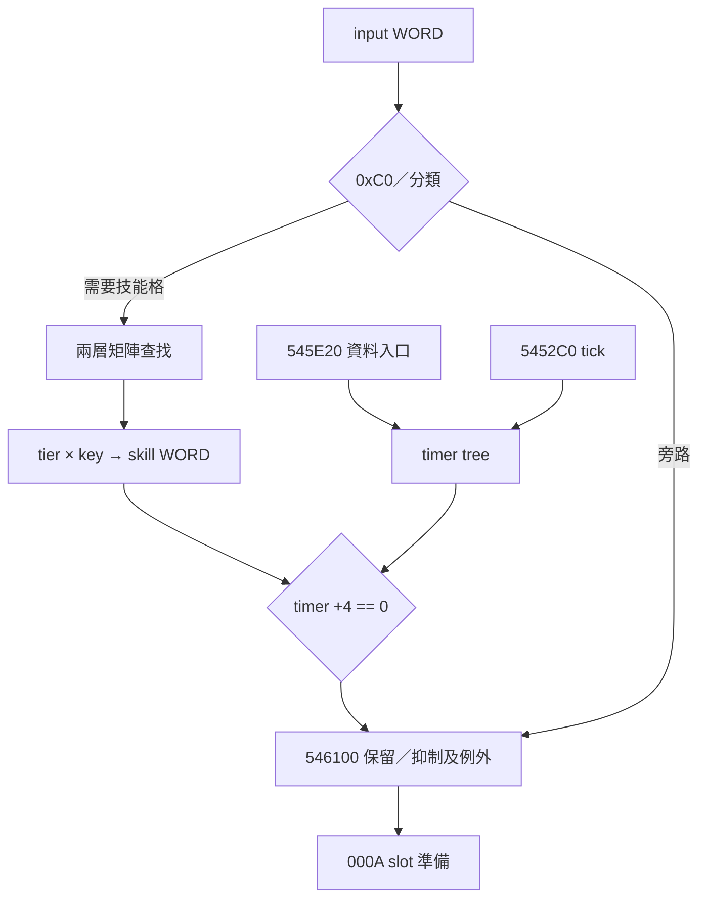

# T10-103：輸入命令 → SkillMatrix → 計時門檻 → C2S 準備邊界

本段為完整研究原稿，接續 T10-101、102；不是摘要替代檔。KR 唯讀離線分析；未執行、附加或修改遊戲。第一輪已有實質新進展，故沒有以重複搜尋湊出 103-2／103-3。全文的「已確認」只涵蓋列出的 native 分支，非整個 Task FULL-PASS。

## 1. 本輪結論與證據等級

1. **已確認**：`54F270` 的輸入 bit0 單獨成立時選矩陣欄 1；bit0+bit1 選欄4，bit0+bit2 選欄5，三鍵同時成立優先欄4。這是組合優先級，不是時間序列連段。
2. **已確認**：普通控制器 `546100` 內，`5462B4..5462DD` 將 actor `+3E8` 與角色模式資料衍生 byte 推入；以實際 push 順序還原，`54F270(arg8=modeSelector,argC=actor+3E8)`。modeSelector 是內層矩陣索引；actor+3E8 低 byte 才是 4 列矩陣 row。不可把二者顛倒。
3. **已確認**：`40F7F0` 是 getter，不消耗 caller 預推的兩個參數；下一個 `819220` 以 `ret8` 消耗它們。外層 key 是 per-actor record `+2` WORD，內層 key 是 modeSelector BYTE；selector0 找不到時可退至內層第一節點，非零 selector 找不到直接失敗。
4. **已確認**：`81A8E0` 回傳 `WORD[matrix+4+2*(row*11+column)]`，row<4、column<11。loader `818430` 從 XML `tier/key/skill` 寫入同一公式；所以此 WORD 是 XML skill 值，而非由這個讀取器直接產生 motion。沒有原始 SkillMatrix.xml 的具體格值，故不填任何角色技能／普攻 ID。
5. **已確認**：`54F270` 以該 WORD 查 per-actor record+4 的 DWORD-key tree；只判斷 payload+4==0，不在此啟動計時、不呼叫 actor motion。`54F4E0` 缺少項目時建立零值 payload，所以「沒有矩陣／skill=0」失敗，但「尚無 timer entry」預設可通過。
6. **已確認**：`5452C0→54F200` 每次控制器 tick 對每項非零 node+14（payload+4）減1；這是 tick 計數，不能據此宣稱毫秒或固定 FPS。`545E20` 的資料處理分支可寫 payload+0/+4/+8/+C，輸入分支不能當作唯一 timer writer。
7. **部分確認**：`546100` 會使用檢查結果決定是否保留輸出 lower15 bits，但 actor+3E8 非零有例外保留分支，global FBA7AC==1 可跳過此檢查。故不能說矩陣／timer 失敗一律不發包。
8. **尚待驗證**：bit0 的所有實際角色 skill 格值、actor+3E8 寫入者及語意、普攻起手／本地預測、原版續段／取消時窗、000A與000D因果配對、timer資料處理入口的網路 opcode與分派鏈。

## 2. 來源、版本與映射

BIN SHA256：`9741d1975327b9309d82b52f631165bc410757694d7c183a5eed970a53ebef91`。
EXE SHA256：`03771b8e1c1e66248f54585fadf9a5e926eb77228721325bb9be5febc53b3b5f`。
每段重新核對原檔；ImageBase 400000。`.text` VA401000/raw400，raw=VA−400C00；`.rdata` VABD2000/raw7D0600，raw=VA−401A00。FBxxxx 全域位於虛擬零填區，本檔沒有其 runtime 值，不能用 text 公式為它製造 raw。

本輪重讀 shared/T10 Project 指示與使用者上傳交接，Git AGENTS blob `a1dcfdb989c47162a081632c2bdd8a5297491cef`；T10 task仍 native_complete=false。此稿是有界輸入介面研究，T11/T02核心規則只引用，不改其 owner/catalog。使用者本輪明確授權完整分析上git；提交T101/102/103原稿，不包含原始遊戲檔或短期交接。

反編譯僅導航：`kr-bulk-roy/<BIN SHA>/functions/0x54f270.c` blob `525d1b4ede22d25da7aadef3acd1d224f205834d`，`0x818430.c` blob `9b1ede8619d8fbbafc29126586cb00c9da4a2e03`。本稿重要值與 ABI 均回到 native 指令；自動反編譯的參數型別不可取代 push/ret 證據。

## 3. 玩家情境 × 封包 × 動作矩陣

| 玩家情境 | Client 已確認分支 | C→S | S→C | 本地／其他角色 motion | 分工與等級 |
|---|---|---|---|---|---|
| 站立短按 Z，實際工作bank將掃描碼44映射ID13 | 承T102 physical DIK_Z與Type0；當前bank仍未知。phase1/2可設bit0，本輪bit0單獨→key1→skill格→timer+4==0 | 承T101：有界條件下000A，6+5N。此稿確認其上游一個准入條件；不保證每次短按必發 | 000D有motion consumer，但非已證明000A回覆 | 尚未確認起手／預測 | Client檢查native；Server裁決未知 |
| 長按映射ID13 | phase2可反覆設bit0；timer每控制器tick遞減，非零時可能抑制；有例外 | 次數／頻率／tick與發包節流相互關係仍未知 | 尚未確認 | 尚未確認續段 | 不以重複bit推論連段 |
| 放開映射ID13 | phase3已在T101定位；本輪未新增release攻擊路徑 | 是否另外發包尚未確認 | 尚未確認 | 尚未確認 | 未找到不等於不發 |
| 同時觸發bit0與bit1 | 欄4優先於單鍵；三鍵亦欄4 | 仍是既有input WORD路徑；不在此將skill WORD寫成獨立opcode | 尚未確認 | 尚未確認 | 同時組合native，不是先後combo |
| 有timer、actor+3E8=0 | 此檢查失敗時546302清lower15，只保留bit15 | 是否仍因其他slot／分支發包需個別核對 | 尚未確認 | 尚未確認 | 有界抑制native |
| 同樣timer、actor+3E8非零 | 5462F6保留成功旗標；row>=4時matrix讀0，但caller仍有例外 | 不可宣稱一律不發 | 尚未確認 | +3E8不能直接命名連段段數 | 原生分支已確認，語意未知 |
| 施放中鍵盤／滑鼠移動 | 承T101不同producer，本輪未閉合cancel | 尚未確認時序／取消請求 | 尚未確認 | 尚未確認取消 | 分工未知 |

## 4. 輸入分類、資料流與偽碼

命令分類按程式先後：

| 條件（數值為mask） | column | 備註 |
|---|---:|---|
| input&0xC0 !=0 | 不查，直接true | 在任一技能組合測試之前 |
| (input&1)&&(input&2) | 4 | 含input=7 |
| (input&1)&&(input&4) | 5 | 第二優先 |
| (input&2)&&(input&4) | 6 | 第三優先 |
| input&1 | 1 | bit0單獨 |
| input&2 | 2 | bit1單獨 |
| input&4 | 3 | bit2單獨 |
| input&8 | 7 | 若前述皆不成立 |
| input&0x10 | 10 | 十進位10 |
| 其他 | 不查，直接true | 不是全input WORD合法性檢查 |

```cpp
// 自製說明偽碼；不是原版函式簽名或伺服器實作
bool input_gate(Record* r, uint32_t input, uint32_t modeSelector, uint32_t actorField3E8) {
  if (input & 0xC0) return true;
  int col = prioritized_column(input);
  if (col < 0) return true;
  Matrix* m = lookup(FAB27C, r->word_at_2, uint8_t(modeSelector));
  if (!m) return false;
  uint16_t skill = read_matrix(m, uint8_t(actorField3E8), uint8_t(col));
  if (!skill) return false;
  Payload* p = find_or_insert_zero(r+4, uint32_t(skill));
  return p->dword_at_4 == 0;
}
```

`5462B4` 先push actor+3E8，`5462C3` modeByte來自模式資料byte0或byte1，選擇條件byte2!=0；`5462CE` 再push mode。因此進54F270後 `[ebp+8]=mode`、`[ebp+C]=actor+3E8`。`54F2D9/DA` 再將mode及r+2傳給819220；返回後81A8E0用argC作row。這個區分是本輪重要ABI核對。

## 5. 矩陣來源與生命週期

`48D0A6` 引用 `Table/Skill/SkillMatrix.xml`，`48D0B3` 指定FAB27C，`48D0B8` 呼叫8180C0。後者遍歷MatrixInfo並於818386呼叫818430。818430有MatrixList/SkillMatrix/Matrix階層；外層CharID讀至local D8，其低WORD用於819460；matrix變體的byte localE0用於819650。這裡不把該byte更精細命名成某職業或姿態。

重要字串核對：C52F00 MatrixInfo；C52F0C MatrixList；C52F18 SkillMatrix；C52F24 Matrix；C0FBE4 Tier；C408C0 Key；C0F030 tier；C0F038 key；C0E83C skill；C5294C CharID。Tier/Key節點名和tier/key屬性不可混為physical key掃描碼。

Native writer兩個可達布局：818E5A..818E7D與81902A..81904D，皆row<4、col<11，寫WORD+4+2*(row*11+col)。attribute缺失預設0；轉換後取低byte／低WORD並做界限檢查。818F49分支的tier/key/skill轉換慢路徑在819189、8191B8、8191E2回跳到共享writer。不能只看線性0初值就說它總寫0。

819092..8190D4：matrix物件經81A910輔助處理後，依CharID及變體byte插入兩層map。81A910配置的0x5C大小物件在parent+5C，並經81B660建立多組vector/critical section；**不是本稿4×11 WORD表本體**。兩者恰有92-byte量級不能當作同一結構。819280載入SkillSystemResetFee.xml，不能錯當SkillMatrix loader。

819220由外層WORD tree定位，內層BYTE tree定位，回傳innernode+10儲存的matrix指標；不是把node+10直接當內嵌表。外層／內層缺失都可返回null；selector0允許取第一個變體，沒有證據說其必為預設職業或特定Matrix ID。

## 6. 計時tree、writer與tick

| 基址 | 偏移 | 已確認用途 |
|---|---|---|
| peractor record | +2 WORD | 外層matrix查找key |
| peractor record | +4 | timer map物件 |
| tree node | +C DWORD | skill key（由矩陣WORD零擴展） |
| tree node | +10 | payload起點 |
| payload | +0 DWORD | 資料writer寫入的計數基準值；完整語意未定 |
| payload | +4 DWORD | gate判零、tick遞減的剩餘計數 |
| payload | +8 BYTE | writer可設1，5CE33A清0；完整旗標語意未定 |
| payload | +C DWORD | writer保存輸入skill key |
| tree node | +20/+21 | 樹顏色／sentinel結構欄位，不能誤作payload |

54F4E0以r+4查DWORD key，缺失時local payload之+0/+4/+8低byte/+C初始化零；54F7D0配置0x24 node並拷貝key和16-byte payload，54F6A0插入。+8其餘padding位元未保證清零，不能聲稱整個16-byte原始記憶體逐byte皆0。

5452C0在54534B讀每slot record→545351呼叫54F200；三slot迴圈步長0xC，record可空。54F200從record+8取得map head（即record+4的map+4），依node+14非零就減1，不使用delta時間。隨後特定actor+158物件的+8==3時，54536E→597B70清掉tree；這是條件清除，不是攻擊完成證據。

545E20：arg8指向輸入資料，前+2 WORD匹配三slot actor+4；arg8+4非零走597B70清tree。否則計算floor((len−8)/6)，每筆6byte：+0 WORD key，+2 signedDWORD原始計數。545EBD乘數0x3E0F83E1、高位右移3再符號修正，即signed除33（toward0），結果寫payload+0及+4；+C寫key；+0非零可將+8設1。此處只建立**資料處理入口**，尚未把它的arg來源、vtable槽或網路opcode閉合，不稱已證明S2C冷卻封包。

5CE335..5CE34F有另一條clear payload+8及+4路徑；目前只核對局部寫入，不推論施放成功／UI重置／server拒絕。54F330則同矩陣索引後拷貝16-byte payload給caller；不在本段擴展為T11冷卻UI完整審核。

## 7. 與000A、000D及motion的邊界

承T101/102：mapped held→phase→事件分派／已處理phase清除→battle tick；ID13 phase1/2可設controller+5C bit0；546780合成input WORD；ordinary virtual48=548A20→546100；5452C0以000A、F93944及每slot actorWORD/inputWORD/headingBYTE構建6+5N並交network virtual10，後續T02 WSASend路徑已有引用。

本段新閉合的是546100內一個保留／抑制條件，不是新的opcode：FBA7AC==1跳過54F270；input0跳過；gate true設成功旗標；false但actor+3E8非零亦設成功旗標；僅false且actor+3E8==0在546302對輸出WORD AND8000。因此不能以timer非零推論整包不送，其他slot與既有節流仍須核對。

S2C000D→4B01C0→4C8A90→actor virtual68是前段已定位motion consumer；本段沒有找到矩陣skill WORD直接寫入motion欄位或直接呼叫它。skill key、input mask、mappedID、DIK index、motion WORD是不同domain，不能因數值相同就相等。



## 8. Server責任分級與禁止外推

| 項目 | 等級 | 可採用的證據／限制 |
|---|---|---|
| 解析000A actor/input/heading | Client封包證據支持相容Server責任 | T101提供具體編碼；不等於已知原版裁決 |
| 回送角色motion／同步 | 有S2C consumer證據 | 000D可影響actor；尚未證明每次000A必回000D |
| 冷卻／資源／合法性裁決 | 合理的相容設計需求，原版Server規則未知 | Client有matrix與timer檢查不能證明Server算法 |
| timer初值來源／同步 | Client/Server分工未知 | 545E20資料入口未定位網路來源 |
| 持按續段、排隊、取消窗口 | 原版資訊缺失／待補開發 | 沒有把timer tick或tier擬稱combo window |
| skill到motion與普通攻擊身份 | 尚待驗證 | 缺實際原生格值及consumer鏈 |

沒有新增AI替代規則、常數或可遊玩實作；沒有使用CHAIN_WINDOW=.65。tier是XML維度名，不是已證明連段stage。計數除33不能反推固定30FPS、33ms網路頻率或原版server tickrate。

## 9. 搜尋覆蓋、反證與下一入口

以完整BIN objdump的指令邊界作搜尋；列出direct call覆蓋，不稱所有間接caller已排除。54F270 direct callers：5462DD、54827F、549C0E、549D54；81A8E0 direct callers：54F2F7、61C9BD。54F4E0 direct callers全列於附錄；包含資料writer與清零writer，足以否定「gate是唯一timer來源」。

本段沒有全量重作Ghidra。只對鍵盤→封包准入阻塞擴展矩陣loader／tree生命週期／timer writer，T11核心語意保留。明確排除兩個易誤點：819280是resetfee loader；81A910配置+5C輔助物件不是4×11表。

下一段優先：(1)定位actor+3E8所有writer，判斷row/tier更新來源與例外；(2)按已核對KR資源索引取得SkillMatrix.xml的具體格值及版本來源，再追skill→motion consumer；(3)545E20的控制器vtable槽／接收dispatch，閉合timer資料是否來自S2C及opcode；(4)61C9BD作交叉consumer，但不擴成T11全技能重審；(5)以短按Z仍未閉合的實際bank與000D因果驗證為驗收。phase override vector非零producer仍未知，沒有因本段timer進展而宣稱全部phase writer完成。

## 10. 第一手native證據附錄

以下是從原檔objdump完整指令流擷取的區段；包括完整函式及必要caller。沒有從任意位元組中段重新反組譯來製造入口。VA/raw表及每條帶bytes指令可由原BIN獨立重現。

| 證據區段 | VA起點 | raw起點 | 終點（不含） |
|---|---|---|---|
| getter及ABI | 0040F7F0 | 0000EBF0 | 0040F851 |
| 矩陣載入callsite | 0048D064 | 0008C464 | 0048D0C7 |
| tick呼叫與slot清除 | 005452C0 | 001446C0 | 00545379 |
| 資料writer完整 | 00545E20 | 00145220 | 00545F2B |
| ordinary輸出准入上游 | 00546100 | 00145500 | 00546306 |
| 其他直接caller有界片段 | 00548230 | 00147630 | 005482B0 |
| 其他直接caller有界片段 | 00549BE0 | 00148FE0 | 00549C35 |
| 其他直接caller有界片段 | 00549D20 | 00149120 | 00549D80 |
| tick及gate完整 | 0054F200 | 0014E600 | 0054F32F |
| payload查詢拷貝 | 0054F330 | 0014E730 | 0054F466 |
| tree查找或建立 | 0054F4E0 | 0014E8E0 | 0054F56E |
| tree插入與node配置 | 0054F6A0 | 0014EAA0 | 0054F84B |
| tree清除 | 00597B70 | 00196F70 | 00597BB9 |
| 另一個timer清零writer | 005CE31D | 001CD71D | 005CE34F |
| matrix全域建構有界片段 | 00817DA0 | 004171A0 | 00817F10 |
| MatrixInfo loader完整 | 008180C0 | 004174C0 | 00818430 |
| Matrix XML parser完整 | 00818430 | 00417830 | 00819220 |
| 兩層lookup完整 | 00819220 | 00418620 | 00819280 |
| 外層lookup | 008195E0 | 004189E0 | 00819650 |
| 內層lookup | 008196D0 | 00418AD0 | 00819730 |
| 4x11 reader完整 | 0081A8E0 | 00419CE0 | 0081A910 |
| aux物件建構有界片段 | 0081A910 | 00419D10 | 0081AAE0 |
| aux ctor/dtor | 0081B660 | 0041AA60 | 0081B720 |

### getter及ABI：0040F7F0..0040F851

```asm
  40f7f0:	55                   	push   ebp
  40f7f1:	8b ec                	mov    ebp,esp
  40f7f3:	6a ff                	push   0xffffffff
  40f7f5:	68 be 0f 91 00       	push   0x910fbe
  40f7fa:	64 a1 00 00 00 00    	mov    eax,fs:0x0
  40f800:	50                   	push   eax
  40f801:	a1 20 1f d6 00       	mov    eax,ds:0xd61f20
  40f806:	33 c5                	xor    eax,ebp
  40f808:	50                   	push   eax
  40f809:	8d 45 f4             	lea    eax,[ebp-0xc]
  40f80c:	64 a3 00 00 00 00    	mov    fs:0x0,eax
  40f812:	b8 01 00 00 00       	mov    eax,0x1
  40f817:	84 05 78 b2 fa 00    	test   BYTE PTR ds:0xfab278,al
  40f81d:	75 1f                	jne    0x40f83e
  40f81f:	09 05 78 b2 fa 00    	or     DWORD PTR ds:0xfab278,eax
  40f825:	c7 45 fc 00 00 00 00 	mov    DWORD PTR [ebp-0x4],0x0
  40f82c:	e8 6f 85 40 00       	call   0x817da0
  40f831:	68 d0 ce bc 00       	push   0xbcced0
  40f836:	e8 df 2a 48 00       	call   0x89231a
  40f83b:	83 c4 04             	add    esp,0x4
  40f83e:	b8 7c b2 fa 00       	mov    eax,0xfab27c
  40f843:	8b 4d f4             	mov    ecx,DWORD PTR [ebp-0xc]
  40f846:	64 89 0d 00 00 00 00 	mov    DWORD PTR fs:0x0,ecx
  40f84d:	59                   	pop    ecx
  40f84e:	8b e5                	mov    esp,ebp
  40f850:	5d                   	pop    ebp
```

### 矩陣載入callsite：0048D064..0048D0C7

```asm
  48d064:	f6 05 78 b2 fa 00 01 	test   BYTE PTR ds:0xfab278,0x1
  48d06b:	75 24                	jne    0x48d091
  48d06d:	09 3d 78 b2 fa 00    	or     DWORD PTR ds:0xfab278,edi
  48d073:	c7 44 24 70 21 00 00 	mov    DWORD PTR [esp+0x70],0x21
  48d07a:	00 
  48d07b:	e8 20 ad 38 00       	call   0x817da0
  48d080:	68 d0 ce bc 00       	push   0xbcced0
  48d085:	e8 90 52 40 00       	call   0x89231a
  48d08a:	83 c4 04             	add    esp,0x4
  48d08d:	89 5c 24 70          	mov    DWORD PTR [esp+0x70],ebx
  48d091:	83 ec 1c             	sub    esp,0x1c
  48d094:	8b cc                	mov    ecx,esp
  48d096:	89 64 24 2c          	mov    DWORD PTR [esp+0x2c],esp
  48d09a:	6a 1b                	push   0x1b
  48d09c:	c7 41 14 0f 00 00 00 	mov    DWORD PTR [ecx+0x14],0xf
  48d0a3:	89 71 10             	mov    DWORD PTR [ecx+0x10],esi
  48d0a6:	68 74 2f c5 00       	push   0xc52f74
  48d0ab:	c6 01 00             	mov    BYTE PTR [ecx],0x0
  48d0ae:	e8 bd 59 f7 ff       	call   0x402a70
  48d0b3:	b9 7c b2 fa 00       	mov    ecx,0xfab27c
  48d0b8:	e8 03 b0 38 00       	call   0x8180c0
  48d0bd:	68 7c b2 fa 00       	push   0xfab27c
  48d0c2:	e8 b9 c1 38 00       	call   0x819280
```

### tick呼叫與slot清除：005452C0..00545379

```asm
  5452c0:	55                   	push   ebp
  5452c1:	8b ec                	mov    ebp,esp
  5452c3:	83 e4 f8             	and    esp,0xfffffff8
  5452c6:	6a ff                	push   0xffffffff
  5452c8:	68 1c 3f 94 00       	push   0x943f1c
  5452cd:	64 a1 00 00 00 00    	mov    eax,fs:0x0
  5452d3:	50                   	push   eax
  5452d4:	83 ec 30             	sub    esp,0x30
  5452d7:	53                   	push   ebx
  5452d8:	56                   	push   esi
  5452d9:	57                   	push   edi
  5452da:	a1 20 1f d6 00       	mov    eax,ds:0xd61f20
  5452df:	33 c4                	xor    eax,esp
  5452e1:	50                   	push   eax
  5452e2:	8d 44 24 40          	lea    eax,[esp+0x40]
  5452e6:	64 a3 00 00 00 00    	mov    fs:0x0,eax
  5452ec:	8b f1                	mov    esi,ecx
  5452ee:	89 74 24 14          	mov    DWORD PTR [esp+0x14],esi
  5452f2:	83 7e 04 00          	cmp    DWORD PTR [esi+0x4],0x0
  5452f6:	0f 84 8e 08 00 00    	je     0x545b8a
  5452fc:	f6 05 90 43 f9 00 01 	test   BYTE PTR ds:0xf94390,0x1
  545303:	75 29                	jne    0x54532e
  545305:	83 0d 90 43 f9 00 01 	or     DWORD PTR ds:0xf94390,0x1
  54530c:	c7 44 24 48 00 00 00 	mov    DWORD PTR [esp+0x48],0x0
  545313:	00 
  545314:	e8 77 c2 f9 ff       	call   0x4e1590
  545319:	68 80 cc bc 00       	push   0xbccc80
  54531e:	e8 f7 cf 34 00       	call   0x89231a
  545323:	83 c4 04             	add    esp,0x4
  545326:	c7 44 24 48 ff ff ff 	mov    DWORD PTR [esp+0x48],0xffffffff
  54532d:	ff 
  54532e:	a1 3c 42 f9 00       	mov    eax,ds:0xf9423c
  545333:	89 44 24 28          	mov    DWORD PTR [esp+0x28],eax
  545337:	2b 46 64             	sub    eax,DWORD PTR [esi+0x64]
  54533a:	89 44 24 1c          	mov    DWORD PTR [esp+0x1c],eax
  54533e:	e8 6d 7b 00 00       	call   0x54ceb0
  545343:	83 c6 10             	add    esi,0x10
  545346:	bb 03 00 00 00       	mov    ebx,0x3
  54534b:	8b 06                	mov    eax,DWORD PTR [esi]
  54534d:	85 c0                	test   eax,eax
  54534f:	74 22                	je     0x545373
  545351:	e8 aa 9e 00 00       	call   0x54f200
  545356:	8b 46 fc             	mov    eax,DWORD PTR [esi-0x4]
  545359:	85 c0                	test   eax,eax
  54535b:	74 16                	je     0x545373
  54535d:	8b 80 58 01 00 00    	mov    eax,DWORD PTR [eax+0x158]
  545363:	83 78 08 03          	cmp    DWORD PTR [eax+0x8],0x3
  545367:	75 0a                	jne    0x545373
  545369:	8b 3e                	mov    edi,DWORD PTR [esi]
  54536b:	8d 7f 04             	lea    edi,[edi+0x4]
  54536e:	e8 fd 27 05 00       	call   0x597b70
  545373:	83 c6 0c             	add    esi,0xc
  545376:	4b                   	dec    ebx
  545377:	75 d2                	jne    0x54534b
```

### 資料writer完整：00545E20..00545F2B

```asm
  545e20:	55                   	push   ebp
  545e21:	8b ec                	mov    ebp,esp
  545e23:	83 e4 f8             	and    esp,0xfffffff8
  545e26:	83 ec 0c             	sub    esp,0xc
  545e29:	53                   	push   ebx
  545e2a:	8b 5d 08             	mov    ebx,DWORD PTR [ebp+0x8]
  545e2d:	56                   	push   esi
  545e2e:	57                   	push   edi
  545e2f:	66 8b 7b 02          	mov    di,WORD PTR [ebx+0x2]
  545e33:	33 f6                	xor    esi,esi
  545e35:	8d 51 0c             	lea    edx,[ecx+0xc]
  545e38:	8b 02                	mov    eax,DWORD PTR [edx]
  545e3a:	85 c0                	test   eax,eax
  545e3c:	74 06                	je     0x545e44
  545e3e:	66 39 78 04          	cmp    WORD PTR [eax+0x4],di
  545e42:	74 12                	je     0x545e56
  545e44:	46                   	inc    esi
  545e45:	83 c2 0c             	add    edx,0xc
  545e48:	83 fe 03             	cmp    esi,0x3
  545e4b:	7c eb                	jl     0x545e38
  545e4d:	5f                   	pop    edi
  545e4e:	5e                   	pop    esi
  545e4f:	5b                   	pop    ebx
  545e50:	8b e5                	mov    esp,ebp
  545e52:	5d                   	pop    ebp
  545e53:	c2 0c 00             	ret    0xc
  545e56:	83 fe ff             	cmp    esi,0xffffffff
  545e59:	0f 84 c3 00 00 00    	je     0x545f22
  545e5f:	83 7b 04 00          	cmp    DWORD PTR [ebx+0x4],0x0
  545e63:	74 18                	je     0x545e7d
  545e65:	8d 04 76             	lea    eax,[esi+esi*2]
  545e68:	8b 7c 81 10          	mov    edi,DWORD PTR [ecx+eax*4+0x10]
  545e6c:	83 c7 04             	add    edi,0x4
  545e6f:	e8 fc 1c 05 00       	call   0x597b70
  545e74:	5f                   	pop    edi
  545e75:	5e                   	pop    esi
  545e76:	5b                   	pop    ebx
  545e77:	8b e5                	mov    esp,ebp
  545e79:	5d                   	pop    ebp
  545e7a:	c2 0c 00             	ret    0xc
  545e7d:	8b 45 0c             	mov    eax,DWORD PTR [ebp+0xc]
  545e80:	83 f8 08             	cmp    eax,0x8
  545e83:	73 04                	jae    0x545e89
  545e85:	33 d2                	xor    edx,edx
  545e87:	eb 0d                	jmp    0x545e96
  545e89:	8d 50 f8             	lea    edx,[eax-0x8]
  545e8c:	b8 ab aa aa aa       	mov    eax,0xaaaaaaab
  545e91:	f7 e2                	mul    edx
  545e93:	c1 ea 02             	shr    edx,0x2
  545e96:	85 d2                	test   edx,edx
  545e98:	0f 84 84 00 00 00    	je     0x545f22
  545e9e:	8d 04 76             	lea    eax,[esi+esi*2]
  545ea1:	8d 4c 81 10          	lea    ecx,[ecx+eax*4+0x10]
  545ea5:	89 4c 24 14          	mov    DWORD PTR [esp+0x14],ecx
  545ea9:	83 c3 08             	add    ebx,0x8
  545eac:	89 54 24 10          	mov    DWORD PTR [esp+0x10],edx
  545eb0:	0f b7 13             	movzx  edx,WORD PTR [ebx]
  545eb3:	8b 44 24 14          	mov    eax,DWORD PTR [esp+0x14]
  545eb7:	8b 38                	mov    edi,DWORD PTR [eax]
  545eb9:	89 54 24 0c          	mov    DWORD PTR [esp+0xc],edx
  545ebd:	b8 e1 83 0f 3e       	mov    eax,0x3e0f83e1
  545ec2:	f7 6b 02             	imul   DWORD PTR [ebx+0x2]
  545ec5:	c1 fa 03             	sar    edx,0x3
  545ec8:	8b f2                	mov    esi,edx
  545eca:	83 c7 04             	add    edi,0x4
  545ecd:	c1 ee 1f             	shr    esi,0x1f
  545ed0:	57                   	push   edi
  545ed1:	8d 44 24 10          	lea    eax,[esp+0x10]
  545ed5:	03 f2                	add    esi,edx
  545ed7:	e8 04 96 00 00       	call   0x54f4e0
  545edc:	8b 4c 24 0c          	mov    ecx,DWORD PTR [esp+0xc]
  545ee0:	89 48 0c             	mov    DWORD PTR [eax+0xc],ecx
  545ee3:	57                   	push   edi
  545ee4:	8d 44 24 10          	lea    eax,[esp+0x10]
  545ee8:	e8 f3 95 00 00       	call   0x54f4e0
  545eed:	89 30                	mov    DWORD PTR [eax],esi
  545eef:	57                   	push   edi
  545ef0:	8d 44 24 10          	lea    eax,[esp+0x10]
  545ef4:	e8 e7 95 00 00       	call   0x54f4e0
  545ef9:	89 70 04             	mov    DWORD PTR [eax+0x4],esi
  545efc:	57                   	push   edi
  545efd:	8d 44 24 10          	lea    eax,[esp+0x10]
  545f01:	e8 da 95 00 00       	call   0x54f4e0
  545f06:	83 38 00             	cmp    DWORD PTR [eax],0x0
  545f09:	74 0e                	je     0x545f19
  545f0b:	57                   	push   edi
  545f0c:	8d 44 24 10          	lea    eax,[esp+0x10]
  545f10:	e8 cb 95 00 00       	call   0x54f4e0
  545f15:	c6 40 08 01          	mov    BYTE PTR [eax+0x8],0x1
  545f19:	83 c3 06             	add    ebx,0x6
  545f1c:	ff 4c 24 10          	dec    DWORD PTR [esp+0x10]
  545f20:	75 8e                	jne    0x545eb0
  545f22:	5f                   	pop    edi
  545f23:	5e                   	pop    esi
  545f24:	5b                   	pop    ebx
  545f25:	8b e5                	mov    esp,ebp
  545f27:	5d                   	pop    ebp
  545f28:	c2 0c 00             	ret    0xc
```

### ordinary輸出准入上游：00546100..00546306

```asm
  546100:	55                   	push   ebp
  546101:	8b ec                	mov    ebp,esp
  546103:	83 e4 f8             	and    esp,0xfffffff8
  546106:	6a ff                	push   0xffffffff
  546108:	68 6c fe 93 00       	push   0x93fe6c
  54610d:	64 a1 00 00 00 00    	mov    eax,fs:0x0
  546113:	50                   	push   eax
  546114:	83 ec 28             	sub    esp,0x28
  546117:	53                   	push   ebx
  546118:	56                   	push   esi
  546119:	57                   	push   edi
  54611a:	a1 20 1f d6 00       	mov    eax,ds:0xd61f20
  54611f:	33 c4                	xor    eax,esp
  546121:	50                   	push   eax
  546122:	8d 44 24 38          	lea    eax,[esp+0x38]
  546126:	64 a3 00 00 00 00    	mov    fs:0x0,eax
  54612c:	89 4c 24 18          	mov    DWORD PTR [esp+0x18],ecx
  546130:	83 3d ac a7 fb 00 03 	cmp    DWORD PTR ds:0xfba7ac,0x3
  546137:	8b 79 0c             	mov    edi,DWORD PTR [ecx+0xc]
  54613a:	c6 44 24 17 00       	mov    BYTE PTR [esp+0x17],0x0
  54613f:	75 0a                	jne    0x54614b
  546141:	8b 45 08             	mov    eax,DWORD PTR [ebp+0x8]
  546144:	8d 44 40 03          	lea    eax,[eax+eax*2+0x3]
  546148:	8b 3c 81             	mov    edi,DWORD PTR [ecx+eax*4]
  54614b:	33 f6                	xor    esi,esi
  54614d:	3b fe                	cmp    edi,esi
  54614f:	75 20                	jne    0x546171
  546151:	89 71 7c             	mov    DWORD PTR [ecx+0x7c],esi
  546154:	89 b1 80 00 00 00    	mov    DWORD PTR [ecx+0x80],esi
  54615a:	32 c0                	xor    al,al
  54615c:	8b 4c 24 38          	mov    ecx,DWORD PTR [esp+0x38]
  546160:	64 89 0d 00 00 00 00 	mov    DWORD PTR fs:0x0,ecx
  546167:	59                   	pop    ecx
  546168:	5f                   	pop    edi
  546169:	5e                   	pop    esi
  54616a:	5b                   	pop    ebx
  54616b:	8b e5                	mov    esp,ebp
  54616d:	5d                   	pop    ebp
  54616e:	c2 08 00             	ret    0x8
  546171:	0f b6 87 e4 00 00 00 	movzx  eax,BYTE PTR [edi+0xe4]
  546178:	8b 97 e0 00 00 00    	mov    edx,DWORD PTR [edi+0xe0]
  54617e:	8b 5d 0c             	mov    ebx,DWORD PTR [ebp+0xc]
  546181:	88 44 24 30          	mov    BYTE PTR [esp+0x30],al
  546185:	33 c0                	xor    eax,eax
  546187:	89 54 24 2c          	mov    DWORD PTR [esp+0x2c],edx
  54618b:	8a 97 b0 00 00 00    	mov    dl,BYTE PTR [edi+0xb0]
  546191:	66 89 43 02          	mov    WORD PTR [ebx+0x2],ax
  546195:	8a 87 b0 00 00 00    	mov    al,BYTE PTR [edi+0xb0]
  54619b:	88 43 04             	mov    BYTE PTR [ebx+0x4],al
  54619e:	8b 87 58 01 00 00    	mov    eax,DWORD PTR [edi+0x158]
  5461a4:	88 54 24 1c          	mov    BYTE PTR [esp+0x1c],dl
  5461a8:	89 74 24 20          	mov    DWORD PTR [esp+0x20],esi
  5461ac:	3b c6                	cmp    eax,esi
  5461ae:	74 05                	je     0x5461b5
  5461b0:	39 70 34             	cmp    DWORD PTR [eax+0x34],esi
  5461b3:	74 09                	je     0x5461be
  5461b5:	89 71 7c             	mov    DWORD PTR [ecx+0x7c],esi
  5461b8:	89 b1 80 00 00 00    	mov    DWORD PTR [ecx+0x80],esi
  5461be:	f6 05 90 43 f9 00 01 	test   BYTE PTR ds:0xf94390,0x1
  5461c5:	89 74 24 28          	mov    DWORD PTR [esp+0x28],esi
  5461c9:	75 25                	jne    0x5461f0
  5461cb:	83 0d 90 43 f9 00 01 	or     DWORD PTR ds:0xf94390,0x1
  5461d2:	89 74 24 40          	mov    DWORD PTR [esp+0x40],esi
  5461d6:	e8 b5 b3 f9 ff       	call   0x4e1590
  5461db:	68 80 cc bc 00       	push   0xbccc80
  5461e0:	e8 35 c1 34 00       	call   0x89231a
  5461e5:	83 c4 04             	add    esp,0x4
  5461e8:	c7 44 24 40 ff ff ff 	mov    DWORD PTR [esp+0x40],0xffffffff
  5461ef:	ff 
  5461f0:	0f b7 87 88 00 00 00 	movzx  eax,WORD PTR [edi+0x88]
  5461f7:	8b 0d 04 43 f9 00    	mov    ecx,DWORD PTR ds:0xf94304
  5461fd:	83 f8 09             	cmp    eax,0x9
  546200:	0f 87 54 ff ff ff    	ja     0x54615a
  546206:	69 c0 10 02 00 00    	imul   eax,eax,0x210
  54620c:	03 c1                	add    eax,ecx
  54620e:	39 70 5c             	cmp    DWORD PTR [eax+0x5c],esi
  546211:	0f 84 43 ff ff ff    	je     0x54615a
  546217:	3b c6                	cmp    eax,esi
  546219:	0f 84 3b ff ff ff    	je     0x54615a
  54621f:	05 f4 01 00 00       	add    eax,0x1f4
  546224:	89 44 24 24          	mov    DWORD PTR [esp+0x24],eax
  546228:	3b c6                	cmp    eax,esi
  54622a:	0f 84 2a ff ff ff    	je     0x54615a
  546230:	8b 87 58 01 00 00    	mov    eax,DWORD PTR [edi+0x158]
  546236:	85 c0                	test   eax,eax
  546238:	74 03                	je     0x54623d
  54623a:	8b 70 2c             	mov    esi,DWORD PTR [eax+0x2c]
  54623d:	8b cf                	mov    ecx,edi
  54623f:	e8 8c 3c f8 ff       	call   0x4c9ed0
  546244:	85 f6                	test   esi,esi
  546246:	0f 84 ba 00 00 00    	je     0x546306
  54624c:	85 c0                	test   eax,eax
  54624e:	0f 85 b2 00 00 00    	jne    0x546306
  546254:	8b 44 24 18          	mov    eax,DWORD PTR [esp+0x18]
  546258:	8d 4c 24 20          	lea    ecx,[esp+0x20]
  54625c:	51                   	push   ecx
  54625d:	8d 54 24 20          	lea    edx,[esp+0x20]
  546261:	52                   	push   edx
  546262:	57                   	push   edi
  546263:	e8 18 05 00 00       	call   0x546780
  546268:	89 44 24 28          	mov    DWORD PTR [esp+0x28],eax
  54626c:	e8 ef e6 ef ff       	call   0x444960
  546271:	80 b8 ef 07 00 00 01 	cmp    BYTE PTR [eax+0x7ef],0x1
  546278:	75 0c                	jne    0x546286
  54627a:	b8 00 01 00 00       	mov    eax,0x100
  54627f:	c6 44 24 17 01       	mov    BYTE PTR [esp+0x17],0x1
  546284:	eb 09                	jmp    0x54628f
  546286:	8b 44 24 20          	mov    eax,DWORD PTR [esp+0x20]
  54628a:	66 85 c0             	test   ax,ax
  54628d:	74 13                	je     0x5462a2
  54628f:	66 8b 4b 02          	mov    cx,WORD PTR [ebx+0x2]
  546293:	66 33 c8             	xor    cx,ax
  546296:	ba ff 7f 00 00       	mov    edx,0x7fff
  54629b:	66 23 ca             	and    cx,dx
  54629e:	66 31 4b 02          	xor    WORD PTR [ebx+0x2],cx
  5462a2:	83 3d ac a7 fb 00 01 	cmp    DWORD PTR ds:0xfba7ac,0x1
  5462a9:	74 5b                	je     0x546306
  5462ab:	66 85 c0             	test   ax,ax
  5462ae:	74 56                	je     0x546306
  5462b0:	8b 74 24 24          	mov    esi,DWORD PTR [esp+0x24]
  5462b4:	8b 8f e8 03 00 00    	mov    ecx,DWORD PTR [edi+0x3e8]
  5462ba:	33 d2                	xor    edx,edx
  5462bc:	38 56 02             	cmp    BYTE PTR [esi+0x2],dl
  5462bf:	51                   	push   ecx
  5462c0:	0f 95 c2             	setne  dl
  5462c3:	8a 14 32             	mov    dl,BYTE PTR [edx+esi*1]
  5462c6:	88 54 24 28          	mov    BYTE PTR [esp+0x28],dl
  5462ca:	8b 4c 24 28          	mov    ecx,DWORD PTR [esp+0x28]
  5462ce:	51                   	push   ecx
  5462cf:	8b 4d 08             	mov    ecx,DWORD PTR [ebp+0x8]
  5462d2:	8d 14 49             	lea    edx,[ecx+ecx*2]
  5462d5:	8b 4c 24 20          	mov    ecx,DWORD PTR [esp+0x20]
  5462d9:	8b 4c 91 10          	mov    ecx,DWORD PTR [ecx+edx*4+0x10]
  5462dd:	e8 8e 8f 00 00       	call   0x54f270
  5462e2:	85 c0                	test   eax,eax
  5462e4:	74 07                	je     0x5462ed
  5462e6:	c6 44 24 17 01       	mov    BYTE PTR [esp+0x17],0x1
  5462eb:	eb 19                	jmp    0x546306
  5462ed:	83 bf e8 03 00 00 00 	cmp    DWORD PTR [edi+0x3e8],0x0
  5462f4:	74 07                	je     0x5462fd
  5462f6:	c6 44 24 17 01       	mov    BYTE PTR [esp+0x17],0x1
  5462fb:	eb 09                	jmp    0x546306
  5462fd:	ba 00 80 00 00       	mov    edx,0x8000
  546302:	66 21 53 02          	and    WORD PTR [ebx+0x2],dx
```

### 其他直接caller有界片段：00548230..005482B0

```asm
  548231:	74 0b                	je     0x54823e
  548233:	8b ce                	mov    ecx,esi
  548235:	e8 96 1c f8 ff       	call   0x4c9ed0
  54823a:	85 c0                	test   eax,eax
  54823c:	74 0e                	je     0x54824c
  54823e:	8b 7d 0c             	mov    edi,DWORD PTR [ebp+0xc]
  548241:	b9 00 80 00 00       	mov    ecx,0x8000
  548246:	66 21 4f 02          	and    WORD PTR [edi+0x2],cx
  54824a:	eb 44                	jmp    0x548290
  54824c:	8b 45 0c             	mov    eax,DWORD PTR [ebp+0xc]
  54824f:	66 8b 40 02          	mov    ax,WORD PTR [eax+0x2]
  548253:	ba ff 7f 00 00       	mov    edx,0x7fff
  548258:	66 23 c2             	and    ax,dx
  54825b:	74 30                	je     0x54828d
  54825d:	8b 8e e8 03 00 00    	mov    ecx,DWORD PTR [esi+0x3e8]
  548263:	33 d2                	xor    edx,edx
  548265:	38 57 02             	cmp    BYTE PTR [edi+0x2],dl
  548268:	51                   	push   ecx
  548269:	0f 95 c2             	setne  dl
  54826c:	8a 14 3a             	mov    dl,BYTE PTR [edx+edi*1]
  54826f:	88 54 24 1c          	mov    BYTE PTR [esp+0x1c],dl
  548273:	8b 4c 24 1c          	mov    ecx,DWORD PTR [esp+0x1c]
  548277:	8b 54 24 18          	mov    edx,DWORD PTR [esp+0x18]
  54827b:	51                   	push   ecx
  54827c:	8b 4a 10             	mov    ecx,DWORD PTR [edx+0x10]
  54827f:	e8 ec 6f 00 00       	call   0x54f270
  548284:	85 c0                	test   eax,eax
  548286:	74 56                	je     0x5482de
  548288:	c6 44 24 13 01       	mov    BYTE PTR [esp+0x13],0x1
  54828d:	8b 7d 0c             	mov    edi,DWORD PTR [ebp+0xc]
  548290:	8b 86 58 01 00 00    	mov    eax,DWORD PTR [esi+0x158]
  548296:	85 c0                	test   eax,eax
  548298:	74 79                	je     0x548313
  54829a:	83 78 30 00          	cmp    DWORD PTR [eax+0x30],0x0
  54829e:	74 73                	je     0x548313
  5482a0:	8b ce                	mov    ecx,esi
  5482a2:	e8 29 1c f8 ff       	call   0x4c9ed0
  5482a7:	85 c0                	test   eax,eax
  5482a9:	75 68                	jne    0x548313
  5482ab:	0f b7 47 02          	movzx  eax,WORD PTR [edi+0x2]
  5482af:	a9 00 80 00 00       	test   eax,0x8000
```

### 其他直接caller有界片段：00549BE0..00549C35

```asm
  549be1:	8d 0c 40             	lea    ecx,[eax+eax*2]
  549be4:	8b 54 8a 10          	mov    edx,DWORD PTR [edx+ecx*4+0x10]
  549be8:	8b 44 24 28          	mov    eax,DWORD PTR [esp+0x28]
  549bec:	33 c9                	xor    ecx,ecx
  549bee:	38 48 02             	cmp    BYTE PTR [eax+0x2],cl
  549bf1:	0f 95 c1             	setne  cl
  549bf4:	8a 04 01             	mov    al,BYTE PTR [ecx+eax*1]
  549bf7:	8b 4d 10             	mov    ecx,DWORD PTR [ebp+0x10]
  549bfa:	88 44 24 28          	mov    BYTE PTR [esp+0x28],al
  549bfe:	e8 1d f1 ff ff       	call   0x548d20
  549c03:	8b 7d 0c             	mov    edi,DWORD PTR [ebp+0xc]
  549c06:	8b 4c 24 28          	mov    ecx,DWORD PTR [esp+0x28]
  549c0a:	57                   	push   edi
  549c0b:	51                   	push   ecx
  549c0c:	8b ca                	mov    ecx,edx
  549c0e:	e8 5d 56 00 00       	call   0x54f270
  549c13:	85 c0                	test   eax,eax
  549c15:	74 21                	je     0x549c38
  549c17:	83 7d 14 00          	cmp    DWORD PTR [ebp+0x14],0x0
  549c1b:	c7 44 24 18 01 00 00 	mov    DWORD PTR [esp+0x18],0x1
  549c22:	00 
  549c23:	74 13                	je     0x549c38
  549c25:	8b 56 50             	mov    edx,DWORD PTR [esi+0x50]
  549c28:	39 ba e8 03 00 00    	cmp    DWORD PTR [edx+0x3e8],edi
  549c2e:	74 08                	je     0x549c38
  549c30:	c7 44 24 18 00 00 00 	mov    DWORD PTR [esp+0x18],0x0
```

### 其他直接caller有界片段：00549D20..00549D80

```asm
  549d23:	0f 84 ca 00 00 00    	je     0x549df3
  549d29:	83 7d 10 ff          	cmp    DWORD PTR [ebp+0x10],0xffffffff
  549d2d:	75 09                	jne    0x549d38
  549d2f:	8b 8a e8 03 00 00    	mov    ecx,DWORD PTR [edx+0x3e8]
  549d35:	89 4d 10             	mov    DWORD PTR [ebp+0x10],ecx
  549d38:	8b 4d 10             	mov    ecx,DWORD PTR [ebp+0x10]
  549d3b:	33 d2                	xor    edx,edx
  549d3d:	38 50 02             	cmp    BYTE PTR [eax+0x2],dl
  549d40:	51                   	push   ecx
  549d41:	0f 95 c2             	setne  dl
  549d44:	8b cb                	mov    ecx,ebx
  549d46:	8a 04 02             	mov    al,BYTE PTR [edx+eax*1]
  549d49:	88 44 24 14          	mov    BYTE PTR [esp+0x14],al
  549d4d:	8b 54 24 14          	mov    edx,DWORD PTR [esp+0x14]
  549d51:	52                   	push   edx
  549d52:	8b c7                	mov    eax,edi
  549d54:	e8 17 55 00 00       	call   0x54f270
  549d59:	85 c0                	test   eax,eax
  549d5b:	74 2d                	je     0x549d8a
  549d5d:	66 8b 46 72          	mov    ax,WORD PTR [esi+0x72]
  549d61:	8b 96 08 01 00 00    	mov    edx,DWORD PTR [esi+0x108]
  549d67:	66 33 c7             	xor    ax,di
  549d6a:	b9 ff 7f 00 00       	mov    ecx,0x7fff
  549d6f:	66 23 c1             	and    ax,cx
  549d72:	66 31 46 72          	xor    WORD PTR [esi+0x72],ax
  549d76:	03 d2                	add    edx,edx
  549d78:	b8 01 00 00 00       	mov    eax,0x1
  549d7d:	c7 84 d6 ac 00 00 00 	mov    DWORD PTR [esi+edx*8+0xac],0x4
```

### tick及gate完整：0054F200..0054F32F

```asm
  54f200:	8b 50 08             	mov    edx,DWORD PTR [eax+0x8]
  54f203:	8b 0a                	mov    ecx,DWORD PTR [edx]
  54f205:	3b ca                	cmp    ecx,edx
  54f207:	74 5d                	je     0x54f266
  54f209:	8d a4 24 00 00 00 00 	lea    esp,[esp+0x0]
  54f210:	8b 41 14             	mov    eax,DWORD PTR [ecx+0x14]
  54f213:	85 c0                	test   eax,eax
  54f215:	74 04                	je     0x54f21b
  54f217:	48                   	dec    eax
  54f218:	89 41 14             	mov    DWORD PTR [ecx+0x14],eax
  54f21b:	80 79 21 00          	cmp    BYTE PTR [ecx+0x21],0x0
  54f21f:	75 41                	jne    0x54f262
  54f221:	8b 41 08             	mov    eax,DWORD PTR [ecx+0x8]
  54f224:	80 78 21 00          	cmp    BYTE PTR [eax+0x21],0x0
  54f228:	75 16                	jne    0x54f240
  54f22a:	8b c8                	mov    ecx,eax
  54f22c:	8b 01                	mov    eax,DWORD PTR [ecx]
  54f22e:	80 78 21 00          	cmp    BYTE PTR [eax+0x21],0x0
  54f232:	75 2e                	jne    0x54f262
  54f234:	8b c8                	mov    ecx,eax
  54f236:	8b 01                	mov    eax,DWORD PTR [ecx]
  54f238:	80 78 21 00          	cmp    BYTE PTR [eax+0x21],0x0
  54f23c:	74 f6                	je     0x54f234
  54f23e:	eb 22                	jmp    0x54f262
  54f240:	8b 41 04             	mov    eax,DWORD PTR [ecx+0x4]
  54f243:	80 78 21 00          	cmp    BYTE PTR [eax+0x21],0x0
  54f247:	75 17                	jne    0x54f260
  54f249:	8d a4 24 00 00 00 00 	lea    esp,[esp+0x0]
  54f250:	3b 48 08             	cmp    ecx,DWORD PTR [eax+0x8]
  54f253:	75 0b                	jne    0x54f260
  54f255:	8b c8                	mov    ecx,eax
  54f257:	8b 40 04             	mov    eax,DWORD PTR [eax+0x4]
  54f25a:	80 78 21 00          	cmp    BYTE PTR [eax+0x21],0x0
  54f25e:	74 f0                	je     0x54f250
  54f260:	8b c8                	mov    ecx,eax
  54f262:	3b ca                	cmp    ecx,edx
  54f264:	75 aa                	jne    0x54f210
  54f266:	c3                   	ret
  54f267:	cc                   	int3
  54f268:	cc                   	int3
  54f269:	cc                   	int3
  54f26a:	cc                   	int3
  54f26b:	cc                   	int3
  54f26c:	cc                   	int3
  54f26d:	cc                   	int3
  54f26e:	cc                   	int3
  54f26f:	cc                   	int3
  54f270:	55                   	push   ebp
  54f271:	8b ec                	mov    ebp,esp
  54f273:	53                   	push   ebx
  54f274:	56                   	push   esi
  54f275:	8b f1                	mov    esi,ecx
  54f277:	a8 c0                	test   al,0xc0
  54f279:	0f 85 a6 00 00 00    	jne    0x54f325
  54f27f:	8b c8                	mov    ecx,eax
  54f281:	83 e1 01             	and    ecx,0x1
  54f284:	74 08                	je     0x54f28e
  54f286:	a8 02                	test   al,0x2
  54f288:	74 04                	je     0x54f28e
  54f28a:	b3 04                	mov    bl,0x4
  54f28c:	eb 44                	jmp    0x54f2d2
  54f28e:	66 85 c9             	test   cx,cx
  54f291:	74 08                	je     0x54f29b
  54f293:	a8 04                	test   al,0x4
  54f295:	74 04                	je     0x54f29b
  54f297:	b3 05                	mov    bl,0x5
  54f299:	eb 37                	jmp    0x54f2d2
  54f29b:	8b d0                	mov    edx,eax
  54f29d:	83 e2 02             	and    edx,0x2
  54f2a0:	74 08                	je     0x54f2aa
  54f2a2:	a8 04                	test   al,0x4
  54f2a4:	74 04                	je     0x54f2aa
  54f2a6:	b3 06                	mov    bl,0x6
  54f2a8:	eb 28                	jmp    0x54f2d2
  54f2aa:	66 85 c9             	test   cx,cx
  54f2ad:	74 04                	je     0x54f2b3
  54f2af:	b3 01                	mov    bl,0x1
  54f2b1:	eb 1f                	jmp    0x54f2d2
  54f2b3:	66 85 d2             	test   dx,dx
  54f2b6:	74 04                	je     0x54f2bc
  54f2b8:	b3 02                	mov    bl,0x2
  54f2ba:	eb 16                	jmp    0x54f2d2
  54f2bc:	a8 04                	test   al,0x4
  54f2be:	74 04                	je     0x54f2c4
  54f2c0:	b3 03                	mov    bl,0x3
  54f2c2:	eb 0e                	jmp    0x54f2d2
  54f2c4:	a8 08                	test   al,0x8
  54f2c6:	74 04                	je     0x54f2cc
  54f2c8:	b3 07                	mov    bl,0x7
  54f2ca:	eb 06                	jmp    0x54f2d2
  54f2cc:	a8 10                	test   al,0x10
  54f2ce:	74 55                	je     0x54f325
  54f2d0:	b3 0a                	mov    bl,0xa
  54f2d2:	8b 45 08             	mov    eax,DWORD PTR [ebp+0x8]
  54f2d5:	0f b7 4e 02          	movzx  ecx,WORD PTR [esi+0x2]
  54f2d9:	50                   	push   eax
  54f2da:	51                   	push   ecx
  54f2db:	e8 10 05 ec ff       	call   0x40f7f0
  54f2e0:	e8 3b 9f 2c 00       	call   0x819220
  54f2e5:	85 c0                	test   eax,eax
  54f2e7:	75 08                	jne    0x54f2f1
  54f2e9:	33 c0                	xor    eax,eax
  54f2eb:	5e                   	pop    esi
  54f2ec:	5b                   	pop    ebx
  54f2ed:	5d                   	pop    ebp
  54f2ee:	c2 08 00             	ret    0x8
  54f2f1:	50                   	push   eax
  54f2f2:	8a 45 0c             	mov    al,BYTE PTR [ebp+0xc]
  54f2f5:	8a cb                	mov    cl,bl
  54f2f7:	e8 e4 b5 2c 00       	call   0x81a8e0
  54f2fc:	0f b7 c0             	movzx  eax,ax
  54f2ff:	66 85 c0             	test   ax,ax
  54f302:	74 e5                	je     0x54f2e9
  54f304:	8b d0                	mov    edx,eax
  54f306:	83 c6 04             	add    esi,0x4
  54f309:	56                   	push   esi
  54f30a:	8d 45 08             	lea    eax,[ebp+0x8]
  54f30d:	89 55 08             	mov    DWORD PTR [ebp+0x8],edx
  54f310:	e8 cb 01 00 00       	call   0x54f4e0
  54f315:	33 c9                	xor    ecx,ecx
  54f317:	39 48 04             	cmp    DWORD PTR [eax+0x4],ecx
  54f31a:	0f 94 c1             	sete   cl
  54f31d:	8b c1                	mov    eax,ecx
  54f31f:	5e                   	pop    esi
  54f320:	5b                   	pop    ebx
  54f321:	5d                   	pop    ebp
  54f322:	c2 08 00             	ret    0x8
  54f325:	5e                   	pop    esi
  54f326:	b8 01 00 00 00       	mov    eax,0x1
  54f32b:	5b                   	pop    ebx
  54f32c:	5d                   	pop    ebp
  54f32d:	c2 08 00             	ret    0x8
```

### payload查詢拷貝：0054F330..0054F466

```asm
  54f330:	55                   	push   ebp
  54f331:	8b ec                	mov    ebp,esp
  54f333:	6a ff                	push   0xffffffff
  54f335:	68 5e 2c 91 00       	push   0x912c5e
  54f33a:	64 a1 00 00 00 00    	mov    eax,fs:0x0
  54f340:	50                   	push   eax
  54f341:	83 ec 08             	sub    esp,0x8
  54f344:	53                   	push   ebx
  54f345:	56                   	push   esi
  54f346:	57                   	push   edi
  54f347:	a1 20 1f d6 00       	mov    eax,ds:0xd61f20
  54f34c:	33 c5                	xor    eax,ebp
  54f34e:	50                   	push   eax
  54f34f:	8d 45 f4             	lea    eax,[ebp-0xc]
  54f352:	64 a3 00 00 00 00    	mov    fs:0x0,eax
  54f358:	8b 5d 18             	mov    ebx,DWORD PTR [ebp+0x18]
  54f35b:	f6 05 78 b2 fa 00 01 	test   BYTE PTR ds:0xfab278,0x1
  54f362:	75 27                	jne    0x54f38b
  54f364:	83 0d 78 b2 fa 00 01 	or     DWORD PTR ds:0xfab278,0x1
  54f36b:	c7 45 fc 00 00 00 00 	mov    DWORD PTR [ebp-0x4],0x0
  54f372:	e8 29 8a 2c 00       	call   0x817da0
  54f377:	68 d0 ce bc 00       	push   0xbcced0
  54f37c:	e8 99 2f 34 00       	call   0x89231a
  54f381:	83 c4 04             	add    esp,0x4
  54f384:	c7 45 fc ff ff ff ff 	mov    DWORD PTR [ebp-0x4],0xffffffff
  54f38b:	8a 45 0c             	mov    al,BYTE PTR [ebp+0xc]
  54f38e:	8b 4d 08             	mov    ecx,DWORD PTR [ebp+0x8]
  54f391:	0f b7 51 02          	movzx  edx,WORD PTR [ecx+0x2]
  54f395:	88 45 18             	mov    BYTE PTR [ebp+0x18],al
  54f398:	8d 45 f0             	lea    eax,[ebp-0x10]
  54f39b:	50                   	push   eax
  54f39c:	8d 45 ec             	lea    eax,[ebp-0x14]
  54f39f:	b9 7c b2 fa 00       	mov    ecx,0xfab27c
  54f3a4:	89 55 f0             	mov    DWORD PTR [ebp-0x10],edx
  54f3a7:	e8 34 a2 2c 00       	call   0x8195e0
  54f3ac:	8b 45 ec             	mov    eax,DWORD PTR [ebp-0x14]
  54f3af:	3b 05 80 b2 fa 00    	cmp    eax,DWORD PTR ds:0xfab280
  54f3b5:	0f 84 95 00 00 00    	je     0x54f450
  54f3bb:	8d 70 10             	lea    esi,[eax+0x10]
  54f3be:	8d 7d 18             	lea    edi,[ebp+0x18]
  54f3c1:	8d 45 ec             	lea    eax,[ebp-0x14]
  54f3c4:	e8 07 a3 2c 00       	call   0x8196d0
  54f3c9:	8b 4e 04             	mov    ecx,DWORD PTR [esi+0x4]
  54f3cc:	8b 45 ec             	mov    eax,DWORD PTR [ebp-0x14]
  54f3cf:	3b c8                	cmp    ecx,eax
  54f3d1:	75 0e                	jne    0x54f3e1
  54f3d3:	80 7d 0c 00          	cmp    BYTE PTR [ebp+0xc],0x0
  54f3d7:	75 77                	jne    0x54f450
  54f3d9:	83 7e 08 00          	cmp    DWORD PTR [esi+0x8],0x0
  54f3dd:	74 71                	je     0x54f450
  54f3df:	8b 01                	mov    eax,DWORD PTR [ecx]
  54f3e1:	8b 40 10             	mov    eax,DWORD PTR [eax+0x10]
  54f3e4:	85 c0                	test   eax,eax
  54f3e6:	74 68                	je     0x54f450
  54f3e8:	8a 55 10             	mov    dl,BYTE PTR [ebp+0x10]
  54f3eb:	80 fa 04             	cmp    dl,0x4
  54f3ee:	73 60                	jae    0x54f450
  54f3f0:	8a 4d 14             	mov    cl,BYTE PTR [ebp+0x14]
  54f3f3:	80 f9 0b             	cmp    cl,0xb
  54f3f6:	73 58                	jae    0x54f450
  54f3f8:	0f b6 d2             	movzx  edx,dl
  54f3fb:	6b d2 0b             	imul   edx,edx,0xb
  54f3fe:	0f b6 c9             	movzx  ecx,cl
  54f401:	03 d1                	add    edx,ecx
  54f403:	0f b7 44 50 04       	movzx  eax,WORD PTR [eax+edx*2+0x4]
  54f408:	66 85 c0             	test   ax,ax
  54f40b:	74 43                	je     0x54f450
  54f40d:	8b d0                	mov    edx,eax
  54f40f:	8b 45 08             	mov    eax,DWORD PTR [ebp+0x8]
  54f412:	83 c0 04             	add    eax,0x4
  54f415:	50                   	push   eax
  54f416:	8d 45 0c             	lea    eax,[ebp+0xc]
  54f419:	89 55 0c             	mov    DWORD PTR [ebp+0xc],edx
  54f41c:	e8 bf 00 00 00       	call   0x54f4e0
  54f421:	8b 08                	mov    ecx,DWORD PTR [eax]
  54f423:	89 0b                	mov    DWORD PTR [ebx],ecx
  54f425:	8b 50 04             	mov    edx,DWORD PTR [eax+0x4]
  54f428:	89 53 04             	mov    DWORD PTR [ebx+0x4],edx
  54f42b:	8b 48 08             	mov    ecx,DWORD PTR [eax+0x8]
  54f42e:	89 4b 08             	mov    DWORD PTR [ebx+0x8],ecx
  54f431:	8b 50 0c             	mov    edx,DWORD PTR [eax+0xc]
  54f434:	89 53 0c             	mov    DWORD PTR [ebx+0xc],edx
  54f437:	b8 01 00 00 00       	mov    eax,0x1
  54f43c:	8b 4d f4             	mov    ecx,DWORD PTR [ebp-0xc]
  54f43f:	64 89 0d 00 00 00 00 	mov    DWORD PTR fs:0x0,ecx
  54f446:	59                   	pop    ecx
  54f447:	5f                   	pop    edi
  54f448:	5e                   	pop    esi
  54f449:	5b                   	pop    ebx
  54f44a:	8b e5                	mov    esp,ebp
  54f44c:	5d                   	pop    ebp
  54f44d:	c2 14 00             	ret    0x14
  54f450:	33 c0                	xor    eax,eax
  54f452:	8b 4d f4             	mov    ecx,DWORD PTR [ebp-0xc]
  54f455:	64 89 0d 00 00 00 00 	mov    DWORD PTR fs:0x0,ecx
  54f45c:	59                   	pop    ecx
  54f45d:	5f                   	pop    edi
  54f45e:	5e                   	pop    esi
  54f45f:	5b                   	pop    ebx
  54f460:	8b e5                	mov    esp,ebp
  54f462:	5d                   	pop    ebp
  54f463:	c2 14 00             	ret    0x14
```

### tree查找或建立：0054F4E0..0054F56E

```asm
  54f4e0:	55                   	push   ebp
  54f4e1:	8b ec                	mov    ebp,esp
  54f4e3:	83 ec 24             	sub    esp,0x24
  54f4e6:	53                   	push   ebx
  54f4e7:	8b 5d 08             	mov    ebx,DWORD PTR [ebp+0x8]
  54f4ea:	8b 4b 04             	mov    ecx,DWORD PTR [ebx+0x4]
  54f4ed:	56                   	push   esi
  54f4ee:	57                   	push   edi
  54f4ef:	8b f8                	mov    edi,eax
  54f4f1:	8b 41 04             	mov    eax,DWORD PTR [ecx+0x4]
  54f4f4:	80 78 21 00          	cmp    BYTE PTR [eax+0x21],0x0
  54f4f8:	8b f1                	mov    esi,ecx
  54f4fa:	75 18                	jne    0x54f514
  54f4fc:	8b 0f                	mov    ecx,DWORD PTR [edi]
  54f4fe:	8b ff                	mov    edi,edi
  54f500:	39 48 0c             	cmp    DWORD PTR [eax+0xc],ecx
  54f503:	73 05                	jae    0x54f50a
  54f505:	8b 40 08             	mov    eax,DWORD PTR [eax+0x8]
  54f508:	eb 04                	jmp    0x54f50e
  54f50a:	8b f0                	mov    esi,eax
  54f50c:	8b 00                	mov    eax,DWORD PTR [eax]
  54f50e:	80 78 21 00          	cmp    BYTE PTR [eax+0x21],0x0
  54f512:	74 ec                	je     0x54f500
  54f514:	3b 73 04             	cmp    esi,DWORD PTR [ebx+0x4]
  54f517:	74 07                	je     0x54f520
  54f519:	8b 07                	mov    eax,DWORD PTR [edi]
  54f51b:	3b 46 0c             	cmp    eax,DWORD PTR [esi+0xc]
  54f51e:	73 42                	jae    0x54f562
  54f520:	8b 3f                	mov    edi,DWORD PTR [edi]
  54f522:	33 c0                	xor    eax,eax
  54f524:	33 c9                	xor    ecx,ecx
  54f526:	88 45 f8             	mov    BYTE PTR [ebp-0x8],al
  54f529:	89 4d e4             	mov    DWORD PTR [ebp-0x1c],ecx
  54f52c:	8b 4d f8             	mov    ecx,DWORD PTR [ebp-0x8]
  54f52f:	33 d2                	xor    edx,edx
  54f531:	89 7d dc             	mov    DWORD PTR [ebp-0x24],edi
  54f534:	89 45 e0             	mov    DWORD PTR [ebp-0x20],eax
  54f537:	8d 7d dc             	lea    edi,[ebp-0x24]
  54f53a:	8b c3                	mov    eax,ebx
  54f53c:	89 4d e8             	mov    DWORD PTR [ebp-0x18],ecx
  54f53f:	89 55 ec             	mov    DWORD PTR [ebp-0x14],edx
  54f542:	e8 89 02 00 00       	call   0x54f7d0
  54f547:	56                   	push   esi
  54f548:	8d 55 08             	lea    edx,[ebp+0x8]
  54f54b:	52                   	push   edx
  54f54c:	8b cb                	mov    ecx,ebx
  54f54e:	e8 4d 01 00 00       	call   0x54f6a0
  54f553:	8b 45 08             	mov    eax,DWORD PTR [ebp+0x8]
  54f556:	83 c0 10             	add    eax,0x10
  54f559:	5f                   	pop    edi
  54f55a:	5e                   	pop    esi
  54f55b:	5b                   	pop    ebx
  54f55c:	8b e5                	mov    esp,ebp
  54f55e:	5d                   	pop    ebp
  54f55f:	c2 04 00             	ret    0x4
  54f562:	5f                   	pop    edi
  54f563:	8d 46 10             	lea    eax,[esi+0x10]
  54f566:	5e                   	pop    esi
  54f567:	5b                   	pop    ebx
  54f568:	8b e5                	mov    esp,ebp
  54f56a:	5d                   	pop    ebp
  54f56b:	c2 04 00             	ret    0x4
```

### tree插入與node配置：0054F6A0..0054F84B

```asm
  54f6a0:	55                   	push   ebp
  54f6a1:	8b ec                	mov    ebp,esp
  54f6a3:	83 ec 08             	sub    esp,0x8
  54f6a6:	53                   	push   ebx
  54f6a7:	8b 5d 08             	mov    ebx,DWORD PTR [ebp+0x8]
  54f6aa:	56                   	push   esi
  54f6ab:	57                   	push   edi
  54f6ac:	8b f9                	mov    edi,ecx
  54f6ae:	83 7f 08 00          	cmp    DWORD PTR [edi+0x8],0x0
  54f6b2:	8b f0                	mov    esi,eax
  54f6b4:	75 17                	jne    0x54f6cd
  54f6b6:	8b 47 04             	mov    eax,DWORD PTR [edi+0x4]
  54f6b9:	56                   	push   esi
  54f6ba:	6a 01                	push   0x1
  54f6bc:	53                   	push   ebx
  54f6bd:	e8 be 87 04 00       	call   0x597e80
  54f6c2:	5f                   	pop    edi
  54f6c3:	5e                   	pop    esi
  54f6c4:	8b c3                	mov    eax,ebx
  54f6c6:	5b                   	pop    ebx
  54f6c7:	8b e5                	mov    esp,ebp
  54f6c9:	5d                   	pop    ebp
  54f6ca:	c2 08 00             	ret    0x8
  54f6cd:	8b 4f 04             	mov    ecx,DWORD PTR [edi+0x4]
  54f6d0:	8b 45 0c             	mov    eax,DWORD PTR [ebp+0xc]
  54f6d3:	3b 01                	cmp    eax,DWORD PTR [ecx]
  54f6d5:	75 20                	jne    0x54f6f7
  54f6d7:	8b 4e 0c             	mov    ecx,DWORD PTR [esi+0xc]
  54f6da:	3b 48 0c             	cmp    ecx,DWORD PTR [eax+0xc]
  54f6dd:	0f 83 c5 00 00 00    	jae    0x54f7a8
  54f6e3:	56                   	push   esi
  54f6e4:	6a 01                	push   0x1
  54f6e6:	53                   	push   ebx
  54f6e7:	e8 94 87 04 00       	call   0x597e80
  54f6ec:	5f                   	pop    edi
  54f6ed:	5e                   	pop    esi
  54f6ee:	8b c3                	mov    eax,ebx
  54f6f0:	5b                   	pop    ebx
  54f6f1:	8b e5                	mov    esp,ebp
  54f6f3:	5d                   	pop    ebp
  54f6f4:	c2 08 00             	ret    0x8
  54f6f7:	3b c1                	cmp    eax,ecx
  54f6f9:	75 23                	jne    0x54f71e
  54f6fb:	8b 41 08             	mov    eax,DWORD PTR [ecx+0x8]
  54f6fe:	8b 50 0c             	mov    edx,DWORD PTR [eax+0xc]
  54f701:	3b 56 0c             	cmp    edx,DWORD PTR [esi+0xc]
  54f704:	0f 83 9e 00 00 00    	jae    0x54f7a8
  54f70a:	56                   	push   esi
  54f70b:	6a 00                	push   0x0
  54f70d:	53                   	push   ebx
  54f70e:	e8 6d 87 04 00       	call   0x597e80
  54f713:	5f                   	pop    edi
  54f714:	5e                   	pop    esi
  54f715:	8b c3                	mov    eax,ebx
  54f717:	5b                   	pop    ebx
  54f718:	8b e5                	mov    esp,ebp
  54f71a:	5d                   	pop    ebp
  54f71b:	c2 08 00             	ret    0x8
  54f71e:	8b 4e 0c             	mov    ecx,DWORD PTR [esi+0xc]
  54f721:	3b 48 0c             	cmp    ecx,DWORD PTR [eax+0xc]
  54f724:	73 39                	jae    0x54f75f
  54f726:	89 45 08             	mov    DWORD PTR [ebp+0x8],eax
  54f729:	8d 45 08             	lea    eax,[ebp+0x8]
  54f72c:	e8 8f 80 2e 00       	call   0x8377c0
  54f731:	8b 45 08             	mov    eax,DWORD PTR [ebp+0x8]
  54f734:	8b 4e 0c             	mov    ecx,DWORD PTR [esi+0xc]
  54f737:	39 48 0c             	cmp    DWORD PTR [eax+0xc],ecx
  54f73a:	73 20                	jae    0x54f75c
  54f73c:	8b 48 08             	mov    ecx,DWORD PTR [eax+0x8]
  54f73f:	80 79 21 00          	cmp    BYTE PTR [ecx+0x21],0x0
  54f743:	56                   	push   esi
  54f744:	75 c5                	jne    0x54f70b
  54f746:	8b 45 0c             	mov    eax,DWORD PTR [ebp+0xc]
  54f749:	6a 01                	push   0x1
  54f74b:	53                   	push   ebx
  54f74c:	e8 2f 87 04 00       	call   0x597e80
  54f751:	5f                   	pop    edi
  54f752:	5e                   	pop    esi
  54f753:	8b c3                	mov    eax,ebx
  54f755:	5b                   	pop    ebx
  54f756:	8b e5                	mov    esp,ebp
  54f758:	5d                   	pop    ebp
  54f759:	c2 08 00             	ret    0x8
  54f75c:	8b 45 0c             	mov    eax,DWORD PTR [ebp+0xc]
  54f75f:	8b 4e 0c             	mov    ecx,DWORD PTR [esi+0xc]
  54f762:	39 48 0c             	cmp    DWORD PTR [eax+0xc],ecx
  54f765:	73 41                	jae    0x54f7a8
  54f767:	89 45 08             	mov    DWORD PTR [ebp+0x8],eax
  54f76a:	8d 45 08             	lea    eax,[ebp+0x8]
  54f76d:	e8 ce ea 30 00       	call   0x85e240
  54f772:	8b 45 08             	mov    eax,DWORD PTR [ebp+0x8]
  54f775:	3b 47 04             	cmp    eax,DWORD PTR [edi+0x4]
  54f778:	74 08                	je     0x54f782
  54f77a:	8b 4e 0c             	mov    ecx,DWORD PTR [esi+0xc]
  54f77d:	3b 48 0c             	cmp    ecx,DWORD PTR [eax+0xc]
  54f780:	73 26                	jae    0x54f7a8
  54f782:	8b 4d 0c             	mov    ecx,DWORD PTR [ebp+0xc]
  54f785:	8b 51 08             	mov    edx,DWORD PTR [ecx+0x8]
  54f788:	80 7a 21 00          	cmp    BYTE PTR [edx+0x21],0x0
  54f78c:	56                   	push   esi
  54f78d:	0f 84 51 ff ff ff    	je     0x54f6e4
  54f793:	6a 00                	push   0x0
  54f795:	53                   	push   ebx
  54f796:	8b c1                	mov    eax,ecx
  54f798:	e8 e3 86 04 00       	call   0x597e80
  54f79d:	5f                   	pop    edi
  54f79e:	5e                   	pop    esi
  54f79f:	8b c3                	mov    eax,ebx
  54f7a1:	5b                   	pop    ebx
  54f7a2:	8b e5                	mov    esp,ebp
  54f7a4:	5d                   	pop    ebp
  54f7a5:	c2 08 00             	ret    0x8
  54f7a8:	56                   	push   esi
  54f7a9:	57                   	push   edi
  54f7aa:	8d 75 f8             	lea    esi,[ebp-0x8]
  54f7ad:	e8 fe 85 04 00       	call   0x597db0
  54f7b2:	8b 00                	mov    eax,DWORD PTR [eax]
  54f7b4:	5f                   	pop    edi
  54f7b5:	89 03                	mov    DWORD PTR [ebx],eax
  54f7b7:	5e                   	pop    esi
  54f7b8:	8b c3                	mov    eax,ebx
  54f7ba:	5b                   	pop    ebx
  54f7bb:	8b e5                	mov    esp,ebp
  54f7bd:	5d                   	pop    ebp
  54f7be:	c2 08 00             	ret    0x8
  54f7c1:	cc                   	int3
  54f7c2:	cc                   	int3
  54f7c3:	cc                   	int3
  54f7c4:	cc                   	int3
  54f7c5:	cc                   	int3
  54f7c6:	cc                   	int3
  54f7c7:	cc                   	int3
  54f7c8:	cc                   	int3
  54f7c9:	cc                   	int3
  54f7ca:	cc                   	int3
  54f7cb:	cc                   	int3
  54f7cc:	cc                   	int3
  54f7cd:	cc                   	int3
  54f7ce:	cc                   	int3
  54f7cf:	cc                   	int3
  54f7d0:	55                   	push   ebp
  54f7d1:	8b ec                	mov    ebp,esp
  54f7d3:	83 ec 10             	sub    esp,0x10
  54f7d6:	56                   	push   esi
  54f7d7:	6a 24                	push   0x24
  54f7d9:	8b f0                	mov    esi,eax
  54f7db:	e8 88 1a 34 00       	call   0x891268
  54f7e0:	33 c9                	xor    ecx,ecx
  54f7e2:	83 c4 04             	add    esp,0x4
  54f7e5:	3b c1                	cmp    eax,ecx
  54f7e7:	74 3d                	je     0x54f826
  54f7e9:	8b 56 04             	mov    edx,DWORD PTR [esi+0x4]
  54f7ec:	89 10                	mov    DWORD PTR [eax],edx
  54f7ee:	8b 56 04             	mov    edx,DWORD PTR [esi+0x4]
  54f7f1:	89 50 04             	mov    DWORD PTR [eax+0x4],edx
  54f7f4:	8b 56 04             	mov    edx,DWORD PTR [esi+0x4]
  54f7f7:	89 50 08             	mov    DWORD PTR [eax+0x8],edx
  54f7fa:	8d 50 0c             	lea    edx,[eax+0xc]
  54f7fd:	66 89 48 20          	mov    WORD PTR [eax+0x20],cx
  54f801:	3b d1                	cmp    edx,ecx
  54f803:	74 1c                	je     0x54f821
  54f805:	8b 0f                	mov    ecx,DWORD PTR [edi]
  54f807:	89 0a                	mov    DWORD PTR [edx],ecx
  54f809:	8b 77 04             	mov    esi,DWORD PTR [edi+0x4]
  54f80c:	89 72 04             	mov    DWORD PTR [edx+0x4],esi
  54f80f:	8b 77 08             	mov    esi,DWORD PTR [edi+0x8]
  54f812:	89 72 08             	mov    DWORD PTR [edx+0x8],esi
  54f815:	8b 77 0c             	mov    esi,DWORD PTR [edi+0xc]
  54f818:	89 72 0c             	mov    DWORD PTR [edx+0xc],esi
  54f81b:	8b 4f 10             	mov    ecx,DWORD PTR [edi+0x10]
  54f81e:	89 4a 10             	mov    DWORD PTR [edx+0x10],ecx
  54f821:	5e                   	pop    esi
  54f822:	8b e5                	mov    esp,ebp
  54f824:	5d                   	pop    ebp
  54f825:	c3                   	ret
  54f826:	8d 55 fc             	lea    edx,[ebp-0x4]
  54f829:	89 4d fc             	mov    DWORD PTR [ebp-0x4],ecx
  54f82c:	52                   	push   edx
  54f82d:	8d 4d f0             	lea    ecx,[ebp-0x10]
  54f830:	e8 74 18 34 00       	call   0x8910a9
  54f835:	68 a8 57 c8 00       	push   0xc857a8
  54f83a:	8d 45 f0             	lea    eax,[ebp-0x10]
  54f83d:	50                   	push   eax
  54f83e:	c7 45 f0 a4 2c bd 00 	mov    DWORD PTR [ebp-0x10],0xbd2ca4
  54f845:	e8 a6 d1 34 00       	call   0x89c9f0
  54f84a:	cc                   	int3
```

### tree清除：00597B70..00597BB9

```asm
  597b70:	8b 47 04             	mov    eax,DWORD PTR [edi+0x4]
  597b73:	53                   	push   ebx
  597b74:	8b 58 04             	mov    ebx,DWORD PTR [eax+0x4]
  597b77:	80 7b 21 00          	cmp    BYTE PTR [ebx+0x21],0x0
  597b7b:	56                   	push   esi
  597b7c:	8b f3                	mov    esi,ebx
  597b7e:	75 1e                	jne    0x597b9e
  597b80:	8b 4e 08             	mov    ecx,DWORD PTR [esi+0x8]
  597b83:	51                   	push   ecx
  597b84:	8b cf                	mov    ecx,edi
  597b86:	e8 25 fa 2b 00       	call   0x8575b0
  597b8b:	8b 36                	mov    esi,DWORD PTR [esi]
  597b8d:	53                   	push   ebx
  597b8e:	e8 79 96 2f 00       	call   0x89120c
  597b93:	83 c4 04             	add    esp,0x4
  597b96:	80 7e 21 00          	cmp    BYTE PTR [esi+0x21],0x0
  597b9a:	8b de                	mov    ebx,esi
  597b9c:	74 e2                	je     0x597b80
  597b9e:	8b 47 04             	mov    eax,DWORD PTR [edi+0x4]
  597ba1:	89 40 04             	mov    DWORD PTR [eax+0x4],eax
  597ba4:	8b 47 04             	mov    eax,DWORD PTR [edi+0x4]
  597ba7:	89 00                	mov    DWORD PTR [eax],eax
  597ba9:	8b 47 04             	mov    eax,DWORD PTR [edi+0x4]
  597bac:	5e                   	pop    esi
  597bad:	89 40 08             	mov    DWORD PTR [eax+0x8],eax
  597bb0:	c7 47 08 00 00 00 00 	mov    DWORD PTR [edi+0x8],0x0
  597bb7:	5b                   	pop    ebx
  597bb8:	c3                   	ret
```

### 另一個timer清零writer：005CE31D..005CE34F

```asm
  5ce31d:	8b 44 24 54          	mov    eax,DWORD PTR [esp+0x54]
  5ce321:	89 44 24 2c          	mov    DWORD PTR [esp+0x2c],eax
  5ce325:	85 c0                	test   eax,eax
  5ce327:	74 26                	je     0x5ce34f
  5ce329:	8b 74 24 38          	mov    esi,DWORD PTR [esp+0x38]
  5ce32d:	83 c6 04             	add    esi,0x4
  5ce330:	56                   	push   esi
  5ce331:	8d 44 24 30          	lea    eax,[esp+0x30]
  5ce335:	e8 a6 11 f8 ff       	call   0x54f4e0
  5ce33a:	c6 40 08 00          	mov    BYTE PTR [eax+0x8],0x0
  5ce33e:	56                   	push   esi
  5ce33f:	8d 44 24 30          	lea    eax,[esp+0x30]
  5ce343:	e8 98 11 f8 ff       	call   0x54f4e0
  5ce348:	c7 40 04 00 00 00 00 	mov    DWORD PTR [eax+0x4],0x0
```

### matrix全域建構有界片段：00817DA0..00817F10

```asm
  817da0:	55                   	push   ebp
  817da1:	8b ec                	mov    ebp,esp
  817da3:	6a ff                	push   0xffffffff
  817da5:	68 c0 c1 90 00       	push   0x90c1c0
  817daa:	64 a1 00 00 00 00    	mov    eax,fs:0x0
  817db0:	50                   	push   eax
  817db1:	83 ec 14             	sub    esp,0x14
  817db4:	56                   	push   esi
  817db5:	a1 20 1f d6 00       	mov    eax,ds:0xd61f20
  817dba:	33 c5                	xor    eax,ebp
  817dbc:	50                   	push   eax
  817dbd:	8d 45 f4             	lea    eax,[ebp-0xc]
  817dc0:	64 a3 00 00 00 00    	mov    fs:0x0,eax
  817dc6:	33 f6                	xor    esi,esi
  817dc8:	6a 24                	push   0x24
  817dca:	c7 45 ec 7c b2 fa 00 	mov    DWORD PTR [ebp-0x14],0xfab27c
  817dd1:	89 35 84 b2 fa 00    	mov    DWORD PTR ds:0xfab284,esi
  817dd7:	e8 8c 94 07 00       	call   0x891268
  817ddc:	83 c4 04             	add    esp,0x4
  817ddf:	3b c6                	cmp    eax,esi
  817de1:	74 62                	je     0x817e45
  817de3:	a3 80 b2 fa 00       	mov    ds:0xfab280,eax
  817de8:	89 00                	mov    DWORD PTR [eax],eax
  817dea:	a1 80 b2 fa 00       	mov    eax,ds:0xfab280
  817def:	89 40 04             	mov    DWORD PTR [eax+0x4],eax
  817df2:	a1 80 b2 fa 00       	mov    eax,ds:0xfab280
  817df7:	89 40 08             	mov    DWORD PTR [eax+0x8],eax
  817dfa:	8b 0d 80 b2 fa 00    	mov    ecx,DWORD PTR ds:0xfab280
  817e00:	b0 01                	mov    al,0x1
  817e02:	88 41 20             	mov    BYTE PTR [ecx+0x20],al
  817e05:	8b 15 80 b2 fa 00    	mov    edx,DWORD PTR ds:0xfab280
  817e0b:	88 42 21             	mov    BYTE PTR [edx+0x21],al
  817e0e:	89 75 fc             	mov    DWORD PTR [ebp-0x4],esi
  817e11:	89 35 8c b2 fa 00    	mov    DWORD PTR ds:0xfab28c,esi
  817e17:	89 35 90 b2 fa 00    	mov    DWORD PTR ds:0xfab290,esi
  817e1d:	89 35 94 b2 fa 00    	mov    DWORD PTR ds:0xfab294,esi
  817e23:	88 45 fc             	mov    BYTE PTR [ebp-0x4],al
  817e26:	e8 c5 79 bf ff       	call   0x40f7f0
  817e2b:	a3 14 a9 fb 00       	mov    ds:0xfba914,eax
  817e30:	b8 7c b2 fa 00       	mov    eax,0xfab27c
  817e35:	8b 4d f4             	mov    ecx,DWORD PTR [ebp-0xc]
  817e38:	64 89 0d 00 00 00 00 	mov    DWORD PTR fs:0x0,ecx
  817e3f:	59                   	pop    ecx
  817e40:	5e                   	pop    esi
  817e41:	8b e5                	mov    esp,ebp
  817e43:	5d                   	pop    ebp
  817e44:	c3                   	ret
  817e45:	8d 45 f0             	lea    eax,[ebp-0x10]
  817e48:	50                   	push   eax
  817e49:	8d 4d e0             	lea    ecx,[ebp-0x20]
  817e4c:	89 75 f0             	mov    DWORD PTR [ebp-0x10],esi
  817e4f:	e8 55 92 07 00       	call   0x8910a9
  817e54:	68 a8 57 c8 00       	push   0xc857a8
  817e59:	8d 4d e0             	lea    ecx,[ebp-0x20]
  817e5c:	51                   	push   ecx
  817e5d:	c7 45 e0 a4 2c bd 00 	mov    DWORD PTR [ebp-0x20],0xbd2ca4
  817e64:	e8 87 4b 08 00       	call   0x89c9f0
  817e69:	cc                   	int3
  817e6a:	cc                   	int3
  817e6b:	cc                   	int3
  817e6c:	cc                   	int3
  817e6d:	cc                   	int3
  817e6e:	cc                   	int3
  817e6f:	cc                   	int3
  817e70:	55                   	push   ebp
  817e71:	8b ec                	mov    ebp,esp
  817e73:	6a ff                	push   0xffffffff
  817e75:	68 95 c1 90 00       	push   0x90c195
  817e7a:	64 a1 00 00 00 00    	mov    eax,fs:0x0
  817e80:	50                   	push   eax
  817e81:	51                   	push   ecx
  817e82:	56                   	push   esi
  817e83:	a1 20 1f d6 00       	mov    eax,ds:0xd61f20
  817e88:	33 c5                	xor    eax,ebp
  817e8a:	50                   	push   eax
  817e8b:	8d 45 f4             	lea    eax,[ebp-0xc]
  817e8e:	64 a3 00 00 00 00    	mov    fs:0x0,eax
  817e94:	c7 45 fc 00 00 00 00 	mov    DWORD PTR [ebp-0x4],0x0
  817e9b:	a1 80 b2 fa 00       	mov    eax,ds:0xfab280
  817ea0:	8b 08                	mov    ecx,DWORD PTR [eax]
  817ea2:	50                   	push   eax
  817ea3:	51                   	push   ecx
  817ea4:	8d 75 f0             	lea    esi,[ebp-0x10]
  817ea7:	e8 b4 19 00 00       	call   0x819860
  817eac:	a1 80 b2 fa 00       	mov    eax,ds:0xfab280
  817eb1:	50                   	push   eax
  817eb2:	e8 55 93 07 00       	call   0x89120c
  817eb7:	83 c4 04             	add    esp,0x4
  817eba:	8b 4d f4             	mov    ecx,DWORD PTR [ebp-0xc]
  817ebd:	64 89 0d 00 00 00 00 	mov    DWORD PTR fs:0x0,ecx
  817ec4:	59                   	pop    ecx
  817ec5:	5e                   	pop    esi
  817ec6:	8b e5                	mov    esp,ebp
  817ec8:	5d                   	pop    ebp
  817ec9:	c3                   	ret
  817eca:	cc                   	int3
  817ecb:	cc                   	int3
  817ecc:	cc                   	int3
  817ecd:	cc                   	int3
  817ece:	cc                   	int3
  817ecf:	cc                   	int3
  817ed0:	55                   	push   ebp
  817ed1:	8b ec                	mov    ebp,esp
  817ed3:	6a ff                	push   0xffffffff
  817ed5:	68 85 ea 90 00       	push   0x90ea85
  817eda:	64 a1 00 00 00 00    	mov    eax,fs:0x0
  817ee0:	50                   	push   eax
  817ee1:	83 ec 10             	sub    esp,0x10
  817ee4:	53                   	push   ebx
  817ee5:	56                   	push   esi
  817ee6:	57                   	push   edi
  817ee7:	a1 20 1f d6 00       	mov    eax,ds:0xd61f20
  817eec:	33 c5                	xor    eax,ebp
  817eee:	50                   	push   eax
  817eef:	8d 45 f4             	lea    eax,[ebp-0xc]
  817ef2:	64 a3 00 00 00 00    	mov    fs:0x0,eax
  817ef8:	c7 45 e4 7c b2 fa 00 	mov    DWORD PTR [ebp-0x1c],0xfab27c
  817eff:	c7 45 fc 01 00 00 00 	mov    DWORD PTR [ebp-0x4],0x1
  817f06:	a1 80 b2 fa 00       	mov    eax,ds:0xfab280
  817f0b:	8b 10                	mov    edx,DWORD PTR [eax]
  817f0d:	8b f0                	mov    esi,eax
  817f0f:	89 55 f0             	mov    DWORD PTR [ebp-0x10],edx
```

### MatrixInfo loader完整：008180C0..00818430

```asm
  8180c0:	55                   	push   ebp
  8180c1:	8b ec                	mov    ebp,esp
  8180c3:	6a ff                	push   0xffffffff
  8180c5:	68 c3 62 92 00       	push   0x9262c3
  8180ca:	64 a1 00 00 00 00    	mov    eax,fs:0x0
  8180d0:	50                   	push   eax
  8180d1:	81 ec c8 00 00 00    	sub    esp,0xc8
  8180d7:	a1 20 1f d6 00       	mov    eax,ds:0xd61f20
  8180dc:	33 c5                	xor    eax,ebp
  8180de:	89 45 ec             	mov    DWORD PTR [ebp-0x14],eax
  8180e1:	53                   	push   ebx
  8180e2:	56                   	push   esi
  8180e3:	57                   	push   edi
  8180e4:	50                   	push   eax
  8180e5:	8d 45 f4             	lea    eax,[ebp-0xc]
  8180e8:	64 a3 00 00 00 00    	mov    fs:0x0,eax
  8180ee:	89 8d 34 ff ff ff    	mov    DWORD PTR [ebp-0xcc],ecx
  8180f4:	8d 45 08             	lea    eax,[ebp+0x8]
  8180f7:	50                   	push   eax
  8180f8:	8d 8d 3c ff ff ff    	lea    ecx,[ebp-0xc4]
  8180fe:	33 db                	xor    ebx,ebx
  818100:	51                   	push   ecx
  818101:	89 5d fc             	mov    DWORD PTR [ebp-0x4],ebx
  818104:	e8 f7 6d f1 ff       	call   0x72ef00
  818109:	c6 45 fc 01          	mov    BYTE PTR [ebp-0x4],0x1
  81810d:	8b 8d 5c ff ff ff    	mov    ecx,DWORD PTR [ebp-0xa4]
  818113:	bf 10 00 00 00       	mov    edi,0x10
  818118:	39 bd 70 ff ff ff    	cmp    DWORD PTR [ebp-0x90],edi
  81811e:	73 06                	jae    0x818126
  818120:	8d 8d 5c ff ff ff    	lea    ecx,[ebp-0xa4]
  818126:	53                   	push   ebx
  818127:	8d b5 3c ff ff ff    	lea    esi,[ebp-0xc4]
  81812d:	e8 de 6f f1 ff       	call   0x72f110
  818132:	84 c0                	test   al,al
  818134:	75 4e                	jne    0x818184
  818136:	88 5d fc             	mov    BYTE PTR [ebp-0x4],bl
  818139:	c7 85 3c ff ff ff 94 	mov    DWORD PTR [ebp-0xc4],0xbf2394
  818140:	23 bf 00 
  818143:	39 7d 9c             	cmp    DWORD PTR [ebp-0x64],edi
  818146:	72 0c                	jb     0x818154
  818148:	8b 55 88             	mov    edx,DWORD PTR [ebp-0x78]
  81814b:	52                   	push   edx
  81814c:	e8 bb 90 07 00       	call   0x89120c
  818151:	83 c4 04             	add    esp,0x4
  818154:	8d 8d 3c ff ff ff    	lea    ecx,[ebp-0xc4]
  81815a:	c7 45 9c 0f 00 00 00 	mov    DWORD PTR [ebp-0x64],0xf
  818161:	89 5d 98             	mov    DWORD PTR [ebp-0x68],ebx
  818164:	88 5d 88             	mov    BYTE PTR [ebp-0x78],bl
  818167:	e8 d4 5e f1 ff       	call   0x72e040
  81816c:	39 7d 1c             	cmp    DWORD PTR [ebp+0x1c],edi
  81816f:	72 0c                	jb     0x81817d
  818171:	8b 45 08             	mov    eax,DWORD PTR [ebp+0x8]
  818174:	50                   	push   eax
  818175:	e8 92 90 07 00       	call   0x89120c
  81817a:	83 c4 04             	add    esp,0x4
  81817d:	33 c0                	xor    eax,eax
  81817f:	e9 8d 02 00 00       	jmp    0x818411
  818184:	bf a0 d0 c0 00       	mov    edi,0xc0d0a0
  818189:	8d 85 3c ff ff ff    	lea    eax,[ebp-0xc4]
  81818f:	e8 cc 61 f1 ff       	call   0x72e360
  818194:	8b f0                	mov    esi,eax
  818196:	89 b5 2c ff ff ff    	mov    DWORD PTR [ebp-0xd4],esi
  81819c:	3b f3                	cmp    esi,ebx
  81819e:	75 53                	jne    0x8181f3
  8181a0:	88 5d fc             	mov    BYTE PTR [ebp-0x4],bl
  8181a3:	be 10 00 00 00       	mov    esi,0x10
  8181a8:	c7 85 3c ff ff ff 94 	mov    DWORD PTR [ebp-0xc4],0xbf2394
  8181af:	23 bf 00 
  8181b2:	39 75 9c             	cmp    DWORD PTR [ebp-0x64],esi
  8181b5:	72 0c                	jb     0x8181c3
  8181b7:	8b 4d 88             	mov    ecx,DWORD PTR [ebp-0x78]
  8181ba:	51                   	push   ecx
  8181bb:	e8 4c 90 07 00       	call   0x89120c
  8181c0:	83 c4 04             	add    esp,0x4
  8181c3:	8d 8d 3c ff ff ff    	lea    ecx,[ebp-0xc4]
  8181c9:	c7 45 9c 0f 00 00 00 	mov    DWORD PTR [ebp-0x64],0xf
  8181d0:	89 5d 98             	mov    DWORD PTR [ebp-0x68],ebx
  8181d3:	88 5d 88             	mov    BYTE PTR [ebp-0x78],bl
  8181d6:	e8 65 5e f1 ff       	call   0x72e040
  8181db:	39 75 1c             	cmp    DWORD PTR [ebp+0x1c],esi
  8181de:	72 9d                	jb     0x81817d
  8181e0:	8b 55 08             	mov    edx,DWORD PTR [ebp+0x8]
  8181e3:	52                   	push   edx
  8181e4:	e8 23 90 07 00       	call   0x89120c
  8181e9:	83 c4 04             	add    esp,0x4
  8181ec:	33 c0                	xor    eax,eax
  8181ee:	e9 1e 02 00 00       	jmp    0x818411
  8181f3:	bf 40 f8 c4 00       	mov    edi,0xc4f840
  8181f8:	8b c6                	mov    eax,esi
  8181fa:	e8 61 61 f1 ff       	call   0x72e360
  8181ff:	8b f8                	mov    edi,eax
  818201:	89 bd 38 ff ff ff    	mov    DWORD PTR [ebp-0xc8],edi
  818207:	3b fb                	cmp    edi,ebx
  818209:	0f 84 c7 00 00 00    	je     0x8182d6
  81820f:	eb 06                	jmp    0x818217
  818211:	8b bd 38 ff ff ff    	mov    edi,DWORD PTR [ebp-0xc8]
  818217:	6a 04                	push   0x4
  818219:	68 6c d6 c0 00       	push   0xc0d66c
  81821e:	8d 4d d0             	lea    ecx,[ebp-0x30]
  818221:	c7 45 e4 0f 00 00 00 	mov    DWORD PTR [ebp-0x1c],0xf
  818228:	89 5d e0             	mov    DWORD PTR [ebp-0x20],ebx
  81822b:	88 5d d0             	mov    BYTE PTR [ebp-0x30],bl
  81822e:	e8 3d a8 be ff       	call   0x402a70
  818233:	68 75 23 bf 00       	push   0xbf2375
  818238:	8d 45 d0             	lea    eax,[ebp-0x30]
  81823b:	8d 75 b4             	lea    esi,[ebp-0x4c]
  81823e:	8b cf                	mov    ecx,edi
  818240:	c6 45 fc 02          	mov    BYTE PTR [ebp-0x4],0x2
  818244:	e8 a7 6a f1 ff       	call   0x72ecf0
  818249:	be 10 00 00 00       	mov    esi,0x10
  81824e:	c6 45 fc 04          	mov    BYTE PTR [ebp-0x4],0x4
  818252:	39 75 e4             	cmp    DWORD PTR [ebp-0x1c],esi
  818255:	72 0c                	jb     0x818263
  818257:	8b 45 d0             	mov    eax,DWORD PTR [ebp-0x30]
  81825a:	50                   	push   eax
  81825b:	e8 ac 8f 07 00       	call   0x89120c
  818260:	83 c4 04             	add    esp,0x4
  818263:	83 ec 1c             	sub    esp,0x1c
  818266:	8b cc                	mov    ecx,esp
  818268:	89 a5 30 ff ff ff    	mov    DWORD PTR [ebp-0xd0],esp
  81826e:	6a ff                	push   0xffffffff
  818270:	b8 0f 00 00 00       	mov    eax,0xf
  818275:	53                   	push   ebx
  818276:	8d 55 b4             	lea    edx,[ebp-0x4c]
  818279:	89 41 14             	mov    DWORD PTR [ecx+0x14],eax
  81827c:	89 59 10             	mov    DWORD PTR [ecx+0x10],ebx
  81827f:	52                   	push   edx
  818280:	89 45 e4             	mov    DWORD PTR [ebp-0x1c],eax
  818283:	89 5d e0             	mov    DWORD PTR [ebp-0x20],ebx
  818286:	88 5d d0             	mov    BYTE PTR [ebp-0x30],bl
  818289:	88 19                	mov    BYTE PTR [ecx],bl
  81828b:	e8 b0 ad be ff       	call   0x403040
  818290:	8b 8d 34 ff ff ff    	mov    ecx,DWORD PTR [ebp-0xcc]
  818296:	e8 25 fe ff ff       	call   0x8180c0
  81829b:	8b 85 38 ff ff ff    	mov    eax,DWORD PTR [ebp-0xc8]
  8182a1:	bf 40 f8 c4 00       	mov    edi,0xc4f840
  8182a6:	e8 15 61 f1 ff       	call   0x72e3c0
  8182ab:	8b f8                	mov    edi,eax
  8182ad:	c6 45 fc 01          	mov    BYTE PTR [ebp-0x4],0x1
  8182b1:	89 bd 38 ff ff ff    	mov    DWORD PTR [ebp-0xc8],edi
  8182b7:	39 75 c8             	cmp    DWORD PTR [ebp-0x38],esi
  8182ba:	72 0c                	jb     0x8182c8
  8182bc:	8b 45 b4             	mov    eax,DWORD PTR [ebp-0x4c]
  8182bf:	50                   	push   eax
  8182c0:	e8 47 8f 07 00       	call   0x89120c
  8182c5:	83 c4 04             	add    esp,0x4
  8182c8:	3b fb                	cmp    edi,ebx
  8182ca:	0f 85 41 ff ff ff    	jne    0x818211
  8182d0:	8b b5 2c ff ff ff    	mov    esi,DWORD PTR [ebp-0xd4]
  8182d6:	bf 00 2f c5 00       	mov    edi,0xc52f00
  8182db:	8b c6                	mov    eax,esi
  8182dd:	e8 7e 60 f1 ff       	call   0x72e360
  8182e2:	8b f8                	mov    edi,eax
  8182e4:	89 bd 38 ff ff ff    	mov    DWORD PTR [ebp-0xc8],edi
  8182ea:	3b fb                	cmp    edi,ebx
  8182ec:	0f 84 ce 00 00 00    	je     0x8183c0
  8182f2:	eb 12                	jmp    0x818306
  8182f4:	eb 0a                	jmp    0x818300
  8182f6:	8d a4 24 00 00 00 00 	lea    esp,[esp+0x0]
  8182fd:	8d 49 00             	lea    ecx,[ecx+0x0]
  818300:	8b bd 38 ff ff ff    	mov    edi,DWORD PTR [ebp-0xc8]
  818306:	6a 04                	push   0x4
  818308:	68 6c d6 c0 00       	push   0xc0d66c
  81830d:	8d 4d d0             	lea    ecx,[ebp-0x30]
  818310:	c7 45 e4 0f 00 00 00 	mov    DWORD PTR [ebp-0x1c],0xf
  818317:	89 5d e0             	mov    DWORD PTR [ebp-0x20],ebx
  81831a:	88 5d d0             	mov    BYTE PTR [ebp-0x30],bl
  81831d:	e8 4e a7 be ff       	call   0x402a70
  818322:	68 75 23 bf 00       	push   0xbf2375
  818327:	8d 45 d0             	lea    eax,[ebp-0x30]
  81832a:	8d 75 b4             	lea    esi,[ebp-0x4c]
  81832d:	8b cf                	mov    ecx,edi
  81832f:	c6 45 fc 05          	mov    BYTE PTR [ebp-0x4],0x5
  818333:	e8 b8 69 f1 ff       	call   0x72ecf0
  818338:	be 10 00 00 00       	mov    esi,0x10
  81833d:	c6 45 fc 07          	mov    BYTE PTR [ebp-0x4],0x7
  818341:	39 75 e4             	cmp    DWORD PTR [ebp-0x1c],esi
  818344:	72 0c                	jb     0x818352
  818346:	8b 4d d0             	mov    ecx,DWORD PTR [ebp-0x30]
  818349:	51                   	push   ecx
  81834a:	e8 bd 8e 07 00       	call   0x89120c
  81834f:	83 c4 04             	add    esp,0x4
  818352:	83 ec 1c             	sub    esp,0x1c
  818355:	8b cc                	mov    ecx,esp
  818357:	89 a5 30 ff ff ff    	mov    DWORD PTR [ebp-0xd0],esp
  81835d:	6a ff                	push   0xffffffff
  81835f:	b8 0f 00 00 00       	mov    eax,0xf
  818364:	53                   	push   ebx
  818365:	8d 55 b4             	lea    edx,[ebp-0x4c]
  818368:	89 41 14             	mov    DWORD PTR [ecx+0x14],eax
  81836b:	89 59 10             	mov    DWORD PTR [ecx+0x10],ebx
  81836e:	52                   	push   edx
  81836f:	89 45 e4             	mov    DWORD PTR [ebp-0x1c],eax
  818372:	89 5d e0             	mov    DWORD PTR [ebp-0x20],ebx
  818375:	88 5d d0             	mov    BYTE PTR [ebp-0x30],bl
  818378:	88 19                	mov    BYTE PTR [ecx],bl
  81837a:	e8 c1 ac be ff       	call   0x403040
  81837f:	8b 85 34 ff ff ff    	mov    eax,DWORD PTR [ebp-0xcc]
  818385:	50                   	push   eax
  818386:	e8 a5 00 00 00       	call   0x818430
  81838b:	8b 85 38 ff ff ff    	mov    eax,DWORD PTR [ebp-0xc8]
  818391:	bf 00 2f c5 00       	mov    edi,0xc52f00
  818396:	e8 25 60 f1 ff       	call   0x72e3c0
  81839b:	8b f8                	mov    edi,eax
  81839d:	c6 45 fc 01          	mov    BYTE PTR [ebp-0x4],0x1
  8183a1:	89 bd 38 ff ff ff    	mov    DWORD PTR [ebp-0xc8],edi
  8183a7:	39 75 c8             	cmp    DWORD PTR [ebp-0x38],esi
  8183aa:	72 0c                	jb     0x8183b8
  8183ac:	8b 4d b4             	mov    ecx,DWORD PTR [ebp-0x4c]
  8183af:	51                   	push   ecx
  8183b0:	e8 57 8e 07 00       	call   0x89120c
  8183b5:	83 c4 04             	add    esp,0x4
  8183b8:	3b fb                	cmp    edi,ebx
  8183ba:	0f 85 40 ff ff ff    	jne    0x818300
  8183c0:	88 5d fc             	mov    BYTE PTR [ebp-0x4],bl
  8183c3:	be 10 00 00 00       	mov    esi,0x10
  8183c8:	c7 85 3c ff ff ff 94 	mov    DWORD PTR [ebp-0xc4],0xbf2394
  8183cf:	23 bf 00 
  8183d2:	39 75 9c             	cmp    DWORD PTR [ebp-0x64],esi
  8183d5:	72 0c                	jb     0x8183e3
  8183d7:	8b 55 88             	mov    edx,DWORD PTR [ebp-0x78]
  8183da:	52                   	push   edx
  8183db:	e8 2c 8e 07 00       	call   0x89120c
  8183e0:	83 c4 04             	add    esp,0x4
  8183e3:	8d 8d 3c ff ff ff    	lea    ecx,[ebp-0xc4]
  8183e9:	c7 45 9c 0f 00 00 00 	mov    DWORD PTR [ebp-0x64],0xf
  8183f0:	89 5d 98             	mov    DWORD PTR [ebp-0x68],ebx
  8183f3:	88 5d 88             	mov    BYTE PTR [ebp-0x78],bl
  8183f6:	e8 45 5c f1 ff       	call   0x72e040
  8183fb:	39 75 1c             	cmp    DWORD PTR [ebp+0x1c],esi
  8183fe:	72 0c                	jb     0x81840c
  818400:	8b 45 08             	mov    eax,DWORD PTR [ebp+0x8]
  818403:	50                   	push   eax
  818404:	e8 03 8e 07 00       	call   0x89120c
  818409:	83 c4 04             	add    esp,0x4
  81840c:	b8 01 00 00 00       	mov    eax,0x1
  818411:	8b 4d f4             	mov    ecx,DWORD PTR [ebp-0xc]
  818414:	64 89 0d 00 00 00 00 	mov    DWORD PTR fs:0x0,ecx
  81841b:	59                   	pop    ecx
  81841c:	5f                   	pop    edi
  81841d:	5e                   	pop    esi
  81841e:	5b                   	pop    ebx
  81841f:	8b 4d ec             	mov    ecx,DWORD PTR [ebp-0x14]
  818422:	33 cd                	xor    ecx,ebp
  818424:	e8 d8 8b 07 00       	call   0x891001
  818429:	8b e5                	mov    esp,ebp
  81842b:	5d                   	pop    ebp
  81842c:	c2 1c 00             	ret    0x1c
  81842f:	cc                   	int3
```

### Matrix XML parser完整：00818430..00819220

```asm
  818430:	55                   	push   ebp
  818431:	8b ec                	mov    ebp,esp
  818433:	6a ff                	push   0xffffffff
  818435:	68 63 62 92 00       	push   0x926263
  81843a:	64 a1 00 00 00 00    	mov    eax,fs:0x0
  818440:	50                   	push   eax
  818441:	81 ec e4 00 00 00    	sub    esp,0xe4
  818447:	a1 20 1f d6 00       	mov    eax,ds:0xd61f20
  81844c:	33 c5                	xor    eax,ebp
  81844e:	89 45 f0             	mov    DWORD PTR [ebp-0x10],eax
  818451:	53                   	push   ebx
  818452:	56                   	push   esi
  818453:	57                   	push   edi
  818454:	50                   	push   eax
  818455:	8d 45 f4             	lea    eax,[ebp-0xc]
  818458:	64 a3 00 00 00 00    	mov    fs:0x0,eax
  81845e:	8b 45 08             	mov    eax,DWORD PTR [ebp+0x8]
  818461:	89 85 1c ff ff ff    	mov    DWORD PTR [ebp-0xe4],eax
  818467:	8d 4d 0c             	lea    ecx,[ebp+0xc]
  81846a:	51                   	push   ecx
  81846b:	8d 95 40 ff ff ff    	lea    edx,[ebp-0xc0]
  818471:	33 db                	xor    ebx,ebx
  818473:	52                   	push   edx
  818474:	89 5d fc             	mov    DWORD PTR [ebp-0x4],ebx
  818477:	e8 84 6a f1 ff       	call   0x72ef00
  81847c:	c6 45 fc 01          	mov    BYTE PTR [ebp-0x4],0x1
  818480:	8b 8d 60 ff ff ff    	mov    ecx,DWORD PTR [ebp-0xa0]
  818486:	bf 10 00 00 00       	mov    edi,0x10
  81848b:	39 bd 74 ff ff ff    	cmp    DWORD PTR [ebp-0x8c],edi
  818491:	73 06                	jae    0x818499
  818493:	8d 8d 60 ff ff ff    	lea    ecx,[ebp-0xa0]
  818499:	53                   	push   ebx
  81849a:	8d b5 40 ff ff ff    	lea    esi,[ebp-0xc0]
  8184a0:	e8 6b 6c f1 ff       	call   0x72f110
  8184a5:	84 c0                	test   al,al
  8184a7:	75 4f                	jne    0x8184f8
  8184a9:	88 45 fc             	mov    BYTE PTR [ebp-0x4],al
  8184ac:	c7 85 40 ff ff ff 94 	mov    DWORD PTR [ebp-0xc0],0xbf2394
  8184b3:	23 bf 00 
  8184b6:	39 7d a0             	cmp    DWORD PTR [ebp-0x60],edi
  8184b9:	72 0c                	jb     0x8184c7
  8184bb:	8b 45 8c             	mov    eax,DWORD PTR [ebp-0x74]
  8184be:	50                   	push   eax
  8184bf:	e8 48 8d 07 00       	call   0x89120c
  8184c4:	83 c4 04             	add    esp,0x4
  8184c7:	8d 8d 40 ff ff ff    	lea    ecx,[ebp-0xc0]
  8184cd:	c7 45 a0 0f 00 00 00 	mov    DWORD PTR [ebp-0x60],0xf
  8184d4:	89 5d 9c             	mov    DWORD PTR [ebp-0x64],ebx
  8184d7:	c6 45 8c 00          	mov    BYTE PTR [ebp-0x74],0x0
  8184db:	e8 60 5b f1 ff       	call   0x72e040
  8184e0:	39 7d 20             	cmp    DWORD PTR [ebp+0x20],edi
  8184e3:	72 0c                	jb     0x8184f1
  8184e5:	8b 4d 0c             	mov    ecx,DWORD PTR [ebp+0xc]
  8184e8:	51                   	push   ecx
  8184e9:	e8 1e 8d 07 00       	call   0x89120c
  8184ee:	83 c4 04             	add    esp,0x4
  8184f1:	33 c0                	xor    eax,eax
  8184f3:	e9 73 0c 00 00       	jmp    0x81916b
  8184f8:	bf 0c 2f c5 00       	mov    edi,0xc52f0c
  8184fd:	8d 85 40 ff ff ff    	lea    eax,[ebp-0xc0]
  818503:	e8 58 5e f1 ff       	call   0x72e360
  818508:	3b c3                	cmp    eax,ebx
  81850a:	75 55                	jne    0x818561
  81850c:	c6 45 fc 00          	mov    BYTE PTR [ebp-0x4],0x0
  818510:	be 10 00 00 00       	mov    esi,0x10
  818515:	c7 85 40 ff ff ff 94 	mov    DWORD PTR [ebp-0xc0],0xbf2394
  81851c:	23 bf 00 
  81851f:	39 75 a0             	cmp    DWORD PTR [ebp-0x60],esi
  818522:	72 0c                	jb     0x818530
  818524:	8b 55 8c             	mov    edx,DWORD PTR [ebp-0x74]
  818527:	52                   	push   edx
  818528:	e8 df 8c 07 00       	call   0x89120c
  81852d:	83 c4 04             	add    esp,0x4
  818530:	8d 8d 40 ff ff ff    	lea    ecx,[ebp-0xc0]
  818536:	c7 45 a0 0f 00 00 00 	mov    DWORD PTR [ebp-0x60],0xf
  81853d:	89 5d 9c             	mov    DWORD PTR [ebp-0x64],ebx
  818540:	c6 45 8c 00          	mov    BYTE PTR [ebp-0x74],0x0
  818544:	e8 f7 5a f1 ff       	call   0x72e040
  818549:	39 75 20             	cmp    DWORD PTR [ebp+0x20],esi
  81854c:	72 a3                	jb     0x8184f1
  81854e:	8b 45 0c             	mov    eax,DWORD PTR [ebp+0xc]
  818551:	50                   	push   eax
  818552:	e8 b5 8c 07 00       	call   0x89120c
  818557:	83 c4 04             	add    esp,0x4
  81855a:	33 c0                	xor    eax,eax
  81855c:	e9 0a 0c 00 00       	jmp    0x81916b
  818561:	bf 18 2f c5 00       	mov    edi,0xc52f18
  818566:	e8 f5 5d f1 ff       	call   0x72e360
  81856b:	8b f0                	mov    esi,eax
  81856d:	89 b5 10 ff ff ff    	mov    DWORD PTR [ebp-0xf0],esi
  818573:	3b f3                	cmp    esi,ebx
  818575:	0f 84 9d 0b 00 00    	je     0x819118
  81857b:	eb 03                	jmp    0x818580
  81857d:	8d 49 00             	lea    ecx,[ecx+0x0]
  818580:	68 4c 29 c5 00       	push   0xc5294c
  818585:	8d 7e 44             	lea    edi,[esi+0x44]
  818588:	e8 13 7b f1 ff       	call   0x7300a0
  81858d:	85 c0                	test   eax,eax
  81858f:	74 20                	je     0x8185b1
  818591:	83 c0 30             	add    eax,0x30
  818594:	83 78 14 10          	cmp    DWORD PTR [eax+0x14],0x10
  818598:	72 02                	jb     0x81859c
  81859a:	8b 00                	mov    eax,DWORD PTR [eax]
  81859c:	85 c0                	test   eax,eax
  81859e:	74 11                	je     0x8185b1
  8185a0:	50                   	push   eax
  8185a1:	e8 0e 92 07 00       	call   0x8917b4
  8185a6:	83 c4 04             	add    esp,0x4
  8185a9:	89 85 28 ff ff ff    	mov    DWORD PTR [ebp-0xd8],eax
  8185af:	eb 0a                	jmp    0x8185bb
  8185b1:	c7 85 28 ff ff ff 00 	mov    DWORD PTR [ebp-0xd8],0x0
  8185b8:	00 00 00 
  8185bb:	bf 24 2f c5 00       	mov    edi,0xc52f24
  8185c0:	8b c6                	mov    eax,esi
  8185c2:	e8 99 5d f1 ff       	call   0x72e360
  8185c7:	89 85 2c ff ff ff    	mov    DWORD PTR [ebp-0xd4],eax
  8185cd:	85 c0                	test   eax,eax
  8185cf:	0f 84 25 0b 00 00    	je     0x8190fa
  8185d5:	eb 09                	jmp    0x8185e0
  8185d7:	8d a4 24 00 00 00 00 	lea    esp,[esp+0x0]
  8185de:	8b ff                	mov    edi,edi
  8185e0:	8b bd 2c ff ff ff    	mov    edi,DWORD PTR [ebp-0xd4]
  8185e6:	8b b7 94 00 00 00    	mov    esi,DWORD PTR [edi+0x94]
  8185ec:	83 c7 44             	add    edi,0x44
  8185ef:	bb 10 00 00 00       	mov    ebx,0x10
  8185f4:	3b f7                	cmp    esi,edi
  8185f6:	74 23                	je     0x81861b
  8185f8:	39 5e 28             	cmp    DWORD PTR [esi+0x28],ebx
  8185fb:	8d 46 14             	lea    eax,[esi+0x14]
  8185fe:	72 02                	jb     0x818602
  818600:	8b 00                	mov    eax,DWORD PTR [eax]
  818602:	68 2c b8 bf 00       	push   0xbfb82c
  818607:	50                   	push   eax
  818608:	e8 a4 b6 07 00       	call   0x893cb1
  81860d:	83 c4 08             	add    esp,0x8
  818610:	85 c0                	test   eax,eax
  818612:	74 6f                	je     0x818683
  818614:	8b 76 50             	mov    esi,DWORD PTR [esi+0x50]
  818617:	3b f7                	cmp    esi,edi
  818619:	75 dd                	jne    0x8185f8
  81861b:	c7 85 20 ff ff ff 00 	mov    DWORD PTR [ebp-0xe0],0x0
  818622:	00 00 00 
  818625:	8b 9d 20 ff ff ff    	mov    ebx,DWORD PTR [ebp-0xe0]
  81862b:	8b 85 2c ff ff ff    	mov    eax,DWORD PTR [ebp-0xd4]
  818631:	bf 7c 29 c5 00       	mov    edi,0xc5297c
  818636:	e8 25 5d f1 ff       	call   0x72e360
  81863b:	33 f6                	xor    esi,esi
  81863d:	3b c6                	cmp    eax,esi
  81863f:	0f 84 71 03 00 00    	je     0x8189b6
  818645:	bf dc 2d c5 00       	mov    edi,0xc52ddc
  81864a:	e8 11 5d f1 ff       	call   0x72e360
  81864f:	6a 0c                	push   0xc
  818651:	8b d8                	mov    ebx,eax
  818653:	e8 10 8c 07 00       	call   0x891268
  818658:	83 c4 04             	add    esp,0x4
  81865b:	3b c6                	cmp    eax,esi
  81865d:	74 49                	je     0x8186a8
  81865f:	8a 8d 20 ff ff ff    	mov    cl,BYTE PTR [ebp-0xe0]
  818665:	8a 95 28 ff ff ff    	mov    dl,BYTE PTR [ebp-0xd8]
  81866b:	88 08                	mov    BYTE PTR [eax],cl
  81866d:	88 50 01             	mov    BYTE PTR [eax+0x1],dl
  818670:	66 89 70 04          	mov    WORD PTR [eax+0x4],si
  818674:	c6 40 06 00          	mov    BYTE PTR [eax+0x6],0x0
  818678:	89 70 08             	mov    DWORD PTR [eax+0x8],esi
  81867b:	89 85 38 ff ff ff    	mov    DWORD PTR [ebp-0xc8],eax
  818681:	eb 2b                	jmp    0x8186ae
  818683:	85 f6                	test   esi,esi
  818685:	74 94                	je     0x81861b
  818687:	39 5e 44             	cmp    DWORD PTR [esi+0x44],ebx
  81868a:	8d 46 30             	lea    eax,[esi+0x30]
  81868d:	72 02                	jb     0x818691
  81868f:	8b 00                	mov    eax,DWORD PTR [eax]
  818691:	85 c0                	test   eax,eax
  818693:	74 86                	je     0x81861b
  818695:	50                   	push   eax
  818696:	e8 19 91 07 00       	call   0x8917b4
  81869b:	8b d8                	mov    ebx,eax
  81869d:	83 c4 04             	add    esp,0x4
  8186a0:	89 9d 20 ff ff ff    	mov    DWORD PTR [ebp-0xe0],ebx
  8186a6:	eb 83                	jmp    0x81862b
  8186a8:	89 b5 38 ff ff ff    	mov    DWORD PTR [ebp-0xc8],esi
  8186ae:	3b de                	cmp    ebx,esi
  8186b0:	0f 84 9a 02 00 00    	je     0x818950
  8186b6:	eb 08                	jmp    0x8186c0
  8186b8:	8d a4 24 00 00 00 00 	lea    esp,[esp+0x0]
  8186bf:	90                   	nop
  8186c0:	6a 04                	push   0x4
  8186c2:	bf 0f 00 00 00       	mov    edi,0xf
  8186c7:	68 b8 08 c4 00       	push   0xc408b8
  8186cc:	8d 4d b8             	lea    ecx,[ebp-0x48]
  8186cf:	89 7d cc             	mov    DWORD PTR [ebp-0x34],edi
  8186d2:	c7 45 c8 00 00 00 00 	mov    DWORD PTR [ebp-0x38],0x0
  8186d9:	c6 45 b8 00          	mov    BYTE PTR [ebp-0x48],0x0
  8186dd:	e8 8e a3 be ff       	call   0x402a70
  8186e2:	68 75 23 bf 00       	push   0xbf2375
  8186e7:	8d 45 b8             	lea    eax,[ebp-0x48]
  8186ea:	8d 75 d4             	lea    esi,[ebp-0x2c]
  8186ed:	8b cb                	mov    ecx,ebx
  8186ef:	c6 45 fc 02          	mov    BYTE PTR [ebp-0x4],0x2
  8186f3:	e8 f8 65 f1 ff       	call   0x72ecf0
  8186f8:	be 10 00 00 00       	mov    esi,0x10
  8186fd:	c6 45 fc 04          	mov    BYTE PTR [ebp-0x4],0x4
  818701:	39 75 cc             	cmp    DWORD PTR [ebp-0x34],esi
  818704:	72 0c                	jb     0x818712
  818706:	8b 45 b8             	mov    eax,DWORD PTR [ebp-0x48]
  818709:	50                   	push   eax
  81870a:	e8 fd 8a 07 00       	call   0x89120c
  81870f:	83 c4 04             	add    esp,0x4
  818712:	8b 45 d4             	mov    eax,DWORD PTR [ebp-0x2c]
  818715:	89 7d cc             	mov    DWORD PTR [ebp-0x34],edi
  818718:	c7 45 c8 00 00 00 00 	mov    DWORD PTR [ebp-0x38],0x0
  81871f:	c6 45 b8 00          	mov    BYTE PTR [ebp-0x48],0x0
  818723:	39 75 e8             	cmp    DWORD PTR [ebp-0x18],esi
  818726:	73 03                	jae    0x81872b
  818728:	8d 45 d4             	lea    eax,[ebp-0x2c]
  81872b:	68 24 2f c5 00       	push   0xc52f24
  818730:	50                   	push   eax
  818731:	e8 7b b5 07 00       	call   0x893cb1
  818736:	83 c4 08             	add    esp,0x8
  818739:	85 c0                	test   eax,eax
  81873b:	75 71                	jne    0x8187ae
  81873d:	8b b3 94 00 00 00    	mov    esi,DWORD PTR [ebx+0x94]
  818743:	8d 7b 44             	lea    edi,[ebx+0x44]
  818746:	3b f7                	cmp    esi,edi
  818748:	74 2a                	je     0x818774
  81874a:	8d 9b 00 00 00 00    	lea    ebx,[ebx+0x0]
  818750:	83 7e 28 10          	cmp    DWORD PTR [esi+0x28],0x10
  818754:	8d 46 14             	lea    eax,[esi+0x14]
  818757:	72 02                	jb     0x81875b
  818759:	8b 00                	mov    eax,DWORD PTR [eax]
  81875b:	68 2c b8 bf 00       	push   0xbfb82c
  818760:	50                   	push   eax
  818761:	e8 4b b5 07 00       	call   0x893cb1
  818766:	83 c4 08             	add    esp,0x8
  818769:	85 c0                	test   eax,eax
  81876b:	74 17                	je     0x818784
  81876d:	8b 76 50             	mov    esi,DWORD PTR [esi+0x50]
  818770:	3b f7                	cmp    esi,edi
  818772:	75 dc                	jne    0x818750
  818774:	8b 8d 38 ff ff ff    	mov    ecx,DWORD PTR [ebp-0xc8]
  81877a:	33 c0                	xor    eax,eax
  81877c:	88 41 04             	mov    BYTE PTR [ecx+0x4],al
  81877f:	e9 a0 01 00 00       	jmp    0x818924
  818784:	85 f6                	test   esi,esi
  818786:	74 ec                	je     0x818774
  818788:	83 7e 44 10          	cmp    DWORD PTR [esi+0x44],0x10
  81878c:	8d 46 30             	lea    eax,[esi+0x30]
  81878f:	72 02                	jb     0x818793
  818791:	8b 00                	mov    eax,DWORD PTR [eax]
  818793:	85 c0                	test   eax,eax
  818795:	74 dd                	je     0x818774
  818797:	50                   	push   eax
  818798:	e8 17 90 07 00       	call   0x8917b4
  81879d:	8b 8d 38 ff ff ff    	mov    ecx,DWORD PTR [ebp-0xc8]
  8187a3:	83 c4 04             	add    esp,0x4
  8187a6:	88 41 04             	mov    BYTE PTR [ecx+0x4],al
  8187a9:	e9 76 01 00 00       	jmp    0x818924
  8187ae:	8b 45 d4             	mov    eax,DWORD PTR [ebp-0x2c]
  8187b1:	39 75 e8             	cmp    DWORD PTR [ebp-0x18],esi
  8187b4:	73 03                	jae    0x8187b9
  8187b6:	8d 45 d4             	lea    eax,[ebp-0x2c]
  8187b9:	68 0c 2e c5 00       	push   0xc52e0c
  8187be:	50                   	push   eax
  8187bf:	e8 ed b4 07 00       	call   0x893cb1
  8187c4:	83 c4 08             	add    esp,0x8
  8187c7:	85 c0                	test   eax,eax
  8187c9:	75 73                	jne    0x81883e
  8187cb:	8b b3 94 00 00 00    	mov    esi,DWORD PTR [ebx+0x94]
  8187d1:	8d 7b 44             	lea    edi,[ebx+0x44]
  8187d4:	3b f7                	cmp    esi,edi
  8187d6:	74 2c                	je     0x818804
  8187d8:	eb 06                	jmp    0x8187e0
  8187da:	8d 9b 00 00 00 00    	lea    ebx,[ebx+0x0]
  8187e0:	83 7e 28 10          	cmp    DWORD PTR [esi+0x28],0x10
  8187e4:	8d 46 14             	lea    eax,[esi+0x14]
  8187e7:	72 02                	jb     0x8187eb
  8187e9:	8b 00                	mov    eax,DWORD PTR [eax]
  8187eb:	68 88 f8 c4 00       	push   0xc4f888
  8187f0:	50                   	push   eax
  8187f1:	e8 bb b4 07 00       	call   0x893cb1
  8187f6:	83 c4 08             	add    esp,0x8
  8187f9:	85 c0                	test   eax,eax
  8187fb:	74 17                	je     0x818814
  8187fd:	8b 76 50             	mov    esi,DWORD PTR [esi+0x50]
  818800:	3b f7                	cmp    esi,edi
  818802:	75 dc                	jne    0x8187e0
  818804:	8b 95 38 ff ff ff    	mov    edx,DWORD PTR [ebp-0xc8]
  81880a:	33 c0                	xor    eax,eax
  81880c:	88 42 05             	mov    BYTE PTR [edx+0x5],al
  81880f:	e9 10 01 00 00       	jmp    0x818924
  818814:	85 f6                	test   esi,esi
  818816:	74 ec                	je     0x818804
  818818:	83 7e 44 10          	cmp    DWORD PTR [esi+0x44],0x10
  81881c:	8d 46 30             	lea    eax,[esi+0x30]
  81881f:	72 02                	jb     0x818823
  818821:	8b 00                	mov    eax,DWORD PTR [eax]
  818823:	85 c0                	test   eax,eax
  818825:	74 dd                	je     0x818804
  818827:	50                   	push   eax
  818828:	e8 87 8f 07 00       	call   0x8917b4
  81882d:	8b 95 38 ff ff ff    	mov    edx,DWORD PTR [ebp-0xc8]
  818833:	83 c4 04             	add    esp,0x4
  818836:	88 42 05             	mov    BYTE PTR [edx+0x5],al
  818839:	e9 e6 00 00 00       	jmp    0x818924
  81883e:	8b 45 d4             	mov    eax,DWORD PTR [ebp-0x2c]
  818841:	39 75 e8             	cmp    DWORD PTR [ebp-0x18],esi
  818844:	73 03                	jae    0x818849
  818846:	8d 45 d4             	lea    eax,[ebp-0x2c]
  818849:	68 2c 2f c5 00       	push   0xc52f2c
  81884e:	50                   	push   eax
  81884f:	e8 5d b4 07 00       	call   0x893cb1
  818854:	83 c4 08             	add    esp,0x8
  818857:	85 c0                	test   eax,eax
  818859:	75 70                	jne    0x8188cb
  81885b:	8b b3 94 00 00 00    	mov    esi,DWORD PTR [ebx+0x94]
  818861:	8d 7b 44             	lea    edi,[ebx+0x44]
  818864:	3b f7                	cmp    esi,edi
  818866:	74 2c                	je     0x818894
  818868:	eb 06                	jmp    0x818870
  81886a:	8d 9b 00 00 00 00    	lea    ebx,[ebx+0x0]
  818870:	83 7e 28 10          	cmp    DWORD PTR [esi+0x28],0x10
  818874:	8d 46 14             	lea    eax,[esi+0x14]
  818877:	72 02                	jb     0x81887b
  818879:	8b 00                	mov    eax,DWORD PTR [eax]
  81887b:	68 88 f8 c4 00       	push   0xc4f888
  818880:	50                   	push   eax
  818881:	e8 2b b4 07 00       	call   0x893cb1
  818886:	83 c4 08             	add    esp,0x8
  818889:	85 c0                	test   eax,eax
  81888b:	74 17                	je     0x8188a4
  81888d:	8b 76 50             	mov    esi,DWORD PTR [esi+0x50]
  818890:	3b f7                	cmp    esi,edi
  818892:	75 dc                	jne    0x818870
  818894:	8b 8d 38 ff ff ff    	mov    ecx,DWORD PTR [ebp-0xc8]
  81889a:	33 c0                	xor    eax,eax
  81889c:	88 41 06             	mov    BYTE PTR [ecx+0x6],al
  81889f:	e9 80 00 00 00       	jmp    0x818924
  8188a4:	85 f6                	test   esi,esi
  8188a6:	74 ec                	je     0x818894
  8188a8:	83 7e 44 10          	cmp    DWORD PTR [esi+0x44],0x10
  8188ac:	8d 46 30             	lea    eax,[esi+0x30]
  8188af:	72 02                	jb     0x8188b3
  8188b1:	8b 00                	mov    eax,DWORD PTR [eax]
  8188b3:	85 c0                	test   eax,eax
  8188b5:	74 dd                	je     0x818894
  8188b7:	50                   	push   eax
  8188b8:	e8 f7 8e 07 00       	call   0x8917b4
  8188bd:	8b 8d 38 ff ff ff    	mov    ecx,DWORD PTR [ebp-0xc8]
  8188c3:	83 c4 04             	add    esp,0x4
  8188c6:	88 41 06             	mov    BYTE PTR [ecx+0x6],al
  8188c9:	eb 59                	jmp    0x818924
  8188cb:	8b 45 d4             	mov    eax,DWORD PTR [ebp-0x2c]
  8188ce:	39 75 e8             	cmp    DWORD PTR [ebp-0x18],esi
  8188d1:	73 03                	jae    0x8188d6
  8188d3:	8d 45 d4             	lea    eax,[ebp-0x2c]
  8188d6:	68 00 2e c5 00       	push   0xc52e00
  8188db:	50                   	push   eax
  8188dc:	e8 d0 b3 07 00       	call   0x893cb1
  8188e1:	83 c4 08             	add    esp,0x8
  8188e4:	85 c0                	test   eax,eax
  8188e6:	75 3c                	jne    0x818924
  8188e8:	8b b3 94 00 00 00    	mov    esi,DWORD PTR [ebx+0x94]
  8188ee:	8d 7b 44             	lea    edi,[ebx+0x44]
  8188f1:	3b f7                	cmp    esi,edi
  8188f3:	74 24                	je     0x818919
  8188f5:	83 7e 28 10          	cmp    DWORD PTR [esi+0x28],0x10
  8188f9:	8d 46 14             	lea    eax,[esi+0x14]
  8188fc:	72 02                	jb     0x818900
  8188fe:	8b 00                	mov    eax,DWORD PTR [eax]
  818900:	68 88 f8 c4 00       	push   0xc4f888
  818905:	50                   	push   eax
  818906:	e8 a6 b3 07 00       	call   0x893cb1
  81890b:	83 c4 08             	add    esp,0x8
  81890e:	85 c0                	test   eax,eax
  818910:	74 7f                	je     0x818991
  818912:	8b 76 50             	mov    esi,DWORD PTR [esi+0x50]
  818915:	3b f7                	cmp    esi,edi
  818917:	75 dc                	jne    0x8188f5
  818919:	33 c0                	xor    eax,eax
  81891b:	8b 95 38 ff ff ff    	mov    edx,DWORD PTR [ebp-0xc8]
  818921:	89 42 08             	mov    DWORD PTR [edx+0x8],eax
  818924:	bf dc 2d c5 00       	mov    edi,0xc52ddc
  818929:	8b c3                	mov    eax,ebx
  81892b:	e8 90 5a f1 ff       	call   0x72e3c0
  818930:	c6 45 fc 01          	mov    BYTE PTR [ebp-0x4],0x1
  818934:	83 7d e8 10          	cmp    DWORD PTR [ebp-0x18],0x10
  818938:	8b d8                	mov    ebx,eax
  81893a:	72 0c                	jb     0x818948
  81893c:	8b 45 d4             	mov    eax,DWORD PTR [ebp-0x2c]
  81893f:	50                   	push   eax
  818940:	e8 c7 88 07 00       	call   0x89120c
  818945:	83 c4 04             	add    esp,0x4
  818948:	85 db                	test   ebx,ebx
  81894a:	0f 85 70 fd ff ff    	jne    0x8186c0
  818950:	8a 8d 20 ff ff ff    	mov    cl,BYTE PTR [ebp-0xe0]
  818956:	0f b7 95 28 ff ff ff 	movzx  edx,WORD PTR [ebp-0xd8]
  81895d:	8d 85 34 ff ff ff    	lea    eax,[ebp-0xcc]
  818963:	88 8d 3c ff ff ff    	mov    BYTE PTR [ebp-0xc4],cl
  818969:	8b 8d 1c ff ff ff    	mov    ecx,DWORD PTR [ebp-0xe4]
  81896f:	50                   	push   eax
  818970:	89 95 34 ff ff ff    	mov    DWORD PTR [ebp-0xcc],edx
  818976:	e8 e5 0a 00 00       	call   0x819460
  81897b:	8d 95 3c ff ff ff    	lea    edx,[ebp-0xc4]
  818981:	e8 ca 0c 00 00       	call   0x819650
  818986:	8b 8d 38 ff ff ff    	mov    ecx,DWORD PTR [ebp-0xc8]
  81898c:	89 48 04             	mov    DWORD PTR [eax+0x4],ecx
  81898f:	eb 7e                	jmp    0x818a0f
  818991:	85 f6                	test   esi,esi
  818993:	74 84                	je     0x818919
  818995:	83 7e 44 10          	cmp    DWORD PTR [esi+0x44],0x10
  818999:	8d 46 30             	lea    eax,[esi+0x30]
  81899c:	72 02                	jb     0x8189a0
  81899e:	8b 00                	mov    eax,DWORD PTR [eax]
  8189a0:	85 c0                	test   eax,eax
  8189a2:	0f 84 71 ff ff ff    	je     0x818919
  8189a8:	50                   	push   eax
  8189a9:	e8 06 8e 07 00       	call   0x8917b4
  8189ae:	83 c4 04             	add    esp,0x4
  8189b1:	e9 65 ff ff ff       	jmp    0x81891b
  8189b6:	6a 0c                	push   0xc
  8189b8:	e8 ab 88 07 00       	call   0x891268
  8189bd:	83 c4 04             	add    esp,0x4
  8189c0:	3b c6                	cmp    eax,esi
  8189c2:	74 18                	je     0x8189dc
  8189c4:	8a 95 28 ff ff ff    	mov    dl,BYTE PTR [ebp-0xd8]
  8189ca:	88 18                	mov    BYTE PTR [eax],bl
  8189cc:	88 50 01             	mov    BYTE PTR [eax+0x1],dl
  8189cf:	66 89 70 04          	mov    WORD PTR [eax+0x4],si
  8189d3:	89 70 08             	mov    DWORD PTR [eax+0x8],esi
  8189d6:	c6 40 06 00          	mov    BYTE PTR [eax+0x6],0x0
  8189da:	8b f0                	mov    esi,eax
  8189dc:	0f b7 85 28 ff ff ff 	movzx  eax,WORD PTR [ebp-0xd8]
  8189e3:	8d 8d 34 ff ff ff    	lea    ecx,[ebp-0xcc]
  8189e9:	51                   	push   ecx
  8189ea:	8b 8d 1c ff ff ff    	mov    ecx,DWORD PTR [ebp-0xe4]
  8189f0:	88 9d 3c ff ff ff    	mov    BYTE PTR [ebp-0xc4],bl
  8189f6:	89 85 34 ff ff ff    	mov    DWORD PTR [ebp-0xcc],eax
  8189fc:	e8 5f 0a 00 00       	call   0x819460
  818a01:	8d 95 3c ff ff ff    	lea    edx,[ebp-0xc4]
  818a07:	e8 44 0c 00 00       	call   0x819650
  818a0c:	89 70 04             	mov    DWORD PTR [eax+0x4],esi
  818a0f:	6a 78                	push   0x78
  818a11:	e8 52 88 07 00       	call   0x891268
  818a16:	8b d0                	mov    edx,eax
  818a18:	33 f6                	xor    esi,esi
  818a1a:	83 c4 04             	add    esp,0x4
  818a1d:	3b d6                	cmp    edx,esi
  818a1f:	74 31                	je     0x818a52
  818a21:	33 c0                	xor    eax,eax
  818a23:	0f b7 d8             	movzx  ebx,ax
  818a26:	89 32                	mov    DWORD PTR [edx],esi
  818a28:	89 72 5c             	mov    DWORD PTR [edx+0x5c],esi
  818a2b:	8b c3                	mov    eax,ebx
  818a2d:	89 72 60             	mov    DWORD PTR [edx+0x60],esi
  818a30:	c6 42 64 00          	mov    BYTE PTR [edx+0x64],0x0
  818a34:	c1 e3 10             	shl    ebx,0x10
  818a37:	8d 7a 04             	lea    edi,[edx+0x4]
  818a3a:	8d 4e 16             	lea    ecx,[esi+0x16]
  818a3d:	0b c3                	or     eax,ebx
  818a3f:	89 72 68             	mov    DWORD PTR [edx+0x68],esi
  818a42:	89 72 6c             	mov    DWORD PTR [edx+0x6c],esi
  818a45:	89 72 70             	mov    DWORD PTR [edx+0x70],esi
  818a48:	f3 ab                	rep stos DWORD PTR es:[edi],eax
  818a4a:	89 95 38 ff ff ff    	mov    DWORD PTR [ebp-0xc8],edx
  818a50:	eb 06                	jmp    0x818a58
  818a52:	89 b5 38 ff ff ff    	mov    DWORD PTR [ebp-0xc8],esi
  818a58:	8b 85 2c ff ff ff    	mov    eax,DWORD PTR [ebp-0xd4]
  818a5e:	bf 38 2f c5 00       	mov    edi,0xc52f38
  818a63:	e8 f8 58 f1 ff       	call   0x72e360
  818a68:	3b c6                	cmp    eax,esi
  818a6a:	74 7c                	je     0x818ae8
  818a6c:	8b b0 94 00 00 00    	mov    esi,DWORD PTR [eax+0x94]
  818a72:	8d 78 44             	lea    edi,[eax+0x44]
  818a75:	3b f7                	cmp    esi,edi
  818a77:	74 2e                	je     0x818aa7
  818a79:	bb 10 00 00 00       	mov    ebx,0x10
  818a7e:	8b ff                	mov    edi,edi
  818a80:	39 5e 28             	cmp    DWORD PTR [esi+0x28],ebx
  818a83:	8d 46 14             	lea    eax,[esi+0x14]
  818a86:	72 02                	jb     0x818a8a
  818a88:	8b 00                	mov    eax,DWORD PTR [eax]
  818a8a:	68 48 2f c5 00       	push   0xc52f48
  818a8f:	50                   	push   eax
  818a90:	e8 1c b2 07 00       	call   0x893cb1
  818a95:	83 c4 08             	add    esp,0x8
  818a98:	85 c0                	test   eax,eax
  818a9a:	0f 84 6c 01 00 00    	je     0x818c0c
  818aa0:	8b 76 50             	mov    esi,DWORD PTR [esi+0x50]
  818aa3:	3b f7                	cmp    esi,edi
  818aa5:	75 d9                	jne    0x818a80
  818aa7:	33 db                	xor    ebx,ebx
  818aa9:	8b 77 50             	mov    esi,DWORD PTR [edi+0x50]
  818aac:	3b f7                	cmp    esi,edi
  818aae:	74 28                	je     0x818ad8
  818ab0:	83 7e 28 10          	cmp    DWORD PTR [esi+0x28],0x10
  818ab4:	8d 46 14             	lea    eax,[esi+0x14]
  818ab7:	72 02                	jb     0x818abb
  818ab9:	8b 00                	mov    eax,DWORD PTR [eax]
  818abb:	68 54 2f c5 00       	push   0xc52f54
  818ac0:	50                   	push   eax
  818ac1:	e8 eb b1 07 00       	call   0x893cb1
  818ac6:	83 c4 08             	add    esp,0x8
  818ac9:	85 c0                	test   eax,eax
  818acb:	0f 84 65 01 00 00    	je     0x818c36
  818ad1:	8b 76 50             	mov    esi,DWORD PTR [esi+0x50]
  818ad4:	3b f7                	cmp    esi,edi
  818ad6:	75 d8                	jne    0x818ab0
  818ad8:	33 c0                	xor    eax,eax
  818ada:	8b 8d 38 ff ff ff    	mov    ecx,DWORD PTR [ebp-0xc8]
  818ae0:	89 59 60             	mov    DWORD PTR [ecx+0x60],ebx
  818ae3:	88 41 64             	mov    BYTE PTR [ecx+0x64],al
  818ae6:	33 f6                	xor    esi,esi
  818ae8:	8b 85 2c ff ff ff    	mov    eax,DWORD PTR [ebp-0xd4]
  818aee:	bf 58 2f c5 00       	mov    edi,0xc52f58
  818af3:	e8 68 58 f1 ff       	call   0x72e360
  818af8:	3b c6                	cmp    eax,esi
  818afa:	0f 84 58 02 00 00    	je     0x818d58
  818b00:	bf 18 29 c5 00       	mov    edi,0xc52918
  818b05:	e8 56 58 f1 ff       	call   0x72e360
  818b0a:	89 85 30 ff ff ff    	mov    DWORD PTR [ebp-0xd0],eax
  818b10:	85 c0                	test   eax,eax
  818b12:	0f 84 40 02 00 00    	je     0x818d58
  818b18:	eb 06                	jmp    0x818b20
  818b1a:	8d 9b 00 00 00 00    	lea    ebx,[ebx+0x0]
  818b20:	8b b0 94 00 00 00    	mov    esi,DWORD PTR [eax+0x94]
  818b26:	8d 78 44             	lea    edi,[eax+0x44]
  818b29:	bb 10 00 00 00       	mov    ebx,0x10
  818b2e:	3b f7                	cmp    esi,edi
  818b30:	74 27                	je     0x818b59
  818b32:	39 5e 28             	cmp    DWORD PTR [esi+0x28],ebx
  818b35:	8d 46 14             	lea    eax,[esi+0x14]
  818b38:	72 02                	jb     0x818b3c
  818b3a:	8b 00                	mov    eax,DWORD PTR [eax]
  818b3c:	68 18 2e c5 00       	push   0xc52e18
  818b41:	50                   	push   eax
  818b42:	e8 6a b1 07 00       	call   0x893cb1
  818b47:	83 c4 08             	add    esp,0x8
  818b4a:	85 c0                	test   eax,eax
  818b4c:	0f 84 0d 01 00 00    	je     0x818c5f
  818b52:	8b 76 50             	mov    esi,DWORD PTR [esi+0x50]
  818b55:	3b f7                	cmp    esi,edi
  818b57:	75 d9                	jne    0x818b32
  818b59:	33 db                	xor    ebx,ebx
  818b5b:	8b 77 50             	mov    esi,DWORD PTR [edi+0x50]
  818b5e:	3b f7                	cmp    esi,edi
  818b60:	74 28                	je     0x818b8a
  818b62:	83 7e 28 10          	cmp    DWORD PTR [esi+0x28],0x10
  818b66:	8d 46 14             	lea    eax,[esi+0x14]
  818b69:	72 02                	jb     0x818b6d
  818b6b:	8b 00                	mov    eax,DWORD PTR [eax]
  818b6d:	68 e4 e3 c0 00       	push   0xc0e3e4
  818b72:	50                   	push   eax
  818b73:	e8 39 b1 07 00       	call   0x893cb1
  818b78:	83 c4 08             	add    esp,0x8
  818b7b:	85 c0                	test   eax,eax
  818b7d:	0f 84 06 01 00 00    	je     0x818c89
  818b83:	8b 76 50             	mov    esi,DWORD PTR [esi+0x50]
  818b86:	3b f7                	cmp    esi,edi
  818b88:	75 d8                	jne    0x818b62
  818b8a:	33 c0                	xor    eax,eax
  818b8c:	8b bd 38 ff ff ff    	mov    edi,DWORD PTR [ebp-0xc8]
  818b92:	88 85 18 ff ff ff    	mov    BYTE PTR [ebp-0xe8],al
  818b98:	8b 47 6c             	mov    eax,DWORD PTR [edi+0x6c]
  818b9b:	8d 95 14 ff ff ff    	lea    edx,[ebp-0xec]
  818ba1:	8b f3                	mov    esi,ebx
  818ba3:	89 b5 14 ff ff ff    	mov    DWORD PTR [ebp-0xec],esi
  818ba9:	3b d0                	cmp    edx,eax
  818bab:	0f 83 2b 01 00 00    	jae    0x818cdc
  818bb1:	8b 57 68             	mov    edx,DWORD PTR [edi+0x68]
  818bb4:	8d 8d 14 ff ff ff    	lea    ecx,[ebp-0xec]
  818bba:	3b d1                	cmp    edx,ecx
  818bbc:	0f 87 1a 01 00 00    	ja     0x818cdc
  818bc2:	8b f1                	mov    esi,ecx
  818bc4:	8b 4f 70             	mov    ecx,DWORD PTR [edi+0x70]
  818bc7:	2b f2                	sub    esi,edx
  818bc9:	c1 fe 03             	sar    esi,0x3
  818bcc:	3b c1                	cmp    eax,ecx
  818bce:	0f 85 ef 00 00 00    	jne    0x818cc3
  818bd4:	2b c2                	sub    eax,edx
  818bd6:	c1 f8 03             	sar    eax,0x3
  818bd9:	3d fe ff ff 1f       	cmp    eax,0x1ffffffe
  818bde:	0f 87 27 06 00 00    	ja     0x81920b
  818be4:	2b ca                	sub    ecx,edx
  818be6:	40                   	inc    eax
  818be7:	c1 f9 03             	sar    ecx,0x3
  818bea:	3b c1                	cmp    eax,ecx
  818bec:	0f 86 d1 00 00 00    	jbe    0x818cc3
  818bf2:	8b d1                	mov    edx,ecx
  818bf4:	d1 ea                	shr    edx,1
  818bf6:	bb ff ff ff 1f       	mov    ebx,0x1fffffff
  818bfb:	2b da                	sub    ebx,edx
  818bfd:	3b d9                	cmp    ebx,ecx
  818bff:	0f 83 ad 00 00 00    	jae    0x818cb2
  818c05:	33 c9                	xor    ecx,ecx
  818c07:	e9 a8 00 00 00       	jmp    0x818cb4
  818c0c:	85 f6                	test   esi,esi
  818c0e:	0f 84 93 fe ff ff    	je     0x818aa7
  818c14:	39 5e 44             	cmp    DWORD PTR [esi+0x44],ebx
  818c17:	8d 46 30             	lea    eax,[esi+0x30]
  818c1a:	72 02                	jb     0x818c1e
  818c1c:	8b 00                	mov    eax,DWORD PTR [eax]
  818c1e:	85 c0                	test   eax,eax
  818c20:	0f 84 81 fe ff ff    	je     0x818aa7
  818c26:	50                   	push   eax
  818c27:	e8 88 8b 07 00       	call   0x8917b4
  818c2c:	83 c4 04             	add    esp,0x4
  818c2f:	8b d8                	mov    ebx,eax
  818c31:	e9 73 fe ff ff       	jmp    0x818aa9
  818c36:	85 f6                	test   esi,esi
  818c38:	0f 84 9a fe ff ff    	je     0x818ad8
  818c3e:	83 7e 44 10          	cmp    DWORD PTR [esi+0x44],0x10
  818c42:	8d 46 30             	lea    eax,[esi+0x30]
  818c45:	72 02                	jb     0x818c49
  818c47:	8b 00                	mov    eax,DWORD PTR [eax]
  818c49:	85 c0                	test   eax,eax
  818c4b:	0f 84 87 fe ff ff    	je     0x818ad8
  818c51:	50                   	push   eax
  818c52:	e8 5d 8b 07 00       	call   0x8917b4
  818c57:	83 c4 04             	add    esp,0x4
  818c5a:	e9 7b fe ff ff       	jmp    0x818ada
  818c5f:	85 f6                	test   esi,esi
  818c61:	0f 84 f2 fe ff ff    	je     0x818b59
  818c67:	39 5e 44             	cmp    DWORD PTR [esi+0x44],ebx
  818c6a:	8d 46 30             	lea    eax,[esi+0x30]
  818c6d:	72 02                	jb     0x818c71
  818c6f:	8b 00                	mov    eax,DWORD PTR [eax]
  818c71:	85 c0                	test   eax,eax
  818c73:	0f 84 e0 fe ff ff    	je     0x818b59
  818c79:	50                   	push   eax
  818c7a:	e8 35 8b 07 00       	call   0x8917b4
  818c7f:	83 c4 04             	add    esp,0x4
  818c82:	8b d8                	mov    ebx,eax
  818c84:	e9 d2 fe ff ff       	jmp    0x818b5b
  818c89:	85 f6                	test   esi,esi
  818c8b:	0f 84 f9 fe ff ff    	je     0x818b8a
  818c91:	83 7e 44 10          	cmp    DWORD PTR [esi+0x44],0x10
  818c95:	8d 46 30             	lea    eax,[esi+0x30]
  818c98:	72 02                	jb     0x818c9c
  818c9a:	8b 00                	mov    eax,DWORD PTR [eax]
  818c9c:	85 c0                	test   eax,eax
  818c9e:	0f 84 e6 fe ff ff    	je     0x818b8a
  818ca4:	50                   	push   eax
  818ca5:	e8 0a 8b 07 00       	call   0x8917b4
  818caa:	83 c4 04             	add    esp,0x4
  818cad:	e9 da fe ff ff       	jmp    0x818b8c
  818cb2:	03 ca                	add    ecx,edx
  818cb4:	3b c8                	cmp    ecx,eax
  818cb6:	73 02                	jae    0x818cba
  818cb8:	8b c8                	mov    ecx,eax
  818cba:	51                   	push   ecx
  818cbb:	8d 4f 68             	lea    ecx,[edi+0x68]
  818cbe:	e8 6d e6 cc ff       	call   0x4e7330
  818cc3:	8b 47 6c             	mov    eax,DWORD PTR [edi+0x6c]
  818cc6:	8b 57 68             	mov    edx,DWORD PTR [edi+0x68]
  818cc9:	8d 0c f2             	lea    ecx,[edx+esi*8]
  818ccc:	85 c0                	test   eax,eax
  818cce:	74 66                	je     0x818d36
  818cd0:	8b 11                	mov    edx,DWORD PTR [ecx]
  818cd2:	89 10                	mov    DWORD PTR [eax],edx
  818cd4:	8b 49 04             	mov    ecx,DWORD PTR [ecx+0x4]
  818cd7:	89 48 04             	mov    DWORD PTR [eax+0x4],ecx
  818cda:	eb 5a                	jmp    0x818d36
  818cdc:	8b 4f 70             	mov    ecx,DWORD PTR [edi+0x70]
  818cdf:	3b c1                	cmp    eax,ecx
  818ce1:	75 41                	jne    0x818d24
  818ce3:	8b 57 68             	mov    edx,DWORD PTR [edi+0x68]
  818ce6:	2b c2                	sub    eax,edx
  818ce8:	c1 f8 03             	sar    eax,0x3
  818ceb:	3d fe ff ff 1f       	cmp    eax,0x1ffffffe
  818cf0:	0f 87 15 05 00 00    	ja     0x81920b
  818cf6:	2b ca                	sub    ecx,edx
  818cf8:	40                   	inc    eax
  818cf9:	c1 f9 03             	sar    ecx,0x3
  818cfc:	3b c1                	cmp    eax,ecx
  818cfe:	76 24                	jbe    0x818d24
  818d00:	8b d1                	mov    edx,ecx
  818d02:	d1 ea                	shr    edx,1
  818d04:	bb ff ff ff 1f       	mov    ebx,0x1fffffff
  818d09:	2b da                	sub    ebx,edx
  818d0b:	3b d9                	cmp    ebx,ecx
  818d0d:	73 04                	jae    0x818d13
  818d0f:	33 c9                	xor    ecx,ecx
  818d11:	eb 02                	jmp    0x818d15
  818d13:	03 ca                	add    ecx,edx
  818d15:	3b c8                	cmp    ecx,eax
  818d17:	73 02                	jae    0x818d1b
  818d19:	8b c8                	mov    ecx,eax
  818d1b:	51                   	push   ecx
  818d1c:	8d 4f 68             	lea    ecx,[edi+0x68]
  818d1f:	e8 0c e6 cc ff       	call   0x4e7330
  818d24:	8b 47 6c             	mov    eax,DWORD PTR [edi+0x6c]
  818d27:	85 c0                	test   eax,eax
  818d29:	74 0b                	je     0x818d36
  818d2b:	8b 95 18 ff ff ff    	mov    edx,DWORD PTR [ebp-0xe8]
  818d31:	89 30                	mov    DWORD PTR [eax],esi
  818d33:	89 50 04             	mov    DWORD PTR [eax+0x4],edx
  818d36:	83 47 6c 08          	add    DWORD PTR [edi+0x6c],0x8
  818d3a:	8b 85 30 ff ff ff    	mov    eax,DWORD PTR [ebp-0xd0]
  818d40:	bf 18 29 c5 00       	mov    edi,0xc52918
  818d45:	e8 76 56 f1 ff       	call   0x72e3c0
  818d4a:	89 85 30 ff ff ff    	mov    DWORD PTR [ebp-0xd0],eax
  818d50:	85 c0                	test   eax,eax
  818d52:	0f 85 c8 fd ff ff    	jne    0x818b20
  818d58:	8b 85 2c ff ff ff    	mov    eax,DWORD PTR [ebp-0xd4]
  818d5e:	bf 6c 2f c5 00       	mov    edi,0xc52f6c
  818d63:	e8 f8 55 f1 ff       	call   0x72e360
  818d68:	bf e4 fb c0 00       	mov    edi,0xc0fbe4
  818d6d:	85 c0                	test   eax,eax
  818d6f:	0f 84 d4 01 00 00    	je     0x818f49
  818d75:	e8 e6 55 f1 ff       	call   0x72e360
  818d7a:	8b d8                	mov    ebx,eax
  818d7c:	89 9d 34 ff ff ff    	mov    DWORD PTR [ebp-0xcc],ebx
  818d82:	85 db                	test   ebx,ebx
  818d84:	0f 84 08 03 00 00    	je     0x819092
  818d8a:	8d 9b 00 00 00 00    	lea    ebx,[ebx+0x0]
  818d90:	8b b3 94 00 00 00    	mov    esi,DWORD PTR [ebx+0x94]
  818d96:	8d 7b 44             	lea    edi,[ebx+0x44]
  818d99:	3b f7                	cmp    esi,edi
  818d9b:	74 2b                	je     0x818dc8
  818d9d:	8d 49 00             	lea    ecx,[ecx+0x0]
  818da0:	83 7e 28 10          	cmp    DWORD PTR [esi+0x28],0x10
  818da4:	8d 46 14             	lea    eax,[esi+0x14]
  818da7:	72 02                	jb     0x818dab
  818da9:	8b 00                	mov    eax,DWORD PTR [eax]
  818dab:	68 30 f0 c0 00       	push   0xc0f030
  818db0:	50                   	push   eax
  818db1:	e8 fb ae 07 00       	call   0x893cb1
  818db6:	83 c4 08             	add    esp,0x8
  818db9:	85 c0                	test   eax,eax
  818dbb:	0f 84 06 01 00 00    	je     0x818ec7
  818dc1:	8b 76 50             	mov    esi,DWORD PTR [esi+0x50]
  818dc4:	3b f7                	cmp    esi,edi
  818dc6:	75 d8                	jne    0x818da0
  818dc8:	c7 85 30 ff ff ff 00 	mov    DWORD PTR [ebp-0xd0],0x0
  818dcf:	00 00 00 
  818dd2:	bf c0 08 c4 00       	mov    edi,0xc408c0
  818dd7:	8b c3                	mov    eax,ebx
  818dd9:	e8 82 55 f1 ff       	call   0x72e360
  818dde:	89 85 24 ff ff ff    	mov    DWORD PTR [ebp-0xdc],eax
  818de4:	85 c0                	test   eax,eax
  818de6:	0f 84 ba 00 00 00    	je     0x818ea6
  818dec:	8d 64 24 00          	lea    esp,[esp+0x0]
  818df0:	8b b0 94 00 00 00    	mov    esi,DWORD PTR [eax+0x94]
  818df6:	8d 78 44             	lea    edi,[eax+0x44]
  818df9:	bb 10 00 00 00       	mov    ebx,0x10
  818dfe:	3b f7                	cmp    esi,edi
  818e00:	74 27                	je     0x818e29
  818e02:	39 5e 28             	cmp    DWORD PTR [esi+0x28],ebx
  818e05:	8d 46 14             	lea    eax,[esi+0x14]
  818e08:	72 02                	jb     0x818e0c
  818e0a:	8b 00                	mov    eax,DWORD PTR [eax]
  818e0c:	68 38 f0 c0 00       	push   0xc0f038
  818e11:	50                   	push   eax
  818e12:	e8 9a ae 07 00       	call   0x893cb1
  818e17:	83 c4 08             	add    esp,0x8
  818e1a:	85 c0                	test   eax,eax
  818e1c:	0f 84 d4 00 00 00    	je     0x818ef6
  818e22:	8b 76 50             	mov    esi,DWORD PTR [esi+0x50]
  818e25:	3b f7                	cmp    esi,edi
  818e27:	75 d9                	jne    0x818e02
  818e29:	33 db                	xor    ebx,ebx
  818e2b:	8b 77 50             	mov    esi,DWORD PTR [edi+0x50]
  818e2e:	3b f7                	cmp    esi,edi
  818e30:	74 28                	je     0x818e5a
  818e32:	83 7e 28 10          	cmp    DWORD PTR [esi+0x28],0x10
  818e36:	8d 46 14             	lea    eax,[esi+0x14]
  818e39:	72 02                	jb     0x818e3d
  818e3b:	8b 00                	mov    eax,DWORD PTR [eax]
  818e3d:	68 3c e8 c0 00       	push   0xc0e83c
  818e42:	50                   	push   eax
  818e43:	e8 69 ae 07 00       	call   0x893cb1
  818e48:	83 c4 08             	add    esp,0x8
  818e4b:	85 c0                	test   eax,eax
  818e4d:	0f 84 cd 00 00 00    	je     0x818f20
  818e53:	8b 76 50             	mov    esi,DWORD PTR [esi+0x50]
  818e56:	3b f7                	cmp    esi,edi
  818e58:	75 d8                	jne    0x818e32
  818e5a:	33 c0                	xor    eax,eax
  818e5c:	8a 8d 30 ff ff ff    	mov    cl,BYTE PTR [ebp-0xd0]
  818e62:	80 f9 04             	cmp    cl,0x4
  818e65:	73 1b                	jae    0x818e82
  818e67:	80 fb 0b             	cmp    bl,0xb
  818e6a:	73 16                	jae    0x818e82
  818e6c:	0f b6 c9             	movzx  ecx,cl
  818e6f:	6b c9 0b             	imul   ecx,ecx,0xb
  818e72:	0f b6 d3             	movzx  edx,bl
  818e75:	03 ca                	add    ecx,edx
  818e77:	8b 95 38 ff ff ff    	mov    edx,DWORD PTR [ebp-0xc8]
  818e7d:	66 89 44 4a 04       	mov    WORD PTR [edx+ecx*2+0x4],ax
  818e82:	8b 85 24 ff ff ff    	mov    eax,DWORD PTR [ebp-0xdc]
  818e88:	bf c0 08 c4 00       	mov    edi,0xc408c0
  818e8d:	e8 2e 55 f1 ff       	call   0x72e3c0
  818e92:	89 85 24 ff ff ff    	mov    DWORD PTR [ebp-0xdc],eax
  818e98:	85 c0                	test   eax,eax
  818e9a:	0f 85 50 ff ff ff    	jne    0x818df0
  818ea0:	8b 9d 34 ff ff ff    	mov    ebx,DWORD PTR [ebp-0xcc]
  818ea6:	bf e4 fb c0 00       	mov    edi,0xc0fbe4
  818eab:	8b c3                	mov    eax,ebx
  818ead:	e8 0e 55 f1 ff       	call   0x72e3c0
  818eb2:	8b d8                	mov    ebx,eax
  818eb4:	89 85 34 ff ff ff    	mov    DWORD PTR [ebp-0xcc],eax
  818eba:	85 db                	test   ebx,ebx
  818ebc:	0f 85 ce fe ff ff    	jne    0x818d90
  818ec2:	e9 cb 01 00 00       	jmp    0x819092
  818ec7:	85 f6                	test   esi,esi
  818ec9:	0f 84 f9 fe ff ff    	je     0x818dc8
  818ecf:	83 7e 44 10          	cmp    DWORD PTR [esi+0x44],0x10
  818ed3:	8d 46 30             	lea    eax,[esi+0x30]
  818ed6:	72 02                	jb     0x818eda
  818ed8:	8b 00                	mov    eax,DWORD PTR [eax]
  818eda:	85 c0                	test   eax,eax
  818edc:	0f 84 e6 fe ff ff    	je     0x818dc8
  818ee2:	50                   	push   eax
  818ee3:	e8 cc 88 07 00       	call   0x8917b4
  818ee8:	83 c4 04             	add    esp,0x4
  818eeb:	89 85 30 ff ff ff    	mov    DWORD PTR [ebp-0xd0],eax
  818ef1:	e9 dc fe ff ff       	jmp    0x818dd2
  818ef6:	85 f6                	test   esi,esi
  818ef8:	0f 84 2b ff ff ff    	je     0x818e29
  818efe:	39 5e 44             	cmp    DWORD PTR [esi+0x44],ebx
  818f01:	8d 46 30             	lea    eax,[esi+0x30]
  818f04:	72 02                	jb     0x818f08
  818f06:	8b 00                	mov    eax,DWORD PTR [eax]
  818f08:	85 c0                	test   eax,eax
  818f0a:	0f 84 19 ff ff ff    	je     0x818e29
  818f10:	50                   	push   eax
  818f11:	e8 9e 88 07 00       	call   0x8917b4
  818f16:	83 c4 04             	add    esp,0x4
  818f19:	8b d8                	mov    ebx,eax
  818f1b:	e9 0b ff ff ff       	jmp    0x818e2b
  818f20:	85 f6                	test   esi,esi
  818f22:	0f 84 32 ff ff ff    	je     0x818e5a
  818f28:	83 7e 44 10          	cmp    DWORD PTR [esi+0x44],0x10
  818f2c:	8d 46 30             	lea    eax,[esi+0x30]
  818f2f:	72 02                	jb     0x818f33
  818f31:	8b 00                	mov    eax,DWORD PTR [eax]
  818f33:	85 c0                	test   eax,eax
  818f35:	0f 84 1f ff ff ff    	je     0x818e5a
  818f3b:	50                   	push   eax
  818f3c:	e8 73 88 07 00       	call   0x8917b4
  818f41:	83 c4 04             	add    esp,0x4
  818f44:	e9 13 ff ff ff       	jmp    0x818e5c
  818f49:	8b 85 2c ff ff ff    	mov    eax,DWORD PTR [ebp-0xd4]
  818f4f:	e8 0c 54 f1 ff       	call   0x72e360
  818f54:	8b d8                	mov    ebx,eax
  818f56:	89 9d 30 ff ff ff    	mov    DWORD PTR [ebp-0xd0],ebx
  818f5c:	85 db                	test   ebx,ebx
  818f5e:	0f 84 2e 01 00 00    	je     0x819092
  818f64:	8b b3 94 00 00 00    	mov    esi,DWORD PTR [ebx+0x94]
  818f6a:	8d 7b 44             	lea    edi,[ebx+0x44]
  818f6d:	3b f7                	cmp    esi,edi
  818f6f:	74 28                	je     0x818f99
  818f71:	83 7e 28 10          	cmp    DWORD PTR [esi+0x28],0x10
  818f75:	8d 46 14             	lea    eax,[esi+0x14]
  818f78:	72 02                	jb     0x818f7c
  818f7a:	8b 00                	mov    eax,DWORD PTR [eax]
  818f7c:	68 30 f0 c0 00       	push   0xc0f030
  818f81:	50                   	push   eax
  818f82:	e8 2a ad 07 00       	call   0x893cb1
  818f87:	83 c4 08             	add    esp,0x8
  818f8a:	85 c0                	test   eax,eax
  818f8c:	0f 84 f7 01 00 00    	je     0x819189
  818f92:	8b 76 50             	mov    esi,DWORD PTR [esi+0x50]
  818f95:	3b f7                	cmp    esi,edi
  818f97:	75 d8                	jne    0x818f71
  818f99:	c7 85 34 ff ff ff 00 	mov    DWORD PTR [ebp-0xcc],0x0
  818fa0:	00 00 00 
  818fa3:	bf c0 08 c4 00       	mov    edi,0xc408c0
  818fa8:	8b c3                	mov    eax,ebx
  818faa:	e8 b1 53 f1 ff       	call   0x72e360
  818faf:	89 85 24 ff ff ff    	mov    DWORD PTR [ebp-0xdc],eax
  818fb5:	85 c0                	test   eax,eax
  818fb7:	0f 84 b9 00 00 00    	je     0x819076
  818fbd:	8d 49 00             	lea    ecx,[ecx+0x0]
  818fc0:	8b b0 94 00 00 00    	mov    esi,DWORD PTR [eax+0x94]
  818fc6:	8d 78 44             	lea    edi,[eax+0x44]
  818fc9:	bb 10 00 00 00       	mov    ebx,0x10
  818fce:	3b f7                	cmp    esi,edi
  818fd0:	74 27                	je     0x818ff9
  818fd2:	39 5e 28             	cmp    DWORD PTR [esi+0x28],ebx
  818fd5:	8d 46 14             	lea    eax,[esi+0x14]
  818fd8:	72 02                	jb     0x818fdc
  818fda:	8b 00                	mov    eax,DWORD PTR [eax]
  818fdc:	68 38 f0 c0 00       	push   0xc0f038
  818fe1:	50                   	push   eax
  818fe2:	e8 ca ac 07 00       	call   0x893cb1
  818fe7:	83 c4 08             	add    esp,0x8
  818fea:	85 c0                	test   eax,eax
  818fec:	0f 84 c6 01 00 00    	je     0x8191b8
  818ff2:	8b 76 50             	mov    esi,DWORD PTR [esi+0x50]
  818ff5:	3b f7                	cmp    esi,edi
  818ff7:	75 d9                	jne    0x818fd2
  818ff9:	33 db                	xor    ebx,ebx
  818ffb:	8b 77 50             	mov    esi,DWORD PTR [edi+0x50]
  818ffe:	3b f7                	cmp    esi,edi
  819000:	74 28                	je     0x81902a
  819002:	83 7e 28 10          	cmp    DWORD PTR [esi+0x28],0x10
  819006:	8d 46 14             	lea    eax,[esi+0x14]
  819009:	72 02                	jb     0x81900d
  81900b:	8b 00                	mov    eax,DWORD PTR [eax]
  81900d:	68 3c e8 c0 00       	push   0xc0e83c
  819012:	50                   	push   eax
  819013:	e8 99 ac 07 00       	call   0x893cb1
  819018:	83 c4 08             	add    esp,0x8
  81901b:	85 c0                	test   eax,eax
  81901d:	0f 84 bf 01 00 00    	je     0x8191e2
  819023:	8b 76 50             	mov    esi,DWORD PTR [esi+0x50]
  819026:	3b f7                	cmp    esi,edi
  819028:	75 d8                	jne    0x819002
  81902a:	33 c0                	xor    eax,eax
  81902c:	8a 8d 34 ff ff ff    	mov    cl,BYTE PTR [ebp-0xcc]
  819032:	80 f9 04             	cmp    cl,0x4
  819035:	73 1b                	jae    0x819052
  819037:	80 fb 0b             	cmp    bl,0xb
  81903a:	73 16                	jae    0x819052
  81903c:	0f b6 c9             	movzx  ecx,cl
  81903f:	6b c9 0b             	imul   ecx,ecx,0xb
  819042:	0f b6 d3             	movzx  edx,bl
  819045:	03 ca                	add    ecx,edx
  819047:	8b 95 38 ff ff ff    	mov    edx,DWORD PTR [ebp-0xc8]
  81904d:	66 89 44 4a 04       	mov    WORD PTR [edx+ecx*2+0x4],ax
  819052:	8b 85 24 ff ff ff    	mov    eax,DWORD PTR [ebp-0xdc]
  819058:	bf c0 08 c4 00       	mov    edi,0xc408c0
  81905d:	e8 5e 53 f1 ff       	call   0x72e3c0
  819062:	89 85 24 ff ff ff    	mov    DWORD PTR [ebp-0xdc],eax
  819068:	85 c0                	test   eax,eax
  81906a:	0f 85 50 ff ff ff    	jne    0x818fc0
  819070:	8b 9d 30 ff ff ff    	mov    ebx,DWORD PTR [ebp-0xd0]
  819076:	bf e4 fb c0 00       	mov    edi,0xc0fbe4
  81907b:	8b c3                	mov    eax,ebx
  81907d:	e8 3e 53 f1 ff       	call   0x72e3c0
  819082:	8b d8                	mov    ebx,eax
  819084:	89 85 30 ff ff ff    	mov    DWORD PTR [ebp-0xd0],eax
  81908a:	85 db                	test   ebx,ebx
  81908c:	0f 85 d2 fe ff ff    	jne    0x818f64
  819092:	8b b5 38 ff ff ff    	mov    esi,DWORD PTR [ebp-0xc8]
  819098:	56                   	push   esi
  819099:	e8 72 18 00 00       	call   0x81a910
  81909e:	0f b7 8d 28 ff ff ff 	movzx  ecx,WORD PTR [ebp-0xd8]
  8190a5:	8a 85 20 ff ff ff    	mov    al,BYTE PTR [ebp-0xe0]
  8190ab:	8d 95 34 ff ff ff    	lea    edx,[ebp-0xcc]
  8190b1:	89 8d 34 ff ff ff    	mov    DWORD PTR [ebp-0xcc],ecx
  8190b7:	8b 8d 1c ff ff ff    	mov    ecx,DWORD PTR [ebp-0xe4]
  8190bd:	52                   	push   edx
  8190be:	88 85 3c ff ff ff    	mov    BYTE PTR [ebp-0xc4],al
  8190c4:	e8 97 03 00 00       	call   0x819460
  8190c9:	8d 95 3c ff ff ff    	lea    edx,[ebp-0xc4]
  8190cf:	e8 7c 05 00 00       	call   0x819650
  8190d4:	89 30                	mov    DWORD PTR [eax],esi
  8190d6:	8b 85 2c ff ff ff    	mov    eax,DWORD PTR [ebp-0xd4]
  8190dc:	bf 24 2f c5 00       	mov    edi,0xc52f24
  8190e1:	e8 da 52 f1 ff       	call   0x72e3c0
  8190e6:	89 85 2c ff ff ff    	mov    DWORD PTR [ebp-0xd4],eax
  8190ec:	85 c0                	test   eax,eax
  8190ee:	0f 85 ec f4 ff ff    	jne    0x8185e0
  8190f4:	8b b5 10 ff ff ff    	mov    esi,DWORD PTR [ebp-0xf0]
  8190fa:	bf 18 2f c5 00       	mov    edi,0xc52f18
  8190ff:	8b c6                	mov    eax,esi
  819101:	e8 ba 52 f1 ff       	call   0x72e3c0
  819106:	8b f0                	mov    esi,eax
  819108:	89 b5 10 ff ff ff    	mov    DWORD PTR [ebp-0xf0],esi
  81910e:	85 f6                	test   esi,esi
  819110:	0f 85 6a f4 ff ff    	jne    0x818580
  819116:	33 db                	xor    ebx,ebx
  819118:	c6 45 fc 00          	mov    BYTE PTR [ebp-0x4],0x0
  81911c:	be 10 00 00 00       	mov    esi,0x10
  819121:	c7 85 40 ff ff ff 94 	mov    DWORD PTR [ebp-0xc0],0xbf2394
  819128:	23 bf 00 
  81912b:	39 75 a0             	cmp    DWORD PTR [ebp-0x60],esi
  81912e:	72 0c                	jb     0x81913c
  819130:	8b 45 8c             	mov    eax,DWORD PTR [ebp-0x74]
  819133:	50                   	push   eax
  819134:	e8 d3 80 07 00       	call   0x89120c
  819139:	83 c4 04             	add    esp,0x4
  81913c:	8d 8d 40 ff ff ff    	lea    ecx,[ebp-0xc0]
  819142:	c7 45 a0 0f 00 00 00 	mov    DWORD PTR [ebp-0x60],0xf
  819149:	89 5d 9c             	mov    DWORD PTR [ebp-0x64],ebx
  81914c:	c6 45 8c 00          	mov    BYTE PTR [ebp-0x74],0x0
  819150:	e8 eb 4e f1 ff       	call   0x72e040
  819155:	39 75 20             	cmp    DWORD PTR [ebp+0x20],esi
  819158:	72 0c                	jb     0x819166
  81915a:	8b 4d 0c             	mov    ecx,DWORD PTR [ebp+0xc]
  81915d:	51                   	push   ecx
  81915e:	e8 a9 80 07 00       	call   0x89120c
  819163:	83 c4 04             	add    esp,0x4
  819166:	b8 01 00 00 00       	mov    eax,0x1
  81916b:	8b 4d f4             	mov    ecx,DWORD PTR [ebp-0xc]
  81916e:	64 89 0d 00 00 00 00 	mov    DWORD PTR fs:0x0,ecx
  819175:	59                   	pop    ecx
  819176:	5f                   	pop    edi
  819177:	5e                   	pop    esi
  819178:	5b                   	pop    ebx
  819179:	8b 4d f0             	mov    ecx,DWORD PTR [ebp-0x10]
  81917c:	33 cd                	xor    ecx,ebp
  81917e:	e8 7e 7e 07 00       	call   0x891001
  819183:	8b e5                	mov    esp,ebp
  819185:	5d                   	pop    ebp
  819186:	c2 20 00             	ret    0x20
  819189:	85 f6                	test   esi,esi
  81918b:	0f 84 08 fe ff ff    	je     0x818f99
  819191:	83 7e 44 10          	cmp    DWORD PTR [esi+0x44],0x10
  819195:	8d 46 30             	lea    eax,[esi+0x30]
  819198:	72 02                	jb     0x81919c
  81919a:	8b 00                	mov    eax,DWORD PTR [eax]
  81919c:	85 c0                	test   eax,eax
  81919e:	0f 84 f5 fd ff ff    	je     0x818f99
  8191a4:	50                   	push   eax
  8191a5:	e8 0a 86 07 00       	call   0x8917b4
  8191aa:	83 c4 04             	add    esp,0x4
  8191ad:	89 85 34 ff ff ff    	mov    DWORD PTR [ebp-0xcc],eax
  8191b3:	e9 eb fd ff ff       	jmp    0x818fa3
  8191b8:	85 f6                	test   esi,esi
  8191ba:	0f 84 39 fe ff ff    	je     0x818ff9
  8191c0:	39 5e 44             	cmp    DWORD PTR [esi+0x44],ebx
  8191c3:	8d 46 30             	lea    eax,[esi+0x30]
  8191c6:	72 02                	jb     0x8191ca
  8191c8:	8b 00                	mov    eax,DWORD PTR [eax]
  8191ca:	85 c0                	test   eax,eax
  8191cc:	0f 84 27 fe ff ff    	je     0x818ff9
  8191d2:	50                   	push   eax
  8191d3:	e8 dc 85 07 00       	call   0x8917b4
  8191d8:	83 c4 04             	add    esp,0x4
  8191db:	8b d8                	mov    ebx,eax
  8191dd:	e9 19 fe ff ff       	jmp    0x818ffb
  8191e2:	85 f6                	test   esi,esi
  8191e4:	0f 84 40 fe ff ff    	je     0x81902a
  8191ea:	83 7e 44 10          	cmp    DWORD PTR [esi+0x44],0x10
  8191ee:	8d 46 30             	lea    eax,[esi+0x30]
  8191f1:	72 02                	jb     0x8191f5
  8191f3:	8b 00                	mov    eax,DWORD PTR [eax]
  8191f5:	85 c0                	test   eax,eax
  8191f7:	0f 84 2d fe ff ff    	je     0x81902a
  8191fd:	50                   	push   eax
  8191fe:	e8 b1 85 07 00       	call   0x8917b4
  819203:	83 c4 04             	add    esp,0x4
  819206:	e9 21 fe ff ff       	jmp    0x81902c
  81920b:	68 78 23 bf 00       	push   0xbf2378
  819210:	e8 1b 49 06 00       	call   0x87db30
  819215:	cc                   	int3
  819216:	cc                   	int3
  819217:	cc                   	int3
  819218:	cc                   	int3
  819219:	cc                   	int3
  81921a:	cc                   	int3
  81921b:	cc                   	int3
  81921c:	cc                   	int3
  81921d:	cc                   	int3
  81921e:	cc                   	int3
  81921f:	cc                   	int3
```

### 兩層lookup完整：00819220..00819280

```asm
  819220:	55                   	push   ebp
  819221:	8b ec                	mov    ebp,esp
  819223:	51                   	push   ecx
  819224:	56                   	push   esi
  819225:	8b f0                	mov    esi,eax
  819227:	8d 45 08             	lea    eax,[ebp+0x8]
  81922a:	50                   	push   eax
  81922b:	8d 45 fc             	lea    eax,[ebp-0x4]
  81922e:	8b ce                	mov    ecx,esi
  819230:	e8 ab 03 00 00       	call   0x8195e0
  819235:	8b 45 fc             	mov    eax,DWORD PTR [ebp-0x4]
  819238:	3b 46 04             	cmp    eax,DWORD PTR [esi+0x4]
  81923b:	75 09                	jne    0x819246
  81923d:	33 c0                	xor    eax,eax
  81923f:	5e                   	pop    esi
  819240:	8b e5                	mov    esp,ebp
  819242:	5d                   	pop    ebp
  819243:	c2 08 00             	ret    0x8
  819246:	57                   	push   edi
  819247:	8d 70 10             	lea    esi,[eax+0x10]
  81924a:	8d 7d 0c             	lea    edi,[ebp+0xc]
  81924d:	8d 45 08             	lea    eax,[ebp+0x8]
  819250:	e8 7b 04 00 00       	call   0x8196d0
  819255:	8b 46 04             	mov    eax,DWORD PTR [esi+0x4]
  819258:	8b 4d 08             	mov    ecx,DWORD PTR [ebp+0x8]
  81925b:	5f                   	pop    edi
  81925c:	3b c1                	cmp    eax,ecx
  81925e:	75 0e                	jne    0x81926e
  819260:	80 7d 0c 00          	cmp    BYTE PTR [ebp+0xc],0x0
  819264:	75 d7                	jne    0x81923d
  819266:	83 7e 08 00          	cmp    DWORD PTR [esi+0x8],0x0
  81926a:	74 d1                	je     0x81923d
  81926c:	8b 08                	mov    ecx,DWORD PTR [eax]
  81926e:	8b 41 10             	mov    eax,DWORD PTR [ecx+0x10]
  819271:	5e                   	pop    esi
  819272:	8b e5                	mov    esp,ebp
  819274:	5d                   	pop    ebp
  819275:	c2 08 00             	ret    0x8
  819278:	cc                   	int3
  819279:	cc                   	int3
  81927a:	cc                   	int3
  81927b:	cc                   	int3
  81927c:	cc                   	int3
  81927d:	cc                   	int3
  81927e:	cc                   	int3
  81927f:	cc                   	int3
```

### 外層lookup：008195E0..00819650

```asm
  8195e0:	55                   	push   ebp
  8195e1:	8b ec                	mov    ebp,esp
  8195e3:	51                   	push   ecx
  8195e4:	53                   	push   ebx
  8195e5:	8b 5d 08             	mov    ebx,DWORD PTR [ebp+0x8]
  8195e8:	56                   	push   esi
  8195e9:	8b f1                	mov    esi,ecx
  8195eb:	8b 56 04             	mov    edx,DWORD PTR [esi+0x4]
  8195ee:	8b 4a 04             	mov    ecx,DWORD PTR [edx+0x4]
  8195f1:	80 79 21 00          	cmp    BYTE PTR [ecx+0x21],0x0
  8195f5:	75 1f                	jne    0x819616
  8195f7:	57                   	push   edi
  8195f8:	0f b7 3b             	movzx  edi,WORD PTR [ebx]
  8195fb:	eb 03                	jmp    0x819600
  8195fd:	8d 49 00             	lea    ecx,[ecx+0x0]
  819600:	66 39 79 0c          	cmp    WORD PTR [ecx+0xc],di
  819604:	73 05                	jae    0x81960b
  819606:	8b 49 08             	mov    ecx,DWORD PTR [ecx+0x8]
  819609:	eb 04                	jmp    0x81960f
  81960b:	8b d1                	mov    edx,ecx
  81960d:	8b 09                	mov    ecx,DWORD PTR [ecx]
  81960f:	80 79 21 00          	cmp    BYTE PTR [ecx+0x21],0x0
  819613:	74 eb                	je     0x819600
  819615:	5f                   	pop    edi
  819616:	8b 4e 04             	mov    ecx,DWORD PTR [esi+0x4]
  819619:	89 55 08             	mov    DWORD PTR [ebp+0x8],edx
  81961c:	3b d1                	cmp    edx,ecx
  81961e:	74 18                	je     0x819638
  819620:	66 8b 33             	mov    si,WORD PTR [ebx]
  819623:	66 3b 72 0c          	cmp    si,WORD PTR [edx+0xc]
  819627:	72 0f                	jb     0x819638
  819629:	8d 4d 08             	lea    ecx,[ebp+0x8]
  81962c:	8b 09                	mov    ecx,DWORD PTR [ecx]
  81962e:	5e                   	pop    esi
  81962f:	89 08                	mov    DWORD PTR [eax],ecx
  819631:	5b                   	pop    ebx
  819632:	8b e5                	mov    esp,ebp
  819634:	5d                   	pop    ebp
  819635:	c2 04 00             	ret    0x4
  819638:	89 4d fc             	mov    DWORD PTR [ebp-0x4],ecx
  81963b:	8d 4d fc             	lea    ecx,[ebp-0x4]
  81963e:	8b 09                	mov    ecx,DWORD PTR [ecx]
  819640:	5e                   	pop    esi
  819641:	89 08                	mov    DWORD PTR [eax],ecx
  819643:	5b                   	pop    ebx
  819644:	8b e5                	mov    esp,ebp
  819646:	5d                   	pop    ebp
  819647:	c2 04 00             	ret    0x4
  81964a:	cc                   	int3
  81964b:	cc                   	int3
  81964c:	cc                   	int3
  81964d:	cc                   	int3
  81964e:	cc                   	int3
  81964f:	cc                   	int3
```

### 內層lookup：008196D0..00819730

```asm
  8196d0:	55                   	push   ebp
  8196d1:	8b ec                	mov    ebp,esp
  8196d3:	8b 56 04             	mov    edx,DWORD PTR [esi+0x4]
  8196d6:	8b 4a 04             	mov    ecx,DWORD PTR [edx+0x4]
  8196d9:	83 ec 08             	sub    esp,0x8
  8196dc:	80 79 19 00          	cmp    BYTE PTR [ecx+0x19],0x0
  8196e0:	53                   	push   ebx
  8196e1:	75 16                	jne    0x8196f9
  8196e3:	8a 1f                	mov    bl,BYTE PTR [edi]
  8196e5:	38 59 0c             	cmp    BYTE PTR [ecx+0xc],bl
  8196e8:	73 05                	jae    0x8196ef
  8196ea:	8b 49 08             	mov    ecx,DWORD PTR [ecx+0x8]
  8196ed:	eb 04                	jmp    0x8196f3
  8196ef:	8b d1                	mov    edx,ecx
  8196f1:	8b 09                	mov    ecx,DWORD PTR [ecx]
  8196f3:	80 79 19 00          	cmp    BYTE PTR [ecx+0x19],0x0
  8196f7:	74 ec                	je     0x8196e5
  8196f9:	8b 4e 04             	mov    ecx,DWORD PTR [esi+0x4]
  8196fc:	89 55 fc             	mov    DWORD PTR [ebp-0x4],edx
  8196ff:	3b d1                	cmp    edx,ecx
  819701:	74 13                	je     0x819716
  819703:	8a 1f                	mov    bl,BYTE PTR [edi]
  819705:	3a 5a 0c             	cmp    bl,BYTE PTR [edx+0xc]
  819708:	72 0c                	jb     0x819716
  81970a:	8d 4d fc             	lea    ecx,[ebp-0x4]
  81970d:	8b 09                	mov    ecx,DWORD PTR [ecx]
  81970f:	89 08                	mov    DWORD PTR [eax],ecx
  819711:	5b                   	pop    ebx
  819712:	8b e5                	mov    esp,ebp
  819714:	5d                   	pop    ebp
  819715:	c3                   	ret
  819716:	89 4d f8             	mov    DWORD PTR [ebp-0x8],ecx
  819719:	8d 4d f8             	lea    ecx,[ebp-0x8]
  81971c:	8b 09                	mov    ecx,DWORD PTR [ecx]
  81971e:	89 08                	mov    DWORD PTR [eax],ecx
  819720:	5b                   	pop    ebx
  819721:	8b e5                	mov    esp,ebp
  819723:	5d                   	pop    ebp
  819724:	c3                   	ret
  819725:	cc                   	int3
  819726:	cc                   	int3
  819727:	cc                   	int3
  819728:	cc                   	int3
  819729:	cc                   	int3
  81972a:	cc                   	int3
  81972b:	cc                   	int3
  81972c:	cc                   	int3
  81972d:	cc                   	int3
  81972e:	cc                   	int3
  81972f:	cc                   	int3
```

### 4x11 reader完整：0081A8E0..0081A910

```asm
  81a8e0:	55                   	push   ebp
  81a8e1:	8b ec                	mov    ebp,esp
  81a8e3:	3c 04                	cmp    al,0x4
  81a8e5:	73 1c                	jae    0x81a903
  81a8e7:	80 f9 0b             	cmp    cl,0xb
  81a8ea:	73 17                	jae    0x81a903
  81a8ec:	8b 55 08             	mov    edx,DWORD PTR [ebp+0x8]
  81a8ef:	0f b6 c0             	movzx  eax,al
  81a8f2:	6b c0 0b             	imul   eax,eax,0xb
  81a8f5:	0f b6 c9             	movzx  ecx,cl
  81a8f8:	03 c1                	add    eax,ecx
  81a8fa:	66 8b 44 42 04       	mov    ax,WORD PTR [edx+eax*2+0x4]
  81a8ff:	5d                   	pop    ebp
  81a900:	c2 04 00             	ret    0x4
  81a903:	33 c0                	xor    eax,eax
  81a905:	5d                   	pop    ebp
  81a906:	c2 04 00             	ret    0x4
  81a909:	cc                   	int3
  81a90a:	cc                   	int3
  81a90b:	cc                   	int3
  81a90c:	cc                   	int3
  81a90d:	cc                   	int3
  81a90e:	cc                   	int3
  81a90f:	cc                   	int3
```

### aux物件建構有界片段：0081A910..0081AAE0

```asm
  81a910:	55                   	push   ebp
  81a911:	8b ec                	mov    ebp,esp
  81a913:	6a ff                	push   0xffffffff
  81a915:	68 8e 0f 91 00       	push   0x910f8e
  81a91a:	64 a1 00 00 00 00    	mov    eax,fs:0x0
  81a920:	50                   	push   eax
  81a921:	83 ec 10             	sub    esp,0x10
  81a924:	53                   	push   ebx
  81a925:	56                   	push   esi
  81a926:	57                   	push   edi
  81a927:	a1 20 1f d6 00       	mov    eax,ds:0xd61f20
  81a92c:	33 c5                	xor    eax,ebp
  81a92e:	50                   	push   eax
  81a92f:	8d 45 f4             	lea    eax,[ebp-0xc]
  81a932:	64 a3 00 00 00 00    	mov    fs:0x0,eax
  81a938:	8b 7d 08             	mov    edi,DWORD PTR [ebp+0x8]
  81a93b:	83 7f 5c 00          	cmp    DWORD PTR [edi+0x5c],0x0
  81a93f:	75 1c                	jne    0x81a95d
  81a941:	6a 5c                	push   0x5c
  81a943:	e8 20 69 07 00       	call   0x891268
  81a948:	83 c4 04             	add    esp,0x4
  81a94b:	85 c0                	test   eax,eax
  81a94d:	74 09                	je     0x81a958
  81a94f:	8b f0                	mov    esi,eax
  81a951:	e8 0a 0d 00 00       	call   0x81b660
  81a956:	eb 02                	jmp    0x81a95a
  81a958:	33 c0                	xor    eax,eax
  81a95a:	89 47 5c             	mov    DWORD PTR [edi+0x5c],eax
  81a95d:	8b 77 5c             	mov    esi,DWORD PTR [edi+0x5c]
  81a960:	e8 bb 0d 00 00       	call   0x81b720
  81a965:	8b 47 6c             	mov    eax,DWORD PTR [edi+0x6c]
  81a968:	2b 47 68             	sub    eax,DWORD PTR [edi+0x68]
  81a96b:	c7 45 f0 00 00 00 00 	mov    DWORD PTR [ebp-0x10],0x0
  81a972:	c1 f8 03             	sar    eax,0x3
  81a975:	85 c0                	test   eax,eax
  81a977:	0f 84 10 01 00 00    	je     0x81aa8d
  81a97d:	8b 35 b0 11 fb 00    	mov    esi,DWORD PTR ds:0xfb11b0
  81a983:	f6 05 a8 11 fb 00 01 	test   BYTE PTR ds:0xfb11a8,0x1
  81a98a:	8b 4f 68             	mov    ecx,DWORD PTR [edi+0x68]
  81a98d:	8b 55 f0             	mov    edx,DWORD PTR [ebp-0x10]
  81a990:	8d 1c d1             	lea    ebx,[ecx+edx*8]
  81a993:	89 5d e4             	mov    DWORD PTR [ebp-0x1c],ebx
  81a996:	75 2d                	jne    0x81a9c5
  81a998:	83 0d a8 11 fb 00 01 	or     DWORD PTR ds:0xfb11a8,0x1
  81a99f:	c7 45 fc 00 00 00 00 	mov    DWORD PTR [ebp-0x4],0x0
  81a9a6:	e8 e5 8e ff ff       	call   0x813890
  81a9ab:	68 c0 ce bc 00       	push   0xbccec0
  81a9b0:	e8 65 79 07 00       	call   0x89231a
  81a9b5:	c7 45 fc ff ff ff ff 	mov    DWORD PTR [ebp-0x4],0xffffffff
  81a9bc:	8b 35 b0 11 fb 00    	mov    esi,DWORD PTR ds:0xfb11b0
  81a9c2:	83 c4 04             	add    esp,0x4
  81a9c5:	8b 46 04             	mov    eax,DWORD PTR [esi+0x4]
  81a9c8:	80 78 15 00          	cmp    BYTE PTR [eax+0x15],0x0
  81a9cc:	8b 13                	mov    edx,DWORD PTR [ebx]
  81a9ce:	8b ce                	mov    ecx,esi
  81a9d0:	75 14                	jne    0x81a9e6
  81a9d2:	39 50 0c             	cmp    DWORD PTR [eax+0xc],edx
  81a9d5:	73 05                	jae    0x81a9dc
  81a9d7:	8b 40 08             	mov    eax,DWORD PTR [eax+0x8]
  81a9da:	eb 04                	jmp    0x81a9e0
  81a9dc:	8b c8                	mov    ecx,eax
  81a9de:	8b 00                	mov    eax,DWORD PTR [eax]
  81a9e0:	80 78 15 00          	cmp    BYTE PTR [eax+0x15],0x0
  81a9e4:	74 ec                	je     0x81a9d2
  81a9e6:	89 4d ec             	mov    DWORD PTR [ebp-0x14],ecx
  81a9e9:	3b ce                	cmp    ecx,esi
  81a9eb:	74 0a                	je     0x81a9f7
  81a9ed:	3b 51 0c             	cmp    edx,DWORD PTR [ecx+0xc]
  81a9f0:	72 05                	jb     0x81a9f7
  81a9f2:	8d 45 ec             	lea    eax,[ebp-0x14]
  81a9f5:	eb 06                	jmp    0x81a9fd
  81a9f7:	89 75 e8             	mov    DWORD PTR [ebp-0x18],esi
  81a9fa:	8d 45 e8             	lea    eax,[ebp-0x18]
  81a9fd:	8b 00                	mov    eax,DWORD PTR [eax]
  81a9ff:	3b c6                	cmp    eax,esi
  81aa01:	74 72                	je     0x81aa75
  81aa03:	8b 58 10             	mov    ebx,DWORD PTR [eax+0x10]
  81aa06:	85 db                	test   ebx,ebx
  81aa08:	74 6b                	je     0x81aa75
  81aa0a:	33 ff                	xor    edi,edi
  81aa0c:	8d 64 24 00          	lea    esp,[esp+0x0]
  81aa10:	8b 4b 18             	mov    ecx,DWORD PTR [ebx+0x18]
  81aa13:	8b 45 e4             	mov    eax,DWORD PTR [ebp-0x1c]
  81aa16:	2b 4b 14             	sub    ecx,DWORD PTR [ebx+0x14]
  81aa19:	0f b6 70 04          	movzx  esi,BYTE PTR [eax+0x4]
  81aa1d:	c1 f9 02             	sar    ecx,0x2
  81aa20:	3b ce                	cmp    ecx,esi
  81aa22:	76 48                	jbe    0x81aa6c
  81aa24:	8b 53 14             	mov    edx,DWORD PTR [ebx+0x14]
  81aa27:	8b 0c b2             	mov    ecx,DWORD PTR [edx+esi*4]
  81aa2a:	8b 41 18             	mov    eax,DWORD PTR [ecx+0x18]
  81aa2d:	2b 41 14             	sub    eax,DWORD PTR [ecx+0x14]
  81aa30:	c1 f8 02             	sar    eax,0x2
  81aa33:	3b f8                	cmp    edi,eax
  81aa35:	73 35                	jae    0x81aa6c
  81aa37:	8b d1                	mov    edx,ecx
  81aa39:	8b 42 18             	mov    eax,DWORD PTR [edx+0x18]
  81aa3c:	2b 42 14             	sub    eax,DWORD PTR [edx+0x14]
  81aa3f:	c1 f8 02             	sar    eax,0x2
  81aa42:	3b f8                	cmp    edi,eax
  81aa44:	73 15                	jae    0x81aa5b
  81aa46:	8b 4a 14             	mov    ecx,DWORD PTR [edx+0x14]
  81aa49:	8b 55 08             	mov    edx,DWORD PTR [ebp+0x8]
  81aa4c:	8b 42 5c             	mov    eax,DWORD PTR [edx+0x5c]
  81aa4f:	8b 34 b9             	mov    esi,DWORD PTR [ecx+edi*4]
  81aa52:	50                   	push   eax
  81aa53:	e8 98 0d 00 00       	call   0x81b7f0
  81aa58:	47                   	inc    edi
  81aa59:	eb b5                	jmp    0x81aa10
  81aa5b:	8b 55 08             	mov    edx,DWORD PTR [ebp+0x8]
  81aa5e:	8b 42 5c             	mov    eax,DWORD PTR [edx+0x5c]
  81aa61:	33 f6                	xor    esi,esi
  81aa63:	50                   	push   eax
  81aa64:	e8 87 0d 00 00       	call   0x81b7f0
  81aa69:	47                   	inc    edi
  81aa6a:	eb a4                	jmp    0x81aa10
  81aa6c:	8b 35 b0 11 fb 00    	mov    esi,DWORD PTR ds:0xfb11b0
  81aa72:	8b 7d 08             	mov    edi,DWORD PTR [ebp+0x8]
  81aa75:	8b 4f 6c             	mov    ecx,DWORD PTR [edi+0x6c]
  81aa78:	2b 4f 68             	sub    ecx,DWORD PTR [edi+0x68]
  81aa7b:	8b 45 f0             	mov    eax,DWORD PTR [ebp-0x10]
  81aa7e:	40                   	inc    eax
  81aa7f:	c1 f9 03             	sar    ecx,0x3
  81aa82:	89 45 f0             	mov    DWORD PTR [ebp-0x10],eax
  81aa85:	3b c1                	cmp    eax,ecx
  81aa87:	0f 82 f6 fe ff ff    	jb     0x81a983
  81aa8d:	8b 4d f4             	mov    ecx,DWORD PTR [ebp-0xc]
  81aa90:	64 89 0d 00 00 00 00 	mov    DWORD PTR fs:0x0,ecx
  81aa97:	59                   	pop    ecx
  81aa98:	5f                   	pop    edi
  81aa99:	5e                   	pop    esi
  81aa9a:	5b                   	pop    ebx
  81aa9b:	8b e5                	mov    esp,ebp
  81aa9d:	5d                   	pop    ebp
  81aa9e:	c2 04 00             	ret    0x4
  81aaa1:	cc                   	int3
  81aaa2:	cc                   	int3
  81aaa3:	cc                   	int3
  81aaa4:	cc                   	int3
  81aaa5:	cc                   	int3
  81aaa6:	cc                   	int3
  81aaa7:	cc                   	int3
  81aaa8:	cc                   	int3
  81aaa9:	cc                   	int3
  81aaaa:	cc                   	int3
  81aaab:	cc                   	int3
  81aaac:	cc                   	int3
  81aaad:	cc                   	int3
  81aaae:	cc                   	int3
  81aaaf:	cc                   	int3
  81aab0:	55                   	push   ebp
  81aab1:	8b ec                	mov    ebp,esp
  81aab3:	6a ff                	push   0xffffffff
  81aab5:	68 2b cc 91 00       	push   0x91cc2b
  81aaba:	64 a1 00 00 00 00    	mov    eax,fs:0x0
  81aac0:	50                   	push   eax
  81aac1:	51                   	push   ecx
  81aac2:	53                   	push   ebx
  81aac3:	56                   	push   esi
  81aac4:	57                   	push   edi
  81aac5:	a1 20 1f d6 00       	mov    eax,ds:0xd61f20
  81aaca:	33 c5                	xor    eax,ebp
  81aacc:	50                   	push   eax
  81aacd:	8d 45 f4             	lea    eax,[ebp-0xc]
  81aad0:	64 a3 00 00 00 00    	mov    fs:0x0,eax
  81aad6:	8b 5d 08             	mov    ebx,DWORD PTR [ebp+0x8]
  81aad9:	8b 43 18             	mov    eax,DWORD PTR [ebx+0x18]
  81aadc:	2b 43 14             	sub    eax,DWORD PTR [ebx+0x14]
  81aadf:	8d 73 14             	lea    esi,[ebx+0x14]
```

### aux ctor/dtor：0081B660..0081B720

```asm
  81b660:	33 c0                	xor    eax,eax
  81b662:	89 46 04             	mov    DWORD PTR [esi+0x4],eax
  81b665:	89 46 08             	mov    DWORD PTR [esi+0x8],eax
  81b668:	89 46 0c             	mov    DWORD PTR [esi+0xc],eax
  81b66b:	89 46 14             	mov    DWORD PTR [esi+0x14],eax
  81b66e:	89 46 18             	mov    DWORD PTR [esi+0x18],eax
  81b671:	89 46 1c             	mov    DWORD PTR [esi+0x1c],eax
  81b674:	89 46 24             	mov    DWORD PTR [esi+0x24],eax
  81b677:	89 46 28             	mov    DWORD PTR [esi+0x28],eax
  81b67a:	89 46 2c             	mov    DWORD PTR [esi+0x2c],eax
  81b67d:	89 46 34             	mov    DWORD PTR [esi+0x34],eax
  81b680:	89 46 38             	mov    DWORD PTR [esi+0x38],eax
  81b683:	89 46 3c             	mov    DWORD PTR [esi+0x3c],eax
  81b686:	68 a0 0f 00 00       	push   0xfa0
  81b68b:	8d 46 44             	lea    eax,[esi+0x44]
  81b68e:	50                   	push   eax
  81b68f:	ff 15 2c 22 bd 00    	call   DWORD PTR ds:0xbd222c
  81b695:	8b c6                	mov    eax,esi
  81b697:	c3                   	ret
  81b698:	cc                   	int3
  81b699:	cc                   	int3
  81b69a:	cc                   	int3
  81b69b:	cc                   	int3
  81b69c:	cc                   	int3
  81b69d:	cc                   	int3
  81b69e:	cc                   	int3
  81b69f:	cc                   	int3
  81b6a0:	57                   	push   edi
  81b6a1:	8d 46 44             	lea    eax,[esi+0x44]
  81b6a4:	50                   	push   eax
  81b6a5:	ff 15 28 22 bd 00    	call   DWORD PTR ds:0xbd2228
  81b6ab:	8b 46 34             	mov    eax,DWORD PTR [esi+0x34]
  81b6ae:	33 ff                	xor    edi,edi
  81b6b0:	3b c7                	cmp    eax,edi
  81b6b2:	74 09                	je     0x81b6bd
  81b6b4:	50                   	push   eax
  81b6b5:	e8 52 5b 07 00       	call   0x89120c
  81b6ba:	83 c4 04             	add    esp,0x4
  81b6bd:	89 7e 34             	mov    DWORD PTR [esi+0x34],edi
  81b6c0:	89 7e 38             	mov    DWORD PTR [esi+0x38],edi
  81b6c3:	89 7e 3c             	mov    DWORD PTR [esi+0x3c],edi
  81b6c6:	8b 46 24             	mov    eax,DWORD PTR [esi+0x24]
  81b6c9:	3b c7                	cmp    eax,edi
  81b6cb:	74 09                	je     0x81b6d6
  81b6cd:	50                   	push   eax
  81b6ce:	e8 39 5b 07 00       	call   0x89120c
  81b6d3:	83 c4 04             	add    esp,0x4
  81b6d6:	89 7e 24             	mov    DWORD PTR [esi+0x24],edi
  81b6d9:	89 7e 28             	mov    DWORD PTR [esi+0x28],edi
  81b6dc:	89 7e 2c             	mov    DWORD PTR [esi+0x2c],edi
  81b6df:	8b 46 14             	mov    eax,DWORD PTR [esi+0x14]
  81b6e2:	3b c7                	cmp    eax,edi
  81b6e4:	74 09                	je     0x81b6ef
  81b6e6:	50                   	push   eax
  81b6e7:	e8 20 5b 07 00       	call   0x89120c
  81b6ec:	83 c4 04             	add    esp,0x4
  81b6ef:	89 7e 14             	mov    DWORD PTR [esi+0x14],edi
  81b6f2:	89 7e 18             	mov    DWORD PTR [esi+0x18],edi
  81b6f5:	89 7e 1c             	mov    DWORD PTR [esi+0x1c],edi
  81b6f8:	8b 46 04             	mov    eax,DWORD PTR [esi+0x4]
  81b6fb:	3b c7                	cmp    eax,edi
  81b6fd:	74 09                	je     0x81b708
  81b6ff:	50                   	push   eax
  81b700:	e8 07 5b 07 00       	call   0x89120c
  81b705:	83 c4 04             	add    esp,0x4
  81b708:	89 7e 04             	mov    DWORD PTR [esi+0x4],edi
  81b70b:	89 7e 08             	mov    DWORD PTR [esi+0x8],edi
  81b70e:	89 7e 0c             	mov    DWORD PTR [esi+0xc],edi
  81b711:	5f                   	pop    edi
  81b712:	c3                   	ret
  81b713:	cc                   	int3
  81b714:	cc                   	int3
  81b715:	cc                   	int3
  81b716:	cc                   	int3
  81b717:	cc                   	int3
  81b718:	cc                   	int3
  81b719:	cc                   	int3
  81b71a:	cc                   	int3
  81b71b:	cc                   	int3
  81b71c:	cc                   	int3
  81b71d:	cc                   	int3
  81b71e:	cc                   	int3
  81b71f:	cc                   	int3
```

### direct call檢索（僅靜態直接call）

```asm
  545351:	e8 aa 9e 00 00       	call   0x54f200
  545ed7:	e8 04 96 00 00       	call   0x54f4e0
  545ee8:	e8 f3 95 00 00       	call   0x54f4e0
  545ef4:	e8 e7 95 00 00       	call   0x54f4e0
  545f01:	e8 da 95 00 00       	call   0x54f4e0
  545f10:	e8 cb 95 00 00       	call   0x54f4e0
  5462dd:	e8 8e 8f 00 00       	call   0x54f270
  54827f:	e8 ec 6f 00 00       	call   0x54f270
  549c0e:	e8 5d 56 00 00       	call   0x54f270
  549d54:	e8 17 55 00 00       	call   0x54f270
  54f2f7:	e8 e4 b5 2c 00       	call   0x81a8e0
  54f310:	e8 cb 01 00 00       	call   0x54f4e0
  54f41c:	e8 bf 00 00 00       	call   0x54f4e0
  5ce335:	e8 a6 11 f8 ff       	call   0x54f4e0
  5ce343:	e8 98 11 f8 ff       	call   0x54f4e0
  61c9bd:	e8 1e df 1f 00       	call   0x81a8e0
```

### 字串原始bytes

- VA `00C52F00` raw `00851500`: `MatrixInfo`; hex `4d 61 74 72 69 78 49 6e 66 6f 00`
- VA `00C52F0C` raw `0085150C`: `MatrixList`; hex `4d 61 74 72 69 78 4c 69 73 74 00`
- VA `00C52F18` raw `00851518`: `SkillMatrix`; hex `53 6b 69 6c 6c 4d 61 74 72 69 78 00`
- VA `00C52F24` raw `00851524`: `Matrix`; hex `4d 61 74 72 69 78 00`
- VA `00C52F74` raw `00851574`: `Table/Skill/SkillMatrix.xml`; hex `54 61 62 6c 65 2f 53 6b 69 6c 6c 2f 53 6b 69 6c 6c 4d 61 74 72 69 78 2e 78 6d 6c 00`
- VA `00C52F90` raw `00851590`: `Table/Skill/SkillSystemResetFee.xml`; hex `54 61 62 6c 65 2f 53 6b 69 6c 6c 2f 53 6b 69 6c 6c 53 79 73 74 65 6d 52 65 73 65 74 46 65 65 2e 78 6d 6c 00`
- VA `00C0FBE4` raw `0080E1E4`: `Tier`; hex `54 69 65 72 00`
- VA `00C408C0` raw `0083EEC0`: `Key`; hex `4b 65 79 00`
- VA `00C0F030` raw `0080D630`: `tier`; hex `74 69 65 72 00`
- VA `00C0F038` raw `0080D638`: `key`; hex `6b 65 79 00`
- VA `00C0E83C` raw `0080CE3C`: `skill`; hex `73 6b 69 6c 6c 00`
- VA `00C5294C` raw `00850F4C`: `CharID`; hex `43 68 61 72 49 44 00`

生成時間：2026-10-28T19:06:17.651459+08:00。來源BIN重新SHA256：`9741d1975327b9309d82b52f631165bc410757694d7c183a5eed970a53ebef91`。
