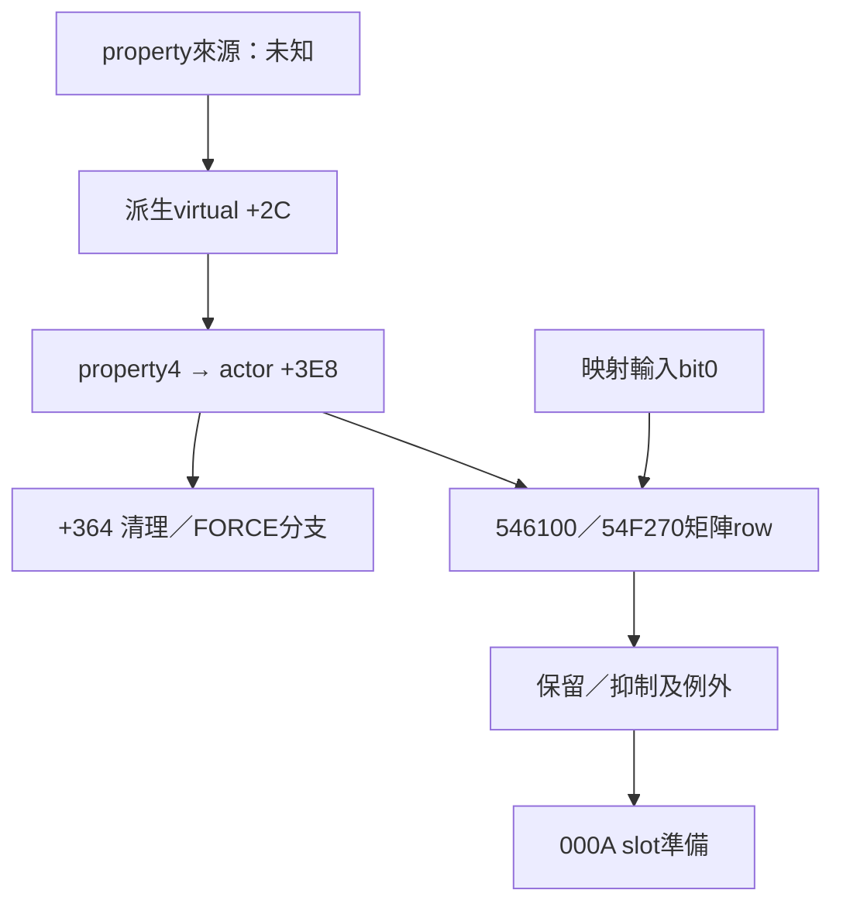

# T10-104：actor +3E8 非零 writer、property 4 與 FORCE 效果

本段完整原稿；接續T10-103。唯讀離線BIN-first；不執行、附加或修改原檔。本輪有實質新證據，不以重複探索充作104-2/104-3。限定native分支已核對，不宣稱Task native_complete。

## 來源與版本

BIN SHA256 `9741d1975327b9309d82b52f631165bc410757694d7c183a5eed970a53ebef91`；EXE SHA256 `03771b8e1c1e66248f54585fadf9a5e926eb77228721325bb9be5febc53b3b5f`，本輪重新計算一致。ImageBase400000；.text VA401000/raw400，raw=VA−400C00；.rdata VABD2000/raw7D0600，raw=VA−401A00。FBxxxx runtime資料不可套text公式。

延用已閱讀shared/T10指示與交接。最新AGENTS blob a1dcfdb989c47162a081632c2bdd8a5297491cef，T10 README blob c28a45bfdacd16f7a2aca68ed8cc3c1e8a18fa0a，沒有驗收退回節。仍為bounded-review，owner未認領，不能自行native_complete。反編譯導航 `kr-bulk-roy/<BIN SHA>/functions/0x4ce7f0.c` blob d518e35576aa7804f1aa3436fbbffc58a4956c16；所有本文肯定值以BIN指令、表格bytes與def-use為準。

## 核心成果與範圍

**已確認**：4C7070基底建構器把actor+3E8初始化0；4CE7F0派生類setter在property=4時，以signed WORD參數寫入DWORD +3E8。是可接收負值的賦值，不是自增；此分支沒有「每次按鍵加一」邏輯。

**已確認**：派生建構4CD6F0先把同一EDI傳給4C7070，再將主vptr寫C07B44；C07B44+2C的DWORD=4CE7F0。所以setter的ECX與已初始化+3E8屬同一物件基底，不能只憑offset相同認定。

**已確認**：property4寫入後，先處理既有actor+364附屬物件：其+24非零時7BE5F0清理；重新檢查+364，非空則4C7DB0並置零。然後只有新+3E8==1時呼叫actor virtual4C(0.0f,1.0f)，以actor+4 WORD做49B140查詢，並經551F90建立/取得附屬物件存回+364。描述符包含type2、字串C07AEC=`FORCE`、兩個FFFFFFFF與0。

**部分確認**：這支持稱其為「影響矩陣tier與FORCE附屬效果的狀態值」。FORCE是原始字串，不代表已確定玩法中文名、暴走模式、覺醒或連段段數；+364物件完整視覺/動作語意不在此閉合。virtual4C也不能因取得float就定名播放motion。

**已確認**：基底主vtable C07554+2C=4CA870，派生table C07B44+2C=4CE7F0；C075EC是其他基底子表/析構過程所見值，不能把它當作4C7070結束時主table。這項以constructor store分離。

**已確認**：T103的input gate使用actor+3E8低byte作matrix row；row>=4讀0。但546100只有gate失敗且完整DWORD+3E8==0時清lower15bits；非零例外仍可保留。setter不對參數限制0..3，故低byte與整DWORD判斷範圍不同；不能把matrix row合法性當作全部上行合法性。

**尚待驗證**：property4由哪個封包/本機事件提供；setter的間接caller與opcode；所有actor類型+3E8 writer；實際SkillMatrix格值；FORCE效果與普通攻擊motion的因果。沒有新增普攻起手或取消窗口結論。

## property dispatch：從原始table還原

4CE81D把arg8低WORD符號擴展；4CE821減1；unsigned比較1D，故原property有效範圍1..30，其餘到4CEB2B記錄不支援參數。有效值先用4CEB88的30-byte索引，再以4CEB5C的DWORD目標表跳轉。property4對應index3，索引byte3，目標DWORD4CE90A。表位於.text，**屬資料，不採objdump線性誤解碼為指令**。

4CE90A MOVSX ECX,WORD[argC] →4CE914 [EBX+3E8]=ECX；EBX來自ECX this（4CE81B）。ret8（4CEB59）確認兩個stack參數。負值也可寫入；不宣稱runtime會實際給負值。

## 情境 × Client × 封包 × 動作

| 玩家/狀態情境 | Client已確認 | C→S | S→C | 動作結果 | 等級 |
|---|---|---|---|---|---|
| 短按Z、工作bank映射ID13 | 承T101/102，phase1/2設bit0；T103矩陣column1，本輪補row的可更新來源 | 既有000A 6+5N路徑；每次必送尚未確認 | property4的opcode尚未確認；000D為獨立已定位motion consumer | 本地起手尚未確認 | 輸入資料流部分閉合 |
| property4寫入0 | +3E8=0；先清理+364，不走FORCE建立分支 | gate失敗時546302只保留bit15；整包是否送仍看其他slot/gates | 來源未知，不冒稱Server關閉狀態 | 不等於取消攻擊 | native條件確認 |
| property4寫入1 | +3E8=1，建立FORCE描述符附屬物件 | row1；gate失敗仍有非零例外 | 尚未確認 | 附屬效果物件更新已確認，角色motion未知 | native／語意部分 |
| property4寫入2或3 | 寫入並清理舊附屬，不走==1分支 | row2/3；非零例外 | 尚未確認 | 尚未確認 | 不把2/3命名combo |
| property4寫其他signed WORD | setter無0..3限制 | row取低byte，完整DWORD另判非零；不據此推論實際發包 | 尚未確認 | 尚未確認 | 只有靜態可達值域 |
| 長按／連按／放開、技能中移動 | 本輪未新增該操作consumer | 次數、節流、cancel仍未知 | 尚未確認 | 尚未確認續段 | 未找到不等於不存在 |

## 跨consumer與反證

549104讀controller+50指向物件的+3E8，值1或2時可增加controller槽計數；超過0x3C後依值1/2選7/9傳549C60並清計數。這是有界caller局部證據：未閉合controller類別、tick頻率與549C60完整效果，**不稱60-frame combo或自動續段**。

54ADC0從arg8物件+50再讀+3E8，空指標視0，與this+4比較回bool。可作條件物件consumer，但this+4不等於actor+4。549B49亦比較+3E8是否1以走不同資料加總路徑；不擴展T11/T12核心計算語意。

5CD849在另一個consumer中依額外byte gate選+3E8或0，存在多row處理，不能把UI展示邏輯當成角色實際起手。

絕對offset搜尋另找到493227寫+3E8，值是4943B0函式指標且周邊大量callback table寫入，**不是actor writer證據**。68F3C7周邊EBX每輪+4，+3A0/+3C4/+3E8分屬平行陣列；目前不歸到actor。839B0E/83A188與8C2540等尚未完成類型識別。全文只稱「定位一條已證明actor非零writer」，不聲稱所有writer已窮盡。

## 封包時序與Server責任



圖中來源邊是待閉合入口；不代表網路已證明。Server責任分級：000A解析與角色同步有前段Client封包證據；property4與FORCE同步是候選需求但來源未知；普攻合法性、冷卻、消耗與取消仍需原版Server證據/相容實作設計。沒有以0.65秒或計數0x3C取代原版時窗，也沒有修改遊戲。

## 下一入口與驗證限制

優先追所有actor virtual+2C的呼叫者，但必須先證明物件來源/實際table，不能以數千條+2C literal混認。以property4的參數來源及S2C dispatch為主線；再取正式SkillMatrix.xml格值，辨認FORCE狀態下的skill→motion。54F270 gate、000A/000D關係與phase override writer仍保留T103未知項。

本輪反組譯擷取與原始BIN逐條bytes比對，驗證的是來源一致，非全文語意FULL-PASS。所有新增肯定主張範圍在本文、native附錄及解碼表；附錄其他分支僅保存上下文，不代表每條已命名語意。

## 第一手證據附錄

### actor初始化及基底主vptr VA 004C7070 raw 000C6470，end-exclusive 004C7202

```asm
  4c7070:	55                   	push   ebp
  4c7071:	8b ec                	mov    ebp,esp
  4c7073:	6a ff                	push   0xffffffff
  4c7075:	68 dc da 90 00       	push   0x90dadc
  4c707a:	64 a1 00 00 00 00    	mov    eax,fs:0x0
  4c7080:	50                   	push   eax
  4c7081:	83 ec 24             	sub    esp,0x24
  4c7084:	53                   	push   ebx
  4c7085:	56                   	push   esi
  4c7086:	57                   	push   edi
  4c7087:	a1 20 1f d6 00       	mov    eax,ds:0xd61f20
  4c708c:	33 c5                	xor    eax,ebp
  4c708e:	50                   	push   eax
  4c708f:	8d 45 f4             	lea    eax,[ebp-0xc]
  4c7092:	64 a3 00 00 00 00    	mov    fs:0x0,eax
  4c7098:	8b 5d 08             	mov    ebx,DWORD PTR [ebp+0x8]
  4c709b:	8b f3                	mov    esi,ebx
  4c709d:	e8 8e 36 00 00       	call   0x4ca730
  4c70a2:	8d 83 f0 00 00 00    	lea    eax,[ebx+0xf0]
  4c70a8:	c7 45 fc 00 00 00 00 	mov    DWORD PTR [ebp-0x4],0x0
  4c70af:	e8 dc 2e 00 00       	call   0x4c9f90
  4c70b4:	c7 83 f0 00 00 00 ec 	mov    DWORD PTR [ebx+0xf0],0xc075ec
  4c70bb:	75 c0 00 
  4c70be:	33 f6                	xor    esi,esi
  4c70c0:	c6 45 fc 01          	mov    BYTE PTR [ebp-0x4],0x1
  4c70c4:	8d 83 5c 01 00 00    	lea    eax,[ebx+0x15c]
  4c70ca:	56                   	push   esi
  4c70cb:	c7 03 54 75 c0 00    	mov    DWORD PTR [ebx],0xc07554
  4c70d1:	c7 83 f0 00 00 00 dc 	mov    DWORD PTR [ebx+0xf0],0xc075dc
  4c70d8:	75 c0 00 
  4c70db:	50                   	push   eax
  4c70dc:	89 30                	mov    DWORD PTR [eax],esi
  4c70de:	89 70 04             	mov    DWORD PTR [eax+0x4],esi
  4c70e1:	e8 7a 33 00 00       	call   0x4ca460
  4c70e6:	c6 45 fc 02          	mov    BYTE PTR [ebp-0x4],0x2
  4c70ea:	89 b3 6c 03 00 00    	mov    DWORD PTR [ebx+0x36c],esi
  4c70f0:	89 b3 70 03 00 00    	mov    DWORD PTR [ebx+0x370],esi
  4c70f6:	c7 83 74 03 00 00 01 	mov    DWORD PTR [ebx+0x374],0x1
  4c70fd:	00 00 00 
  4c7100:	6a 14                	push   0x14
  4c7102:	89 b3 80 03 00 00    	mov    DWORD PTR [ebx+0x380],esi
  4c7108:	e8 5b a1 3c 00       	call   0x891268
  4c710d:	83 c4 04             	add    esp,0x4
  4c7110:	3b c6                	cmp    eax,esi
  4c7112:	0f 84 17 0a 00 00    	je     0x4c7b2f
  4c7118:	89 83 7c 03 00 00    	mov    DWORD PTR [ebx+0x37c],eax
  4c711e:	89 00                	mov    DWORD PTR [eax],eax
  4c7120:	8b 83 7c 03 00 00    	mov    eax,DWORD PTR [ebx+0x37c]
  4c7126:	89 40 04             	mov    DWORD PTR [eax+0x4],eax
  4c7129:	8b 83 7c 03 00 00    	mov    eax,DWORD PTR [ebx+0x37c]
  4c712f:	89 40 08             	mov    DWORD PTR [eax+0x8],eax
  4c7132:	8b 83 7c 03 00 00    	mov    eax,DWORD PTR [ebx+0x37c]
  4c7138:	c6 40 10 01          	mov    BYTE PTR [eax+0x10],0x1
  4c713c:	8b 8b 7c 03 00 00    	mov    ecx,DWORD PTR [ebx+0x37c]
  4c7142:	c6 41 11 01          	mov    BYTE PTR [ecx+0x11],0x1
  4c7146:	c6 45 fc 03          	mov    BYTE PTR [ebp-0x4],0x3
  4c714a:	f3 0f 10 05 c0 56 c4 	movss  xmm0,DWORD PTR ds:0xc456c0
  4c7151:	00 
  4c7152:	b8 01 00 00 00       	mov    eax,0x1
  4c7157:	89 83 8c 03 00 00    	mov    DWORD PTR [ebx+0x38c],eax
  4c715d:	89 83 ac 03 00 00    	mov    DWORD PTR [ebx+0x3ac],eax
  4c7163:	b8 64 00 00 00       	mov    eax,0x64
  4c7168:	33 d2                	xor    edx,edx
  4c716a:	66 89 93 88 03 00 00 	mov    WORD PTR [ebx+0x388],dx
  4c7171:	89 b3 90 03 00 00    	mov    DWORD PTR [ebx+0x390],esi
  4c7177:	f3 0f 11 83 98 03 00 	movss  DWORD PTR [ebx+0x398],xmm0
  4c717e:	00 
  4c717f:	c7 83 9c 03 00 00 7f 	mov    DWORD PTR [ebx+0x39c],0x7f
  4c7186:	00 00 00 
  4c7189:	89 b3 a0 03 00 00    	mov    DWORD PTR [ebx+0x3a0],esi
  4c718f:	88 93 a4 03 00 00    	mov    BYTE PTR [ebx+0x3a4],dl
  4c7195:	89 b3 a8 03 00 00    	mov    DWORD PTR [ebx+0x3a8],esi
  4c719b:	89 b3 b0 03 00 00    	mov    DWORD PTR [ebx+0x3b0],esi
  4c71a1:	89 b3 b4 03 00 00    	mov    DWORD PTR [ebx+0x3b4],esi
  4c71a7:	89 b3 b8 03 00 00    	mov    DWORD PTR [ebx+0x3b8],esi
  4c71ad:	89 83 bc 03 00 00    	mov    DWORD PTR [ebx+0x3bc],eax
  4c71b3:	89 83 c0 03 00 00    	mov    DWORD PTR [ebx+0x3c0],eax
  4c71b9:	89 83 c4 03 00 00    	mov    DWORD PTR [ebx+0x3c4],eax
  4c71bf:	89 83 c8 03 00 00    	mov    DWORD PTR [ebx+0x3c8],eax
  4c71c5:	89 83 cc 03 00 00    	mov    DWORD PTR [ebx+0x3cc],eax
  4c71cb:	89 83 d0 03 00 00    	mov    DWORD PTR [ebx+0x3d0],eax
  4c71d1:	89 b3 d4 03 00 00    	mov    DWORD PTR [ebx+0x3d4],esi
  4c71d7:	89 b3 d8 03 00 00    	mov    DWORD PTR [ebx+0x3d8],esi
  4c71dd:	89 b3 dc 03 00 00    	mov    DWORD PTR [ebx+0x3dc],esi
  4c71e3:	89 b3 e0 03 00 00    	mov    DWORD PTR [ebx+0x3e0],esi
  4c71e9:	89 b3 e4 03 00 00    	mov    DWORD PTR [ebx+0x3e4],esi
  4c71ef:	89 b3 e8 03 00 00    	mov    DWORD PTR [ebx+0x3e8],esi
  4c71f5:	6a 18                	push   0x18
  4c71f7:	89 b3 f8 03 00 00    	mov    DWORD PTR [ebx+0x3f8],esi
  4c71fd:	e8 66 a0 3c 00       	call   0x891268
```

### 派生建構this來源與vptr VA 004CD6F0 raw 000CCAF0，end-exclusive 004CD744

```asm
  4cd6f0:	55                   	push   ebp
  4cd6f1:	8b ec                	mov    ebp,esp
  4cd6f3:	6a ff                	push   0xffffffff
  4cd6f5:	68 74 76 91 00       	push   0x917674
  4cd6fa:	64 a1 00 00 00 00    	mov    eax,fs:0x0
  4cd700:	50                   	push   eax
  4cd701:	83 ec 0c             	sub    esp,0xc
  4cd704:	53                   	push   ebx
  4cd705:	56                   	push   esi
  4cd706:	57                   	push   edi
  4cd707:	a1 20 1f d6 00       	mov    eax,ds:0xd61f20
  4cd70c:	33 c5                	xor    eax,ebp
  4cd70e:	50                   	push   eax
  4cd70f:	8d 45 f4             	lea    eax,[ebp-0xc]
  4cd712:	64 a3 00 00 00 00    	mov    fs:0x0,eax
  4cd718:	8b 7d 08             	mov    edi,DWORD PTR [ebp+0x8]
  4cd71b:	57                   	push   edi
  4cd71c:	e8 4f 99 ff ff       	call   0x4c7070
  4cd721:	33 db                	xor    ebx,ebx
  4cd723:	89 5d fc             	mov    DWORD PTR [ebp-0x4],ebx
  4cd726:	6a 30                	push   0x30
  4cd728:	c7 07 44 7b c0 00    	mov    DWORD PTR [edi],0xc07b44
  4cd72e:	c7 87 f0 00 00 00 cc 	mov    DWORD PTR [edi+0xf0],0xc07bcc
  4cd735:	7b c0 00 
  4cd738:	89 9f 20 04 00 00    	mov    DWORD PTR [edi+0x420],ebx
  4cd73e:	89 9f 24 04 00 00    	mov    DWORD PTR [edi+0x424],ebx
```

### property setter完整，不含內嵌表 VA 004CE7F0 raw 000CDBF0，end-exclusive 004CEB5C

```asm
  4ce7f0:	55                   	push   ebp
  4ce7f1:	8b ec                	mov    ebp,esp
  4ce7f3:	6a ff                	push   0xffffffff
  4ce7f5:	68 e8 05 94 00       	push   0x9405e8
  4ce7fa:	64 a1 00 00 00 00    	mov    eax,fs:0x0
  4ce800:	50                   	push   eax
  4ce801:	83 ec 3c             	sub    esp,0x3c
  4ce804:	a1 20 1f d6 00       	mov    eax,ds:0xd61f20
  4ce809:	33 c5                	xor    eax,ebp
  4ce80b:	89 45 f0             	mov    DWORD PTR [ebp-0x10],eax
  4ce80e:	53                   	push   ebx
  4ce80f:	56                   	push   esi
  4ce810:	57                   	push   edi
  4ce811:	50                   	push   eax
  4ce812:	8d 45 f4             	lea    eax,[ebp-0xc]
  4ce815:	64 a3 00 00 00 00    	mov    fs:0x0,eax
  4ce81b:	8b d9                	mov    ebx,ecx
  4ce81d:	0f bf 4d 08          	movsx  ecx,WORD PTR [ebp+0x8]
  4ce821:	8d 41 ff             	lea    eax,[ecx-0x1]
  4ce824:	83 f8 1d             	cmp    eax,0x1d
  4ce827:	0f 87 fe 02 00 00    	ja     0x4ceb2b
  4ce82d:	0f b6 80 88 eb 4c 00 	movzx  eax,BYTE PTR [eax+0x4ceb88]
  4ce834:	ff 24 85 5c eb 4c 00 	jmp    DWORD PTR [eax*4+0x4ceb5c]
  4ce83b:	0f bf 45 0c          	movsx  eax,WORD PTR [ebp+0xc]
  4ce83f:	89 83 b0 03 00 00    	mov    DWORD PTR [ebx+0x3b0],eax
  4ce845:	8b 9b 68 03 00 00    	mov    ebx,DWORD PTR [ebx+0x368]
  4ce84b:	89 45 cc             	mov    DWORD PTR [ebp-0x34],eax
  4ce84e:	85 db                	test   ebx,ebx
  4ce850:	0f 84 e8 02 00 00    	je     0x4ceb3e
  4ce856:	db 45 cc             	fild   DWORD PTR [ebp-0x34]
  4ce859:	53                   	push   ebx
  4ce85a:	8d 45 d0             	lea    eax,[ebp-0x30]
  4ce85d:	c6 45 d0 00          	mov    BYTE PTR [ebp-0x30],0x0
  4ce861:	dc 0d d8 56 c5 00    	fmul   QWORD PTR ds:0xc556d8
  4ce867:	d9 5d cc             	fstp   DWORD PTR [ebp-0x34]
  4ce86a:	d9 45 cc             	fld    DWORD PTR [ebp-0x34]
  4ce86d:	d9 5d cc             	fstp   DWORD PTR [ebp-0x34]
  4ce870:	e8 5b 66 2e 00       	call   0x7b4ed0
  4ce875:	d9 45 cc             	fld    DWORD PTR [ebp-0x34]
  4ce878:	d9 58 0c             	fstp   DWORD PTR [eax+0xc]
  4ce87b:	e9 be 02 00 00       	jmp    0x4ceb3e
  4ce880:	0f bf 45 0c          	movsx  eax,WORD PTR [ebp+0xc]
  4ce884:	89 83 b4 03 00 00    	mov    DWORD PTR [ebx+0x3b4],eax
  4ce88a:	8b 9b 68 03 00 00    	mov    ebx,DWORD PTR [ebx+0x368]
  4ce890:	89 45 cc             	mov    DWORD PTR [ebp-0x34],eax
  4ce893:	85 db                	test   ebx,ebx
  4ce895:	0f 84 a3 02 00 00    	je     0x4ceb3e
  4ce89b:	db 45 cc             	fild   DWORD PTR [ebp-0x34]
  4ce89e:	53                   	push   ebx
  4ce89f:	8d 45 d0             	lea    eax,[ebp-0x30]
  4ce8a2:	c6 45 d0 01          	mov    BYTE PTR [ebp-0x30],0x1
  4ce8a6:	dc 35 e8 57 c5 00    	fdiv   QWORD PTR ds:0xc557e8
  4ce8ac:	d9 5d cc             	fstp   DWORD PTR [ebp-0x34]
  4ce8af:	d9 45 cc             	fld    DWORD PTR [ebp-0x34]
  4ce8b2:	d9 5d cc             	fstp   DWORD PTR [ebp-0x34]
  4ce8b5:	e8 16 66 2e 00       	call   0x7b4ed0
  4ce8ba:	d9 45 cc             	fld    DWORD PTR [ebp-0x34]
  4ce8bd:	d9 58 0c             	fstp   DWORD PTR [eax+0xc]
  4ce8c0:	e9 79 02 00 00       	jmp    0x4ceb3e
  4ce8c5:	0f bf 45 0c          	movsx  eax,WORD PTR [ebp+0xc]
  4ce8c9:	89 83 b8 03 00 00    	mov    DWORD PTR [ebx+0x3b8],eax
  4ce8cf:	8b 9b 68 03 00 00    	mov    ebx,DWORD PTR [ebx+0x368]
  4ce8d5:	89 45 cc             	mov    DWORD PTR [ebp-0x34],eax
  4ce8d8:	85 db                	test   ebx,ebx
  4ce8da:	0f 84 5e 02 00 00    	je     0x4ceb3e
  4ce8e0:	db 45 cc             	fild   DWORD PTR [ebp-0x34]
  4ce8e3:	53                   	push   ebx
  4ce8e4:	8d 45 d0             	lea    eax,[ebp-0x30]
  4ce8e7:	c6 45 d0 02          	mov    BYTE PTR [ebp-0x30],0x2
  4ce8eb:	dc 35 e8 57 c5 00    	fdiv   QWORD PTR ds:0xc557e8
  4ce8f1:	d9 5d cc             	fstp   DWORD PTR [ebp-0x34]
  4ce8f4:	d9 45 cc             	fld    DWORD PTR [ebp-0x34]
  4ce8f7:	d9 5d cc             	fstp   DWORD PTR [ebp-0x34]
  4ce8fa:	e8 d1 65 2e 00       	call   0x7b4ed0
  4ce8ff:	d9 45 cc             	fld    DWORD PTR [ebp-0x34]
  4ce902:	d9 58 0c             	fstp   DWORD PTR [eax+0xc]
  4ce905:	e9 34 02 00 00       	jmp    0x4ceb3e
  4ce90a:	0f bf 4d 0c          	movsx  ecx,WORD PTR [ebp+0xc]
  4ce90e:	8b 83 64 03 00 00    	mov    eax,DWORD PTR [ebx+0x364]
  4ce914:	89 8b e8 03 00 00    	mov    DWORD PTR [ebx+0x3e8],ecx
  4ce91a:	85 c0                	test   eax,eax
  4ce91c:	74 27                	je     0x4ce945
  4ce91e:	83 78 24 00          	cmp    DWORD PTR [eax+0x24],0x0
  4ce922:	8d 70 24             	lea    esi,[eax+0x24]
  4ce925:	74 05                	je     0x4ce92c
  4ce927:	e8 c4 fc 2e 00       	call   0x7be5f0
  4ce92c:	8b bb 64 03 00 00    	mov    edi,DWORD PTR [ebx+0x364]
  4ce932:	85 ff                	test   edi,edi
  4ce934:	74 0f                	je     0x4ce945
  4ce936:	e8 75 94 ff ff       	call   0x4c7db0
  4ce93b:	c7 83 64 03 00 00 00 	mov    DWORD PTR [ebx+0x364],0x0
  4ce942:	00 00 00 
  4ce945:	83 bb e8 03 00 00 01 	cmp    DWORD PTR [ebx+0x3e8],0x1
  4ce94c:	0f 85 ec 01 00 00    	jne    0x4ceb3e
  4ce952:	d9 e8                	fld1
  4ce954:	8b 13                	mov    edx,DWORD PTR [ebx]
  4ce956:	8b 42 4c             	mov    eax,DWORD PTR [edx+0x4c]
  4ce959:	83 ec 08             	sub    esp,0x8
  4ce95c:	d9 5c 24 04          	fstp   DWORD PTR [esp+0x4]
  4ce960:	83 cf ff             	or     edi,0xffffffff
  4ce963:	d9 ee                	fldz
  4ce965:	8b cb                	mov    ecx,ebx
  4ce967:	d9 1c 24             	fstp   DWORD PTR [esp]
  4ce96a:	c7 45 b8 02 00 00 00 	mov    DWORD PTR [ebp-0x48],0x2
  4ce971:	c7 45 bc ec 7a c0 00 	mov    DWORD PTR [ebp-0x44],0xc07aec
  4ce978:	89 7d c0             	mov    DWORD PTR [ebp-0x40],edi
  4ce97b:	89 7d c4             	mov    DWORD PTR [ebp-0x3c],edi
  4ce97e:	c7 45 c8 00 00 00 00 	mov    DWORD PTR [ebp-0x38],0x0
  4ce985:	ff d0                	call   eax
  4ce987:	0f b7 4b 04          	movzx  ecx,WORD PTR [ebx+0x4]
  4ce98b:	51                   	push   ecx
  4ce98c:	8b f0                	mov    esi,eax
  4ce98e:	e8 ad c7 fc ff       	call   0x49b140
  4ce993:	8d 55 b8             	lea    edx,[ebp-0x48]
  4ce996:	8b c8                	mov    ecx,eax
  4ce998:	e8 f3 35 08 00       	call   0x551f90
  4ce99d:	89 83 64 03 00 00    	mov    DWORD PTR [ebx+0x364],eax
  4ce9a3:	e9 96 01 00 00       	jmp    0x4ceb3e
  4ce9a8:	0f bf 55 0c          	movsx  edx,WORD PTR [ebp+0xc]
  4ce9ac:	0f 57 c0             	xorps  xmm0,xmm0
  4ce9af:	f3 0f 2a c2          	cvtsi2ss xmm0,edx
  4ce9b3:	f3 0f 11 83 cc 00 00 	movss  DWORD PTR [ebx+0xcc],xmm0
  4ce9ba:	00 
  4ce9bb:	e9 7e 01 00 00       	jmp    0x4ceb3e
  4ce9c0:	0f bf 45 0c          	movsx  eax,WORD PTR [ebp+0xc]
  4ce9c4:	89 83 d0 00 00 00    	mov    DWORD PTR [ebx+0xd0],eax
  4ce9ca:	e9 6f 01 00 00       	jmp    0x4ceb3e
  4ce9cf:	0f bf 4d 0c          	movsx  ecx,WORD PTR [ebp+0xc]
  4ce9d3:	89 8b 90 00 00 00    	mov    DWORD PTR [ebx+0x90],ecx
  4ce9d9:	e9 60 01 00 00       	jmp    0x4ceb3e
  4ce9de:	0f bf 45 0c          	movsx  eax,WORD PTR [ebp+0xc]
  4ce9e2:	3b 83 d4 03 00 00    	cmp    eax,DWORD PTR [ebx+0x3d4]
  4ce9e8:	0f 84 aa 00 00 00    	je     0x4cea98
  4ce9ee:	8b 0d a4 a7 fb 00    	mov    ecx,DWORD PTR ds:0xfba7a4
  4ce9f4:	8b 11                	mov    edx,DWORD PTR [ecx]
  4ce9f6:	8b 42 20             	mov    eax,DWORD PTR [edx+0x20]
  4ce9f9:	ff d0                	call   eax
  4ce9fb:	83 cf ff             	or     edi,0xffffffff
  4ce9fe:	3b d8                	cmp    ebx,eax
  4cea00:	75 46                	jne    0x4cea48
  4cea02:	83 bb d4 03 00 00 00 	cmp    DWORD PTR [ebx+0x3d4],0x0
  4cea09:	0f 84 89 00 00 00    	je     0x4cea98
  4cea0f:	ba f4 7a c0 00       	mov    edx,0xc07af4
  4cea14:	8d 75 d4             	lea    esi,[ebp-0x2c]
  4cea17:	e8 a4 c9 f3 ff       	call   0x40b3c0
  4cea1c:	c7 45 fc 00 00 00 00 	mov    DWORD PTR [ebp-0x4],0x0
  4cea23:	e8 c8 c9 f3 ff       	call   0x40b3f0
  4cea28:	50                   	push   eax
  4cea29:	8b ce                	mov    ecx,esi
  4cea2b:	e8 d0 c0 33 00       	call   0x80ab00
  4cea30:	85 c0                	test   eax,eax
  4cea32:	74 09                	je     0x4cea3d
  4cea34:	8b 10                	mov    edx,DWORD PTR [eax]
  4cea36:	8b c8                	mov    ecx,eax
  4cea38:	8b 42 14             	mov    eax,DWORD PTR [edx+0x14]
  4cea3b:	ff d0                	call   eax
  4cea3d:	8d 75 d4             	lea    esi,[ebp-0x2c]
  4cea40:	89 7d fc             	mov    DWORD PTR [ebp-0x4],edi
  4cea43:	e8 08 0a 30 00       	call   0x7cf450
  4cea48:	83 bb d4 03 00 00 00 	cmp    DWORD PTR [ebx+0x3d4],0x0
  4cea4f:	74 47                	je     0x4cea98
  4cea51:	d9 e8                	fld1
  4cea53:	8b 13                	mov    edx,DWORD PTR [ebx]
  4cea55:	8b 42 4c             	mov    eax,DWORD PTR [edx+0x4c]
  4cea58:	83 ec 08             	sub    esp,0x8
  4cea5b:	d9 5c 24 04          	fstp   DWORD PTR [esp+0x4]
  4cea5f:	8b cb                	mov    ecx,ebx
  4cea61:	d9 ee                	fldz
  4cea63:	c7 45 b8 02 00 00 00 	mov    DWORD PTR [ebp-0x48],0x2
  4cea6a:	d9 1c 24             	fstp   DWORD PTR [esp]
  4cea6d:	c7 45 bc f4 7a c0 00 	mov    DWORD PTR [ebp-0x44],0xc07af4
  4cea74:	89 7d c0             	mov    DWORD PTR [ebp-0x40],edi
  4cea77:	89 7d c4             	mov    DWORD PTR [ebp-0x3c],edi
  4cea7a:	c7 45 c8 00 00 00 00 	mov    DWORD PTR [ebp-0x38],0x0
  4cea81:	ff d0                	call   eax
  4cea83:	0f b7 4b 04          	movzx  ecx,WORD PTR [ebx+0x4]
  4cea87:	50                   	push   eax
  4cea88:	51                   	push   ecx
  4cea89:	e8 b2 c6 fc ff       	call   0x49b140
  4cea8e:	8d 55 b8             	lea    edx,[ebp-0x48]
  4cea91:	8b c8                	mov    ecx,eax
  4cea93:	e8 88 34 08 00       	call   0x551f20
  4cea98:	0f bf 45 0c          	movsx  eax,WORD PTR [ebp+0xc]
  4cea9c:	89 83 d4 03 00 00    	mov    DWORD PTR [ebx+0x3d4],eax
  4ceaa2:	e9 97 00 00 00       	jmp    0x4ceb3e
  4ceaa7:	e8 34 b5 fb ff       	call   0x489fe0
  4ceaac:	f3 0f 10 05 c0 56 c4 	movss  xmm0,DWORD PTR ds:0xc456c0
  4ceab3:	00 
  4ceab4:	0f bf 55 0c          	movsx  edx,WORD PTR [ebp+0xc]
  4ceab8:	f3 0f 11 40 24       	movss  DWORD PTR [eax+0x24],xmm0
  4ceabd:	f3 0f 10 05 d0 57 c5 	movss  xmm0,DWORD PTR ds:0xc557d0
  4ceac4:	00 
  4ceac5:	c7 40 2c 3c 00 00 00 	mov    DWORD PTR [eax+0x2c],0x3c
  4ceacc:	f3 0f 11 40 28       	movss  DWORD PTR [eax+0x28],xmm0
  4cead1:	89 50 34             	mov    DWORD PTR [eax+0x34],edx
  4cead4:	eb 68                	jmp    0x4ceb3e
  4cead6:	8b 0d a4 a7 fb 00    	mov    ecx,DWORD PTR ds:0xfba7a4
  4ceadc:	8b 01                	mov    eax,DWORD PTR [ecx]
  4ceade:	8b 50 20             	mov    edx,DWORD PTR [eax+0x20]
  4ceae1:	ff d2                	call   edx
  4ceae3:	3b d8                	cmp    ebx,eax
  4ceae5:	75 57                	jne    0x4ceb3e
  4ceae7:	0f b7 b3 88 00 00 00 	movzx  esi,WORD PTR [ebx+0x88]
  4ceaee:	e8 ad 60 f3 ff       	call   0x404ba0
  4ceaf3:	8b 88 24 69 00 00    	mov    ecx,DWORD PTR [eax+0x6924]
  4ceaf9:	8b c6                	mov    eax,esi
  4ceafb:	83 f8 09             	cmp    eax,0x9
  4ceafe:	77 1d                	ja     0x4ceb1d
  4ceb00:	69 c0 10 02 00 00    	imul   eax,eax,0x210
  4ceb06:	03 c8                	add    ecx,eax
  4ceb08:	8b 41 5c             	mov    eax,DWORD PTR [ecx+0x5c]
  4ceb0b:	f7 d8                	neg    eax
  4ceb0d:	1b c0                	sbb    eax,eax
  4ceb0f:	23 c1                	and    eax,ecx
  4ceb11:	0f bf 4d 0c          	movsx  ecx,WORD PTR [ebp+0xc]
  4ceb15:	89 88 dc 00 00 00    	mov    DWORD PTR [eax+0xdc],ecx
  4ceb1b:	eb 21                	jmp    0x4ceb3e
  4ceb1d:	0f bf 4d 0c          	movsx  ecx,WORD PTR [ebp+0xc]
  4ceb21:	33 c0                	xor    eax,eax
  4ceb23:	89 88 dc 00 00 00    	mov    DWORD PTR [eax+0xdc],ecx
  4ceb29:	eb 13                	jmp    0x4ceb3e
  4ceb2b:	0f bf 55 0c          	movsx  edx,WORD PTR [ebp+0xc]
  4ceb2f:	52                   	push   edx
  4ceb30:	51                   	push   ecx
  4ceb31:	68 fc 7a c0 00       	push   0xc07afc
  4ceb36:	e8 25 f0 21 00       	call   0x6edb60
  4ceb3b:	83 c4 0c             	add    esp,0xc
  4ceb3e:	8b 4d f4             	mov    ecx,DWORD PTR [ebp-0xc]
  4ceb41:	64 89 0d 00 00 00 00 	mov    DWORD PTR fs:0x0,ecx
  4ceb48:	59                   	pop    ecx
  4ceb49:	5f                   	pop    edi
  4ceb4a:	5e                   	pop    esi
  4ceb4b:	5b                   	pop    ebx
  4ceb4c:	8b 4d f0             	mov    ecx,DWORD PTR [ebp-0x10]
  4ceb4f:	33 cd                	xor    ecx,ebp
  4ceb51:	e8 ab 24 3c 00       	call   0x891001
  4ceb56:	8b e5                	mov    esp,ebp
  4ceb58:	5d                   	pop    ebp
  4ceb59:	c2 08 00             	ret    0x8
```

### 輸出保留例外 VA 005462A2 raw 001456A2，end-exclusive 00546306

```asm
  5462a2:	83 3d ac a7 fb 00 01 	cmp    DWORD PTR ds:0xfba7ac,0x1
  5462a9:	74 5b                	je     0x546306
  5462ab:	66 85 c0             	test   ax,ax
  5462ae:	74 56                	je     0x546306
  5462b0:	8b 74 24 24          	mov    esi,DWORD PTR [esp+0x24]
  5462b4:	8b 8f e8 03 00 00    	mov    ecx,DWORD PTR [edi+0x3e8]
  5462ba:	33 d2                	xor    edx,edx
  5462bc:	38 56 02             	cmp    BYTE PTR [esi+0x2],dl
  5462bf:	51                   	push   ecx
  5462c0:	0f 95 c2             	setne  dl
  5462c3:	8a 14 32             	mov    dl,BYTE PTR [edx+esi*1]
  5462c6:	88 54 24 28          	mov    BYTE PTR [esp+0x28],dl
  5462ca:	8b 4c 24 28          	mov    ecx,DWORD PTR [esp+0x28]
  5462ce:	51                   	push   ecx
  5462cf:	8b 4d 08             	mov    ecx,DWORD PTR [ebp+0x8]
  5462d2:	8d 14 49             	lea    edx,[ecx+ecx*2]
  5462d5:	8b 4c 24 20          	mov    ecx,DWORD PTR [esp+0x20]
  5462d9:	8b 4c 91 10          	mov    ecx,DWORD PTR [ecx+edx*4+0x10]
  5462dd:	e8 8e 8f 00 00       	call   0x54f270
  5462e2:	85 c0                	test   eax,eax
  5462e4:	74 07                	je     0x5462ed
  5462e6:	c6 44 24 17 01       	mov    BYTE PTR [esp+0x17],0x1
  5462eb:	eb 19                	jmp    0x546306
  5462ed:	83 bf e8 03 00 00 00 	cmp    DWORD PTR [edi+0x3e8],0x0
  5462f4:	74 07                	je     0x5462fd
  5462f6:	c6 44 24 17 01       	mov    BYTE PTR [esp+0x17],0x1
  5462fb:	eb 09                	jmp    0x546306
  5462fd:	ba 00 80 00 00       	mov    edx,0x8000
  546302:	66 21 53 02          	and    WORD PTR [ebx+0x2],dx
```

### matrix input gate VA 0054F270 raw 0014E670，end-exclusive 0054F32F

```asm
  54f270:	55                   	push   ebp
  54f271:	8b ec                	mov    ebp,esp
  54f273:	53                   	push   ebx
  54f274:	56                   	push   esi
  54f275:	8b f1                	mov    esi,ecx
  54f277:	a8 c0                	test   al,0xc0
  54f279:	0f 85 a6 00 00 00    	jne    0x54f325
  54f27f:	8b c8                	mov    ecx,eax
  54f281:	83 e1 01             	and    ecx,0x1
  54f284:	74 08                	je     0x54f28e
  54f286:	a8 02                	test   al,0x2
  54f288:	74 04                	je     0x54f28e
  54f28a:	b3 04                	mov    bl,0x4
  54f28c:	eb 44                	jmp    0x54f2d2
  54f28e:	66 85 c9             	test   cx,cx
  54f291:	74 08                	je     0x54f29b
  54f293:	a8 04                	test   al,0x4
  54f295:	74 04                	je     0x54f29b
  54f297:	b3 05                	mov    bl,0x5
  54f299:	eb 37                	jmp    0x54f2d2
  54f29b:	8b d0                	mov    edx,eax
  54f29d:	83 e2 02             	and    edx,0x2
  54f2a0:	74 08                	je     0x54f2aa
  54f2a2:	a8 04                	test   al,0x4
  54f2a4:	74 04                	je     0x54f2aa
  54f2a6:	b3 06                	mov    bl,0x6
  54f2a8:	eb 28                	jmp    0x54f2d2
  54f2aa:	66 85 c9             	test   cx,cx
  54f2ad:	74 04                	je     0x54f2b3
  54f2af:	b3 01                	mov    bl,0x1
  54f2b1:	eb 1f                	jmp    0x54f2d2
  54f2b3:	66 85 d2             	test   dx,dx
  54f2b6:	74 04                	je     0x54f2bc
  54f2b8:	b3 02                	mov    bl,0x2
  54f2ba:	eb 16                	jmp    0x54f2d2
  54f2bc:	a8 04                	test   al,0x4
  54f2be:	74 04                	je     0x54f2c4
  54f2c0:	b3 03                	mov    bl,0x3
  54f2c2:	eb 0e                	jmp    0x54f2d2
  54f2c4:	a8 08                	test   al,0x8
  54f2c6:	74 04                	je     0x54f2cc
  54f2c8:	b3 07                	mov    bl,0x7
  54f2ca:	eb 06                	jmp    0x54f2d2
  54f2cc:	a8 10                	test   al,0x10
  54f2ce:	74 55                	je     0x54f325
  54f2d0:	b3 0a                	mov    bl,0xa
  54f2d2:	8b 45 08             	mov    eax,DWORD PTR [ebp+0x8]
  54f2d5:	0f b7 4e 02          	movzx  ecx,WORD PTR [esi+0x2]
  54f2d9:	50                   	push   eax
  54f2da:	51                   	push   ecx
  54f2db:	e8 10 05 ec ff       	call   0x40f7f0
  54f2e0:	e8 3b 9f 2c 00       	call   0x819220
  54f2e5:	85 c0                	test   eax,eax
  54f2e7:	75 08                	jne    0x54f2f1
  54f2e9:	33 c0                	xor    eax,eax
  54f2eb:	5e                   	pop    esi
  54f2ec:	5b                   	pop    ebx
  54f2ed:	5d                   	pop    ebp
  54f2ee:	c2 08 00             	ret    0x8
  54f2f1:	50                   	push   eax
  54f2f2:	8a 45 0c             	mov    al,BYTE PTR [ebp+0xc]
  54f2f5:	8a cb                	mov    cl,bl
  54f2f7:	e8 e4 b5 2c 00       	call   0x81a8e0
  54f2fc:	0f b7 c0             	movzx  eax,ax
  54f2ff:	66 85 c0             	test   ax,ax
  54f302:	74 e5                	je     0x54f2e9
  54f304:	8b d0                	mov    edx,eax
  54f306:	83 c6 04             	add    esi,0x4
  54f309:	56                   	push   esi
  54f30a:	8d 45 08             	lea    eax,[ebp+0x8]
  54f30d:	89 55 08             	mov    DWORD PTR [ebp+0x8],edx
  54f310:	e8 cb 01 00 00       	call   0x54f4e0
  54f315:	33 c9                	xor    ecx,ecx
  54f317:	39 48 04             	cmp    DWORD PTR [eax+0x4],ecx
  54f31a:	0f 94 c1             	sete   cl
  54f31d:	8b c1                	mov    eax,ecx
  54f31f:	5e                   	pop    esi
  54f320:	5b                   	pop    ebx
  54f321:	5d                   	pop    ebp
  54f322:	c2 08 00             	ret    0x8
  54f325:	5e                   	pop    esi
  54f326:	b8 01 00 00 00       	mov    eax,0x1
  54f32b:	5b                   	pop    ebx
  54f32c:	5d                   	pop    ebp
  54f32d:	c2 08 00             	ret    0x8
```

### matrix reader VA 0081A8E0 raw 00419CE0，end-exclusive 0081A909

```asm
  81a8e0:	55                   	push   ebp
  81a8e1:	8b ec                	mov    ebp,esp
  81a8e3:	3c 04                	cmp    al,0x4
  81a8e5:	73 1c                	jae    0x81a903
  81a8e7:	80 f9 0b             	cmp    cl,0xb
  81a8ea:	73 17                	jae    0x81a903
  81a8ec:	8b 55 08             	mov    edx,DWORD PTR [ebp+0x8]
  81a8ef:	0f b6 c0             	movzx  eax,al
  81a8f2:	6b c0 0b             	imul   eax,eax,0xb
  81a8f5:	0f b6 c9             	movzx  ecx,cl
  81a8f8:	03 c1                	add    eax,ecx
  81a8fa:	66 8b 44 42 04       	mov    ax,WORD PTR [edx+eax*2+0x4]
  81a8ff:	5d                   	pop    ebp
  81a900:	c2 04 00             	ret    0x4
  81a903:	33 c0                	xor    eax,eax
  81a905:	5d                   	pop    ebp
  81a906:	c2 04 00             	ret    0x4
```

### 狀態1/2局部計數consumer VA 005490FB raw 001484FB，end-exclusive 00549145

```asm
  5490fb:	80 7e 4c 00          	cmp    BYTE PTR [esi+0x4c],0x0
  5490ff:	74 17                	je     0x549118
  549101:	8b 56 50             	mov    edx,DWORD PTR [esi+0x50]
  549104:	8b 82 e8 03 00 00    	mov    eax,DWORD PTR [edx+0x3e8]
  54910a:	83 f8 01             	cmp    eax,0x1
  54910d:	74 05                	je     0x549114
  54910f:	83 f8 02             	cmp    eax,0x2
  549112:	75 04                	jne    0x549118
  549114:	ff 44 9e 40          	inc    DWORD PTR [esi+ebx*4+0x40]
  549118:	83 7c 9e 40 3c       	cmp    DWORD PTR [esi+ebx*4+0x40],0x3c
  54911d:	7e 26                	jle    0x549145
  54911f:	8b 46 50             	mov    eax,DWORD PTR [esi+0x50]
  549122:	8b 80 e8 03 00 00    	mov    eax,DWORD PTR [eax+0x3e8]
  549128:	83 f8 01             	cmp    eax,0x1
  54912b:	75 04                	jne    0x549131
  54912d:	6a 07                	push   0x7
  54912f:	eb 07                	jmp    0x549138
  549131:	83 f8 02             	cmp    eax,0x2
  549134:	75 0b                	jne    0x549141
  549136:	6a 09                	push   0x9
  549138:	6a ff                	push   0xffffffff
  54913a:	57                   	push   edi
  54913b:	57                   	push   edi
  54913c:	e8 1f 0b 00 00       	call   0x549c60
  549141:	89 7c 9e 40          	mov    DWORD PTR [esi+ebx*4+0x40],edi
```

### 有界資料consumer VA 00549B39 raw 00148F39，end-exclusive 00549BB0

```asm
  549b39:	b8 01 00 00 00       	mov    eax,0x1
  549b3e:	39 45 0c             	cmp    DWORD PTR [ebp+0xc],eax
  549b41:	75 6d                	jne    0x549bb0
  549b43:	8b 55 08             	mov    edx,DWORD PTR [ebp+0x8]
  549b46:	8b 4a 50             	mov    ecx,DWORD PTR [edx+0x50]
  549b49:	39 81 e8 03 00 00    	cmp    DWORD PTR [ecx+0x3e8],eax
  549b4f:	74 5f                	je     0x549bb0
  549b51:	8b 54 24 20          	mov    edx,DWORD PTR [esp+0x20]
  549b55:	0f b7 7a 12          	movzx  edi,WORD PTR [edx+0x12]
  549b59:	8b 74 24 1c          	mov    esi,DWORD PTR [esp+0x1c]
  549b5d:	57                   	push   edi
  549b5e:	e8 0d c4 2d 00       	call   0x825f70
  549b63:	8b f0                	mov    esi,eax
  549b65:	85 f6                	test   esi,esi
  549b67:	74 47                	je     0x549bb0
  549b69:	0f b7 5e 04          	movzx  ebx,WORD PTR [esi+0x4]
  549b6d:	e8 3e b3 f3 ff       	call   0x484eb0
  549b72:	50                   	push   eax
  549b73:	8b c3                	mov    eax,ebx
  549b75:	8b cf                	mov    ecx,edi
  549b77:	e8 b4 69 fe ff       	call   0x530530
  549b7c:	01 44 24 10          	add    DWORD PTR [esp+0x10],eax
  549b80:	0f b7 5e 04          	movzx  ebx,WORD PTR [esi+0x4]
  549b84:	e8 27 b3 f3 ff       	call   0x484eb0
  549b89:	50                   	push   eax
  549b8a:	8b c3                	mov    eax,ebx
  549b8c:	8b cf                	mov    ecx,edi
  549b8e:	e8 2d 6a fe ff       	call   0x5305c0
  549b93:	8b 5c 24 24          	mov    ebx,DWORD PTR [esp+0x24]
  549b97:	0f b7 76 04          	movzx  esi,WORD PTR [esi+0x4]
  549b9b:	03 d8                	add    ebx,eax
  549b9d:	e8 0e b3 f3 ff       	call   0x484eb0
  549ba2:	50                   	push   eax
  549ba3:	8b c6                	mov    eax,esi
  549ba5:	8b cf                	mov    ecx,edi
  549ba7:	e8 a4 6a fe ff       	call   0x530650
  549bac:	01 44 24 14          	add    DWORD PTR [esp+0x14],eax
```

### 狀態條件consumer VA 0054ADC0 raw 0014A1C0，end-exclusive 0054ADE1

```asm
  54adc0:	55                   	push   ebp
  54adc1:	8b ec                	mov    ebp,esp
  54adc3:	8b 45 08             	mov    eax,DWORD PTR [ebp+0x8]
  54adc6:	8b 40 50             	mov    eax,DWORD PTR [eax+0x50]
  54adc9:	33 d2                	xor    edx,edx
  54adcb:	85 c0                	test   eax,eax
  54adcd:	74 06                	je     0x54add5
  54adcf:	8b 90 e8 03 00 00    	mov    edx,DWORD PTR [eax+0x3e8]
  54add5:	33 c0                	xor    eax,eax
  54add7:	3b 51 04             	cmp    edx,DWORD PTR [ecx+0x4]
  54adda:	0f 94 c0             	sete   al
  54addd:	5d                   	pop    ebp
  54adde:	c2 04 00             	ret    0x4
```

### 另一matrix row consumer VA 005CD7FB raw 001CCBFB，end-exclusive 005CD8AB

```asm
  5cd7fb:	8b 44 24 2c          	mov    eax,DWORD PTR [esp+0x2c]
  5cd7ff:	50                   	push   eax
  5cd800:	57                   	push   edi
  5cd801:	e8 ea 1f e4 ff       	call   0x40f7f0
  5cd806:	e8 15 ba 24 00       	call   0x819220
  5cd80b:	89 44 24 34          	mov    DWORD PTR [esp+0x34],eax
  5cd80f:	85 c0                	test   eax,eax
  5cd811:	75 11                	jne    0x5cd824
  5cd813:	8d 8c 24 c4 00 00 00 	lea    ecx,[esp+0xc4]
  5cd81a:	e8 21 cc f2 ff       	call   0x4fa440
  5cd81f:	e9 6e 0b 00 00       	jmp    0x5ce392
  5cd824:	33 c9                	xor    ecx,ecx
  5cd826:	39 4e 5c             	cmp    DWORD PTR [esi+0x5c],ecx
  5cd829:	74 e8                	je     0x5cd813
  5cd82b:	3b f1                	cmp    esi,ecx
  5cd82d:	74 e4                	je     0x5cd813
  5cd82f:	8d be d4 01 00 00    	lea    edi,[esi+0x1d4]
  5cd835:	89 7c 24 58          	mov    DWORD PTR [esp+0x58],edi
  5cd839:	3b f9                	cmp    edi,ecx
  5cd83b:	74 d6                	je     0x5cd813
  5cd83d:	8b 54 24 20          	mov    edx,DWORD PTR [esp+0x20]
  5cd841:	38 8a 7c 03 00 00    	cmp    BYTE PTR [edx+0x37c],cl
  5cd847:	75 0f                	jne    0x5cd858
  5cd849:	8b 83 e8 03 00 00    	mov    eax,DWORD PTR [ebx+0x3e8]
  5cd84f:	89 44 24 30          	mov    DWORD PTR [esp+0x30],eax
  5cd853:	8d 41 01             	lea    eax,[ecx+0x1]
  5cd856:	eb 09                	jmp    0x5cd861
  5cd858:	89 4c 24 30          	mov    DWORD PTR [esp+0x30],ecx
  5cd85c:	b8 03 00 00 00       	mov    eax,0x3
  5cd861:	89 44 24 2c          	mov    DWORD PTR [esp+0x2c],eax
  5cd865:	89 4c 24 24          	mov    DWORD PTR [esp+0x24],ecx
  5cd869:	3b c1                	cmp    eax,ecx
  5cd86b:	0f 8e 78 04 00 00    	jle    0x5cdce9
  5cd871:	8b c2                	mov    eax,edx
  5cd873:	05 0c 01 00 00       	add    eax,0x10c
  5cd878:	eb 06                	jmp    0x5cd880
  5cd87a:	8d 9b 00 00 00 00    	lea    ebx,[ebx+0x0]
  5cd880:	8b 4c 24 20          	mov    ecx,DWORD PTR [esp+0x20]
  5cd884:	80 b9 7c 03 00 00 00 	cmp    BYTE PTR [ecx+0x37c],0x0
  5cd88b:	75 0a                	jne    0x5cd897
  5cd88d:	8b 54 24 30          	mov    edx,DWORD PTR [esp+0x30]
  5cd891:	89 54 24 14          	mov    DWORD PTR [esp+0x14],edx
  5cd895:	eb 08                	jmp    0x5cd89f
  5cd897:	8b 4c 24 24          	mov    ecx,DWORD PTR [esp+0x24]
  5cd89b:	89 4c 24 14          	mov    DWORD PTR [esp+0x14],ecx
  5cd89f:	33 db                	xor    ebx,ebx
  5cd8a1:	89 5c 24 68          	mov    DWORD PTR [esp+0x68],ebx
  5cd8a5:	8b f0                	mov    esi,eax
  5cd8a7:	89 44 24 28          	mov    DWORD PTR [esp+0x28],eax
```

### 排除callback table誤認 VA 004931A9 raw 000925A9，end-exclusive 00493269

```asm
  4931a9:	ba b0 43 49 00       	mov    edx,0x4943b0
  4931ae:	89 90 48 10 00 00    	mov    DWORD PTR [eax+0x1048],edx
  4931b4:	ba b0 43 49 00       	mov    edx,0x4943b0
  4931b9:	89 90 c8 03 00 00    	mov    DWORD PTR [eax+0x3c8],edx
  4931bf:	ba b0 43 49 00       	mov    edx,0x4943b0
  4931c4:	89 90 08 04 00 00    	mov    DWORD PTR [eax+0x408],edx
  4931ca:	ba 60 48 49 00       	mov    edx,0x494860
  4931cf:	89 90 38 04 00 00    	mov    DWORD PTR [eax+0x438],edx
  4931d5:	ba 90 4a 49 00       	mov    edx,0x494a90
  4931da:	89 90 48 04 00 00    	mov    DWORD PTR [eax+0x448],edx
  4931e0:	ba d0 4c 49 00       	mov    edx,0x494cd0
  4931e5:	89 90 f8 04 00 00    	mov    DWORD PTR [eax+0x4f8],edx
  4931eb:	ba 50 47 49 00       	mov    edx,0x494750
  4931f0:	89 90 78 09 00 00    	mov    DWORD PTR [eax+0x978],edx
  4931f6:	ba f0 59 49 00       	mov    edx,0x4959f0
  4931fb:	89 90 a8 0f 00 00    	mov    DWORD PTR [eax+0xfa8],edx
  493201:	ba 60 5a 49 00       	mov    edx,0x495a60
  493206:	89 90 28 0f 00 00    	mov    DWORD PTR [eax+0xf28],edx
  49320c:	ba b0 43 49 00       	mov    edx,0x4943b0
  493211:	89 90 08 09 00 00    	mov    DWORD PTR [eax+0x908],edx
  493217:	ba b0 43 49 00       	mov    edx,0x4943b0
  49321c:	89 90 98 04 00 00    	mov    DWORD PTR [eax+0x498],edx
  493222:	ba b0 43 49 00       	mov    edx,0x4943b0
  493227:	89 90 e8 03 00 00    	mov    DWORD PTR [eax+0x3e8],edx
  49322d:	ba b0 43 49 00       	mov    edx,0x4943b0
  493232:	89 90 48 06 00 00    	mov    DWORD PTR [eax+0x648],edx
  493238:	ba b0 43 49 00       	mov    edx,0x4943b0
  49323d:	89 90 a8 04 00 00    	mov    DWORD PTR [eax+0x4a8],edx
  493243:	ba b0 43 49 00       	mov    edx,0x4943b0
  493248:	89 90 c8 04 00 00    	mov    DWORD PTR [eax+0x4c8],edx
  49324e:	ba b0 43 49 00       	mov    edx,0x4943b0
  493253:	89 90 18 15 00 00    	mov    DWORD PTR [eax+0x1518],edx
  493259:	ba b0 43 49 00       	mov    edx,0x4943b0
  49325e:	89 90 d8 04 00 00    	mov    DWORD PTR [eax+0x4d8],edx
  493264:	ba b0 43 49 00       	mov    edx,0x4943b0
```

### 未確認類型平行陣列 VA 0068F3B3 raw 0028E7B3，end-exclusive 0068F3DE

```asm
  68f3b3:	8b 4c 24 18          	mov    ecx,DWORD PTR [esp+0x18]
  68f3b7:	8b 54 24 10          	mov    edx,DWORD PTR [esp+0x10]
  68f3bb:	89 8b a0 03 00 00    	mov    DWORD PTR [ebx+0x3a0],ecx
  68f3c1:	89 93 c4 03 00 00    	mov    DWORD PTR [ebx+0x3c4],edx
  68f3c7:	89 bb e8 03 00 00    	mov    DWORD PTR [ebx+0x3e8],edi
  68f3cd:	8b 44 24 28          	mov    eax,DWORD PTR [esp+0x28]
  68f3d1:	ff 44 24 20          	inc    DWORD PTR [esp+0x20]
  68f3d5:	83 c0 36             	add    eax,0x36
  68f3d8:	83 c6 1c             	add    esi,0x1c
  68f3db:	83 c3 04             	add    ebx,0x4
```

### dispatch原始資料與解碼

VA `004CEB5C` raw `000CDF5C` bytes `3b e8 4c 00 80 e8 4c 00 c5 e8 4c 00 0a e9 4c 00 c0 e9 4c 00 a8 e9 4c 00 de e9 4c 00 a7 ea 4c 00 cf e9 4c 00 d6 ea 4c 00 2b eb 4c 00`

VA `004CEB88` raw `000CDF88` bytes `00 01 02 03 04 05 0a 0a 0a 0a 0a 0a 0a 0a 0a 0a 0a 0a 0a 0a 0a 0a 06 0a 07 0a 0a 0a 08 09`

VA `00C07B44` raw `00806144` bytes `a0 da 4c 00 10 5d 5f 00 80 a8 4c 00 f0 c2 8d 00 b0 eb 4c 00 f0 eb 4c 00 f0 c2 8d 00 f0 c2 8d 00 40 dd 4c 00 30 de 4c 00 70 e2 4c 00 f0 e7 4c 00 a0 db 4c 00 60 80 4c 00 30 ab 4c 00 b0 6f 4c 00`

VA `00C07554` raw `00805B54` bytes `60 7b 4c 00 10 5d 5f 00 80 a8 4c 00 f0 c2 8d 00 40 82 4c 00 60 83 4c 00 f0 c2 8d 00 f0 c2 8d 00 80 85 4c 00 d0 87 4c 00 f0 88 4c 00 70 a8 4c 00 50 80 4c 00 60 80 4c 00`

VA `00C07AEC` raw `008060EC` bytes `46 4f 52 43 45 00`

| property | index byte | target |
|---:|---:|---|
| 1 | 0 | 004CE83B |
| 2 | 1 | 004CE880 |
| 3 | 2 | 004CE8C5 |
| 4 | 3 | 004CE90A |
| 5 | 4 | 004CE9C0 |
| 6 | 5 | 004CE9A8 |
| 7 | 10 | 004CEB2B |
| 8 | 10 | 004CEB2B |
| 9 | 10 | 004CEB2B |
| 10 | 10 | 004CEB2B |
| 11 | 10 | 004CEB2B |
| 12 | 10 | 004CEB2B |
| 13 | 10 | 004CEB2B |
| 14 | 10 | 004CEB2B |
| 15 | 10 | 004CEB2B |
| 16 | 10 | 004CEB2B |
| 17 | 10 | 004CEB2B |
| 18 | 10 | 004CEB2B |
| 19 | 10 | 004CEB2B |
| 20 | 10 | 004CEB2B |
| 21 | 10 | 004CEB2B |
| 22 | 10 | 004CEB2B |
| 23 | 6 | 004CE9DE |
| 24 | 10 | 004CEB2B |
| 25 | 7 | 004CEAA7 |
| 26 | 10 | 004CEB2B |
| 27 | 10 | 004CEB2B |
| 28 | 10 | 004CEB2B |
| 29 | 8 | 004CE9CF |
| 30 | 9 | 004CEAD6 |

Native bytes逐條核對：655行一致。生成時間：2026-10-28T19:14:24.468197+08:00。
