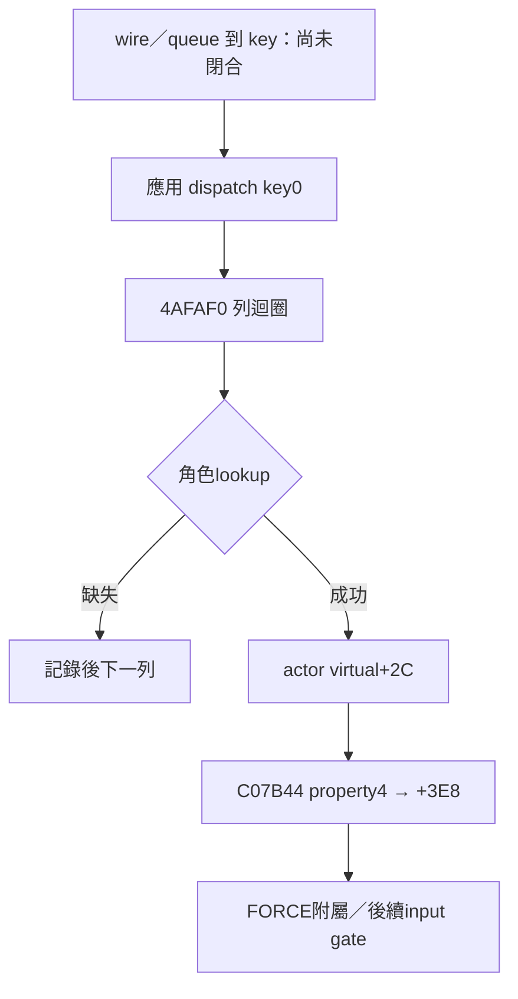

# T10-105：ParamUpdate handler → actor property4 → +3E8

完整研究原稿，接續T10-104；不是摘要替代。唯讀離線BIN-first，未執行／附加／修改遊戲。第一輪有新的可核對資料流進展，沒有用重複搜尋充作105-2/105-3；全文不宣稱native_complete或FULL-PASS。

## 來源與版本

本輪重算BIN SHA256 `9741d1975327b9309d82b52f631165bc410757694d7c183a5eed970a53ebef91`。EXE版本基準沿前段 `03771b8e1c1e66248f54585fadf9a5e926eb77228721325bb9be5febc53b3b5f`，本輪沒有對EXE提出新主張。PE32 ImageBase400000，.text VA401000/raw400，raw=VA−400C00；.rdata VABD2000/raw7D0600，raw=VA−401A00；FB/FD runtime全域不可套text raw公式。

Project shared/T10指示與上傳交接延用本對話已讀版本。最新AGENTS blob a1dcfdb989c47162a081632c2bdd8a5297491cef、T10 README c28a45bfdacd16f7a2aca68ed8cc3c1e8a18fa0a未變；README沒有驗收退回節。研究維持有界介面核對，不更改他人owner/catalog或任務完成狀態。反編譯導航：0x4afaf0.c blob `8ea663f503356e1a3f31ca9a690a0d641c30f90a`；0x4fda30.c blob `eebb85d0ec70e7bea4c783b7a439c2d086c8014d`，皆在kr-bulk-roy/<BIN SHA>/functions；重要參數與值回到native。

## 本輪成果

1. **已確認**：`4AFAF0` 是原生屬性批次handler，缺角色時記錄原字串 `ParamUpdate: Cannot Found In CharList`。arg8是資料指標，argC是長度，arg10是額外分派參數且本體不用；結尾ret0C。不能採反編譯未完整表示的二參數簽名取代ABI。
2. **已確認**：len<2時無列；否則count=floor((len−2)/6)。每列三個WORD：actorID於P+2+6i、property於P+4+6i、value於P+6+6i。尾端不滿6bytes餘數被count忽略；沒有證據顯示handler本體驗證opcode、總len或每列屬性值合法性。
3. **已確認**：40F060回傳FAB130；handler查FAB130+8的角色tree（head於+0C），以actorID zero-extended DWORD查82EF00。失敗／payload指標空則log後跳下一列；成功從node+10取actor ECX，以actor主vtable+2C呼叫(propertyWORD,valueWORD)。
4. **已確認且限定類型**：T104已證明派生vtable C07B44+2C=4CE7F0，故當查得角色採此table時，property4接4CE90A→4CE914，將value低WORD符號擴展寫actor+3E8，並更新FORCE附屬效果。基底table C07554+2C=4CA870只log/ret8；不可說所有actor類型都同樣處理property4。
5. **已確認**：4ADD50把4AFAF0寫this+4、描述字串指標寫this+8；4FDA30以this+4+8*sign_extend(arg10.lowWORD)取handler。故該table的dispatch key0接4AFAF0。**部分確認**：此為應用分派key0，尚未重建socket framing與key取自wire的那一邊，不將它直接無條件命名為S2C opcode0000。
6. **已確認**：4B7EC0預設管理器分派可將原三參數tailjump到active state virtual4；active state採C072B4或manager C06EB4時，virtual4=4FDA30。4B7D50把EDI存入manager+5EAC；它是狀態註冊路徑，不是直接呼叫4AFAF0。
7. **尚待驗證**：socket receive→封包組裝→queue callback→dispatch key0的完整來源；真實封包樣本／wire opcode；哪些actor實際採派生vtable；property4的伺服器裁決、合法值域、觸發原因，以及與000A攻擊／000D motion的因果。

## ABI、編碼與def-use

4AFAF0先從[ebp+C]取得len；unsigned len<2分支count0；(len−2)*AAAAAAAB high>>2即unsigned除6。ESI=P+4，迴圈頭[ESI−2]是actorID，[ESI]是property，[ESI+2]是value，每輪ESI+=6。

4AFB5B先MOVZX value、push；4AFB65再MOVZX property、push；ECX已是角色，4AFB69間接call。進4CE7F0後arg8=property，argC=value，各自MOVSX低WORD；caller的zero-extension不會阻止callee把FFFF解讀−1。這是型別轉換證據，不表示Server實際送負值。

4AFB24把actorID暫存在原argC stack slot，4AFB38又以原arg8 stack slot接tree iterator；不要因反編譯變數重用而認為資料P被改寫或下一列長度來自角色ID。ESI及EBX保留列指標與列數，故失敗仍繼續下一列。

| 列欄位 | P內偏移 | 寬度 | consumer |
|---|---:|---:|---|
| 前置header | 0 | 2 | 本handler不讀；含義未知 |
| actorID | 2+6i | WORD | zero-extended tree key |
| property | 4+6i | WORD | actor virtual+2C第一參數，派生setter讀signed WORD |
| value | 6+6i | WORD | 第二參數，property4轉signed WORD到DWORD |

這不是已取得原始wire封包樣本。以上是**handler預期buffer布局**；header可能是opcode的推測不列為已確認。合法N列需要len≥2+6N；不補造actorID、property4狀態值或收包時間。

## 分派表與狀態生命週期

4ADD50從this+4起初始化0xBD5個8byte slots，預設handler4B7D40及描述BF2375。4ADDAC覆寫index0為4AFAF0；index1為4AFB80；index13為4B01C0（對照T101的motion handler），但**index恰好與前段opcode相符不能單獨當作本段wire proof**。

4FDA30從arg10讀完整DWORD保留原參數，同時MOVSX lowWORD到EDI作索引。沒有在此函式看到key範圍檢查；不能把constructor slot數當已證明所有上游都驗證。handler空時走this virtual0C；非空先紀錄描述，將原arg10,argC,arg8依序push，ECX=this，call保存的handler。返回80004005時有錯誤log；不是普攻拒絕協定。

4B7DC0把manager全域FD2CFC起始slots預設4B7EC0；4B7EC0看manager+5EAC active state，存在則virtual4 tailcall、不另改stack參數；空則記錄資訊、return0。4B7D50切換active state時會先對舊state virtual14與virtual0(1)，再存新EDI並呼叫其virtual10；只保存本段所需狀態生命週期，不重審UI狀態語意。

48F6D9分支配置0x5EAC，call4ADD50，寫C072B4主vptr；該表virtual4=4FDA30。C06EB4 manager亦virtual4=4FDA30；這些是可接路徑，runtime當下active state未觀察。804740仍只引用前段queue drain，未虛構其與本段manager的直接呼叫鏈。

## 玩家情境 × Client × C→S × S→C × motion

| 情境 | Client已確認 | C→S | S→C／資料下游 | 動作結果 | 分工等級 |
|---|---|---|---|---|---|
| 站立短按Z且實際bank映射ID13 | 前段phase1/2→bit0；本段未新增按鍵producer | 承000A 6+5N有界路徑，不保證短按必送 | ParamUpdate handler可改角色狀態，未證明是此操作回覆 | 本地起手未知 | 按鍵與回包因果未閉合 |
| handler列property4/value1，查得C07B44角色 | 寫+3E8=1，FORCE附屬處理 | 後續gate用row1；非零例外仍適用 | buffer→角色更新原生已確認；wire來源未閉合 | 附屬效果與motion需分開 | Client consumer已確認 |
| 同列value0 | 寫+3E8=0並清舊+364附屬 | gate失敗時抑制lower15；其他slot仍可能送 | 同上 | 不等於已證取消攻擊 | 原生條件已確認 |
| 角色ID缺失／payload空 | log後續下列 | 沒有在此新增發包證據 | 該列不呼叫角色setter | 該列無此setter效果 | 有界不處理native |
| 查得基底C07554角色 | virtual2C=4CA870記錄並return | 未新增 | 不套用派生property4語意 | 尚未確認其他效果 | 類型限制native |
| 長按、連按、放開及施放中移動 | 本輪沒有新增相應判定 | 次數／排序未知 | 未證ParamUpdate的觸發節奏 | 續段／取消未知 | 缺失，不當作沒有 |

## 時序與Server責任



Server責任：角色狀態同步有Client資料consumer支持，但此輪尚不能聲稱wire opcode與來源已驗證；若相容Server需要提供此buffer，必須先閉合framing和dispatch。000A解析／000D動作同步仍沿前段限定證據；property4觸發時機、合法性、維持時間、冷卻消耗與攻擊裁決未知。沒有自製0.65秒、SubAI續段或任何替代規則，沒有改遊戲。

## 搜尋範圍、反證與下一段

本輪先在490000..4C7000掃描mov reg,[reg+2C]且鄰近call，發現4AFB61實際兩參數setter路徑；同範圍其他+2C多為不同介面，沒有僅憑offset命名actor。此搜尋不是所有間接caller窮盡證明。

已查4AFAF0完整、40F060 getter、82EF00呼叫接口、4ADD50註冊、4FDA30完整、4B7EC0完整及active-state註冊有界片段。82EF00完整tree旋轉／比較未在此重新審核；用handler sentinel與node+10讀取證明成功失敗邊界，不宣稱整個泛型tree FULL-PASS。

本段有實質進展：T104未知的writer caller已到buffer欄位與分派key；仍缺socket→key入口。下一段優先定位manager C06EB4 virtual4的實際呼叫者及804740 callback物件，證明arg10是否由收到資料的header或外部metadata產生。再取得SkillMatrix.xml原始格值及FORCE→skill/motion。不要在未閉合前把key0寫成已核對wire opcode0000；不要把ParamUpdate當成000A專屬接受回覆。

## Native證據附錄

VA/raw起點與帶bytes指令如下，逐行回比原BIN；這項僅證明擷取來源一致，不代替語意驗收。4C2F30附近完整objdump曾受前置嵌入資料影響，不採該區錯位解碼作本段證據；本段只用明確邊界48F6D9及constructor table bytes。

### VA 0040F060 raw 0000E460, end-exclusive 0040F0CA

```asm
  40f060:	55                   	push   ebp
  40f061:	8b ec                	mov    ebp,esp
  40f063:	83 e4 f8             	and    esp,0xfffffff8
  40f066:	6a ff                	push   0xffffffff
  40f068:	68 ee 61 94 00       	push   0x9461ee
  40f06d:	64 a1 00 00 00 00    	mov    eax,fs:0x0
  40f073:	50                   	push   eax
  40f074:	51                   	push   ecx
  40f075:	a1 20 1f d6 00       	mov    eax,ds:0xd61f20
  40f07a:	33 c4                	xor    eax,esp
  40f07c:	50                   	push   eax
  40f07d:	8d 44 24 08          	lea    eax,[esp+0x8]
  40f081:	64 a3 00 00 00 00    	mov    fs:0x0,eax
  40f087:	b8 01 00 00 00       	mov    eax,0x1
  40f08c:	84 05 2c b2 fa 00    	test   BYTE PTR ds:0xfab22c,al
  40f092:	75 20                	jne    0x40f0b4
  40f094:	09 05 2c b2 fa 00    	or     DWORD PTR ds:0xfab22c,eax
  40f09a:	c7 44 24 10 00 00 00 	mov    DWORD PTR [esp+0x10],0x0
  40f0a1:	00 
  40f0a2:	e8 e9 fb 0c 00       	call   0x4dec90
  40f0a7:	68 30 ce bc 00       	push   0xbcce30
  40f0ac:	e8 69 32 48 00       	call   0x89231a
  40f0b1:	83 c4 04             	add    esp,0x4
  40f0b4:	b8 30 b1 fa 00       	mov    eax,0xfab130
  40f0b9:	8b 4c 24 08          	mov    ecx,DWORD PTR [esp+0x8]
  40f0bd:	64 89 0d 00 00 00 00 	mov    DWORD PTR fs:0x0,ecx
  40f0c4:	59                   	pop    ecx
  40f0c5:	8b e5                	mov    esp,ebp
  40f0c7:	5d                   	pop    ebp
  40f0c8:	c3                   	ret
  40f0c9:	cc                   	int3
```

### VA 0048F6D9 raw 0008EAD9, end-exclusive 0048F705

```asm
  48f6d9:	68 ac 5e 00 00       	push   0x5eac
  48f6de:	e8 85 1b 40 00       	call   0x891268
  48f6e3:	83 c4 04             	add    esp,0x4
  48f6e6:	3b c3                	cmp    eax,ebx
  48f6e8:	74 19                	je     0x48f703
  48f6ea:	e8 61 e6 01 00       	call   0x4add50
  48f6ef:	c7 00 b4 72 c0 00    	mov    DWORD PTR [eax],0xc072b4
  48f6f5:	c7 05 74 a6 d6 00 53 	mov    DWORD PTR ds:0xd6a674,0x46495253
  48f6fc:	52 49 46 
  48f6ff:	8b f8                	mov    edi,eax
  48f701:	eb 02                	jmp    0x48f705
  48f703:	33 ff                	xor    edi,edi
```

### VA 004ADD50 raw 000AD150, end-exclusive 004ADDDA

```asm
  4add50:	53                   	push   ebx
  4add51:	56                   	push   esi
  4add52:	8d 50 08             	lea    edx,[eax+0x8]
  4add55:	be d5 0b 00 00       	mov    esi,0xbd5
  4add5a:	b9 75 23 bf 00       	mov    ecx,0xbf2375
  4add5f:	90                   	nop
  4add60:	c7 42 fc 40 7d 4b 00 	mov    DWORD PTR [edx-0x4],0x4b7d40
  4add67:	89 0a                	mov    DWORD PTR [edx],ecx
  4add69:	83 c2 08             	add    edx,0x8
  4add6c:	4e                   	dec    esi
  4add6d:	75 f1                	jne    0x4add60
  4add6f:	ba 80 fb 4a 00       	mov    edx,0x4afb80
  4add74:	c7 40 34 30 7d 4b 00 	mov    DWORD PTR [eax+0x34],0x4b7d30
  4add7b:	89 48 38             	mov    DWORD PTR [eax+0x38],ecx
  4add7e:	c7 40 3c d0 e4 4a 00 	mov    DWORD PTR [eax+0x3c],0x4ae4d0
  4add85:	89 48 40             	mov    DWORD PTR [eax+0x40],ecx
  4add88:	c7 80 f4 09 00 00 b0 	mov    DWORD PTR [eax+0x9f4],0x4aedb0
  4add8f:	ed 4a 00 
  4add92:	89 88 f8 09 00 00    	mov    DWORD PTR [eax+0x9f8],ecx
  4add98:	c7 40 44 30 f5 4a 00 	mov    DWORD PTR [eax+0x44],0x4af530
  4add9f:	89 48 48             	mov    DWORD PTR [eax+0x48],ecx
  4adda2:	c7 40 54 20 f9 4a 00 	mov    DWORD PTR [eax+0x54],0x4af920
  4adda9:	89 48 58             	mov    DWORD PTR [eax+0x58],ecx
  4addac:	c7 40 04 f0 fa 4a 00 	mov    DWORD PTR [eax+0x4],0x4afaf0
  4addb3:	89 48 08             	mov    DWORD PTR [eax+0x8],ecx
  4addb6:	89 50 0c             	mov    DWORD PTR [eax+0xc],edx
  4addb9:	89 48 10             	mov    DWORD PTR [eax+0x10],ecx
  4addbc:	c7 40 5c 60 fe 4a 00 	mov    DWORD PTR [eax+0x5c],0x4afe60
  4addc3:	89 48 60             	mov    DWORD PTR [eax+0x60],ecx
  4addc6:	c7 40 64 30 01 4b 00 	mov    DWORD PTR [eax+0x64],0x4b0130
  4addcd:	89 48 68             	mov    DWORD PTR [eax+0x68],ecx
  4addd0:	c7 40 6c c0 01 4b 00 	mov    DWORD PTR [eax+0x6c],0x4b01c0
  4addd7:	89 48 70             	mov    DWORD PTR [eax+0x70],ecx
```

### VA 004AFAF0 raw 000AEEF0, end-exclusive 004AFB7A

```asm
  4afaf0:	55                   	push   ebp
  4afaf1:	8b ec                	mov    ebp,esp
  4afaf3:	8b 45 0c             	mov    eax,DWORD PTR [ebp+0xc]
  4afaf6:	83 f8 02             	cmp    eax,0x2
  4afaf9:	73 04                	jae    0x4afaff
  4afafb:	33 d2                	xor    edx,edx
  4afafd:	eb 0d                	jmp    0x4afb0c
  4afaff:	8d 48 fe             	lea    ecx,[eax-0x2]
  4afb02:	b8 ab aa aa aa       	mov    eax,0xaaaaaaab
  4afb07:	f7 e1                	mul    ecx
  4afb09:	c1 ea 02             	shr    edx,0x2
  4afb0c:	85 d2                	test   edx,edx
  4afb0e:	74 64                	je     0x4afb74
  4afb10:	53                   	push   ebx
  4afb11:	56                   	push   esi
  4afb12:	8b 75 08             	mov    esi,DWORD PTR [ebp+0x8]
  4afb15:	57                   	push   edi
  4afb16:	83 c6 04             	add    esi,0x4
  4afb19:	8b da                	mov    ebx,edx
  4afb1b:	eb 03                	jmp    0x4afb20
  4afb1d:	8d 49 00             	lea    ecx,[ecx+0x0]
  4afb20:	0f b7 56 fe          	movzx  edx,WORD PTR [esi-0x2]
  4afb24:	89 55 0c             	mov    DWORD PTR [ebp+0xc],edx
  4afb27:	e8 34 f5 f5 ff       	call   0x40f060
  4afb2c:	8b f8                	mov    edi,eax
  4afb2e:	8d 45 0c             	lea    eax,[ebp+0xc]
  4afb31:	50                   	push   eax
  4afb32:	8d 4f 08             	lea    ecx,[edi+0x8]
  4afb35:	8d 45 08             	lea    eax,[ebp+0x8]
  4afb38:	e8 c3 f3 37 00       	call   0x82ef00
  4afb3d:	8b 45 08             	mov    eax,DWORD PTR [ebp+0x8]
  4afb40:	3b 47 0c             	cmp    eax,DWORD PTR [edi+0xc]
  4afb43:	74 07                	je     0x4afb4c
  4afb45:	8b 48 10             	mov    ecx,DWORD PTR [eax+0x10]
  4afb48:	85 c9                	test   ecx,ecx
  4afb4a:	75 0f                	jne    0x4afb5b
  4afb4c:	68 88 6a c0 00       	push   0xc06a88
  4afb51:	e8 0a e0 23 00       	call   0x6edb60
  4afb56:	83 c4 04             	add    esp,0x4
  4afb59:	eb 10                	jmp    0x4afb6b
  4afb5b:	0f b7 46 02          	movzx  eax,WORD PTR [esi+0x2]
  4afb5f:	8b 11                	mov    edx,DWORD PTR [ecx]
  4afb61:	8b 52 2c             	mov    edx,DWORD PTR [edx+0x2c]
  4afb64:	50                   	push   eax
  4afb65:	0f b7 06             	movzx  eax,WORD PTR [esi]
  4afb68:	50                   	push   eax
  4afb69:	ff d2                	call   edx
  4afb6b:	83 c6 06             	add    esi,0x6
  4afb6e:	4b                   	dec    ebx
  4afb6f:	75 af                	jne    0x4afb20
  4afb71:	5f                   	pop    edi
  4afb72:	5e                   	pop    esi
  4afb73:	5b                   	pop    ebx
  4afb74:	33 c0                	xor    eax,eax
  4afb76:	5d                   	pop    ebp
  4afb77:	c2 0c 00             	ret    0xc
```

### VA 004B7D50 raw 000B7150, end-exclusive 004B7DC0

```asm
  4b7d50:	51                   	push   ecx
  4b7d51:	85 ff                	test   edi,edi
  4b7d53:	75 0a                	jne    0x4b7d5f
  4b7d55:	68 cc 6d c0 00       	push   0xc06dcc
  4b7d5a:	e8 11 5f 23 00       	call   0x6edc70
  4b7d5f:	8b 8e ac 5e 00 00    	mov    ecx,DWORD PTR [esi+0x5eac]
  4b7d65:	85 c9                	test   ecx,ecx
  4b7d67:	74 23                	je     0x4b7d8c
  4b7d69:	8b 01                	mov    eax,DWORD PTR [ecx]
  4b7d6b:	8b 50 14             	mov    edx,DWORD PTR [eax+0x14]
  4b7d6e:	ff d2                	call   edx
  4b7d70:	8b 8e ac 5e 00 00    	mov    ecx,DWORD PTR [esi+0x5eac]
  4b7d76:	85 c9                	test   ecx,ecx
  4b7d78:	74 12                	je     0x4b7d8c
  4b7d7a:	8b 01                	mov    eax,DWORD PTR [ecx]
  4b7d7c:	8b 10                	mov    edx,DWORD PTR [eax]
  4b7d7e:	6a 01                	push   0x1
  4b7d80:	ff d2                	call   edx
  4b7d82:	c7 86 ac 5e 00 00 00 	mov    DWORD PTR [esi+0x5eac],0x0
  4b7d89:	00 00 00 
  4b7d8c:	a1 74 a6 d6 00       	mov    eax,ds:0xd6a674
  4b7d91:	50                   	push   eax
  4b7d92:	8b c8                	mov    ecx,eax
  4b7d94:	8b d0                	mov    edx,eax
  4b7d96:	c1 e9 08             	shr    ecx,0x8
  4b7d99:	51                   	push   ecx
  4b7d9a:	c1 ea 10             	shr    edx,0x10
  4b7d9d:	52                   	push   edx
  4b7d9e:	c1 e8 18             	shr    eax,0x18
  4b7da1:	50                   	push   eax
  4b7da2:	68 e0 6d c0 00       	push   0xc06de0
  4b7da7:	89 be ac 5e 00 00    	mov    DWORD PTR [esi+0x5eac],edi
  4b7dad:	e8 4e 5f 23 00       	call   0x6edd00
  4b7db2:	8b 07                	mov    eax,DWORD PTR [edi]
  4b7db4:	8b 50 10             	mov    edx,DWORD PTR [eax+0x10]
  4b7db7:	83 c4 14             	add    esp,0x14
  4b7dba:	8b cf                	mov    ecx,edi
  4b7dbc:	ff d2                	call   edx
  4b7dbe:	59                   	pop    ecx
  4b7dbf:	c3                   	ret
```

### VA 004B7DC0 raw 000B71C0, end-exclusive 004B7DF0

```asm
  4b7dc0:	b8 00 2d fd 00       	mov    eax,0xfd2d00
  4b7dc5:	ba c0 7e 4b 00       	mov    edx,0x4b7ec0
  4b7dca:	b9 75 23 bf 00       	mov    ecx,0xbf2375
  4b7dcf:	90                   	nop
  4b7dd0:	89 50 fc             	mov    DWORD PTR [eax-0x4],edx
  4b7dd3:	89 08                	mov    DWORD PTR [eax],ecx
  4b7dd5:	83 c0 08             	add    eax,0x8
  4b7dd8:	3d a8 8b fd 00       	cmp    eax,0xfd8ba8
  4b7ddd:	7c f1                	jl     0x4b7dd0
  4b7ddf:	c7 05 0c 2d fd 00 00 	mov    DWORD PTR ds:0xfd2d0c,0x4b7f00
  4b7de6:	7f 4b 00 
  4b7de9:	89 0d 10 2d fd 00    	mov    DWORD PTR ds:0xfd2d10,ecx
  4b7def:	c7 05 8c 8b fd 00 c0 	mov    DWORD PTR ds:0xfd8b8c,0x4b8dc0
```

### VA 004B7EC0 raw 000B72C0, end-exclusive 004B7EF2

```asm
  4b7ec0:	55                   	push   ebp
  4b7ec1:	8b ec                	mov    ebp,esp
  4b7ec3:	83 b9 ac 5e 00 00 00 	cmp    DWORD PTR [ecx+0x5eac],0x0
  4b7eca:	74 0e                	je     0x4b7eda
  4b7ecc:	8b 89 ac 5e 00 00    	mov    ecx,DWORD PTR [ecx+0x5eac]
  4b7ed2:	8b 01                	mov    eax,DWORD PTR [ecx]
  4b7ed4:	8b 40 04             	mov    eax,DWORD PTR [eax+0x4]
  4b7ed7:	5d                   	pop    ebp
  4b7ed8:	ff e0                	jmp    eax
  4b7eda:	0f bf 4d 10          	movsx  ecx,WORD PTR [ebp+0x10]
  4b7ede:	51                   	push   ecx
  4b7edf:	68 f8 6d c0 00       	push   0xc06df8
  4b7ee4:	e8 77 5c 23 00       	call   0x6edb60
  4b7ee9:	83 c4 08             	add    esp,0x8
  4b7eec:	33 c0                	xor    eax,eax
  4b7eee:	5d                   	pop    ebp
  4b7eef:	c2 0c 00             	ret    0xc
```

### VA 004FDA30 raw 000FCE30, end-exclusive 004FDAB3

```asm
  4fda30:	55                   	push   ebp
  4fda31:	8b ec                	mov    ebp,esp
  4fda33:	51                   	push   ecx
  4fda34:	56                   	push   esi
  4fda35:	8b f1                	mov    esi,ecx
  4fda37:	8b 4d 10             	mov    ecx,DWORD PTR [ebp+0x10]
  4fda3a:	57                   	push   edi
  4fda3b:	0f bf f9             	movsx  edi,cx
  4fda3e:	8b 44 fe 04          	mov    eax,DWORD PTR [esi+edi*8+0x4]
  4fda42:	89 45 fc             	mov    DWORD PTR [ebp-0x4],eax
  4fda45:	85 c0                	test   eax,eax
  4fda47:	75 1a                	jne    0x4fda63
  4fda49:	8b 06                	mov    eax,DWORD PTR [esi]
  4fda4b:	8b 55 08             	mov    edx,DWORD PTR [ebp+0x8]
  4fda4e:	8b 40 0c             	mov    eax,DWORD PTR [eax+0xc]
  4fda51:	51                   	push   ecx
  4fda52:	8b 4d 0c             	mov    ecx,DWORD PTR [ebp+0xc]
  4fda55:	51                   	push   ecx
  4fda56:	52                   	push   edx
  4fda57:	8b ce                	mov    ecx,esi
  4fda59:	ff d0                	call   eax
  4fda5b:	5f                   	pop    edi
  4fda5c:	5e                   	pop    esi
  4fda5d:	8b e5                	mov    esp,ebp
  4fda5f:	5d                   	pop    ebp
  4fda60:	c2 0c 00             	ret    0xc
  4fda63:	8b 4c fe 08          	mov    ecx,DWORD PTR [esi+edi*8+0x8]
  4fda67:	53                   	push   ebx
  4fda68:	6a 06                	push   0x6
  4fda6a:	8d 5c fe 08          	lea    ebx,[esi+edi*8+0x8]
  4fda6e:	68 6c 6c bf 00       	push   0xbf6c6c
  4fda73:	51                   	push   ecx
  4fda74:	e8 45 4e 39 00       	call   0x8928be
  4fda79:	8b 55 10             	mov    edx,DWORD PTR [ebp+0x10]
  4fda7c:	8b 45 0c             	mov    eax,DWORD PTR [ebp+0xc]
  4fda7f:	8b 4d 08             	mov    ecx,DWORD PTR [ebp+0x8]
  4fda82:	83 c4 0c             	add    esp,0xc
  4fda85:	52                   	push   edx
  4fda86:	50                   	push   eax
  4fda87:	51                   	push   ecx
  4fda88:	8b ce                	mov    ecx,esi
  4fda8a:	ff 55 fc             	call   DWORD PTR [ebp-0x4]
  4fda8d:	8b f0                	mov    esi,eax
  4fda8f:	81 fe 05 40 00 80    	cmp    esi,0x80004005
  4fda95:	75 11                	jne    0x4fdaa8
  4fda97:	8b 13                	mov    edx,DWORD PTR [ebx]
  4fda99:	52                   	push   edx
  4fda9a:	57                   	push   edi
  4fda9b:	68 74 6c bf 00       	push   0xbf6c74
  4fdaa0:	e8 bb 00 1f 00       	call   0x6edb60
  4fdaa5:	83 c4 0c             	add    esp,0xc
  4fdaa8:	5b                   	pop    ebx
  4fdaa9:	5f                   	pop    edi
  4fdaaa:	8b c6                	mov    eax,esi
  4fdaac:	5e                   	pop    esi
  4fdaad:	8b e5                	mov    esp,ebp
  4fdaaf:	5d                   	pop    ebp
  4fdab0:	c2 0c 00             	ret    0xc
```

### VA 004CD6F0 raw 000CCAF0, end-exclusive 004CD744

```asm
  4cd6f0:	55                   	push   ebp
  4cd6f1:	8b ec                	mov    ebp,esp
  4cd6f3:	6a ff                	push   0xffffffff
  4cd6f5:	68 74 76 91 00       	push   0x917674
  4cd6fa:	64 a1 00 00 00 00    	mov    eax,fs:0x0
  4cd700:	50                   	push   eax
  4cd701:	83 ec 0c             	sub    esp,0xc
  4cd704:	53                   	push   ebx
  4cd705:	56                   	push   esi
  4cd706:	57                   	push   edi
  4cd707:	a1 20 1f d6 00       	mov    eax,ds:0xd61f20
  4cd70c:	33 c5                	xor    eax,ebp
  4cd70e:	50                   	push   eax
  4cd70f:	8d 45 f4             	lea    eax,[ebp-0xc]
  4cd712:	64 a3 00 00 00 00    	mov    fs:0x0,eax
  4cd718:	8b 7d 08             	mov    edi,DWORD PTR [ebp+0x8]
  4cd71b:	57                   	push   edi
  4cd71c:	e8 4f 99 ff ff       	call   0x4c7070
  4cd721:	33 db                	xor    ebx,ebx
  4cd723:	89 5d fc             	mov    DWORD PTR [ebp-0x4],ebx
  4cd726:	6a 30                	push   0x30
  4cd728:	c7 07 44 7b c0 00    	mov    DWORD PTR [edi],0xc07b44
  4cd72e:	c7 87 f0 00 00 00 cc 	mov    DWORD PTR [edi+0xf0],0xc07bcc
  4cd735:	7b c0 00 
  4cd738:	89 9f 20 04 00 00    	mov    DWORD PTR [edi+0x420],ebx
  4cd73e:	89 9f 24 04 00 00    	mov    DWORD PTR [edi+0x424],ebx
```

### VA 004CE7F0 raw 000CDBF0, end-exclusive 004CE845

```asm
  4ce7f0:	55                   	push   ebp
  4ce7f1:	8b ec                	mov    ebp,esp
  4ce7f3:	6a ff                	push   0xffffffff
  4ce7f5:	68 e8 05 94 00       	push   0x9405e8
  4ce7fa:	64 a1 00 00 00 00    	mov    eax,fs:0x0
  4ce800:	50                   	push   eax
  4ce801:	83 ec 3c             	sub    esp,0x3c
  4ce804:	a1 20 1f d6 00       	mov    eax,ds:0xd61f20
  4ce809:	33 c5                	xor    eax,ebp
  4ce80b:	89 45 f0             	mov    DWORD PTR [ebp-0x10],eax
  4ce80e:	53                   	push   ebx
  4ce80f:	56                   	push   esi
  4ce810:	57                   	push   edi
  4ce811:	50                   	push   eax
  4ce812:	8d 45 f4             	lea    eax,[ebp-0xc]
  4ce815:	64 a3 00 00 00 00    	mov    fs:0x0,eax
  4ce81b:	8b d9                	mov    ebx,ecx
  4ce81d:	0f bf 4d 08          	movsx  ecx,WORD PTR [ebp+0x8]
  4ce821:	8d 41 ff             	lea    eax,[ecx-0x1]
  4ce824:	83 f8 1d             	cmp    eax,0x1d
  4ce827:	0f 87 fe 02 00 00    	ja     0x4ceb2b
  4ce82d:	0f b6 80 88 eb 4c 00 	movzx  eax,BYTE PTR [eax+0x4ceb88]
  4ce834:	ff 24 85 5c eb 4c 00 	jmp    DWORD PTR [eax*4+0x4ceb5c]
  4ce83b:	0f bf 45 0c          	movsx  eax,WORD PTR [ebp+0xc]
  4ce83f:	89 83 b0 03 00 00    	mov    DWORD PTR [ebx+0x3b0],eax
```

### VA 004CE90A raw 000CDD0A, end-exclusive 004CE9A8

```asm
  4ce90a:	0f bf 4d 0c          	movsx  ecx,WORD PTR [ebp+0xc]
  4ce90e:	8b 83 64 03 00 00    	mov    eax,DWORD PTR [ebx+0x364]
  4ce914:	89 8b e8 03 00 00    	mov    DWORD PTR [ebx+0x3e8],ecx
  4ce91a:	85 c0                	test   eax,eax
  4ce91c:	74 27                	je     0x4ce945
  4ce91e:	83 78 24 00          	cmp    DWORD PTR [eax+0x24],0x0
  4ce922:	8d 70 24             	lea    esi,[eax+0x24]
  4ce925:	74 05                	je     0x4ce92c
  4ce927:	e8 c4 fc 2e 00       	call   0x7be5f0
  4ce92c:	8b bb 64 03 00 00    	mov    edi,DWORD PTR [ebx+0x364]
  4ce932:	85 ff                	test   edi,edi
  4ce934:	74 0f                	je     0x4ce945
  4ce936:	e8 75 94 ff ff       	call   0x4c7db0
  4ce93b:	c7 83 64 03 00 00 00 	mov    DWORD PTR [ebx+0x364],0x0
  4ce942:	00 00 00 
  4ce945:	83 bb e8 03 00 00 01 	cmp    DWORD PTR [ebx+0x3e8],0x1
  4ce94c:	0f 85 ec 01 00 00    	jne    0x4ceb3e
  4ce952:	d9 e8                	fld1
  4ce954:	8b 13                	mov    edx,DWORD PTR [ebx]
  4ce956:	8b 42 4c             	mov    eax,DWORD PTR [edx+0x4c]
  4ce959:	83 ec 08             	sub    esp,0x8
  4ce95c:	d9 5c 24 04          	fstp   DWORD PTR [esp+0x4]
  4ce960:	83 cf ff             	or     edi,0xffffffff
  4ce963:	d9 ee                	fldz
  4ce965:	8b cb                	mov    ecx,ebx
  4ce967:	d9 1c 24             	fstp   DWORD PTR [esp]
  4ce96a:	c7 45 b8 02 00 00 00 	mov    DWORD PTR [ebp-0x48],0x2
  4ce971:	c7 45 bc ec 7a c0 00 	mov    DWORD PTR [ebp-0x44],0xc07aec
  4ce978:	89 7d c0             	mov    DWORD PTR [ebp-0x40],edi
  4ce97b:	89 7d c4             	mov    DWORD PTR [ebp-0x3c],edi
  4ce97e:	c7 45 c8 00 00 00 00 	mov    DWORD PTR [ebp-0x38],0x0
  4ce985:	ff d0                	call   eax
  4ce987:	0f b7 4b 04          	movzx  ecx,WORD PTR [ebx+0x4]
  4ce98b:	51                   	push   ecx
  4ce98c:	8b f0                	mov    esi,eax
  4ce98e:	e8 ad c7 fc ff       	call   0x49b140
  4ce993:	8d 55 b8             	lea    edx,[ebp-0x48]
  4ce996:	8b c8                	mov    ecx,eax
  4ce998:	e8 f3 35 08 00       	call   0x551f90
  4ce99d:	89 83 64 03 00 00    	mov    DWORD PTR [ebx+0x364],eax
  4ce9a3:	e9 96 01 00 00       	jmp    0x4ceb3e
```

### VA 004CA870 raw 000C9C70, end-exclusive 004CA87E

```asm
  4ca870:	68 1c 76 c0 00       	push   0xc0761c
  4ca875:	e8 e6 32 22 00       	call   0x6edb60
  4ca87a:	59                   	pop    ecx
  4ca87b:	c2 08 00             	ret    0x8
```

### VA 005462A2 raw 001456A2, end-exclusive 00546306

```asm
  5462a2:	83 3d ac a7 fb 00 01 	cmp    DWORD PTR ds:0xfba7ac,0x1
  5462a9:	74 5b                	je     0x546306
  5462ab:	66 85 c0             	test   ax,ax
  5462ae:	74 56                	je     0x546306
  5462b0:	8b 74 24 24          	mov    esi,DWORD PTR [esp+0x24]
  5462b4:	8b 8f e8 03 00 00    	mov    ecx,DWORD PTR [edi+0x3e8]
  5462ba:	33 d2                	xor    edx,edx
  5462bc:	38 56 02             	cmp    BYTE PTR [esi+0x2],dl
  5462bf:	51                   	push   ecx
  5462c0:	0f 95 c2             	setne  dl
  5462c3:	8a 14 32             	mov    dl,BYTE PTR [edx+esi*1]
  5462c6:	88 54 24 28          	mov    BYTE PTR [esp+0x28],dl
  5462ca:	8b 4c 24 28          	mov    ecx,DWORD PTR [esp+0x28]
  5462ce:	51                   	push   ecx
  5462cf:	8b 4d 08             	mov    ecx,DWORD PTR [ebp+0x8]
  5462d2:	8d 14 49             	lea    edx,[ecx+ecx*2]
  5462d5:	8b 4c 24 20          	mov    ecx,DWORD PTR [esp+0x20]
  5462d9:	8b 4c 91 10          	mov    ecx,DWORD PTR [ecx+edx*4+0x10]
  5462dd:	e8 8e 8f 00 00       	call   0x54f270
  5462e2:	85 c0                	test   eax,eax
  5462e4:	74 07                	je     0x5462ed
  5462e6:	c6 44 24 17 01       	mov    BYTE PTR [esp+0x17],0x1
  5462eb:	eb 19                	jmp    0x546306
  5462ed:	83 bf e8 03 00 00 00 	cmp    DWORD PTR [edi+0x3e8],0x0
  5462f4:	74 07                	je     0x5462fd
  5462f6:	c6 44 24 17 01       	mov    BYTE PTR [esp+0x17],0x1
  5462fb:	eb 09                	jmp    0x546306
  5462fd:	ba 00 80 00 00       	mov    edx,0x8000
  546302:	66 21 53 02          	and    WORD PTR [ebx+0x2],dx
```

VA 00C072B4 raw 008058B4: `40 59 4c 00 30 da 4f 00 10 28 42 00 f0 27 42 00`

VA 00C06EB4 raw 008054B4: `40 59 4c 00 30 da 4f 00 10 28 42 00 f0 27 42 00`

VA 00C07B44 raw 00806144: `a0 da 4c 00 10 5d 5f 00 80 a8 4c 00 f0 c2 8d 00 b0 eb 4c 00 f0 eb 4c 00 f0 c2 8d 00 f0 c2 8d 00 40 dd 4c 00 30 de 4c 00 70 e2 4c 00 f0 e7 4c 00`

VA 00C07554 raw 00805B54: `60 7b 4c 00 10 5d 5f 00 80 a8 4c 00 f0 c2 8d 00 40 82 4c 00 60 83 4c 00 f0 c2 8d 00 f0 c2 8d 00 80 85 4c 00 d0 87 4c 00 f0 88 4c 00 70 a8 4c 00`

VA 00C06A88 raw 00805088: `50 61 72 61 6d 55 70 64 61 74 65 3a 20 43 61 6e 6e 6f 74 20 46 6f 75 6e 64 20 49 6e 20 43 68 61 72 4c 69 73 74 00 00 00`

核對native指令行數：385；時間 2026-10-28T19:19:03.915441+08:00。
