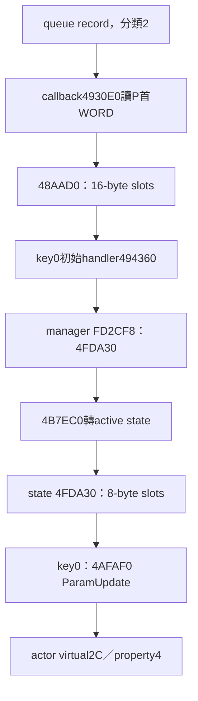

# T10-106：queue callback header key 與兩層應用分派

完整原稿，接T10-105；BIN-first唯讀離線，未執行、附加或修改目標。第一輪有實質新進展，未以重複搜尋湊106-2/3。本段是有界原生分析，不宣稱Task native_complete或全文FULL-PASS。

## 來源與檢查

本輪重算BIN SHA256 `9741d1975327b9309d82b52f631165bc410757694d7c183a5eed970a53ebef91`。EXE沿前段版本識別 `03771b8e1c1e66248f54585fadf9a5e926eb77228721325bb9be5febc53b3b5f`，本輪不對EXE新增主張。PE32 ImageBase400000；text VA401000/raw400，raw=VA−400C00；rdata VABD2000/raw7D0600，raw=VA−401A00。FD/FB全域為runtime資料，不製造其raw對照。

shared/T10固定指示與交接已於本對話閱讀；最新AGENTS a1dcfdb989c47162a081632c2bdd8a5297491cef、T10 README c28a45bfdacd16f7a2aca68ed8cc3c1e8a18fa0a未變。無README驗收退回節。本輪延續獨立分支有界核對，不更改owner/catalog或完整性標記。

反編譯導航 `kr-bulk-roy/<BIN SHA>/functions/0x4930e0.c` blob `a1d643046aaaa6e4fd8f783aaac36c6d73aa2592`；重要值與this偏移均回到BIN。所有附件指令bytes逐條核對原檔；這只證明擷取一致，不代表語意自動驗收。

## 新結論與界線

**已確認**：804740 drain取得queue record後，以record+8作資料P、record+4作長度L、record+0作額外第一參數，queue分類作第四參數，呼叫callback物件virtual0。不是將queue分類直接當opcode。

**已確認**：callback4930E0從P首WORD讀key K（4930ED）。L==0時直接return0；分類不是2時也不進應用分派。分類==2時將K,L,P傳到callback+ B8所嵌入dispatcher virtual4。P保持原首WORD，沒有在此跳過2-byte header。

**已確認**：讀header發生在L判零之前（4930ED先讀，4930F6後test）；此函式沒有本體內len>=2防護。不能因handler有len>=2檢查就稱完整接收鏈對短buffer安全；前置framing是否保證長度仍待查。

**已確認**：構造4C?不是正確入口；本輪用48AB70附近constructor資料流：48AB98取root R，48AC81 EAX=R+148，804380初始化並回傳同指標，48AC9A寫callback table C05AEC，其virtual0=4930E0。48ACAC寫root+200 table C05B04，其virtual4=48AAD0。兩者相差B8，所以4930E0的this+B8正好落在root+200 dispatcher，不是T105的8-byte-slot state表。

**已確認**：48C027以EBX−8傳493170初始化root內分派表；同函式48C0E0以EBX+140作callback初始化位置。故EBX為root+8時，EBX+140=root+148、表初始化基底root=EBX−8。這個8-byte基底差異解釋前段表面+140/+148，不能把不同函式基址的offset直接拼接。

**已確認**：48AAD0為16-byte-slot dispatcher：K取signed lowWORD，slot=root+208+16*K（相對其this=root+200為+8+16*K）；handler於slot+0，this-adjustment於slot+4，描述於slot+8。呼叫this=dispatcherThis+adjustment−200= root+adjustment。這與4FDA30的8-byte-slot布局不同。

**已確認**：493170先以0xBD5項初始化root+208起slots，default handler494360、adjustment0、描述BF2375。初始化函式中具體覆寫另附原生完整區段；未見index0/根+208被覆寫，故本次初始key0走494360。494360取得manager FD2CF8，tailcall其virtual4=4FDA30，預設slot0再走4B7EC0，active state存在時virtual4。active state採T105的4ADD50表時，state key0=4AFAF0→角色setter→property4。runtime可否另改表仍未窮盡。

**部分確認**：T105的「key0」現在已接到**queue資料P首WORD=0**，不是外部另造key。可稱「應用接收資料header key0」；仍未把socket framing、解密/解壓、queue enqueue與此P的完整來源閉合，故保留wire opcode0000的驗收限制。也沒有證明它是000A的回覆。

## queue record與callback ABI

| 節點／參數 | 來源 | 送入4930E0 |
|---|---|---|
| arg8 | record DWORD+0 | 本callback未用於分派key |
| argC | record地址+8 | P，首WORD為K |
| arg10 | record DWORD+4 | L |
| arg14 | drain queue分類 | 只等於2進應用分派 |
| callback this | drain arg8（EBX） | vptr virtual0 |

804837 push queue分類、push &record，再以EAX=FC10D0 call804100；返回true才讀record。804100按分類及內部toggle選queue，這一版沒有重審其所有allocator／同步helper語意。804850..80486D native push順序證明上述四參數。callback ret10。返回值及耗時計算後有其他virtual記錄、回收record；不把返回true解讀成Server接受攻擊。

4930E0類別2先6DB1F0(K,L)，timeGetTime前後包住dispatch；若dispatch返回100h且this+BE8C非零則回1，其餘回0。100h是此Client callback分支值，不是已知網路狀態碼，不能稱攻擊成功。BD25A0沿前段已核對為timeGetTime，不是GetTickCount。

## 從header到property4的有界鏈



圖的前提：queue分類2，P/L滿足上游合約，app表保持已核對初值，active state採4ADD50初始化表，查得actor採C07B44派生table。任一條件未滿都不能宣稱必然寫+3E8。L==0與分類非2有界不分派；角色查找失敗只跳過該列；基底table的setter只log。

T105的buffer布局在本輪新增首WORD含義（queue層已確認）：P+0 WORD K；其後N列，每列actorID/property/value各WORD，總2+6N，count floor((L−2)/6)。此布局仍是Client解碼後buffer，沒有原始線上封包樣本。property4的value1會更新FORCE附屬效果（T104）；沒有直接呼叫普通攻擊motion的證據。

## 玩家情境 × Client × 封包 × motion

| 情境 | Client判斷 | C→S | S→C／資料 | motion／玩家結果 | 等級 |
|---|---|---|---|---|---|
| 短按Z、實際bank映射ID13 | 前段phase→bit0→矩陣/timer | 000A有界編碼，短按是否必送仍未知 | 本輪未證key0是000A回覆 | 本地起手未知 | 不把狀態更新當攻擊接受 |
| queue分類2且P首WORD0 | 有界走上述key0 state handler | 此callback沒新增上行證據 | queue header到ParamUpdate已接條件鏈；wire來源仍缺 | property4可改FORCE/後續矩陣row | 新native資料流 |
| queue分類非2 | callback讀header後不進本應用dispatcher | 不作全遊戲無發包結論 | 不在此呼叫ParamUpdate | 其他callback／系統結果未知 | 有界不處理 |
| L==0 | 先讀header，再return0 | 未新增 | 需上游確保P可讀，不能冒稱安全短包驗證 | 沒有此dispatch | native順序 |
| 多列不同角色／部分ID不存在 | ParamUpdate對每列查找，缺失log繼續 | 未新增 | 一個buffer可含多角色狀態，不是只針對本地角色 | 依實際actor table處理 | 本地/遠端未硬分 |
| 長按／連按／放開或施放中移動 | 本輪未新增producer與取消門檻 | 頻率、排序未知 | key0節奏及觸發原因未知 | 續段／取消時窗未知 | 缺失保留 |

## Server責任與剩餘未知

有Client證據：可解析000A的相容上行資料、角色屬性批次更新與000D motion consumer。尚未證明：Server何時送key0、是否廣播、接受／拒絕用途、是否需要與000A配對、冷卻或連段判定。相容Server設計仍需補實際framing和狀態規則；沒有將0.65秒、0x3C計數或FORCE狀態當原版combo時窗。沒有新增AI替代規則或可玩實作。

本輪搜尋：追804740實際push與callback virtual0，反查root構造store與table bytes；讀4930E0完整、48AAD0完整、493170完整初始化，494360完整，對照T105 manager/state 8-byte table。沒有重做socket全反編譯，沒有把literal hit當callee入口。部份原稿內歷史+140稱app基底未細分，本文新增root+8/子物件基底解釋，先保留舊稿而非覆蓋。

下一段：沿queue enqueue writer找record+8來源與category2生產者，從socket解框到P首WORD，核對長度、header是否經轉換、opcode值域；再閉合active state實際類型與角色建立。只有這些證據可把queue header key0提升為wire opcode結論。仍須追SkillMatrix.xml具體格值及skill→motion，不能因收包dispatcher接上就宣稱普攻還原完成。

## Native證據附錄

下列完整指令擷取包含已確認鏈及必要上下文；bytes逐行比原BIN，其他未命名指令不代表全面語意審核。text中若有表格資料不以線性誤解碼充作入口。

### VA 0048AB70 raw 00089F70, end-exclusive 0048AD06

```asm
  48ab70:	55                   	push   ebp
  48ab71:	8b ec                	mov    ebp,esp
  48ab73:	6a ff                	push   0xffffffff
  48ab75:	68 3d a7 93 00       	push   0x93a73d
  48ab7a:	64 a1 00 00 00 00    	mov    eax,fs:0x0
  48ab80:	50                   	push   eax
  48ab81:	83 ec 10             	sub    esp,0x10
  48ab84:	53                   	push   ebx
  48ab85:	56                   	push   esi
  48ab86:	57                   	push   edi
  48ab87:	a1 20 1f d6 00       	mov    eax,ds:0xd61f20
  48ab8c:	33 c5                	xor    eax,ebp
  48ab8e:	50                   	push   eax
  48ab8f:	8d 45 f4             	lea    eax,[ebp-0xc]
  48ab92:	64 a3 00 00 00 00    	mov    fs:0x0,eax
  48ab98:	8b 7d 08             	mov    edi,DWORD PTR [ebp+0x8]
  48ab9b:	c7 07 18 5b c0 00    	mov    DWORD PTR [edi],0xc05b18
  48aba1:	89 3d 18 13 fb 00    	mov    DWORD PTR ds:0xfb1318,edi
  48aba7:	33 db                	xor    ebx,ebx
  48aba9:	89 5d fc             	mov    DWORD PTR [ebp-0x4],ebx
  48abac:	f6 05 28 88 fb 00 01 	test   BYTE PTR ds:0xfb8828,0x1
  48abb3:	8d 73 01             	lea    esi,[ebx+0x1]
  48abb6:	75 1c                	jne    0x48abd4
  48abb8:	09 35 28 88 fb 00    	or     DWORD PTR ds:0xfb8828,esi
  48abbe:	c6 45 fc 01          	mov    BYTE PTR [ebp-0x4],0x1
  48abc2:	e8 89 4c 0c 00       	call   0x54f850
  48abc7:	68 80 d5 bc 00       	push   0xbcd580
  48abcc:	e8 49 77 40 00       	call   0x89231a
  48abd1:	83 c4 04             	add    esp,0x4
  48abd4:	66 39 1d ba 92 fb 00 	cmp    WORD PTR ds:0xfb92ba,bx
  48abdb:	7e 31                	jle    0x48ac0e
  48abdd:	f6 05 28 88 fb 00 01 	test   BYTE PTR ds:0xfb8828,0x1
  48abe4:	75 1c                	jne    0x48ac02
  48abe6:	09 35 28 88 fb 00    	or     DWORD PTR ds:0xfb8828,esi
  48abec:	c6 45 fc 02          	mov    BYTE PTR [ebp-0x4],0x2
  48abf0:	e8 5b 4c 0c 00       	call   0x54f850
  48abf5:	68 80 d5 bc 00       	push   0xbcd580
  48abfa:	e8 1b 77 40 00       	call   0x89231a
  48abff:	83 c4 04             	add    esp,0x4
  48ac02:	0f bf 05 ba 92 fb 00 	movsx  eax,WORD PTR ds:0xfb92ba
  48ac09:	89 45 f0             	mov    DWORD PTR [ebp-0x10],eax
  48ac0c:	eb 07                	jmp    0x48ac15
  48ac0e:	c7 45 f0 00 03 00 00 	mov    DWORD PTR [ebp-0x10],0x300
  48ac15:	f6 05 28 88 fb 00 01 	test   BYTE PTR ds:0xfb8828,0x1
  48ac1c:	75 1c                	jne    0x48ac3a
  48ac1e:	09 35 28 88 fb 00    	or     DWORD PTR ds:0xfb8828,esi
  48ac24:	c6 45 fc 03          	mov    BYTE PTR [ebp-0x4],0x3
  48ac28:	e8 23 4c 0c 00       	call   0x54f850
  48ac2d:	68 80 d5 bc 00       	push   0xbcd580
  48ac32:	e8 e3 76 40 00       	call   0x89231a
  48ac37:	83 c4 04             	add    esp,0x4
  48ac3a:	66 39 1d aa 92 fb 00 	cmp    WORD PTR ds:0xfb92aa,bx
  48ac41:	7e 2e                	jle    0x48ac71
  48ac43:	f6 05 28 88 fb 00 01 	test   BYTE PTR ds:0xfb8828,0x1
  48ac4a:	75 1c                	jne    0x48ac68
  48ac4c:	09 35 28 88 fb 00    	or     DWORD PTR ds:0xfb8828,esi
  48ac52:	c6 45 fc 04          	mov    BYTE PTR [ebp-0x4],0x4
  48ac56:	e8 f5 4b 0c 00       	call   0x54f850
  48ac5b:	68 80 d5 bc 00       	push   0xbcd580
  48ac60:	e8 b5 76 40 00       	call   0x89231a
  48ac65:	83 c4 04             	add    esp,0x4
  48ac68:	0f bf 0d aa 92 fb 00 	movsx  ecx,WORD PTR ds:0xfb92aa
  48ac6f:	eb 05                	jmp    0x48ac76
  48ac71:	b9 00 04 00 00       	mov    ecx,0x400
  48ac76:	8b 55 f0             	mov    edx,DWORD PTR [ebp-0x10]
  48ac79:	8d 77 08             	lea    esi,[edi+0x8]
  48ac7c:	e8 1f 3e 25 00       	call   0x6deaa0
  48ac81:	8d 87 48 01 00 00    	lea    eax,[edi+0x148]
  48ac87:	e8 f4 96 37 00       	call   0x804380
  48ac8c:	c7 87 00 02 00 00 38 	mov    DWORD PTR [edi+0x200],0xc05b38
  48ac93:	5b c0 00 
  48ac96:	c6 45 fc 07          	mov    BYTE PTR [ebp-0x4],0x7
  48ac9a:	c7 00 ec 5a c0 00    	mov    DWORD PTR [eax],0xc05aec
  48aca0:	c7 07 9c 5a c0 00    	mov    DWORD PTR [edi],0xc05a9c
  48aca6:	c7 06 a4 5a c0 00    	mov    DWORD PTR [esi],0xc05aa4
  48acac:	c7 87 00 02 00 00 04 	mov    DWORD PTR [edi+0x200],0xc05b04
  48acb3:	5b c0 00 
  48acb6:	89 9f 60 bf 00 00    	mov    DWORD PTR [edi+0xbf60],ebx
  48acbc:	89 9f 64 bf 00 00    	mov    DWORD PTR [edi+0xbf64],ebx
  48acc2:	89 9f 68 bf 00 00    	mov    DWORD PTR [edi+0xbf68],ebx
  48acc8:	89 9f 6c bf 00 00    	mov    DWORD PTR [edi+0xbf6c],ebx
  48acce:	c7 87 70 bf 00 00 64 	mov    DWORD PTR [edi+0xbf70],0x64
  48acd5:	00 00 00 
  48acd8:	89 9f 74 bf 00 00    	mov    DWORD PTR [edi+0xbf74],ebx
  48acde:	89 9f 78 bf 00 00    	mov    DWORD PTR [edi+0xbf78],ebx
  48ace4:	89 9f 7c bf 00 00    	mov    DWORD PTR [edi+0xbf7c],ebx
  48acea:	89 9f 80 bf 00 00    	mov    DWORD PTR [edi+0xbf80],ebx
  48acf0:	6a 3e                	push   0x3e
  48acf2:	8d 8f 95 bf 00 00    	lea    ecx,[edi+0xbf95]
  48acf8:	33 c0                	xor    eax,eax
  48acfa:	33 d2                	xor    edx,edx
  48acfc:	53                   	push   ebx
  48acfd:	51                   	push   ecx
  48acfe:	c7 87 84 bf 00 00 d2 	mov    DWORD PTR [edi+0xbf84],0xd2
  48ad05:	00 00 00 
```

### VA 0048C009 raw 0008B409, end-exclusive 0048C02F

```asm
  48c009:	8b 83 78 bf 00 00    	mov    eax,DWORD PTR [ebx+0xbf78]
  48c00f:	68 28 5b c0 00       	push   0xc05b28
  48c014:	68 f0 56 c0 00       	push   0xc056f0
  48c019:	50                   	push   eax
  48c01a:	68 fc 56 c0 00       	push   0xc056fc
  48c01f:	e8 dc 1c 26 00       	call   0x6edd00
  48c024:	83 c4 10             	add    esp,0x10
  48c027:	8d 43 f8             	lea    eax,[ebx-0x8]
  48c02a:	e8 41 71 00 00       	call   0x493170
```

### VA 0048C0E0 raw 0008B4E0, end-exclusive 0048C0EB

```asm
  48c0e0:	8d bb 40 01 00 00    	lea    edi,[ebx+0x140]
  48c0e6:	e8 65 85 37 00       	call   0x804650
```

### VA 00491020 raw 00090420, end-exclusive 00491029

```asm
  491020:	8b 45 08             	mov    eax,DWORD PTR [ebp+0x8]
  491023:	33 f6                	xor    esi,esi
  491025:	89 44 24 20          	mov    DWORD PTR [esp+0x20],eax
```

### VA 0049197F raw 00090D7F, end-exclusive 0049198F

```asm
  49197f:	8b 7c 24 20          	mov    edi,DWORD PTR [esp+0x20]
  491983:	8d 9f 40 01 00 00    	lea    ebx,[edi+0x140]
  491989:	53                   	push   ebx
  49198a:	e8 b1 2d 37 00       	call   0x804740
```

### VA 00804380 raw 00403780, end-exclusive 00804440

```asm
  804380:	33 c9                	xor    ecx,ecx
  804382:	c7 00 ec 15 c5 00    	mov    DWORD PTR [eax],0xc515ec
  804388:	89 48 04             	mov    DWORD PTR [eax+0x4],ecx
  80438b:	89 48 08             	mov    DWORD PTR [eax+0x8],ecx
  80438e:	89 48 0c             	mov    DWORD PTR [eax+0xc],ecx
  804391:	89 48 10             	mov    DWORD PTR [eax+0x10],ecx
  804394:	89 48 14             	mov    DWORD PTR [eax+0x14],ecx
  804397:	89 48 18             	mov    DWORD PTR [eax+0x18],ecx
  80439a:	89 48 1c             	mov    DWORD PTR [eax+0x1c],ecx
  80439d:	89 48 24             	mov    DWORD PTR [eax+0x24],ecx
  8043a0:	89 48 28             	mov    DWORD PTR [eax+0x28],ecx
  8043a3:	66 89 48 2c          	mov    WORD PTR [eax+0x2c],cx
  8043a7:	89 48 30             	mov    DWORD PTR [eax+0x30],ecx
  8043aa:	89 48 34             	mov    DWORD PTR [eax+0x34],ecx
  8043ad:	89 48 38             	mov    DWORD PTR [eax+0x38],ecx
  8043b0:	89 48 3c             	mov    DWORD PTR [eax+0x3c],ecx
  8043b3:	89 48 40             	mov    DWORD PTR [eax+0x40],ecx
  8043b6:	89 48 44             	mov    DWORD PTR [eax+0x44],ecx
  8043b9:	89 48 48             	mov    DWORD PTR [eax+0x48],ecx
  8043bc:	89 48 50             	mov    DWORD PTR [eax+0x50],ecx
  8043bf:	89 48 54             	mov    DWORD PTR [eax+0x54],ecx
  8043c2:	66 89 48 58          	mov    WORD PTR [eax+0x58],cx
  8043c6:	89 48 5c             	mov    DWORD PTR [eax+0x5c],ecx
  8043c9:	89 48 60             	mov    DWORD PTR [eax+0x60],ecx
  8043cc:	89 48 64             	mov    DWORD PTR [eax+0x64],ecx
  8043cf:	89 48 68             	mov    DWORD PTR [eax+0x68],ecx
  8043d2:	89 48 6c             	mov    DWORD PTR [eax+0x6c],ecx
  8043d5:	89 48 70             	mov    DWORD PTR [eax+0x70],ecx
  8043d8:	89 48 74             	mov    DWORD PTR [eax+0x74],ecx
  8043db:	89 48 78             	mov    DWORD PTR [eax+0x78],ecx
  8043de:	89 48 7c             	mov    DWORD PTR [eax+0x7c],ecx
  8043e1:	89 88 80 00 00 00    	mov    DWORD PTR [eax+0x80],ecx
  8043e7:	89 88 84 00 00 00    	mov    DWORD PTR [eax+0x84],ecx
  8043ed:	89 88 88 00 00 00    	mov    DWORD PTR [eax+0x88],ecx
  8043f3:	88 88 90 00 00 00    	mov    BYTE PTR [eax+0x90],cl
  8043f9:	89 88 94 00 00 00    	mov    DWORD PTR [eax+0x94],ecx
  8043ff:	89 88 98 00 00 00    	mov    DWORD PTR [eax+0x98],ecx
  804405:	89 88 9c 00 00 00    	mov    DWORD PTR [eax+0x9c],ecx
  80440b:	89 88 a4 00 00 00    	mov    DWORD PTR [eax+0xa4],ecx
  804411:	89 88 a8 00 00 00    	mov    DWORD PTR [eax+0xa8],ecx
  804417:	89 88 ac 00 00 00    	mov    DWORD PTR [eax+0xac],ecx
  80441d:	89 88 b0 00 00 00    	mov    DWORD PTR [eax+0xb0],ecx
  804423:	c3                   	ret
  804424:	cc                   	int3
  804425:	cc                   	int3
  804426:	cc                   	int3
  804427:	cc                   	int3
  804428:	cc                   	int3
  804429:	cc                   	int3
  80442a:	cc                   	int3
  80442b:	cc                   	int3
  80442c:	cc                   	int3
  80442d:	cc                   	int3
  80442e:	cc                   	int3
  80442f:	cc                   	int3
  804430:	55                   	push   ebp
  804431:	8b ec                	mov    ebp,esp
  804433:	56                   	push   esi
  804434:	8b f1                	mov    esi,ecx
  804436:	e8 25 00 00 00       	call   0x804460
  80443b:	f6 45 08 01          	test   BYTE PTR [ebp+0x8],0x1
  80443f:	74 09                	je     0x80444a
```

### VA 00804650 raw 00403A50, end-exclusive 00804737

```asm
  804650:	55                   	push   ebp
  804651:	8b ec                	mov    ebp,esp
  804653:	6a ff                	push   0xffffffff
  804655:	68 99 c4 91 00       	push   0x91c499
  80465a:	64 a1 00 00 00 00    	mov    eax,fs:0x0
  804660:	50                   	push   eax
  804661:	51                   	push   ecx
  804662:	56                   	push   esi
  804663:	a1 20 1f d6 00       	mov    eax,ds:0xd61f20
  804668:	33 c5                	xor    eax,ebp
  80466a:	50                   	push   eax
  80466b:	8d 45 f4             	lea    eax,[ebp-0xc]
  80466e:	64 a3 00 00 00 00    	mov    fs:0x0,eax
  804674:	f6 05 54 33 fe 00 01 	test   BYTE PTR ds:0xfe3354,0x1
  80467b:	c7 87 8c 00 00 00 00 	mov    DWORD PTR [edi+0x8c],0x0
  804682:	00 00 00 
  804685:	75 27                	jne    0x8046ae
  804687:	83 0d 54 33 fe 00 01 	or     DWORD PTR ds:0xfe3354,0x1
  80468e:	c7 45 fc 00 00 00 00 	mov    DWORD PTR [ebp-0x4],0x0
  804695:	e8 86 2a 00 00       	call   0x807120
  80469a:	68 90 0b bd 00       	push   0xbd0b90
  80469f:	e8 76 dc 08 00       	call   0x89231a
  8046a4:	83 c4 04             	add    esp,0x4
  8046a7:	c7 45 fc ff ff ff ff 	mov    DWORD PTR [ebp-0x4],0xffffffff
  8046ae:	83 3d 58 a8 fb 00 00 	cmp    DWORD PTR ds:0xfba858,0x0
  8046b5:	75 15                	jne    0x8046cc
  8046b7:	83 3d 5c a8 fb 00 00 	cmp    DWORD PTR ds:0xfba85c,0x0
  8046be:	74 07                	je     0x8046c7
  8046c0:	e8 9b 68 c9 ff       	call   0x49af60
  8046c5:	eb 05                	jmp    0x8046cc
  8046c7:	e8 34 69 c9 ff       	call   0x49b000
  8046cc:	a1 58 a8 fb 00       	mov    eax,ds:0xfba858
  8046d1:	50                   	push   eax
  8046d2:	e8 49 10 00 00       	call   0x805720
  8046d7:	6a 5c                	push   0x5c
  8046d9:	e8 8a cb 08 00       	call   0x891268
  8046de:	8b f0                	mov    esi,eax
  8046e0:	83 c4 04             	add    esp,0x4
  8046e3:	89 75 f0             	mov    DWORD PTR [ebp-0x10],esi
  8046e6:	c7 45 fc 01 00 00 00 	mov    DWORD PTR [ebp-0x4],0x1
  8046ed:	85 f6                	test   esi,esi
  8046ef:	74 10                	je     0x804701
  8046f1:	56                   	push   esi
  8046f2:	e8 69 f6 ff ff       	call   0x803d60
  8046f7:	c7 06 48 17 c5 00    	mov    DWORD PTR [esi],0xc51748
  8046fd:	8b ce                	mov    ecx,esi
  8046ff:	eb 02                	jmp    0x804703
  804701:	33 c9                	xor    ecx,ecx
  804703:	c7 45 fc ff ff ff ff 	mov    DWORD PTR [ebp-0x4],0xffffffff
  80470a:	8b 11                	mov    edx,DWORD PTR [ecx]
  80470c:	8b 42 08             	mov    eax,DWORD PTR [edx+0x8]
  80470f:	89 0d 54 a8 fb 00    	mov    DWORD PTR ds:0xfba854,ecx
  804715:	ff d0                	call   eax
  804717:	8b 35 a0 25 bd 00    	mov    esi,DWORD PTR ds:0xbd25a0
  80471d:	ff d6                	call   esi
  80471f:	89 47 60             	mov    DWORD PTR [edi+0x60],eax
  804722:	ff d6                	call   esi
  804724:	89 47 34             	mov    DWORD PTR [edi+0x34],eax
  804727:	8b 4d f4             	mov    ecx,DWORD PTR [ebp-0xc]
  80472a:	64 89 0d 00 00 00 00 	mov    DWORD PTR fs:0x0,ecx
  804731:	59                   	pop    ecx
  804732:	5e                   	pop    esi
  804733:	8b e5                	mov    esp,ebp
  804735:	5d                   	pop    ebp
  804736:	c3                   	ret
```

### VA 00804740 raw 00403B40, end-exclusive 008048E0

```asm
  804740:	55                   	push   ebp
  804741:	8b ec                	mov    ebp,esp
  804743:	6a ff                	push   0xffffffff
  804745:	68 9c 9a 90 00       	push   0x909a9c
  80474a:	64 a1 00 00 00 00    	mov    eax,fs:0x0
  804750:	50                   	push   eax
  804751:	83 ec 4c             	sub    esp,0x4c
  804754:	53                   	push   ebx
  804755:	56                   	push   esi
  804756:	57                   	push   edi
  804757:	a1 20 1f d6 00       	mov    eax,ds:0xd61f20
  80475c:	33 c5                	xor    eax,ebp
  80475e:	50                   	push   eax
  80475f:	8d 45 f4             	lea    eax,[ebp-0xc]
  804762:	64 a3 00 00 00 00    	mov    fs:0x0,eax
  804768:	8b 5d 08             	mov    ebx,DWORD PTR [ebp+0x8]
  80476b:	f6 05 cc 10 fc 00 01 	test   BYTE PTR ds:0xfc10cc,0x1
  804772:	75 27                	jne    0x80479b
  804774:	83 0d cc 10 fc 00 01 	or     DWORD PTR ds:0xfc10cc,0x1
  80477b:	c7 45 fc 00 00 00 00 	mov    DWORD PTR [ebp-0x4],0x0
  804782:	e8 69 f8 ff ff       	call   0x803ff0
  804787:	68 90 dc bc 00       	push   0xbcdc90
  80478c:	e8 89 db 08 00       	call   0x89231a
  804791:	83 c4 04             	add    esp,0x4
  804794:	c7 45 fc ff ff ff ff 	mov    DWORD PTR [ebp-0x4],0xffffffff
  80479b:	a1 f0 11 fc 00       	mov    eax,ds:0xfc11f0
  8047a0:	6a 01                	push   0x1
  8047a2:	50                   	push   eax
  8047a3:	c7 45 f0 00 00 00 00 	mov    DWORD PTR [ebp-0x10],0x0
  8047aa:	ff 15 fc 20 bd 00    	call   DWORD PTR ds:0xbd20fc
  8047b0:	33 c0                	xor    eax,eax
  8047b2:	8d 7b 04             	lea    edi,[ebx+0x4]
  8047b5:	b9 0b 00 00 00       	mov    ecx,0xb
  8047ba:	8d 73 30             	lea    esi,[ebx+0x30]
  8047bd:	f3 a5                	rep movs DWORD PTR es:[edi],DWORD PTR ds:[esi]
  8047bf:	89 45 a8             	mov    DWORD PTR [ebp-0x58],eax
  8047c2:	89 45 ac             	mov    DWORD PTR [ebp-0x54],eax
  8047c5:	89 45 b0             	mov    DWORD PTR [ebp-0x50],eax
  8047c8:	89 45 b4             	mov    DWORD PTR [ebp-0x4c],eax
  8047cb:	89 45 b8             	mov    DWORD PTR [ebp-0x48],eax
  8047ce:	89 45 bc             	mov    DWORD PTR [ebp-0x44],eax
  8047d1:	89 45 c0             	mov    DWORD PTR [ebp-0x40],eax
  8047d4:	89 45 c8             	mov    DWORD PTR [ebp-0x38],eax
  8047d7:	89 45 cc             	mov    DWORD PTR [ebp-0x34],eax
  8047da:	66 89 45 d0          	mov    WORD PTR [ebp-0x30],ax
  8047de:	b9 0b 00 00 00       	mov    ecx,0xb
  8047e3:	8d 75 a8             	lea    esi,[ebp-0x58]
  8047e6:	8d 7b 30             	lea    edi,[ebx+0x30]
  8047e9:	f3 a5                	rep movs DWORD PTR es:[edi],DWORD PTR ds:[esi]
  8047eb:	8b 3d a0 25 bd 00    	mov    edi,DWORD PTR ds:0xbd25a0
  8047f1:	ff d7                	call   edi
  8047f3:	8b 8b 84 00 00 00    	mov    ecx,DWORD PTR [ebx+0x84]
  8047f9:	89 43 30             	mov    DWORD PTR [ebx+0x30],eax
  8047fc:	2b 43 10             	sub    eax,DWORD PTR [ebx+0x10]
  8047ff:	8d 51 fc             	lea    edx,[ecx-0x4]
  804802:	3b c2                	cmp    eax,edx
  804804:	76 0d                	jbe    0x804813
  804806:	c7 45 ec 04 00 00 00 	mov    DWORD PTR [ebp-0x14],0x4
  80480d:	c6 43 58 01          	mov    BYTE PTR [ebx+0x58],0x1
  804811:	eb 03                	jmp    0x804816
  804813:	89 4d ec             	mov    DWORD PTR [ebp-0x14],ecx
  804816:	33 f6                	xor    esi,esi
  804818:	89 73 50             	mov    DWORD PTR [ebx+0x50],esi
  80481b:	89 73 54             	mov    DWORD PTR [ebx+0x54],esi
  80481e:	ff d7                	call   edi
  804820:	89 43 38             	mov    DWORD PTR [ebx+0x38],eax
  804823:	89 75 08             	mov    DWORD PTR [ebp+0x8],esi
  804826:	83 fe 02             	cmp    esi,0x2
  804829:	75 0c                	jne    0x804837
  80482b:	ff d7                	call   edi
  80482d:	89 43 40             	mov    DWORD PTR [ebx+0x40],eax
  804830:	c7 43 54 00 00 00 00 	mov    DWORD PTR [ebx+0x54],0x0
  804837:	56                   	push   esi
  804838:	8d 45 f0             	lea    eax,[ebp-0x10]
  80483b:	50                   	push   eax
  80483c:	b8 d0 10 fc 00       	mov    eax,0xfc10d0
  804841:	e8 ba f8 ff ff       	call   0x804100
  804846:	84 c0                	test   al,al
  804848:	0f 84 82 01 00 00    	je     0x8049d0
  80484e:	8b ff                	mov    edi,edi
  804850:	ff d7                	call   edi
  804852:	8b 75 f0             	mov    esi,DWORD PTR [ebp-0x10]
  804855:	8b 4d 08             	mov    ecx,DWORD PTR [ebp+0x8]
  804858:	8b 13                	mov    edx,DWORD PTR [ebx]
  80485a:	8b 12                	mov    edx,DWORD PTR [edx]
  80485c:	89 45 e8             	mov    DWORD PTR [ebp-0x18],eax
  80485f:	8b 46 04             	mov    eax,DWORD PTR [esi+0x4]
  804862:	51                   	push   ecx
  804863:	50                   	push   eax
  804864:	8d 46 08             	lea    eax,[esi+0x8]
  804867:	50                   	push   eax
  804868:	8b 06                	mov    eax,DWORD PTR [esi]
  80486a:	50                   	push   eax
  80486b:	8b cb                	mov    ecx,ebx
  80486d:	ff d2                	call   edx
  80486f:	89 45 e4             	mov    DWORD PTR [ebp-0x1c],eax
  804872:	ff d7                	call   edi
  804874:	2b 45 e8             	sub    eax,DWORD PTR [ebp-0x18]
  804877:	8b 4d 08             	mov    ecx,DWORD PTR [ebp+0x8]
  80487a:	8b f8                	mov    edi,eax
  80487c:	8b 03                	mov    eax,DWORD PTR [ebx]
  80487e:	8b 50 0c             	mov    edx,DWORD PTR [eax+0xc]
  804881:	57                   	push   edi
  804882:	56                   	push   esi
  804883:	51                   	push   ecx
  804884:	8b cb                	mov    ecx,ebx
  804886:	ff d2                	call   edx
  804888:	83 ff 28             	cmp    edi,0x28
  80488b:	76 16                	jbe    0x8048a3
  80488d:	8b 4d 08             	mov    ecx,DWORD PTR [ebp+0x8]
  804890:	8b 03                	mov    eax,DWORD PTR [ebx]
  804892:	8b 93 8c 00 00 00    	mov    edx,DWORD PTR [ebx+0x8c]
  804898:	8b 40 08             	mov    eax,DWORD PTR [eax+0x8]
  80489b:	57                   	push   edi
  80489c:	56                   	push   esi
  80489d:	51                   	push   ecx
  80489e:	52                   	push   edx
  80489f:	8b cb                	mov    ecx,ebx
  8048a1:	ff d0                	call   eax
  8048a3:	f6 05 54 33 fe 00 01 	test   BYTE PTR ds:0xfe3354,0x1
  8048aa:	75 27                	jne    0x8048d3
  8048ac:	b8 01 00 00 00       	mov    eax,0x1
  8048b1:	09 05 54 33 fe 00    	or     DWORD PTR ds:0xfe3354,eax
  8048b7:	89 45 fc             	mov    DWORD PTR [ebp-0x4],eax
  8048ba:	e8 61 28 00 00       	call   0x807120
  8048bf:	68 90 0b bd 00       	push   0xbd0b90
  8048c4:	e8 51 da 08 00       	call   0x89231a
  8048c9:	83 c4 04             	add    esp,0x4
  8048cc:	c7 45 fc ff ff ff ff 	mov    DWORD PTR [ebp-0x4],0xffffffff
  8048d3:	c7 06 00 00 00 00    	mov    DWORD PTR [esi],0x0
  8048d9:	c7 46 04 00 00 00 00 	mov    DWORD PTR [esi+0x4],0x0
```

### VA 004930E0 raw 000924E0, end-exclusive 00493161

```asm
  4930e0:	55                   	push   ebp
  4930e1:	8b ec                	mov    ebp,esp
  4930e3:	51                   	push   ecx
  4930e4:	8b 45 0c             	mov    eax,DWORD PTR [ebp+0xc]
  4930e7:	53                   	push   ebx
  4930e8:	8b 5d 10             	mov    ebx,DWORD PTR [ebp+0x10]
  4930eb:	56                   	push   esi
  4930ec:	57                   	push   edi
  4930ed:	0f b7 38             	movzx  edi,WORD PTR [eax]
  4930f0:	8b f1                	mov    esi,ecx
  4930f2:	c6 45 ff 00          	mov    BYTE PTR [ebp-0x1],0x0
  4930f6:	85 db                	test   ebx,ebx
  4930f8:	75 0b                	jne    0x493105
  4930fa:	5f                   	pop    edi
  4930fb:	5e                   	pop    esi
  4930fc:	33 c0                	xor    eax,eax
  4930fe:	5b                   	pop    ebx
  4930ff:	8b e5                	mov    esp,ebp
  493101:	5d                   	pop    ebp
  493102:	c2 10 00             	ret    0x10
  493105:	8b 45 14             	mov    eax,DWORD PTR [ebp+0x14]
  493108:	83 e8 02             	sub    eax,0x2
  49310b:	75 47                	jne    0x493154
  49310d:	53                   	push   ebx
  49310e:	57                   	push   edi
  49310f:	8d 86 e0 be 00 00    	lea    eax,[esi+0xbee0]
  493115:	e8 d6 80 24 00       	call   0x6db1f0
  49311a:	ff 15 a0 25 bd 00    	call   DWORD PTR ds:0xbd25a0
  493120:	8b 96 b8 00 00 00    	mov    edx,DWORD PTR [esi+0xb8]
  493126:	8b 45 0c             	mov    eax,DWORD PTR [ebp+0xc]
  493129:	8b 52 04             	mov    edx,DWORD PTR [edx+0x4]
  49312c:	57                   	push   edi
  49312d:	8d 8e b8 00 00 00    	lea    ecx,[esi+0xb8]
  493133:	53                   	push   ebx
  493134:	50                   	push   eax
  493135:	ff d2                	call   edx
  493137:	8b f8                	mov    edi,eax
  493139:	ff 15 a0 25 bd 00    	call   DWORD PTR ds:0xbd25a0
  49313f:	81 ff 00 01 00 00    	cmp    edi,0x100
  493145:	75 0d                	jne    0x493154
  493147:	83 be 8c be 00 00 00 	cmp    DWORD PTR [esi+0xbe8c],0x0
  49314e:	74 04                	je     0x493154
  493150:	c6 45 ff 01          	mov    BYTE PTR [ebp-0x1],0x1
  493154:	0f b6 45 ff          	movzx  eax,BYTE PTR [ebp-0x1]
  493158:	5f                   	pop    edi
  493159:	5e                   	pop    esi
  49315a:	5b                   	pop    ebx
  49315b:	8b e5                	mov    esp,ebp
  49315d:	5d                   	pop    ebp
  49315e:	c2 10 00             	ret    0x10
```

### VA 0048AAD0 raw 00089ED0, end-exclusive 0048AB68

```asm
  48aad0:	55                   	push   ebp
  48aad1:	8b ec                	mov    ebp,esp
  48aad3:	83 ec 08             	sub    esp,0x8
  48aad6:	53                   	push   ebx
  48aad7:	8b 5d 10             	mov    ebx,DWORD PTR [ebp+0x10]
  48aada:	0f bf c3             	movsx  eax,bx
  48aadd:	56                   	push   esi
  48aade:	89 45 10             	mov    DWORD PTR [ebp+0x10],eax
  48aae1:	03 c0                	add    eax,eax
  48aae3:	57                   	push   edi
  48aae4:	8b f9                	mov    edi,ecx
  48aae6:	8b 4c c7 0c          	mov    ecx,DWORD PTR [edi+eax*8+0xc]
  48aaea:	8d 34 c7             	lea    esi,[edi+eax*8]
  48aaed:	8b 46 08             	mov    eax,DWORD PTR [esi+0x8]
  48aaf0:	89 45 f8             	mov    DWORD PTR [ebp-0x8],eax
  48aaf3:	89 4d fc             	mov    DWORD PTR [ebp-0x4],ecx
  48aaf6:	85 c0                	test   eax,eax
  48aaf8:	75 1b                	jne    0x48ab15
  48aafa:	8b 45 0c             	mov    eax,DWORD PTR [ebp+0xc]
  48aafd:	8b 4d 08             	mov    ecx,DWORD PTR [ebp+0x8]
  48ab00:	8b 17                	mov    edx,DWORD PTR [edi]
  48ab02:	8b 52 0c             	mov    edx,DWORD PTR [edx+0xc]
  48ab05:	53                   	push   ebx
  48ab06:	50                   	push   eax
  48ab07:	51                   	push   ecx
  48ab08:	8b cf                	mov    ecx,edi
  48ab0a:	ff d2                	call   edx
  48ab0c:	5f                   	pop    edi
  48ab0d:	5e                   	pop    esi
  48ab0e:	5b                   	pop    ebx
  48ab0f:	8b e5                	mov    esp,ebp
  48ab11:	5d                   	pop    ebp
  48ab12:	c2 0c 00             	ret    0xc
  48ab15:	8b 46 10             	mov    eax,DWORD PTR [esi+0x10]
  48ab18:	6a 06                	push   0x6
  48ab1a:	68 6c 6c bf 00       	push   0xbf6c6c
  48ab1f:	50                   	push   eax
  48ab20:	e8 99 7d 40 00       	call   0x8928be
  48ab25:	8b 4d 0c             	mov    ecx,DWORD PTR [ebp+0xc]
  48ab28:	8b 55 08             	mov    edx,DWORD PTR [ebp+0x8]
  48ab2b:	8b 45 fc             	mov    eax,DWORD PTR [ebp-0x4]
  48ab2e:	83 c4 0c             	add    esp,0xc
  48ab31:	53                   	push   ebx
  48ab32:	51                   	push   ecx
  48ab33:	52                   	push   edx
  48ab34:	8d 8c 38 00 fe ff ff 	lea    ecx,[eax+edi*1-0x200]
  48ab3b:	ff 55 f8             	call   DWORD PTR [ebp-0x8]
  48ab3e:	8b f8                	mov    edi,eax
  48ab40:	81 ff 05 40 00 80    	cmp    edi,0x80004005
  48ab46:	75 15                	jne    0x48ab5d
  48ab48:	8b 4e 10             	mov    ecx,DWORD PTR [esi+0x10]
  48ab4b:	8b 55 10             	mov    edx,DWORD PTR [ebp+0x10]
  48ab4e:	51                   	push   ecx
  48ab4f:	52                   	push   edx
  48ab50:	68 74 6c bf 00       	push   0xbf6c74
  48ab55:	e8 06 30 26 00       	call   0x6edb60
  48ab5a:	83 c4 0c             	add    esp,0xc
  48ab5d:	8b c7                	mov    eax,edi
  48ab5f:	5f                   	pop    edi
  48ab60:	5e                   	pop    esi
  48ab61:	5b                   	pop    ebx
  48ab62:	8b e5                	mov    esp,ebp
  48ab64:	5d                   	pop    ebp
  48ab65:	c2 0c 00             	ret    0xc
```

### VA 00493170 raw 00092570, end-exclusive 00494355

```asm
  493170:	53                   	push   ebx
  493171:	56                   	push   esi
  493172:	57                   	push   edi
  493173:	bf 60 43 49 00       	mov    edi,0x494360
  493178:	33 db                	xor    ebx,ebx
  49317a:	8d 90 10 02 00 00    	lea    edx,[eax+0x210]
  493180:	be d5 0b 00 00       	mov    esi,0xbd5
  493185:	b9 75 23 bf 00       	mov    ecx,0xbf2375
  49318a:	8d 9b 00 00 00 00    	lea    ebx,[ebx+0x0]
  493190:	89 7a f8             	mov    DWORD PTR [edx-0x8],edi
  493193:	89 5a fc             	mov    DWORD PTR [edx-0x4],ebx
  493196:	89 0a                	mov    DWORD PTR [edx],ecx
  493198:	83 c2 10             	add    edx,0x10
  49319b:	4e                   	dec    esi
  49319c:	75 f2                	jne    0x493190
  49319e:	ba 80 47 49 00       	mov    edx,0x494780
  4931a3:	89 90 98 03 00 00    	mov    DWORD PTR [eax+0x398],edx
  4931a9:	ba b0 43 49 00       	mov    edx,0x4943b0
  4931ae:	89 90 48 10 00 00    	mov    DWORD PTR [eax+0x1048],edx
  4931b4:	ba b0 43 49 00       	mov    edx,0x4943b0
  4931b9:	89 90 c8 03 00 00    	mov    DWORD PTR [eax+0x3c8],edx
  4931bf:	ba b0 43 49 00       	mov    edx,0x4943b0
  4931c4:	89 90 08 04 00 00    	mov    DWORD PTR [eax+0x408],edx
  4931ca:	ba 60 48 49 00       	mov    edx,0x494860
  4931cf:	89 90 38 04 00 00    	mov    DWORD PTR [eax+0x438],edx
  4931d5:	ba 90 4a 49 00       	mov    edx,0x494a90
  4931da:	89 90 48 04 00 00    	mov    DWORD PTR [eax+0x448],edx
  4931e0:	ba d0 4c 49 00       	mov    edx,0x494cd0
  4931e5:	89 90 f8 04 00 00    	mov    DWORD PTR [eax+0x4f8],edx
  4931eb:	ba 50 47 49 00       	mov    edx,0x494750
  4931f0:	89 90 78 09 00 00    	mov    DWORD PTR [eax+0x978],edx
  4931f6:	ba f0 59 49 00       	mov    edx,0x4959f0
  4931fb:	89 90 a8 0f 00 00    	mov    DWORD PTR [eax+0xfa8],edx
  493201:	ba 60 5a 49 00       	mov    edx,0x495a60
  493206:	89 90 28 0f 00 00    	mov    DWORD PTR [eax+0xf28],edx
  49320c:	ba b0 43 49 00       	mov    edx,0x4943b0
  493211:	89 90 08 09 00 00    	mov    DWORD PTR [eax+0x908],edx
  493217:	ba b0 43 49 00       	mov    edx,0x4943b0
  49321c:	89 90 98 04 00 00    	mov    DWORD PTR [eax+0x498],edx
  493222:	ba b0 43 49 00       	mov    edx,0x4943b0
  493227:	89 90 e8 03 00 00    	mov    DWORD PTR [eax+0x3e8],edx
  49322d:	ba b0 43 49 00       	mov    edx,0x4943b0
  493232:	89 90 48 06 00 00    	mov    DWORD PTR [eax+0x648],edx
  493238:	ba b0 43 49 00       	mov    edx,0x4943b0
  49323d:	89 90 a8 04 00 00    	mov    DWORD PTR [eax+0x4a8],edx
  493243:	ba b0 43 49 00       	mov    edx,0x4943b0
  493248:	89 90 c8 04 00 00    	mov    DWORD PTR [eax+0x4c8],edx
  49324e:	ba b0 43 49 00       	mov    edx,0x4943b0
  493253:	89 90 18 15 00 00    	mov    DWORD PTR [eax+0x1518],edx
  493259:	ba b0 43 49 00       	mov    edx,0x4943b0
  49325e:	89 90 d8 04 00 00    	mov    DWORD PTR [eax+0x4d8],edx
  493264:	ba b0 43 49 00       	mov    edx,0x4943b0
  493269:	89 90 18 08 00 00    	mov    DWORD PTR [eax+0x818],edx
  49326f:	ba b0 43 49 00       	mov    edx,0x4943b0
  493274:	89 90 68 08 00 00    	mov    DWORD PTR [eax+0x868],edx
  49327a:	89 b0 9c 03 00 00    	mov    DWORD PTR [eax+0x39c],esi
  493280:	89 88 a0 03 00 00    	mov    DWORD PTR [eax+0x3a0],ecx
  493286:	89 b0 4c 10 00 00    	mov    DWORD PTR [eax+0x104c],esi
  49328c:	89 88 50 10 00 00    	mov    DWORD PTR [eax+0x1050],ecx
  493292:	89 b0 cc 03 00 00    	mov    DWORD PTR [eax+0x3cc],esi
  493298:	89 88 d0 03 00 00    	mov    DWORD PTR [eax+0x3d0],ecx
  49329e:	89 b0 0c 04 00 00    	mov    DWORD PTR [eax+0x40c],esi
  4932a4:	89 88 10 04 00 00    	mov    DWORD PTR [eax+0x410],ecx
  4932aa:	89 b0 3c 04 00 00    	mov    DWORD PTR [eax+0x43c],esi
  4932b0:	89 88 40 04 00 00    	mov    DWORD PTR [eax+0x440],ecx
  4932b6:	89 b0 4c 04 00 00    	mov    DWORD PTR [eax+0x44c],esi
  4932bc:	89 88 50 04 00 00    	mov    DWORD PTR [eax+0x450],ecx
  4932c2:	89 b0 fc 04 00 00    	mov    DWORD PTR [eax+0x4fc],esi
  4932c8:	89 88 00 05 00 00    	mov    DWORD PTR [eax+0x500],ecx
  4932ce:	89 b0 7c 09 00 00    	mov    DWORD PTR [eax+0x97c],esi
  4932d4:	89 88 80 09 00 00    	mov    DWORD PTR [eax+0x980],ecx
  4932da:	89 b0 ac 0f 00 00    	mov    DWORD PTR [eax+0xfac],esi
  4932e0:	89 88 b0 0f 00 00    	mov    DWORD PTR [eax+0xfb0],ecx
  4932e6:	89 b0 2c 0f 00 00    	mov    DWORD PTR [eax+0xf2c],esi
  4932ec:	89 88 30 0f 00 00    	mov    DWORD PTR [eax+0xf30],ecx
  4932f2:	89 b0 0c 09 00 00    	mov    DWORD PTR [eax+0x90c],esi
  4932f8:	89 88 10 09 00 00    	mov    DWORD PTR [eax+0x910],ecx
  4932fe:	89 b0 9c 04 00 00    	mov    DWORD PTR [eax+0x49c],esi
  493304:	89 88 a0 04 00 00    	mov    DWORD PTR [eax+0x4a0],ecx
  49330a:	89 b0 ec 03 00 00    	mov    DWORD PTR [eax+0x3ec],esi
  493310:	89 88 f0 03 00 00    	mov    DWORD PTR [eax+0x3f0],ecx
  493316:	89 b0 4c 06 00 00    	mov    DWORD PTR [eax+0x64c],esi
  49331c:	89 88 50 06 00 00    	mov    DWORD PTR [eax+0x650],ecx
  493322:	89 b0 ac 04 00 00    	mov    DWORD PTR [eax+0x4ac],esi
  493328:	89 88 b0 04 00 00    	mov    DWORD PTR [eax+0x4b0],ecx
  49332e:	89 b0 cc 04 00 00    	mov    DWORD PTR [eax+0x4cc],esi
  493334:	89 88 d0 04 00 00    	mov    DWORD PTR [eax+0x4d0],ecx
  49333a:	89 b0 1c 15 00 00    	mov    DWORD PTR [eax+0x151c],esi
  493340:	89 88 20 15 00 00    	mov    DWORD PTR [eax+0x1520],ecx
  493346:	89 b0 dc 04 00 00    	mov    DWORD PTR [eax+0x4dc],esi
  49334c:	89 88 e0 04 00 00    	mov    DWORD PTR [eax+0x4e0],ecx
  493352:	89 b0 1c 08 00 00    	mov    DWORD PTR [eax+0x81c],esi
  493358:	89 88 20 08 00 00    	mov    DWORD PTR [eax+0x820],ecx
  49335e:	89 b0 6c 08 00 00    	mov    DWORD PTR [eax+0x86c],esi
  493364:	89 88 70 08 00 00    	mov    DWORD PTR [eax+0x870],ecx
  49336a:	ba b0 43 49 00       	mov    edx,0x4943b0
  49336f:	89 90 78 08 00 00    	mov    DWORD PTR [eax+0x878],edx
  493375:	ba b0 43 49 00       	mov    edx,0x4943b0
  49337a:	89 90 b8 04 00 00    	mov    DWORD PTR [eax+0x4b8],edx
  493380:	ba b0 43 49 00       	mov    edx,0x4943b0
  493385:	89 90 c8 05 00 00    	mov    DWORD PTR [eax+0x5c8],edx
  49338b:	ba b0 43 49 00       	mov    edx,0x4943b0
  493390:	89 90 b8 09 00 00    	mov    DWORD PTR [eax+0x9b8],edx
  493396:	ba b0 43 49 00       	mov    edx,0x4943b0
  49339b:	89 90 88 09 00 00    	mov    DWORD PTR [eax+0x988],edx
  4933a1:	ba b0 43 49 00       	mov    edx,0x4943b0
  4933a6:	89 90 d8 09 00 00    	mov    DWORD PTR [eax+0x9d8],edx
  4933ac:	ba b0 43 49 00       	mov    edx,0x4943b0
  4933b1:	89 90 18 0a 00 00    	mov    DWORD PTR [eax+0xa18],edx
  4933b7:	ba b0 43 49 00       	mov    edx,0x4943b0
  4933bc:	89 90 38 0a 00 00    	mov    DWORD PTR [eax+0xa38],edx
  4933c2:	ba b0 43 49 00       	mov    edx,0x4943b0
  4933c7:	89 90 98 0f 00 00    	mov    DWORD PTR [eax+0xf98],edx
  4933cd:	ba b0 43 49 00       	mov    edx,0x4943b0
  4933d2:	89 90 e8 09 00 00    	mov    DWORD PTR [eax+0x9e8],edx
  4933d8:	ba b0 43 49 00       	mov    edx,0x4943b0
  4933dd:	89 90 08 0a 00 00    	mov    DWORD PTR [eax+0xa08],edx
  4933e3:	ba b0 43 49 00       	mov    edx,0x4943b0
  4933e8:	89 90 18 0e 00 00    	mov    DWORD PTR [eax+0xe18],edx
  4933ee:	ba b0 43 49 00       	mov    edx,0x4943b0
  4933f3:	89 90 48 0a 00 00    	mov    DWORD PTR [eax+0xa48],edx
  4933f9:	ba b0 43 49 00       	mov    edx,0x4943b0
  4933fe:	89 90 28 0b 00 00    	mov    DWORD PTR [eax+0xb28],edx
  493404:	ba b0 43 49 00       	mov    edx,0x4943b0
  493409:	89 90 d8 0c 00 00    	mov    DWORD PTR [eax+0xcd8],edx
  49340f:	ba b0 43 49 00       	mov    edx,0x4943b0
  493414:	89 90 e8 0c 00 00    	mov    DWORD PTR [eax+0xce8],edx
  49341a:	ba b0 43 49 00       	mov    edx,0x4943b0
  49341f:	89 90 38 0b 00 00    	mov    DWORD PTR [eax+0xb38],edx
  493425:	ba b0 43 49 00       	mov    edx,0x4943b0
  49342a:	89 90 28 0d 00 00    	mov    DWORD PTR [eax+0xd28],edx
  493430:	ba b0 43 49 00       	mov    edx,0x4943b0
  493435:	89 90 08 0d 00 00    	mov    DWORD PTR [eax+0xd08],edx
  49343b:	ba b0 43 49 00       	mov    edx,0x4943b0
  493440:	89 90 78 be 00 00    	mov    DWORD PTR [eax+0xbe78],edx
  493446:	ba b0 43 49 00       	mov    edx,0x4943b0
  49344b:	89 b0 7c 08 00 00    	mov    DWORD PTR [eax+0x87c],esi
  493451:	89 88 80 08 00 00    	mov    DWORD PTR [eax+0x880],ecx
  493457:	89 b0 bc 04 00 00    	mov    DWORD PTR [eax+0x4bc],esi
  49345d:	89 88 c0 04 00 00    	mov    DWORD PTR [eax+0x4c0],ecx
  493463:	89 b0 cc 05 00 00    	mov    DWORD PTR [eax+0x5cc],esi
  493469:	89 88 d0 05 00 00    	mov    DWORD PTR [eax+0x5d0],ecx
  49346f:	89 b0 bc 09 00 00    	mov    DWORD PTR [eax+0x9bc],esi
  493475:	89 88 c0 09 00 00    	mov    DWORD PTR [eax+0x9c0],ecx
  49347b:	89 b0 8c 09 00 00    	mov    DWORD PTR [eax+0x98c],esi
  493481:	89 88 90 09 00 00    	mov    DWORD PTR [eax+0x990],ecx
  493487:	89 b0 dc 09 00 00    	mov    DWORD PTR [eax+0x9dc],esi
  49348d:	89 88 e0 09 00 00    	mov    DWORD PTR [eax+0x9e0],ecx
  493493:	89 b0 1c 0a 00 00    	mov    DWORD PTR [eax+0xa1c],esi
  493499:	89 88 20 0a 00 00    	mov    DWORD PTR [eax+0xa20],ecx
  49349f:	89 b0 3c 0a 00 00    	mov    DWORD PTR [eax+0xa3c],esi
  4934a5:	89 88 40 0a 00 00    	mov    DWORD PTR [eax+0xa40],ecx
  4934ab:	89 b0 9c 0f 00 00    	mov    DWORD PTR [eax+0xf9c],esi
  4934b1:	89 88 a0 0f 00 00    	mov    DWORD PTR [eax+0xfa0],ecx
  4934b7:	89 b0 ec 09 00 00    	mov    DWORD PTR [eax+0x9ec],esi
  4934bd:	89 88 f0 09 00 00    	mov    DWORD PTR [eax+0x9f0],ecx
  4934c3:	89 b0 0c 0a 00 00    	mov    DWORD PTR [eax+0xa0c],esi
  4934c9:	89 88 10 0a 00 00    	mov    DWORD PTR [eax+0xa10],ecx
  4934cf:	89 b0 1c 0e 00 00    	mov    DWORD PTR [eax+0xe1c],esi
  4934d5:	89 88 20 0e 00 00    	mov    DWORD PTR [eax+0xe20],ecx
  4934db:	89 b0 4c 0a 00 00    	mov    DWORD PTR [eax+0xa4c],esi
  4934e1:	89 88 50 0a 00 00    	mov    DWORD PTR [eax+0xa50],ecx
  4934e7:	89 b0 2c 0b 00 00    	mov    DWORD PTR [eax+0xb2c],esi
  4934ed:	89 88 30 0b 00 00    	mov    DWORD PTR [eax+0xb30],ecx
  4934f3:	89 b0 dc 0c 00 00    	mov    DWORD PTR [eax+0xcdc],esi
  4934f9:	89 88 e0 0c 00 00    	mov    DWORD PTR [eax+0xce0],ecx
  4934ff:	89 b0 ec 0c 00 00    	mov    DWORD PTR [eax+0xcec],esi
  493505:	89 88 f0 0c 00 00    	mov    DWORD PTR [eax+0xcf0],ecx
  49350b:	89 b0 3c 0b 00 00    	mov    DWORD PTR [eax+0xb3c],esi
  493511:	89 88 40 0b 00 00    	mov    DWORD PTR [eax+0xb40],ecx
  493517:	89 b0 2c 0d 00 00    	mov    DWORD PTR [eax+0xd2c],esi
  49351d:	89 88 30 0d 00 00    	mov    DWORD PTR [eax+0xd30],ecx
  493523:	89 b0 0c 0d 00 00    	mov    DWORD PTR [eax+0xd0c],esi
  493529:	89 88 10 0d 00 00    	mov    DWORD PTR [eax+0xd10],ecx
  49352f:	89 b0 7c be 00 00    	mov    DWORD PTR [eax+0xbe7c],esi
  493535:	89 88 80 be 00 00    	mov    DWORD PTR [eax+0xbe80],ecx
  49353b:	89 90 28 0e 00 00    	mov    DWORD PTR [eax+0xe28],edx
  493541:	89 b0 2c 0e 00 00    	mov    DWORD PTR [eax+0xe2c],esi
  493547:	89 88 30 0e 00 00    	mov    DWORD PTR [eax+0xe30],ecx
  49354d:	89 b0 3c 0e 00 00    	mov    DWORD PTR [eax+0xe3c],esi
  493553:	89 88 40 0e 00 00    	mov    DWORD PTR [eax+0xe40],ecx
  493559:	89 b0 4c 0e 00 00    	mov    DWORD PTR [eax+0xe4c],esi
  49355f:	89 88 50 0e 00 00    	mov    DWORD PTR [eax+0xe50],ecx
  493565:	89 b0 6c 0e 00 00    	mov    DWORD PTR [eax+0xe6c],esi
  49356b:	89 88 70 0e 00 00    	mov    DWORD PTR [eax+0xe70],ecx
  493571:	89 b0 5c 0e 00 00    	mov    DWORD PTR [eax+0xe5c],esi
  493577:	89 88 60 0e 00 00    	mov    DWORD PTR [eax+0xe60],ecx
  49357d:	89 b0 dc 0f 00 00    	mov    DWORD PTR [eax+0xfdc],esi
  493583:	89 88 e0 0f 00 00    	mov    DWORD PTR [eax+0xfe0],ecx
  493589:	89 b0 fc 0f 00 00    	mov    DWORD PTR [eax+0xffc],esi
  49358f:	89 88 00 10 00 00    	mov    DWORD PTR [eax+0x1000],ecx
  493595:	89 b0 2c 10 00 00    	mov    DWORD PTR [eax+0x102c],esi
  49359b:	89 88 30 10 00 00    	mov    DWORD PTR [eax+0x1030],ecx
  4935a1:	ba b0 43 49 00       	mov    edx,0x4943b0
  4935a6:	89 90 38 0e 00 00    	mov    DWORD PTR [eax+0xe38],edx
  4935ac:	ba b0 43 49 00       	mov    edx,0x4943b0
  4935b1:	89 90 48 0e 00 00    	mov    DWORD PTR [eax+0xe48],edx
  4935b7:	ba b0 43 49 00       	mov    edx,0x4943b0
  4935bc:	89 90 68 0e 00 00    	mov    DWORD PTR [eax+0xe68],edx
  4935c2:	ba b0 43 49 00       	mov    edx,0x4943b0
  4935c7:	89 90 58 0e 00 00    	mov    DWORD PTR [eax+0xe58],edx
  4935cd:	ba b0 43 49 00       	mov    edx,0x4943b0
  4935d2:	89 90 d8 0f 00 00    	mov    DWORD PTR [eax+0xfd8],edx
  4935d8:	ba b0 43 49 00       	mov    edx,0x4943b0
  4935dd:	89 90 f8 0f 00 00    	mov    DWORD PTR [eax+0xff8],edx
  4935e3:	ba b0 43 49 00       	mov    edx,0x4943b0
  4935e8:	89 90 28 10 00 00    	mov    DWORD PTR [eax+0x1028],edx
  4935ee:	ba b0 43 49 00       	mov    edx,0x4943b0
  4935f3:	89 90 38 10 00 00    	mov    DWORD PTR [eax+0x1038],edx
  4935f9:	89 b0 3c 10 00 00    	mov    DWORD PTR [eax+0x103c],esi
  4935ff:	89 88 40 10 00 00    	mov    DWORD PTR [eax+0x1040],ecx
  493605:	ba b0 43 49 00       	mov    edx,0x4943b0
  49360a:	89 90 58 10 00 00    	mov    DWORD PTR [eax+0x1058],edx
  493610:	89 b0 5c 10 00 00    	mov    DWORD PTR [eax+0x105c],esi
  493616:	89 88 60 10 00 00    	mov    DWORD PTR [eax+0x1060],ecx
  49361c:	ba b0 43 49 00       	mov    edx,0x4943b0
  493621:	89 90 68 10 00 00    	mov    DWORD PTR [eax+0x1068],edx
  493627:	89 b0 6c 10 00 00    	mov    DWORD PTR [eax+0x106c],esi
  49362d:	89 88 70 10 00 00    	mov    DWORD PTR [eax+0x1070],ecx
  493633:	ba b0 43 49 00       	mov    edx,0x4943b0
  493638:	89 90 18 14 00 00    	mov    DWORD PTR [eax+0x1418],edx
  49363e:	89 b0 1c 14 00 00    	mov    DWORD PTR [eax+0x141c],esi
  493644:	89 88 20 14 00 00    	mov    DWORD PTR [eax+0x1420],ecx
  49364a:	ba b0 43 49 00       	mov    edx,0x4943b0
  49364f:	89 90 28 14 00 00    	mov    DWORD PTR [eax+0x1428],edx
  493655:	89 b0 2c 14 00 00    	mov    DWORD PTR [eax+0x142c],esi
  49365b:	89 88 30 14 00 00    	mov    DWORD PTR [eax+0x1430],ecx
  493661:	ba b0 43 49 00       	mov    edx,0x4943b0
  493666:	89 90 68 12 00 00    	mov    DWORD PTR [eax+0x1268],edx
  49366c:	89 b0 6c 12 00 00    	mov    DWORD PTR [eax+0x126c],esi
  493672:	89 88 70 12 00 00    	mov    DWORD PTR [eax+0x1270],ecx
  493678:	ba b0 43 49 00       	mov    edx,0x4943b0
  49367d:	89 90 78 10 00 00    	mov    DWORD PTR [eax+0x1078],edx
  493683:	89 b0 7c 10 00 00    	mov    DWORD PTR [eax+0x107c],esi
  493689:	89 88 80 10 00 00    	mov    DWORD PTR [eax+0x1080],ecx
  49368f:	ba 40 44 49 00       	mov    edx,0x494440
  493694:	89 90 08 06 00 00    	mov    DWORD PTR [eax+0x608],edx
  49369a:	89 b0 0c 06 00 00    	mov    DWORD PTR [eax+0x60c],esi
  4936a0:	89 88 10 06 00 00    	mov    DWORD PTR [eax+0x610],ecx
  4936a6:	ba 40 44 49 00       	mov    edx,0x494440
  4936ab:	89 90 58 06 00 00    	mov    DWORD PTR [eax+0x658],edx
  4936b1:	89 b0 5c 06 00 00    	mov    DWORD PTR [eax+0x65c],esi
  4936b7:	89 88 60 06 00 00    	mov    DWORD PTR [eax+0x660],ecx
  4936bd:	ba 40 44 49 00       	mov    edx,0x494440
  4936c2:	89 90 68 06 00 00    	mov    DWORD PTR [eax+0x668],edx
  4936c8:	89 b0 6c 06 00 00    	mov    DWORD PTR [eax+0x66c],esi
  4936ce:	89 88 70 06 00 00    	mov    DWORD PTR [eax+0x670],ecx
  4936d4:	ba 40 44 49 00       	mov    edx,0x494440
  4936d9:	89 90 78 06 00 00    	mov    DWORD PTR [eax+0x678],edx
  4936df:	89 b0 7c 06 00 00    	mov    DWORD PTR [eax+0x67c],esi
  4936e5:	89 88 80 06 00 00    	mov    DWORD PTR [eax+0x680],ecx
  4936eb:	ba 40 44 49 00       	mov    edx,0x494440
  4936f0:	89 90 48 08 00 00    	mov    DWORD PTR [eax+0x848],edx
  4936f6:	89 b0 4c 08 00 00    	mov    DWORD PTR [eax+0x84c],esi
  4936fc:	89 88 50 08 00 00    	mov    DWORD PTR [eax+0x850],ecx
  493702:	ba 40 44 49 00       	mov    edx,0x494440
  493707:	89 90 58 08 00 00    	mov    DWORD PTR [eax+0x858],edx
  49370d:	89 b0 5c 08 00 00    	mov    DWORD PTR [eax+0x85c],esi
  493713:	89 88 60 08 00 00    	mov    DWORD PTR [eax+0x860],ecx
  493719:	ba 40 44 49 00       	mov    edx,0x494440
  49371e:	89 90 f8 08 00 00    	mov    DWORD PTR [eax+0x8f8],edx
  493724:	89 b0 fc 08 00 00    	mov    DWORD PTR [eax+0x8fc],esi
  49372a:	89 88 00 09 00 00    	mov    DWORD PTR [eax+0x900],ecx
  493730:	ba 40 44 49 00       	mov    edx,0x494440
  493735:	89 90 28 09 00 00    	mov    DWORD PTR [eax+0x928],edx
  49373b:	89 b0 2c 09 00 00    	mov    DWORD PTR [eax+0x92c],esi
  493741:	89 88 30 09 00 00    	mov    DWORD PTR [eax+0x930],ecx
  493747:	ba 40 44 49 00       	mov    edx,0x494440
  49374c:	89 90 48 09 00 00    	mov    DWORD PTR [eax+0x948],edx
  493752:	89 b0 4c 09 00 00    	mov    DWORD PTR [eax+0x94c],esi
  493758:	89 88 50 09 00 00    	mov    DWORD PTR [eax+0x950],ecx
  49375e:	ba d0 44 49 00       	mov    edx,0x4944d0
  493763:	89 90 58 0a 00 00    	mov    DWORD PTR [eax+0xa58],edx
  493769:	89 b0 5c 0a 00 00    	mov    DWORD PTR [eax+0xa5c],esi
  49376f:	89 88 60 0a 00 00    	mov    DWORD PTR [eax+0xa60],ecx
  493775:	ba d0 44 49 00       	mov    edx,0x4944d0
  49377a:	89 90 68 0a 00 00    	mov    DWORD PTR [eax+0xa68],edx
  493780:	89 b0 6c 0a 00 00    	mov    DWORD PTR [eax+0xa6c],esi
  493786:	89 88 70 0a 00 00    	mov    DWORD PTR [eax+0xa70],ecx
  49378c:	ba d0 44 49 00       	mov    edx,0x4944d0
  493791:	89 90 78 0a 00 00    	mov    DWORD PTR [eax+0xa78],edx
  493797:	89 b0 7c 0a 00 00    	mov    DWORD PTR [eax+0xa7c],esi
  49379d:	89 88 80 0a 00 00    	mov    DWORD PTR [eax+0xa80],ecx
  4937a3:	ba d0 44 49 00       	mov    edx,0x4944d0
  4937a8:	89 90 38 07 00 00    	mov    DWORD PTR [eax+0x738],edx
  4937ae:	89 b0 3c 07 00 00    	mov    DWORD PTR [eax+0x73c],esi
  4937b4:	89 88 40 07 00 00    	mov    DWORD PTR [eax+0x740],ecx
  4937ba:	ba d0 44 49 00       	mov    edx,0x4944d0
  4937bf:	89 90 48 07 00 00    	mov    DWORD PTR [eax+0x748],edx
  4937c5:	89 b0 4c 07 00 00    	mov    DWORD PTR [eax+0x74c],esi
  4937cb:	89 88 50 07 00 00    	mov    DWORD PTR [eax+0x750],ecx
  4937d1:	ba d0 44 49 00       	mov    edx,0x4944d0
  4937d6:	89 90 58 07 00 00    	mov    DWORD PTR [eax+0x758],edx
  4937dc:	89 b0 5c 07 00 00    	mov    DWORD PTR [eax+0x75c],esi
  4937e2:	89 88 60 07 00 00    	mov    DWORD PTR [eax+0x760],ecx
  4937e8:	ba d0 44 49 00       	mov    edx,0x4944d0
  4937ed:	89 90 68 07 00 00    	mov    DWORD PTR [eax+0x768],edx
  4937f3:	89 b0 6c 07 00 00    	mov    DWORD PTR [eax+0x76c],esi
  4937f9:	89 88 70 07 00 00    	mov    DWORD PTR [eax+0x770],ecx
  4937ff:	ba d0 44 49 00       	mov    edx,0x4944d0
  493804:	89 90 78 07 00 00    	mov    DWORD PTR [eax+0x778],edx
  49380a:	89 b0 7c 07 00 00    	mov    DWORD PTR [eax+0x77c],esi
  493810:	89 88 80 07 00 00    	mov    DWORD PTR [eax+0x780],ecx
  493816:	ba d0 44 49 00       	mov    edx,0x4944d0
  49381b:	89 90 88 07 00 00    	mov    DWORD PTR [eax+0x788],edx
  493821:	89 b0 8c 07 00 00    	mov    DWORD PTR [eax+0x78c],esi
  493827:	89 88 90 07 00 00    	mov    DWORD PTR [eax+0x790],ecx
  49382d:	ba d0 44 49 00       	mov    edx,0x4944d0
  493832:	89 90 a8 07 00 00    	mov    DWORD PTR [eax+0x7a8],edx
  493838:	89 b0 ac 07 00 00    	mov    DWORD PTR [eax+0x7ac],esi
  49383e:	89 88 b0 07 00 00    	mov    DWORD PTR [eax+0x7b0],ecx
  493844:	ba 60 45 49 00       	mov    edx,0x494560
  493849:	89 90 d8 0a 00 00    	mov    DWORD PTR [eax+0xad8],edx
  49384f:	89 b0 dc 0a 00 00    	mov    DWORD PTR [eax+0xadc],esi
  493855:	89 88 e0 0a 00 00    	mov    DWORD PTR [eax+0xae0],ecx
  49385b:	ba 60 45 49 00       	mov    edx,0x494560
  493860:	89 90 e8 0a 00 00    	mov    DWORD PTR [eax+0xae8],edx
  493866:	89 b0 ec 0a 00 00    	mov    DWORD PTR [eax+0xaec],esi
  49386c:	89 88 f0 0a 00 00    	mov    DWORD PTR [eax+0xaf0],ecx
  493872:	ba 60 45 49 00       	mov    edx,0x494560
  493877:	89 90 f8 0a 00 00    	mov    DWORD PTR [eax+0xaf8],edx
  49387d:	89 b0 fc 0a 00 00    	mov    DWORD PTR [eax+0xafc],esi
  493883:	89 88 00 0b 00 00    	mov    DWORD PTR [eax+0xb00],ecx
  493889:	ba 60 45 49 00       	mov    edx,0x494560
  49388e:	89 90 08 0b 00 00    	mov    DWORD PTR [eax+0xb08],edx
  493894:	89 b0 0c 0b 00 00    	mov    DWORD PTR [eax+0xb0c],esi
  49389a:	89 88 10 0b 00 00    	mov    DWORD PTR [eax+0xb10],ecx
  4938a0:	ba 60 45 49 00       	mov    edx,0x494560
  4938a5:	89 90 88 0a 00 00    	mov    DWORD PTR [eax+0xa88],edx
  4938ab:	89 b0 8c 0a 00 00    	mov    DWORD PTR [eax+0xa8c],esi
  4938b1:	89 88 90 0a 00 00    	mov    DWORD PTR [eax+0xa90],ecx
  4938b7:	ba 60 45 49 00       	mov    edx,0x494560
  4938bc:	89 90 98 0a 00 00    	mov    DWORD PTR [eax+0xa98],edx
  4938c2:	89 b0 9c 0a 00 00    	mov    DWORD PTR [eax+0xa9c],esi
  4938c8:	89 88 a0 0a 00 00    	mov    DWORD PTR [eax+0xaa0],ecx
  4938ce:	ba 60 45 49 00       	mov    edx,0x494560
  4938d3:	89 90 a8 0a 00 00    	mov    DWORD PTR [eax+0xaa8],edx
  4938d9:	89 b0 ac 0a 00 00    	mov    DWORD PTR [eax+0xaac],esi
  4938df:	89 88 b0 0a 00 00    	mov    DWORD PTR [eax+0xab0],ecx
  4938e5:	ba 60 45 49 00       	mov    edx,0x494560
  4938ea:	89 90 b8 0a 00 00    	mov    DWORD PTR [eax+0xab8],edx
  4938f0:	89 b0 bc 0a 00 00    	mov    DWORD PTR [eax+0xabc],esi
  4938f6:	89 88 c0 0a 00 00    	mov    DWORD PTR [eax+0xac0],ecx
  4938fc:	ba 60 45 49 00       	mov    edx,0x494560
  493901:	89 90 c8 0a 00 00    	mov    DWORD PTR [eax+0xac8],edx
  493907:	89 b0 cc 0a 00 00    	mov    DWORD PTR [eax+0xacc],esi
  49390d:	89 88 d0 0a 00 00    	mov    DWORD PTR [eax+0xad0],ecx
  493913:	ba 80 46 49 00       	mov    edx,0x494680
  493918:	89 90 98 bd 00 00    	mov    DWORD PTR [eax+0xbd98],edx
  49391e:	89 b0 9c bd 00 00    	mov    DWORD PTR [eax+0xbd9c],esi
  493924:	89 88 a0 bd 00 00    	mov    DWORD PTR [eax+0xbda0],ecx
  49392a:	ba 80 46 49 00       	mov    edx,0x494680
  49392f:	89 90 a8 bd 00 00    	mov    DWORD PTR [eax+0xbda8],edx
  493935:	89 b0 ac bd 00 00    	mov    DWORD PTR [eax+0xbdac],esi
  49393b:	89 88 b0 bd 00 00    	mov    DWORD PTR [eax+0xbdb0],ecx
  493941:	ba 80 46 49 00       	mov    edx,0x494680
  493946:	89 90 b8 bd 00 00    	mov    DWORD PTR [eax+0xbdb8],edx
  49394c:	89 b0 bc bd 00 00    	mov    DWORD PTR [eax+0xbdbc],esi
  493952:	89 88 c0 bd 00 00    	mov    DWORD PTR [eax+0xbdc0],ecx
  493958:	ba 80 46 49 00       	mov    edx,0x494680
  49395d:	89 90 c8 bd 00 00    	mov    DWORD PTR [eax+0xbdc8],edx
  493963:	89 b0 cc bd 00 00    	mov    DWORD PTR [eax+0xbdcc],esi
  493969:	89 88 d0 bd 00 00    	mov    DWORD PTR [eax+0xbdd0],ecx
  49396f:	ba 80 46 49 00       	mov    edx,0x494680
  493974:	89 90 98 be 00 00    	mov    DWORD PTR [eax+0xbe98],edx
  49397a:	89 b0 9c be 00 00    	mov    DWORD PTR [eax+0xbe9c],esi
  493980:	89 88 a0 be 00 00    	mov    DWORD PTR [eax+0xbea0],ecx
  493986:	ba 80 46 49 00       	mov    edx,0x494680
  49398b:	89 90 88 be 00 00    	mov    DWORD PTR [eax+0xbe88],edx
  493991:	89 b0 8c be 00 00    	mov    DWORD PTR [eax+0xbe8c],esi
  493997:	89 88 90 be 00 00    	mov    DWORD PTR [eax+0xbe90],ecx
  49399d:	ba 80 46 49 00       	mov    edx,0x494680
  4939a2:	89 90 b8 be 00 00    	mov    DWORD PTR [eax+0xbeb8],edx
  4939a8:	89 b0 bc be 00 00    	mov    DWORD PTR [eax+0xbebc],esi
  4939ae:	89 88 c0 be 00 00    	mov    DWORD PTR [eax+0xbec0],ecx
  4939b4:	ba 80 46 49 00       	mov    edx,0x494680
  4939b9:	89 90 d8 bd 00 00    	mov    DWORD PTR [eax+0xbdd8],edx
  4939bf:	89 b0 dc bd 00 00    	mov    DWORD PTR [eax+0xbddc],esi
  4939c5:	89 88 e0 bd 00 00    	mov    DWORD PTR [eax+0xbde0],ecx
  4939cb:	ba 80 46 49 00       	mov    edx,0x494680
  4939d0:	89 90 a8 be 00 00    	mov    DWORD PTR [eax+0xbea8],edx
  4939d6:	89 b0 ac be 00 00    	mov    DWORD PTR [eax+0xbeac],esi
  4939dc:	89 88 b0 be 00 00    	mov    DWORD PTR [eax+0xbeb0],ecx
  4939e2:	ba 80 46 49 00       	mov    edx,0x494680
  4939e7:	89 90 e8 bd 00 00    	mov    DWORD PTR [eax+0xbde8],edx
  4939ed:	89 b0 ec bd 00 00    	mov    DWORD PTR [eax+0xbdec],esi
  4939f3:	89 88 f0 bd 00 00    	mov    DWORD PTR [eax+0xbdf0],ecx
  4939f9:	ba 80 46 49 00       	mov    edx,0x494680
  4939fe:	89 90 f8 bd 00 00    	mov    DWORD PTR [eax+0xbdf8],edx
  493a04:	89 b0 fc bd 00 00    	mov    DWORD PTR [eax+0xbdfc],esi
  493a0a:	89 88 00 be 00 00    	mov    DWORD PTR [eax+0xbe00],ecx
  493a10:	ba 80 46 49 00       	mov    edx,0x494680
  493a15:	89 90 08 be 00 00    	mov    DWORD PTR [eax+0xbe08],edx
  493a1b:	89 b0 0c be 00 00    	mov    DWORD PTR [eax+0xbe0c],esi
  493a21:	89 88 10 be 00 00    	mov    DWORD PTR [eax+0xbe10],ecx
  493a27:	ba 80 46 49 00       	mov    edx,0x494680
  493a2c:	89 90 38 be 00 00    	mov    DWORD PTR [eax+0xbe38],edx
  493a32:	89 b0 3c be 00 00    	mov    DWORD PTR [eax+0xbe3c],esi
  493a38:	89 88 40 be 00 00    	mov    DWORD PTR [eax+0xbe40],ecx
  493a3e:	ba 80 46 49 00       	mov    edx,0x494680
  493a43:	89 90 38 0d 00 00    	mov    DWORD PTR [eax+0xd38],edx
  493a49:	89 b0 3c 0d 00 00    	mov    DWORD PTR [eax+0xd3c],esi
  493a4f:	89 88 40 0d 00 00    	mov    DWORD PTR [eax+0xd40],ecx
  493a55:	ba 80 46 49 00       	mov    edx,0x494680
  493a5a:	89 90 48 be 00 00    	mov    DWORD PTR [eax+0xbe48],edx
  493a60:	89 b0 4c be 00 00    	mov    DWORD PTR [eax+0xbe4c],esi
  493a66:	89 88 50 be 00 00    	mov    DWORD PTR [eax+0xbe50],ecx
  493a6c:	ba 80 46 49 00       	mov    edx,0x494680
  493a71:	89 90 58 be 00 00    	mov    DWORD PTR [eax+0xbe58],edx
  493a77:	89 b0 5c be 00 00    	mov    DWORD PTR [eax+0xbe5c],esi
  493a7d:	89 88 60 be 00 00    	mov    DWORD PTR [eax+0xbe60],ecx
  493a83:	ba 80 46 49 00       	mov    edx,0x494680
  493a88:	89 90 68 be 00 00    	mov    DWORD PTR [eax+0xbe68],edx
  493a8e:	89 b0 6c be 00 00    	mov    DWORD PTR [eax+0xbe6c],esi
  493a94:	89 88 70 be 00 00    	mov    DWORD PTR [eax+0xbe70],ecx
  493a9a:	ba 80 46 49 00       	mov    edx,0x494680
  493a9f:	89 90 18 be 00 00    	mov    DWORD PTR [eax+0xbe18],edx
  493aa5:	89 b0 1c be 00 00    	mov    DWORD PTR [eax+0xbe1c],esi
  493aab:	89 88 20 be 00 00    	mov    DWORD PTR [eax+0xbe20],ecx
  493ab1:	ba 80 46 49 00       	mov    edx,0x494680
  493ab6:	89 90 28 be 00 00    	mov    DWORD PTR [eax+0xbe28],edx
  493abc:	89 b0 2c be 00 00    	mov    DWORD PTR [eax+0xbe2c],esi
  493ac2:	89 88 30 be 00 00    	mov    DWORD PTR [eax+0xbe30],ecx
  493ac8:	ba 80 46 49 00       	mov    edx,0x494680
  493acd:	89 90 c8 be 00 00    	mov    DWORD PTR [eax+0xbec8],edx
  493ad3:	89 b0 cc be 00 00    	mov    DWORD PTR [eax+0xbecc],esi
  493ad9:	89 88 d0 be 00 00    	mov    DWORD PTR [eax+0xbed0],ecx
  493adf:	ba 80 46 49 00       	mov    edx,0x494680
  493ae4:	89 90 e8 be 00 00    	mov    DWORD PTR [eax+0xbee8],edx
  493aea:	89 b0 ec be 00 00    	mov    DWORD PTR [eax+0xbeec],esi
  493af0:	89 88 f0 be 00 00    	mov    DWORD PTR [eax+0xbef0],ecx
  493af6:	ba 80 46 49 00       	mov    edx,0x494680
  493afb:	89 90 d8 be 00 00    	mov    DWORD PTR [eax+0xbed8],edx
  493b01:	89 b0 dc be 00 00    	mov    DWORD PTR [eax+0xbedc],esi
  493b07:	89 88 e0 be 00 00    	mov    DWORD PTR [eax+0xbee0],ecx
  493b0d:	ba 80 46 49 00       	mov    edx,0x494680
  493b12:	89 90 08 10 00 00    	mov    DWORD PTR [eax+0x1008],edx
  493b18:	89 b0 0c 10 00 00    	mov    DWORD PTR [eax+0x100c],esi
  493b1e:	89 88 10 10 00 00    	mov    DWORD PTR [eax+0x1010],ecx
  493b24:	ba 10 47 49 00       	mov    edx,0x494710
  493b29:	89 90 08 0c 00 00    	mov    DWORD PTR [eax+0xc08],edx
  493b2f:	89 b0 0c 0c 00 00    	mov    DWORD PTR [eax+0xc0c],esi
  493b35:	89 88 10 0c 00 00    	mov    DWORD PTR [eax+0xc10],ecx
  493b3b:	ba 10 47 49 00       	mov    edx,0x494710
  493b40:	89 90 f8 0b 00 00    	mov    DWORD PTR [eax+0xbf8],edx
  493b46:	89 b0 fc 0b 00 00    	mov    DWORD PTR [eax+0xbfc],esi
  493b4c:	89 88 00 0c 00 00    	mov    DWORD PTR [eax+0xc00],ecx
  493b52:	ba 10 47 49 00       	mov    edx,0x494710
  493b57:	89 90 18 0c 00 00    	mov    DWORD PTR [eax+0xc18],edx
  493b5d:	89 b0 1c 0c 00 00    	mov    DWORD PTR [eax+0xc1c],esi
  493b63:	89 88 20 0c 00 00    	mov    DWORD PTR [eax+0xc20],ecx
  493b69:	ba 10 47 49 00       	mov    edx,0x494710
  493b6e:	89 90 38 0c 00 00    	mov    DWORD PTR [eax+0xc38],edx
  493b74:	89 b0 3c 0c 00 00    	mov    DWORD PTR [eax+0xc3c],esi
  493b7a:	89 88 40 0c 00 00    	mov    DWORD PTR [eax+0xc40],ecx
  493b80:	ba 10 47 49 00       	mov    edx,0x494710
  493b85:	89 90 28 0c 00 00    	mov    DWORD PTR [eax+0xc28],edx
  493b8b:	89 b0 2c 0c 00 00    	mov    DWORD PTR [eax+0xc2c],esi
  493b91:	89 88 30 0c 00 00    	mov    DWORD PTR [eax+0xc30],ecx
  493b97:	ba 70 52 49 00       	mov    edx,0x495270
  493b9c:	89 90 98 0d 00 00    	mov    DWORD PTR [eax+0xd98],edx
  493ba2:	89 b0 9c 0d 00 00    	mov    DWORD PTR [eax+0xd9c],esi
  493ba8:	89 88 a0 0d 00 00    	mov    DWORD PTR [eax+0xda0],ecx
  493bae:	ba 70 52 49 00       	mov    edx,0x495270
  493bb3:	89 90 88 0d 00 00    	mov    DWORD PTR [eax+0xd88],edx
  493bb9:	89 b0 8c 0d 00 00    	mov    DWORD PTR [eax+0xd8c],esi
  493bbf:	89 88 90 0d 00 00    	mov    DWORD PTR [eax+0xd90],ecx
  493bc5:	ba 80 52 49 00       	mov    edx,0x495280
  493bca:	89 90 b8 0d 00 00    	mov    DWORD PTR [eax+0xdb8],edx
  493bd0:	89 b0 bc 0d 00 00    	mov    DWORD PTR [eax+0xdbc],esi
  493bd6:	89 88 c0 0d 00 00    	mov    DWORD PTR [eax+0xdc0],ecx
  493bdc:	ba b0 43 49 00       	mov    edx,0x4943b0
  493be1:	89 90 48 0f 00 00    	mov    DWORD PTR [eax+0xf48],edx
  493be7:	89 b0 4c 0f 00 00    	mov    DWORD PTR [eax+0xf4c],esi
  493bed:	89 88 50 0f 00 00    	mov    DWORD PTR [eax+0xf50],ecx
  493bf3:	ba b0 43 49 00       	mov    edx,0x4943b0
  493bf8:	89 90 f8 be 00 00    	mov    DWORD PTR [eax+0xbef8],edx
  493bfe:	89 b0 fc be 00 00    	mov    DWORD PTR [eax+0xbefc],esi
  493c04:	89 88 00 bf 00 00    	mov    DWORD PTR [eax+0xbf00],ecx
  493c0a:	ba b0 43 49 00       	mov    edx,0x4943b0
  493c0f:	89 90 48 bf 00 00    	mov    DWORD PTR [eax+0xbf48],edx
  493c15:	89 b0 4c bf 00 00    	mov    DWORD PTR [eax+0xbf4c],esi
  493c1b:	89 88 50 bf 00 00    	mov    DWORD PTR [eax+0xbf50],ecx
  493c21:	ba b0 43 49 00       	mov    edx,0x4943b0
  493c26:	89 90 08 bf 00 00    	mov    DWORD PTR [eax+0xbf08],edx
  493c2c:	89 b0 0c bf 00 00    	mov    DWORD PTR [eax+0xbf0c],esi
  493c32:	89 88 10 bf 00 00    	mov    DWORD PTR [eax+0xbf10],ecx
  493c38:	ba b0 43 49 00       	mov    edx,0x4943b0
  493c3d:	89 90 78 0f 00 00    	mov    DWORD PTR [eax+0xf78],edx
  493c43:	89 b0 7c 0f 00 00    	mov    DWORD PTR [eax+0xf7c],esi
  493c49:	89 88 80 0f 00 00    	mov    DWORD PTR [eax+0xf80],ecx
  493c4f:	ba b0 43 49 00       	mov    edx,0x4943b0
  493c54:	89 90 68 0f 00 00    	mov    DWORD PTR [eax+0xf68],edx
  493c5a:	89 b0 6c 0f 00 00    	mov    DWORD PTR [eax+0xf6c],esi
  493c60:	89 88 70 0f 00 00    	mov    DWORD PTR [eax+0xf70],ecx
  493c66:	ba b0 43 49 00       	mov    edx,0x4943b0
  493c6b:	89 90 58 0f 00 00    	mov    DWORD PTR [eax+0xf58],edx
  493c71:	89 b0 5c 0f 00 00    	mov    DWORD PTR [eax+0xf5c],esi
  493c77:	ba b0 43 49 00       	mov    edx,0x4943b0
  493c7c:	89 88 60 0f 00 00    	mov    DWORD PTR [eax+0xf60],ecx
  493c82:	89 90 18 10 00 00    	mov    DWORD PTR [eax+0x1018],edx
  493c88:	89 b0 1c 10 00 00    	mov    DWORD PTR [eax+0x101c],esi
  493c8e:	89 88 20 10 00 00    	mov    DWORD PTR [eax+0x1020],ecx
  493c94:	ba 80 5a 49 00       	mov    edx,0x495a80
  493c99:	89 90 c8 0f 00 00    	mov    DWORD PTR [eax+0xfc8],edx
  493c9f:	89 b0 cc 0f 00 00    	mov    DWORD PTR [eax+0xfcc],esi
  493ca5:	89 88 d0 0f 00 00    	mov    DWORD PTR [eax+0xfd0],ecx
  493cab:	ba b0 43 49 00       	mov    edx,0x4943b0
  493cb0:	89 90 98 10 00 00    	mov    DWORD PTR [eax+0x1098],edx
  493cb6:	89 b0 9c 10 00 00    	mov    DWORD PTR [eax+0x109c],esi
  493cbc:	89 88 a0 10 00 00    	mov    DWORD PTR [eax+0x10a0],ecx
  493cc2:	ba b0 43 49 00       	mov    edx,0x4943b0
  493cc7:	89 90 88 10 00 00    	mov    DWORD PTR [eax+0x1088],edx
  493ccd:	89 b0 8c 10 00 00    	mov    DWORD PTR [eax+0x108c],esi
  493cd3:	89 88 90 10 00 00    	mov    DWORD PTR [eax+0x1090],ecx
  493cd9:	ba b0 43 49 00       	mov    edx,0x4943b0
  493cde:	89 90 a8 10 00 00    	mov    DWORD PTR [eax+0x10a8],edx
  493ce4:	89 b0 ac 10 00 00    	mov    DWORD PTR [eax+0x10ac],esi
  493cea:	89 88 b0 10 00 00    	mov    DWORD PTR [eax+0x10b0],ecx
  493cf0:	ba 10 47 49 00       	mov    edx,0x494710
  493cf5:	89 90 f8 10 00 00    	mov    DWORD PTR [eax+0x10f8],edx
  493cfb:	89 b0 fc 10 00 00    	mov    DWORD PTR [eax+0x10fc],esi
  493d01:	89 88 00 11 00 00    	mov    DWORD PTR [eax+0x1100],ecx
  493d07:	ba 10 47 49 00       	mov    edx,0x494710
  493d0c:	89 90 08 11 00 00    	mov    DWORD PTR [eax+0x1108],edx
  493d12:	89 b0 0c 11 00 00    	mov    DWORD PTR [eax+0x110c],esi
  493d18:	89 88 10 11 00 00    	mov    DWORD PTR [eax+0x1110],ecx
  493d1e:	ba 10 47 49 00       	mov    edx,0x494710
  493d23:	89 90 18 11 00 00    	mov    DWORD PTR [eax+0x1118],edx
  493d29:	89 b0 1c 11 00 00    	mov    DWORD PTR [eax+0x111c],esi
  493d2f:	89 88 20 11 00 00    	mov    DWORD PTR [eax+0x1120],ecx
  493d35:	ba 10 47 49 00       	mov    edx,0x494710
  493d3a:	89 90 28 11 00 00    	mov    DWORD PTR [eax+0x1128],edx
  493d40:	89 b0 2c 11 00 00    	mov    DWORD PTR [eax+0x112c],esi
  493d46:	89 88 30 11 00 00    	mov    DWORD PTR [eax+0x1130],ecx
  493d4c:	ba 10 47 49 00       	mov    edx,0x494710
  493d51:	89 90 38 11 00 00    	mov    DWORD PTR [eax+0x1138],edx
  493d57:	89 b0 3c 11 00 00    	mov    DWORD PTR [eax+0x113c],esi
  493d5d:	89 88 40 11 00 00    	mov    DWORD PTR [eax+0x1140],ecx
  493d63:	ba b0 43 49 00       	mov    edx,0x4943b0
  493d68:	89 90 48 11 00 00    	mov    DWORD PTR [eax+0x1148],edx
  493d6e:	89 b0 4c 11 00 00    	mov    DWORD PTR [eax+0x114c],esi
  493d74:	89 88 50 11 00 00    	mov    DWORD PTR [eax+0x1150],ecx
  493d7a:	ba 90 5b 49 00       	mov    edx,0x495b90
  493d7f:	89 90 58 11 00 00    	mov    DWORD PTR [eax+0x1158],edx
  493d85:	89 b0 5c 11 00 00    	mov    DWORD PTR [eax+0x115c],esi
  493d8b:	89 88 60 11 00 00    	mov    DWORD PTR [eax+0x1160],ecx
  493d91:	ba 50 5c 49 00       	mov    edx,0x495c50
  493d96:	89 90 68 11 00 00    	mov    DWORD PTR [eax+0x1168],edx
  493d9c:	89 b0 6c 11 00 00    	mov    DWORD PTR [eax+0x116c],esi
  493da2:	89 88 70 11 00 00    	mov    DWORD PTR [eax+0x1170],ecx
  493da8:	ba e0 5f 49 00       	mov    edx,0x495fe0
  493dad:	89 90 78 11 00 00    	mov    DWORD PTR [eax+0x1178],edx
  493db3:	89 b0 7c 11 00 00    	mov    DWORD PTR [eax+0x117c],esi
  493db9:	89 88 80 11 00 00    	mov    DWORD PTR [eax+0x1180],ecx
  493dbf:	ba f0 5f 49 00       	mov    edx,0x495ff0
  493dc4:	89 90 88 11 00 00    	mov    DWORD PTR [eax+0x1188],edx
  493dca:	89 b0 8c 11 00 00    	mov    DWORD PTR [eax+0x118c],esi
  493dd0:	89 88 90 11 00 00    	mov    DWORD PTR [eax+0x1190],ecx
  493dd6:	ba 70 62 49 00       	mov    edx,0x496270
  493ddb:	89 90 a8 11 00 00    	mov    DWORD PTR [eax+0x11a8],edx
  493de1:	89 b0 ac 11 00 00    	mov    DWORD PTR [eax+0x11ac],esi
  493de7:	89 88 b0 11 00 00    	mov    DWORD PTR [eax+0x11b0],ecx
  493ded:	ba f0 62 49 00       	mov    edx,0x4962f0
  493df2:	89 90 98 11 00 00    	mov    DWORD PTR [eax+0x1198],edx
  493df8:	89 b0 9c 11 00 00    	mov    DWORD PTR [eax+0x119c],esi
  493dfe:	89 88 a0 11 00 00    	mov    DWORD PTR [eax+0x11a0],ecx
  493e04:	ba 70 52 49 00       	mov    edx,0x495270
  493e09:	89 90 e8 11 00 00    	mov    DWORD PTR [eax+0x11e8],edx
  493e0f:	89 b0 ec 11 00 00    	mov    DWORD PTR [eax+0x11ec],esi
  493e15:	89 88 f0 11 00 00    	mov    DWORD PTR [eax+0x11f0],ecx
  493e1b:	ba 70 52 49 00       	mov    edx,0x495270
  493e20:	89 90 f8 11 00 00    	mov    DWORD PTR [eax+0x11f8],edx
  493e26:	89 b0 fc 11 00 00    	mov    DWORD PTR [eax+0x11fc],esi
  493e2c:	89 88 00 12 00 00    	mov    DWORD PTR [eax+0x1200],ecx
  493e32:	ba 70 52 49 00       	mov    edx,0x495270
  493e37:	89 90 08 12 00 00    	mov    DWORD PTR [eax+0x1208],edx
  493e3d:	89 b0 0c 12 00 00    	mov    DWORD PTR [eax+0x120c],esi
  493e43:	89 88 10 12 00 00    	mov    DWORD PTR [eax+0x1210],ecx
  493e49:	ba 80 63 49 00       	mov    edx,0x496380
  493e4e:	89 90 58 12 00 00    	mov    DWORD PTR [eax+0x1258],edx
  493e54:	89 b0 5c 12 00 00    	mov    DWORD PTR [eax+0x125c],esi
  493e5a:	89 88 60 12 00 00    	mov    DWORD PTR [eax+0x1260],ecx
  493e60:	ba b0 43 49 00       	mov    edx,0x4943b0
  493e65:	89 90 78 12 00 00    	mov    DWORD PTR [eax+0x1278],edx
  493e6b:	89 b0 7c 12 00 00    	mov    DWORD PTR [eax+0x127c],esi
  493e71:	89 88 80 12 00 00    	mov    DWORD PTR [eax+0x1280],ecx
  493e77:	ba b0 43 49 00       	mov    edx,0x4943b0
  493e7c:	89 90 88 12 00 00    	mov    DWORD PTR [eax+0x1288],edx
  493e82:	89 b0 8c 12 00 00    	mov    DWORD PTR [eax+0x128c],esi
  493e88:	89 88 90 12 00 00    	mov    DWORD PTR [eax+0x1290],ecx
  493e8e:	ba f0 45 49 00       	mov    edx,0x4945f0
  493e93:	89 90 98 12 00 00    	mov    DWORD PTR [eax+0x1298],edx
  493e99:	89 b0 9c 12 00 00    	mov    DWORD PTR [eax+0x129c],esi
  493e9f:	89 88 a0 12 00 00    	mov    DWORD PTR [eax+0x12a0],ecx
  493ea5:	ba f0 45 49 00       	mov    edx,0x4945f0
  493eaa:	89 90 a8 12 00 00    	mov    DWORD PTR [eax+0x12a8],edx
  493eb0:	89 b0 ac 12 00 00    	mov    DWORD PTR [eax+0x12ac],esi
  493eb6:	89 88 b0 12 00 00    	mov    DWORD PTR [eax+0x12b0],ecx
  493ebc:	ba f0 45 49 00       	mov    edx,0x4945f0
  493ec1:	89 90 b8 12 00 00    	mov    DWORD PTR [eax+0x12b8],edx
  493ec7:	89 b0 bc 12 00 00    	mov    DWORD PTR [eax+0x12bc],esi
  493ecd:	89 88 c0 12 00 00    	mov    DWORD PTR [eax+0x12c0],ecx
  493ed3:	ba f0 45 49 00       	mov    edx,0x4945f0
  493ed8:	89 90 c8 12 00 00    	mov    DWORD PTR [eax+0x12c8],edx
  493ede:	89 b0 cc 12 00 00    	mov    DWORD PTR [eax+0x12cc],esi
  493ee4:	89 88 d0 12 00 00    	mov    DWORD PTR [eax+0x12d0],ecx
  493eea:	ba 50 65 49 00       	mov    edx,0x496550
  493eef:	89 90 18 bf 00 00    	mov    DWORD PTR [eax+0xbf18],edx
  493ef5:	89 b0 1c bf 00 00    	mov    DWORD PTR [eax+0xbf1c],esi
  493efb:	89 88 20 bf 00 00    	mov    DWORD PTR [eax+0xbf20],ecx
  493f01:	ba b0 65 49 00       	mov    edx,0x4965b0
  493f06:	89 90 d8 12 00 00    	mov    DWORD PTR [eax+0x12d8],edx
  493f0c:	89 b0 dc 12 00 00    	mov    DWORD PTR [eax+0x12dc],esi
  493f12:	89 88 e0 12 00 00    	mov    DWORD PTR [eax+0x12e0],ecx
  493f18:	ba a0 66 49 00       	mov    edx,0x4966a0
  493f1d:	89 90 e8 12 00 00    	mov    DWORD PTR [eax+0x12e8],edx
  493f23:	89 b0 ec 12 00 00    	mov    DWORD PTR [eax+0x12ec],esi
  493f29:	89 88 f0 12 00 00    	mov    DWORD PTR [eax+0x12f0],ecx
  493f2f:	ba 20 6a 49 00       	mov    edx,0x496a20
  493f34:	89 90 38 13 00 00    	mov    DWORD PTR [eax+0x1338],edx
  493f3a:	89 b0 3c 13 00 00    	mov    DWORD PTR [eax+0x133c],esi
  493f40:	89 88 40 13 00 00    	mov    DWORD PTR [eax+0x1340],ecx
  493f46:	ba 40 7d 49 00       	mov    edx,0x497d40
  493f4b:	89 90 48 13 00 00    	mov    DWORD PTR [eax+0x1348],edx
  493f51:	89 b0 4c 13 00 00    	mov    DWORD PTR [eax+0x134c],esi
  493f57:	89 88 50 13 00 00    	mov    DWORD PTR [eax+0x1350],ecx
  493f5d:	ba 60 6f 49 00       	mov    edx,0x496f60
  493f62:	89 90 a8 13 00 00    	mov    DWORD PTR [eax+0x13a8],edx
  493f68:	89 b0 ac 13 00 00    	mov    DWORD PTR [eax+0x13ac],esi
  493f6e:	89 88 b0 13 00 00    	mov    DWORD PTR [eax+0x13b0],ecx
  493f74:	ba 70 52 49 00       	mov    edx,0x495270
  493f79:	89 90 b8 13 00 00    	mov    DWORD PTR [eax+0x13b8],edx
  493f7f:	89 b0 bc 13 00 00    	mov    DWORD PTR [eax+0x13bc],esi
  493f85:	89 88 c0 13 00 00    	mov    DWORD PTR [eax+0x13c0],ecx
  493f8b:	ba 70 52 49 00       	mov    edx,0x495270
  493f90:	89 90 c8 13 00 00    	mov    DWORD PTR [eax+0x13c8],edx
  493f96:	89 b0 cc 13 00 00    	mov    DWORD PTR [eax+0x13cc],esi
  493f9c:	89 88 d0 13 00 00    	mov    DWORD PTR [eax+0x13d0],ecx
  493fa2:	ba e0 70 49 00       	mov    edx,0x4970e0
  493fa7:	89 90 e8 13 00 00    	mov    DWORD PTR [eax+0x13e8],edx
  493fad:	89 b0 ec 13 00 00    	mov    DWORD PTR [eax+0x13ec],esi
  493fb3:	89 88 f0 13 00 00    	mov    DWORD PTR [eax+0x13f0],ecx
  493fb9:	ba b0 43 49 00       	mov    edx,0x4943b0
  493fbe:	89 90 f8 13 00 00    	mov    DWORD PTR [eax+0x13f8],edx
  493fc4:	89 b0 fc 13 00 00    	mov    DWORD PTR [eax+0x13fc],esi
  493fca:	89 88 00 14 00 00    	mov    DWORD PTR [eax+0x1400],ecx
  493fd0:	ba b0 43 49 00       	mov    edx,0x4943b0
  493fd5:	89 90 08 14 00 00    	mov    DWORD PTR [eax+0x1408],edx
  493fdb:	89 b0 0c 14 00 00    	mov    DWORD PTR [eax+0x140c],esi
  493fe1:	89 88 10 14 00 00    	mov    DWORD PTR [eax+0x1410],ecx
  493fe7:	ba b0 43 49 00       	mov    edx,0x4943b0
  493fec:	89 90 38 bf 00 00    	mov    DWORD PTR [eax+0xbf38],edx
  493ff2:	89 b0 3c bf 00 00    	mov    DWORD PTR [eax+0xbf3c],esi
  493ff8:	89 88 40 bf 00 00    	mov    DWORD PTR [eax+0xbf40],ecx
  493ffe:	ba b0 43 49 00       	mov    edx,0x4943b0
  494003:	89 90 68 14 00 00    	mov    DWORD PTR [eax+0x1468],edx
  494009:	89 b0 6c 14 00 00    	mov    DWORD PTR [eax+0x146c],esi
  49400f:	89 88 70 14 00 00    	mov    DWORD PTR [eax+0x1470],ecx
  494015:	ba b0 43 49 00       	mov    edx,0x4943b0
  49401a:	89 90 78 14 00 00    	mov    DWORD PTR [eax+0x1478],edx
  494020:	89 b0 7c 14 00 00    	mov    DWORD PTR [eax+0x147c],esi
  494026:	89 88 80 14 00 00    	mov    DWORD PTR [eax+0x1480],ecx
  49402c:	ba b0 43 49 00       	mov    edx,0x4943b0
  494031:	89 90 88 14 00 00    	mov    DWORD PTR [eax+0x1488],edx
  494037:	89 b0 8c 14 00 00    	mov    DWORD PTR [eax+0x148c],esi
  49403d:	89 88 90 14 00 00    	mov    DWORD PTR [eax+0x1490],ecx
  494043:	ba b0 43 49 00       	mov    edx,0x4943b0
  494048:	89 90 98 14 00 00    	mov    DWORD PTR [eax+0x1498],edx
  49404e:	89 b0 9c 14 00 00    	mov    DWORD PTR [eax+0x149c],esi
  494054:	89 88 a0 14 00 00    	mov    DWORD PTR [eax+0x14a0],ecx
  49405a:	ba b0 43 49 00       	mov    edx,0x4943b0
  49405f:	89 90 38 14 00 00    	mov    DWORD PTR [eax+0x1438],edx
  494065:	89 b0 3c 14 00 00    	mov    DWORD PTR [eax+0x143c],esi
  49406b:	89 88 40 14 00 00    	mov    DWORD PTR [eax+0x1440],ecx
  494071:	ba b0 43 49 00       	mov    edx,0x4943b0
  494076:	89 90 48 14 00 00    	mov    DWORD PTR [eax+0x1448],edx
  49407c:	89 b0 4c 14 00 00    	mov    DWORD PTR [eax+0x144c],esi
  494082:	89 88 50 14 00 00    	mov    DWORD PTR [eax+0x1450],ecx
  494088:	ba 60 43 49 00       	mov    edx,0x494360
  49408d:	89 90 a8 14 00 00    	mov    DWORD PTR [eax+0x14a8],edx
  494093:	89 b0 ac 14 00 00    	mov    DWORD PTR [eax+0x14ac],esi
  494099:	89 88 b0 14 00 00    	mov    DWORD PTR [eax+0x14b0],ecx
  49409f:	ba b0 43 49 00       	mov    edx,0x4943b0
  4940a4:	89 90 b8 14 00 00    	mov    DWORD PTR [eax+0x14b8],edx
  4940aa:	89 b0 bc 14 00 00    	mov    DWORD PTR [eax+0x14bc],esi
  4940b0:	89 88 c0 14 00 00    	mov    DWORD PTR [eax+0x14c0],ecx
  4940b6:	ba b0 43 49 00       	mov    edx,0x4943b0
  4940bb:	89 90 c8 14 00 00    	mov    DWORD PTR [eax+0x14c8],edx
  4940c1:	89 b0 cc 14 00 00    	mov    DWORD PTR [eax+0x14cc],esi
  4940c7:	89 88 d0 14 00 00    	mov    DWORD PTR [eax+0x14d0],ecx
  4940cd:	ba b0 43 49 00       	mov    edx,0x4943b0
  4940d2:	89 90 d8 14 00 00    	mov    DWORD PTR [eax+0x14d8],edx
  4940d8:	89 b0 dc 14 00 00    	mov    DWORD PTR [eax+0x14dc],esi
  4940de:	89 88 e0 14 00 00    	mov    DWORD PTR [eax+0x14e0],ecx
  4940e4:	ba b0 43 49 00       	mov    edx,0x4943b0
  4940e9:	89 90 e8 14 00 00    	mov    DWORD PTR [eax+0x14e8],edx
  4940ef:	89 b0 ec 14 00 00    	mov    DWORD PTR [eax+0x14ec],esi
  4940f5:	89 88 f0 14 00 00    	mov    DWORD PTR [eax+0x14f0],ecx
  4940fb:	ba 90 77 49 00       	mov    edx,0x497790
  494100:	89 90 f8 14 00 00    	mov    DWORD PTR [eax+0x14f8],edx
  494106:	89 b0 fc 14 00 00    	mov    DWORD PTR [eax+0x14fc],esi
  49410c:	89 88 00 15 00 00    	mov    DWORD PTR [eax+0x1500],ecx
  494112:	ba b0 43 49 00       	mov    edx,0x4943b0
  494117:	89 90 08 15 00 00    	mov    DWORD PTR [eax+0x1508],edx
  49411d:	89 b0 0c 15 00 00    	mov    DWORD PTR [eax+0x150c],esi
  494123:	89 88 10 15 00 00    	mov    DWORD PTR [eax+0x1510],ecx
  494129:	ba b0 43 49 00       	mov    edx,0x4943b0
  49412e:	89 90 28 15 00 00    	mov    DWORD PTR [eax+0x1528],edx
  494134:	89 b0 2c 15 00 00    	mov    DWORD PTR [eax+0x152c],esi
  49413a:	89 88 30 15 00 00    	mov    DWORD PTR [eax+0x1530],ecx
  494140:	ba b0 43 49 00       	mov    edx,0x4943b0
  494145:	89 90 38 15 00 00    	mov    DWORD PTR [eax+0x1538],edx
  49414b:	89 b0 3c 15 00 00    	mov    DWORD PTR [eax+0x153c],esi
  494151:	89 88 40 15 00 00    	mov    DWORD PTR [eax+0x1540],ecx
  494157:	ba b0 43 49 00       	mov    edx,0x4943b0
  49415c:	89 90 48 15 00 00    	mov    DWORD PTR [eax+0x1548],edx
  494162:	89 b0 4c 15 00 00    	mov    DWORD PTR [eax+0x154c],esi
  494168:	89 88 50 15 00 00    	mov    DWORD PTR [eax+0x1550],ecx
  49416e:	ba b0 43 49 00       	mov    edx,0x4943b0
  494173:	89 90 78 15 00 00    	mov    DWORD PTR [eax+0x1578],edx
  494179:	89 b0 7c 15 00 00    	mov    DWORD PTR [eax+0x157c],esi
  49417f:	89 88 80 15 00 00    	mov    DWORD PTR [eax+0x1580],ecx
  494185:	ba b0 43 49 00       	mov    edx,0x4943b0
  49418a:	89 90 88 15 00 00    	mov    DWORD PTR [eax+0x1588],edx
  494190:	89 b0 8c 15 00 00    	mov    DWORD PTR [eax+0x158c],esi
  494196:	89 88 90 15 00 00    	mov    DWORD PTR [eax+0x1590],ecx
  49419c:	ba b0 43 49 00       	mov    edx,0x4943b0
  4941a1:	89 90 98 15 00 00    	mov    DWORD PTR [eax+0x1598],edx
  4941a7:	89 b0 9c 15 00 00    	mov    DWORD PTR [eax+0x159c],esi
  4941ad:	89 88 a0 15 00 00    	mov    DWORD PTR [eax+0x15a0],ecx
  4941b3:	ba b0 43 49 00       	mov    edx,0x4943b0
  4941b8:	89 90 a8 15 00 00    	mov    DWORD PTR [eax+0x15a8],edx
  4941be:	89 b0 ac 15 00 00    	mov    DWORD PTR [eax+0x15ac],esi
  4941c4:	89 88 b0 15 00 00    	mov    DWORD PTR [eax+0x15b0],ecx
  4941ca:	ba b0 43 49 00       	mov    edx,0x4943b0
  4941cf:	89 90 18 16 00 00    	mov    DWORD PTR [eax+0x1618],edx
  4941d5:	89 b0 1c 16 00 00    	mov    DWORD PTR [eax+0x161c],esi
  4941db:	89 88 20 16 00 00    	mov    DWORD PTR [eax+0x1620],ecx
  4941e1:	ba b0 43 49 00       	mov    edx,0x4943b0
  4941e6:	89 90 28 16 00 00    	mov    DWORD PTR [eax+0x1628],edx
  4941ec:	89 b0 2c 16 00 00    	mov    DWORD PTR [eax+0x162c],esi
  4941f2:	89 88 30 16 00 00    	mov    DWORD PTR [eax+0x1630],ecx
  4941f8:	ba b0 43 49 00       	mov    edx,0x4943b0
  4941fd:	89 90 08 16 00 00    	mov    DWORD PTR [eax+0x1608],edx
  494203:	89 b0 0c 16 00 00    	mov    DWORD PTR [eax+0x160c],esi
  494209:	89 88 10 16 00 00    	mov    DWORD PTR [eax+0x1610],ecx
  49420f:	ba b0 43 49 00       	mov    edx,0x4943b0
  494214:	89 90 58 15 00 00    	mov    DWORD PTR [eax+0x1558],edx
  49421a:	89 b0 5c 15 00 00    	mov    DWORD PTR [eax+0x155c],esi
  494220:	89 88 60 15 00 00    	mov    DWORD PTR [eax+0x1560],ecx
  494226:	ba b0 43 49 00       	mov    edx,0x4943b0
  49422b:	89 90 58 14 00 00    	mov    DWORD PTR [eax+0x1458],edx
  494231:	89 b0 5c 14 00 00    	mov    DWORD PTR [eax+0x145c],esi
  494237:	89 88 60 14 00 00    	mov    DWORD PTR [eax+0x1460],ecx
  49423d:	ba 80 46 49 00       	mov    edx,0x494680
  494242:	89 90 38 16 00 00    	mov    DWORD PTR [eax+0x1638],edx
  494248:	89 b0 3c 16 00 00    	mov    DWORD PTR [eax+0x163c],esi
  49424e:	89 88 40 16 00 00    	mov    DWORD PTR [eax+0x1640],ecx
  494254:	ba 80 46 49 00       	mov    edx,0x494680
  494259:	89 90 48 16 00 00    	mov    DWORD PTR [eax+0x1648],edx
  49425f:	89 b0 4c 16 00 00    	mov    DWORD PTR [eax+0x164c],esi
  494265:	89 88 50 16 00 00    	mov    DWORD PTR [eax+0x1650],ecx
  49426b:	ba b0 43 49 00       	mov    edx,0x4943b0
  494270:	89 90 68 16 00 00    	mov    DWORD PTR [eax+0x1668],edx
  494276:	89 b0 6c 16 00 00    	mov    DWORD PTR [eax+0x166c],esi
  49427c:	89 88 70 16 00 00    	mov    DWORD PTR [eax+0x1670],ecx
  494282:	ba b0 43 49 00       	mov    edx,0x4943b0
  494287:	89 90 a8 16 00 00    	mov    DWORD PTR [eax+0x16a8],edx
  49428d:	89 b0 ac 16 00 00    	mov    DWORD PTR [eax+0x16ac],esi
  494293:	89 88 b0 16 00 00    	mov    DWORD PTR [eax+0x16b0],ecx
  494299:	ba b0 43 49 00       	mov    edx,0x4943b0
  49429e:	89 90 78 16 00 00    	mov    DWORD PTR [eax+0x1678],edx
  4942a4:	89 b0 7c 16 00 00    	mov    DWORD PTR [eax+0x167c],esi
  4942aa:	89 88 80 16 00 00    	mov    DWORD PTR [eax+0x1680],ecx
  4942b0:	ba b0 43 49 00       	mov    edx,0x4943b0
  4942b5:	89 90 88 16 00 00    	mov    DWORD PTR [eax+0x1688],edx
  4942bb:	89 b0 8c 16 00 00    	mov    DWORD PTR [eax+0x168c],esi
  4942c1:	89 88 90 16 00 00    	mov    DWORD PTR [eax+0x1690],ecx
  4942c7:	ba b0 43 49 00       	mov    edx,0x4943b0
  4942cc:	89 90 c8 16 00 00    	mov    DWORD PTR [eax+0x16c8],edx
  4942d2:	89 b0 cc 16 00 00    	mov    DWORD PTR [eax+0x16cc],esi
  4942d8:	89 88 d0 16 00 00    	mov    DWORD PTR [eax+0x16d0],ecx
  4942de:	ba b0 43 49 00       	mov    edx,0x4943b0
  4942e3:	89 90 d8 16 00 00    	mov    DWORD PTR [eax+0x16d8],edx
  4942e9:	89 b0 dc 16 00 00    	mov    DWORD PTR [eax+0x16dc],esi
  4942ef:	89 88 e0 16 00 00    	mov    DWORD PTR [eax+0x16e0],ecx
  4942f5:	ba b0 43 49 00       	mov    edx,0x4943b0
  4942fa:	89 90 e8 16 00 00    	mov    DWORD PTR [eax+0x16e8],edx
  494300:	89 b0 ec 16 00 00    	mov    DWORD PTR [eax+0x16ec],esi
  494306:	89 88 f0 16 00 00    	mov    DWORD PTR [eax+0x16f0],ecx
  49430c:	ba b0 43 49 00       	mov    edx,0x4943b0
  494311:	89 90 08 17 00 00    	mov    DWORD PTR [eax+0x1708],edx
  494317:	89 b0 0c 17 00 00    	mov    DWORD PTR [eax+0x170c],esi
  49431d:	89 88 10 17 00 00    	mov    DWORD PTR [eax+0x1710],ecx
  494323:	ba b0 43 49 00       	mov    edx,0x4943b0
  494328:	89 90 c8 11 00 00    	mov    DWORD PTR [eax+0x11c8],edx
  49432e:	89 b0 cc 11 00 00    	mov    DWORD PTR [eax+0x11cc],esi
  494334:	89 88 d0 11 00 00    	mov    DWORD PTR [eax+0x11d0],ecx
  49433a:	ba b0 43 49 00       	mov    edx,0x4943b0
  49433f:	89 90 d8 11 00 00    	mov    DWORD PTR [eax+0x11d8],edx
  494345:	5f                   	pop    edi
  494346:	89 b0 dc 11 00 00    	mov    DWORD PTR [eax+0x11dc],esi
  49434c:	5e                   	pop    esi
  49434d:	89 88 e0 11 00 00    	mov    DWORD PTR [eax+0x11e0],ecx
  494353:	5b                   	pop    ebx
  494354:	c3                   	ret
```

### VA 00494360 raw 00093760, end-exclusive 004943AC

```asm
  494360:	55                   	push   ebp
  494361:	8b ec                	mov    ebp,esp
  494363:	b8 01 00 00 00       	mov    eax,0x1
  494368:	84 05 f4 2c fd 00    	test   BYTE PTR ds:0xfd2cf4,al
  49436e:	75 2c                	jne    0x49439c
  494370:	09 05 f4 2c fd 00    	or     DWORD PTR ds:0xfd2cf4,eax
  494376:	c7 05 f8 2c fd 00 b4 	mov    DWORD PTR ds:0xfd2cf8,0xc06eb4
  49437d:	6e c0 00 
  494380:	c7 05 a4 8b fd 00 00 	mov    DWORD PTR ds:0xfd8ba4,0x0
  494387:	00 00 00 
  49438a:	e8 31 3a 02 00       	call   0x4b7dc0
  49438f:	68 f0 dc bc 00       	push   0xbcdcf0
  494394:	e8 81 df 3f 00       	call   0x89231a
  494399:	83 c4 04             	add    esp,0x4
  49439c:	b9 f8 2c fd 00       	mov    ecx,0xfd2cf8
  4943a1:	a1 f8 2c fd 00       	mov    eax,ds:0xfd2cf8
  4943a6:	8b 50 04             	mov    edx,DWORD PTR [eax+0x4]
  4943a9:	5d                   	pop    ebp
  4943aa:	ff e2                	jmp    edx
```

### VA 004FDA30 raw 000FCE30, end-exclusive 004FDAB3

```asm
  4fda30:	55                   	push   ebp
  4fda31:	8b ec                	mov    ebp,esp
  4fda33:	51                   	push   ecx
  4fda34:	56                   	push   esi
  4fda35:	8b f1                	mov    esi,ecx
  4fda37:	8b 4d 10             	mov    ecx,DWORD PTR [ebp+0x10]
  4fda3a:	57                   	push   edi
  4fda3b:	0f bf f9             	movsx  edi,cx
  4fda3e:	8b 44 fe 04          	mov    eax,DWORD PTR [esi+edi*8+0x4]
  4fda42:	89 45 fc             	mov    DWORD PTR [ebp-0x4],eax
  4fda45:	85 c0                	test   eax,eax
  4fda47:	75 1a                	jne    0x4fda63
  4fda49:	8b 06                	mov    eax,DWORD PTR [esi]
  4fda4b:	8b 55 08             	mov    edx,DWORD PTR [ebp+0x8]
  4fda4e:	8b 40 0c             	mov    eax,DWORD PTR [eax+0xc]
  4fda51:	51                   	push   ecx
  4fda52:	8b 4d 0c             	mov    ecx,DWORD PTR [ebp+0xc]
  4fda55:	51                   	push   ecx
  4fda56:	52                   	push   edx
  4fda57:	8b ce                	mov    ecx,esi
  4fda59:	ff d0                	call   eax
  4fda5b:	5f                   	pop    edi
  4fda5c:	5e                   	pop    esi
  4fda5d:	8b e5                	mov    esp,ebp
  4fda5f:	5d                   	pop    ebp
  4fda60:	c2 0c 00             	ret    0xc
  4fda63:	8b 4c fe 08          	mov    ecx,DWORD PTR [esi+edi*8+0x8]
  4fda67:	53                   	push   ebx
  4fda68:	6a 06                	push   0x6
  4fda6a:	8d 5c fe 08          	lea    ebx,[esi+edi*8+0x8]
  4fda6e:	68 6c 6c bf 00       	push   0xbf6c6c
  4fda73:	51                   	push   ecx
  4fda74:	e8 45 4e 39 00       	call   0x8928be
  4fda79:	8b 55 10             	mov    edx,DWORD PTR [ebp+0x10]
  4fda7c:	8b 45 0c             	mov    eax,DWORD PTR [ebp+0xc]
  4fda7f:	8b 4d 08             	mov    ecx,DWORD PTR [ebp+0x8]
  4fda82:	83 c4 0c             	add    esp,0xc
  4fda85:	52                   	push   edx
  4fda86:	50                   	push   eax
  4fda87:	51                   	push   ecx
  4fda88:	8b ce                	mov    ecx,esi
  4fda8a:	ff 55 fc             	call   DWORD PTR [ebp-0x4]
  4fda8d:	8b f0                	mov    esi,eax
  4fda8f:	81 fe 05 40 00 80    	cmp    esi,0x80004005
  4fda95:	75 11                	jne    0x4fdaa8
  4fda97:	8b 13                	mov    edx,DWORD PTR [ebx]
  4fda99:	52                   	push   edx
  4fda9a:	57                   	push   edi
  4fda9b:	68 74 6c bf 00       	push   0xbf6c74
  4fdaa0:	e8 bb 00 1f 00       	call   0x6edb60
  4fdaa5:	83 c4 0c             	add    esp,0xc
  4fdaa8:	5b                   	pop    ebx
  4fdaa9:	5f                   	pop    edi
  4fdaaa:	8b c6                	mov    eax,esi
  4fdaac:	5e                   	pop    esi
  4fdaad:	8b e5                	mov    esp,ebp
  4fdaaf:	5d                   	pop    ebp
  4fdab0:	c2 0c 00             	ret    0xc
```

### VA 004B7EC0 raw 000B72C0, end-exclusive 004B7EF2

```asm
  4b7ec0:	55                   	push   ebp
  4b7ec1:	8b ec                	mov    ebp,esp
  4b7ec3:	83 b9 ac 5e 00 00 00 	cmp    DWORD PTR [ecx+0x5eac],0x0
  4b7eca:	74 0e                	je     0x4b7eda
  4b7ecc:	8b 89 ac 5e 00 00    	mov    ecx,DWORD PTR [ecx+0x5eac]
  4b7ed2:	8b 01                	mov    eax,DWORD PTR [ecx]
  4b7ed4:	8b 40 04             	mov    eax,DWORD PTR [eax+0x4]
  4b7ed7:	5d                   	pop    ebp
  4b7ed8:	ff e0                	jmp    eax
  4b7eda:	0f bf 4d 10          	movsx  ecx,WORD PTR [ebp+0x10]
  4b7ede:	51                   	push   ecx
  4b7edf:	68 f8 6d c0 00       	push   0xc06df8
  4b7ee4:	e8 77 5c 23 00       	call   0x6edb60
  4b7ee9:	83 c4 08             	add    esp,0x8
  4b7eec:	33 c0                	xor    eax,eax
  4b7eee:	5d                   	pop    ebp
  4b7eef:	c2 0c 00             	ret    0xc
```

### VA 004AFAF0 raw 000AEEF0, end-exclusive 004AFB7A

```asm
  4afaf0:	55                   	push   ebp
  4afaf1:	8b ec                	mov    ebp,esp
  4afaf3:	8b 45 0c             	mov    eax,DWORD PTR [ebp+0xc]
  4afaf6:	83 f8 02             	cmp    eax,0x2
  4afaf9:	73 04                	jae    0x4afaff
  4afafb:	33 d2                	xor    edx,edx
  4afafd:	eb 0d                	jmp    0x4afb0c
  4afaff:	8d 48 fe             	lea    ecx,[eax-0x2]
  4afb02:	b8 ab aa aa aa       	mov    eax,0xaaaaaaab
  4afb07:	f7 e1                	mul    ecx
  4afb09:	c1 ea 02             	shr    edx,0x2
  4afb0c:	85 d2                	test   edx,edx
  4afb0e:	74 64                	je     0x4afb74
  4afb10:	53                   	push   ebx
  4afb11:	56                   	push   esi
  4afb12:	8b 75 08             	mov    esi,DWORD PTR [ebp+0x8]
  4afb15:	57                   	push   edi
  4afb16:	83 c6 04             	add    esi,0x4
  4afb19:	8b da                	mov    ebx,edx
  4afb1b:	eb 03                	jmp    0x4afb20
  4afb1d:	8d 49 00             	lea    ecx,[ecx+0x0]
  4afb20:	0f b7 56 fe          	movzx  edx,WORD PTR [esi-0x2]
  4afb24:	89 55 0c             	mov    DWORD PTR [ebp+0xc],edx
  4afb27:	e8 34 f5 f5 ff       	call   0x40f060
  4afb2c:	8b f8                	mov    edi,eax
  4afb2e:	8d 45 0c             	lea    eax,[ebp+0xc]
  4afb31:	50                   	push   eax
  4afb32:	8d 4f 08             	lea    ecx,[edi+0x8]
  4afb35:	8d 45 08             	lea    eax,[ebp+0x8]
  4afb38:	e8 c3 f3 37 00       	call   0x82ef00
  4afb3d:	8b 45 08             	mov    eax,DWORD PTR [ebp+0x8]
  4afb40:	3b 47 0c             	cmp    eax,DWORD PTR [edi+0xc]
  4afb43:	74 07                	je     0x4afb4c
  4afb45:	8b 48 10             	mov    ecx,DWORD PTR [eax+0x10]
  4afb48:	85 c9                	test   ecx,ecx
  4afb4a:	75 0f                	jne    0x4afb5b
  4afb4c:	68 88 6a c0 00       	push   0xc06a88
  4afb51:	e8 0a e0 23 00       	call   0x6edb60
  4afb56:	83 c4 04             	add    esp,0x4
  4afb59:	eb 10                	jmp    0x4afb6b
  4afb5b:	0f b7 46 02          	movzx  eax,WORD PTR [esi+0x2]
  4afb5f:	8b 11                	mov    edx,DWORD PTR [ecx]
  4afb61:	8b 52 2c             	mov    edx,DWORD PTR [edx+0x2c]
  4afb64:	50                   	push   eax
  4afb65:	0f b7 06             	movzx  eax,WORD PTR [esi]
  4afb68:	50                   	push   eax
  4afb69:	ff d2                	call   edx
  4afb6b:	83 c6 06             	add    esi,0x6
  4afb6e:	4b                   	dec    ebx
  4afb6f:	75 af                	jne    0x4afb20
  4afb71:	5f                   	pop    edi
  4afb72:	5e                   	pop    esi
  4afb73:	5b                   	pop    ebx
  4afb74:	33 c0                	xor    eax,eax
  4afb76:	5d                   	pop    ebp
  4afb77:	c2 0c 00             	ret    0xc
```

VA 00C05AEC raw 008040EC bytes `e0 30 49 00 10 5d 5f 00 20 ae 49 00 10 ae 49 00 00 ae 49 00`; DWORDs ['0x4930e0', '0x5f5d10', '0x49ae20', '0x49ae10', '0x49ae00']

VA 00C05B04 raw 00804104 bytes `f0 ad 49 00 d0 aa 48 00 10 28 42 00 f0 27 42 00`; DWORDs ['0x49adf0', '0x48aad0', '0x422810', '0x4227f0']

VA 00C06EB4 raw 008054B4 bytes `40 59 4c 00 30 da 4f 00 10 28 42 00 f0 27 42 00`; DWORDs ['0x4c5940', '0x4fda30', '0x422810', '0x4227f0']

VA 00C072B4 raw 008058B4 bytes `40 59 4c 00 30 da 4f 00 10 28 42 00 f0 27 42 00`; DWORDs ['0x4c5940', '0x4fda30', '0x422810', '0x4227f0']

1442行native bytes比對一致。時間 2026-10-28T19:42:15.957893+08:00。
