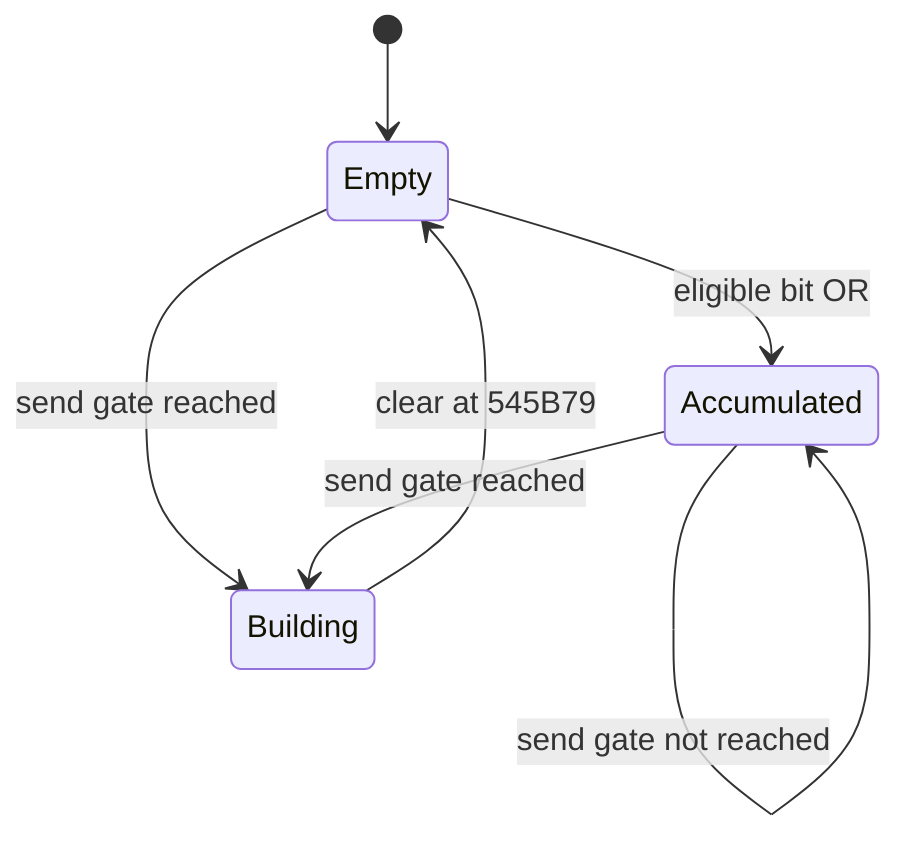

# KR action buffer 與狀態機契約

本稿為T10/T11指定交付。證據詳見 [evidence/buffer-s2c-analysis.md](evidence/buffer-s2c-analysis.md) 的 B-S來源及 B-N原件核對，總索引見 [evidence-index.md](evidence-index.md)；0A producer、方向與physical鍵相位的精確條件見 [input-contract.md](input-contract.md)。原件SHA256：`9741d1975327b9309d82b52f631165bc410757694d7c183a5eed970a53ebef91`。靜態限定，runtime NOT_RUN，非T01 FULL-PASS。

## 1. 結論及實作範圍

已證的native結構是**按鍵相位、controller WORD聚合器、可送的row、actor current FSM／motion、已收到的movement、per-key timer map**。它們不是一個共用的「動作buffer」。尤其controller+5C只保存bits，沒有每次按下的時間、次數及方向；現在不能從原件證明「普攻pending一個、技能pending保留最新、0.4秒過期」。[B-S1/B-S4；本輪本工作包5452C0；B-N2]

Server可立即實作的是有來源的row解碼、觀測事件、狀態分離、原順序保存及已證S2C欄位。Server動作佇列、攻擊優先序、combo／cancel期限及消耗時點，必須保留為明示候選規則，不能由input adapter偷偷補出。

## 2. 不同資料的生命週期

| 層／結構 | key與資料 | 更新／消費 | 會遺失的資訊／限制 |
|---|---|---|---|
| Physical／phase | key mapping與current/previous state→pressed/held/released | 依DirectInput／UI／controller資格取樣，詳input-contract.md | 多鍵實體同時性、未取樣的極短edge需要按來源界定 |
| Controller aggregate | controller+5C一個WORD | eligible key event或held OR bit；送包時間／credit gate跳過時保留；到545B79清零，包括builder N=0 | 相同bit重複次數、先後、單次heading／timestamp、held與pressed身份 |
| Row candidate | actorID、secondWORD、fifthBYTE、producer/context | 正常、特殊及RowB路徑各自gate；可以無row；多actor和同actor多row仍按builder原順序 | masked/drop欄位不可還原；第五byte不是一律physical方向 |
| Sent app event | app0A headeru32、N筆5B rows | N>0進transport sender；DA/send-credit是包節流 | enqueue／WSASend不等於Server執行或ACK；N不是輸入buffer容量 |
| Received movement | actorE2.bit15、E4及座標／correction | 000B等收包改寫；4CA890依E2/E4推位移 | 已執行狀態不等於physical held；不能反推release edge |
| Current FSM | actor+F0的current+68=actor+158；state ID、previous-state ID | 4CA060同步old.exit→replace current→new.entry | 25 state slots是類型註冊；current不是待施放技能；previous不是next |
| Motion request | actor+38C及attached animation | main+68=4C8DA0，先寫38C，資源存在才呼叫7A6970 | 已提交motion不保證可見、完成、hit、cost |
| Timer map | 每actor skillKey→`{total,remaining,active,key}` | 012A覆寫／clear，54F200遞減，54F270查remaining==0；UI可清 | 不是action FIFO，entries不是pending casts，沒有技能入列heading |
| Server pending | 由Server自行定義的candidate | 入列／覆寫／過期／提交依明示policy | 本工作沒有原版policy可給固定容量、時間或last-key優先序 |

## 3. 已證 native input 聚合器狀態機



`Building`內先依controller/actor/matrix/collision等條件產生0..N rows；只有N>0才呼叫此builder的sender。上述清零不是ack，也不是一個排隊動作已被成功消費；N=0仍清了聚合器。舊aggregate可能在生成row前被mask、拒絕或與其他bits合併。需以input-contract.md每一個控制器完整分支定義；不能從一個AND／OR外推所有場景。

例如在未達send gate的區間，先合入Z bit1，之後合入X bit2，WORD變3；它與同一次取樣合入Z+X可能相同。再按Z數次還是3。這是OR資訊壓縮，不足以判「兩次獨立攻擊」「最新X覆蓋Z」「合法同時和弦」。54F270對3選matrix col4，是可用性查詢的確定分支，但不恢復先後或證Server動作選擇。[B-S1/B-S4；本工作包5452C0]

方向release不在這個聚合器裡附帶一筆可排隊的keyboard edge。0A是否能區別held方向+Z及released方向+Z取決於完整producer，詳input-contract；不能用這個圖默認8000是held。

## 4. 已收到狀態與正在執行內容

本節concrete vtable／state類型以已核CActor及CCharacter為範圍，需actor與state slot有效。actor+158存放current-state pointer；應先dereference，再讀state+28/+2C/+30/+34，不可把actor+158這個地址本身當state起點。

### 4.1 狀態轉移表

| 收到／本地事件 | 確定轉移 | 可在Server鏡像記錄 | 不可視為 |
|---|---|---|---|
| 000C row state=i，actor存在且FSM slot有效 | 4CA060：old.exit，new.prev=old.id，current=new，new.entry | `ClientStateDirective(actor,i)` | 直接技能ID、從buffer取出next |
| 000D row actor/heading/motion/float | heading→main+58；4C8A90→FSM13；main+68(motion,float) | `ClientMotionDirective(actor,heading,motion,parameter)`及所要求的FSM13 | 此次C2S action的ACK、cast成功、傷害或資源扣除 |
| 000C state5（CCharacter） | CAttackedState entry→motion9,1.0；+418=300 | state5及requested motion9 | 官方hurt持續300ms、允許／不允許cancel的整體規則 |
| 000D任意motion包括9 | 先CSkillState13再motion；state flags預設+2C/+30=0 | state13與motion分開 | 等同0C state5 |
| 000B | 更新E2.bit15/E4，位置或correction | `ClientMovementDirective(actor,moving,heading,position)` | physical held、方向released、cast是否結束 |
| 012A數值row | keyed timer total/remaining覆寫，q≠0才active=1 | `ClientTimerDirective(actor,key,rawValue,q)` | 含等待技能本體的queue item |
| 012A reset | 清該actor skill-key timer map | `ClientTimerReset(actor)` | cancel所有pending cast／refund |
| 000F部分分支 | cannot-use-skill提示 | `ClientSkillUnavailableNotice(rawFields)` | 對某一nonce或row的完整reject ACK |
| 000E場景result | 13B rows→outcome/effect呈現 | `ClientOutcomeDirective(rawRows,scene)` | 必然扣HP或必然自動hurt |

其具體來源：0C `4B0130`；0D `4B01C0/4C8A90`；FSM `4CA060`；state5 `4CD945/4CD94F/4CD956/4CB870`；state13 `4C75EA/4C75F6/4CBB00`。[B-S2/B-S3；B-N2/B-N3/B-N4]

### 4.2 移動與施放的交錯

`currentState`、`motionId`、`receivedMoving`是獨立欄位。0D切state13時沒有直接清E2；4CA890的正常movement分支讀E2/E4而不讀state+30。因此Client可持有skill state＋舊moving=1。producer對新0A移動bit的抑制，不能替代Server要不要更新0B的決定。[B-N6]

這僅證Client的狀態表示與consumer，沒有證官方允許所有技能邊移動邊施放，也沒有證移動一定取消施放。Server須把`ActionExecution`與`MovementExecution`分開，衝突由明示policy裁決，並發出相容的各自狀態；不得以0D必自停為前提。

## 5. 時間來源與期限

| 數值／欄位 | 確定來源及單位 | 使用範圍 | 無法推導的時間 |
|---|---|---|---|
| F9423C | 本工作包已復用T09：timeGetTime的ms clock | 5452C0送包elapsed與不同credit閾值 | 不等於combo deadline或cast duration |
| send thresholds100/120/180/300與latency候選 | 5452C0對clock差與DA發送額度分支 | 建包／傳送資格；不是按鍵一次一次等候 | 不可拿其最大300推0.3s動作buffer |
| 012A row i32 /33 | 545EBD..545ED5 signed trunc division；+0/+4寫q | 客戶端per-key timercounter初始化 | 原版Server傳值語意／單位、CD起算事件仍未知 |
| timer remaining decrement1 | 每次54F200訪問非0entry；5452C0三actor slot caller545351 | 本地timer可用性 | 未獨立把每一次caller排程閉合成固定33ms |
| 動作／位移dt1/30 | 既有T09與4CA890參數 | movement integration | 不等於技能窗口；無runtime scheduler保證 |
| actor+418=300 | Skill／Attacked entry寫入，base update遞減；Wait state另讀 | 此欄是另一個actor計數值 | 不得當300ms、10秒cast鎖、連擊／取消窗 |
| 0.4s pending | 目前Server候選 | 可保留為候選policy參數與trace | 本工作未證native相同值 |
| Isla 20frames/40FPS | 11/1 P0B引用S00資源metadata，這輪未重驗資源 | nominal動畫長0.5s | 不證hurt-lock／無敵／cancel窗 |

時間必須以實際clock domain保存。Server觀測row到達時間可以用自己的monotonic clock；不能把它稱Client按鍵發生時間。原wire沒有每筆input timestamp／edge序號，就無法精確回推哪一段時間內按了幾次。

## 6. 冷卻／SP、MP與實際消費

54F270的結果是本地predicate：mask3/5/6選matrix4/5/6，取skill key，remaining==0才通過；C0 bits及若干mask又能直接true。True本身不表示「已施放並扣費」。

549980的三資源nonnegative檢查位在SubAI流程；它讀3C8/3CC/3D0加signedadjustment，未寫回，亦未證玩家collector每次必經。0034 typed resource更新能補目前值，不能補入列／起手／命中／結束／取消refund時點。完整映射見evidence/buffer-s2c-analysis.md §5。[B-S1/B-S10；B-N5]

因此Server實作可有明確`CanStartAction`、`CommitCost`、`StartCooldown`、`CancelAction`事件，但此工作包只能標它們為Server-owned候選，不能對應到一個現成Client欄位宣稱native。未證SP/MP命名與skill值時，原始觀測保留ResourceA/B/C及數值來源。

## 7. 可直接實作的 Server 適配資料模型

以下是對已證wire作無損適配的建議欄位名，不是原版C++結構或官方Server類別。控制器明確bit規則已列於input-contract.md；Server實作適配以server-integration.md為準。

```text
InputBatchObserved
  receiveOrdinal                 # Server本地接收次序
  serverReceivedAtMonotonic
  applicationHeaderU32           # 0A+2，保留原值
  rows[] in original order
    rowOrdinal
    actorId
    rawWord
    rawByte5
    context                     # Square/Tutorial/Field等已知場景
    producerProvenance          # 若由Server現有actor/controller狀態可識別
    low15 = rawWord & 0x7fff
    highBit = bool(rawWord & 0x8000)
    headingInterpretation       # 依producer，可能unknown
    physicalDirectionHeld = UNKNOWN
    physicalPressedEdges = UNKNOWN
    physicalReleasedEdges = UNKNOWN

ActorObservedState
  lastInputObservation           # 不等於目前執行中
  clientMovementDirective       # 最近Server已發movement欄位
  clientFSMDirective            # 最近已發state，0D還要求FSM13
  clientMotionDirective         # motion/parameter/heading
  resourceSnapshots             # keyed by proven kind, raw values
  timerSnapshots                # skillKey, rawValue, quotient33

ActionCandidate
  sourceBatchOrdinal, sourceRowOrdinal
  actorId, context, rawMask, observedHeading
  serverObservedAt              # 不是Client按鍵時刻
  interpretationEvidence
  selectionPolicyVersion        # 若要進一步選技能或排隊
```

適配規則：

1. 保存batch與row原順序，包含同actor的重複row；不能把同actor兩row直接當同兩次按鍵，也不能在未證等價前去重。
2. 不把RowB bit2直接叫實體X。本工作包已證546EF0可由target距離>70寫bit2；因此必須帶producer／actor角色與context。
3. low15是native action候選欄，先依已證controller/matrix解釋；不照Server固定分支倒推「原版Z優先」。Z+X與Z+C各自查證，不用數值相加建立新和弦法則。
4. 高bit和heading依input-contract.md映射；held／released不可區分時保持UNKNOWN，不用沿用上次moving、固定last-key或Z強制stop掩蓋。
5. 只把實際發出的0B/0C/0D分別更新movement/state/motion；發給Client不等於收到Client明確ACK。
6. 若Server需要動作pending，pending數量、替換、期限、heading snapshot時點及中斷必須有明示policy與source。若尚無依據，將不能決定的candidate保留觀測／診斷狀態，不默默發明本地buffer合約。

## 8. 現行 Server 候選對照

| 候選 | 原件對照 | 結論 |
|---|---|---|
| 廣場8000讀成moving | 8000是producer的可送狀態，並非physical held；action-only可丟方向資訊，詳input-contract.md | 可作某層wire觀測，但不能自行等同玩家是否放開方向 |
| 戰鬥動作抑制移動 | 某producer確會依state／action分支改bit；接收movement與motion仍獨立 | 不能升為全控制器、所有技能的通用互斥規則 |
| 普攻一個pending | 只證一個共用WORD aggregate，沒找到玩家attack-slot | native未證 |
| 技能一個最新pending | 同WORD使用OR；keyedtimer存的是counter | native未證，OR還可能合併不同時間Z/X |
| 0.4s過期 | send gate、/33counter、actor418均有不同來源 | native未證 |
| 固定action分支優先序 | 54F270有確定matrix predicate分支；不等於Server選招政策 | 只可逐分支引用，不可由predicate拓展成完整按鍵優先序 |

## 9. 未閉合資料如何處理

這輪允許的邊界是：精確保存觀測、將已證欄位轉成有限意圖、分開執行狀態，對無法還原的physical鍵／buffer／時間標UNKNOWN。不能用「缺原版Server」掩蓋可查Client缺口，也不必為此改Client；具體剩餘callee及來源列在evidence/buffer-s2c-analysis.md §7。

目前沒有新玩法結論。玩家廣場只給「依序測上/左/下/右+Z而方向按住連點Z不能移動」的綜合回報；不拆成四組獨立驗收失敗。v14/v15的Z強制停步／方向鎖是錯誤解讀，v16移除後仍未通過；舊152筆0A沒有rows不能回放；新診斷尚待正常時序實測。此狀態機稿不能充作真人PASS。

## 10. 精確的 FSM gate、timer 與資源介面

### 10.1 已證建構值與自然退出邊界

| state ID | concrete RTTI／vtable | state+28 / +2C / +30 / +34 | 目前可證的用途 |
|---:|---|---|---|
| 1 | ActorStates::CWaitState / C0779C | 1 / 1 / 1 / 0 | 共用wait狀態的建構值；不是pending item |
| 2 | CharStates::CMoveState / C07984 | 1 / 1 / 1 / 0 | current state可允許collection及movement gates |
| 5 | CharStates::CAttackedState / C0799C | 0 / 1 / 0 / 0 | 可收集不等於可立即施放；entry由+38=9提交motion9 |
| 12 | CharStates::CForceState / C079B4 | 0 / 1 / 1 / 0 | 不是與state2等價的全部movement許可 |
| 13 | ActorStates::CSkillState / C078EC | 0 / 0 / 0 / 0 | 000D在已核consumer要求的state；不等於動畫resource |
| 3 | CharStates::CDeadState / C079CC | 0 / 0 / 0 / 1 | 另有+34 gate，不能只按state名稱推所有效果 |

這是原件建構值與已讀entry的範圍；沒有聲稱所有runtime writer已窮盡。SkillState13與AttackedState5的virtual+8均為476430的`ret4`空update；目前所讀entry／本state update沒有倒數後自行離開的邏輯。actor+418=300另在base update遞減，Wait state也讀它，**不能當作SkillState13停留300ms或某個連擊窗**。[B-N2/B-N3；evidence/buffer-s2c-analysis.md §1、§4]

若要進一步閉合自然退出，具體候選是actor F0+8 callers、main+68與attached `7A6970→7A7800`完成通知；尚未窮盡這些callee，不聲稱只能靠Server退出或永不自動退出。這個Client缺口與未知官方Server時間分開記錄。

### 10.2 012A的可直接實作欄位與消費事件

```text
u16 command = 0x012A
u16 actor_id                    # P+2，匹配controller三個actor slots
u32 reset_field                 # P+4，非0則清該actor timer tree
if reset_field == 0:
  N = floor((L-8)/6)
  row[N]: {u16 skill_key, i32 raw_value}
```

路由為`4AE28D`註冊`4B1A00`，該handler明確讀FBA7A4，再轉controller+40；已核Single／Tutorial／Formation均545E20。該handler與000E的scene forwarding不同。[B-N1]

每個key透過54F4E0查找／插入；`q=trunc_toward_zero(raw_value/33)`。`545EED`寫entry+0=q，`545EF9`寫entry+4=q；q非0才在`545F15`設entry+8=1。**q=0路徑沒有明確清entry+8**；不能在native鏡像時自行補成false。同key後到row覆寫counter，不同key可並存，這是timer map，沒有pending action heading／時間戳。

`54F200`每次visit遍歷，remaining非0就減1，0維持0；`54F270`消費條件是remaining==0。UI在5CE33A／5CE348也有active／remaining清零writer。UI觸發條件未完全閉合，不能把這兩筆clear解成玩家取消、退款或施放成功。012A raw_value的正式單位／起算事件未知；除數33與visit計數保存原樣，不以send ms clock偷換。[B-S1；B-N1]

### 10.3 Resource A/B/C：判斷與同步不等於扣費

SubAI的549980讀`actor+3C8/+3CC/+3D0`加signed adjustments，負值失敗；該predicate沒有扣款writer，也不是已證玩家0A的每次必經路。`549D54`屬549C60，不能與549980混為同一分支。[B-S1]

已證S2C0034為`2+18*N`，每row `{u32 kind,u16 actor,u32 valueA,u32 valueB,u32 valueC}`。在CCharacter及record guards成立時：

| kind | actor欄位絕對同步 | 原件writer |
|---:|---|---|
| 2 | +3BC=valueA；+3C8=valueC | 4B3243／4B3249 |
| 3 | +3C0=valueA；+3CC=valueC | 4B321C／4B3222 |
| 4 | +3C4=valueA；+3D0=valueC | 4B31F5／4B31FB |

這能補目前數值；未證此處ResourceA/B/C的正式HP/SP/MP命名，也沒有逐cast correlation。不要因更新後數值減少，就指定官方在入列、起手、命中、完成或取消時扣／退SP或MP。Server實作所需的`CommitCost`、`StartCooldown`、`Refund`應各自有明示policy；這些不是本輪還原的native時間點。[B-S10；B-N5]

## 11. 精確剩餘範圍與分類

| 項目 | 分類 | 已查範圍／為何目前不能下更強結論 | 具體下一來源 |
|---|---|---|---|
| 玩家pending容量／expiry／選招 | Server待開發；若要查Client隱藏queue另屬Client研究 | +5C、546100、54F270、FSM與timer沒有保存逐次按鍵事件；既有資料不足以還原官方Server政策 | 以S00現有REQ/GAP去重接收；不能以1+1/0.4s回填 |
| Skill／Attacked自然退出 | Client待逆向 | 已核state ctor、entry、空update與0C/0D替換，未窮盡attached完成通知 | F0+8 callers；main+68；7A6970→7A7800及既有T09/T10來源 |
| UI清timer的正式意義 | Client待逆向 | 已知5CE33A／5CE348清欄位；尚未閉合全部上游條件 | 5CE0A7及caller，不把clear命名成取消／退款 |
| SP/MP正式映射與玩家本地檢查 | Client待逆向 | 549980僅SubAI；0034僅typed snapshots | 有名skill-table adjustments、玩家predicate callers與既有T11資源來源 |
| 0F拒絕對應哪個cast | Client待逆向 | 已證提示consumer，不是逐0A ACK | 545C50 P+2..+6／P+7 enum／P+8 bits及上游 |
| 000E結果下游的全部傷害／效果 | T12跨功能待整合 | W06的13B rows有效；本輪只修receiver，未全審效果 | 49B0D0→7ABCD0、7AC030、5521D0、7D28E0、6D89C0、row+10/+11 |
| combo／cancel／hurt／cost/CD時間值 | Server待開發，可能需要官方trace佐證 | send gates、/33、418=300不是這些期限 | 明示Server政策與normal trace；未知值不猜填 |
| 廣場正常操作驗收 | 待遊玩驗證 | 舊152筆沒有rows，新診斷尚無結果 | 既有診斷的逐組、逐段raw row與S2C回覆，不要求改Client |

這些是具體的下一範圍，不代表正式RR已BLOCKED或已結案。本文已交付可觀測狀態機與已證流程；仍未閉合的Client子路徑不提升為全流程FULL-PASS，Server-only政策未知也不冒充Client位元定義。
