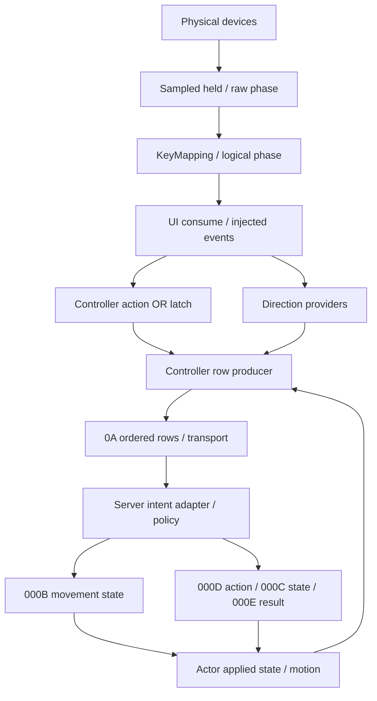

# KR Client 輸入狀態與事件契約

日期：2026-11-03（Asia/Taipei）。範圍：T10／T11，本輪使用者指定的輸入、方向、0A、動作與 buffer 工作包。

**交付性質：既有來源整合＋原件有界補證；不是 T01 FULL-PASS、RR ACCEPTED、Server 修復或真人驗收通過。** 本輪沒有修改、執行、附加 Client，也沒有重做全量反編譯。本文的「已證」只指表列來源支持的精確子流程。來源、原件視窗、歷史勘誤及檢核結果見 [evidence-index.md](evidence-index.md)。Server 的實作適配見 [server-integration.md](server-integration.md)，動作與時間見 [action-buffer-state-machine.md](action-buffer-state-machine.md)，逐組條件見 [key-combinations.csv](key-combinations.csv)。

## 1. S00 最優先答案

### 1.1 `second WORD & 0x8000` 不是物理方向 held

它是**具體 row producer 經過控制器、actor FSM、狀態／可用性、方向與碰撞相關分支後產生的移動報告位元**。它不直接保存鍵盤 held，也不單獨保證已移動、可通行或動作已執行。

正常廣場 `CSquare → CSingleController → 548A20 → 546100` 路徑中，`546191` 先把 out WORD 清零；`54638A test word[out+2],7FFFh`、`54638E jne 54646F` 在動作低 15 位仍非零時略過移動分支，以及該分支內的兩個 `OR 8000h`。因此在**這一條 callback**，保留的 action mask 與 8000 不同時成立。這不是由單一 AND／OR 推論，而是從初始化、完整前置 gates、分支跳轉與所有高位寫入點得到的限定結論。[N-5461；N-SQUARE；S-W03C]

相反方向相消、UI 清 phase、目前 FSM 不允許、availability gate、不同裝置來源和 controller 特例都可能改變輸出。Formation 副角色與 Row B 另有 producer；尤其 Formation 副角色可保留低位後再寫高位，不能把上述結論擴張成全 Client 的「動作永遠排斥移動」。[N-KEY；N-CONTROLLERS；N-ROWB]

### 1.2 held 方向＋Z 與 released 方向＋Z，現有 row 一般不能可靠區分

在正常 Single 的 `546100` 分支，假設 logical Z 成為可保留的 `M=1`、row 可送出、owner+58=0、actor 目前 `B0=h`，且 held 方向在當時相機角度下也量化為 `h`：

| 物理／取樣歷史 | collector heading | 最終 low15 | bit15 | fifth byte |
|---|---|---:|---:|---:|
| 方向仍 held，Z pressed／held | 當次方向 `h` | 1 | 0 | h |
| 方向已 released，Z pressed／held；沒有其他方向來源 | 預填的 actor B0=`h` | 1 | 0 | h |

兩者可輸出完全相同的五個 byte，例如 actor=`0x1234` 時都是 `34 12 01 00 h`。**這是原件分支的符號反例，不是新封包擷取。** 在這兩段歷史中，先前方向／Server moving 狀態也可相同，釋放方向的 edge 又沒有獨立欄位，因此保留上一個 heading／moving、觀察相同包長或依靠 DA 都不能消歧。[N-5461；S-W01；N-DA]

`000B`／`000D` 是 Server 提供給 Client 的 actor 狀態；已證的 `0022`／`0068`／`0007` 也沒有可補此缺口的 physical-direction snapshot。這是已查來源範圍的結論，**不是宣稱全部 opcode 都已排除**。Server 應把 `physical_direction_held` 保留為 unknown，不能把 action-only 解碼為「方向已放開」，也不能據此肯定「方向仍 held」。[S-W04；E-WIRE]

## 2. 研究基準與現場事實

| 項目 | 固定基準／狀態 |
|---|---|
| KR 原件 BIN | SHA256 `9741d1975327b9309d82b52f631165bc410757694d7c183a5eed970a53ebef91`；12,472,320 bytes；ImageBase `00400000` |
| 首次開工 main | `83959c0e7e65ab01348b285f03c285f487077610` |
| 既有 T10 分支起點 | `0419c66009a958597e95c9a88740d6f7f0d6772c`；沿用 `t10/roy/chatgpt-web` |
| 本機同步 | 既有 T10 分支與以上 main 完成本機 merge；HEAD `72771cd6f6b3b001f5aaf341d861edf3a719a72a`。未提交本輪研究、未 Push、未新增分支 |
| 前置 | AGENTS、T10/T11 README/task.json、RR/index/inbox、T01 退回及共用驗證索引已讀；無 owner_task=T10/T11 的現行 RR；未更改登記／驗收狀態 |
| 七個候選 | frozen bulk review 皆 `full_function_semantic_review=not-recorded`；後續 W00–W05 有有限 R2，不能升格整函式 FULL-PASS |
| 舊退回 | T10 七項狀態保留；本輪引用 W00 對 116 fifth-byte 與 007 store 位址等修正，沒有把既有勘誤當作 T01 已結案 |

使用者提供的現場資訊保持原樣：玩家在廣場依序測上＋Z、左＋Z、下＋Z、右＋Z，整體回報方向按住連點 Z 無法移動；**沒有逐組獨立結果**。原始缺陷是放開方向、僅按 Z 仍持續移動。v14／v15 的 Z 強制停步或方向鎖屬錯誤解讀；v16 移除後真人仍未通過。舊 log 僅有 152 筆 0A 與長度，沒有 row bytes，不能回溯。新增診斷尚無新實測結論。本文不替這些狀態補寫成功、失敗原因或四向逐組結果。

## 3. 完整資料流與資訊在哪一層消失



這個回路中的 Server policy 是待實作端，不把本圖當成官方 Server 演算法。[S-W01；S-W03T；S-W04；S-W06；N-STATE]

| 層 | 原生資料／入口 | 時間與語義 | 遺失、合併或限制 |
|---|---|---|---|
| 裝置 | `6F3820/6F38A0` keyboard；`6F16B0 → 6F1790` manager | Poll/GetDeviceState(256)，manager+60 sampled held、+160 raw phase | 一個 sample 間完整按下又放開可能未被 held 取樣看見；失焦／device gates 另有影響 |
| 映射 | `6D1480`，`6D1915..6D19F2` | 40 logical phase：0 idle、1 pressed、2 held、3 released；讀 current bank 的 Key/ModKey | 不是完整物理鍵歷史。manager+20 選 +60／+260；alternate producer 尚未完整命名；注入列表可覆寫 phase |
| UI | 一條已證 frame order：sample → map → UI／event consume `490D40` → controller | UI 可清 logical phase | 清 phase 不等於清已累積的 controller+5C；不能只看 focus 名稱推整幀無輸出 |
| 動作彙集 | `5452C0`，controller+5C WORD | phase 1 或 2 時 OR 入；可跨被 sender gate 擋住的 tick 留存 | 同鍵次數、press/held 差異與時間先後消失；先 Z 後 X 也可能累積成 3，不保證同時和弦 |
| 方向取樣 | `546780 → 546850 / 546B50 / 546D50` | 在真正呼叫 row callback 時取得方向；選一個 heading | 不與第一次動作 OR 同時封存；相反鍵可相消；多裝置只保留優先成功來源 |
| producer | `546100` 或其他 controller callback | availability、FSM、status、collision／feedback gates 決定 WORD／byte／emit | action mask 可被清；bit15 可與 held 分離；不同 callback 的意義不可混用 |
| batch | `5452C0` Row A 三槽＋Row B vector | 按 producer 遍歷順序 append；到真正 batch 尾端即清+5C | 多 actor 與同 actor 多 row 都不是按鍵事件 queue；沒有 press/release timestamp |
| transport | T10-115 queue/framing/WSASend | application `000A` 進待傳 queue；後續連線／IO gates | builder 接受不等於已上線、Server 接受或動作執行 |
| Server → Client | `000B/000C/000D/000E/012A` | 更新 actor movement、FSM／motion、結果與 timer | 這是 applied state／authority feedback，不等於物理鍵 current state；不是已證逐 0A ACK |

**應分開的四類：** sampled current state（held／phase）、edge event（phase1/3）、待處理意圖（+5C、pending transport 或 Server 自建 intent）、已套用狀態（actor E2/E4、B0、FSM current、motion）。同一個「目前動作」名稱不能替代這四類欄位。[S-W01；S-T115；N-5461；N-STATE]

## 4. 鍵位、八方向與量化

### 4.1 Type0 不是所有執行環境的永久鍵表

已提取的 KR KeyMapping 中，Type0 的 Z/X/C（DIK 44/45/46）映 logical13/14/15；方向 logical1/2/3/4 對應上／下／左／右。Type1 方向為 W/S/A/D，Z/C/V 改映 logical10/11/12；所以 wire 不能逆推必然某個 physical key。本 CSV 的鍵名均以 Type0 或等價當前 bank 為條件。[S-KMAP；S-W01]

### 4.2 `546850` 的計算

令 `E(i)=1` 當 logical phase[i] 為 1 或 2，否則 0；native 的兩個運算量為：

```text
a = E(2) - E(1)       // 下減上；不是據此命名世界 x
b = E(4) - E(3)       // 右減左；不是據此命名世界 y
Y = low8(trunc_toward_zero(angleField * FB8824))
H = low8(octant(a,b) + Y)
```

`FB8824≈256/(2π)`。`546AF6 OR EAX,0C00h → FLDCW → FISTP` 證明浮點轉整數是向零截斷，不是 decompiler 顯示 `ROUND()` 就可稱四捨五入。`4BB450` 也是此量化方式。[N-KEY；S-DIR；S-ANGLE]

| directions held | a,b | base | 當次鍵盤候選 heading |
|---|---|---:|---|
| 上 | −1,0 | 80 | `uint8(0x80+Y)` |
| 下 | +1,0 | 00 | `uint8(0x00+Y)` |
| 左 | 0,−1 | C0 | `uint8(0xC0+Y)` |
| 右 | 0,+1 | 40 | `uint8(0x40+Y)` |
| 左上 | −1,−1 | A0 | `uint8(0xA0+Y)` |
| 右上 | −1,+1 | 60 | `uint8(0x60+Y)` |
| 左下 | +1,−1 | E0 | `uint8(0xE0+Y)` |
| 右下 | +1,+1 | 20 | `uint8(0x20+Y)` |

八向 base 相距 32＝45°；加相機相關 angleField 後不只八個固定 wire byte。後續碰撞候選還可能改 heading。移動消費端的 256 表以 `(sin θ,−cos θ)`、`θ=heading*2π/256` 取方向；沒有當時 angleField 不能把實體「上」硬定為封包 `80`。[S-ANGLE；N-KEY；N-5461]

上＋下、左＋右在同一 sample 相消。a=b=0 時這個 collector 回 0 且不寫 heading，其他 provider 仍可能成功。沒有 last-key timestamp／先按勝出分支。先後按下跨 sample 可以形成不同 current states，落在同一 sample 間隔內的完整先後則未保留。相反方向和特殊同時／先後組合僅靜態說明，列待測，不擴張本輪正常遊玩驗收。[N-KEY]

### 4.3 `546780` 不只方向鍵

`546780` 先取 +5C action WORD，依 `547240` 回值 2/3/4 還可 OR 8/80/40；呼叫三路 provider 後，**鍵盤 546850 優先，其次 546B50，再次 546D50**。三者皆失敗則保留 caller 預填的 actor B0。回值是三路是否有輸入方向的合併，不是 physical keyboard held。[S-W03C；N-COLLECTOR]

`546B50` 是另一條含 toggle／位置向量投影的路徑；鍵盤成功時會清 controller+7C/+80。其所有 UI 業務語義不在本輪重新命名。`546D50 → 6F3350 → 6F1C60` 已補證是可由 Joypad 裝置 axes 供應的路徑；Mouse 的 +20 slot 回 null，不供應這條 axes。舊稿「546D50 是滑鼠游標」不沿用。它也受 foreground、mode、長度 >10240 的 gates。[N-KEY]

## 5. Z、X、C 與組合

### 5.1 候選 mask 有獨立 bit，consumer 有明確組合欄位

| Type0 logical inputs，且沒有舊累積位／其他 producer | OR 候選 | `54F270` 本地 availability column |
|---|---:|---:|
| Z | 0001 | 1 |
| X | 0002 | 2 |
| C | 0004 | 3 |
| Z＋X | 0003 | 4 |
| Z＋C | 0005 | 5 |
| X＋C | 0006 | 6 |
| Z＋X＋C | 0007 | 此 predicate 先命中 column4 |

logical22 另 OR10；logical24/25/26 另 OR3/6/5。這些是產生與消費程式兩側的證據，不是數字相加推測。因此 Z＋X 與 Z＋C 是**不同 mask、不同 matrix column**。但它們不證物理同時和弦合法性、Server 接受、最終選招、兩次施法或兩次扣款。跨 sender-gated ticks 的 OR 也可產生相同值。[S-W01；S-W03C]

`54F270` 先處理 `mask&0xC0`，再依 1&2、1&4、2&4、1、2、4、8、10 的條件選欄。這只是一個 Client availability predicate 的分支優先，**不能移植成全 Server 固定按鍵優先序**。對應 matrix 與 timer 細節見 action-buffer 文件。[S-W05]

### 5.2 左上＋X、左上＋Z＋X，以及朝向時點

左上＋X 可同次提供 heading=`A0+Y` 與 action 候選2；左上＋Z＋X 可提供相同 heading 與候選3。`546100` 在 movement outer gate 通過時，先於 action skip 把 collector heading 寫到 out+4，所以這些 action-only rows 可帶斜向。若 outer gate 不通過，out+4 可能仍為初始 B0；不可只看按鍵就保證最終 byte。[N-5461；N-KEY]

動作 WORD 可能早已 OR 累積，heading 則在這次 callback 收集；原生沒有把第一次 action edge 的方向與時間綁在一個不可變 queue item。S2C `000D` 自帶 heading，由 actor virtual+58 套用，再進 FSM／motion。故 Client 介面能表示朝左上施放；官方 Server 是在收到、排隊、消費或施放時選朝向，**此來源未定義**。[S-W04；N-STATE]

正常 `546100` 的單 row 保留 action 時不設 moving；這不等於 Client 執行層永不允許動作與移動狀態並存，也不代表 Formation 副角色或 Server 回覆必互斥。詳見 §8。[N-CONTROLLERS；N-STATE]

## 6. 控制器與 fifth byte

### 6.1 RTTI／vtable 決定 producer，場景名稱不能代替分派

| controller | vptr | tick +2C | row +48 | 已證範圍 |
|---|---:|---:|---:|---|
| CController | C0F944 | 5452C0 | 546100 | 共用基底 |
| CEmptyController | C0F99C | 8DC2F0 | 547230 | callback return false；不從其名稱推所有外部輸出 |
| CFormationController | C0FA14 | 547F90 | 5480A0 | slot0→546100；slot1/2→5480E0，後者另用548FF0 |
| CMissionRoomController | C0FA6C | 548350 | 546100 | mode1；action 本身不必設 callback emit，見 §7 |
| CSingleController | C0FAC4 | 548A90 | 548A20 | 正常→546100；A4／actor38C 特例另述 |
| CTutorialController | C0FB1C | 548CB0 | 548D10 | +4與+DC gate；callback→546100 |
| CTagController | BFB5A4 | 444670 | 548A20 | row slot 與 Single 同路，tick 不同；不把它當廣場唯一類別 |

已查場景建立鏈：正常 `CSquare` 建立 Single（mode2）；既有來源另列 `CMissionField→Single`、`CMissionRoom→MissionRoom`、`CScenarioField→Formation`、`CTutorial→Tutorial`。玩家稱「教學」的流程可包含 Scenario／Formation，不能自動等同 RTTI 的 CTutorial。當前 session 實際 controller 與鍵位 bank 需要既有診斷資料確認，靜態表不是當時 runtime capture。[S-E66；S-CONTEXT；N-SQUARE；N-CONTROLLERS]

### 6.2 廣場／互動／UI

`548A90` 的 `548AD2 call5452C0` 在互動處理前；之後才檢查 actor current FSM、呼叫 `49C5C0`，並將 `FB9011==1`（Z pressed）轉成 `434250 → 544A00` 的 true/false 參數。兩路都呼叫互動流程；只有 phase1 傳 true，其餘傳 false。因此不能說「非戰鬥 Z 在互動層先被消耗，所以沒有 0A」；builder 接受 phase1/2，而這個參數區分 pressed，兩者不是同一件事。[N-SQUARE]

`548A20` 的確另有抑制分支：actor+38C==0x10 **或** controller+A4!=0 時，把 WORD 清0、heading 設 slot actor B0、+BC 設1；僅 +BC 原為0時 emit一次。否則清+BC並尾跳546100。不能把 +A4、+38C 的條件簡化成「按 Z」；正常路徑中 retained action 也會使移動高位0，但那是 §7 的 producer gate，與這個一次清狀態分支不同。[N-SQUARE]

已有一個 +A4 writer 可具體排除「Z必觸發」：`548B12 ECX=C+88 → 49C5C0`，其 `49C74F` 讀 logical23／FB901B，phase1時 `49C77D [EDI+1C]=1`，即C+A4=1。Type0/Type1 logical23是Space；另有清除路徑。這只閉合該組writer，不宣稱窮盡所有alias。`544A00→544730`直接處理互動候選、距離、manual參數與物件+104鎖存；成功後`544B2D`分派所選物件v+64。未窮盡此處所有UI callback，不能用Z pressed一概判定後續抑制。[N-KEY；S-SIDE]

MissionRoom `548350` 也先 call5452C0，再做後續 UI／room checks；後續 return0不能取消已建立的0A。Tutorial 在進builder前另有+DC gate。frame前UI phase清除、controller latch、actor FSM 和互動對象狀態應分別記錄，不能以單一 `ui_focused` 布林解釋所有場合。[S-W01；N-CONTROLLERS]

### 6.3 fifth byte 的精確來源與取樣時間

| row 路徑 | 初始值 | 可改寫來源 | append 前最後覆寫 | 不可過度命名之處 |
|---|---|---|---|---|
| A：546100，包含正常 Single／Tutorial／MissionRoom／Formation slot0 | callback當時 actor B0 | outer gate通過後collector值；實際movement分支可被5464C0調整 | owner+58!=0時，caller清WORD並改成**callback前**保存的 actor B0 | 並非永遠「當前物理方向」或永遠B0 |
| A：Single 特例548A20 | slot actor B0 | 此特例不做collector | 同上owner+58規則 | 是一次清狀態輸出中的朝向快照 |
| A：Formation副角色5480E0 | 不以B0/E4初始化output；E0/E4只存comparison locals | 548FF0達正常publish時：WORD取CAIControl+72，byte取+74；其後清+72、保留+74。heading可為本次helper更新或AI既存值 | 同上owner+58規則；5480E0後段無直接byte writer | 未publish early-return不能保證B0/E4 seed；不能把它稱本輪keyboard heading |
| B：5452C0 vector項→virtual44，已證546EF0 | actor E4，與E0一起複製 | callback可按目標幾何寫heading；亦可保留E4 | callback true且owner+58==0時保留callback結果；其餘可append分支用callback前B0並清WORD | 不能說RowB一律E4或一律B0；它可能是Server既有狀態回授 |
| fallback：callback false且owner+58!=0且owner+6A bit15 | caller保存的B0 | WORD=0 | 5471B0實際可append 5bytes | 不是「沒有row」；舊T09說helper不append已勘誤 |

first WORD 最終由 actor+4 填入；second WORD 和 fifth byte 必須成對保留 callback／override provenance。這一點採用 T01退回116的W00修正，不採舊稿對stack local或第五byte的泛化。[S-W00-116；S-W03T；N-5452；N-ROWB；N-CONTROLLERS]

Formation副角色補充：`548141..548151`只保存比較用E0/E4；`549145/54914B` publish AI+70 DWORD、`54914D/549150` publish AI+74；`549155`僅清AI+72。AI heading的已證writer包括549E10的副actorB0 seed／幾何／近距主actorB0（最後54A013），及549C60成功候選的target幾何（549DEC）。這些值取於各helper當次執行或沿用既存AI欄位，不是物理和弦的排隊方向。5480E0在movement gates與候選bit15成立時先對比H與舊E4、可設emit，再按state+28重寫bit15，後來高位清零不撤回先前emit。548FF0另有不publish的early-return，caller不以其EAX判成功；未閉合的不變量保留未知，不進一步宣稱遊戲必發未初始化資料。[N-FORMATION；S-SUBAI]

## 7. `546100` 的 low15／8000／emit 契約

### 7.1 變數與前置

`C=controller`，`R=actor`，`O=out row`，`S=*(R+0x158)`（取出actor+F0 FSM 的 current 指標，**不是 motion resource 指標**）。本文`actor+offset`在欄位敘述中表示該偏移的儲存值；指標運算須先取值。先保存舊 `R+E0/E4`，初始化 `O.word=0`、`O.heading=byte[R+B0]`。mode3按slot取actor，否則取主slot。必要hero table/entry不存在可早退。[N-5461；N-STATE]

| 步驟 | 精確 gate／更新 | 確定語義與限制 |
|---|---|---|
| 收集 | S非null、S+2C!=0、4C9ED0(R)==0 才call546780 | +2C是此收集許可欄位；4C9ED0為R+3F4 status tree的bit檢查，不直接命名成冷卻 |
| 特例輸入 | config+7EF==1 →mask100、emit=true | 特例碼保留原值，不擅自稱某一技能 |
| 寫低15 | 將collected mask寫入O.word低15 | store在5467F4是collector out WORD；546100再做gate，不是傳上來即必送 |
| availability | mode!=1且M!=0 →54F270；false且R+3E8==0時清low15；true或R+3E8!=0時emit=true | R+3E8確有Server property writer，但不自行命名全功能 |
| movement outer gate | S非null、S+30!=0、4C9ED0==0、logical5 phase==0 | logical5連release phase3也非0；別把它簡化為某物理鍵held |
| heading sample | outer gate通過→O.heading=collector local heading | **在**inputPresence／low15 skip之前 |
| movement skip | inputPresence==0 **或**O.low15!=0 →54646F | retained action直接跳過下列兩個highbit寫入點 |
| free/probe branch | 545F30==0且C+74==0 | S+28!=0且low15==0才設8000；否則清8000 |
| adjustment branch | 545F30!=0或C+74!=0 | 先5464C0修正方向／C+70，再OR8000；**OR不以5464C0成功為必要條件** |
| heading apply | 只在實際movement body呼叫actor v+58 | 對比舊E4，變化才設emit；action skip不執行這項heading差異測試 |
| outer gate不通過 | 清8000 | heading可留初始化B0 |
| 最後emit | O.bit15與舊R+E2.bit15不同→true | 對比Server套用狀態，**不是last-sent row** |

`545F30`用actor speed×約1/30做探測；`5464C0`的回值未必成立但高位仍可設，因此8000不能精確譯為「此次必能走通」。S+28／+2C／+30是不同gates；目前FSM種類及其設定見 action-buffer 文件。[N-5461]

### 7.2 emit 不等於 input edge

callback emit的已證來源是特殊100、本地action availability允許／bypass、實際movement body heading相對舊E4改變、highbit相對舊E2改變。mode1跳過availability區塊，**非零action本身不保證emit**。外層還有owner+58 fallback、row容量與batch／transport gates。[N-5461；N-5452]

具體而言，mode1、special100未啟動、原E2.bit15=0且M非0時，action skip不設heading emit，也沒有action-availability emit。若沒有fallback與其他row，N=0但batch尾端仍清+5C；這是候選被消耗／丟棄，不是保證留待稍後施放。[N-5461；N-5452]

因此：

- 物理狀態完全不變仍可能有row：持續action可反覆通過availability；或Server moving回授尚未一致。
- 無action、heading與Server moving狀態都一致時，此callback可以不產生row；不存在已證的「每tick無變化也無條件送0A」規則。
- callback不emit不等於整包不送：其它slot、RowB或fallback仍可有row。
- heading改變但action仍在時，不因「只是heading變了」獨立emit；仍依action／highbit等已證條件。

### 7.3 Row B 為什麼不能譯成 physical keys

已證 `546EF0` 按vector項的目標actor計算位置距離；距離>10可設bit15並以atan計算heading，>70可OR低位2。這個2沒有讀physical X。其後FSM/status gates可清低位；低15仍非0時又清8000。只有movement gates通過且當時bit15仍為1，才按S+28低bit重寫高位；已因保留action而清高位者不會再設回。因此這個具體RowB producer也有action/highbit互斥，但Formation副角色不能類推。它不是玩家第2筆按鍵。[N-ROWB]

原件第二次距離計算須跟蹤ESP：`54706C fld [esp+1C]`在`547070 add esp,4`之前，讀的是stable-local18（dx）；`54707A`才讀stable-local1C（dy），仍為sqrt(dx²+dy²)，不可因文字offset相同誤判成sqrt(2dy²)。[N-ROWB]

## 8. 0A 到 S2C、目前動作與移動執行

以下FSM／B0 concrete consumer以已核實的CActor／CCharacter vtable為範圍；前提是actor存在且對應state slot有效。尤其state5→CAttackedState→motion9是CCharacter的已證鏈，不推廣到所有actor類型。[N-STATE]

| application message | 已證結構／入口 | 套用效果 | 不可宣稱 |
|---|---|---|---|
| C2S000A | `u16 opcode + u32(F93944) + N*{u16 actor,u16 word,u8 byte}` | 0A batch；長度6+5N；header DWORD業務語義未知 | nonce、physical snapshot、按鍵queue、成功施放 |
| S2C000B | 2+8N；4AFE60；actor u16、heading u8、flag u8、x/y各u16 | flag bit0→actor E2.bit15；heading→E4及v58/B0；位置修正另受gates；可能回流RowB | 物理held、逐0A ACK |
| S2C000C | 2+3N；4B0130 | signed byte→actor+F0 v8 FSM事件 | 該byte就是key phase或固定受擊結果 |
| S2C000D | 2+9N；4B01C0 | heading v58；4C8A90先進FSM state13，再呼叫main v68處理motion WORD／float | 回覆可直接稱「一次攻擊接受ACK」、motion9必然等於FSM受擊state5 |
| S2C000E | scene virtual+28；MissionField→4B0640／Scenario→4C4920 | 已有W06的結果row parser／actor結果應用 | 不能採P0B錯用controller vtable而稱全部cleanup／zero stub |
| S2C012A | 8+6N；controller timer更新 | 接收timer並供本地availability／顯示；時間換算見另一文件 | 動作buffer／combo窗口／每個row已施放 |
| S2C00DA | first layer slot→4959F0 | FBA7B0 +=5，發送額度 | action容量、五次動作accepted ACK或held補證 |

**動作與移動的執行層可並存。** `000D → SkillState13` 不直接清actor E2.bit15。已證CCharacter update到`4CA890`的D4!=1路徑仍可依E2.bit15及E4推位置，再過map/collision；不以currentFSM+30作這裡的移動開關。故只送000D而不處理000B，不能假定Client必停步。這是Client相容性事實；哪些技能官方允許移動施放、何時停、能否取消仍由Server規則／後續證據決定。[N-STATE；S-W04]

## 9. 發送時序與無變化情形

### 9.1 sender gates、OR latch 清除時點

`5452C0` 先做三個actor timer visit。C+78 gate或後續eligibility失敗不一定消耗+5C。可以累積action後，再因virtual+18、主slot、clock、credit gate而不建batch。令T為threshold，必須 `now−C+64 > T`（嚴格大於）且FBA7B0>0：[N-5452]

| 當時credit FBA7B0 | 基礎threshold（ms） |
|---:|---:|
| >20 | 100 |
| 16..20 | 120 |
| 9..15 | 180 |
| ≤8 | 300 |

實際T再取與`2*[[FB1318]+BF74]`之max。F9423C的writer是WINMM `timeGetTime`，因此上述clock單位已補證為毫秒；這不是技能buffer期限或combo窗口。[S-T09CLOCK；N-CLOCK]

成功建到batch尾端（`545B79`）就清+5C，**即使N=0**。若N>0才減credit一次、清+74、更新+64並送包；不是每row減一次。進不到建batch尾端的gates可留下+5C。此函式沒有+5C的0.4秒過期器。[N-5452；N-DA]

### 9.2 正常時序只能給條件序列，不能捏造固定封包列表

| 操作段落 | 當次sample／latch | 正常546100可能row | 無法保證的細節 |
|---|---|---|---|
| 按住方向，Z按下 | 方向1/2；Z1/2 OR1 | M1通過→action-only並帶當次候選heading；M1被清則可走movement分支 | 每個Z按下都有獨立row、每組測試均已失敗 |
| 保持方向，Z放開 | 方向2；Z3不新增bit0 | 舊latch已清且無其它action時可回movement；未清時仍可M1 | release一發生就一定送8000 |
| 放開方向，仍按／連點Z | 方向3/0；Z1/2可OR1 | action-only、heading可沿B0；與held+Z同值 | action-only能證實方向釋放 |
| 重按方向，Z仍按 | 方向1；Z2可OR1 | 新候選heading＋action-only；若heading同B0也完全同值 | wire一定帶direction-pressed事件 |
| Z不作用，只改方向 | 新舊方向phase1/3形成新的有效向量 | gates通過且inputPresent、low15=0時走movement；heading相對E4變化可emit | 一個sample間的完整先後、Server必接受／立即位移 |

Row A 按三個slot遍歷，再Row B按8-byte vector元素遍歷，沒有actor dedup。即使同一actor多row，其順序也是producer traversal order，沒有各row的物理鍵事件時間。不要預設同actor last-wins、把多row合成和弦，或把DA credit當動作queue長度。[S-W03T；S-W00-116；N-5452]

## 10. 確定／未知與交接界線

| 類別 | 可交付結論／剩餘邊界 |
|---|---|
| 已證可實作 | 0A layout與row順序保留、low15/highbit拆解但不反推physical held、各controller producer分支、八向量化、action組合predicate、S2C分層及timer介面 |
| 資訊不可逆 | held+Z／released+Z存在相同wire映像；同一OR latch不保存次數／先後；現有欄位不能一般性重建 |
| Client待逆向 | 限定欄位的全部業務命名／alternate input與注入來源、所選互動物件v+64的完整分流、SubAI候選集合的完整業務映射、FSM自然退出與資源/取消flag的完整writer。見另一文件的精確callee／搜尋邊界；不因未知Server數值停止已可查的路徑 |
| Server待開發 | 動作pending容量、覆寫／丟棄／過期策略、combo/cancel期限、SP/MP正式扣款、接受／拒絕與movement/action協調；Client沒有提供的時間不得填0.4s冒充原生 |
| 跨功能待整合 | 0A parser與S2C000B/000D/000E/012A各已證子流程需接入S00；P0B的000E receiver錯類別必先勘誤 |
| 待遊玩驗證 | 使用現有新增診斷做正常路徑逐組、逐段時序紀錄；玩家的本輪報告仍是整體未通過，沒有新結果；相反鍵等非本輪優先另列待測 |

本契約沒有用固定last-key、Z強制停步、雙pending或0.4s替未知下定義。Server可據此實作可觀測意圖與權威回覆；若要同時恢復「held+Z可移動」和「released+Z不續走」，須承認現有action-only bytes有不可辨識情形，不能把任一預設heuristic寫成已還原的Client規格。

## 11. CSV 符號的精確定義

CSV是靜態條件表，不是實測紀錄。一般Type0列假定該bank有效、沒有其他device方向來源或額外action bits，且採正常callback；若另列例外，以該列條件為準。`Y`／`H`依§4，`C/R/i`是controller／actor／slot。`fresh M`只表示此次候選沒有先前latch殘位，不保證每個真人按鍵都符合這個條件。

| 符號 | 精確含義 |
|---|---|
| `MoveGate(C,R,H)` | 完整546100的bit15結果：若movement outer gates不通過、inputPresence=0或final low15!=0，結果0；若進move body且545F30=0、C+74=0，結果取S+28!=0；否則5464C0後設1（不保證其回值非0）。heading可另受調整 |
| `A_Guarded(C,R,i)` | 正常546100且mode!=1。actor/table必須有效；collection gates只限制收集、special100與action-availability路徑。emit = special100，或保留的非零action經54F270成功／R+3E8 bypass，或move body的heading與舊E4不同，或最終bit15與舊E2不同；**未收集也可因最後高位差異emit**。詳§7，不是每個pressed必發 |
| `A_Room(C,R,i)` | 正常546100且mode1。少了上述54F270/action-availability emit；剩special100、move body heading差及bit15差。M!=0本身不設emit；仍可能因別的條件有row |
| `common batch/owner/append/send gates` | 場景tick gate、C+4／+78、virtual+18、slot有效、elapsed>threshold、credit>0先決定是否到callback；callback/owner+58決定候選或fallback；容量允許才append；N>0才呼叫sender；連線queue實送另依T10-115 |
| `owner+58=0` | callback output可保留；非0時caller可清WORD並改為callback前B0，不可把CSV的callback候選直接當最終wire |
| `static-bounded` | 有表列來源與原件界線；不是runtime-tested、T01 FULL-PASS或可玩PASS |

對direction-only的`wire_heading=H`同樣須套用collector／movement gates與5464C0調整；對action的`wire_heading=H`須outer gate允許寫入，否則可留B0。CSV已逐列保留這些條件，不以base heading替代當時相機角度。
