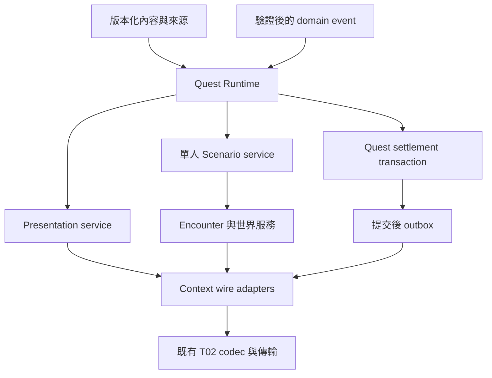
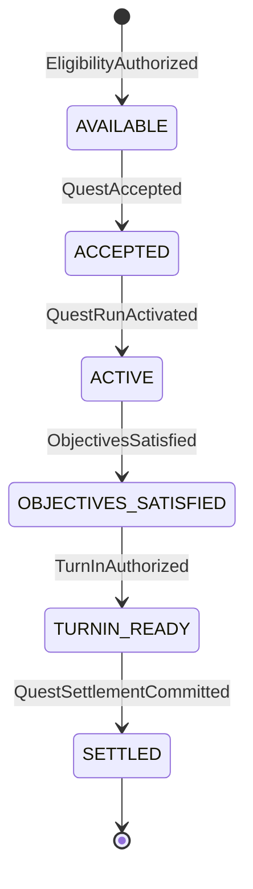
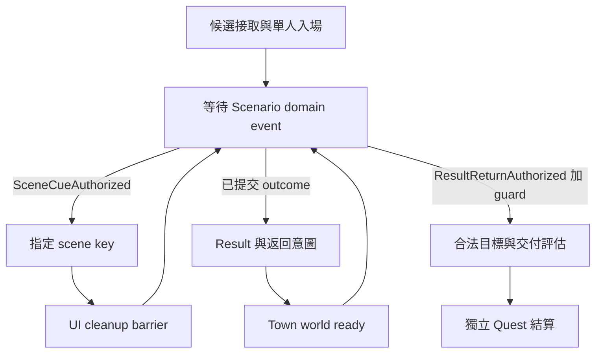

# KR 共用任務 Runtime／內容契約草案

版本 **0.1.0** · 2026-11-03 · 配合 T16 主責，供 S00 設計與分批採用。  
分類：**Server 候選設計；不是原生 MEF，不是已公開 RR 認領，不是整村主線通關證明。**

## 1. 交付結論與可採用範圍

先把穩定的分層接口、typed ID、事件圖、保存交易與既有 codec 邊界定下來。新任務主要填 definition、objective binding、flow graph 與 Scenario entry；確實涉及新型目標或原生生命週期時才補共用 handler。**不以 QuestId switch、sceneIdx 遞增或「播放全部 scene」作任務引擎。**

本包有 20 筆所選任務原表投影、12 筆馮德斯候選鏈、35 個複合 scene key、四張候選流程圖，以及 Quest15／117／119 和教學的獨立資料例。這些資料的 `activation` 一律為 `DRAFT_BLOCKED`，可匯入審閱，不能直接啟用為正常任務。完整資料形狀與完整合法業務規則是兩個不同交付狀態。

| 第一批項目 | 已交付 | 尚未取得或尚未核准 |
| --- | --- | --- |
| 任務／flow schema | Draft 2020-12，版本化、typed ID、條件 AST、primitive input、逐筆來源 | 逐任務 Server 接受／完成／交付／reward plan 的核准 |
| Quest15 完整資料例 | 原表、四 scene、Field19／Case103／Map191→192、有界 wire、32 節點橋接／結算形狀 | 合法 Quest15 terminal、發獎、UI cleanup 通用 binding；已到村不可替代 |
| Quest117 | 無 field、單一 town scene 的資料與 13 節點候選流程 | 合法目標／接取交付操作與獎勵發布 |
| Quest119 | Field26、五 scene、26 節點事件分派圖、Scenario entry | Case107 Chart／Cluster 原件、scene cue 排程、允許編隊、合法結果與結算 |
| 例外與遷移 | 16 條實際分支映射、9 個例外、保留教學及到村重建 hook | 每個小切換點的正常流程驗收；本輪未跑 |

`quest-definitions.json`、`quest-flows.json`、`scenario-entries.json` 為候選內容主體；CSV 是便於批量編輯和比對的投影。`validate_content.py` 只做靜態格式、引用、圖與啟用門檻檢核。其 PASS 不代表 Client／Server 正常遊玩通過。

## 2. 分工、來源與證據分類

已按開工規則閱讀 AGENTS、T16 原 Task／退回事項、S00 inbox／RR 台帳、共用驗證入口、T06／T07／T09 及既有 W1/W2/W3。沿用開工固定 main；沒有更動 owner、task.json、catalog、退回狀態、RR 或既有研究。原 Task T09 的 README 職責為「關卡內移動與同步」，不能因工作卡簡稱副本而擅改主責。T16-117 等是研究段號，與 Quest117 不是相同 ID 域。

| 證據層 | 固定版本／來源 | 可以主張的範圍 |
| --- | --- | --- |
| 原 Client／資源 | KR BIN、Table.stp、Event.stp；完整 SHA 見 `source-index.json` | 本檔實際 bytes、欄位、引用、指定 consumer／producer 的有限行為 |
| 既有分析 main | `83959c0e7e65ab01348b285f03c285f487077610` | T16 歷史結論、勘誤、W1 完成成果；W2/W3 在此版本仍是工作卡 |
| 補充分析 | `76e6f9ba9a130bf8b8abb404f21ab75d18cb19ac` | 較新的獎勵顯示、NPC UI、portal、人測與保存報告；不冒稱已在上述 main |
| 現有 Server 候選 | `f95fe9099419b2bbb5f0daa71c6810d0c2b53d8e`，既有 tutorial-combat 分支 | 專用分支現在如何實作；不反推原 Server 的官服規則 |
| 使用者要求 | 本次任務及固定 W2 reusable-runtime 工作卡 | 手動 Z、清怪保留戰鬥、debug 隔離、只讀、正常流程優先等產品要求 |
| 本包 Server 候選 | 本 schema、圖、primitive、保存與恢復提案 | 待 S00 接受及實作的契約；不得標為 Client 既有能力 |

機讀 `evidence_kind` 保留 `CLIENT_RESOURCE_DIRECT`、`EXISTING_RESOURCE_BYTES_REPARSED`、`CLIENT_BINARY_BOUNDED`、`EXISTING_ANALYSIS`、`SERVER_IMPLEMENTATION_FACT`、`SERVER_CANDIDATE_DESIGN`、`USER_REQUIREMENT`、`HUMAN_ACCEPTANCE_RECORDED`、`UNKNOWN` 等分類。`SERVER_IMPLEMENTATION_FACT` 只表示候選 Server 的現碼事實。

每筆 CSV 都有 `source_ref / source_sha / evidence_kind / unknowns`。主 `source_sha` 一律為完整引用內容或解碼 member 的 **SHA256**；Git blob SHA1 另存。XML bounded row 的 `row_sha256` 與 byte 範圍另外保留，不能把重新排版的 XML hash 當成原 member hash。多來源存於 `supporting_sources`，不能用串接多個 hash 假裝單一 SHA。來源清單、carrier→stored member→decoded member→row 的層次見 `source-index.json` 與 `evidence/source-members.json`。

來源入口：[AGENTS][agents]、[T16 Task][t16]、[W1 reconciled][w1]、[本工作卡][work]。本包沒有重開既有 RESOLVED 項，也沒有新增 FULL-PASS／native_complete 宣告。

## 3. 原表盤點與資料缺口

### 3.1 可以直接使用的原表

| 原件／member | 提供的資料 | 明確不提供的規則 |
| --- | --- | --- |
| `Table/QuestInfo.xml` | 4,798 Quest；id/type/town/field/level/giver/finisher/subtype/subject；Demands、Contents、Action、RewardsEtc、RewardsItem | 完整 Server 接取條件、重複性、帳號／角色 scope、通用結算交易 |
| `Table/QuestTalk.xml` | 4,322 筆對話任務資料；本包所選 20 Quest 均無匹配列 | 不可把「沒列」變成「不需要對話」或自動接取 |
| `Table/SceneList.xml` | CHAPTERTABLE、chapterIdx／townId／questId 與 scene 成員順序 | SceneList 的另一個 Event 域、原 Server gameplay 排程 |
| `Event/SceneList.xml` | `(questIdx,sceneIdx) → funcName/endBehavior` | 全域 sceneIdx 唯一性、合法任務完成條件 |
| `Event/*.SEQ` | LoadMap、OpenTalkScene、CreateObject、phase、RestoreMap 等腳本呼叫 | Server 戰鬥目標、發獎及通關權威 |
| `Table/npctable.xml` | NPC definition 及其自身表內條件／對話集合 | 地圖 actor 已生成／可見、互動距離、任務已可接 |
| `_TownList.xml / _TownTypeList.xml` | Town membership 與分類 | 全部 spawn／控制恢復／NPC visibility 規則 |
| `_CaseList.xml` | Case ID、STAGE、MAPFLOW、CLUSTER | Quest.field 相等之外的入場授權、原 MEF 勝利判定 |
| `_MapList.xml` | Map ID→TRIGGER／MAP／BOUND | instance/node、portal 位置與完成條件 |
| `_ActorList.xml / _PortalList.xml` | actor resource variant／portal effect variant | kill credit entity、世界 portal instance 與目的地 |
| `ItemTable*.xml`、Quest reward 節點 | item metadata 與 raw reward domain | 實際 grant recipient、資產交易與 publication 因果 |

完整 table 結構、來源 SHA、absence 與多前置範例見 `evidence/table-structure-report.json`、`evidence/resource-findings.md`。Demands 的原 XML 沒有 AND/OR 欄；Q110、721、1012、2841、3080、3485 的多項例子不能自行補成 AND。Contents 是 id／顯示文字，不是結構化的 target/count/scope。

Event SceneList 全表有 1,687 列／1,685 個複合 key；重複 `(0,249)`、`(0,250)` 在本包所選 scene 之外。本包選取的 35 個 key 唯一。批量匯入必須報告原表衝突，不能以後列覆寫前列；本包唯一性檢核只對明示選取範圍負責。

`Field.stp` 原 carrier 本輪未重新取得；Case103 與教學 Case102 的已保存原始 Chart／Cluster bytes 已按固定 Git blob／SHA 重新解析。此範圍分類為 `EXISTING_RESOURCE_BYTES_REPARSED`，不是本輪重新解完整 Field.stp。Case107 等仍缺的 member 逐 entry 列出，不能以 SEQ 的 LoadMap 名稱補造 map graph。

### 3.2 必須保持分離的 ID

| Domain | Canonical key／關聯 | 本案容易混用的值 |
| --- | --- | --- |
| Quest | `{domain:"quest",value}` | Quest15 是任務，不是 instance／Field |
| Chapter | `{domain:"chapter",value}`，另有 chapter town | Q15 原 Quest.town5，但 Chapter1.town1 |
| Scene | `{domain:"scene",quest:{…},scene_index}` | Scene15/1 與 Scene117/1 不是同一 scene |
| NPC | NPC definition ID；runtime entity 另域 | 10047 與 10048 即使同名也不合併；10027 在所選 npctable 缺列 |
| Town／Field | 獨立 tagged ID | Town1、Field19 不可作 Quest／Map key |
| Case | Case.ID；STAGE 是明列的另一欄 | Field19 候選 join Case103，不能直接用 Case19 |
| Map | Map.ID；Chart node 是另一個 key | Map191／192；SEQ 字串 scene asset 不自動是 numeric Map ID |
| Formation token | Server 發出、adapter 原值 echo、綁 owner/admission 的 opaque token | 現碼 token19 是候選選值，等於 Field19 的數字不建立同一性 |
| Portal | instance＋map node＋wire key；category 由 adapter 約束 | effect ID/state 與 checkpoint key/category 分開 |
| Monster | category＋resource ID＋PRE；live entity 另域 | CreateObject local index／spawn entity／kill credit 不能合併 |
| Item／Reward | item ID；`RewardsEtc.type` 與 `RewardsItem.type` 分域 | 不把 type2 視為貨幣；不把 raw value 視為已發放數量 |

詳見 `id-dictionary.csv`、`id-values.csv`、`id-relations.csv`。typed ID 的數值不能靜默 cast 到另一域。wire adapter 再檢查其 u16/i16 等真實寬度，超界是未綁定／拒絕編碼，不得截斷。韓文原名與工作中文翻譯分欄；翻譯不參與索引或關聯。

### 3.3 候選主線逐項核對

下列「前置」只指 QuestInfo 的 Demand；「scene」只指章節與 Event 成員。不是已驗收完整章節。每一列原值與 SHA 均在 `quest-catalog.csv`、`quest-scenes.csv`。

| Quest | Demand | Quest town | Field | level raw | giver→finisher | Chapter / chapter town | scene 數 | RewardsEtc raw |
| --- | --- | --- | --- | --- | --- | --- | --- | --- |
| 15 | 16 | 5 | 19 | 1 | 10338→10338 | 1 / 1 | 4 | type2=2800；type4=468 |
| 117 | 15 | 1 | 缺欄 | 1 | 10002→10002 | 1 / 1 | 1 | type2=710 |
| 118 | 117 | 1 | 28 | 5 | 10047→10047 | 1 / 1 | 1 | 未列 |
| 119 | 118 | 1 | 26 | 5 | 10047→10047 | 1 / 1 | 5 | type2=5850；type3=40；type4=900 |
| 120 | 119 | 1 | 缺欄 | 8 | 10008→10008 | 1 / 1 | 3 | 未列 |
| 121 | 120 | 1 | 缺欄 | 9 | 10002→10002 | 1 / 1 | 1 | 未列 |
| 122 | 121 | 1 | 27 | 8 | 10002→10002 | 1 / 1 | 5 | type2=9686；type3=40；type4=918 |
| 123 | 122 | 1 | 缺欄 | 9 | 10048→10048 | 1 / 1 | 1 | 未列 |
| 124 | 123 | 1 | 17 | 9 | 10048→10048 | 1 / 1 | 7 | type2=13086；type3=40；type4=1440 |
| 131 | 124 | 1 | 缺欄 | 10 | 10002→10002 | 2 / 2 | 1 | 未列 |
| 132 | 131 | 1 | 28 | 10 | 10002→10002 | 2 / 2 | 5 | type2=15850；type3=40；type4=1440 |
| 133 | 132 | 2 | 21 | 10 | 10053→10005 | 2 / 2 | 1 | 未列 |

Q131 已列 Chapter2，但 Quest town 仍是 1；Q133 才是本鏈第一個 Quest town2。這不能簡化成「到 Q133 才切 chapter」。QuestId 與 level 也不單調，例如 121 的 level9、122 的 level8；不能按 ID 或等級排序推主線。

結構重用樣本選 **Q117 與 Q119**：前者是一段 `Phindous_LittleTrouble` 村莊對話場景，腳本有 14 個 OpenTalkScene 呼叫；後者有 Blank／Stage／Boss／BossClear／After 五個 scene，宣告 Field26。它們證明內容形狀不同，可用同一組 primitive 表達；不能證明 Q117 看完就完成或 Q119 五段必須依數字順序播完。**Q118 是反例**：有 Field28 卻只有一段村莊 scene，不能由 field 存在自動建立 instance。[W1 來源][w1]

## 4. Runtime 與服務邊界



Quest Runtime 只負責：驗證 owner/context、載入指定 definition version、評估條件、依 graph 訂閱事件、呼叫服務、保存自己的進度與結算。它不自行生成 byte[]、spawn 怪物、選 portal 座標、切 Client controller 或替多人 party 管隊員。

Scenario service 擁有單人 admission、formation token、允許角色、immutable instance config、map graph、Encounter／world adapter、portal、result／return。Encounter service 擁有 entity 生死、合法戰鬥事件與 node outcome。世界服務擁有 map／NPC／actor 初始化與可操作狀態。Presentation service 擁有 NPC TalkBox、scene controller、pending receipt 及生命週期 barrier。Reward／資產服務負責 grant ledger 與各資產發布，不能由 quest handler 直接加錢或改角色。

候選呼叫形狀如下；名稱是本包設計，不冒充現有原 Server API：

```text
EvaluateOffer(progressOwner, questId, definitionVersion, worldContext)
AcceptQuest(progressOwner, questId, acceptedIntent, expectedRevision)
StartPresentation(questRun, sceneKey, controllerContract, expectedGeneration)
OfferSingleScenario(questRun, entryRef, admissionContext)
ConfirmSingleFormation(admissionId, opaqueToken, selectedOwnedCharacters)
ObserveScenarioEvent(questRun, committedOutcomeOrAuthorizedCue)
AuthorizeTurnIn(questRun, finisherNpc, verifiedIntent)
CommitQuestSettlement(questRun, objectiveEvidence, rewardPlan, expectedRevision)
PublishCommittedProjection(progressOwner, committedRevision)
```

每個事件 envelope 至少分成 `event_id/type/schema_version`、`progress_owner`、`quest_run_id`、`definition_version/hash`、`execution_mode`、`world/instance/node context`、`session_epoch/controller_generation`、`observed_at/committed_revision`、`source_service/evidence_refs`、typed payload。**這些是 Server 內部欄位，不表示舊 Client wire 帶有 event ID、nonce、position 或 epoch。** 無 nonce 的 C2S receipt 只能比對 Server pending slot、當前連線／controller／expected scene；不能聲稱任意晚到的同形封包一定可辨識。

## 5. 任務狀態機、Client projection 與合法轉移

### 5.1 候選權威狀態



| 起點→終點 | 必要 guard／事件來源 | 保存／發布界線 |
| --- | --- | --- |
| 未可接→AVAILABLE | 已核准 eligibility AST；前置、Town/NPC、level scope、角色／分支／週期條件全部成立 | AVAILABLE 通常為計算投影；如需保存 offer snapshot 必須有 version，不當永久完成紀錄 |
| AVAILABLE→ACCEPTED | 具體接取意圖或明示自動接取政策已綁定；正確 owner、NPC、世界 context | 先提交 QuestRun、content hash、accepted_at、scope，再發布接取 UI |
| ACCEPTED→ACTIVE | flow entry 成功綁定；必要初始狀態已提交 | 可以與 accept 同一交易，但不能省略其語意與權威來源 |
| ACTIVE→ACTIVE | 已驗證的對話／區域／kill／collect／instance 等事件；適用正確 scope 與目標 | 更新合法 counters／evidence 與 flow checkpoint；一般 scene receipt 只更新 presentation audit |
| ACTIVE→OBJECTIVES_SATISFIED | 明示 objective rule 對提交過的 evidence 為真 | counter/evidence/revision 原子保存；原表缺規則時 BLOCKED |
| OBJECTIVES_SATISFIED→TURNIN_READY | finisher、地點、交付／消耗／選擇條件；若無 NPC 交付也需明示政策 | 候選可同交易提升；不能默認所有任務只看完即自動交付 |
| TURNIN_READY→SETTLED | 合法 turn-in＋versioned reward plan＋資產交易成功；唯一 settlement key | 同一合法結算提交：任務、消耗、grant ledger、完成前置與 outbox |
| SETTLED→下一次 run | 僅明示 repeatability／reset policy 可建立新 run | 不能將舊 run 倒退；週期與重登處理待設計／待測 |

這是候選正常狀態機，沒有替未知原版失敗／放棄／重置路線補預設。分支與可選目標存在於 graph／objective rule；不要求所有任務都經過所有 presentation/Scenario primitive。多目標可用 `all/any`，但只由明示條件決定。持續持有道具型目標與一次取得型目標的可撤回性不同，必須由目標政策指定；本包不先做通用的自動倒退。

### 5.2 Client 可見的東西不是上述狀態的同義詞

| Client 可見／記憶體事實 | 候選用途 | 不得等同 |
| --- | --- | --- |
| NPC event、mode2 接取窗、mode3 結束窗 | 具體 UI projection／意圖 | Server ACCEPTED／SETTLED 的提交證據 |
| Quest exclusion／prerequisite list、6F／74 更新 | 提交後全量／增量投影；保留既有 Client 篩選行為 | 完整 QuestRun 或 RewardLedger |
| scene primary/secondary、coroutine、3F report | 預期 presentation 的有限回報／audit | 目標達成、UI 全部清完、發獎成功 |
| objective record／value 更新（41/42/7F） | 綁定後的 counter/UI projection | record_key 必然等於 QuestId；某值必然表示完成 |
| ScenarioDecision／result page | 結果呈現與返回意圖環境 | Quest settlement、資產發布或下一任務自動解鎖 |

Scene、NPC dialog、instance、quest run 各有獨立生命週期。`SceneReported`、`SceneLifecycleReleased`、`InstanceOutcomeCommitted`、`JourneyMilestoneCommitted` 都不是 `QuestSettlementCommitted` 的別名。[wire 契約與逐欄證據](wire-adapter-contract.md)

## 6. 條件、目標、分支與可見 NPC

`source_data` 原樣保存原表；`policy` 才是 S00 要採用的 Server 規則。`Demands=[15]` 可證「表內引用15」，不能自動變成「只要 Client prerequisites 有15就合法」。歷史候選 prerequisites 需獨立 origin／policy／revision，不能冒充正式已結算任務。

條件 AST 提供 `all`、`any`、`not` 和具名 typed predicates；`all/any` 最少一項，避免空陣列偷偷變成 true。predicate 的 args 有獨立 schema，不接受任意 JSON。沒有角色限制或沒有可選分支，也要在啟用前有明示政策；null 是未知，不能由 runtime 當作 unrestricted／once。

| Objective kind | typed target | 合法 evidence 候選 | 本包未恢復的部分 |
| --- | --- | --- | --- |
| talk | NPC ID | 合法對話分支提交／明示互動完成事件 | 點 NPC、開窗或關窗是否足夠須逐任務決定 |
| watch_scene | 複合 scene key | 能區分失敗與完成的 presentation policy | 目前 3F 同形失敗回報，不能直接計數 |
| reach_region | Map＋region key | 世界服務根據權威位置驗證進入區域 | region geometry／是否一次觸發／作用域 |
| kill | category/resource/PRE selector | Encounter 已提交 kill credit，含 instance/entity | spawn選擇、credit owner、數量，不能用群組字面數直接替代 |
| collect | Item ID | 資產服務已提交取得／持有事件 | 是累計取得還是當前持有、來源與 scope |
| clear_instance | Scenario entry＋outcome contract | 綁定本 run 的已提交 instance outcome | 清怪、boss、保護、時間等真正成功條件 |
| deliver | Item ID | 合法 turn-in 與消耗交易 | 數量、消耗時點、收件 NPC、可替代物 |
| interact | Map＋world interaction key | 世界服務授權操作 | 操作／位置／controller binding |
| server_hook | hook ID＋contract version | 明示特殊服務事件 | 只保留實際特殊需求，不為每個 Quest 再塞專用 if |

每個 objective 有 `required_count`、`counter_scope`、`event_contract`、filters、status 與 source。目標／數量／作用域未恢復時保留 null，`BLOCKED`；本包沒有把任何任務補成「看1次影片」。目標 target 依 kind 限定 domain，防止 kill 指向 MapId 或 collect 指向 QuestId。

NPC definition、Town membership、Quest giver/finisher、scene actor 四種關聯分開。`quest-npc-scenes.csv` 明確標為「經同一 Quest 的間接關聯」，不是 scene 內 actor 身分或可見性證明。可見 NPC 需要世界 ready、Town 成員與已核准 NPC/Quest predicate；不能以名字翻譯或表列存在代替。

## 7. 共用流程 primitive 契約

所有節點的共通 precondition 為正確 progress owner、normal/debug mode、content version、expected node 與 revision。表中 P 表示 presentation checkpoint，Q 表示 QuestRun／objective 交易，I 表示 instance/outcome，J 表示 journey milestone，O 表示提交後 outbox。詳細 typed input、wait proof、next guard、transaction、durable fields 逐節點保存在 `quest-nodes.csv`；不能省略 unknowns。

### 7.1 互動與 presentation

| Primitive | 特定 precondition／input | Effect | wait／next | 持久化點與未知 |
| --- | --- | --- | --- | --- |
| evaluate_eligibility | Quest＋version，完整 eligibility policy | 計算 offer | EligibilityAuthorized→後繼 | 一般僅投影；policy null 阻擋 |
| wait_npc_intent | NPC／當前 world，意圖 adapter | 驗證 NPC互動 context | NpcInteractionAuthorized→對話／候選接取 | 不寫完成；001C 沒有位置與QuestId保證 |
| show_npc_dialog | Quest、NPC、具體 mode adapter | 建立有 owner 的 NPC UI | 綁定的玩家意圖→accept/branch | P；不將40當silent ACK |
| accept_quest | 接取政策與已驗證意圖 | 建立 QuestRun | QuestAccepted 提交→下一節點 | Q：scope/version/revision；時點逐任務綁定 |
| close_npc_dialog | 現存 dialog owner、close adapter | 釋放 NPC window | NpcDialogReleased→scene | P；沒有通用 close receipt，現為BLOCKED |
| play_scene | scene composite key、controller gate、cleanup barrier | 經 Presentation service 發47或選用已發生的本地觸發 | SceneReported→cleanup／後續授權 | P／audit；receipt只證回報，不證成功 |
| wait_scene_receipt | expected scene／pending slot | 記錄既有本地 scene 的回報，避免重複發播放 | 有界3F→lifecycle barrier | P；失敗也可能同形 |
| await_ui_cleanup | 對應 scene/controller owner | 等 coroutine/UI/key 清理的可證界線 | SceneLifecycleReleased→下一presentation/world | P；不得發明 ACK 或固定 sleep |

NPC TalkBox 與 Lua `OpenTalkScene` 不同。後者 local `OnEndTalk` 解除 `g_scenePlaying` 的 coroutine 等待，不是 NPC 接取窗關閉或 Quest 完成。正常3F在 `561FB0` 發出後，才移除 coroutine、還原 UI、清 scene key；因此相鄰兩段 scene 必須有生命週期 gate。Q15 scene1 已可能由 NPC 本地 controller 準備，示例先等其 report，不再無條件發同一段47；15/1→15/2 不加40。現行修正的無殘窗正常驗收仍須逐版本完成。[UI 補充證據][ui]

### 7.2 單人 Scenario 與返回

| Primitive | 特定 precondition／input | Effect | wait／next | 持久化點與未知 |
| --- | --- | --- | --- | --- |
| offer_single_formation | entry／允許角色 policy | Scenario service 發一次性 admission offer | FormationConfirmed→create | admission snapshot；token opaque、角色須擁有 |
| create_instance | 授權 admission／編隊／immutable config | 建立單人 instance | InstanceCreated→world/events | I；缺 Chart/完成政策不得造圖 |
| initialize_world | typed Map、可選Town、node、layout | 委派 controller/reset/map/player/NPC/control/ready | WorldReady→Encounter／presentation | I/P；不是單一map selector包即可完成 |
| await_encounter_outcome | instance/node與完成政策 | 訂閱權威 outcome | EncounterOutcomeCommitted→portal/graph | I；node outcome與instance outcome要分層 |
| open_manual_portal | node完成、portal geometry binding | 發門；清怪後保留 combat/cooldowns | PortalPublished→等動作 | I的門狀態；manual automatic0；不是立即轉場 |
| await_portal_intent | 門已開、當前node、Server位置合法 | 驗證 category/key、站位與Z意圖 | PortalIntentAuthorized→nextMap/result | I：node exit；001C無座標、Quest、Map |
| show_result | 已提交的合法instance outcome／result contract | 安裝相應 result UI | ResultPresentationRequested→return等待 | P/O；未解欄位不能填猜零；result不結算Quest |
| await_return_intent | 當前result-ready、合法33上下文 | 授權返回 | ReturnIntentAuthorized→return_town | I：return intent；不從wire取目的地 |
| return_town | 已授權返回、typed Town/Map/layout | 委派世界重建 | WorldReady→story／finisher | I/P；回村完成仍與settlement分開 |
| record_journey_milestone | 明示journey證據／政策 | 保存入場、到村等資格 | JourneyMilestoneCommitted→rebind/objectives | J；`marks_quest_settled=false` 固定 |

### 7.3 目標、結算與控制流

| Primitive | 特定 precondition／input | Effect | wait／next | 持久化點與未知 |
| --- | --- | --- | --- | --- |
| evaluate_objectives | Quest、bound completion rule、已提交 evidence | 重算權威目標 | ObjectivesSatisfied→turn-in | Q；禁止scene count替代目標 |
| await_turnin_intent | 目標達成、正確finisher、明示政策 | 驗證交付及選擇 | TurnInAuthorized→settle | Q前置授權；UI意圖仍不是交易完成 |
| settle_quest | 正確run/revision，目標/交付/reward plan均BOUND | 原子結算 | QuestSettlementCommitted→publish | Q＋reward ledger＋O；未知獎勵不默認零 |
| publish_quest_projection | 已提交revision | 經adapter發布UI／prerequisite／資產投影 | ProjectionScheduled→next offers | O；發包不替代DB commit，不聲稱Client成功呈現 |
| publish_next_quests | 候選Quest集合＋新提交進度 | 各自重算eligibility | AvailabilityProjected→end | O／可重算投影；不做qid+1 |
| wait_domain_event | event allowlist、source/instance binding | 等待合法分支事件 | 依event+guard分派 | checkpoint；明示可重入loop |
| branch | versioned branch policy／選擇 | 決定一或多條合法邊 | 符合guard→目標node | branch choice須保存；無policy不得猜 |
| tutorial_hook | 已命名、版本化特殊契約 | 保留TUTO coroutine／首戰／角色取得／ordered exit | hook的具體事件→共用節點 | 原保存邊界；不改成普通ScenarioDecision |
| end | 同Quest已結算或明示非結算終點 | 結束run流程 | 無後繼 | SETTLED必由同Quest settle節點支配 |

若將來引入新的 handler，應是新的可重用目標型別或真正原生差異，例如 escort、timer 或專用 controller；以 `hook_id + contract_version` 明列輸入／輸出／持久化。把每個 QuestId 包成一個hook不符合此設計目的。

## 8. 單人 Scenario 介面及三種樣本

入場資料要帶 `quest_run / progress_owner / entry_version / field / candidate case / admission policy / allowed formation / map graph / completion rule / portal binding / result / return / execution mode`。允許角色來自本任務政策及已擁有名單，不能由Client宣稱、token數字或多人體制推導。多人 party admission、隊長、共享 credit 與返回流程另立服務，不由單人原型自動支持。

Q15 現碼一次只選一名已擁有 leader，候選為角色1/3/4。這是當前候選實作限制，並非原版最大隊員數；Q119 不繼承此名單。Scenario14 與 Quest14 也不是同域。

### Quest15 橋接

原表：Quest15 → Field19；Case103.STAGE19；Chart node1→node2 分別選 Map191→192。原 Chart 邊可證，觸發政策、spawn位置、portal幾何、選哪個cluster與勝利條件仍屬不同binding。Cluster literal只表示群組內數量，不是Quest kill target。

完整形狀在 `examples/quest15.definition.json`、`examples/q15.candidate.flow.json`、`examples/quest15.scenario.json`。範例將 NPC10338、local15/1、關NPC窗、15/2、formation、兩張圖、各自清怪→保留戰鬥→站門按Z、result、return、Town1/Map182、15/3、15/4、到村資格及world rebind 分開；最後另接被阻擋的目標／交付／結算／下一Quest尾段。

其中 accept節點是未核准的一般Quest接取交易位置，**不能把現碼 `LocalPhindosStage.Accepted` 直接搬到此處**。現碼 stage1是在編隊確認後的副本入場，stage4是 `ArrivalAuthorized`。示例保留「scene4 cleanup之後記錄到村資格，再rebind世界」的候選偏序；現碼保存資格先於 `InitializePhindosTown(startStory:false)`，兩個觀測必須分開。新加入的通用cleanup barrier還未有原生binding，不宣稱既有路線已經提供此ACK。[現用Server候選][server]

第二圖的Encounter結束須由Scenario service再判斷instance成功，只有已提交的instance outcome可授權結果。Runtime不可看到第二次clear就自行合成成功。現碼的selected-cluster-all-dead可作明示版本的Server候選政策，但不是原MEF恢復結果。

### Quest117 單scene例

Q117 原表 Demand15、Town1、giver/finisher10002、level1，沒有field欄。流程不用instance；同一組 NPC／scene／cleanup／objective／settlement primitive足以表達。合法觀看目標未證時保持null；若S00未來決定此任務以一個對話分支完成，應獨立核准事件及失敗辨識，不能從一段SEQ自行推得。

### Quest119 事件分派例

Q119 原表 Demand118、Field26、Case107候選與五scene成員。圖以Scenario服務的合法cue分派各scene，cleanup後回事件等待；另由已提交outcome走result→return，再由已授權的return事件進目標評估。**不以1→2→3→4→5強制串行。**



這張圖展示非線性介面形狀；scene cue 何時發、是否要全部scene、boss／clear條件與回村時序均未填猜值。缺件是 `Field/MapFlow/CHART_scenario_chicken_01.xml` 與 `Field/Cluster/CLUST_scenario_chicken_01.xml`。原資料檔名本身不保證怪物種類或目標。

### 教學特殊流程

保留 CTutorial coroutine、`05/type1 → C2S09`、Map190、首戰、招募／裝備、`004C` 恢復原場景，以及 exit10/12/13/14的預期序列。普通Scenario的`5F/type2`、`22/type0`／`33`不能取代教學生命週期。Q14／Q16 原表與現行教學里程碑分別保存；教學到廣場的歷史正常人測不等於Q14/16原版合法結算與獎勵已閉合。特例只留在 `tutorial_hook` 和既有服務，泛用目標／結算尾段仍共用。[教學歷史證據][tutorial]

## 9. 結算、保存、恢復及 debug 契約

### 9.1 建議的持久化模型與提交點

以下表／欄位是 Server 候選模型，不是宣稱原服schema或直接要求修改目前SQLite。使用既有store facade分批映射，先保留歷史原義。

| Record／提交點 | 最小候選欄位 | 原子性／權威界線 |
| --- | --- | --- |
| QuestRun／接取 | progress_owner_type/id、quest_id、run_id、definition_version/hash、state、revision、accepted_at、execution_mode | 先合法接取提交，再發UI；不能從Clientmode回寫狀態 |
| ObjectiveProgress／合法事件 | run_id、objective_key、counter_scope、count、evidence_event_ids、source_instance/node/entity、revision | 同一權威事件與增量同交易；來源kill／inventory/outcome由各服務提交 |
| FlowCheckpoint／scene進度 | run_id、flow_version/hash、expected_node、branch_choices、presentation_instance、expected_scene、receipt_class、controller_generation、safe_resume_node | 保存已確認的presentation進度與未知原因；不保存「receipt=成功」猜值 |
| ScenarioRun／入場 | instance_id、admission_id、owner、quest_run_ref、formation_snapshot、config_hash、graph_version、current_node、execution_mode | 入場授權與instance配置綁定；immutable config不能中途換成最新版 |
| Node／InstanceOutcome | instance/node、outcome_key、policy_version、evidence_refs、committed_at、revision | node clear與instance success分開；結果UI只引用提交過的outcome |
| JourneyMilestone | owner、journey_key/stage、policy_version、evidence_refs、lease/revision context | 保留tutorial轉場／Phindos入場與到村資格；不新增完成Quest key |
| QuestSettlement | settlement_key、run_id、objective_evidence_revision、turnin_authorization、reward_plan_version/hash、committed_at | 只有合法結算交易可以寫SETTLED；相同Quest/run結算唯一 |
| RewardEntitlement／Ledger | settlement_key、reward_key、raw_container/type/value、mapped_grant_domain、recipient、amount或item/character、asset_revision、publication_state、blocked_reason | raw資料、計畫、實際資產變動及Client發布分開；未知不能發放 |
| Progress／Prerequisite projection | progress_owner、settled_quest_keys、legacy_candidate_keys及origin、revision | 正式settled與舊候選完成鍵不能混成無來源set |
| Outbox／發布與解鎖 | commit_revision、projection_kind、adapter_contract_version、typed_payload、delivery_state | 與結算同交易記錄待發布；候選next quests逐一重算，不按ID+1 |

候選 `QUEST_SETTLEMENT_TRANSACTION_V0_1` 的前置：normal mode、正確owner與run/version、目標rule成立、合法turn-in、所有grant binding已核准。交易內保存消耗、資產ledger、Quest settled、完成前置、版本化outbox。若資產服務不與Quest store共用交易，須另定可提交的跨服務契約；在該契約未成立前，不用「先標完成，日後補獎」掩蓋缺口。

發送UI／prerequisite／result等封包應在相應權威提交後，由outbox adapter發布。6F是全量bitmap替換，不能把未知玩家進度補成空集合；74是append且Client不去重，也不能直接當持久化集合操作。重新計算offer時要用S00核准的progress scope與正式／legacy key的明示過渡規則。[wire逐列資料](quest-wire-map.csv)

### 9.2 獎勵：原表、Client顯示與資產發布分離

`RewardsEtc.type` 的loader offset映射為1→+80、2→+88、3→+84、4→+7C、5→+8C、6→+90。較新的有限原生來源已證 **type2顯示`kQuestRewardPartyExp`、type4顯示`kQuestRewardLeeloo`**，兩條UI路線乘F94364。這只更新Client儲存／顯示層，不能推為Server實發倍率、貨幣／EXP所有權或發放時點；type3顯示語意仍空。[獎勵有界來源][reward]

`quest-rewards.csv` 同時保留raw source與`client_binding_sources`。所有`grant_domain / recipient_scope / publication_adapter_id`仍未綁定。未列RewardsEtc／RewardsItem的任務，保留「原節點ABSENT＋reward plan BLOCKED」，不是零獎勵。

| 資產類別 | 原表可用域 | Client發布契約狀態 |
| --- | --- | --- |
| 道具 | RewardsItem.type與Item.idx/value、Item表 | 所選鏈無RewardsItem；Quest settlement→inventory publisher因果未閉合，BLOCKED |
| 貨幣 | RewardsEtc raw tuple及部分UI顯示 | 尚缺明示grant domain／recipient／producer，BLOCKED |
| 角色 | 教學現有招募與roster候選行為；不混入任意RewardsEtc type | 需沿用招募權威服務，不能將取得角色包直接當一般Quest reward映射，BLOCKED |
| 經驗 | type2的PartyExp顯示已證 | character／expedition歸屬、實發倍率、level連動及publication仍BLOCKED |

未知的原Server內部算法屬Server設計／開發決策；不是要求Client逆向保證能恢復官服全部邏輯。未知Client收發欄位／controller生命週期則由對應原Task補證，二者分流。

### 9.3 恢復與重複處理：只設計、待測

提案採用run/revision與settlement唯一鍵、已提交event ledger、outbox revision；重複意圖只能查同一授權結果，不重新發獎。斷線恢復由已提交checkpoint選一個安全重建node，重建Client世界／UI並發布完整合法投影，不把原Lua coroutine序列化成已可恢復物件。若instance是否可保留、Scene可否重播、result可否重送或資產跨服務提交狀態不明，維持明確blocked/pending，禁止填「成功」。

上述是設計意圖，不是已通過exactly-once或斷線測試。重送、重複結算、斷線、重登、競態、故障恢復、惡意輸入均只列在`acceptance-cards.md`延後清單，本輪未執行。

### 9.4 debug不回寫正常紀錄

`execution_mode`至少分`NORMAL`與`TEST_PROGRESS_OVERRIDE`，必須隨Quest、presentation、Scenario、asset事件一路傳遞；正常Quest／milestone／prerequisite／grant／equipment writer統一拒絕debug上下文。快進／退回只改獨立debug checkpoint／fixture／audit，不能把正常QuestRun倒退，也不能補正式完成鍵。

現碼`_debugProgressOverride`可略過Phindos milestone，但`PollWorldAsync`在設定override前會呼叫`PrepareStarterKitAuthorizedAsync`，debug編隊確認也會呼叫；該方法會向正常`local_tutorial_progress / local_tutorial_equipment`做`INSERT OR IGNORE`並commit。**因此目前不能聲稱debug全程無正常寫入。** S00開發需改為唯讀既有kit或獨立debug fixture store，所有write入口再檢查mode。本輪僅靜態讀碼，沒有操作DB，也沒有判定既有玩家資料已被污染。詳見`exceptions.csv`的EX09與`migration-matrix.csv`的M15。

## 10. Wire分層及禁止跨場景誤用

dispatch至少使用：方向、連線/channel、active scene/manager、controller/mode/generation、opcode、subtype、body length。相同opcode在不同table/scene並非同一契約。Domain engine只交typed command給adapter；adapter再用既有encoder，不能由內容作者塞hex byte array。

`quest-wire-map.csv`有38列，逐列提供完整已證欄位與offset/type、producer精確長度或consumer最低讀取長度、scene/controller條件、effect、receipt、next、持久化與未知；`quest-wire-evidence.json`保留全部支持來源與有限主張。所有length都含2-byte opcode且只指application body，不把consumer最低讀取量冒充完整TCPframe長度。無法恢復的欄位明列BLOCKED，不能填零或任意enum。

關鍵界線：001C是context-specific意圖；0036只有已證的特定mode1 producer；3F是ambiguous report；40會建立接取NPC UI；45依CompleteAction；46有cache及mode3副作用；47是scene命令；48是checkpoint enable；6F全量、74追加；37只在特定Decision override；22/type0是Scenario result consumer；33在特定返回UI分支僅opcode。全數細節及例外見`wire-adapter-contract.md`，不得簡化成通用Quest request/response表。

## 11. 批量內容與檢核規則

三個schema均標`SERVER_CANDIDATE_NOT_NATIVE_MEF`；schema及內容版本0.1.0。沒有JSON Schema `default`。未知JSON值為null，未知CSV為空白；原節點缺失另有`*_present`／`*_presence`。空白不是0、false、空清單、無獎勵或無限制。

`csv-contracts.json`提供各表欄位型別、主鍵、外鍵、JSON-in-cell與空值規則。每個來源欄位可追到`source-index.json`。table資料和flow資料的canonical檔分開；不得只改CSV後假設JSON同步。

必做的靜態檢核：

1. typed ID／scene composite key／Quest／flow／node／adapter主鍵唯一，顯示名稱不作主鍵。
2. Quest、Demand、NPC、scene、Scenario entry、map graph、node.next、adapter引用可解析；缺原件或缺row以明示BLOCKED和來源absence表示，不合成引用。
3. node從entry可達、next目標存在、事件allowlist有出口，迴圈必在`explicit_event_loops`宣告，node的expected-node predicate與自身名稱相同。
4. `end.outcome=SETTLED`的每條路徑須由同一Quest的`settle_quest`支配，且其出口是`QuestSettlementCommitted`；不能只相信作者填的`legal_settlement_nodes`清單。
5. 多Quest flow分別驗證結算。教學Q14提交不能充當Q16提交；scene、journey、result不算結算節點。
6. `ENABLED_AFTER_ACCEPTANCE`跨definition／flow／Scenario檢查：不得仍有blocking issues、BLOCKED節點、未綁定必要policy/objective/reward/adapter。沒有reward raw也必須明示核准reward plan，不能藉空array跳過。
7. source_ref/hash/evidence_kind/unknowns完整，raw source與native display binding來源分開；禁止ID域混用、未知補default、把自訂圖稱原生MEF。

驗證報告分`structural_status`與`activation_status`：來源和圖可通過靜態檢核，內容仍可全部BLOCKED。它沒有執行Client、Server、玩家進度查詢或遊戲行為測試。完整列數、檢查範圍與未解除項以`validation-report.json`為準。

## 12. 採用順序、例外與解除條件

`migration-matrix.csv`用現有Server固定版本的真實函式作左側，映射本包primitive、內容欄位、必留hook、來源與正常驗收；`exceptions.csv`有九個不能抹平的差異。

先以facade包住現有專用路線，抽typed ID、definition loader、event envelope、codec adapter與保存接口。然後逐個移動小切換點：NPC→scene交接、單圖outcome→manual portal、formation/admission、result/return、town story後rebind。每一步只替換對應分支，以同一正常路線與已保存進度核對；不要一次重寫教學到整村鏈。

優先保留TUTO coroutine、教學招募／scope、scene report與cleanup差異、NPC window交接、現行單leader限制、缺MEF處的明示候選政策、RestoreMap後重建、未知結算／獎勵、debug獨立store。它們有些是永久特殊hook，有些是待補證的binding，不能全部當成每Quest專用程式。

| 未解除項 | 分流 | 具體解除產物 |
| --- | --- | --- |
| 接取／交付UI意圖、NPC/window cleanup、scene失敗辨識 | Client研究＋整合 | 限定controller/mode的consumer/producer／正常可觀察生命週期證據 |
| Quest合法目標、scope、repeatability、可選分支、reward plan | S00 Server設計 | 明示政策版本、來源／替代設計分類及驗收卡；不等待不存在的原Server原碼 |
| Scenario admission／kill credit／instance outcome／result→return | Scenario／Encounter開發 | 服務接口、不可變配置、權威事件與提交點；禁止Runtime自行spawn或猜成功 |
| Case107與其他未取得Chart/Cluster、trigger/geometry | 原件補齊＋資源研究 | 指定member、carrier/member SHA、可追溯graph與觸發binding |
| debug starter-kit正常表寫入 | Server開發 | 唯讀kit或獨立fixture store＋所有writer的mode contract |
| 新通用路徑的正常流程 | Gameplay驗收 | `acceptance-cards.md`逐卡人測與保存對照，debug快進不計入 |

歷史fresh tutorial到廣場及v12到馮德斯的人測範圍保留；v12的三項缺陷、後續修正版本與未測部分也保留。未直接讀取當前玩家DB，只核對既有公開的去識別化保存快照與程式；未見Quest15正式完成鍵、Quest117完成或Quest15獎勵合法發放證據。Quest16 raw type2/value50在該歷史候選紀錄仍是`PENDING_NATIVE_PUBLICATION`。後續資料整理不可把這些限制升格為整村主線已完成。[歷史v12結果][v12]

[agents]: https://github.com/we88ec3-prog/ttr_anal_multi/blob/83959c0e7e65ab01348b285f03c285f487077610/AGENTS.md
[t16]: https://github.com/we88ec3-prog/ttr_anal_multi/blob/83959c0e7e65ab01348b285f03c285f487077610/kr/tasks/T16/README.md
[w1]: https://github.com/we88ec3-prog/ttr_anal_multi/blob/83959c0e7e65ab01348b285f03c285f487077610/research/handoffs/s00-phindos-mainline-20261102/W1-RESULT-BATCH04-SCENELIST-RECONCILED.md
[work]: https://github.com/we88ec3-prog/ttr_anal_multi/blob/76e6f9ba9a130bf8b8abb404f21ab75d18cb19ac/research/handoffs/s00-input-and-quest-reuse-20261103/W2-REUSABLE-QUEST-RUNTIME.md
[server]: https://github.com/we88ec3-prog/ttr_server_roy/blob/f95fe9099419b2bbb5f0daa71c6810d0c2b53d8e/docs/LOCAL-PHINDOS-SINGLE-PLAYER-BRIDGE.md
[tutorial]: https://github.com/we88ec3-prog/ttr_anal_multi/blob/76e6f9ba9a130bf8b8abb404f21ab75d18cb19ac/governance/s00-iterations/S00-20261102-FRESH-TUTORIAL-HUMAN-PASS.md
[v12]: https://github.com/we88ec3-prog/ttr_anal_multi/blob/76e6f9ba9a130bf8b8abb404f21ab75d18cb19ac/governance/s00-iterations/S00-20261103-PHINDOS-V12-HUMAN-RESULT.md
[ui]: https://github.com/we88ec3-prog/ttr_anal_multi/blob/76e6f9ba9a130bf8b8abb404f21ab75d18cb19ac/governance/s00-iterations/S00-20261103-PHINDOS-ACCEPTANCE-UI.md
[reward]: https://github.com/we88ec3-prog/ttr_anal_multi/blob/76e6f9ba9a130bf8b8abb404f21ab75d18cb19ac/governance/s00-iterations/S00-20261102-QUEST-REWARD-CHANNELS.md
