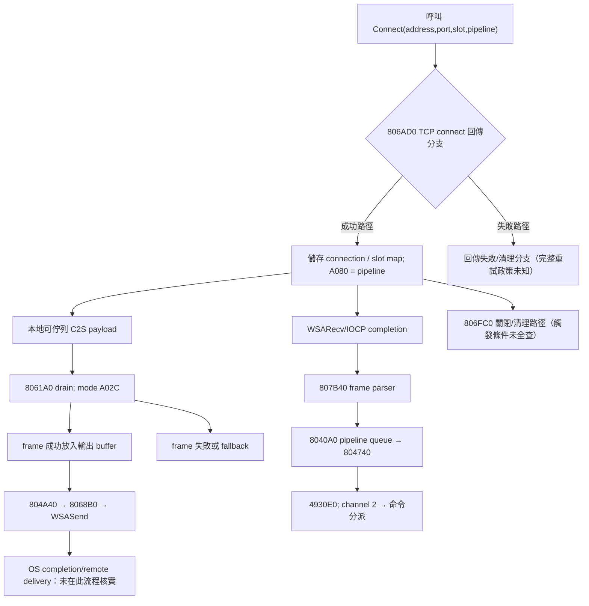

# T02 KR Client 網路邊界狀態模型（S00）

**模型目的：**區分可見的 Client API/內部狀態與尚未證實的 Server 協定時序。**不是**官方登入成功/切線 state machine；不得由圖表推出 Server 必須依特定先後送三條 TCP 連線。

## 已核對的有限條件分支

圖中 `C→D`、`C→K` 只表示可觀察的**功能路徑**，不是 Client「發送一定早於接收」的順序。OS connect success ≠ 官方登入成功。

## 四類不同的「狀態」

1. **Connection slot**：`806AD0` 第三個參數；network+0x18 map key。已知 slot 1→8415、slot0→8416、slot2→8414 的限定呼叫。
2. **Pipeline class**：第四參數寫 `conn+A080`；觀察三條已知呼叫均為 2，對應 CClient `4930E0` 的 channel==2 分支。
3. **Frame mode**：`conn+A02C`，0 使用 1A68，非零先嘗試 0BBB 並可 fallback。較早有限掃描見初始化寫入 2；**未驗證所有寫入者與切換時機**。
4. **Session/業務狀態**：登入驗證、選服、角色清單、選角、世界/場景；**不在 T02 規格自行下結論**。需 T03/T04/T05 的端到端研究。

## 需要真正閉合的狀態轉移

| 來源/目標 | 目前證據狀態 | 完成必要條件 |
|---|---|---|
| Connect → 可以收送框架訊息 | PARTIAL | 具體返回處理/非同步收送啟用點、第一個可交換消息 |
| Initial mode → 已選定 S2C frame 模式 | UNKNOWN | 收包階段/連線槽綁定/錯誤時回退的原生證據 |
| Login result → 選服/切線 | UNKNOWN | T03 0x13 回覆、endpoint/token/lease 與 4957C0 時序 |
| 角色清單 → 允許選角 | UNKNOWN | T03 request/response 與 UI 初始化前置 |
| Disconnect → retry/reconnect | UNKNOWN | 原版狀態處理和觸發；不靠 OS API 存在自行推論 |

參照 [S00 T02 來源盤點](T02-EVIDENCE-INVENTORY.md)、[連線契約](SPEC-NET-0002.md)、[分派契約](SPEC-NET-0003.md)。不含對外動態測試、Server 原始碼或可玩驗證。
